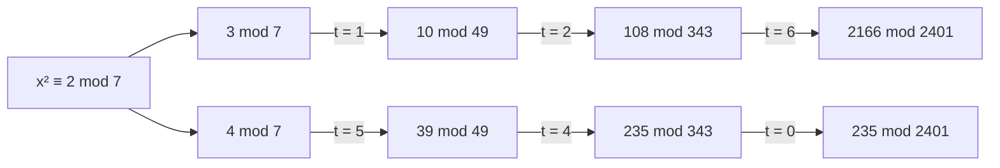

# The p-adic numbers: closeness by divisibility, and lifting a root one power at a time

[Syllabus](../../../SYLLABUS.md) → [Algebraic and analytic number theory](../README.md) → [Algebraic Numbers](../README.md#s06) → The p-adic numbers

---

## General Overview

Is there a square root of 2 on a clock with 7 hours? Yes: $`3^2 - 2 = 7`$, a multiple of 7. So 3 solves $`x^2 \equiv 2 \pmod 7`$ ([Congruence](../../02-Number%20theory/03-Clock%20Arithmetic/01-congruence-mod-n.md)).

Now ask the same on a clock with 49 hours. The answer is 10: $`10^2 - 2 = 98 = 2 \times 49`$. On a clock with 343 hours it is 108: $`108^2 - 2 = 11662 = 34 \times 343`$. Each answer keeps the last one and adds one more power of 7: $`10 = 3 + 1 \times 7`$ and $`108 = 10 + 2 \times 49`$.

These answers agree more and more. 10 and 3 differ by 7. 108 and 10 differ by 98, a multiple of 49. The next answer, 2166, differs from 108 by 2058, a multiple of 343. By ordinary size the gaps grow. Measured by how many 7s divide them, they shrink.

The **p-adic numbers** take that second measure seriously. Fix a prime $`p`$, here 7. Call a number small when a high power of $`p`$ divides it. With that distance the list 3, 10, 108, 2166 closes in on a limit, a genuine square root of 2 in the **7-adic numbers**. **Hensel's lemma** guarantees the lifting never gets stuck, and gives the rule for each next step.

**Two numbers are p-adically close when their difference is divisible by a high power of p; in that distance a root of a polynomial modulo p, where the derivative is not divisible by p, lifts to exactly one root modulo every power of p, and so to one exact p-adic root.**

**What kind of fact this is:** the p-adic size $`|x|_p`$, the p-adic numbers $`\mathbb{Q}_p`$ and the p-adic integers $`\mathbb{Z}_p`$ are definitions. The strong triangle inequality and Hensel's lemma are theorems, proved on this card in Why it works. Ostrowski's theorem, that the ordinary size and the p-adic sizes are the only sizes on the fractions, is stated with its key idea in a fold and sourced to Ostrowski (1916).

### The picture: one choice of digit at each level



Each arrow adds $`t`$ times the current power of 7. At every level there are 7 candidates for $`t`$, and exactly one works. Two roots mod 7 grow into two chains, the 7-adic $`\sqrt{2}`$ and $`-\sqrt{2}`$. A search of every residue up to $`7^6 = 117649`$ finds exactly these two roots at each level, and no others.

---

## The formula

Some words first. A **prime** $`p`$ is fixed for the whole discussion. From [Chebyshev's bounds](../01-Arithmetic%20Functions%20Again/08-chebyshev-bounds.md): $`v_p(n)`$ is the number of times $`p`$ divides the whole number $`n`$. For a fraction $`a/b`$ it is $`v_p(a) - v_p(b)`$. So $`v_7(98) = 2`$ and $`v_7(105) = 1`$.

New on this card: the **p-adic size** of a fraction.

```math
|x|_p = p^{-v_p(x)} \quad (x \ne 0), \qquad |0|_p = 0
```

**Read it aloud:** the p-adic size of x is one over p raised to the number of times p divides x. The p-adic distance between two numbers is the p-adic size of their difference, $`|x - y|_p`$.

So $`|98|_7 = 1/49`$ and $`|105|_7 = 1/7`$. A number not divisible by 7, such as 108, has size 1. Dividing by 7 makes a number bigger: $`|1/7|_7 = 7`$.

**Hensel's step.** Let $`f`$ be a polynomial with whole coefficients, here $`f(x) = x^2 - 2`$, with derivative $`f'(x) = 2x`$. Suppose $`a_k`$ solves $`f(a_k) \equiv 0 \pmod{p^k}`$. Write $`f(a_k) = p^k c_k`$. Then

```math
a_{k+1} = a_k + t_k\,p^k, \qquad t_k \equiv -c_k \cdot f'(a_k)^{-1} \pmod p
```

**Read it aloud:** the next root is the old root plus one new digit times p to the k, where the digit is minus the leftover c times the inverse of the slope, worked out on the clock of size p.

Here $`f'(a_k)^{-1}`$ means the number that multiplies $`f'(a_k)`$ to 1 on the clock of size $`p`$. It exists exactly when $`p`$ does not divide $`f'(a_k)`$.

**Ostrowski's list.** An **absolute value** on the fractions is a size $`|\cdot|`$ with $`|x| = 0`$ only for $`x = 0`$, $`|xy| = |x|\,|y|`$ and $`|x + y| \le |x| + |y|`$. Two are **equivalent** when one is a fixed positive power of the other; then they agree on which lists converge.

```math
\text{every nontrivial absolute value on } \mathbb{Q} \text{ is equivalent to exactly one of } \ |x|_\infty,\ |x|_2,\ |x|_3,\ |x|_5,\ |x|_7,\ \dots
```

**Read it aloud:** apart from the trivial size, which gives every nonzero number size 1, each way of measuring fractions is a power of the ordinary size or of the p-adic size for exactly one prime.

Completing the fractions under $`|x|_p`$ gives the **p-adic numbers** $`\mathbb{Q}_p`$, the same way completing them under the ordinary size gives the reals. The **p-adic integers** $`\mathbb{Z}_p`$ are those of size at most 1.

| Symbol | Plain meaning | In our example | Push it up and the answer… |
| --- | --- | --- | --- |
| $`p`$ | the fixed prime | 7 | a new digit has more choices |
| $`v_p(x)`$ | how many times $`p`$ divides $`x`$ | $`v_7(98) = 2`$ | the number gets p-adically smaller |
| $`\lvert x\rvert_p`$ | p-adic size, $`p^{-v_p(x)}`$ | $`\lvert 98\rvert_7 = 1/49`$ | — |
| $`\lvert x\rvert_\infty`$ | the ordinary size | $`\lvert 98\rvert_\infty = 98`$ | — |
| $`\mathbb{Q}_p`$ | the p-adic numbers: the fractions completed under $`\lvert x\rvert_p`$ | $`\mathbb{Q}_7`$ | — |
| $`\mathbb{Z}_p`$ | the p-adic integers: members of size at most 1 | contains 3, 108 and 11/6 | — |
| $`f(x)`$ | the polynomial whose root is wanted | $`x^2 - 2`$ | — |
| $`f'(x)`$ | its derivative, the slope | $`2x`$; $`f'(3) = 6`$ | — |
| $`a_k`$ | the root modulo $`p^k`$; $`k`$ counts the powers of $`p`$ matched so far | $`a_1 = 3,\ a_2 = 10,\ a_3 = 108`$ | one more correct digit per step |
| $`c_k`$ | the leftover, $`f(a_k)/p^k`$ | $`c_1 = 1,\ c_2 = 2,\ c_3 = 34`$ | the new digit changes |
| $`t_k`$ | the new digit, 0 to $`p - 1`$ | 1, 2, 6 | — |
| $`\alpha`$ | the exact root in $`\mathbb{Z}_p`$ | the 7-adic $`\sqrt{2}`$ with last digit 3 | — |

### When it holds

- **A root mod p to start from.** Hensel lifts a root; it cannot create one. The nonzero squares mod 7 are 1, 2 and 4, so $`x^2 \equiv 3 \pmod 7`$ has no root and $`\sqrt{3}`$ is not in $`\mathbb{Q}_7`$.
- **The slope not divisible by p.** If $`p`$ divides $`f'(a)`$, the step cannot divide by the slope. $`x^2 = 7`$ has the root 0 mod 7, slope 0, and no root at all mod 49.
- **p = 2 needs a stronger start.** For $`p = 2`$ the slope $`2a`$ of $`x^2 - c`$ is always even, so the plain lemma never applies. A sharper form of the lemma asks only $`|f(a)|_2 < |f'(a)|_2^2`$. For $`x^2 = 17`$, $`a = 1`$ passes it: $`|f(1)|_2 = 1/16`$, below $`|f'(1)|_2^2 = 1/4`$, so $`\sqrt{17}`$ is in $`\mathbb{Q}_2`$. What fails is the plain lift one power at a time: the roots mod 2, 4, 8, … number 1, 2, 4, 4, 4, 4, so they do not lift one to one.
- **The p-adic distance, not the ordinary one.** The gaps 7, 98, 2058 grow in ordinary size. Only their 7-adic sizes 1/7, 1/49, 1/343 shrink.
- **Whole-number coefficients.** The step uses that the part of $`f(a + t\,p^k)`$ beyond the slope term is $`t^2 p^{2k}`$ times a whole number. A coefficient with 7 in its denominator breaks this.

---

## Why it works

### Step 0: divisibility behaves like closeness

Two numbers that agree mod 49 also agree mod 7. Two numbers that agree mod 343 agree mod 49 and mod 7. So "agrees to a higher power of $`p`$" is a ladder, and climbing it feels like moving closer. The p-adic size turns that feeling into a distance. A root mod $`p^k`$ is then an approximation good to $`k`$ digits, and Hensel's step adds one digit.

### Step 1: the p-adic size is an absolute value, and a strong one

**It multiplies.** $`v_p(xy) = v_p(x) + v_p(y)`$, because the prime factors of a product are the factors of the two parts put together ([Why the factorisation is unique](../../02-Number%20theory/02-Greatest%20Common%20Divisor%20and%20Euclid%27s%20Algorithm/07-unique-factorisation.md)). Raise $`p`$ to minus both sides: $`|xy|_p = |x|_p\,|y|_p`$.

**The strong triangle inequality.** If $`p^m`$ divides both $`x`$ and $`y`$, it divides $`x + y`$. So $`v_p(x + y) \ge \min(v_p(x), v_p(y))`$, and

```math
|x + y|_p \le \max\big(|x|_p,\ |y|_p\big)
```

The larger of the two sizes is already a bound; no sum is needed. A distance with this property is an **ultrametric**, the same rule [The test spaces](../../17-Topology/02-Topological%20Spaces/09-standard-examples-and-counterexamples.md) meets on Cantor-set addresses. The p-adic size is its arithmetic example.

Two oddities follow. Every triangle has its two longest sides equal: for 3, 10 and 108 the sides are $`|7|_7 = 1/7`$, $`|98|_7 = 1/49`$ and $`|105|_7 = 1/7`$. And a list bunches together as soon as its steps shrink to zero, because the distance from step $`j`$ to any later step is at most the largest step in between. In $`\mathbb{Q}_p`$, which has no holes, such a list converges.

**Evidence, not proof:** the code tries all 359,400 pairs of nonzero whole numbers from $`-300`$ to 300 with nonzero sum. The 7-adic size breaks the strong rule 0 times. The ordinary size breaks it 180,000 times, for instance $`|1 + 1|_\infty = 2 > 1`$.

### Step 2: the step comes from expanding the polynomial

Try $`a_{k+1} = a_k + t\,p^k`$ for an unknown digit $`t`$. For $`f(x) = x^2 - 2`$, expanding gives exactly

```math
f(a_k + t\,p^k) = f(a_k) + t\,p^k f'(a_k) + t^2 p^{2k}
```

For any polynomial with whole coefficients the last term is $`t^2 p^{2k}`$ times a whole number. Since $`2k \ge k + 1`$, the last term vanishes mod $`p^{k+1}`$. What is left is

```math
f(a_k + t\,p^k) \equiv p^k\big(c_k + t\,f'(a_k)\big) \pmod{p^{k+1}}
```

This is 0 mod $`p^{k+1}`$ exactly when $`c_k + t\,f'(a_k) \equiv 0 \pmod p`$. If $`p`$ does not divide $`f'(a_k)`$, that linear equation has exactly one solution $`t`$ from 0 to $`p - 1`$: the formula's $`t_k`$.

The slope condition never has to be checked again. $`f'(a_{k+1}) \equiv f'(a_k) \pmod p`$, because the two points agree mod $`p`$. In the example the slope is 6 mod 7 at every step.

### Step 3: Hensel's lemma

**Hensel's lemma.** Let $`f`$ have whole coefficients, and let $`a`$ satisfy $`f(a) \equiv 0 \pmod p`$ with $`p`$ not dividing $`f'(a)`$. Then there is exactly one $`\alpha`$ in $`\mathbb{Z}_p`$ with $`f(\alpha) = 0`$ and $`\alpha \equiv a \pmod p`$.

The shape of the proof:

1. Step 2 builds $`a_1 = a, a_2, a_3, \dots`$ with $`f(a_k) \equiv 0 \pmod{p^k}`$.
2. Consecutive terms differ by $`t_k\,p^k`$, of size at most $`p^{-k}`$. By Step 1 the list converges.
3. $`\mathbb{Q}_p`$ is complete, so the limit $`\alpha`$ exists there ([Complete space](../../17-Topology/01-Metric%20Spaces/05-completeness-and-completion.md) builds a completion; it is not rebuilt here).
4. $`|f(a_k)|_p \le p^{-k}`$ shrinks to 0, so $`f(\alpha) = 0`$.
5. Any root $`\beta \equiv a`$ is, mod each $`p^k`$, a root that Step 2 says is unique. So $`\beta`$ agrees with $`a_k`$ to every power, and $`\beta = \alpha`$.

<details>
<summary>Detailed proof: convergence, the root, and uniqueness</summary>

**Convergence.** For $`j < m`$,

$`\displaystyle a_m - a_j = t_j p^j + t_{j+1} p^{j+1} + \cdots + t_{m-1} p^{m-1},`$

and every term is divisible by $`p^j`$. So $`|a_m - a_j|_p \le p^{-j}`$. That is the definition of a Cauchy list (terms that bunch together), and a Cauchy list converges in the complete space $`\mathbb{Q}_p`$. Call the limit $`\alpha`$. Each $`|a_k|_p \le 1`$, and the closed ball of radius 1 is closed, so $`\alpha`$ lies in $`\mathbb{Z}_p`$.

**The root.** A polynomial is continuous for $`|\cdot|_p`$, because sums and products of convergent lists converge. So $`f(\alpha) = \lim f(a_k)`$. Since $`p^k`$ divides $`f(a_k)`$, $`|f(a_k)|_p \le p^{-k}`$, and the limit is 0.

**Uniqueness.** Let $`\beta`$ in $`\mathbb{Z}_p`$ have $`f(\beta) = 0`$ and $`\beta \equiv a \pmod p`$. Every p-adic integer has a residue mod $`p^k`$, a whole number $`b_k`$ from 0 to $`p^k - 1`$ with $`|\beta - b_k|_p \le p^{-k}`$. Then $`f(b_k) \equiv 0 \pmod{p^k}`$. Suppose $`b_k \equiv a_k \pmod{p^k}`$. Then $`b_{k+1} = a_k + t\,p^k + (\text{multiple of } p^{k+1})`$ for some digit $`t`$, and Step 2 says only $`t = t_k`$ makes it a root. So $`b_{k+1} \equiv a_{k+1}`$. By induction $`|\beta - \alpha|_p \le p^{-k}`$ for every $`k`$, so $`\beta = \alpha`$.

</details>

**Where proof ends and evidence begins.** The lemma is proved above for every prime and every such polynomial. The code adds an exact count: a search of every residue mod $`7^k`$, for $`k = 1`$ to 6, finds exactly two roots of $`x^2 \equiv 2`$ at each level, the two lifts. That count is complete for those six levels and is evidence beyond them.

### Step 4: Newton's method is the same step, and it doubles the digits

[Newton's method](../../06-Calculus%20and%20analysis/03-What%20Derivatives%20Tell%20You/06-newtons-method.md) replaces $`x`$ by $`x - f(x)/f'(x)`$, and near a simple root it doubles the correct digits each round. Hensel's lemma is the same step, with closeness measured by $`|x|_p`$.

Run Newton's step on exact fractions from 3. After $`n`$ rounds, read the fraction mod $`7^{2^n}`$:

| Round $`n`$ | Newton fraction | Decimal | Mod $`7^{2^n}`$ | 7s dividing $`x^2 - 2`$ |
| --- | --- | --- | --- | --- |
| 0 | 3 | 3.000000 | 3 mod 7 | 1 |
| 1 | 11/6 | 1.833333 | 10 mod 49 | 2 |
| 2 | 193/132 | 1.462121 | 2166 mod 2401 | 4 |
| 3 | 72097/50952 | 1.414998 | 1802916 mod $`7^8`$ | 8 |
| 4 | 10390190017/7346972688 | 1.414214 | 9611769806236 mod $`7^{16}`$ | 16 |

One list of fractions converges to two different numbers. In ordinary size it closes in on 1.414214, the real $`\sqrt{2}`$. In 7-adic size it closes in on the 7-adic root that ends in 3, matching the one-digit-at-a-time lifts at 1, 2, 4, 8 and 16 digits.

The doubling is exact here: $`f(x - f(x)/f'(x)) = f(x)^2 / (4x^2)`$ for $`f(x) = x^2 - 2`$, and $`4x^2`$ has no factor 7, so the count of 7s doubles each round.

```
correct 7-adic digits after each step
one power at a time, round 2 |███                3
Newton,              round 2 |████               4
one power at a time, round 4 |█████              5
Newton,              round 4 |████████████████  16
```

A fraction such as 11/6 counts as a 7-adic integer, because 6 has an inverse mod every power of 7. Mod 49 it is 10: 6 times 10 leaves 11 on division by 49.

### Step 5: Ostrowski's list, and why there are no others

Ostrowski proved in 1916 that the sizes in the formula are all there is. The key idea splits the sizes in two. Either every whole number has size at most 1, and then the whole numbers of size below 1 are exactly the multiples of one prime $`p`$; or some whole number has size above 1, and then the size grows like a power of the ordinary size.

<details>
<summary>Key idea of the proof: two cases</summary>

Let $`|\cdot|`$ be a nontrivial absolute value on the fractions. It is fixed by its values on whole numbers, since $`|a/b| = |a|/|b|`$.

**Case 1: $`|n| \le 1`$ for every whole number $`n`$.** First, the size is an ultrametric: expand $`(x + y)^N`$ by the binomial theorem, bound each of the $`N + 1`$ terms by $`\max(|x|, |y|)^N`$, take $`N`$-th roots and let $`N`$ grow. Then the whole numbers with $`|n| < 1`$ are closed under adding and under multiplying by any whole number, and they contain no product $`ab`$ with $`|a| = |b| = 1`$. So they are the multiples of one prime $`p`$. Write $`n = p^{v} m`$ with $`p`$ not dividing $`m`$: then $`|n| = |p|^{v}`$. Put $`|p| = p^{-s}`$ with $`s > 0`$, and $`|n| = |n|_p^{\,s}`$.

**Case 2: some $`|n| > 1`$.** Write a large whole number $`m^k`$ in base $`n`$. It has about $`k\log m/\log n`$ digits, each of size at most a fixed constant. The triangle inequality bounds $`|m|^k`$ by a constant times $`k`$ times a power of $`|n|`$. Take $`k`$-th roots and let $`k`$ grow. Comparing in both directions gives $`|m|^{1/\log m} = |n|^{1/\log n}`$ for all $`m, n > 1`$. So $`|m| = m^{s}`$ for one fixed $`s`$ with $`0 < s \le 1`$: a power of the ordinary size.

Gouvêa (below) gives both cases in full.

</details>

With the list complete, one identity ties it together. For any nonzero fraction the product of all its sizes, the ordinary one and one for each prime, is 1. It follows from unique factorisation:

```math
|x|_\infty \cdot \prod_{p} |x|_p = 1
```

For $`11662 = 2 \times 7^3 \times 17`$: $`11662 \times \tfrac{1}{2} \times \tfrac{1}{343} \times \tfrac{1}{17} = 1`$. Each prime factor shrinks the p-adic size by exactly what it adds to the ordinary size.

---

## Worked numbers, by hand

| Step | Arithmetic | Value |
| --- | --- | --- |
| root mod 7 | $`3^2 - 2 = 7`$ | $`a_1 = 3`$ |
| leftover and slope | $`c_1 = 7/7 = 1`$; $`f'(3) = 6`$, inverse 6 mod 7 | $`c_1 = 1`$ |
| digit | $`t_1 \equiv -1 \times 6 \equiv 1 \pmod 7`$ | $`a_2 = 3 + 1 \times 7 = 10`$ |
| check mod 49 | $`10^2 - 2 = 98 = 2 \times 49`$ | $`c_2 = 2`$ |
| digit | $`f'(10) = 20 \equiv 6`$; $`t_2 \equiv -2 \times 6 \equiv 2`$ | $`a_3 = 10 + 2 \times 49 = 108`$ |
| check mod 343 | $`108^2 - 2 = 11662 = 34 \times 343`$ | $`c_3 = 34 \equiv 6`$ |
| digit | $`f'(108) = 216 \equiv 6`$; $`t_3 \equiv -6 \times 6 \equiv 6`$ | $`a_4 = 108 + 6 \times 343 = 2166`$ |
| sizes of the misses | $`\lvert f(3)\rvert_7,\ \lvert f(10)\rvert_7,\ \lvert f(108)\rvert_7`$ | 1/7, 1/49, 1/343 |
| digits so far, lowest first | $`3 + 1 \cdot 7 + 2 \cdot 49 + 6 \cdot 343`$ | **3, 1, 2, 6** |

The 7-adic square root of 2 that ends in 3 begins 3, 1, 2, 6, 1, 2, 1, 2, …, lowest digit first, and runs forever to the left. Its square agrees with 2 to as many powers of 7 as you keep.

### What breaks if you drop a piece

| Mistake | Comes out at | What went wrong |
| --- | --- | --- |
| Start from $`x^2 \equiv 3 \pmod 7`$ | no root mod 7 | 3 is not a square mod 7; Hensel needs a starting root |
| Lift a root where 7 divides the slope: $`x^2 = 7`$ from 0 | root 0 mod 7, none mod 49 | the step would divide by $`f'(0) = 0`$ |
| Use $`p = 2`$ with $`x^2 = 17`$, slope always even | roots mod 2, 4, …, 64 number 1, 2, 4, 4, 4, 4 | roots mod $`2^k`$ do not lift one to one, so the plain lemma does not apply; the sharper one still puts $`\sqrt{17}`$ in $`\mathbb{Q}_2`$ |
| Measure the lifts by ordinary size | gaps 7, 98, 2058 grow | only the 7-adic sizes 1/7, 1/49, 1/343 shrink |

The code prints every row.

---

## Code, from first principles, and it actually runs

The code takes three independent roads to the 7-adic $`\sqrt{2}`$. Road 1 lifts the root one power of 7 at a time with Hensel's step. Road 2 tries every residue mod $`7^k`$ for $`k`$ up to 6 and keeps the squares that leave 2. Road 3 runs Newton's step on exact fractions and reads each fraction mod $`7^{2^n}`$ and as a decimal. Asserts tie the roads together, then check the failures, the strong triangle rule, the product formula and the house example.

### Python

```python
# The p-adic numbers and Hensel's lemma -- the check behind the card.  Standard
# library only.  Root 2 in the 7-adics by three roads: road 1 lifts a root one
# power of 7 at a time (Hensel's step); road 2 tries every residue mod 7^k;
# road 3 runs Newton's step on exact fractions (fractions.Fraction) and reads
# each one mod 7^k and as a decimal.  Then the failures, distances and Ostrowski.
from fractions import Fraction as F

P = 7

def v(n, p=P):                       # p-adic valuation: how many times p divides n
    k = 0
    while n % p == 0:
        n //= p
        k += 1
    return k

def inv(a, m):                       # inverse of a mod m, extended Euclid
    r0, r1, s0, s1 = a % m, m, 1, 0
    while r1:
        q = r0 // r1
        r0, r1, s0, s1 = r1, r0 - q * r1, s1, s0 - q * s1
    assert r0 == 1
    return s0 % m

def size(n, p=P):                    # |n|_p written as a fraction
    return "0" if n == 0 else f"1/{p ** v(n, p)}" if v(n, p) else "1"

def roots(c, p, k):                  # road 2: every x mod p^k with x^2 = c mod p^k
    m = p ** k
    return [x for x in range(m) if (x * x - c) % m == 0]

def lift(a, steps, show=False):      # road 1: root mod 7 -> root mod 7^(steps+1)
    out, pk = [a], P
    for k in range(1, steps + 1):
        fa = a * a - 2
        c, d = fa // pk, inv(2 * a, P)
        t = (-c * d) % P
        if show:
            print(f"lift {k}: a = {a}, f(a) = {fa} = 7^{k} * {c}, c mod 7 = {c % P}, "
                  f"f'(a) = {2 * a} = {2 * a % P} mod 7, inverse {d}, t = {t}, new root {a + t * pk} mod {pk * P}")
        a += t * pk
        pk *= P
        out.append(a)
    return out

print("f(x) = x^2 - 2, p = 7; roots mod 7:", roots(2, P, 1), "; nonzero squares mod 7:", sorted({x * x % P for x in range(1, P)}))
up = lift(3, 15, show=False)
lift(3, 3, show=True)
down = lift(4, 7)
print("lifts of 3, one power at a time:", up[:8])
print("lifts of 4, one power at a time:", down)
digits = [(up[15] // P ** i) % P for i in range(16)]
print("7-adic digits of the root above 3, lowest first:", digits)
print("7-adic digits of the root above 4, lowest first:", [(down[7] // P ** i) % P for i in range(8)])
for k in range(1, 7):                # road 2 against road 1
    r = roots(2, P, k)
    print(f"mod 7^{k} = {P ** k}: {len(r)} roots by search, lift of 3 is {up[k - 1]}, lift of 4 is {down[k - 1]}")
    assert r == sorted([up[k - 1], down[k - 1]])
x, newton_v = F(3), []               # road 3: Newton's step on exact fractions
for n in range(5):
    m = P ** (2 ** n)
    res = x.numerator * inv(x.denominator, m) % m
    newton_v.append(v(x.numerator ** 2 - 2 * x.denominator ** 2))
    print(f"Newton x_{n} = {x} = {float(x):.6f}; mod 7^{2 ** n} it is {res}; v_7(x^2 - 2) = {newton_v[-1]}")
    assert res == up[2 ** n - 1] % m
    x = x - (x * x - 2) / (2 * x)
assert abs(float(x) ** 2 - 2) < 1e-12
assert newton_v == [1, 2, 4, 8, 16]
lin = [v(a * a - 2) for a in up[:5]]
print(f"correct 7-adic digits after each step: one power at a time {lin}; Newton {newton_v}")
assert up[:4] == [3, 10, 108, 2166]
assert all((a * a - 2) % P ** (k + 1) == 0 for k, a in enumerate(up))
print(f"7-adic distances: |10 - 3| = {size(7)}, |108 - 10| = {size(98)}, |108 - 3| = {size(105)}; "
      f"|108|_7 = {size(108)}, |1/7|_7 = {P ** (v(7) - v(1))}")
print(f"|f(a)|_7 for 3, 10, 108: {size(7)}, {size(98)}, {size(108 * 108 - 2)}; f(108) = {108 * 108 - 2}")
bad7 = bad_abs = pairs = 0
for x1 in range(-300, 301):          # the strong triangle rule on 600 x 600 pairs
    for y1 in range(-300, 301):
        if x1 and y1 and x1 + y1:
            pairs += 1
            bad7 += v(x1 + y1) < min(v(x1), v(y1))
            bad_abs += abs(x1 + y1) > max(abs(x1), abs(y1))
print(f"strong triangle rule broken, of {pairs:,} pairs: 7-adic {bad7}, ordinary size {bad_abs:,}")
assert bad7 == 0
assert bad_abs > 0
n = 108 * 108 - 2
places = [p for p in range(2, n + 1) if n % p == 0 and all(p % q for q in range(2, int(p ** 0.5) + 1))]
prod = F(n)
for p in places:
    prod *= F(1, p ** v(n, p))
print(f"product formula for {n}: |n| = {n}, primes {places}, p-adic sizes "
      f"{', '.join(size(n, p) for p in places)}, product {prod}")
assert prod == 1
print("mistake 1, no root mod 7 to start: x^2 = 3 mod 7 has roots", roots(3, P, 1))
print("mistake 2, f'(a) divisible by 7: x^2 = 7 has roots", roots(7, P, 1), "mod 7 and", roots(7, P, 2), "mod 49")
c17 = [len(roots(17, 2, k)) for k in range(1, 7)]
print("mistake 3, p = 2 and x^2 = 17: roots mod 2, 4, ..., 64 number", c17)
f1, d1 = v(1 - 17, 2), v(2 * 1, 2)   # the sharper test at a = 1: |f(1)|_2 < |f'(1)|_2^2
print(f"sharper test for x^2 = 17 at a = 1: |f(1)|_2 = 1/{2 ** f1}, |f'(1)|_2^2 = 1/{2 ** (2 * d1)}, "
      f"passes: {'yes' if f1 > 2 * d1 else 'no'}")
gaps = [up[k + 1] - up[k] for k in range(3)]
print(f"mistake 4, ordinary size: gaps {gaps} grow; 7-adic sizes {', '.join(size(g) for g in gaps)} shrink")
assert roots(3, P, 1) == [] and roots(7, P, 2) == []
assert c17 == [1, 2, 4, 4, 4, 4]
assert f1 > 2 * d1                   # yet the sharper lemma puts sqrt 17 in Q_2
h = [3]
for k in range(1, 3):                # house example: x^2 + 5 = 0 has a root mod 7 that lifts
    c = (h[-1] ** 2 + 5) // P ** k
    h.append(h[-1] + (-c * inv(2 * h[-1], P)) % P * P ** k)
print(f"house example, x^2 = -5: lifts of 3 are {h}; a^2 + 5 = {[a * a + 5 for a in h]}")
assert h[-1] in roots(-5, P, 3) and h[1] in roots(-5, P, 2)
print("ALL CHECKS PASS")
```

**Ran 2026-11-15 on macOS, Python 3.14.10, standard library only. All checks passed. Output, pasted from the run:**

```
f(x) = x^2 - 2, p = 7; roots mod 7: [3, 4] ; nonzero squares mod 7: [1, 2, 4]
lift 1: a = 3, f(a) = 7 = 7^1 * 1, c mod 7 = 1, f'(a) = 6 = 6 mod 7, inverse 6, t = 1, new root 10 mod 49
lift 2: a = 10, f(a) = 98 = 7^2 * 2, c mod 7 = 2, f'(a) = 20 = 6 mod 7, inverse 6, t = 2, new root 108 mod 343
lift 3: a = 108, f(a) = 11662 = 7^3 * 34, c mod 7 = 6, f'(a) = 216 = 6 mod 7, inverse 6, t = 6, new root 2166 mod 2401
lifts of 3, one power at a time: [3, 10, 108, 2166, 4567, 38181, 155830, 1802916]
lifts of 4, one power at a time: [4, 39, 235, 235, 12240, 79468, 667713, 3961885]
7-adic digits of the root above 3, lowest first: [3, 1, 2, 6, 1, 2, 1, 2, 4, 6, 6, 2, 1, 1, 0, 2]
7-adic digits of the root above 4, lowest first: [4, 5, 4, 0, 5, 4, 5, 4]
mod 7^1 = 7: 2 roots by search, lift of 3 is 3, lift of 4 is 4
mod 7^2 = 49: 2 roots by search, lift of 3 is 10, lift of 4 is 39
mod 7^3 = 343: 2 roots by search, lift of 3 is 108, lift of 4 is 235
mod 7^4 = 2401: 2 roots by search, lift of 3 is 2166, lift of 4 is 235
mod 7^5 = 16807: 2 roots by search, lift of 3 is 4567, lift of 4 is 12240
mod 7^6 = 117649: 2 roots by search, lift of 3 is 38181, lift of 4 is 79468
Newton x_0 = 3 = 3.000000; mod 7^1 it is 3; v_7(x^2 - 2) = 1
Newton x_1 = 11/6 = 1.833333; mod 7^2 it is 10; v_7(x^2 - 2) = 2
Newton x_2 = 193/132 = 1.462121; mod 7^4 it is 2166; v_7(x^2 - 2) = 4
Newton x_3 = 72097/50952 = 1.414998; mod 7^8 it is 1802916; v_7(x^2 - 2) = 8
Newton x_4 = 10390190017/7346972688 = 1.414214; mod 7^16 it is 9611769806236; v_7(x^2 - 2) = 16
correct 7-adic digits after each step: one power at a time [1, 2, 3, 4, 5]; Newton [1, 2, 4, 8, 16]
7-adic distances: |10 - 3| = 1/7, |108 - 10| = 1/49, |108 - 3| = 1/7; |108|_7 = 1, |1/7|_7 = 7
|f(a)|_7 for 3, 10, 108: 1/7, 1/49, 1/343; f(108) = 11662
strong triangle rule broken, of 359,400 pairs: 7-adic 0, ordinary size 180,000
product formula for 11662: |n| = 11662, primes [2, 7, 17], p-adic sizes 1/2, 1/343, 1/17, product 1
mistake 1, no root mod 7 to start: x^2 = 3 mod 7 has roots []
mistake 2, f'(a) divisible by 7: x^2 = 7 has roots [0] mod 7 and [] mod 49
mistake 3, p = 2 and x^2 = 17: roots mod 2, 4, ..., 64 number [1, 2, 4, 4, 4, 4]
sharper test for x^2 = 17 at a = 1: |f(1)|_2 = 1/16, |f'(1)|_2^2 = 1/4, passes: yes
mistake 4, ordinary size: gaps [7, 98, 2058] grow; 7-adic sizes 1/7, 1/49, 1/343 shrink
house example, x^2 = -5: lifts of 3 are [3, 17, 311]; a^2 + 5 = [14, 294, 96726]
ALL CHECKS PASS
```

### Rust

Same numbers, same labels, built with `rustc --edition 2021 -O`.

```rust
// The p-adic numbers and Hensel's lemma -- the same check as the Python, in
// Rust.  No crates.  Root 2 in the 7-adics by three roads: road 1 lifts a root
// one power of 7 at a time (Hensel's step); road 2 tries every residue mod 7^k;
// road 3 runs Newton's step on exact fractions (i128 pairs, checked) and reads
// each one mod 7^k and as a decimal.  Then the failures, distances and Ostrowski.
const P: i128 = 7;

fn v(mut n: i128, p: i128) -> u32 {  // p-adic valuation: how many times p divides n
    let mut k = 0;
    while n % p == 0 { n /= p; k += 1; }
    k
}

fn md(a: i128, m: i128) -> i128 { ((a % m) + m) % m }

fn inv(a: i128, m: i128) -> i128 {   // inverse of a mod m, extended Euclid
    let (mut r0, mut r1, mut s0, mut s1) = (md(a, m), m, 1i128, 0i128);
    while r1 != 0 {
        let q = r0.div_euclid(r1);
        (r0, r1, s0, s1) = (r1, r0 - q * r1, s1, s0 - q * s1);
    }
    assert!(r0 == 1);
    md(s0, m)
}

fn size(n: i128, p: i128) -> String { // |n|_p written as a fraction
    if n == 0 { "0".to_string() } else if v(n, p) > 0 { format!("1/{}", p.pow(v(n, p))) } else { "1".to_string() }
}

fn roots(c: i128, p: i128, k: u32) -> Vec<i128> { // road 2: every x mod p^k with x^2 = c
    let m = p.pow(k);
    (0..m).filter(|&x| md(x * x - c, m) == 0).collect()
}

fn lift(mut a: i128, steps: u32, show: bool) -> Vec<i128> { // road 1: root mod 7 -> mod 7^(steps+1)
    let (mut out, mut pk) = (vec![a], P);
    for k in 1..=steps {
        let fa = a.checked_mul(a).unwrap() - 2;
        let (c, d) = (fa.div_euclid(pk), inv(2 * a, P));
        let t = md(-c * d, P);
        if show {
            println!("lift {}: a = {}, f(a) = {} = 7^{} * {}, c mod 7 = {}, f'(a) = {} = {} mod 7, inverse {}, t = {}, new root {} mod {}",
                k, a, fa, k, c, md(c, P), 2 * a, md(2 * a, P), d, t, a + t * pk, pk * P);
        }
        a += t * pk;
        pk *= P;
        out.push(a);
    }
    out
}

fn gcd(a: i128, b: i128) -> i128 { if b == 0 { a.abs() } else { gcd(b, a % b) } }

fn list(xs: &[i128]) -> String {
    format!("[{}]", xs.iter().map(|x| x.to_string()).collect::<Vec<_>>().join(", "))
}

fn commas(n: i128) -> String {
    let s = n.to_string();
    let mut out = String::new();
    for (i, ch) in s.chars().enumerate() {
        if i > 0 && (s.len() - i) % 3 == 0 { out.push(','); }
        out.push(ch);
    }
    out
}

fn main() {
    let mut sq: Vec<i128> = (1..P).map(|x| x * x % P).collect();
    sq.sort();
    sq.dedup();
    println!("f(x) = x^2 - 2, p = 7; roots mod 7: {} ; nonzero squares mod 7: {}", list(&roots(2, P, 1)), list(&sq));
    let up = lift(3, 15, false);
    lift(3, 3, true);
    let down = lift(4, 7, false);
    println!("lifts of 3, one power at a time: {}", list(&up[..8]));
    println!("lifts of 4, one power at a time: {}", list(&down));
    let digits: Vec<i128> = (0..16).map(|i| (up[15] / P.pow(i)) % P).collect();
    println!("7-adic digits of the root above 3, lowest first: {}", list(&digits));
    let dd: Vec<i128> = (0..8).map(|i| (down[7] / P.pow(i)) % P).collect();
    println!("7-adic digits of the root above 4, lowest first: {}", list(&dd));
    for k in 1..7u32 {                // road 2 against road 1
        let r = roots(2, P, k);
        let (a, b) = (up[k as usize - 1], down[k as usize - 1]);
        println!("mod 7^{} = {}: {} roots by search, lift of 3 is {}, lift of 4 is {}", k, P.pow(k), r.len(), a, b);
        assert!(r == vec![a.min(b), a.max(b)]);
    }
    let (mut xn, mut xd) = (3i128, 1i128); // road 3: Newton's step on exact fractions
    let mut newton_v = vec![];
    for n in 0..5u32 {
        let m = P.pow(1 << n);
        let res = md(md(xn, m) * inv(xd, m), m);
        newton_v.push(v(xn.checked_mul(xn).unwrap() - 2 * xd.checked_mul(xd).unwrap(), P));
        let shown = if xd == 1 { xn.to_string() } else { format!("{}/{}", xn, xd) };
        println!("Newton x_{} = {} = {:.6}; mod 7^{} it is {}; v_7(x^2 - 2) = {}", n, shown, xn as f64 / xd as f64, 1 << n, res, newton_v[n as usize]);
        assert!(res == md(up[(1 << n) - 1], m));
        let (nn, nd) = (xn.checked_mul(xn).unwrap() + 2 * xd.checked_mul(xd).unwrap(), 2 * xn.checked_mul(xd).unwrap());
        let g = gcd(nn, nd);
        xn = nn / g;
        xd = nd / g;
    }
    let xf = xn as f64 / xd as f64;
    assert!((xf * xf - 2.0).abs() < 1e-12);
    assert!(newton_v == vec![1, 2, 4, 8, 16]);
    let lin: Vec<i128> = up[..5].iter().map(|&a| v(a * a - 2, P) as i128).collect();
    let nv: Vec<i128> = newton_v.iter().map(|&x| x as i128).collect();
    println!("correct 7-adic digits after each step: one power at a time {}; Newton {}", list(&lin), list(&nv));
    assert!(up[..4] == [3, 10, 108, 2166]);
    assert!(up.iter().enumerate().all(|(k, &a)| md(a * a - 2, P.pow(k as u32 + 1)) == 0));
    println!("7-adic distances: |10 - 3| = {}, |108 - 10| = {}, |108 - 3| = {}; |108|_7 = {}, |1/7|_7 = {}",
             size(7, P), size(98, P), size(105, P), size(108, P), P.pow(v(7, P) - v(1, P)));
    println!("|f(a)|_7 for 3, 10, 108: {}, {}, {}; f(108) = {}", size(7, P), size(98, P), size(108 * 108 - 2, P), 108 * 108 - 2);
    let (mut bad7, mut bad_abs, mut pairs) = (0i128, 0i128, 0i128);
    for x1 in -300i128..301 {         // the strong triangle rule on 600 x 600 pairs
        for y1 in -300i128..301 {
            if x1 != 0 && y1 != 0 && x1 + y1 != 0 {
                pairs += 1;
                bad7 += (v(x1 + y1, P) < v(x1, P).min(v(y1, P))) as i128;
                bad_abs += ((x1 + y1).abs() > x1.abs().max(y1.abs())) as i128;
            }
        }
    }
    println!("strong triangle rule broken, of {} pairs: 7-adic {}, ordinary size {}", commas(pairs), bad7, commas(bad_abs));
    assert!(bad7 == 0);
    assert!(bad_abs > 0);
    let n = 108i128 * 108 - 2;
    let places: Vec<i128> = (2..=n).filter(|&p| n % p == 0 && (2..p).take_while(|q| q * q <= p).all(|q| p % q != 0)).collect();
    let (mut pn, mut pd) = (n, 1i128);
    for &p in &places { pd *= p.pow(v(n, p)); }
    let g = gcd(pn, pd);
    pn /= g;
    pd /= g;
    let sizes: Vec<String> = places.iter().map(|&p| size(n, p)).collect();
    let prod = if pd == 1 { pn.to_string() } else { format!("{}/{}", pn, pd) };
    println!("product formula for {}: |n| = {}, primes {}, p-adic sizes {}, product {}", n, n, list(&places), sizes.join(", "), prod);
    assert!(pn == 1 && pd == 1);
    println!("mistake 1, no root mod 7 to start: x^2 = 3 mod 7 has roots {}", list(&roots(3, P, 1)));
    println!("mistake 2, f'(a) divisible by 7: x^2 = 7 has roots {} mod 7 and {} mod 49", list(&roots(7, P, 1)), list(&roots(7, P, 2)));
    let c17: Vec<i128> = (1..7).map(|k| roots(17, 2, k).len() as i128).collect();
    println!("mistake 3, p = 2 and x^2 = 17: roots mod 2, 4, ..., 64 number {}", list(&c17));
    let (f1, d1) = (v(1 - 17, 2), v(2 * 1, 2)); // the sharper test at a = 1: |f(1)|_2 < |f'(1)|_2^2
    println!("sharper test for x^2 = 17 at a = 1: |f(1)|_2 = 1/{}, |f'(1)|_2^2 = 1/{}, passes: {}",
             2i128.pow(f1), 2i128.pow(2 * d1), if f1 > 2 * d1 { "yes" } else { "no" });
    let gaps: Vec<i128> = (0..3).map(|k| up[k + 1] - up[k]).collect();
    let gs: Vec<String> = gaps.iter().map(|&g| size(g, P)).collect();
    println!("mistake 4, ordinary size: gaps {} grow; 7-adic sizes {} shrink", list(&gaps), gs.join(", "));
    assert!(roots(3, P, 1).is_empty() && roots(7, P, 2).is_empty());
    assert!(c17 == vec![1, 2, 4, 4, 4, 4]);
    assert!(f1 > 2 * d1);             // yet the sharper lemma puts sqrt 17 in Q_2
    let mut h = vec![3i128];
    for k in 1..3u32 {                // house example: x^2 + 5 = 0 has a root mod 7 that lifts
        let a = *h.last().unwrap();
        let c = (a * a + 5) / P.pow(k);
        h.push(a + md(-c * inv(2 * a, P), P) * P.pow(k));
    }
    let hv: Vec<i128> = h.iter().map(|&a| a * a + 5).collect();
    println!("house example, x^2 = -5: lifts of 3 are {}; a^2 + 5 = {}", list(&h), list(&hv));
    assert!(roots(-5, P, 3).contains(&h[2]) && roots(-5, P, 2).contains(&h[1]));
    println!("ALL CHECKS PASS");
}
```

**Ran 2026-11-15 on macOS, rustc 1.98.1, no crates. All checks passed. Output, pasted from the run:**

```
f(x) = x^2 - 2, p = 7; roots mod 7: [3, 4] ; nonzero squares mod 7: [1, 2, 4]
lift 1: a = 3, f(a) = 7 = 7^1 * 1, c mod 7 = 1, f'(a) = 6 = 6 mod 7, inverse 6, t = 1, new root 10 mod 49
lift 2: a = 10, f(a) = 98 = 7^2 * 2, c mod 7 = 2, f'(a) = 20 = 6 mod 7, inverse 6, t = 2, new root 108 mod 343
lift 3: a = 108, f(a) = 11662 = 7^3 * 34, c mod 7 = 6, f'(a) = 216 = 6 mod 7, inverse 6, t = 6, new root 2166 mod 2401
lifts of 3, one power at a time: [3, 10, 108, 2166, 4567, 38181, 155830, 1802916]
lifts of 4, one power at a time: [4, 39, 235, 235, 12240, 79468, 667713, 3961885]
7-adic digits of the root above 3, lowest first: [3, 1, 2, 6, 1, 2, 1, 2, 4, 6, 6, 2, 1, 1, 0, 2]
7-adic digits of the root above 4, lowest first: [4, 5, 4, 0, 5, 4, 5, 4]
mod 7^1 = 7: 2 roots by search, lift of 3 is 3, lift of 4 is 4
mod 7^2 = 49: 2 roots by search, lift of 3 is 10, lift of 4 is 39
mod 7^3 = 343: 2 roots by search, lift of 3 is 108, lift of 4 is 235
mod 7^4 = 2401: 2 roots by search, lift of 3 is 2166, lift of 4 is 235
mod 7^5 = 16807: 2 roots by search, lift of 3 is 4567, lift of 4 is 12240
mod 7^6 = 117649: 2 roots by search, lift of 3 is 38181, lift of 4 is 79468
Newton x_0 = 3 = 3.000000; mod 7^1 it is 3; v_7(x^2 - 2) = 1
Newton x_1 = 11/6 = 1.833333; mod 7^2 it is 10; v_7(x^2 - 2) = 2
Newton x_2 = 193/132 = 1.462121; mod 7^4 it is 2166; v_7(x^2 - 2) = 4
Newton x_3 = 72097/50952 = 1.414998; mod 7^8 it is 1802916; v_7(x^2 - 2) = 8
Newton x_4 = 10390190017/7346972688 = 1.414214; mod 7^16 it is 9611769806236; v_7(x^2 - 2) = 16
correct 7-adic digits after each step: one power at a time [1, 2, 3, 4, 5]; Newton [1, 2, 4, 8, 16]
7-adic distances: |10 - 3| = 1/7, |108 - 10| = 1/49, |108 - 3| = 1/7; |108|_7 = 1, |1/7|_7 = 7
|f(a)|_7 for 3, 10, 108: 1/7, 1/49, 1/343; f(108) = 11662
strong triangle rule broken, of 359,400 pairs: 7-adic 0, ordinary size 180,000
product formula for 11662: |n| = 11662, primes [2, 7, 17], p-adic sizes 1/2, 1/343, 1/17, product 1
mistake 1, no root mod 7 to start: x^2 = 3 mod 7 has roots []
mistake 2, f'(a) divisible by 7: x^2 = 7 has roots [0] mod 7 and [] mod 49
mistake 3, p = 2 and x^2 = 17: roots mod 2, 4, ..., 64 number [1, 2, 4, 4, 4, 4]
sharper test for x^2 = 17 at a = 1: |f(1)|_2 = 1/16, |f'(1)|_2^2 = 1/4, passes: yes
mistake 4, ordinary size: gaps [7, 98, 2058] grow; 7-adic sizes 1/7, 1/49, 1/343 shrink
house example, x^2 = -5: lifts of 3 are [3, 17, 311]; a^2 + 5 = [14, 294, 96726]
ALL CHECKS PASS
```

The two outputs match line for line.

### Lean

Lean proves Hensel's lemma for every prime and every polynomial with whole coefficients, the strong triangle inequality, and the worked numbers.

- Suppose $`f`$ has whole coefficients, $`a`$ is a whole number, and $`p`$ divides $`f(a)`$ but not the slope $`f'(a)`$. Then exactly one $`\alpha`$ in $`\mathbb{Z}_p`$ has $`f(\alpha) = 0`$ and $`\alpha \equiv a \pmod p`$.
- Take the same $`f`$, $`a`$ and $`p`$, and any $`k \ge 1`$. Then exactly one root of $`f`$ mod $`p^k`$ agrees with $`a`$ mod $`p`$.
- Take any two fractions $`x`$ and $`y`$. Then $`|x + y|_p \le \max(|x|_p, |y|_p)`$.
- The lifts 3, 10, 108, 2166 of the 7-adic square root of 2, and their digits 1, 2, 6, are checked.
- Mod 7, 49 and 343, $`x^2 \equiv 2`$ has exactly two roots. The other chain's roots, 39 mod 49 and 235 mod 2401, are checked.
- What breaks is checked too: $`x^2 \equiv 3 \pmod 7`$ has no root, and $`x^2 \equiv 7 \pmod{49}`$ has none.
- Take $`p = 2`$ and $`x^2 = 17`$. Then the roots mod 2, 4, 8, 16, 32 and 64 number 1, 2, 4, 4, 4, 4.
- Newton's step from 3 gives 11/6, then 193/132, and 11/6 is 10 mod 49.
- The product formula holds for 11662. The house example's lifts 3, 17 and 311 of $`\sqrt{-5}`$ are checked.

Ostrowski's theorem, the root counts mod $`7^4`$ to $`7^6`$ and the later Newton rounds are left to the Python and Rust checks.

```lean
-- The p-adic numbers: a root of a whole-number polynomial modulo a prime p, where the slope is not divisible by p, lifts to exactly one root modulo every power of p and to exactly one p-adic root, and the p-adic size obeys the strong triangle inequality.
import Mathlib.NumberTheory.Padics.PadicIntegers
import Mathlib.NumberTheory.Padics.PadicNorm
import Mathlib.Algebra.Polynomial.Derivative
import Mathlib.Algebra.Polynomial.AlgebraMap
import Mathlib.Data.ZMod.Basic
import Mathlib.NumberTheory.Padics.Hensel
import Mathlib.NumberTheory.Padics.RingHoms
import Mathlib.Algebra.Polynomial.Identities
import Mathlib.Data.ZMod.Units

open Polynomial

/-- A ring map commutes with evaluating a whole-number polynomial. -/
theorem padic_helper_map_aeval {A B : Type*} [CommRing A] [CommRing B] (φ : A →+* B)
    (f : ℤ[X]) (x : A) : φ (aeval x f) = aeval (φ x) f :=
  (Polynomial.aeval_algHom_apply φ.toIntAlgHom x f).symm

#print axioms padic_helper_map_aeval

/-- Evaluating a whole-number polynomial at a whole number, then casting. -/
theorem padic_helper_aeval_int {A : Type*} [CommRing A] (g : ℤ[X]) (x : ℤ) :
    aeval (x : A) g = ((g.eval x : ℤ) : A) := by
  rw [← eq_intCast (Int.castRingHom A), ← padic_helper_map_aeval, coe_aeval_eq_eval, eq_intCast]

#print axioms padic_helper_aeval_int

/-- A residue mod `p^k` whose reduction mod `p` is nonzero is a unit. -/
theorem padic_helper_isUnit (p : ℕ) [Fact p.Prime] (k : ℕ) (hk : k ≠ 0) (u : ZMod (p ^ k))
    (h : ZMod.castHom (dvd_pow_self p hk) (ZMod p) u ≠ 0) : IsUnit u := by
  have : NeZero (p ^ k) := ⟨pow_ne_zero _ (Fact.out : p.Prime).ne_zero⟩
  rw [ZMod.castHom_apply, ZMod.cast_eq_val, Ne, ZMod.natCast_eq_zero_iff] at h
  rw [← ZMod.natCast_zmod_val u, ZMod.isUnit_iff_coprime,
    Nat.coprime_pow_right_iff (Nat.pos_of_ne_zero hk)]
  exact ((Nat.Prime.coprime_iff_not_dvd Fact.out).2 h).symm

#print axioms padic_helper_isUnit

/-- Two roots mod `p^k` that agree mod `p`, where the slope is a unit, are equal. -/
theorem padic_helper_unique (p : ℕ) [Fact p.Prime] (f : ℤ[X]) (a : ℤ)
    (hslope : ¬ (p : ℤ) ∣ f.derivative.eval a) (k : ℕ) (hk : k ≠ 0) (b c : ZMod (p ^ k))
    (hb : aeval b f = 0) (hba : ZMod.castHom (dvd_pow_self p hk) (ZMod p) b = (a : ZMod p))
    (hc : aeval c f = 0) (hca : ZMod.castHom (dvd_pow_self p hk) (ZMod p) c = (a : ZMod p)) :
    c = b := by
  have hev : ∀ (h : ℤ[X]) (x : ZMod (p ^ k)),
      aeval x h = (h.map (Int.castRingHom (ZMod (p ^ k)))).eval x := by
    intro h x; rw [aeval_def, eval_map, algebraMap_int_eq]
  obtain ⟨e, he⟩ := binomExpansion (f.map (Int.castRingHom (ZMod (p ^ k)))) b (c - b)
  rw [add_sub_cancel, ← hev, hc, ← hev, hb, derivative_map, ← hev] at he
  have hu : IsUnit (aeval b (derivative f) + e * (c - b)) := by
    apply padic_helper_isUnit p k hk
    rw [map_add, map_mul, map_sub, hca, hba, sub_self, mul_zero, add_zero,
      padic_helper_map_aeval, hba, padic_helper_aeval_int, Ne, ZMod.intCast_zmod_eq_zero_iff_dvd]
    exact hslope
  have h0 : (c - b) * (aeval b (derivative f) + e * (c - b)) = 0 := by linear_combination -he
  rw [hu.mul_left_eq_zero] at h0
  exact sub_eq_zero.1 h0

#print axioms padic_helper_unique

/-- Hensel's lemma: let `f` have whole coefficients, and let the whole number `a` satisfy
`f(a) ≡ 0 (mod p)` with `p` not dividing the slope `f'(a)`. Then there is exactly one
p-adic integer `α` with `f(α) = 0` and `α ≡ a (mod p)`. -/
theorem hensel_unique_padic_root (p : ℕ) [Fact p.Prime] (f : ℤ[X]) (a : ℤ)
    (hroot : (p : ℤ) ∣ f.eval a) (hslope : ¬ (p : ℤ) ∣ f.derivative.eval a) :
    ∃! α : ℤ_[p], aeval α f = 0 ∧ (p : ℤ_[p]) ∣ α - (a : ℤ_[p]) := by
  have h1 : ‖aeval (a : ℤ_[p]) f‖ < 1 := by
    rw [padic_helper_aeval_int]; exact (PadicInt.norm_int_lt_one_iff_dvd _).2 hroot
  have h2 : ‖aeval (a : ℤ_[p]) (derivative f)‖ = 1 := by
    rw [padic_helper_aeval_int]
    exact le_antisymm (PadicInt.norm_le_one _)
      (not_lt.1 (fun h => hslope ((PadicInt.norm_int_lt_one_iff_dvd _).1 h)))
  obtain ⟨z, hz, hza, -, huniq⟩ :=
    hensels_lemma (F := f) (a := (a : ℤ_[p])) (by rw [h2, one_pow]; exact h1)
  rw [h2] at hza huniq
  refine ⟨z, ⟨hz, (PadicInt.norm_lt_one_iff_dvd _).1 hza⟩, ?_⟩
  rintro y ⟨hy, hya⟩
  exact huniq y hy ((PadicInt.norm_lt_one_iff_dvd _).2 hya)

/-- The lift one power at a time: under the same hypotheses, for every power `p^k` with
`k ≥ 1` there is exactly one root of `f` modulo `p^k` that reduces to `a` modulo `p`. -/
theorem hensel_unique_root_mod_prime_power (p : ℕ) [Fact p.Prime] (f : ℤ[X]) (a : ℤ)
    (hroot : (p : ℤ) ∣ f.eval a) (hslope : ¬ (p : ℤ) ∣ f.derivative.eval a)
    (k : ℕ) (hk : k ≠ 0) :
    ∃! b : ZMod (p ^ k), aeval b f = 0 ∧
      ZMod.castHom (dvd_pow_self p hk) (ZMod p) b = (a : ZMod p) := by
  obtain ⟨α, ⟨hα, hαa⟩, -⟩ := hensel_unique_padic_root p f a hroot hslope
  have hb : aeval (PadicInt.toZModPow k α) f = 0 := by
    rw [← padic_helper_map_aeval, hα, map_zero]
  have hba : ZMod.castHom (dvd_pow_self p hk) (ZMod p) (PadicInt.toZModPow k α) = (a : ZMod p) := by
    obtain ⟨c, hc⟩ := hαa
    have hα' : α = a + p * c := by rw [← hc]; ring
    rw [hα', map_add, map_add, map_mul, map_mul, map_intCast, map_intCast, map_natCast,
      map_natCast, ZMod.natCast_self, zero_mul, add_zero]
  refine ⟨PadicInt.toZModPow k α, ⟨hb, hba⟩, ?_⟩
  rintro c ⟨hc, hca⟩
  exact padic_helper_unique p f a hslope k hk _ c hb hba hc hca

/-- The strong triangle inequality: for fractions `x` and `y`, the p-adic size of `x + y`
is at most the larger of the p-adic sizes of `x` and `y`. -/
theorem padicNorm_strong_triangle (p : ℕ) [Fact p.Prime] (x y : ℚ) :
    padicNorm p (x + y) ≤ max (padicNorm p x) (padicNorm p y) := by
  exact padicNorm.nonarchimedean

-- Worked example: the lifts 3, 10, 108, 2166 of the 7-adic square root of 2.
example : (3 : ℤ) ^ 2 - 2 = 7 := by norm_num
example : (10 : ℤ) ^ 2 - 2 = 2 * 49 ∧ (10 : ℤ) = 3 + 1 * 7 := by norm_num
example : (108 : ℤ) ^ 2 - 2 = 11662 ∧ (11662 : ℤ) = 34 * 343 ∧ (108 : ℤ) = 10 + 2 * 49 := by norm_num
example : (2166 : ℤ) = 108 + 6 * 343 ∧ ((2166 : ℤ) ^ 2 - 2) % 2401 = 0 := by norm_num
-- The digits t: 1, 2, 6 from t ≡ -c · 6⁻¹ (mod 7), where 6 is its own inverse mod 7.
example : (6 * 6) % 7 = 1 ∧ (-1 * 6 : ℤ) % 7 = 1 ∧ (-2 * 6 : ℤ) % 7 = 2 ∧ (-34 * 6 : ℤ) % 7 = 6 := by
  norm_num
-- The lifts of 4: 39 mod 49 and 235 mod 343 and mod 2401.
example : ((39 : ℤ) ^ 2 - 2) % 49 = 0 ∧ ((235 : ℤ) ^ 2 - 2) % 2401 = 0 := by norm_num
-- Exactly two roots of x² ≡ 2 mod 7, 49 and 343.
example : (Finset.univ.filter (fun x : ZMod 7 => x ^ 2 = 2)).card = 2 := by decide
example : (Finset.univ.filter (fun x : ZMod 49 => x ^ 2 = 2)).card = 2 := by decide
example : (Finset.univ.filter (fun x : ZMod 343 => x ^ 2 = 2)).card = 2 := by decide
-- What breaks: no root of x² ≡ 3 mod 7; x² ≡ 7 has the root 0 mod 7 and none mod 49.
example : ∀ x : ZMod 7, x ^ 2 ≠ 3 := by decide
example : ∀ x : ZMod 49, x ^ 2 ≠ 7 := by decide
-- What breaks at p = 2: roots of x² ≡ 17 mod 2, 4, 8, 16, 32, 64 number 1, 2, 4, 4, 4, 4.
example : (Finset.univ.filter (fun x : ZMod 2 => x ^ 2 = 17)).card = 1 := by decide
example : (Finset.univ.filter (fun x : ZMod 4 => x ^ 2 = 17)).card = 2 := by decide
example : (Finset.univ.filter (fun x : ZMod 8 => x ^ 2 = 17)).card = 4 := by decide
example : (Finset.univ.filter (fun x : ZMod 16 => x ^ 2 = 17)).card = 4 := by decide
example : (Finset.univ.filter (fun x : ZMod 32 => x ^ 2 = 17)).card = 4 := by decide
example : (Finset.univ.filter (fun x : ZMod 64 => x ^ 2 = 17)).card = 4 := by decide
-- Newton's step on exact fractions from 3: 11/6, then 193/132; and 11/6 is 10 mod 49.
example : (3 : ℚ) - (3 ^ 2 - 2) / (2 * 3) = 11 / 6 := by norm_num
example : (11 / 6 : ℚ) - ((11 / 6) ^ 2 - 2) / (2 * (11 / 6)) = 193 / 132 := by norm_num
example : (6 * 10) % 49 = 11 := by norm_num
-- Product formula for 11662 = 2 · 7³ · 17: 11662 · (1/2) · (1/343) · (1/17) = 1.
example : (11662 : ℚ) = 2 * 7 ^ 3 * 17 ∧ (11662 : ℚ) * (1 / 2) * (1 / 343) * (1 / 17) = 1 := by norm_num
-- House example: x² = -5 has the root 3 mod 7, lifting to 17 mod 49 and 311 mod 343.
example : (3 : ℤ) ^ 2 + 5 = 2 * 7 ∧ (17 : ℤ) ^ 2 + 5 = 6 * 49 ∧ (311 : ℤ) ^ 2 + 5 = 282 * 343 := by norm_num

#print axioms hensel_unique_padic_root
#print axioms hensel_unique_root_mod_prime_power
#print axioms padicNorm_strong_triangle
```

**Checked 2026-11-15 on macOS, Lean 4.36.0-rc2, Mathlib v4.36.0-rc2. Every proof is complete and uses only Lean's standard axioms. Output, pasted from the run:**

```
'padic_helper_map_aeval' depends on axioms: [propext, Classical.choice, Quot.sound]
'padic_helper_aeval_int' depends on axioms: [propext, Classical.choice, Quot.sound]
'padic_helper_isUnit' depends on axioms: [propext, Classical.choice, Quot.sound]
'padic_helper_unique' depends on axioms: [propext, Classical.choice, Quot.sound]
'hensel_unique_padic_root' depends on axioms: [propext, Classical.choice, Quot.sound]
'hensel_unique_root_mod_prime_power' depends on axioms: [propext, Classical.choice, Quot.sound]
'padicNorm_strong_triangle' depends on axioms: [propext, Classical.choice, Quot.sound]
```

> [!TIP]
> **Try changing**
> Guess first, then run it. The asserts pin the card's numbers, so expect some changes to stop the program.
> - **The other root.** In the Python Newton loop, change `F(3)` to `F(4)`. Guess first: which root does it chase? It prints `x_0 = 4`, then the assert stops it: 4 starts the other chain, 4, 39, 235, whose digits are 4, 5, 4, 0, ….
> - **A start that fails.** In mistake 3, change `roots(17, 2, k)` to `roots(5, 2, k)`. Guess first. The counts become 1, 2, 0, 0, 0, 0: 5 is odd, so it has a root mod 2, but it is not 1 mod 8, so nothing survives mod 8. The assert on the counts stops it.
> - **A different prime.** In mistake 1, change `roots(3, P, 1)` to `roots(3, 11, 1)`. Guess first. It prints `[5, 6]`: $`\sqrt{3}`$ is missing from $`\mathbb{Q}_7`$ but present in $`\mathbb{Q}_{11}`$. The run still passes, because the assert checks the 7-adic case.

---

## The usual mistake

> [!warning]
> **Lifting where the slope is divisible by p.** Hensel's step divides by $`f'(a)`$ on the clock of size $`p`$. When $`p`$ divides $`f'(a)`$ there is nothing to divide by, and the lift can fail outright. $`x^2 = 7`$ has the root 0 mod 7, with slope 0, and no root at all mod 49: every square divisible by 7 is divisible by 49. Check the slope before you lift.
>
> - **Reading p-adic small as ordinary small.** 2058 is far from 0 on the number line, yet $`|2058|_7 = 1/343`$. The lifts 3, 10, 108, 2166 converge only 7-adically.
> - **Treating 11/6 as outside the 7-adic integers.** Its denominator 6 is not divisible by 7, so $`|11/6|_7 = 1`$. Mod 49 it is 10, the lift itself.
> - **Writing the digits to the right.** A 7-adic integer is $`3 + 1 \cdot 7 + 2 \cdot 49 + 6 \cdot 343 + \cdots`$: its digits run forever to the left, lowest first, not after a decimal point.
> - **Expecting one lift at p = 2.** For $`x^2 = 17`$ the number of roots mod 2, 4, 8, 16 is 1, 2, 4, 4. The slope is even, so the plain lemma promises neither existence nor uniqueness.

---

## Where you meet it in real life

- **Computer algebra.** Programs that factor polynomials with whole coefficients first factor modulo a small prime, which is fast, then lift the factors to a high power of that prime with Hensel's step. The lifted factors reveal the true factors.
- **Fast inverses in hardware and big-number code.** To divide by an odd number $`N`$ modulo $`2^{64}`$, libraries need $`N^{-1}`$. Newton's step in the 2-adics doubles the correct bits each round, so a handful of rounds reaches a full machine word. Montgomery multiplication, used inside public-key cryptography, starts this way.
- **Square roots mod prime powers.** Solving $`x^2 \equiv c \pmod{p^k}`$ starts mod $`p`$ and lifts, as the 3, 10, 108 example does.
- **Splitting of primes, the house example.** In $`\mathbb{Z}[\sqrt{-5}]`$, where 6 factors two ways, $`x^2 = -5`$ has the root 3 mod 7, and it lifts to 17 mod 49 and 311 mod 343 ($`3^2 + 5 = 14`$, $`17^2 + 5 = 294`$, $`311^2 + 5 = 96726`$, divisible by 7, 49 and 343). So $`\sqrt{-5}`$ lives in $`\mathbb{Q}_7`$, the p-adic sign that 7 splits into two prime ideals; [Splitting and ramification](08-splitting-and-ramification.md) explains why.
- **Local-global questions.** The Hasse-Minkowski theorem ([Hasse-Minkowski](../09-Local%20Fields%20and%20Class%20Field%20Theory/01-hasse-minkowski-and-the-hilbert-symbol.md)) says a quadratic equation in several variables has a rational solution exactly when it has one in the reals and in every $`\mathbb{Q}_p`$. Ostrowski's list is what "every" ranges over.

> **Say it back**
> The p-adic size of a number is one over $`p`$ to the number of times $`p`$ divides it, so multiples of high powers of $`p`$ count as small. That size obeys the strong triangle inequality, and completing the fractions under it gives $`\mathbb{Q}_p`$. Hensel's lemma lifts a root mod $`p`$ with slope not divisible by $`p`$ to exactly one root mod every power, and so to one p-adic root: 3, 10, 108, 2166 for $`\sqrt{2}`$ in the 7-adics. The step is Newton's, and in Newton's form it doubles the digits. Ostrowski's theorem says the ordinary size and the p-adic sizes are the only sizes the fractions have.

---

## What this builds on

- [Algebraic integers](01-algebraic-integers-and-number-fields.md): the field with $`\sqrt{-5}`$ whose primes the p-adic view examines one at a time.
- [Congruence](../../02-Number%20theory/03-Clock%20Arithmetic/01-congruence-mod-n.md): roots mod $`p^k`$ are congruences, and the inverse of the slope is an inverse mod $`p`$.
- [The real numbers have no gaps](../../01-Foundations/02-The%20Number%20Line/04-real-numbers-no-gaps.md): the reals fill the holes of the fractions in the ordinary size; $`\mathbb{Q}_p`$ fills them in the p-adic size.
- [Complete space](../../17-Topology/01-Metric%20Spaces/05-completeness-and-completion.md): builds the completion of any metric space, which turns the fractions into $`\mathbb{Q}_p`$.
- [Newton's method](../../06-Calculus%20and%20analysis/03-What%20Derivatives%20Tell%20You/06-newtons-method.md): the step $`x - f(x)/f'(x)`$ and its doubling of digits, reused here with p-adic closeness.
- [The test spaces](../../17-Topology/02-Topological%20Spaces/09-standard-examples-and-counterexamples.md): defines an ultrametric, of which $`|x|_p`$ is the arithmetic example.
- [Chebyshev's bounds](../01-Arithmetic%20Functions%20Again/08-chebyshev-bounds.md): introduces $`v_p(n)`$, the count behind $`|x|_p`$.

See also [Splitting and ramification](08-splitting-and-ramification.md), earlier on this shelf: it reads how a prime splits in a number field, which the p-adic roots of the field's polynomial detect, as 3, 17, 311 does for 7 in $`\mathbb{Z}[\sqrt{-5}]`$.

## Where this goes next

- [Rational points on a cubic](../07-Diophantine%20and%20Modular/05-elliptic-curves-over-q-and-mordell-weil.md): its Tate–Shafarevich group collects "fake" solutions that pass every local test, one in the reals and one in every $`\mathbb{Q}_p`$, yet give no rational point.
- [Curves for keys](../../22-Algebraic%20geometry/04-Elliptic%20Curves/09-elliptic-curve-cryptography-and-schoof.md): Smart's attack lifts an elliptic curve with exactly $`p`$ points mod $`p`$, and its points, to the p-adic numbers, where a p-adic logarithm reads off the secret key.
- [Hasse-Minkowski](../09-Local%20Fields%20and%20Class%20Field%20Theory/01-hasse-minkowski-and-the-hilbert-symbol.md): a quadratic equation has a rational solution exactly when it has one in every completion.
- [Local fields](../09-Local%20Fields%20and%20Class%20Field%20Theory/03-local-fields-and-the-different.md): completing a number field at one prime, and the different that measures ramification.
- [Adeles and ideles](../09-Local%20Fields%20and%20Class%20Field%20Theory/06-adeles-and-ideles.md): every completion of Q at once, and class field theory in a single group.
- [The Hilbert-Smith conjecture](../../25-Frontier/04-Geometry%20and%20Combinatorics/14-hilbert-smith-conjecture.md): can the p-adic integers act faithfully on a manifold.

The lemma lifts a root once it exists mod $`p`$, but it leaves open which $`p`$ give a starting root, a question about primes that the splitting laws answer.

---

## Sources

Verified 2026-11-15: every link below resolves to the publisher's page.

- Gouvêa, Fernando Q. *p-adic Numbers: An Introduction*, 3rd ed. Springer, 2020. [doi:10.1007/978-3-030-47295-5](https://doi.org/10.1007/978-3-030-47295-5). The p-adic size, Ostrowski's theorem with both cases proved, and Hensel's lemma with worked square roots.
- Koblitz, Neal. *p-adic Numbers, p-adic Analysis, and Zeta-Functions*, 2nd ed. Springer, 1984. [doi:10.1007/978-1-4612-1112-9](https://doi.org/10.1007/978-1-4612-1112-9). Completion of the fractions, digit expansions of p-adic integers, and Hensel's lemma as Newton's method.
- Ostrowski, Alexander. "Über einige Lösungen der Funktionalgleichung φ(x)·φ(y) = φ(xy)." *Acta Mathematica* 41 (1916), 271–284. [doi:10.1007/BF02422947](https://doi.org/10.1007/BF02422947). The original proof that the ordinary and p-adic sizes are the only absolute values on the fractions.
- Neukirch, Jürgen. *Algebraic Number Theory*. Springer, 1999. [doi:10.1007/978-3-662-03983-0](https://doi.org/10.1007/978-3-662-03983-0). p-adic numbers and Hensel's lemma inside algebraic number theory, and the link to splitting of primes.
- Cassels, J. W. S. *Local Fields*. Cambridge University Press, 1986. [doi:10.1017/CBO9781139171885](https://doi.org/10.1017/CBO9781139171885). The strong triangle inequality, the product formula, and Hasse-Minkowski.
