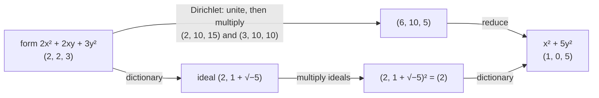

# Composition and genus: multiplying binary quadratic forms is multiplying ideal classes

[Syllabus](../../../SYLLABUS.md) → [Algebraic and analytic number theory](../README.md) → [Algebraic Numbers](../README.md#s06) → Composition and genus

---

## General Overview

The primes 3 and 7 are not of the form $`x^2 + 5y^2`$. Both are values of a second form, $`2x^2 + 2xy + 3y^2`$: put in $`(0, 1)`$ to get 3 and $`(1, 1)`$ to get 7. Their product is not: $`21 = 1^2 + 5 \times 2^2`$ is back on the first form.

That is no accident. There is a polynomial identity: a value of the second form times a value of the second form is always a value of the first. Gauss called this **composition**: a rule that multiplies two forms of the same discriminant and gives a third. Under it, the classes of forms (families of forms that turn into each other by a change of variables) make a group.

This card shows that the group is one already met. Each form matches an ideal of $`\mathbb{Z}[\sqrt{-5}]`$, the ring where $`6 = 2 \times 3 = (1 + \sqrt{-5})(1 - \sqrt{-5})`$ factors two ways. The form $`2x^2 + 2xy + 3y^2`$ matches the ideal $`(2, 1 + \sqrt{-5})`$, whose square is $`(2)`$. So composing that form with itself gives $`x^2 + 5y^2`$, the form of the principal ideals.

Composition also sorts primes. Below 10,000 the 303 primes of the form $`x^2 + 5y^2`$, such as $`29 = 3^2 + 5 \times 2^2`$, are 5 and primes leaving remainder 1 or 9 on division by 20; the 313 of the second form are 2 and primes leaving 3 or 7. Gauss's **genus theory**, which sorts forms by the remainders their values leave, proves this, and says when such a rule must fail. At discriminant −56, 23 and 79 leave the same remainder on division by 56, yet $`23 = 3^2 + 14 \times 1^2`$ while $`79 = 2 \times 6^2 + 7 \times 1^2`$.

**Composing forms is multiplying ideals, because a form's values are the norms in its ideal and norms multiply; the genera are the cosets of the squares, and a congruence picks the form exactly when each genus holds one class.**

**What kind of fact this is:** theorems. The product identities, the match of composition with ideal multiplication, and the fact that every square lies in the principal genus are proved on this card. That the form-to-ideal match is one to one, which product of the genus characters gives the Kronecker symbol, that the characters fix the remainders, and Gauss's count of genera are stated with a named source (Cox, sections 2, 3 and 7). The rule for $`x^2 + 5y^2`$ modulo 20 is proved here. That no congruence decides $`x^2 + 14y^2`$ is class field theory, stated with its source (Cox, chapter 2). The counts below 10,000 and the list of 65 numbers below 2,000 are exact computations, and they are evidence, not proof, beyond their range.

### The picture: two roads to the same square



One road stays with forms: unite, compose, reduce. The other goes through ideals: translate, multiply, translate back. The code takes both for every pair of classes at −20, −56 and −84, and they agree.

---

## The formula

A **binary quadratic form** is $`f(x, y) = ax^2 + bxy + cy^2`$ with whole $`a, b, c`$, written $`(a, b, c)`$. Its **discriminant** is $`D = b^2 - 4ac`$ ([Binary quadratic forms](../../02-Number%20theory/08-Quadratic%20Forms%20and%20Approximation/01-binary-quadratic-forms.md)). Here $`D < 0`$ and $`a > 0`$, so every value except $`f(0, 0)`$ is positive. Two forms are **equivalent** when a renaming of $`x, y`$ with determinant 1 turns one into the other, and each family holds one **reduced form** ([Reduced forms](../../02-Number%20theory/08-Quadratic%20Forms%20and%20Approximation/02-reduced-forms-and-class-numbers.md)). The families are the **classes**; $`h(D)`$ counts them.

The **dictionary** sends a form to a lattice (all whole-number combinations of two numbers) in the field $`\mathbb{Q}(\sqrt{D})`$, and back:

```math
(a, b, c) \;\longmapsto\; \mathfrak{a} = \Big[\, a,\ \tfrac{-b + \sqrt{D}}{2} \,\Big], \qquad f_{\mathfrak{a}}(x, y) = \frac{N(\alpha x - \beta y)}{N(\mathfrak{a})} \quad \text{for } \mathfrak{a} = [\alpha, \beta]
```

**Read it aloud:** the form $`(a, b, c)`$ goes to the lattice spanned by $`a`$ and $`(-b + \sqrt{D})/2`$; an ideal with basis $`\alpha, \beta`$ comes back as the norm of $`\alpha x - \beta y`$, divided by the norm of the ideal.

Composition is then ideal multiplication. Dirichlet found how to do it with forms alone. Write $`s = (b_1 + b_2)/2`$. When $`\gcd(a_1, a_2, s) = 1`$:

```math
B \equiv b_1 \ (\mathrm{mod}\ 2a_1), \quad B \equiv b_2 \ (\mathrm{mod}\ 2a_2), \quad B^2 \equiv D \ (\mathrm{mod}\ 4a_1a_2); \qquad (a_1, b_1, c_1) \circ (a_2, b_2, c_2) = \Big(a_1a_2,\ B,\ \frac{B^2 - D}{4a_1a_2}\Big)
```

**Read it aloud:** find one middle number $`B`$ that fits both forms and the discriminant; the composite has first number $`a_1 a_2`$, middle number $`B`$, and its last number fixed by the discriminant.

Genus theory counts the cosets of the squares:

```math
\#\{\text{genera}\} = \frac{h(D)}{\lvert \mathrm{Cl}(D)^2 \rvert} = 2^{\mu - 1}
```

**Read it aloud:** the number of genera is the class number divided by the number of classes that are squares, and it equals 2 to the power $`\mu - 1`$.

| Symbol | Plain meaning | In our example | Push it up and the answer… |
| --- | --- | --- | --- |
| $`(a, b, c)`$, $`f(x, y)`$ | a form, by its three coefficients; its value at whole $`x, y`$ | $`(2, 2, 3)`$; $`f(1, 1) = 7`$ | — |
| $`x, y, z, w`$; $`X, Y`$ | whole inputs to two forms; the inputs to the composite | $`(0, 1)`$ and $`(1, 1)`$; in the identity at −20 they give inputs $`(-1, 2)`$ to $`x^2 + 5y^2`$ | — |
| $`D`$ | the discriminant $`b^2 - 4ac`$ | −20; also −56 | more classes, more genera |
| $`h(D)`$, $`\mathrm{Cl}(D)`$ | the number of classes; the group they form under composition | 2 at −20, 4 at −56 | — |
| $`\mathcal{O}`$, $`\tau`$ | the ring $`\mathbb{Z}[\tau]`$ of discriminant $`D`$: $`\tau = \sqrt{D}/2`$, or $`(1 + \sqrt{D})/2`$ when $`D`$ leaves remainder 1 on division by 4 | $`\mathbb{Z}[\sqrt{-5}] = \mathcal{O}_K`$ | — |
| $`\mathfrak{a} = [\alpha, \beta]`$, $`N(\mathfrak{a})`$ | a lattice with basis $`\alpha, \beta`$, here an ideal; its norm, the count of remainders | $`[2, -1 + \sqrt{-5}] = (2, 1 + \sqrt{-5})`$, norm 2 | — |
| $`s`$ | half the sum of the two middle numbers | $`(2 + 2)/2 = 2`$ | — |
| $`B`$, $`C`$ | the shared middle number of the **united forms** $`(a_1, B, a_2C)`$ and $`(a_2, B, a_1C)`$, and the last number of the composite | $`B = 10`$, $`C = 5`$ | — |
| $`H`$ | the remainders modulo $`\lvert D \rvert`$ taken by the principal form's values that share no factor with $`D`$ | $`\{1, 9\}`$ at −20 | — |
| $`\mu`$ | the number of genus characters (sign tests, below); for a field discriminant, the number of primes dividing $`D`$ | 2 at −20 (2 and 5) | doubles the genera |
| $`q`$, $`(m/q)`$ | an odd prime dividing $`D`$; the Legendre symbol, +1 when $`m`$ is a square modulo $`q`$, −1 when not | $`q = 5`$; $`(2/5) = -1`$ | — |
| $`p`$, $`n`$ | a prime being sorted; $`n`$ in $`D = -4n`$ | 29, 79; $`n = 5`$ | — |

The letters $`\mathrm{Cl}(D)`$, $`H`$ and $`\mu`$ are this card's; this $`\mu`$ is a count, not the Möbius function. This $`\tau`$ is a number in the ring and takes no argument; it is not the divisor count $`\tau(n)`$. $`\mathrm{Cl}(D)`$ is the form version of the shelf's $`\mathrm{Cl}(K)`$ ([Class groups](05-class-groups-and-the-minkowski-bound.md)), and at −20 the two are the same group.

### When it holds

- **The same discriminant.** Composition joins two forms of one $`D`$. Forms of −20 and −56 have no composite.
- **Primitive forms.** $`a, b, c`$ share no factor. $`(2, 0, 10)`$ has discriminant −80 but is twice $`(1, 0, 5)`$; it matches no invertible ideal and sits outside the group.
- **The coprime condition $`\gcd(a_1, a_2, s) = 1`$.** Without it there may be no $`B`$. For $`(2, 2, 3)`$ with itself the gcd is 2; multiplying first numbers gives $`(4, 2, c)`$ with $`c = 1.5`$, not a form. Replace one form by an equivalent one first.
- **Orientation.** $`(3, 2, 5)`$ and $`(3, -2, 5)`$ take the same values, yet at −56 they are different classes, each the inverse of the other. The dictionary needs the basis in a fixed order: $`\beta/\alpha`$ has positive imaginary part.
- **A congruence decides the form only with one class per genus.** At −20 each genus has one class. At −56 each genus has two, and 23 and 79 show that no remainder modulo 56 separates them.

---

## Why it works

### Step 0: norms multiply

Every value of a form is the norm of a number in its ideal, divided by the ideal's norm. A number of $`\mathfrak{a}`$ times a number of $`\mathfrak{b}`$ lies in $`\mathfrak{a}\mathfrak{b}`$, and the norm of a product is the product of the norms. So a value of $`f_{\mathfrak{a}}`$ times a value of $`f_{\mathfrak{b}}`$ is a value of $`f_{\mathfrak{a}\mathfrak{b}}`$. That is composition. The rest of the card makes this exact, then reads off what remainders the values can leave.

### Step 1: from a form to an ideal and back

Take $`\alpha = a`$ and $`\beta = (-b + \sqrt{D})/2`$. Then $`\alpha x - \beta y`$ has real part $`ax + by/2`$ and imaginary part $`-y\sqrt{\lvert D \rvert}/2`$. Its norm (its absolute value squared) is

```math
N(ax - \beta y) = \Big(ax + \frac{by}{2}\Big)^2 + \frac{\lvert D \rvert\, y^2}{4} = a^2x^2 + abxy + \frac{b^2 - D}{4}\,y^2 = a\,(ax^2 + bxy + cy^2)
```

The lattice $`[a, \beta]`$ is an ideal of norm $`a`$ (Cox, section 7). So $`N(\alpha x - \beta y)/N(\mathfrak{a})`$ gives back $`f`$ exactly.

For $`(2, 2, 3)`$ at $`D = -20`$: $`\sqrt{-20} = 2\sqrt{-5}`$, so $`\beta = -1 + \sqrt{-5}`$. The ideal $`[2, -1 + \sqrt{-5}]`$ is $`(2, 1 + \sqrt{-5})`$, the prime ideal over 2 from [Splitting and ramification](08-splitting-and-ramification.md). And $`N(2x + y - y\sqrt{-5}) = (2x + y)^2 + 5y^2 = 2(2x^2 + 2xy + 3y^2)`$.

Rescaling an ideal by a number $`\lambda`$ multiplies $`N(\alpha x - \beta y)`$ and $`N(\mathfrak{a})`$ alike by $`N(\lambda)`$, so the form is unchanged. A determinant-1 change of basis renames $`x, y`$. So ideals of one class give forms of one class. That the match is one to one on classes is stated with its source (Cox, section 7).

### Step 2: the composite, from ideals

Multiply the two ideals and read off the form of the product; by Step 0 it takes every product of values. [Splitting and ramification](08-splitting-and-ramification.md) shows that $`(2, 1 + \sqrt{-5})^2 = (2)`$. That is a principal ideal, so its form is $`x^2 + 5y^2`$.

### Step 3: the composite, from forms alone

Dirichlet's idea: rewrite both forms so that they share a middle number $`B`$, with last numbers $`a_2C`$ and $`a_1C`$. These are the **united forms**. For them an exact identity holds:

```math
(a_1x^2 + Bxy + a_2Cy^2)(a_2z^2 + Bzw + a_1Cw^2) = a_1a_2X^2 + BXY + CY^2, \quad X = xz - Cyw,\ \ Y = a_1xw + a_2yz + Byw
```

A $`B`$ exists when $`\gcd(a_1, a_2, s) = 1`$. The three congruences then have one solution modulo $`2a_1a_2`$, by the Chinese remainder theorem plus a square root of $`D`$ (Cox, section 3). Shifting $`x`$ by a multiple of $`y`$ moves the middle number of a form by multiples of twice its first number, so both forms can be moved to middle number $`B`$.

<details>
<summary>Detailed proof: the united-forms identity</summary>

Multiply each form by four times its first number and complete the square. With $`u_1 = 2a_1x + By`$ and $`u_2 = 2a_2z + Bw`$:

$`\displaystyle 4a_1(a_1x^2 + Bxy + a_2Cy^2) = u_1^2 - Dy^2, \qquad 4a_2(a_2z^2 + Bzw + a_1Cw^2) = u_2^2 - Dw^2`$

Here $`B^2 - 4a_1a_2C = D`$. The product of two numbers of the shape $`u^2 - Dv^2`$ has the same shape (the norm of a product, written out):

$`\displaystyle (u_1^2 - Dy^2)(u_2^2 - Dw^2) = (u_1u_2 + Dyw)^2 - D(u_1w + u_2y)^2`$

Halve the two brackets. Using $`D = B^2 - 4a_1a_2C`$:

$`\displaystyle \tfrac12(u_1u_2 + Dyw) = 2a_1a_2xz + a_1Bxw + a_2Byz + B^2yw - 2a_1a_2Cyw = 2a_1a_2X + BY`$

$`\displaystyle \tfrac12(u_1w + u_2y) = a_1xw + a_2yz + Byw = Y`$

So the product of the two forms, times $`16a_1a_2`$, equals $`4\big((2a_1a_2X + BY)^2 - DY^2\big)`$. That is $`16a_1a_2(a_1a_2X^2 + BXY + CY^2)`$. Divide by $`16a_1a_2`$.

</details>

### Step 4: the two roads agree

The united form $`(a_1, B, a_2C)`$ matches the ideal $`[a_1, \beta]`$ and $`(a_2, B, a_1C)`$ matches $`[a_2, \beta]`$, with the same $`\beta = (-B + \sqrt{D})/2`$. Their product is $`[a_1a_2, \beta]`$, the ideal of $`(a_1a_2, B, C)`$. So Dirichlet's rule is ideal multiplication, and composition makes the classes of forms a group isomorphic to the ideal class group.

<details>
<summary>Detailed proof: the product of the two ideals</summary>

The number $`\beta = (-B + \sqrt{D})/2`$ is a root of $`t^2 + Bt + (B^2 - D)/4`$, and $`(B^2 - D)/4 = a_1a_2C`$. So $`\beta^2 = -B\beta - a_1a_2C`$.

The product $`[a_1, \beta][a_2, \beta]`$ is spanned by $`a_1a_2`$, $`a_1\beta`$, $`a_2\beta`$ and $`\beta^2 = -B\beta - a_1a_2C`$. Modulo $`a_1a_2`$ these give the multiples of $`\beta`$ by $`a_1`$, $`a_2`$ and $`B`$. So the product is $`[a_1a_2, g\beta]`$ with $`g = \gcd(a_1, a_2, B)`$.

Now $`g = 1`$. Since $`g`$ divides $`a_1`$ and $`B \equiv b_1`$ modulo $`2a_1`$, also $`b_1 \equiv B`$ modulo $`2g`$; the same holds for $`b_2`$. So $`b_1 + b_2 \equiv 2B`$ modulo $`2g`$, and $`s = (b_1 + b_2)/2 \equiv B`$ modulo $`g`$. Then $`g`$ divides $`a_1`$, $`a_2`$ and $`s`$, whose gcd is 1.

</details>

### Step 5: every form leaves fixed remainders

Complete the square once more: $`4a\,f(x, y) = (2ax + by)^2 - Dy^2`$. Let $`q`$ be an odd prime dividing $`D`$. Modulo $`q`$ the right side is a square. So for a value $`m`$ not divisible by $`q`$, the Legendre symbol $`(m/q)`$ equals $`(a/q)`$, the same for every value of the form. (If $`q`$ divides $`a`$, use $`4c\,f = (bx + 2cy)^2 - Dx^2`$ instead; $`q`$ cannot divide both $`a`$ and $`c`$ in a primitive form.)

Such a sign is a **genus character**. There is one for each odd prime dividing $`D`$, plus up to two tests modulo 4 or 8 when $`D`$ is even. Their count is $`\mu`$. A **genus** is a set of classes that get the same signs. The signs are tied together: the product of some of them (all of them at −20, as shown below) is the Kronecker symbol $`(D/m)`$, which is +1 on every value prime to $`D`$, since $`D`$ is a square modulo $`4m`$ ([Binary quadratic forms](../../02-Number%20theory/08-Quadratic%20Forms%20and%20Approximation/01-binary-quadratic-forms.md)). So only $`\mu - 1`$ signs are free, and there are at most $`2^{\mu - 1}`$ genera.

Two facts here are stated with their source, not proved (Cox, sections 2 and 3): which product of the signs gives $`(D/m)`$, and that the signs fix the remainders. Two classes share a genus exactly when their values leave the same remainders modulo $`\lvert D \rvert`$. That is how the code finds the genera by brute force.

At $`D = -20`$, $`q = 5`$. For $`x^2 + 5y^2`$, $`(1/5) = +1`$. For $`2x^2 + 2xy + 3y^2`$, $`(2/5) = -1`$, since the squares modulo 5 are 1 and 4. The mod-4 test is tied to it: for an odd prime $`p \neq 5`$, $`(-20/p) = (-1/p)(5/p) = (-1/p)(p/5)`$ by [Quadratic reciprocity](../03-Characters%20and%20L-functions/07-quadratic-reciprocity-via-gauss-sums.md). So $`\mu = 2`$ and there are at most 2 genera, with remainders $`\{1, 9\}`$ and $`\{3, 7\}`$ modulo 20.

### Step 6: the genera are the cosets of the squares

The characters multiply under composition. By Step 3, $`f \circ g`$ takes the product of a value of $`f`$ and a value of $`g`$, and $`(m m'/q) = (m/q)(m'/q)`$. So each character is a homomorphism from $`\mathrm{Cl}(D)`$ to $`\{+1, -1\}`$. A square class $`f \circ f`$ gets $`(\pm 1)^2 = +1`$ from every character. **Every square lies in the principal genus**, the genus of the principal form.

Gauss proved the converse and the exact count, stated here with its source (Gauss's principal genus theorem; Cox, section 3). The principal genus is exactly $`\mathrm{Cl}(D)^2`$, every sign pattern allowed by the product rule occurs, and so there are exactly $`2^{\mu - 1}`$ genera of $`h(D)/2^{\mu - 1}`$ classes each. For a field discriminant, $`\mu`$ is the number of primes dividing $`D`$. For $`D = -4n`$ in general: with $`r`$ the number of odd primes dividing $`n`$, $`\mu = r`$ when $`n \equiv 3 \pmod 4`$, $`r + 1`$ when $`n \equiv 1, 2 \pmod 4`$ or $`n \equiv 4 \pmod 8`$, and $`r + 2`$ when $`n \equiv 0 \pmod 8`$.

The proof of the $`x^2 + 5y^2`$ rule follows. Let $`p \neq 2, 5`$ leave remainder 1, 3, 7 or 9 on division by 20. Then $`(-20/p) = 1`$ by the reciprocity line in Step 5, so some form of discriminant −20 takes the value $`p`$ (the test on [Binary quadratic forms](../../02-Number%20theory/08-Quadratic%20Forms%20and%20Approximation/01-binary-quadratic-forms.md)). Only two classes exist, and $`(p/5)`$ picks one: +1 for remainders 1 and 9, so $`x^2 + 5y^2`$; −1 for 3 and 7, so $`2x^2 + 2xy + 3y^2`$. Remainders 11, 13, 17 and 19 give $`(-20/p) = -1`$, and neither form takes them.

---

## Worked numbers, by hand

Compose $`(2, 2, 3)`$ with itself at $`D = -20`$.

| Step | Arithmetic | Value |
| --- | --- | --- |
| coprime condition | $`s = (2 + 2)/2 = 2`$; $`\gcd(2, 2, 2)`$ | 2: fails |
| move the second form | $`(x, y) \to (-y, x)`$: $`2y^2 - 2xy + 3x^2`$ | $`(3, -2, 2)`$ |
| coprime condition again | $`s = (2 - 2)/2 = 0`$; $`\gcd(2, 3, 0)`$ | 1 |
| find $`B`$ | $`B \equiv 2 \pmod 4`$, $`B \equiv -2 \pmod 6`$, $`B^2 \equiv -20 \pmod{24}`$: $`100 + 20 = 5 \times 24`$ | $`B = 10`$ |
| united forms | $`x \to x + 2y`$ in each: $`(2, 10, 15)`$, $`(3, 10, 10)`$, with $`C = 5`$ | discriminant $`100 - 120 = -20`$ |
| composite | $`(2 \times 3,\ 10,\ (100 + 20)/24)`$ | $`(6, 10, 5)`$ |
| reduce | $`x \to x - y`$: $`(6, -2, 1)`$; swap: $`(1, 2, 6)`$; $`x \to x - y`$ | **$`(1, 0, 5)`$, the form $`x^2 + 5y^2`$** |

The square of the non-principal class is the principal class. This matches $`(2, 1 + \sqrt{-5})^2 = (2)`$, which the code computes as the lattice $`(2, 0, 2)`$: basis 2 and $`2\sqrt{-5}`$.

The identity behind 21: at $`D = -20`$ the composite of $`2x^2 + 2xy + 3y^2`$ with itself, written out, is

```math
(2x^2 + 2xy + 3y^2)(2z^2 + 2zw + 3w^2) = (2xz + xw + yz - 2yw)^2 + 5\,(xw + yz + yw)^2
```

At $`(x, y) = (0, 1)`$ and $`(z, w) = (1, 1)`$: $`3 \times 7 = (-1)^2 + 5 \times 2^2 = 21`$. The code checks this identity, and Dirichlet's identity for $`(2, 10, 15)`$ and $`(3, 10, 10)`$, on all $`13^4`$ inputs from −6 to 6.

The genus table, from the code:

| $`D`$ | $`h(D)`$ | genera, three ways | classes per genus | squares = principal genus |
| ---: | ---: | ---: | ---: | --- |
| −15 | 2 | 2 | 1 | yes |
| −20 | 2 | 2 | 1 | yes |
| −23 | 3 | 1 | 3 | yes |
| −56 | 4 | 2 | 2 | yes |
| −84 | 4 | 4 | 1 | yes |
| −96 | 4 | 4 | 1 | yes |
| −260 | 8 | 4 | 2 | yes |
| −420 | 8 | 8 | 1 | yes |

At −56 the classes are $`(1, 0, 14)`$, $`(2, 0, 7)`$, $`(3, -2, 5)`$ and $`(3, 2, 5)`$. The group is cyclic of order 4: $`(3, 2, 5)`$ composed with itself is $`(2, 0, 7)`$. The values prime to 56 leave these remainders modulo 56:

| Genus | Classes | Remainders modulo 56 | $`(m/7)`$ |
| --- | --- | --- | --- |
| principal | $`x^2 + 14y^2`$, $`2x^2 + 7y^2`$ | 1, 9, 15, 23, 25, 39 | +1 |
| other | $`3x^2 \pm 2xy + 5y^2`$ | 3, 5, 13, 19, 27, 45 | −1 |

Below 10,000, 298 primes fall in the principal genus. Of these, 145 are $`x^2 + 14y^2`$ (the first are 23, 127, 137, 151, 233) and 153 are $`2x^2 + 7y^2`$ (71, 79, 113, 191, 193). Another 316 are $`3x^2 + 2xy + 5y^2`$.

```
primes below 10,000 that do not divide 56
x^2 + 14y^2         145  #######
2x^2 + 7y^2         153  ########
3x^2 + 2xy + 5y^2   316  ################
```

One `#` is 20 primes. No remainder modulo 56 can split the 145 from the 153, and class field theory shows that no congruence to any modulus can (Cox, chapter 2).

### What breaks if you drop a piece

| Mistake | Comes out at | What went wrong |
| --- | --- | --- |
| Compose $`(2, 2, 3)`$ with itself by multiplying first numbers, $`\gcd(a_1, a_2, s)`$ unchecked | $`(4, 2, c)`$ with $`c = 1.5`$ | the gcd is 2; move one form to $`(3, -2, 2)`$ first; truth $`(1, 0, 5)`$ |
| Assume every square is principal, as at −20 | $`(3, 2, 5) \circ (3, 2, 5)`$ "principal" | at −56 the group is cyclic of order 4; the square is $`(2, 0, 7)`$ |
| Decide the form at −56 by the remainder modulo 56 | 79, which is 23 mod 56, called $`x^2 + 14y^2`$ | two classes share the principal genus; $`79 = 2 \times 6^2 + 7 \times 1^2`$ and is not $`x^2 + 14y^2`$ |
| Count genera as $`2^{\mu}`$ | 4 genera at −20 | the product of the characters is +1, so one sign is not free; truth 2 |

The code prints all four.

---

## Code, from first principles, and it actually runs

Both programs store a form as a triple and an ideal as a lattice in a standard triangular basis $`(A, K, C)`$: the numbers $`A`$ and $`K + C\tau`$. Nothing imported knows about forms, ideals or class groups.

They take **two independent roads** to every composite. Road A is Dirichlet's united forms, then reduction. Road B maps both forms to ideals, multiplies the lattices, and maps back. For the genera they take **three roads**: the class number divided by the number of squares (Gauss), the count $`2^{\mu - 1}`$, and brute force over the remainders each form takes modulo $`\lvert D \rvert`$. The prime lists come from a brute-force search of values, set against the congruence rule at −20 and against a test from Cox's book at −56: $`p = x^2 + 14y^2`$ exactly when $`(-14/p) = 1`$ and $`(t^2 + 1)^2 \equiv 8 \pmod p`$ has a solution, stated there with its proof. The primes in the principal genus at −56, found from remainders, are set against the signs $`(p/7) = +1`$ and $`(-14/p) = +1`$. The last check counts the numbers $`n`$ up to 2,000 whose discriminant $`-4n`$ has one class in each genus.

### Python

```python
# Gauss composition and genus theory for positive binary quadratic forms (a, b, c) = a x^2 + b x y + c y^2.
# Road A composes forms by Dirichlet's united forms; road B multiplies the matching ideals as lattices.
from math import gcd

def red(f, trail=None):            # reduce: -a < b <= a <= c, b >= 0 when a = c (Reduced forms card)
    a, b, c = f
    while not (-a < b <= a <= c):
        k = (a - b) // (2 * a); a, b, c = a, b + 2 * a * k, a * k * k + b * k + c
        if trail is not None and k: trail.append((a, b, c))
        if c < a:
            a, b, c = c, -b, a
            if trail is not None: trail.append((a, b, c))
    return (a, -b, c) if a == c and b < 0 else (a, b, c)
def forms(D):                      # the reduced primitive forms of discriminant D < 0
    return [(a, b, (b * b - D) // (4 * a)) for a in range(1, int((-D / 3) ** 0.5) + 1) for b in range(-a + 1, a + 1)
            if (b * b - D) % (4 * a) == 0 and red((a, b, (b * b - D) // (4 * a))) == (a, b, (b * b - D) // (4 * a))
            and gcd(gcd(a, b), (b * b - D) // (4 * a)) == 1]
def val(f, x, y): return f[0] * x * x + f[1] * x * y + f[2] * y * y
def egcd(a, b):
    if b == 0: return (1, 0)
    u, v = egcd(b, a % b); return (v, u - a // b * v)
def move(g, m):                    # an equivalent form whose first number shares no factor with m
    x, y = next((x, y) for y in range(20) for x in range(20) if gcd(x, y) == 1 and gcd(val(g, x, y), m) == 1)
    s, r = egcd(x, y); r = -r      # x s - y r = 1, so (X, Y) -> (x X + r Y, y X + s Y) can be undone
    return (val(g, x, y), 2 * g[0] * x * r + g[1] * (x * s + y * r) + 2 * g[2] * y * s, val(g, r, s))
def unite(f, g):                   # road A: Dirichlet composition, after making gcd(a1, a2, (b1 + b2)/2) = 1
    if gcd(gcd(f[0], g[0]), (f[1] + g[1]) // 2) > 1: g = move(g, f[0])
    (a1, b1, c1), (a2, b2, c2) = f, g; D = b1 * b1 - 4 * a1 * c1; A = a1 * a2
    B = next(B for B in range(b1 % (2 * a1), 2 * A, 2 * a1) if (B - b2) % (2 * a2) == 0 and (B * B - D) % (4 * A) == 0)
    return g, B, (A, B, (B * B - D) // (4 * A))
def comp(f, g): return red(unite(f, g)[2])
# Road B: the order of discriminant D is Z[t], t^2 = D/4 or t^2 = t + (D - 1)/4; x + y t is the pair (x, y).
def emul(D, u, v):
    r = D % 4; s = (D - r) // 4; t = u[1] * v[1]
    return (u[0] * v[0] + t * s, u[0] * v[1] + u[1] * v[0] + t * r)
def hnf(vs):                       # the lattice spanned by integer vectors, as (A, K, C): basis A and K + C t
    vs = [v for v in vs if v != (0, 0)]
    while len([v for v in vs if v[1]]) > 1:
        vs.sort(key=lambda v: (v[1] == 0, abs(v[1]))); p = vs[0]
        vs = [p] + [(v[0] - v[1] // p[1] * p[0], v[1] - v[1] // p[1] * p[1]) for v in vs[1:]]
    p = [v for v in vs if v[1]][0]; p = (-p[0], -p[1]) if p[1] < 0 else p
    A = 0
    for v in vs:
        if v[1] == 0: A = gcd(A, v[0])
    return (A, p[0] % A, p[1])
def to_ideal(D, f): return hnf([(f[0], 0), ((-f[1] - D % 4) // 2, 1)])   # [a, (-b + sqrt D)/2]
def imul(D, I, J): return hnf([emul(D, u, v) for u in ((I[0], 0), (I[1], I[2])) for v in ((J[0], 0), (J[1], J[2]))])
def to_form(D, I):                 # N(A x - beta y) / N(I), with beta = K + C t
    A, K, C = I; tr = D % 4; nb = K * K + K * C * tr + C * C * (tr - D) // 4
    assert A % C == 0 and (2 * K + C * tr) % C == 0 and nb % (A * C) == 0
    return red((A // C, -(2 * K + C * tr) // C, nb // (A * C)))
def compB(D, f, g): return to_form(D, imul(D, to_ideal(D, f), to_ideal(D, g)))
def mu(D):                         # Gauss's count: the number of genera is 2^(mu - 1)
    n = -D if D % 4 == 1 else -D // 4; m = n
    r = len([p for p in range(3, m + 1, 2) if m % p == 0 and all(p % q for q in range(3, int(p ** 0.5) + 1, 2))])
    if D % 4 == 1: return r
    return r + (0 if n % 4 == 3 else 2 if n % 8 == 0 else 1)
def residues(D, f): return frozenset(val(f, x, y) % -D for x in range(-D) for y in range(-D) if gcd(val(f, x, y), D) == 1)
def genera(D): return len(forms(D)) // len({comp(f, f) for f in forms(D)})
def yn(t): return "yes" if t else "no"

D = -20; F = forms(D); f0, f1 = F
print("D = -20: reduced forms", F, "; ideal of (2, 2, 3) as (A, K, C):", to_ideal(D, f1), "= (2, 1 + sqrt-5); back to a form:", to_form(D, to_ideal(D, f1)))
g, B, u = unite(f1, f1); tr = []; r = red(u, tr)
print("compose (2, 2, 3) with itself: gcd(2, 2, 2) =", gcd(gcd(2, 2), 2), "; second form moved to", g, "; B =", B, "; composite", u, "; reduction", tr, "->", r)
I2 = imul(D, to_ideal(D, f1), to_ideal(D, f1))
print("ideal road: (2, 1 + sqrt-5)^2 =", I2, "= (2) as a lattice, form", to_form(D, I2), "; united forms (2, 10, 15) and (3, 10, 10):", red((2, 10, 15)), red((3, 10, 10)))
assert r == f0 == to_form(D, I2) and I2 == hnf([(2, 0), emul(D, (2, 0), (0, 1))]) and to_form(D, to_ideal(D, f1)) == f1
rng = range(-6, 7)
ok1 = all(val(f1, x, y) * val(f1, z, w) == (2 * x * z + x * w + y * z - 2 * y * w) ** 2 + 5 * (x * w + y * z + y * w) ** 2 for x in rng for y in rng for z in rng for w in rng)
ok2 = all(val((2, 10, 15), x, y) * val((3, 10, 10), z, w) == val((6, 10, 5), x * z - 5 * y * w, 2 * x * w + 3 * y * z + 10 * y * w) for x in rng for y in rng for z in rng for w in rng)
x, y, z, w = 0, 1, 1, 1
print(f"product identities on all 13^4 inputs: {yn(ok1)}, {yn(ok2)}; 3 x 7 = f(0, 1) f(1, 1) = ({2*x*z + x*w + y*z - 2*y*w})^2 + 5 ({x*w + y*z + y*w})^2 = {val(f1, x, y) * val(f1, z, w)}")
assert ok1 and ok2
for D in (-20, -56, -84):
    F = forms(D); tab = [[F.index(comp(f, g)) for g in F] for f in F]
    assert all(comp(f, g) == compB(D, f, g) for f in F for g in F)
    print(f"D = {D}: classes {F}; composition table by index (roads A and B agree): {tab}")
N = 10000; isp = [1] * (N + 1); isp[0] = isp[1] = 0
for i in range(2, 101):
    if isp[i]: isp[i * i::i] = [0] * len(isp[i * i::i])
P = [p for p in range(N + 1) if isp[p]]
def reps(f): return {v for x in range(-120, 121) for y in range(121) if 0 < (v := val(f, x, y)) <= N}
R = {f: reps(f) for f in forms(-20) + forms(-56)}
c19 = [p for p in P if p in R[(1, 0, 5)]]; c37 = [p for p in P if p in R[(2, 2, 3)]]
print("primes below 10,000:", len(P), "; x^2 + 5y^2:", len(c19), "; 2x^2 + 2xy + 3y^2:", len(c37), "; first", c19[:4], c37[:5], "; 3^2 + 5 x 2^2 =", val((1, 0, 5), 3, 2))
assert c19 == [p for p in P if p == 5 or p % 20 in (1, 9)] and c37 == [p for p in P if p == 2 or p % 20 in (3, 7)]
for D in (-20, -56):
    print(f"D = {D}: values prime to {-D}, mod {-D}, of each class:", [sorted(residues(D, f)) for f in forms(D)])
H = residues(-56, (1, 0, 14)); pg = [p for p in P if p % 56 in H]
a14 = [p for p in pg if p in R[(1, 0, 14)]]; b27 = [p for p in pg if p in R[(2, 0, 7)]]; c35 = [p for p in P if p in R[(3, 2, 5)]]
print("D = -56, primes below 10,000 in the principal genus:", len(pg), "; x^2 + 14y^2:", len(a14), "; 2x^2 + 7y^2:", len(b27), "; 3x^2 + 2xy + 5y^2:", len(c35))
print("same residue, different forms: 3^2 + 14 x 1^2 =", val((1, 0, 14), 3, 1), "and 2 x 6^2 + 7 x 1^2 =", val((2, 0, 7), 6, 1), "; both", 79 % 56, "mod 56; first of each", a14[:5], b27[:5])
def kr(p): return pow(-14 % p, (p - 1) // 2, p) == 1
assert sorted(a14 + b27) == pg and not set(a14) & set(b27) and pg == [p for p in P if p > 7 and kr(p) and pow(p, 3, 7) == 1]
quart = [p for p in P if p > 7 and kr(p) and any(((t * t + 1) ** 2 - 8) % p == 0 for t in range(p))]
print("Cox's test, (-14/p) = 1 and (t^2 + 1)^2 = 8 mod p solvable, picks", len(quart), "primes; equal to the x^2 + 14y^2 list:", yn(quart == a14))
assert quart == a14
print("D, h, genera by squares (Gauss), by Gauss's count 2^(mu - 1), by residue sets, classes per genus, squares = principal genus")
for D in (-15, -20, -23, -56, -84, -96, -260, -420):
    F = forms(D); rs = [residues(D, f) for f in F]; sq = {comp(f, f) for f in F}
    g1, g2, g3 = genera(D), 2 ** (mu(D) - 1), len(set(rs))
    print(D, len(F), g1, g2, g3, len(F) // g1, yn(sq == {f for f, s in zip(F, rs) if s == rs[0]}))
    assert g1 == g2 == g3 and sq == {f for f, s in zip(F, rs) if s == rs[0]}
ido = []
for n in range(1, 2001):
    g1 = genera(-4 * n); assert g1 == 2 ** (mu(-4 * n) - 1)
    if g1 == len(forms(-4 * n)): ido.append(n)
print("n up to 2,000 with one class in each genus of -4n (Euler's convenient numbers):", len(ido), "; largest", ido[-1], "; first", ido[:12])
assert len(ido) == 65 and ido[-1] == 1848
a, b = 2, 2; print("what breaks: multiply the first numbers without uniting: (4, 2, c) needs c =", (b * b + 20) / (4 * a * a))
print("what breaks: every square principal, as at -20? at -56", (3, 2, 5), "composed with itself is", comp((3, 2, 5), (3, 2, 5)))
print("what breaks: 79 is", 79 % 56, "mod 56, like 23; is it x^2 + 14y^2?", yn(79 in R[(1, 0, 14)]), "; Gauss's count with 2^mu at -20:", 2 ** mu(-20), "genera, truth", genera(-20))
print("ALL CHECKS PASS")
```

**Ran 2026-11-24 on macOS, Python 3.14.10, standard library only. All checks passed. Output, pasted from the run:**

```
D = -20: reduced forms [(1, 0, 5), (2, 2, 3)] ; ideal of (2, 2, 3) as (A, K, C): (2, 1, 1) = (2, 1 + sqrt-5); back to a form: (2, 2, 3)
compose (2, 2, 3) with itself: gcd(2, 2, 2) = 2 ; second form moved to (3, -2, 2) ; B = 10 ; composite (6, 10, 5) ; reduction [(6, -2, 1), (1, 2, 6), (1, 0, 5)] -> (1, 0, 5)
ideal road: (2, 1 + sqrt-5)^2 = (2, 0, 2) = (2) as a lattice, form (1, 0, 5) ; united forms (2, 10, 15) and (3, 10, 10): (2, 2, 3) (2, 2, 3)
product identities on all 13^4 inputs: yes, yes; 3 x 7 = f(0, 1) f(1, 1) = (-1)^2 + 5 (2)^2 = 21
D = -20: classes [(1, 0, 5), (2, 2, 3)]; composition table by index (roads A and B agree): [[0, 1], [1, 0]]
D = -56: classes [(1, 0, 14), (2, 0, 7), (3, -2, 5), (3, 2, 5)]; composition table by index (roads A and B agree): [[0, 1, 2, 3], [1, 0, 3, 2], [2, 3, 1, 0], [3, 2, 0, 1]]
D = -84: classes [(1, 0, 21), (2, 2, 11), (3, 0, 7), (5, 4, 5)]; composition table by index (roads A and B agree): [[0, 1, 2, 3], [1, 0, 3, 2], [2, 3, 0, 1], [3, 2, 1, 0]]
primes below 10,000: 1229 ; x^2 + 5y^2: 303 ; 2x^2 + 2xy + 3y^2: 313 ; first [5, 29, 41, 61] [2, 3, 7, 23, 43] ; 3^2 + 5 x 2^2 = 29
D = -20: values prime to 20, mod 20, of each class: [[1, 9], [3, 7]]
D = -56: values prime to 56, mod 56, of each class: [[1, 9, 15, 23, 25, 39], [1, 9, 15, 23, 25, 39], [3, 5, 13, 19, 27, 45], [3, 5, 13, 19, 27, 45]]
D = -56, primes below 10,000 in the principal genus: 298 ; x^2 + 14y^2: 145 ; 2x^2 + 7y^2: 153 ; 3x^2 + 2xy + 5y^2: 316
same residue, different forms: 3^2 + 14 x 1^2 = 23 and 2 x 6^2 + 7 x 1^2 = 79 ; both 23 mod 56; first of each [23, 127, 137, 151, 233] [71, 79, 113, 191, 193]
Cox's test, (-14/p) = 1 and (t^2 + 1)^2 = 8 mod p solvable, picks 145 primes; equal to the x^2 + 14y^2 list: yes
D, h, genera by squares (Gauss), by Gauss's count 2^(mu - 1), by residue sets, classes per genus, squares = principal genus
-15 2 2 2 2 1 yes
-20 2 2 2 2 1 yes
-23 3 1 1 1 3 yes
-56 4 2 2 2 2 yes
-84 4 4 4 4 1 yes
-96 4 4 4 4 1 yes
-260 8 4 4 4 2 yes
-420 8 8 8 8 1 yes
n up to 2,000 with one class in each genus of -4n (Euler's convenient numbers): 65 ; largest 1848 ; first [1, 2, 3, 4, 5, 6, 7, 8, 9, 10, 12, 13]
what breaks: multiply the first numbers without uniting: (4, 2, c) needs c = 1.5
what breaks: every square principal, as at -20? at -56 (3, 2, 5) composed with itself is (2, 0, 7)
what breaks: 79 is 23 mod 56, like 23; is it x^2 + 14y^2? no ; Gauss's count with 2^mu at -20: 4 genera, truth 2
ALL CHECKS PASS
```

### Rust

```rust
// Gauss composition and genus theory for positive binary quadratic forms (a, b, c) = a x^2 + b x y + c y^2.
// Road A composes forms by Dirichlet's united forms; road B multiplies the matching ideals as lattices.
use std::collections::BTreeSet;
type F = (i64, i64, i64);
type E = (i64, i64);

fn gcd(a: i64, b: i64) -> i64 { if b == 0 { a.abs() } else { gcd(b, a % b) } }
fn red(f: F, trail: &mut Vec<F>) -> F { // reduce: -a < b <= a <= c, b >= 0 when a = c (Reduced forms card)
    let (mut a, mut b, mut c) = f;
    while !(-a < b && b <= a && a <= c) {
        let k = (a - b).div_euclid(2 * a); let (nb, nc) = (b + 2 * a * k, a * k * k + b * k + c); b = nb; c = nc;
        if k != 0 { trail.push((a, b, c)); }
        if c < a { let t = a; a = c; c = t; b = -b; trail.push((a, b, c)); }
    }
    if a == c && b < 0 { (a, -b, c) } else { (a, b, c) }
}
fn rd(f: F) -> F { red(f, &mut vec![]) }
fn forms(d: i64) -> Vec<F> { // the reduced primitive forms of discriminant d < 0
    let mut out = vec![];
    for a in 1..=((-d as f64 / 3.0).sqrt() as i64) { for b in -a + 1..=a {
        if (b * b - d) % (4 * a) != 0 { continue; }
        let f = (a, b, (b * b - d) / (4 * a));
        if rd(f) == f && gcd(gcd(a, b), f.2) == 1 { out.push(f); }
    } }
    out
}
fn val(f: F, x: i64, y: i64) -> i64 { f.0 * x * x + f.1 * x * y + f.2 * y * y }
fn egcd(a: i64, b: i64) -> (i64, i64) { if b == 0 { (1, 0) } else { let (u, v) = egcd(b, a % b); (v, u - a / b * v) } }
fn mv(g: F, m: i64) -> F { // an equivalent form whose first number shares no factor with m
    let (x, y) = (0..20).flat_map(|y| (0..20).map(move |x| (x, y))).find(|&(x, y)| gcd(x, y) == 1 && gcd(val(g, x, y), m) == 1).unwrap();
    let (s, r) = egcd(x, y); let r = -r; // x s - y r = 1, so (X, Y) -> (x X + r Y, y X + s Y) can be undone
    (val(g, x, y), 2 * g.0 * x * r + g.1 * (x * s + y * r) + 2 * g.2 * y * s, val(g, r, s))
}
fn unite(f: F, g0: F) -> (F, i64, F) { // road A: Dirichlet composition, after making gcd(a1, a2, (b1 + b2)/2) = 1
    let g = if gcd(gcd(f.0, g0.0), (f.1 + g0.1) / 2) > 1 { mv(g0, f.0) } else { g0 };
    let ((a1, b1, c1), (a2, b2, _)) = (f, g); let d = b1 * b1 - 4 * a1 * c1; let aa = a1 * a2;
    let bb = (b1.rem_euclid(2 * a1)..2 * aa).step_by((2 * a1) as usize)
        .find(|&bq| (bq - b2) % (2 * a2) == 0 && (bq * bq - d) % (4 * aa) == 0).unwrap();
    (g, bb, (aa, bb, (bb * bb - d) / (4 * aa)))
}
fn comp(f: F, g: F) -> F { rd(unite(f, g).2) }
// Road B: the order of discriminant d is Z[t], t^2 = d/4 or t^2 = t + (d - 1)/4; x + y t is the pair (x, y).
fn emul(d: i64, u: E, v: E) -> E { let r = d.rem_euclid(4); let s = (d - r) / 4; let t = u.1 * v.1; (u.0 * v.0 + t * s, u.0 * v.1 + u.1 * v.0 + t * r) }
fn hnf(vs: Vec<E>) -> F { // the lattice spanned by integer vectors, as (A, K, C): basis A and K + C t
    let mut vs: Vec<E> = vs.into_iter().filter(|v| *v != (0, 0)).collect();
    while vs.iter().filter(|v| v.1 != 0).count() > 1 {
        vs.sort_by_key(|v| (v.1 == 0, v.1.abs())); let p = vs[0];
        let rest: Vec<E> = vs[1..].iter().map(|v| { let k = v.1.div_euclid(p.1); (v.0 - k * p.0, v.1 - k * p.1) }).collect();
        vs = vec![p]; vs.extend(rest);
    }
    let mut p = *vs.iter().find(|v| v.1 != 0).unwrap(); if p.1 < 0 { p = (-p.0, -p.1); }
    let a = vs.iter().filter(|v| v.1 == 0).fold(0, |g, v| gcd(g, v.0));
    (a, p.0.rem_euclid(a), p.1)
}
fn to_ideal(d: i64, f: F) -> F { hnf(vec![(f.0, 0), ((-f.1 - d.rem_euclid(4)).div_euclid(2), 1)]) } // [a, (-b + sqrt D)/2]
fn imul(d: i64, i: F, j: F) -> F { let mut v = vec![]; for u in [(i.0, 0), (i.1, i.2)] { for w in [(j.0, 0), (j.1, j.2)] { v.push(emul(d, u, w)); } } hnf(v) }
fn to_form(d: i64, i: F) -> F { // N(A x - beta y) / N(I), with beta = K + C t
    let (a, k, c) = i; let tr = d.rem_euclid(4); let nb = k * k + k * c * tr + c * c * (tr - d) / 4;
    assert!(a % c == 0 && (2 * k + c * tr) % c == 0 && nb % (a * c) == 0);
    rd((a / c, -(2 * k + c * tr) / c, nb / (a * c)))
}
fn comp_b(d: i64, f: F, g: F) -> F { to_form(d, imul(d, to_ideal(d, f), to_ideal(d, g))) }
fn mu(d: i64) -> u32 { // Gauss's count: the number of genera is 2^(mu - 1)
    let n = if d.rem_euclid(4) == 1 { -d } else { -d / 4 };
    let r = (3..=n).step_by(2).filter(|&p| n % p == 0 && (3..).step_by(2).take_while(|q| q * q <= p).all(|q| p % q != 0)).count() as u32;
    if d.rem_euclid(4) == 1 { r } else { r + if n % 4 == 3 { 0 } else if n % 8 == 0 { 2 } else { 1 } }
}
fn residues(d: i64, f: F) -> BTreeSet<i64> {
    let mut s = BTreeSet::new();
    for x in 0..-d { for y in 0..-d { let v = val(f, x, y); if gcd(v, d) == 1 { s.insert(v.rem_euclid(-d)); } } }
    s
}
fn genera(d: i64) -> usize { let fs = forms(d); fs.len() / fs.iter().map(|&f| comp(f, f)).collect::<BTreeSet<F>>().len() }
fn yn(t: bool) -> &'static str { if t { "yes" } else { "no" } }
fn first<T: std::fmt::Debug>(v: &[T], k: usize) -> String { format!("{:?}", &v[..k.min(v.len())]) }

fn main() {
    let d = -20; let fs = forms(d); let (f0, f1) = (fs[0], fs[1]);
    println!("D = -20: reduced forms {:?} ; ideal of (2, 2, 3) as (A, K, C): {:?} = (2, 1 + sqrt-5); back to a form: {:?}", fs, to_ideal(d, f1), to_form(d, to_ideal(d, f1)));
    let (g, bb, u) = unite(f1, f1); let mut tr = vec![]; let r = red(u, &mut tr);
    println!("compose (2, 2, 3) with itself: gcd(2, 2, 2) = {} ; second form moved to {:?} ; B = {} ; composite {:?} ; reduction {:?} -> {:?}", gcd(gcd(2, 2), 2), g, bb, u, tr, r);
    let i2 = imul(d, to_ideal(d, f1), to_ideal(d, f1));
    println!("ideal road: (2, 1 + sqrt-5)^2 = {:?} = (2) as a lattice, form {:?} ; united forms (2, 10, 15) and (3, 10, 10): {:?} {:?}", i2, to_form(d, i2), rd((2, 10, 15)), rd((3, 10, 10)));
    assert!(r == f0 && f0 == to_form(d, i2) && i2 == hnf(vec![(2, 0), emul(d, (2, 0), (0, 1))]) && to_form(d, to_ideal(d, f1)) == f1);
    let (mut ok1, mut ok2) = (true, true);
    for x in -6..7 { for y in -6..7 { for z in -6..7 { for w in -6..7 {
        let (p, q) = (2 * x * z + x * w + y * z - 2 * y * w, x * w + y * z + y * w);
        ok1 &= val(f1, x, y) * val(f1, z, w) == p * p + 5 * q * q;
        ok2 &= val((2, 10, 15), x, y) * val((3, 10, 10), z, w) == val((6, 10, 5), x * z - 5 * y * w, 2 * x * w + 3 * y * z + 10 * y * w);
    } } } }
    let (x, y, z, w) = (0, 1, 1, 1);
    println!("product identities on all 13^4 inputs: {}, {}; 3 x 7 = f(0, 1) f(1, 1) = ({})^2 + 5 ({})^2 = {}", yn(ok1), yn(ok2),
        2 * x * z + x * w + y * z - 2 * y * w, x * w + y * z + y * w, val(f1, x, y) * val(f1, z, w));
    assert!(ok1 && ok2);
    for d in [-20, -56, -84] {
        let fs = forms(d);
        let tab: Vec<Vec<usize>> = fs.iter().map(|&f| fs.iter().map(|&g| fs.iter().position(|&h| h == comp(f, g)).unwrap()).collect()).collect();
        assert!(fs.iter().all(|&f| fs.iter().all(|&g| comp(f, g) == comp_b(d, f, g))));
        println!("D = {}: classes {:?}; composition table by index (roads A and B agree): {:?}", d, fs, tab);
    }
    let n = 10000usize; let mut isp = vec![true; n + 1]; isp[0] = false; isp[1] = false;
    for i in 2..101 { if isp[i] { let mut j = i * i; while j <= n { isp[j] = false; j += i; } } }
    let ps: Vec<i64> = (0..=n).filter(|&p| isp[p]).map(|p| p as i64).collect();
    let reps = |f: F| -> BTreeSet<i64> { let mut s = BTreeSet::new(); for x in -120..121 { for y in 0..121 { let v = val(f, x, y); if v > 0 && v <= n as i64 { s.insert(v); } } } s };
    let (r15, r223, r114, r207, r325) = (reps((1, 0, 5)), reps((2, 2, 3)), reps((1, 0, 14)), reps((2, 0, 7)), reps((3, 2, 5)));
    let c19: Vec<i64> = ps.iter().cloned().filter(|p| r15.contains(p)).collect(); let c37: Vec<i64> = ps.iter().cloned().filter(|p| r223.contains(p)).collect();
    println!("primes below 10,000: {} ; x^2 + 5y^2: {} ; 2x^2 + 2xy + 3y^2: {} ; first {} {} ; 3^2 + 5 x 2^2 = {}", ps.len(), c19.len(), c37.len(), first(&c19, 4), first(&c37, 5), val((1, 0, 5), 3, 2));
    assert!(c19 == ps.iter().cloned().filter(|&p| p == 5 || [1, 9].contains(&(p % 20))).collect::<Vec<i64>>());
    assert!(c37 == ps.iter().cloned().filter(|&p| p == 2 || [3, 7].contains(&(p % 20))).collect::<Vec<i64>>());
    for d in [-20, -56] {
        let all: Vec<Vec<i64>> = forms(d).iter().map(|&f| residues(d, f).into_iter().collect()).collect();
        println!("D = {}: values prime to {}, mod {}, of each class: {:?}", d, -d, -d, all);
    }
    let h = residues(-56, (1, 0, 14)); let pg: Vec<i64> = ps.iter().cloned().filter(|p| h.contains(&(p % 56))).collect();
    let a14: Vec<i64> = pg.iter().cloned().filter(|p| r114.contains(p)).collect(); let b27: Vec<i64> = pg.iter().cloned().filter(|p| r207.contains(p)).collect();
    let c35 = ps.iter().filter(|p| r325.contains(p)).count();
    println!("D = -56, primes below 10,000 in the principal genus: {} ; x^2 + 14y^2: {} ; 2x^2 + 7y^2: {} ; 3x^2 + 2xy + 5y^2: {}", pg.len(), a14.len(), b27.len(), c35);
    println!("same residue, different forms: 3^2 + 14 x 1^2 = {} and 2 x 6^2 + 7 x 1^2 = {} ; both {} mod 56; first of each {} {}", val((1, 0, 14), 3, 1), val((2, 0, 7), 6, 1), 79 % 56, first(&a14, 5), first(&b27, 5));
    let mut ab: Vec<i64> = a14.iter().chain(b27.iter()).cloned().collect(); ab.sort();
    let pw = |b: i64, e: i64, m: i64| -> i64 { let (mut r, mut b, mut e) = (1i64, b % m, e); while e > 0 { if e & 1 == 1 { r = r * b % m; } b = b * b % m; e >>= 1; } r };
    assert!(ab == pg && !a14.iter().any(|p| b27.contains(p)) && pg == ps.iter().cloned().filter(|&p| p > 7 && pw((-14i64).rem_euclid(p), (p - 1) / 2, p) == 1 && pw(p, 3, 7) == 1).collect::<Vec<i64>>());
    let quart: Vec<i64> = ps.iter().cloned().filter(|&p| p > 7 && pw((-14i64).rem_euclid(p), (p - 1) / 2, p) == 1 && (0..p).any(|t| ((t * t + 1) * (t * t + 1) - 8) % p == 0)).collect();
    println!("Cox's test, (-14/p) = 1 and (t^2 + 1)^2 = 8 mod p solvable, picks {} primes; equal to the x^2 + 14y^2 list: {}", quart.len(), yn(quart == a14));
    assert!(quart == a14);
    println!("D, h, genera by squares (Gauss), by Gauss's count 2^(mu - 1), by residue sets, classes per genus, squares = principal genus");
    for d in [-15, -20, -23, -56, -84, -96, -260, -420] {
        let fs = forms(d); let rs: Vec<BTreeSet<i64>> = fs.iter().map(|&f| residues(d, f)).collect();
        let sq: BTreeSet<F> = fs.iter().map(|&f| comp(f, f)).collect();
        let pgen: BTreeSet<F> = fs.iter().zip(rs.iter()).filter(|(_, s)| **s == rs[0]).map(|(f, _)| *f).collect();
        let (g1, g2, g3) = (genera(d), 1usize << (mu(d) - 1), rs.iter().collect::<BTreeSet<_>>().len());
        println!("{} {} {} {} {} {} {}", d, fs.len(), g1, g2, g3, fs.len() / g1, yn(sq == pgen));
        assert!(g1 == g2 && g2 == g3 && sq == pgen);
    }
    let mut ido = vec![];
    for n in 1..2001i64 {
        let g1 = genera(-4 * n); assert!(g1 == 1usize << (mu(-4 * n) - 1));
        if g1 == forms(-4 * n).len() { ido.push(n); }
    }
    println!("n up to 2,000 with one class in each genus of -4n (Euler's convenient numbers): {} ; largest {} ; first {}", ido.len(), ido[ido.len() - 1], first(&ido, 12));
    assert!(ido.len() == 65 && ido[64] == 1848);
    let (a, b) = (2i64, 2i64); println!("what breaks: multiply the first numbers without uniting: (4, 2, c) needs c = {}", (b * b + 20) as f64 / (4 * a * a) as f64);
    println!("what breaks: every square principal, as at -20? at -56 {:?} composed with itself is {:?}", (3, 2, 5), comp((3, 2, 5), (3, 2, 5)));
    println!("what breaks: 79 is {} mod 56, like 23; is it x^2 + 14y^2? {} ; Gauss's count with 2^mu at -20: {} genera, truth {}", 79 % 56, yn(r114.contains(&79)), 1 << mu(-20), genera(-20));
    println!("ALL CHECKS PASS");
}
```

**Ran 2026-11-24 on macOS, rustc 1.98.1, no crates. All checks passed. Output, pasted from the run:**

```
D = -20: reduced forms [(1, 0, 5), (2, 2, 3)] ; ideal of (2, 2, 3) as (A, K, C): (2, 1, 1) = (2, 1 + sqrt-5); back to a form: (2, 2, 3)
compose (2, 2, 3) with itself: gcd(2, 2, 2) = 2 ; second form moved to (3, -2, 2) ; B = 10 ; composite (6, 10, 5) ; reduction [(6, -2, 1), (1, 2, 6), (1, 0, 5)] -> (1, 0, 5)
ideal road: (2, 1 + sqrt-5)^2 = (2, 0, 2) = (2) as a lattice, form (1, 0, 5) ; united forms (2, 10, 15) and (3, 10, 10): (2, 2, 3) (2, 2, 3)
product identities on all 13^4 inputs: yes, yes; 3 x 7 = f(0, 1) f(1, 1) = (-1)^2 + 5 (2)^2 = 21
D = -20: classes [(1, 0, 5), (2, 2, 3)]; composition table by index (roads A and B agree): [[0, 1], [1, 0]]
D = -56: classes [(1, 0, 14), (2, 0, 7), (3, -2, 5), (3, 2, 5)]; composition table by index (roads A and B agree): [[0, 1, 2, 3], [1, 0, 3, 2], [2, 3, 1, 0], [3, 2, 0, 1]]
D = -84: classes [(1, 0, 21), (2, 2, 11), (3, 0, 7), (5, 4, 5)]; composition table by index (roads A and B agree): [[0, 1, 2, 3], [1, 0, 3, 2], [2, 3, 0, 1], [3, 2, 1, 0]]
primes below 10,000: 1229 ; x^2 + 5y^2: 303 ; 2x^2 + 2xy + 3y^2: 313 ; first [5, 29, 41, 61] [2, 3, 7, 23, 43] ; 3^2 + 5 x 2^2 = 29
D = -20: values prime to 20, mod 20, of each class: [[1, 9], [3, 7]]
D = -56: values prime to 56, mod 56, of each class: [[1, 9, 15, 23, 25, 39], [1, 9, 15, 23, 25, 39], [3, 5, 13, 19, 27, 45], [3, 5, 13, 19, 27, 45]]
D = -56, primes below 10,000 in the principal genus: 298 ; x^2 + 14y^2: 145 ; 2x^2 + 7y^2: 153 ; 3x^2 + 2xy + 5y^2: 316
same residue, different forms: 3^2 + 14 x 1^2 = 23 and 2 x 6^2 + 7 x 1^2 = 79 ; both 23 mod 56; first of each [23, 127, 137, 151, 233] [71, 79, 113, 191, 193]
Cox's test, (-14/p) = 1 and (t^2 + 1)^2 = 8 mod p solvable, picks 145 primes; equal to the x^2 + 14y^2 list: yes
D, h, genera by squares (Gauss), by Gauss's count 2^(mu - 1), by residue sets, classes per genus, squares = principal genus
-15 2 2 2 2 1 yes
-20 2 2 2 2 1 yes
-23 3 1 1 1 3 yes
-56 4 2 2 2 2 yes
-84 4 4 4 4 1 yes
-96 4 4 4 4 1 yes
-260 8 4 4 4 2 yes
-420 8 8 8 8 1 yes
n up to 2,000 with one class in each genus of -4n (Euler's convenient numbers): 65 ; largest 1848 ; first [1, 2, 3, 4, 5, 6, 7, 8, 9, 10, 12, 13]
what breaks: multiply the first numbers without uniting: (4, 2, c) needs c = 1.5
what breaks: every square principal, as at -20? at -56 (3, 2, 5) composed with itself is (2, 0, 7)
what breaks: 79 is 23 mod 56, like 23; is it x^2 + 14y^2? no ; Gauss's count with 2^mu at -20: 4 genera, truth 2
ALL CHECKS PASS
```

### Lean

Lean proves Dirichlet composition and the fixed genus characters for every form meeting the conditions, and the rule modulo 20 for every prime.

- Take two forms of one discriminant, with positive first numbers and $`\gcd(a_1, a_2, s) = 1`$. Then a middle number $`B`$ exists that is $`b_1`$ modulo $`2a_1`$ and $`b_2`$ modulo $`2a_2`$.
- Take that $`B`$ and $`C = (B^2 - D)/(4a_1a_2)`$. Then the product of the two forms is $`a_1a_2X^2 + BXY + CY^2`$. Here $`X`$ and $`Y`$ are whole combinations of $`xz, xw, yz, yw`$.
- Take a primitive form and an odd prime $`q`$ dividing $`D`$. Then all its values not divisible by $`q`$ have the same Legendre symbol $`(m/q)`$.
- Take a prime $`p`$ other than 2 and 5. Then $`p = x^2 + 5y^2`$ exactly when $`p`$ leaves remainder 1 or 9 on division by 20.
- Take the same $`p`$. Then $`p = 2x^2 + 2xy + 3y^2`$ exactly when $`p`$ leaves 3 or 7 on division by 20.
- The worked numbers at −20 are checked, from $`B = 10`$ to the composite $`(6, 10, 5)`$. So are $`3 \times 7 = 21`$ and the signs $`(1/5) = +1`$ and $`(2/5) = -1`$.
- Take $`(2, 2, 3)`$ with itself. Then $`\gcd(2, 2, 2) = 2`$, and moving the second form to $`(3, -2, 2)`$ gives $`\gcd(2, 3, 0) = 1`$.
- At −56, 23 and 79 both leave 23 on division by 56, and both have $`(m/7) = +1`$. What breaks is checked too: 79 is $`2x^2 + 7y^2`$ but not $`x^2 + 14y^2`$.

The road through ideals, the genus counts, the prime counts and Euler's convenient numbers are left to the Python and Rust checks.

```lean
-- Composition and genus: two binary quadratic forms of the same discriminant compose into a third whose values include every product of their values, every value of a primitive form prime to an odd prime q dividing D has the same Legendre symbol modulo q, and an odd prime other than 5 is x^2 + 5y^2 exactly when it is 1 or 9 mod 20 and 2x^2 + 2xy + 3y^2 exactly when it is 3 or 7 mod 20.
import Mathlib.NumberTheory.LegendreSymbol.Basic
import Mathlib.Tactic.NormNum.LegendreSymbol
import Mathlib.Tactic.NormNum.GCD
import Mathlib.Tactic.NormNum.Prime
import Mathlib.Tactic.Ring
import Mathlib.NumberTheory.LegendreSymbol.QuadraticReciprocity
import Mathlib.Tactic.LinearCombination
import Mathlib.Tactic.IntervalCases

/-! Mathlib has class groups of number fields but no theory of binary quadratic forms, so the
match of form classes with ideal classes and Gauss's count of genera are not stated here.
This file states the parts of the card that can be stated exactly with whole numbers:

* Dirichlet composition (the card's Steps 3 and 4): forms `(a₁, b₁, c₁)` and `(a₂, b₂, c₂)` of
  one discriminant `D`, with `gcd(a₁, a₂, (b₁ + b₂)/2) = 1`, have a composite `(a₁a₂, B, C)` of
  discriminant `D`, with `B ≡ b₁ (mod 2a₁)` and `B ≡ b₂ (mod 2a₂)`, and two bilinear
  expressions `X`, `Y` in `x, y, z, w` that turn the product of the two forms into the composite.
* The genus character (the card's Step 5): for a primitive form and an odd prime `q` dividing
  `D`, all values prime to `q` have the same Legendre symbol modulo `q`.
* The rule for `x² + 5y²` modulo 20 (the card's Step 6), with both classes of discriminant −20. -/

theorem united_forms_identity (a₁ a₂ b₁ b₂ c₁ c₂ B C P Q : ℤ) (h1 : b₁ = B - 2 * a₁ * P)
    (h2 : b₂ = B - 2 * a₂ * Q) (h3 : c₁ = a₂ * C + a₁ * P ^ 2 - B * P)
    (h4 : c₂ = a₁ * C + a₂ * Q ^ 2 - B * Q) (x y z w : ℤ) :
    (a₁ * x ^ 2 + b₁ * x * y + c₁ * y ^ 2) * (a₂ * z ^ 2 + b₂ * z * w + c₂ * w ^ 2) =
      a₁ * a₂ * (1 * x * z + (-Q) * x * w + (-P) * y * z + (P * Q - C) * y * w) ^ 2 +
      B * (1 * x * z + (-Q) * x * w + (-P) * y * z + (P * Q - C) * y * w) *
        (0 * x * z + a₁ * x * w + a₂ * y * z + (B - a₁ * P - a₂ * Q) * y * w) +
      C * (0 * x * z + a₁ * x * w + a₂ * y * z + (B - a₁ * P - a₂ * Q) * y * w) ^ 2 := by
  subst h1 h2 h3 h4
  ring

theorem genus_value_eq_first (a b c : ℤ) (q : ℕ) [Fact q.Prime] (hq : q ≠ 2)
    (ha : ¬ (q : ℤ) ∣ a) (hqD : (q : ℤ) ∣ b ^ 2 - 4 * a * c) (x y : ℤ)
    (hm : ¬ (q : ℤ) ∣ a * x ^ 2 + b * x * y + c * y ^ 2) :
    legendreSym q (a * x ^ 2 + b * x * y + c * y ^ 2) = legendreSym q a := by
  set m := a * x ^ 2 + b * x * y + c * y ^ 2 with hmdef
  have h2 : ((2 : ℤ) : ZMod q) ≠ 0 := by
    intro h
    rw [ZMod.intCast_zmod_eq_zero_iff_dvd] at h
    have h' : q ∣ 2 := by exact_mod_cast h
    exact hq ((Nat.prime_dvd_prime_iff_eq Fact.out Nat.prime_two).mp h')
  have ha' : ((a : ℤ) : ZMod q) ≠ 0 := by rwa [Ne, ZMod.intCast_zmod_eq_zero_iff_dvd]
  have hm' : ((m : ℤ) : ZMod q) ≠ 0 := by rwa [Ne, ZMod.intCast_zmod_eq_zero_iff_dvd]
  have hcast : (((2 : ℤ) ^ 2 * a * m : ℤ) : ZMod q) = (((2 * a * x + b * y) ^ 2 : ℤ) : ZMod q) := by
    rw [ZMod.intCast_eq_intCast_iff_dvd_sub]
    obtain ⟨k, hk⟩ := hqD
    exact ⟨k * y ^ 2, by rw [hmdef]; linear_combination y ^ 2 * hk⟩
  have hne : (((2 * a * x + b * y : ℤ)) : ZMod q) ≠ 0 := by
    intro h0
    have h1 : (((2 : ℤ) ^ 2 * a * m : ℤ) : ZMod q) = 0 := by
      rw [hcast, Int.cast_pow, h0, zero_pow two_ne_zero]
    have h3 : ((2 : ℤ) : ZMod q) ^ 2 * (a : ZMod q) * (m : ZMod q) ≠ 0 :=
      mul_ne_zero (mul_ne_zero (pow_ne_zero 2 h2) ha') hm'
    exact h3 (by exact_mod_cast h1)
  have hL : legendreSym q ((2 : ℤ) ^ 2 * a * m) = legendreSym q ((2 * a * x + b * y) ^ 2) := by
    simp only [legendreSym]; rw [hcast]
  rw [legendreSym.sq_one' q hne, legendreSym.mul, legendreSym.mul, legendreSym.sq_one' q h2] at hL
  rcases legendreSym.eq_one_or_neg_one q ha' with h | h <;>
    rcases legendreSym.eq_one_or_neg_one q hm' with h' | h' <;>
    rw [h, h'] at hL ⊢ <;> norm_num at hL

theorem zmod20_principal_values : ∀ s r : ZMod 20,
    (s ^ 2 + 5 * r ^ 2).val % 2 = 0 ∨ (s ^ 2 + 5 * r ^ 2).val % 5 = 0 ∨
      (s ^ 2 + 5 * r ^ 2).val = 1 ∨ (s ^ 2 + 5 * r ^ 2).val = 9 := by
  decide

theorem zmod20_other_values : ∀ s r : ZMod 20,
    (2 * s ^ 2 + 2 * s * r + 3 * r ^ 2).val % 2 = 0 ∨ (2 * s ^ 2 + 2 * s * r + 3 * r ^ 2).val % 5 = 0 ∨
      (2 * s ^ 2 + 2 * s * r + 3 * r ^ 2).val = 3 ∨ (2 * s ^ 2 + 2 * s * r + 3 * r ^ 2).val = 7 := by
  decide

theorem principal_mod_twenty (p : ℕ) (hp : p.Prime) (h2 : p ≠ 2) (h5 : p ≠ 5) (x y : ℤ)
    (h : (p : ℤ) = x ^ 2 + 5 * y ^ 2) : p % 20 = 1 ∨ p % 20 = 9 := by
  have hc : (p : ZMod 20) = (x : ZMod 20) ^ 2 + 5 * (y : ZMod 20) ^ 2 := by
    have := congrArg (fun z : ℤ => (z : ZMod 20)) h
    push_cast at this
    exact this
  rcases zmod20_principal_values (x : ZMod 20) (y : ZMod 20) with h' | h' | h' | h' <;>
    rw [← hc, ZMod.val_natCast] at h'
  · have hd : 2 ∣ p := by omega
    rcases hp.eq_one_or_self_of_dvd 2 hd with h0 | h0 <;> omega
  · have hd : 5 ∣ p := by omega
    rcases hp.eq_one_or_self_of_dvd 5 hd with h0 | h0 <;> omega
  · omega
  · omega

theorem other_mod_twenty (p : ℕ) (hp : p.Prime) (h2 : p ≠ 2) (h5 : p ≠ 5) (x y : ℤ)
    (h : (p : ℤ) = 2 * x ^ 2 + 2 * x * y + 3 * y ^ 2) : p % 20 = 3 ∨ p % 20 = 7 := by
  have hc : (p : ZMod 20) = 2 * (x : ZMod 20) ^ 2 + 2 * (x : ZMod 20) * (y : ZMod 20) +
      3 * (y : ZMod 20) ^ 2 := by
    have := congrArg (fun z : ℤ => (z : ZMod 20)) h
    push_cast at this
    exact this
  rcases zmod20_other_values (x : ZMod 20) (y : ZMod 20) with h' | h' | h' | h' <;>
    rw [← hc, ZMod.val_natCast] at h'
  · have hd : 2 ∣ p := by omega
    rcases hp.eq_one_or_self_of_dvd 2 hd with h0 | h0 <;> omega
  · have hd : 5 ∣ p := by omega
    rcases hp.eq_one_or_self_of_dvd 5 hd with h0 | h0 <;> omega
  · omega
  · omega

/-- Reduction of forms of discriminant -20: every number represented by a positive definite
form of discriminant -20 is represented by `x² + 5y²` or by `2x² + 2xy + 3y²`. -/
theorem reduce_disc_neg_twenty (n : ℤ) : ∀ (k : ℕ) (a b c : ℤ), a.toNat ≤ k → 0 < a →
    b ^ 2 - 4 * a * c = -20 → (∃ x y : ℤ, n = a * x ^ 2 + b * x * y + c * y ^ 2) →
    (∃ x y : ℤ, n = x ^ 2 + 5 * y ^ 2) ∨ (∃ x y : ℤ, n = 2 * x ^ 2 + 2 * x * y + 3 * y ^ 2) := by
  intro k
  induction k with
  | zero => intro a b c hk ha; omega
  | succ k ih =>
    intro a b c hk ha hdisc ⟨x, y, hn⟩
    -- shift the middle number into [-a, a)
    obtain ⟨s, hs⟩ : ∃ s, s = (b + a) / (2 * a) := ⟨_, rfl⟩
    have hmod := Int.emod_add_mul_ediv (b + a) (2 * a)
    have hr0 := Int.emod_nonneg (b + a) (show 2 * a ≠ 0 by omega)
    have hr1 := Int.emod_lt_of_pos (b + a) (show 0 < 2 * a by omega)
    rw [← hs] at hmod
    obtain ⟨b', hb'⟩ : ∃ b', b' = b - 2 * a * s := ⟨_, rfl⟩
    obtain ⟨c', hc'⟩ : ∃ c', c' = a * s ^ 2 - b * s + c := ⟨_, rfl⟩
    obtain ⟨X, hX⟩ : ∃ X, X = x + s * y := ⟨_, rfl⟩
    have hlo : -a ≤ b' := by
      have : b' = (b + a) % (2 * a) - a := by rw [hb']; linear_combination -hmod
      omega
    have hhi : b' < a := by
      have : b' = (b + a) % (2 * a) - a := by rw [hb']; linear_combination -hmod
      omega
    have hdisc' : b' ^ 2 - 4 * a * c' = -20 := by
      rw [hb', hc']; linear_combination hdisc
    have hn' : n = a * X ^ 2 + b' * X * y + c' * y ^ 2 := by
      rw [hb', hc', hX, hn]; ring
    have hcpos : 0 < c' := by nlinarith
    by_cases hca : c' < a
    · exact ih c' (-b') a (by omega) hcpos (by linear_combination hdisc')
        ⟨y, -X, by rw [hn']; ring⟩
    · have hca' : a ≤ c' := by omega
      have ha2 : a ≤ 2 := by nlinarith
      have hcases : (a = 1 ∧ b' = 0 ∧ c' = 5) ∨ (a = 2 ∧ b' = -2 ∧ c' = 3) := by
        interval_cases a <;> interval_cases b' <;> norm_num at hdisc' ⊢ <;> omega
      rcases hcases with ⟨rfl, rfl, rfl⟩ | ⟨rfl, rfl, rfl⟩
      · exact Or.inl ⟨X, y, by rw [hn']; ring⟩
      · exact Or.inr ⟨-X, y, by rw [hn']; ring⟩

theorem exists_sq_add_five_dvd (p : ℕ) [Fact p.Prime]
    (h : p % 20 = 1 ∨ p % 20 = 3 ∨ p % 20 = 7 ∨ p % 20 = 9) : ∃ k : ℤ, (p : ℤ) ∣ k ^ 2 + 5 := by
  have : Fact (Nat.Prime 5) := ⟨by norm_num⟩
  have hp2 : p ≠ 2 := by omega
  have hrec : legendreSym p 5 = legendreSym 5 p :=
    legendreSym.quadratic_reciprocity_one_mod_four (by norm_num) hp2
  have hmod5 : legendreSym 5 p = legendreSym 5 ((p % 5 : ℕ) : ℤ) := by
    rw [legendreSym.mod 5 (p : ℤ)]
    push_cast
    rfl
  have hL : legendreSym p (-5) = 1 := by
    rw [legendreSym.at_neg hp2, hrec, hmod5, ZMod.χ₄_nat_eq_if_mod_four]
    rcases h with h | h | h | h
    · rw [show p % 5 = 1 by omega]
      simp only [show p % 2 = 1 by omega, show p % 4 = 1 by omega]
      norm_num
    · rw [show p % 5 = 3 by omega]
      simp only [show p % 2 = 1 by omega, show p % 4 = 3 by omega]
      norm_num
    · rw [show p % 5 = 2 by omega]
      simp only [show p % 2 = 1 by omega, show p % 4 = 3 by omega]
      norm_num
    · rw [show p % 5 = 4 by omega]
      simp only [show p % 2 = 1 by omega, show p % 4 = 1 by omega]
      norm_num
  have h0 : ((-5 : ℤ) : ZMod p) ≠ 0 := by
    intro h0
    rw [← legendreSym.eq_zero_iff] at h0
    rw [h0] at hL
    exact zero_ne_one hL
  obtain ⟨r, hr⟩ := (legendreSym.eq_one_iff p h0).mp hL
  refine ⟨(r.val : ℤ), ?_⟩
  rw [← ZMod.intCast_zmod_eq_zero_iff_dvd]
  push_cast
  rw [ZMod.natCast_zmod_val, sq, ← hr]
  ring

#print axioms united_forms_identity
#print axioms genus_value_eq_first
#print axioms zmod20_principal_values
#print axioms zmod20_other_values
#print axioms principal_mod_twenty
#print axioms other_mod_twenty
#print axioms reduce_disc_neg_twenty
#print axioms exists_sq_add_five_dvd

/-- **Dirichlet composition.** Two forms `a₁x² + b₁xy + c₁y²` and `a₂z² + b₂zw + c₂w²` with
positive first numbers and the same discriminant `D = b² − 4ac`, whose first numbers and half the
sum of the middle numbers share no factor, have a composite `a₁a₂X² + BXY + CY²`: its middle
number `B` is `b₁` modulo `2a₁` and `b₂` modulo `2a₂`, its discriminant is `D`, and there are
`X` and `Y`, each a whole-number combination of `xz, xw, yz, yw`, that make the product of the
two forms equal the composite for every `x, y, z, w`. -/
theorem dirichlet_composition (a₁ b₁ c₁ a₂ b₂ c₂ : ℤ) (ha₁ : 0 < a₁) (ha₂ : 0 < a₂)
    (hD : b₁ ^ 2 - 4 * a₁ * c₁ = b₂ ^ 2 - 4 * a₂ * c₂)
    (hcop : Int.gcd (Int.gcd a₁ a₂) ((b₁ + b₂) / 2) = 1) :
    ∃ B C : ℤ, B ≡ b₁ [ZMOD 2 * a₁] ∧ B ≡ b₂ [ZMOD 2 * a₂] ∧
      B ^ 2 - 4 * (a₁ * a₂) * C = b₁ ^ 2 - 4 * a₁ * c₁ ∧
      ∃ p₁ p₂ p₃ p₄ r₁ r₂ r₃ r₄ : ℤ, ∀ x y z w : ℤ,
        (a₁ * x ^ 2 + b₁ * x * y + c₁ * y ^ 2) * (a₂ * z ^ 2 + b₂ * z * w + c₂ * w ^ 2) =
          a₁ * a₂ * (p₁ * x * z + p₂ * x * w + p₃ * y * z + p₄ * y * w) ^ 2 +
          B * (p₁ * x * z + p₂ * x * w + p₃ * y * z + p₄ * y * w) *
            (r₁ * x * z + r₂ * x * w + r₃ * y * z + r₄ * y * w) +
          C * (r₁ * x * z + r₂ * x * w + r₃ * y * z + r₄ * y * w) ^ 2 := by
  have hpar : (2 : ℤ) ∣ b₁ + b₂ := by
    rcases Int.even_or_odd b₁ with ⟨k, hk⟩ | ⟨k, hk⟩ <;>
      rcases Int.even_or_odd b₂ with ⟨m, hm⟩ | ⟨m, hm⟩
    · exact ⟨k + m, by omega⟩
    · exfalso; subst hk hm
      have h4 : (4 : ℤ) ∣ 1 :=
        ⟨k ^ 2 - a₁ * c₁ - m ^ 2 - m + a₂ * c₂, by linear_combination (-1 : ℤ) * hD⟩
      norm_num at h4
    · exfalso; subst hk hm
      have h4 : (4 : ℤ) ∣ 1 :=
        ⟨m ^ 2 - a₂ * c₂ - k ^ 2 - k + a₁ * c₁, by linear_combination hD⟩
      norm_num at h4
    · exact ⟨k + m + 1, by omega⟩
  obtain ⟨β, hβ⟩ := hpar
  have hβ' : (b₁ + b₂) / 2 = β := by omega
  rw [hβ'] at hcop
  obtain ⟨t, rfl⟩ : ∃ t, b₁ = β - t := ⟨β - b₁, by ring⟩
  obtain rfl : b₂ = β + t := by omega
  -- Bezout: a₁ u + a₂ v + β w = 1
  have hg := Int.gcd_eq_gcd_ab a₁ a₂
  have hg2 := Int.gcd_eq_gcd_ab (Int.gcd a₁ a₂ : ℤ) β
  rw [hcop] at hg2
  set u := Int.gcdA a₁ a₂ * Int.gcdA (Int.gcd a₁ a₂ : ℤ) β
  set v := Int.gcdB a₁ a₂ * Int.gcdA (Int.gcd a₁ a₂ : ℤ) β
  set w := Int.gcdB (Int.gcd a₁ a₂ : ℤ) β
  have hbez : a₁ * u + a₂ * v + β * w = 1 := by
    simp only [u, v, w]; push_cast at hg2
    linear_combination (-Int.gcdA (Int.gcd a₁ a₂ : ℤ) β) * hg - hg2
  have hc : a₁ * c₁ - a₂ * c₂ + β * t = 0 := by
    have h4 : 4 * (a₁ * c₁ - a₂ * c₂ + β * t) = 4 * 0 := by linear_combination (-1 : ℤ) * hD
    exact mul_left_cancel₀ (by norm_num) h4
  have hQ : a₂ * (-v * t - w * c₂) = a₁ * (u * t - w * c₁) - t := by
    linear_combination (-t) * hbez + w * hc
  have hN : (β - t) * (u * t - w * c₁) + a₁ * (u * t - w * c₁) ^ 2 + c₁ =
      a₂ * ((u * t - w * c₁) * (-v * t - w * c₂) + u * c₂ + v * c₁) := by
    linear_combination (-(u * t - w * c₁)) * hQ - c₁ * hbez + u * hc
  have hM : (β + t) * (-v * t - w * c₂) + a₂ * (-v * t - w * c₂) ^ 2 + c₂ =
      a₁ * ((u * t - w * c₁) * (-v * t - w * c₂) + u * c₂ + v * c₁) := by
    linear_combination (-v * t - w * c₂) * hQ - c₂ * hbez - v * hc
  refine ⟨β - t + 2 * a₁ * (u * t - w * c₁),
    (u * t - w * c₁) * (-v * t - w * c₂) + u * c₂ + v * c₁, ?_, ?_, ?_,
    1, -(-v * t - w * c₂), -(u * t - w * c₁), (u * t - w * c₁) * (-v * t - w * c₂) - ((u * t - w * c₁) * (-v * t - w * c₂) + u * c₂ + v * c₁),
    0, a₁, a₂, (β - t + 2 * a₁ * (u * t - w * c₁)) - a₁ * (u * t - w * c₁) - a₂ * (-v * t - w * c₂),
    united_forms_identity _ _ _ _ _ _ _ _ _ _ ?_ ?_ ?_ ?_⟩
  · rw [Int.modEq_iff_dvd]; exact ⟨-(u * t - w * c₁), by ring⟩
  · rw [Int.modEq_iff_dvd]; exact ⟨-(-v * t - w * c₂), by linear_combination 2 * hQ⟩
  · linear_combination 4 * a₁ * hN
  · ring
  · linear_combination 2 * hQ
  · linear_combination hN
  · linear_combination hM - 2 * (-v * t - w * c₂) * hQ

/-- **Genus characters.** Let `ax² + bxy + cy²` be a primitive form (`a, b, c` share no factor)
and `q` an odd prime dividing its discriminant `b² − 4ac`. Then any two values of the form that
`q` does not divide have the same Legendre symbol modulo `q`: the sign `(m/q)` is fixed by the
form. -/
theorem genus_character_constant (a b c : ℤ) (q : ℕ) [Fact q.Prime] (hq : q ≠ 2)
    (hprim : Int.gcd (Int.gcd a b) c = 1) (hqD : (q : ℤ) ∣ b ^ 2 - 4 * a * c)
    (x y x' y' : ℤ) (hm : ¬ (q : ℤ) ∣ a * x ^ 2 + b * x * y + c * y ^ 2)
    (hm' : ¬ (q : ℤ) ∣ a * x' ^ 2 + b * x' * y' + c * y' ^ 2) :
    legendreSym q (a * x ^ 2 + b * x * y + c * y ^ 2) =
      legendreSym q (a * x' ^ 2 + b * x' * y' + c * y' ^ 2) := by
  by_cases ha : (q : ℤ) ∣ a
  · have hc : ¬ (q : ℤ) ∣ c := by
      intro hc
      have hqp : Prime (q : ℤ) := Nat.prime_iff_prime_int.mp Fact.out
      have hb2 : (q : ℤ) ∣ b ^ 2 := by
        have : (q : ℤ) ∣ b ^ 2 - 4 * a * c + 4 * a * c := dvd_add hqD (dvd_mul_of_dvd_right hc _)
        simpa using this
      have hb : (q : ℤ) ∣ b := hqp.dvd_of_dvd_pow hb2
      have h1 : (q : ℤ) ∣ ((Int.gcd (Int.gcd a b) c : ℕ) : ℤ) :=
        Int.dvd_coe_gcd (Int.dvd_coe_gcd ha hb) hc
      rw [hprim] at h1
      have h1' : q ∣ 1 := by exact_mod_cast h1
      exact (Fact.out : q.Prime).one_lt.ne' (Nat.dvd_one.mp h1')
    have hqD' : (q : ℤ) ∣ b ^ 2 - 4 * c * a := by rwa [mul_assoc, mul_comm c a, ← mul_assoc]
    have e : ∀ s r : ℤ, a * s ^ 2 + b * s * r + c * r ^ 2 = c * r ^ 2 + b * r * s + a * s ^ 2 :=
      fun s r => by ring
    rw [e] at hm hm' ⊢
    rw [e, genus_value_eq_first c b a q hq hc hqD' y x hm,
      genus_value_eq_first c b a q hq hc hqD' y' x' hm']
  · rw [genus_value_eq_first a b c q hq ha hqD x y hm,
      genus_value_eq_first a b c q hq ha hqD x' y' hm']

/-- **The rule for `x² + 5y²`.** A prime `p` other than 2 and 5 is `x² + 5y²` exactly when it
leaves remainder 1 or 9 on division by 20, and is `2x² + 2xy + 3y²` exactly when it leaves
remainder 3 or 7. -/
theorem prime_x_sq_add_five_y_sq_iff (p : ℕ) (hp : p.Prime) (h2 : p ≠ 2) (h5 : p ≠ 5) :
    ((∃ x y : ℤ, (p : ℤ) = x ^ 2 + 5 * y ^ 2) ↔ p % 20 = 1 ∨ p % 20 = 9) ∧
    ((∃ x y : ℤ, (p : ℤ) = 2 * x ^ 2 + 2 * x * y + 3 * y ^ 2) ↔ p % 20 = 3 ∨ p % 20 = 7) := by
  have := Fact.mk hp
  have key : (p % 20 = 1 ∨ p % 20 = 3 ∨ p % 20 = 7 ∨ p % 20 = 9) →
      (∃ x y : ℤ, (p : ℤ) = x ^ 2 + 5 * y ^ 2) ∨
        (∃ x y : ℤ, (p : ℤ) = 2 * x ^ 2 + 2 * x * y + 3 * y ^ 2) := by
    intro h
    obtain ⟨k, m, hm⟩ := exists_sq_add_five_dvd p h
    have hp0 : (0 : ℤ) < p := by exact_mod_cast hp.pos
    exact reduce_disc_neg_twenty (p : ℤ) (p : ℤ).toNat (p : ℤ) (2 * k) m le_rfl hp0
      (by linear_combination 4 * hm) ⟨1, 0, by ring⟩
  refine ⟨⟨fun ⟨x, y, h⟩ => principal_mod_twenty p hp h2 h5 x y h, fun h => ?_⟩,
    ⟨fun ⟨x, y, h⟩ => other_mod_twenty p hp h2 h5 x y h, fun h => ?_⟩⟩
  · rcases key (by omega) with h' | ⟨x, y, h'⟩
    · exact h'
    · have := other_mod_twenty p hp h2 h5 x y h'
      omega
  · rcases key (by omega) with ⟨x, y, h'⟩ | h'
    · have := principal_mod_twenty p hp h2 h5 x y h'
      omega
    · exact h'

-- Worked numbers from the card.
-- The forms (2, 2, 3), the united forms (2, 10, 15) and (3, 10, 10), and the composite (6, 10, 5)
-- all have discriminant -20.
example : (2 : ℤ) ^ 2 - 4 * 2 * 3 = -20 ∧ (10 : ℤ) ^ 2 - 4 * 2 * 15 = -20 ∧
    (10 : ℤ) ^ 2 - 4 * 3 * 10 = -20 ∧ (10 : ℤ) ^ 2 - 4 * 6 * 5 = -20 := by norm_num
-- The coprime condition for (2, 2, 3) with itself fails, gcd(2, 2, 2) = 2; after moving the second
-- form to (3, -2, 2) it holds, gcd(2, 3, 0) = 1.
example : Int.gcd (Int.gcd 2 2) 2 = 2 ∧ Int.gcd (Int.gcd 2 3) 0 = 1 := by norm_num
-- B = 10: 10 is 2 mod 4, -2 mod 6, and 10^2 is -20 mod 24; then C = (100 + 20)/24 = 5.
example : (10 : ℤ) ≡ 2 [ZMOD 4] ∧ (10 : ℤ) ≡ -2 [ZMOD 6] ∧ (10 : ℤ) ^ 2 ≡ -20 [ZMOD 24] ∧
    ((100 : ℤ) + 20) / 24 = 5 := by decide
-- 3 = f(0, 1) and 7 = f(1, 1) for f = 2x^2 + 2xy + 3y^2, and 3 × 7 = (-1)^2 + 5 × 2^2 = 21.
example : (2 * 0 ^ 2 + 2 * 0 * 1 + 3 * 1 ^ 2 : ℤ) = 3 ∧ (2 * 1 ^ 2 + 2 * 1 * 1 + 3 * 1 ^ 2 : ℤ) = 7 ∧
    (3 * 7 : ℤ) = (-1) ^ 2 + 5 * 2 ^ 2 := by norm_num
-- 29 = 3^2 + 5 × 2^2, and 29 leaves 9 on division by 20.
example : (29 : ℤ) = 3 ^ 2 + 5 * 2 ^ 2 ∧ 29 % 20 = 9 := by norm_num
instance : Fact (Nat.Prime 5) := ⟨by norm_num⟩
instance : Fact (Nat.Prime 7) := ⟨by norm_num⟩
-- The genus characters at -20: (1/5) = +1 and (2/5) = -1.
example : legendreSym 5 1 = 1 ∧ legendreSym 5 2 = -1 := by norm_num
-- At -56: 23 = 3^2 + 14 × 1^2 and 79 = 2 × 6^2 + 7 × 1^2 both leave 23 on division by 56,
-- and both have (m/7) = +1.
example : (23 : ℤ) = 3 ^ 2 + 14 * 1 ^ 2 ∧ (79 : ℤ) = 2 * 6 ^ 2 + 7 * 1 ^ 2 ∧
    79 % 56 = 23 ∧ 23 % 56 = 23 := by norm_num
example : legendreSym 7 23 = 1 ∧ legendreSym 7 79 = 1 := by norm_num
-- 79 is not x^2 + 14y^2 (x^2 ≤ 79 forces x ≤ 8, and 14y^2 ≤ 79 forces y ≤ 2).
example : ∀ x < 9, ∀ y < 3, x ^ 2 + 14 * y ^ 2 ≠ 79 := by decide

#print axioms dirichlet_composition
#print axioms genus_character_constant
#print axioms prime_x_sq_add_five_y_sq_iff
```

**Checked 2026-11-24 on macOS, Lean 4.36.0-rc2, Mathlib v4.36.0-rc2. Every proof is complete and uses only Lean's standard axioms. Output, pasted from the run:**

```
'united_forms_identity' depends on axioms: [propext, Quot.sound]
'genus_value_eq_first' depends on axioms: [propext, Classical.choice, Quot.sound]
'zmod20_principal_values' depends on axioms: [propext, Classical.choice, Quot.sound]
'zmod20_other_values' depends on axioms: [propext, Classical.choice, Quot.sound]
'principal_mod_twenty' depends on axioms: [propext, Classical.choice, Quot.sound]
'other_mod_twenty' depends on axioms: [propext, Classical.choice, Quot.sound]
'reduce_disc_neg_twenty' depends on axioms: [propext, Classical.choice, Quot.sound]
'exists_sq_add_five_dvd' depends on axioms: [propext, Classical.choice, Quot.sound]
'dirichlet_composition' depends on axioms: [propext, Classical.choice, Quot.sound]
'genus_character_constant' depends on axioms: [propext, Classical.choice, Quot.sound]
'prime_x_sq_add_five_y_sq_iff' depends on axioms: [propext, Classical.choice, Quot.sound]
```

> [!TIP]
> **Try changing**
> - **A group of order 3.** Guess first, then add `-23` to the list `(-20, -56, -84)` in the composition-table loop. Answer: classes $`(1, 1, 6)`$, $`(2, -1, 3)`$, $`(2, 1, 3)`$ and table `[[0, 1, 2], [1, 2, 0], [2, 0, 1]]`: a cyclic group, every class a square, one genus. Both roads still agree.
> - **Six classes.** Guess first, then add `-104` to the genus loop. Answer: $`h(D) = 6`$, 2 genera by all three roads, 3 classes per genus, and the squares are the principal genus.
> - **Search further for convenient numbers.** Guess first, then change `range(1, 2001)` to `range(1, 5001)`. Answer: still 65, the largest still 1,848. The run takes longer, and the assert still passes.

---

## The usual mistake

> [!warning]
> **"Forms with the same remainders are the same form."** No. Remainders modulo $`\lvert D \rvert`$ see only the genus, and a genus can hold several classes. At −56, 23 and 79 both leave 23 on division by 56; 23 is $`x^2 + 14y^2`$ and 79 is $`2x^2 + 7y^2`$. Congruences decide the form only when every genus has one class, as at −20.
>
> - **Composing without the coprime condition.** $`(2, 2, 3)`$ with itself, first numbers multiplied: $`(4, 2, c)`$ needs $`c = 1.5`$.
> - **"Equal values, equal class."** $`(3, 2, 5)`$ and $`(3, -2, 5)`$ take the same values, yet at −56 they are inverse classes.
> - **"Squares are always principal."** True at −20 only because each class there has order 1 or 2. At −56, $`(3, 2, 5)`$ squared is $`(2, 0, 7)`$.
> - **Counting $`2^{\mu}`$ genera.** At −20 that gives 4; the product rule leaves 2.

---

## Where you meet it in real life

- **Which primes are $`x^2 + ny^2`$.** Fermat stated the rules for $`n = 1, 2, 3`$. Genus theory proves the rule modulo $`4n`$ for every $`n`$ with one class per genus, such as $`x^2 + 5y^2`$ modulo 20. For other $`n`$, such as 14, class field theory proves that no congruence is enough, and supplies the answer (Cox, chapter 2). The share of primes each class takes is set by [Chebotarev](09-chebotarev-density-and-splitting-statistics.md), earlier on this shelf: below 10,000 the code finds 145 of the 1,229 primes of the form $`x^2 + 14y^2`$.
- **Euler's convenient numbers.** These are the $`n`$ with one class in each genus of $`-4n`$. Euler used them to test large numbers for primality by their representations as $`x^2 + ny^2`$. The code finds exactly 65 up to 2,000, the largest 1,848. Weinberger's 1973 theorem allows at most one more squarefree convenient number beyond 1,848, so at most two more in all, and none if the generalised Riemann hypothesis (GRH) holds (Kani, Corollary 23); as of 2026-11-24 the list is not known to be complete without that hypothesis.
- **Computing and cryptography.** Computer algebra systems compute class groups of imaginary quadratic fields by composition and reduction (Cohen, chapter 5). Verifiable delay functions repeat squaring in a group of unknown size, and class groups of large negative discriminants are one choice: composing is quick, while the class number is hard to find.
- **Higher composition laws.** In 2004 Bhargava rebuilt Gauss composition from cubes of eight whole numbers, and found new composition laws of the same kind for other forms.

> **Say it back**
> A form $`(a, b, c)`$ of negative discriminant $`D`$ matches the ideal $`[a, (-b + \sqrt{D})/2]`$, and its values are the norms of the ideal's numbers divided by the ideal's norm. Since norms multiply, composing forms is multiplying ideals; Dirichlet's united forms do it with forms alone. At −20, $`2x^2 + 2xy + 3y^2`$ is the ideal $`(2, 1 + \sqrt{-5})`$, whose square $`(2)`$ is the form $`x^2 + 5y^2`$. Each form's values leave fixed signs under the genus characters, the genera are the cosets of the squares, and there are $`2^{\mu - 1}`$ of them. When each genus has one class, a congruence decides the form, as with 1 or 9 modulo 20; at −56 it cannot, as 23 and 79 show.

---

## What this builds on

- [Class groups](05-class-groups-and-the-minkowski-bound.md): the ideal class group and $`h_K = 2`$ for $`\mathbb{Q}(\sqrt{-5})`$, which composition rebuilds from forms.
- [Ideals factor uniquely even where numbers do not](04-ideals-and-unique-factorisation-in-dedekind-domains.md): ideals, their norms and their products.
- [Splitting and ramification](08-splitting-and-ramification.md): $`(2) = (2, 1 + \sqrt{-5})^2`$, the square at the centre of the example.
- [Quadratic reciprocity](../03-Characters%20and%20L-functions/07-quadratic-reciprocity-via-gauss-sums.md): the Legendre symbol behind the genus characters, and the link between the tests modulo 4 and modulo 5.
- [Binary quadratic forms](../../02-Number%20theory/08-Quadratic%20Forms%20and%20Approximation/01-binary-quadratic-forms.md): forms, the discriminant, and the test that a number is a value of some form of discriminant $`D`$. That card asks why 21 lands on $`x^2 + 5y^2`$; this card answers.
- [Reduced forms](../../02-Number%20theory/08-Quadratic%20Forms%20and%20Approximation/02-reduced-forms-and-class-numbers.md): one reduced form per class, used here after every composition.

## Where this goes next

- [Cubic reciprocity](12-cubic-reciprocity-and-jacobi-sums.md): the next card on this shelf, the law for cubes in place of squares. It decides $`p = x^2 + 27y^2`$, a case where genus theory alone is not enough.
- [Artin reciprocity](../09-Local%20Fields%20and%20Class%20Field%20Theory/05-artin-reciprocity-and-the-hilbert-class-field.md): the field whose primes split exactly like $`x^2 + 14y^2`$, which explains the extra test $`(t^2 + 1)^2 \equiv 8 \pmod p`$.

The question this card leaves open: is Euler's list of 65 convenient numbers complete? Under GRH it is; without it, one or two more might exist, as of 2026-11-24.

---

## Sources

Verified 2026-11-24: every link below resolves to the publisher's page, except Kani's, which is the author's copy.

- Cox, David A. *Primes of the Form x² + ny²*, 2nd ed. Wiley, 2013. [doi:10.1002/9781118400722](https://doi.org/10.1002/9781118400722). Sections 2 and 3: forms, composition, genus characters and the count of genera; section 7: forms and ideals in quadratic orders. Later chapters give the test for $`x^2 + 14y^2`$.
- Cohen, Henri. *A Course in Computational Algebraic Number Theory*. Springer, 1993. [doi:10.1007/978-3-662-02945-9](https://doi.org/10.1007/978-3-662-02945-9). Chapter 5: algorithms for composition, reduction and class groups of quadratic fields.
- Weinberger, P. J. "Exponents of the class groups of complex quadratic fields." *Acta Arithmetica* 22 (1973). [doi:10.4064/aa-22-2-117-124](https://doi.org/10.4064/aa-22-2-117-124). At most one fundamental discriminant below −5,460 with one class in each genus, and none under GRH.
- Kani, Ernst. "Idoneal numbers and some generalizations." *Annales des sciences mathématiques du Québec* 35 (2011), 197–227. [Author's copy](https://www.queensu.ca/academia/kani/sites/acadkaniwww/files/uploaded_files/Papers/idoneal-f.pdf). Corollary 23: Weinberger's theorem leaves at most two convenient numbers beyond 1,848, so at most 67 in all, and exactly 65 under GRH. Remark 24 corrects the common reading "at most one more".
- Bhargava, Manjul. "Higher composition laws I: A new view on Gauss composition, and quadratic generalizations." *Annals of Mathematics* 159 (2004). [doi:10.4007/annals.2004.159.217](https://doi.org/10.4007/annals.2004.159.217). Gauss composition from cubes of integers.
