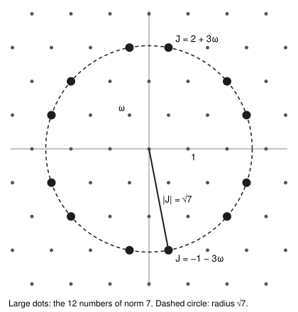

# Cubic reciprocity: Jacobi sums, primes in the Eisenstein integers, and when 2 is a cube

[Syllabus](../../../SYLLABUS.md) → [Algebraic and analytic number theory](../README.md) → [Algebraic Numbers](../README.md#s06) → Cubic reciprocity

---

## General Overview

Is 2 a perfect cube on a clock with 31 hours? In other words, is there a whole number whose cube leaves remainder 2 on division by 31? Yes: $`4^3 = 64 = 2 \times 31 + 2`$. On a clock with 7 hours the answer is no. The cubes of 1 to 6 leave only the remainders 1 and 6. On 13 hours the answer is also no.

Searching every number works for 31. It does not work for a prime with 300 digits. One power does: for a prime p that leaves remainder 1 on division by 3, 2 is a cube exactly when $`2^{(p-1)/3}`$ leaves remainder 1, the test of Step 7. A rule found by Euler and proved by Gauss says more. It names all such primes at once, by their shape:

- 2 is a cube mod p exactly when $`p = x^2 + 27y^2`$ for whole numbers x and y.
- $`31 = 2^2 + 27 \times 1^2`$, so 2 is a cube mod 31.
- 7 and 13 are smaller than 27 and not squares, so they have no such form, and 2 is no cube mod either.

The tool behind the rule is a **Jacobi sum**: a short sum of cube roots of 1, one term for each remainder mod p. Mod 7 it comes out as $`J = -1 - 3\omega`$, where $`\omega`$ is a complex cube root of 1. This number is a prime factor of 7 in the ring of numbers $`a + b\omega`$. Its size squared is exactly 7. Read mod 3, it gives $`4 \times 7 = 1^2 + 27 \times 1^2`$. Read mod 2, it says whether 2 is a cube. Here the second number, the 1 in $`27 \times 1^2`$, is odd, so 2 is not a cube mod 7.

**The Jacobi sum of a cubic character mod p is a prime factor of p among the Eisenstein integers $`a + b\omega`$, so $`p = a^2 - ab + b^2`$; the Gauss sum's cube is p times it; read mod 2, it says whether 2 is a cube mod p, which happens exactly when $`p = x^2 + 27y^2`$.**

**What kind of fact this is:** a theorem, proved on this card in Why it works: the Jacobi-sum facts, $`g(\chi)^3 = p\,J(\chi,\chi)`$ and the rule for when 2 is a cube. Cubic reciprocity, biquadratic reciprocity and Gauss's rule for fourth powers are stated with sources, not proved. The code checks the proved rule on all 611 primes p ≡ 1 mod 3 below 10,000, cubic reciprocity on 1,092 pairs of primes and the fourth-power rule on 609 primes. Those counts are evidence for the stated laws, not proofs.

### The picture: the twelve numbers of norm 7

<p align="center"></p>

Drawn to scale. Each dot is an Eisenstein integer $`a + b\omega`$. The twelve large dots on the dashed circle of radius $`\sqrt 7`$ are the ones of norm 7. They are $`J = -1 - 3\omega`$ and its mirror image $`\bar J = 2 + 3\omega`$, each multiplied by the six units $`\pm 1, \pm\omega, \pm\omega^2`$: turns by sixths of a circle. The Jacobi sum lands on one of them, at (0.500, −2.598).

---

## The formula

Notation first, in words.

- The letter p is a prime that leaves remainder 1 on division by 3. The example is $`p = 7`$.
- $`\omega = e^{2\pi i/3} = (-1 + \sqrt{-3})/2`$ is a cube root of 1 other than 1. It satisfies $`\omega^2 = -1 - \omega`$.
- The **Eisenstein integers** $`\mathbb{Z}[\omega]`$ are the numbers $`a + b\omega`$ with whole a and b. This shelf's [Rings of integers](03-rings-of-integers-and-integral-bases.md) writes $`\omega`$ for $`(1 + \sqrt{-3})/2`$. That number is $`1 + \omega`$ here, so both name the same ring: the ring of integers of $`\mathbb{Q}(\sqrt{-3})`$.
- The **norm** is $`N(a + b\omega) = a^2 - ab + b^2`$, the squared distance from 0.
- A **primitive root** r mod p is a number whose powers run through every nonzero remainder. The **index** of t is the power k with $`r^k \equiv t`$.
- The **cubic character** is $`\chi(t) = \omega^{k}`$ for $`t \equiv r^k`$, with $`\chi(0) = 0`$. It takes the value 1 exactly on the nonzero cubes. Its conjugate $`\bar\chi = \chi^2`$ is the other cubic character.
- The **Gauss sum** is $`g(\chi) = \sum_t \chi(t)\,\zeta_p^{\,t}`$, with $`\zeta_p = e^{2\pi i/p}`$, from [Gauss sums](../03-Characters%20and%20L-functions/06-gauss-sums.md).

The **Jacobi sum** of two characters $`\chi`$ and $`\psi`$ mod p is

```math
J(\chi, \psi) = \sum_{t=0}^{p-1} \chi(t)\,\psi(1 - t)
```

**Read it aloud:** for each remainder t, multiply chi of t by psi of one minus t, and add.

For the cubic character every term is 0, 1, $`\omega`$ or $`\omega^2`$. So $`J(\chi,\chi) = a + b\omega`$ with whole a and b. This card proves four facts about it:

```math
g(\chi)^3 = p\,J(\chi,\chi), \qquad a^2 - ab + b^2 = p, \qquad a \equiv 2,\ b \equiv 0 \pmod 3, \qquad J(\chi,\chi) \equiv \chi(2) \pmod 2
```

**Read it aloud:** the Gauss sum cubed is p times the Jacobi sum; the Jacobi sum has norm p; its two coordinates leave remainders 2 and 0 mod 3; and mod 2 it equals the character's value at 2.

From these comes the rule for 2:

```math
2 \text{ is a cube mod } p \iff b \text{ is even} \iff p = x^2 + 27y^2
```

**Read it aloud:** 2 is a cube mod p exactly when b is even, and exactly when p is a square plus 27 times a square.

For p = 7: $`J = -1 - 3\omega`$, so a = −1 and b = −3. The norm is $`1 - 3 + 9 = 7`$. Mod 3, a leaves 2 and b leaves 0. And b is odd, so 2 is no cube mod 7.

| Symbol | Plain meaning | In our example | Push it up and the answer… |
| --- | --- | --- | --- |
| $`p`$ | a prime leaving remainder 1 on division by 3 | 7; also 13 and 31 | the norm of J grows with it |
| $`\omega`$, $`i`$ | a complex cube root of 1, $`\omega^2 = -1 - \omega`$; the square root of −1 | $`\omega^3 = 1`$ | — |
| $`\mathbb{Z}[\omega]`$, $`N`$ | the Eisenstein integers $`a + b\omega`$; the norm $`a^2 - ab + b^2`$ | $`N(J) = 7`$ | — |
| $`r`$, $`k`$; $`t`$, $`s`$, $`u`$, $`m`$ | a primitive root mod p; the index, the power with $`r^k \equiv t`$; remainders mod p that the sums run over | r = 3 mod 7 | — |
| $`\chi`$, $`\bar\chi`$ | the cubic character and its conjugate | $`\chi(2) = \omega^2`$ mod 7 | — |
| $`\zeta_p`$ or $`\zeta`$, $`g(\chi)`$ | $`e^{2\pi i/p}`$; the Gauss sum of $`\chi`$ | $`g(\chi) = 2.370469406 - 1.175106292i`$ | its size $`\sqrt p`$ grows |
| $`J(\chi,\psi)`$, $`\psi`$, $`\bar J`$ | the Jacobi sum; a second character; the complex conjugate of J | $`J(\chi,\chi) = -1 - 3\omega`$ | — |
| $`a`$, $`b`$; $`S`$, $`\alpha`$, $`\gamma`$ | the coordinates of $`J(\chi,\chi) = a + b\omega`$; other Eisenstein integers in the proofs | −1 and −3 | b even means 2 is a cube |
| $`L`$, $`M`$ | the solution of $`4p = L^2 + 27M^2`$ in positive whole numbers: $`L = \lvert 2a - b\rvert`$, $`M = \lvert b\rvert/3`$ | L = 1, M = 1 | — |
| $`x`$, $`y`$ | whole numbers with $`p = x^2 + 27y^2`$ or $`p = x^2 + 64y^2`$ | none for 7; 2 and 1 for 31 | — |
| $`\pi`$, $`\lambda`$, $`q`$ | primary primes of $`\mathbb{Z}[\omega]`$ (or of $`\mathbb{Z}[i]`$); an ordinary prime leaving 2 on division by 3 | $`\pi = J`$, $`\lambda = 2`$ | — |
| $`\chi_\pi`$ | the cubic (or quartic) residue character of $`\pi`$ | $`\chi_\pi(2) = \omega^2`$ | — |

### When it holds

- **p leaves remainder 1 on division by 3.** Otherwise cubing shuffles the nonzero remainders and every number is a cube. Mod 11 all 10 nonzero remainders are cubes, and $`7^3 \equiv 2`$, yet 11 has no form $`x^2 + 27y^2`$.
- **Both characters are the same non-trivial cubic character.** The trivial character gives J = 5 mod 7, of norm 25, not 7. The pair $`\chi, \bar\chi`$ gives $`J = -1`$, of norm 1.
- **$`\chi(0) = 0`$.** Count $`\chi(0)`$ as 1 and the terms t = 0 and t = 1 add 2: $`1 - 3\omega`$, of norm 13.
- **The 27 is 27.** Every prime p ≡ 1 mod 3 has the form $`x^2 + 3y^2`$, such as $`7 = 2^2 + 3 \times 1^2`$. That form decides nothing; 2 is still no cube mod 7.
- **Reciprocity compares primary primes.** Replace $`\pi = J`$ by $`\omega\pi`$ and the law fails: $`\chi_\pi(5) = \omega^2`$ but $`\chi_5(\omega\pi) = \omega`$.

---

## Why it works

### Step 0: the idea

The Gauss sum $`g(\chi)`$ mixes cube roots of 1 with p-th roots of 1. Its cube cancels every p-th root and leaves p times a number built from $`\omega`$ alone. That number is the Jacobi sum. Since $`\lvert g\rvert^2 = p`$, the Jacobi sum has norm p. So it is a factor of p in $`\mathbb{Z}[\omega]`$, and p is $`a^2 - ab + b^2`$.

Two remainders then do the rest. Mod 3, cubing a sum is the sum of the cubes, and that pins J's shape. Mod 2, the terms of J pair off except one, and that one is $`\chi(2)`$.

### Step 1: the Gauss sum squared is J times another Gauss sum

Multiply out $`g(\chi)^2 = \sum_{s,u} \chi(s)\chi(u)\,\zeta^{s+u}`$, writing $`\zeta`$ for $`\zeta_p`$. Group the terms by $`m = s + u`$.

- For $`m \ne 0`$, put $`s = mt`$ and $`u = m(1 - t)`$. The group adds to $`\chi(m)^2 J(\chi,\chi)\,\zeta^m`$.
- For $`m = 0`$, the group is $`\chi(-1)\sum_s \chi^2(s)`$. A non-trivial character adds to 0 over all remainders, and $`\chi^2`$ is non-trivial.

So

```math
g(\chi)^2 = J(\chi,\chi) \sum_m \chi^2(m)\,\zeta^m = J(\chi,\chi)\; g(\chi^2)
```

**Read it aloud:** the Gauss sum squared is the Jacobi sum times the Gauss sum of chi squared.

### Step 2: the Gauss sum cubed is p times J

Now $`\chi^2 = \bar\chi`$, and $`\chi(-1) = 1`$, because $`-1 = (-1)^3`$ is a cube. So $`g(\bar\chi)`$ is the complex conjugate of $`g(\chi)`$. Multiply Step 1 by $`g(\chi)`$ and use $`\lvert g(\chi)\rvert^2 = p`$ from [Gauss sums](../03-Characters%20and%20L-functions/06-gauss-sums.md):

```math
g(\chi)^3 = J(\chi,\chi)\, g(\chi)\,\overline{g(\chi)} = p\,J(\chi,\chi)
```

**Read it aloud:** g cubed is J times g times its conjugate, which is p times J.

Mod 7: $`g = 2.370469406 - 1.175106292i`$ and $`g^3 = 3.500000000 - 18.186533479i`$. Seven times $`-1 - 3\omega`$ is the same number. The code also cubes g exactly, with whole-number coefficients on the powers of $`\omega`$ and $`\zeta`$, for all 11 primes p ≡ 1 mod 3 below 100.

### Step 3: J has norm p

Each term of J is a power of $`\omega`$, so J is $`a + b\omega`$ with whole a and b. Take sizes in Step 2: $`p^{3/2} = p\,\lvert J\rvert`$, so $`\lvert J\rvert^2 = p`$. The squared size of $`a + b\omega`$ is $`a^2 - ab + b^2`$. So every prime p ≡ 1 mod 3 is $`a^2 - ab + b^2`$, and $`p = J \bar J`$ splits into two Eisenstein primes, as [Splitting and ramification](08-splitting-and-ramification.md) predicts for a prime 1 mod 3.

Mod 7 the five non-zero terms, for t = 2 to 6, are $`\omega^2, 1, \omega^2, 1, \omega^2`$. They add to $`2 + 3\omega^2 = -1 - 3\omega`$, of norm 7.

### Step 4: J leaves −1 mod 3

Mod 3, cubing a sum gives the sum of the cubes. This is Frobenius from [Finite fields](../05-Fields%20and%20Galois%20Theory/09-finite-fields-and-frobenius.md): the middle terms of $`(x + y)^3`$ carry a factor 3. So

```math
g(\chi)^3 \equiv \sum_{t \ne 0} \chi(t)^3 \zeta^{3t} = \sum_{t \ne 0} \zeta^{3t} = -1 \pmod 3
```

**Read it aloud:** mod 3, g cubed is the sum of the cubes of its terms; each character value cubes to 1, and the p − 1 roots left add to −1.

With Step 2, $`pJ \equiv -1`$. Since $`p \equiv 1 \pmod 3`$, $`J \equiv -1 \pmod 3`$: a leaves 2 and b leaves 0. Then

```math
4p = (2a - b)^2 + 3b^2 = (2a - b)^2 + 27\left(\tfrac{b}{3}\right)^2
```

**Read it aloud:** four p is a square plus 27 times a square.

Mod 7: $`28 = 1^2 + 27 \times 1^2`$.

<details>
<summary>Detailed proof: why the congruence mod 3 can be read off a and b</summary>

The congruences live in the ring $`\mathbb{Z}[\omega, \zeta]`$, whole combinations of the products $`\omega^j\zeta^k`$. In Step 4, $`J + 1 = 3\gamma`$ for some $`\gamma`$ in that ring. But $`\gamma = (J + 1)/3`$ also lies in $`\mathbb{Q}(\omega)`$. It is an algebraic integer, as every member of the ring is. The algebraic integers of $`\mathbb{Q}(\omega)`$ are exactly $`\mathbb{Z}[\omega]`$, by [Rings of integers](03-rings-of-integers-and-integral-bases.md) with d = −3. So $`(a + 1)/3 + (b/3)\,\omega`$ has whole coordinates: 3 divides a + 1 and b.

</details>

### Step 5: J leaves χ(2) mod 2

The term for t and the term for 1 − t are the same product, in the other order. So the terms pair off, and each pair is twice something. Only one t pairs with itself: $`t = 1 - t`$, which means $`t \equiv 1/2`$. That term is $`\chi(1/2)^2 = \chi(2)^{-2} = \chi(2)`$, since $`\chi(2)^3 = 1`$. So

```math
J(\chi,\chi) = 2S + \chi(2) \equiv \chi(2) \pmod 2
```

**Read it aloud:** J is twice some Eisenstein integer S, plus chi of 2.

Mod 7, $`1/2 \equiv 4`$, and the unpaired term is $`\chi(4)^2 = \omega^2 = \chi(2)`$. The pairs (2, 6) and (3, 5) give $`2\omega^2`$ and 2. Mod 2 the numbers 1, $`\omega`$ and $`\omega^2`$ are different, because $`\mathbb{Z}[\omega]`$ mod 2 is the field of four elements. So $`\chi(2) = 1`$ exactly when $`J \equiv 1 \pmod 2`$: b even and a odd.

### Step 6: b is even exactly when p = x² + 27y²

If b is even, Step 4 makes b a multiple of 6. Put $`x = a - b/2`$ and $`y = b/6`$. Then $`x^2 + 27y^2 = a^2 - ab + b^2/4 + 3b^2/4 = p`$. For 31, $`J = 5 + 6\omega`$, so x = 2 and y = 1: $`31 = 4 + 27`$.

Conversely, if $`p = x^2 + 27y^2`$, then $`4p = (2x)^2 + 27(2y)^2`$. The equation $`4p = L^2 + 27M^2`$ has only one solution in positive whole numbers, the fold shows. So $`M = \lvert b\rvert/3 = 2\lvert y\rvert`$ is even, and b is even. With Step 5: **2 is a cube mod p exactly when $`p = x^2 + 27y^2`$.**

<details>
<summary>Detailed proof: 4p = L² + 27M² has exactly one positive solution</summary>

A solution gives L and M of the same parity, since $`L^2 + 27M^2`$ is a multiple of 4. So $`\alpha = (L + 3M)/2 + 3M\omega`$ is an Eisenstein integer. Its norm is $`(L^2 + 27M^2)/4 = p`$, and its $`\omega`$-coordinate is a multiple of 3.

$`\mathbb{Z}[\omega]`$ has unique factorisation: its class number is 1, by the Minkowski bound on [Class groups](05-class-groups-and-the-minkowski-bound.md). An element of norm p is a prime factor of $`p = J\bar J`$. So $`\alpha`$ is a unit times J or $`\bar J`$. The six units are $`\pm 1, \pm\omega, \pm\omega^2`$.

Multiplying by $`\omega`$ sends $`a + b\omega`$ to $`-b + (a - b)\omega`$. When a leaves 2 and b leaves 0 mod 3, the new $`\omega`$-coordinate leaves 2. Multiplying by $`\omega^2`$ gives $`(b - a) - a\omega`$, whose $`\omega`$-coordinate leaves 1. So only $`\pm J`$ and $`\pm\bar J`$ have $`\omega`$-coordinate a multiple of 3. All four give $`L = \lvert 2a - b\rvert`$ and $`M = \lvert b\rvert/3`$. The code confirms one solution for each of the 611 primes below 10,000.

</details>

### Step 7: cubic reciprocity, stated

Call an Eisenstein prime $`\pi = a + b\omega`$ **primary** when a leaves 2 and b leaves 0 on division by 3. Each prime of norm other than 3 has exactly one primary partner among its six unit multiples. Step 4 shows J is primary. An ordinary prime q that leaves 2 on division by 3 stays prime in $`\mathbb{Z}[\omega]`$, and it is primary.

The **cubic residue character** of $`\pi`$ is the power of $`\omega`$ that $`\alpha^{(N(\pi) - 1)/3}`$ leaves mod $`\pi`$:

```math
\chi_\pi(\alpha) \equiv \alpha^{(N(\pi)-1)/3} \pmod{\pi}, \qquad \chi_\pi(\alpha) \in \{1, \omega, \omega^2\}
```

**Read it aloud:** chi sub pi of alpha is the cube root of 1 that alpha to the power one third of norm pi minus one leaves mod pi.

It is 1 exactly when $`\alpha`$ is a cube mod $`\pi`$. **Cubic reciprocity** says: for primary primes $`\pi`$ and $`\lambda`$ of different norms, neither norm 3,

```math
\chi_\pi(\lambda) = \chi_\lambda(\pi)
```

**Read it aloud:** whether lambda is a cube mod pi and whether pi is a cube mod lambda have the same answer.

Unlike the quadratic law, there is no sign. Eisenstein published the first proof in 1844. Ireland and Rosen prove it with this card's Jacobi sum: for primary $`\pi`$ of norm p, $`J(\chi_\pi, \chi_\pi) = \pi`$. The card states the law and does not prove it.

Take $`\pi = J = -1 - 3\omega`$ and $`\lambda = 2`$. Then $`\chi_\pi(2) = \omega^2`$. On the other side, $`N(2) = 4`$, so $`\chi_2(\pi) \equiv \pi \pmod 2 = \omega^2`$. The two agree. That is Step 5 again: Step 5 is the law's special case for 2. The code checks the law on 1,092 pairs of primary primes, all norms below 200 plus the ordinary primes 2 to 29, with no exception.

### Step 8: biquadratic reciprocity, stated

The same story runs in the Gaussian integers $`\mathbb{Z}[i]`$ of [Gaussian integers](../../03-Algebra/10-For%20the%20Curious/03-gaussian-integers-and-sums-of-two-squares.md), with fourth roots of 1 in place of cube roots. A prime $`\pi`$ of $`\mathbb{Z}[i]`$ is primary when it leaves 1 mod $`2 + 2i`$. Its **quartic residue character** $`\chi_\pi(\alpha)`$ is the power of i that $`\alpha^{(N(\pi) - 1)/4}`$ leaves mod $`\pi`$. **Biquadratic reciprocity**, for primary primes $`\pi`$ and $`\lambda`$ of different odd norms:

```math
\chi_\lambda(\pi) = \chi_\pi(\lambda)\,(-1)^{\frac{N(\lambda) - 1}{4}\cdot\frac{N(\pi) - 1}{4}}
```

**Read it aloud:** the two quartic characters agree, up to a sign that is minus only when both norms leave 5 on division by 8.

Gauss's rule for 2 comes from the same theory. For a prime p that leaves 1 on division by 4, 2 is a fourth power mod p exactly when $`p = x^2 + 64y^2`$. For example, $`73 = 3^2 + 64 \times 1^2`$, and $`18^4 \equiv 2 \pmod{73}`$. The quartic Jacobi sum mod 73 is $`3 + 8i`$, of norm 73, just as the cubic one has norm p. The card states both laws with sources; the code checks the rule for 2 on all 609 primes p ≡ 1 mod 4 below 10,000.

---

## Worked numbers, by hand

The prime is 7, the primitive root is 3, and $`\omega^2 = -1 - \omega`$.

| Step | Arithmetic | Value |
| --- | --- | --- |
| index mod 3 | the power k with $`3^k \equiv t`$, for t = 1 to 6, mod 3 | 0, 2, 1, 1, 2, 0 |
| cubic character | $`\omega^k`$ for t = 1 to 6 | 1, $`\omega^2`$, $`\omega`$, $`\omega`$, $`\omega^2`$, 1 |
| cubes mod 7 | $`x^3`$ for x = 1 to 6 | only 1 and 6 |
| terms of J, t = 2 to 6 | $`\chi(t)\chi(1 - t)`$ | $`\omega^2, 1, \omega^2, 1, \omega^2`$ |
| add | $`2 + 3\omega^2 = 2 - 3 - 3\omega`$ | $`J = -1 - 3\omega`$ |
| norm | $`(-1)^2 - (-1)(-3) + (-3)^2 = 1 - 3 + 9`$ | 7 |
| mod 3 | a = −1 leaves 2; b = −3 leaves 0 | J is primary |
| Gauss sum | $`\sum_t \chi(t)\zeta_7^{\,t}`$ | $`2.370469406 - 1.175106292i`$, size squared 7.000000000 |
| cube against 7J | $`g^3`$ and $`7(-1 - 3\omega)`$ | both $`3.500000000 - 18.186533479i`$ |
| 4p | $`(2a - b)^2 + 27(b/3)^2 = 1 + 27`$ | 28 |
| mod 2 | b = −3 is odd: $`-1 - 3\omega \equiv 1 + \omega = -\omega^2`$ | $`\omega^2 = \chi(2)`$, not 1 |
| answer | M = 1 is odd, so 7 is not $`x^2 + 27y^2`$ | **2 is not a cube mod 7** |

The Jacobi sum turns a question about all six remainders into one parity: b = −3 is odd. For 31 the same steps give $`J = 5 + 6\omega`$, b even, $`124 = 4^2 + 27 \times 2^2`$ and $`31 = 2^2 + 27 \times 1^2`$. The three cube roots of 2 mod 31 are 4, 7 and 20.

### What breaks if you drop a piece

| Mistake | Comes out at | What went wrong |
| --- | --- | --- |
| Trivial character in place of $`\chi`$ | J = 5, norm 25 | Without $`\omega`$ weights nothing cancels; the norm is $`(p - 2)^2`$ |
| $`J(\chi, \bar\chi)`$ in place of $`J(\chi, \chi)`$ | J = −1, norm 1 | Step 1 needs $`\chi^2`$ non-trivial; here the product is trivial |
| Count $`\chi(0)`$ as 1 | $`1 - 3\omega`$, norm 13 | The terms t = 0 and t = 1 add 2 |
| Test $`x^2 + 3y^2`$ for the cube rule | 7 = 2² + 3 × 1² says "cube" | Every prime 1 mod 3 has that form; 2 is no cube mod 7 |
| Apply the rule to p = 11 | all 10 nonzero remainders are cubes, $`7^3 \equiv 2`$ | p ≡ 2 mod 3 has no cubic character |
| Test $`x^2 + 16y^2`$ for fourth powers | 17 = 1 + 16, but fourth powers mod 17 are 1, 4, 13, 16 | Gauss's rule needs 64 |
| Use $`\omega\pi`$, not primary | $`\chi_\pi(5) = \omega^2`$ but $`\chi_5(\omega\pi) = \omega`$ | The law holds only for primary primes |

---

## Code, from first principles, and it actually runs

The code builds the cubic character from a primitive root and adds the Jacobi sum term by term. It takes four roads. Road one cubes the Gauss sum exactly, with whole-number coefficients on $`\omega^j\zeta^k`$, and compares it with pJ; a floating-point cube agrees. Road two counts the points of $`x^3 + y^3 = 1`$ mod p and compares with $`p - 2 + 2a - b`$. Road three decides "is 2 a cube" for all 611 primes p ≡ 1 mod 3 below 10,000 three ways: by cubing every remainder, by J mod 2 and by searching for $`x^2 + 27y^2`$. Road four checks cubic reciprocity on 1,092 pairs and Gauss's quartic rule on 609 primes.

### Python

```python
# Cubic reciprocity and Jacobi sums: the check behind the card.  Standard library only.
# A pair (a, b) is the Eisenstein integer a + b*omega, with omega^2 = -1 - omega.
# Road 1 adds up the Jacobi sum J directly.  Road 2 cubes the Gauss sum exactly in Z[zeta_3p]
# and in floating point.  Road 3 decides "is 2 a cube mod p" three ways: every cube by brute
# force, J mod 2, and a search for p = x^2 + 27y^2.  Reciprocity and Gauss's quartic rule are counts.
import math

def primes(n):
    s = [1] * n; s[0] = s[1] = 0
    for i in range(2, int(n ** 0.5) + 1):
        if s[i]: s[i * i::i] = [0] * len(s[i * i::i])
    return [i for i in range(n) if s[i]]
def mul(x, y, m=0):                      # (a + b w)(c + d w), w^2 = -1 - w; reduced mod m if m
    a, b = x; c, d = y; r = (a * c - b * d, a * d + b * c - b * d)
    return (r[0] % m, r[1] % m) if m else r
def wpow(x, e, m):
    r = (1, 0)
    while e:
        if e & 1: r = mul(r, x, m)
        x, e = mul(x, x, m), e >> 1
    return r
def rep(p, k):                           # every (x, y), y >= 1, with p = x^2 + k y^2
    return [(math.isqrt(p - k * y * y), y) for y in range(1, math.isqrt(p // k) + 1) if math.isqrt(p - k * y * y) ** 2 == p - k * y * y]
def norm(x): return x[0] ** 2 - x[0] * x[1] + x[1] ** 2
def gen(p):                              # smallest primitive root mod p
    qs = [q for q in primes(p) if (p - 1) % q == 0]
    return next(g for g in range(2, p) if all(pow(g, (p - 1) // q, p) != 1 for q in qs))
def index(p):                            # discrete logs to the smallest primitive root
    g, ind, x = gen(p), [0] * p, 1
    for k in range(p - 1): ind[x] = k; x = x * g % p
    return g, ind
def jacobi(p, n=3):                      # J(chi, chi) as counts of each power of the n-th root
    g, ind = index(p); c = [0] * n
    for a in range(2, p): c[(ind[a] + ind[(1 - a) % p]) % n] += 1
    return c, g, ind
def jac3(p):
    c = jacobi(p)[0]; return (c[0] - c[2], c[1] - c[2])
W = [(1, 0), (0, 1), (-1, -1)]                       # 1, omega, omega^2
mod2 = lambda x: [((w[0] - x[0]) % 2, (w[1] - x[1]) % 2) for w in W].index((0, 0))   # J mod 2 as a power of omega
fmt = lambda x: f"{x[0]} + {x[1]} omega" if x[1] >= 0 else f"{x[0]} - {-x[1]} omega"

c, g7, ind7 = jacobi(7)
print(f"cubic character mod 7, generator {g7}: power of omega for a = 1..6:", [ind7[a] % 3 for a in range(1, 7)])
print("cubes mod 7:", sorted({x ** 3 % 7 for x in range(1, 7)}), " terms a = 2..6:", [(ind7[a] + ind7[(1 - a) % 7]) % 3 for a in range(2, 7)])
J7 = jac3(7); print(f"J(chi, chi) mod 7 = {fmt(J7)}, norm {norm(J7)}, a mod 3 = {J7[0] % 3}, b mod 3 = {J7[1] % 3}")
assert J7 == (-1, -3) and norm(J7) == 7

def gauss_cubed_exact(p):                # grid c[i][j] = coefficient of omega^i zeta^j
    _, ind = index(p); g = [[0] * p for _ in range(3)]
    for a in range(1, p): g[ind[a] % 3][a] += 1
    def times(x, y):
        z = [[0] * p for _ in range(3)]
        for i in range(3):
            for j in range(p):
                if x[i][j]:
                    for k in range(3):
                        for l in range(p): z[(i + k) % 3][(j + l) % p] += x[i][j] * y[k][l]
        return z
    z = times(times(g, g), g)
    for j in range(p): z[0][j] -= z[2][j]; z[1][j] -= z[2][j]; z[2][j] = 0
    for i in range(2): v = z[i][p - 1]; z[i] = [t - v for t in z[i]]
    return z
def gauss_float(p):
    _, ind = index(p)
    return sum(complex(math.cos(2 * math.pi * (ind[a] / 3 + a / p)), math.sin(2 * math.pi * (ind[a] / 3 + a / p))) for a in range(1, p))
cz = lambda x: complex(x[0] - x[1] / 2, x[1] * math.sqrt(3) / 2)
fc = lambda z: f"{z.real:.9f} {'+' if z.imag >= 0 else '-'} {abs(z.imag):.9f}i"
g = gauss_float(7)
print(f"g(chi) mod 7 = {fc(g)}, |g|^2 = {abs(g) ** 2:.9f}")
print(f"g^3 = {fc(g ** 3)}, 7J = {fc(7 * cz(J7))}")
assert abs(abs(g) ** 2 - 7) < 1e-9 and abs(g ** 3 - 7 * cz(J7)) < 1e-9
small, pts = [p for p in primes(100) if p % 3 == 1], {}
for p in small:
    z, J = gauss_cubed_exact(p), jac3(p)
    pts[p] = sum((x ** 3 + y ** 3) % p == 1 for x in range(p) for y in range(p))   # points on x^3 + y^3 = 1
    assert pts[p] == p - 2 + 2 * J[0] - J[1]
    assert z[0] == [p * J[0]] + [0] * (p - 1) and z[1] == [p * J[1]] + [0] * (p - 1) and not any(z[2])
print(f"exact: g^3 = pJ in Z[zeta_3p] for all {len(small)} primes p = 1 mod 3 below 100")
print(f"points on x^3 + y^3 = 1 mod p = p - 2 + 2a - b for all {len(small)}: p = 7: {pts[7]}, p = 31: {pts[31]}")
for p in (7, 13, 31):
    J, ind = jac3(p), index(p)[1]; L, M = abs(2 * J[0] - J[1]), abs(J[1]) // 3
    cubes = sorted({x ** 3 % p for x in range(1, p)})
    print(f"p = {p}: J = {fmt(J)}, 4p = {4 * p} = {L}^2 + 27*{M}^2, chi(2) = omega^{ind[2] % 3}, J mod 2 = omega^{mod2(J)}, 2 a cube: {2 in cubes}")
print(f"4^3 mod 31 = {4 ** 3 % 31}; x^3 = 2 mod 31 at x = {[x for x in range(31) if x ** 3 % 31 == 2]}; 31 = x^2 + 27y^2 at {rep(31, 27)}")
N = 10000; split = [p for p in primes(N) if p % 3 == 1]; agree = cube = 0
for p in split:
    J, ind = jac3(p), index(p)[1]; a, b = J
    reps = [(L, M) for M in range(1, math.isqrt(4 * p // 27) + 1) for L in range(1, math.isqrt(4 * p) + 1) if L * L + 27 * M * M == 4 * p]
    brute = 2 in {x ** 3 % p for x in range(1, p)}
    by_j = mod2(J) == ind[2] % 3                 # J = chi(2) mod 2
    form = bool(rep(p, 27))
    assert norm(J) == p and a % 3 == 2 and b % 3 == 0 and reps == [(abs(2 * a - b), abs(b) // 3)]
    agree += by_j and brute == (b % 2 == 0) == form == (ind[2] % 3 == 0); cube += brute
print(f"primes p = 1 mod 3 below {N}: {len(split)}; norm J = p, one 4p = L^2 + 27M^2, three tests agree: {agree}; 2 a cube: {cube}")
assert agree == len(split)

def chi(pi, alpha):                      # cubic residue character of alpha mod primary pi, as 0, 1, 2
    n = norm(pi); m = n if pi[1] else pi[0]
    v = wpow(alpha, (n - 1) // 3, m)
    if pi[1] == 0: return [((w[0] - v[0]) % m, (w[1] - v[1]) % m) for w in W].index((0, 0))
    r = -pi[0] * pow(pi[1], -1, m) % m   # omega -> r sends pi to 0 mod p
    return [(w[0] + w[1] * r - v[0] - v[1] * r) % m for w in W].index(0)
prim = [x for p in primes(200) if p % 3 == 1 for x in (jac3(p), (jac3(p)[0] - jac3(p)[1], -jac3(p)[1]))]
prim += [(q, 0) for q in primes(30) if q % 3 == 2]
pairs = [(s, t) for s in prim for t in prim if s < t and norm(s) != norm(t) and (s[1] or t[1])]   # skip two ordinary primes
same = sum(chi(s, t) == chi(t, s) for s, t in pairs)
print(f"cubic reciprocity, pi = J mod 7 and 2: chi_pi(2) = omega^{chi(J7, (2, 0))}, chi_2(pi) = omega^{chi((2, 0), J7)}")
print(f"cubic reciprocity on {len(pairs)} pairs of primary primes: {same} agree")
assert same == len(pairs) == 1092 and chi(J7, (2, 0)) == chi((2, 0), J7) == 2
c4, g73, _ = jacobi(73, 4); J4 = (c4[0] - c4[2], c4[1] - c4[3])
print(f"quartic J mod 73, generator {g73}: {J4[0]} + {J4[1]}i, norm {J4[0] ** 2 + J4[1] ** 2}; 73 = 3^2 + 64*1^2; x^4 = 2 mod 73 at x =", [x for x in range(1, 73) if pow(x, 4, 73) == 2])
q4 = [p for p in primes(N) if p % 4 == 1]
four = [2 in {pow(x, 4, p) for x in range(1, p)} for p in q4]
form4 = [bool(rep(p, 64)) for p in q4]
print(f"primes p = 1 mod 4 below {N}: {len(q4)}; 2 a fourth power: {sum(four)}; p = x^2 + 64y^2: {sum(form4)}; agree: {sum(map(lambda u, v: u == v, four, form4))}")
assert four == form4
if N == 10000: assert (len(split), cube, len(q4), sum(four)) == (611, 200, 609, 143)   # the counts on the card
def jsum(p, f, g):                       # sum over t = 0..p-1 of f(t) g(1 - t); f, g give a power of omega, or None for 0
    ws = [W[(f(t) + g((1 - t) % p)) % 3] for t in range(p) if f(t) is not None and g((1 - t) % p) is not None]
    return (sum(w[0] for w in ws), sum(w[1] for w in ws))
chi7, chibar = (lambda t: ind7[t] % 3 if t else None), (lambda t: 2 * ind7[t] % 3 if t else None)
triv, chi1 = (lambda t: 0 if t else None), (lambda t: ind7[t] % 3 if t else 0)   # chi1 counts chi(0) as 1
Jt, Jbar, J0 = jsum(7, triv, triv), jsum(7, chi7, chibar), jsum(7, chi1, chi1)
print(f"break: trivial character mod 7, J = {Jt[0]}, norm {norm(Jt)}; J(chi, chi-bar) = {fmt(Jbar)}, norm {norm(Jbar)}")
print(f"break: chi(0) = 1 counted, J + 2 = {fmt(J0)}, norm {norm(J0)}")
assert jsum(7, chi7, chi7) == J7 and Jt == (7 - 2, 0) and Jbar == (-1, 0) and J0 == (J7[0] + 2, J7[1])
x3 = rep(7, 3)
c11 = {x ** 3 % 11 for x in range(1, 11)}; f17 = sorted({pow(x, 4, 17) for x in range(1, 17)})
print(f"break: 7 = x^2 + 3y^2 at {x3}, yet 2 is no cube mod 7; mod 11 every one of {len(c11)} is a cube, 7^3 mod 11 = {7 ** 3 % 11}")
print(f"break: 17 = 1^2 + 16*1^2, fourth powers mod 17: {f17}")
k1, k2 = chi(J7, (5, 0)), chi((5, 0), mul((0, 1), J7))
print(f"break: non-primary omega*pi mod 7 and 5: chi_pi(5) = omega^{k1}, chi_5(omega pi) = omega^{k2}")
assert x3 == [(2, 1)] and len(c11) == 10 and 2 not in f17 and k1 != k2 == (k1 + 2) % 3
print("figure, norm 7:", " ".join(f"({cz(x).real:.3f},{cz(x).imag:.3f})" for x in sorted((a, b) for a in range(-4, 5) for b in range(-4, 5) if norm((a, b)) == 7)))
print("ALL CHECKS PASS")
```

**Ran 2026-11-24 on macOS, Python 3.14.10, standard library only. All checks passed. Output, pasted from the run:**

```
cubic character mod 7, generator 3: power of omega for a = 1..6: [0, 2, 1, 1, 2, 0]
cubes mod 7: [1, 6]  terms a = 2..6: [2, 0, 2, 0, 2]
J(chi, chi) mod 7 = -1 - 3 omega, norm 7, a mod 3 = 2, b mod 3 = 0
g(chi) mod 7 = 2.370469406 - 1.175106292i, |g|^2 = 7.000000000
g^3 = 3.500000000 - 18.186533479i, 7J = 3.500000000 - 18.186533479i
exact: g^3 = pJ in Z[zeta_3p] for all 11 primes p = 1 mod 3 below 100
points on x^3 + y^3 = 1 mod p = p - 2 + 2a - b for all 11: p = 7: 6, p = 31: 33
p = 7: J = -1 - 3 omega, 4p = 28 = 1^2 + 27*1^2, chi(2) = omega^2, J mod 2 = omega^2, 2 a cube: False
p = 13: J = -4 - 3 omega, 4p = 52 = 5^2 + 27*1^2, chi(2) = omega^1, J mod 2 = omega^1, 2 a cube: False
p = 31: J = 5 + 6 omega, 4p = 124 = 4^2 + 27*2^2, chi(2) = omega^0, J mod 2 = omega^0, 2 a cube: True
4^3 mod 31 = 2; x^3 = 2 mod 31 at x = [4, 7, 20]; 31 = x^2 + 27y^2 at [(2, 1)]
primes p = 1 mod 3 below 10000: 611; norm J = p, one 4p = L^2 + 27M^2, three tests agree: 611; 2 a cube: 200
cubic reciprocity, pi = J mod 7 and 2: chi_pi(2) = omega^2, chi_2(pi) = omega^2
cubic reciprocity on 1092 pairs of primary primes: 1092 agree
quartic J mod 73, generator 5: 3 + 8i, norm 73; 73 = 3^2 + 64*1^2; x^4 = 2 mod 73 at x = [18, 25, 48, 55]
primes p = 1 mod 4 below 10000: 609; 2 a fourth power: 143; p = x^2 + 64y^2: 143; agree: 609
break: trivial character mod 7, J = 5, norm 25; J(chi, chi-bar) = -1 + 0 omega, norm 1
break: chi(0) = 1 counted, J + 2 = 1 - 3 omega, norm 13
break: 7 = x^2 + 3y^2 at [(2, 1)], yet 2 is no cube mod 7; mod 11 every one of 10 is a cube, 7^3 mod 11 = 2
break: 17 = 1^2 + 16*1^2, fourth powers mod 17: [1, 4, 13, 16]
break: non-primary omega*pi mod 7 and 5: chi_pi(5) = omega^2, chi_5(omega pi) = omega^1
figure, norm 7: (-2.000,-1.732) (-2.500,-0.866) (-0.500,-2.598) (-2.500,0.866) (0.500,-2.598) (-2.000,1.732) (2.000,-1.732) (-0.500,2.598) (2.500,-0.866) (0.500,2.598) (2.500,0.866) (2.000,1.732)
ALL CHECKS PASS
```

### Rust

Same numbers, same labels, built with `rustc --edition 2021 -O`.

```rust
// Cubic reciprocity and Jacobi sums: the same check as the Python, std only.
// A pair (a, b) is the Eisenstein integer a + b*omega, with omega^2 = -1 - omega.
// Road 1 adds up the Jacobi sum J directly.  Road 2 cubes the Gauss sum exactly in Z[zeta_3p]
// and in floating point.  Road 3 decides "is 2 a cube mod p" three ways: every cube by brute
// force, J mod 2, and a search for p = x^2 + 27y^2.  Reciprocity and Gauss's quartic rule are counts.
use std::collections::BTreeSet;
type E = (i64, i64);
const W: [E; 3] = [(1, 0), (0, 1), (-1, -1)]; // 1, omega, omega^2

fn primes(n: usize) -> Vec<i64> {
    let mut s = vec![true; n]; s[0] = false; s[1] = false;
    let mut i = 2;
    while i * i < n { if s[i] { let mut j = i * i; while j < n { s[j] = false; j += i; } } i += 1; }
    (0..n).filter(|&i| s[i]).map(|i| i as i64).collect()
}
fn md(x: i64, m: i64) -> i64 { x.rem_euclid(m) }
fn powm(mut b: i64, mut e: i64, m: i64) -> i64 {
    let mut r = 1; b = md(b, m);
    while e > 0 { if e & 1 == 1 { r = r * b % m; } b = b * b % m; e >>= 1; }
    r
}
fn mul(x: E, y: E, m: i64) -> E { // (a + b w)(c + d w), w^2 = -1 - w; reduced mod m if m
    let r = (x.0 * y.0 - x.1 * y.1, x.0 * y.1 + x.1 * y.0 - x.1 * y.1);
    if m > 0 { (md(r.0, m), md(r.1, m)) } else { r }
}
fn wpow(mut x: E, mut e: i64, m: i64) -> E {
    let mut r = (1, 0);
    while e > 0 { if e & 1 == 1 { r = mul(r, x, m); } x = mul(x, x, m); e >>= 1; }
    r
}
fn isqrt(n: i64) -> i64 { let mut r = (n as f64).sqrt() as i64; while r * r > n { r -= 1; } while (r + 1) * (r + 1) <= n { r += 1; } r }
fn rep(p: i64, k: i64) -> Vec<E> { // every (x, y), y >= 1, with p = x^2 + k y^2
    (1..=isqrt(p / k)).filter(|y| { let t = p - k * y * y; isqrt(t) * isqrt(t) == t }).map(|y| (isqrt(p - k * y * y), y)).collect()
}
fn norm(x: E) -> i64 { x.0 * x.0 - x.0 * x.1 + x.1 * x.1 }
fn index(p: i64) -> (i64, Vec<i64>) { // discrete logs to the smallest primitive root
    let qs: Vec<i64> = primes(p as usize).into_iter().filter(|q| (p - 1) % q == 0).collect();
    let g = (2..p).find(|&g| qs.iter().all(|&q| powm(g, (p - 1) / q, p) != 1)).unwrap();
    let (mut ind, mut x) = (vec![0i64; p as usize], 1i64);
    for k in 0..p - 1 { ind[x as usize] = k; x = x * g % p; }
    (g, ind)
}
fn jacobi(p: i64, n: i64) -> (Vec<i64>, i64, Vec<i64>) { // J(chi, chi) as counts of each power of the n-th root
    let (g, ind) = index(p); let mut c = vec![0i64; n as usize];
    for a in 2..p { c[((ind[a as usize] + ind[md(1 - a, p) as usize]) % n) as usize] += 1; }
    (c, g, ind)
}
fn jac3(p: i64) -> E { let c = jacobi(p, 3).0; (c[0] - c[2], c[1] - c[2]) }
fn mod2(x: E) -> usize { W.iter().position(|w| md(w.0 - x.0, 2) == 0 && md(w.1 - x.1, 2) == 0).unwrap() }
fn fmt(x: E) -> String { if x.1 >= 0 { format!("{} + {} omega", x.0, x.1) } else { format!("{} - {} omega", x.0, -x.1) } }
fn jsum(p: i64, f: &dyn Fn(i64) -> Option<i64>, g: &dyn Fn(i64) -> Option<i64>) -> E { // sum over t = 0..p-1 of f(t) g(1 - t); f, g give a power of omega, or None for 0
    (0..p).filter_map(|t| Some(W[((f(t)? + g(md(1 - t, p))?) % 3) as usize])).fold((0, 0), |s, w| (s.0 + w.0, s.1 + w.1))
}
fn py(b: bool) -> &'static str { if b { "True" } else { "False" } }
fn cubes(p: i64) -> BTreeSet<i64> { (1..p).map(|x| powm(x, 3, p)).collect() }
fn fourths(p: i64) -> BTreeSet<i64> { (1..p).map(|x| powm(x, 4, p)).collect() }
#[derive(Clone, Copy)]
struct C(f64, f64);
impl C {
    fn mul(self, o: C) -> C { C(self.0 * o.0 - self.1 * o.1, self.0 * o.1 + self.1 * o.0) }
    fn abs(self) -> f64 { (self.0 * self.0 + self.1 * self.1).sqrt() }
    fn s(self) -> String { format!("{:.9} {} {:.9}i", self.0, if self.1 >= 0.0 { "+" } else { "-" }, self.1.abs()) }
}
fn cz(x: E) -> C { C(x.0 as f64 - x.1 as f64 / 2.0, x.1 as f64 * 3f64.sqrt() / 2.0) }
fn gauss_cubed_exact(p: i64) -> Vec<Vec<i64>> { // grid z[i][j] = coefficient of omega^i zeta^j
    let (pu, ind) = (p as usize, index(p).1);
    let mut g = vec![vec![0i64; pu]; 3];
    for a in 1..pu { g[(ind[a] % 3) as usize][a] += 1; }
    let times = |x: &Vec<Vec<i64>>, y: &Vec<Vec<i64>>| {
        let mut z = vec![vec![0i64; pu]; 3];
        for i in 0..3 { for j in 0..pu { if x[i][j] != 0 { for k in 0..3 { for l in 0..pu {
            z[(i + k) % 3][(j + l) % pu] += x[i][j] * y[k][l]; } } } } }
        z
    };
    let mut z = times(&times(&g, &g), &g);
    for j in 0..pu { let t = z[2][j]; z[0][j] -= t; z[1][j] -= t; z[2][j] = 0; }
    for i in 0..2 { let v = z[i][pu - 1]; for t in z[i].iter_mut() { *t -= v; } }
    z
}
fn gauss_float(p: i64) -> C {
    let ind = index(p).1; let mut s = C(0.0, 0.0);
    for a in 1..p { let t = 2.0 * std::f64::consts::PI * (ind[a as usize] as f64 / 3.0 + a as f64 / p as f64); s = C(s.0 + t.cos(), s.1 + t.sin()); }
    s
}
fn chi(pi: E, alpha: E) -> usize { // cubic residue character of alpha mod primary pi, as 0, 1, 2
    let n = norm(pi); let m = if pi.1 != 0 { n } else { pi.0 };
    let v = wpow(alpha, (n - 1) / 3, m);
    if pi.1 == 0 { return W.iter().position(|w| md(w.0 - v.0, m) == 0 && md(w.1 - v.1, m) == 0).unwrap(); }
    let r = md(-pi.0 * powm(pi.1, m - 2, m), m); // omega -> r sends pi to 0 mod p
    W.iter().position(|w| md(w.0 + w.1 * r - v.0 - v.1 * r, m) == 0).unwrap()
}

fn main() {
    let (_, g7, ind7) = jacobi(7, 3);
    println!("cubic character mod 7, generator {}: power of omega for a = 1..6: {:?}", g7, (1..7).map(|a| ind7[a] % 3).collect::<Vec<_>>());
    println!("cubes mod 7: {:?}  terms a = 2..6: {:?}", cubes(7).iter().collect::<Vec<_>>(), (2..7).map(|a| (ind7[a] + ind7[md(1 - a as i64, 7) as usize]) % 3).collect::<Vec<_>>());
    let j7 = jac3(7);
    println!("J(chi, chi) mod 7 = {}, norm {}, a mod 3 = {}, b mod 3 = {}", fmt(j7), norm(j7), md(j7.0, 3), md(j7.1, 3));
    assert!(j7 == (-1, -3) && norm(j7) == 7);
    let g = gauss_float(7); let g3 = g.mul(g).mul(g); let c7 = cz(j7); let s7 = C(7.0 * c7.0, 7.0 * c7.1);
    println!("g(chi) mod 7 = {}, |g|^2 = {:.9}", g.s(), g.abs() * g.abs());
    println!("g^3 = {}, 7J = {}", g3.s(), s7.s());
    assert!((g.abs() * g.abs() - 7.0).abs() < 1e-9 && C(g3.0 - s7.0, g3.1 - s7.1).abs() < 1e-9);
    let small: Vec<i64> = primes(100).into_iter().filter(|p| p % 3 == 1).collect();
    let mut pts = vec![];
    for &p in &small {
        let (z, j) = (gauss_cubed_exact(p), jac3(p));
        let n3 = (0..p).map(|x| (0..p).filter(|y| (x * x * x + y * y * y) % p == 1).count() as i64).sum::<i64>(); // points on x^3 + y^3 = 1
        assert!(n3 == p - 2 + 2 * j.0 - j.1); pts.push(n3);
        let mut e0 = vec![0i64; p as usize]; let mut e1 = e0.clone(); e0[0] = p * j.0; e1[0] = p * j.1;
        assert!(z[0] == e0 && z[1] == e1 && z[2].iter().all(|&t| t == 0));
    }
    println!("exact: g^3 = pJ in Z[zeta_3p] for all {} primes p = 1 mod 3 below 100", small.len());
    println!("points on x^3 + y^3 = 1 mod p = p - 2 + 2a - b for all {}: p = 7: {}, p = 31: {}", small.len(), pts[0], pts[3]);
    for p in [7i64, 13, 31] {
        let (j, ind) = (jac3(p), index(p).1); let (l, m) = ((2 * j.0 - j.1).abs(), j.1.abs() / 3);
        println!("p = {}: J = {}, 4p = {} = {}^2 + 27*{}^2, chi(2) = omega^{}, J mod 2 = omega^{}, 2 a cube: {}", p, fmt(j), 4 * p, l, m, ind[2] % 3, mod2(j), py(cubes(p).contains(&2)));
    }
    println!("4^3 mod 31 = {}; x^3 = 2 mod 31 at x = {:?}; 31 = x^2 + 27y^2 at {:?}", powm(4, 3, 31), (0..31).filter(|&x| powm(x, 3, 31) == 2).collect::<Vec<_>>(), rep(31, 27));
    let n = 10000usize; let split: Vec<i64> = primes(n).into_iter().filter(|p| p % 3 == 1).collect();
    let (mut agree, mut cube) = (0, 0);
    for &p in &split {
        let (j, ind) = (jac3(p), index(p).1); let (a, b) = j;
        let mut reps = vec![];
        for m in 1..=isqrt(4 * p / 27) { for l in 1..=isqrt(4 * p) { if l * l + 27 * m * m == 4 * p { reps.push((l, m)); } } }
        let brute = cubes(p).contains(&2);
        let by_j = mod2(j) as i64 == ind[2] % 3; // J = chi(2) mod 2
        let form = !rep(p, 27).is_empty();
        assert!(norm(j) == p && md(a, 3) == 2 && md(b, 3) == 0 && reps == vec![((2 * a - b).abs(), b.abs() / 3)]);
        if by_j && brute == (md(b, 2) == 0) && brute == form && form == (ind[2] % 3 == 0) { agree += 1; } if brute { cube += 1; }
    }
    println!("primes p = 1 mod 3 below {}: {}; norm J = p, one 4p = L^2 + 27M^2, three tests agree: {}; 2 a cube: {}", n, split.len(), agree, cube);
    assert!(agree == split.len());

    let mut prim: Vec<E> = vec![];
    for p in primes(200) { if p % 3 == 1 { let j = jac3(p); prim.push(j); prim.push((j.0 - j.1, -j.1)); } }
    for q in primes(30) { if q % 3 == 2 { prim.push((q, 0)); } }
    let mut pairs = vec![];
    for &s in &prim { for &t in &prim { if s < t && norm(s) != norm(t) && (s.1 != 0 || t.1 != 0) { pairs.push((s, t)); } } } // skip two ordinary primes
    let same = pairs.iter().filter(|&&(s, t)| chi(s, t) == chi(t, s)).count();
    println!("cubic reciprocity, pi = J mod 7 and 2: chi_pi(2) = omega^{}, chi_2(pi) = omega^{}", chi(j7, (2, 0)), chi((2, 0), j7));
    println!("cubic reciprocity on {} pairs of primary primes: {} agree", pairs.len(), same);
    assert!(same == pairs.len() && same == 1092 && chi(j7, (2, 0)) == 2 && chi((2, 0), j7) == 2);
    let (c4, g73, _) = jacobi(73, 4); let j4 = (c4[0] - c4[2], c4[1] - c4[3]);
    println!("quartic J mod 73, generator {}: {} + {}i, norm {}; 73 = 3^2 + 64*1^2; x^4 = 2 mod 73 at x = {:?}", g73, j4.0, j4.1, j4.0 * j4.0 + j4.1 * j4.1, (1..73).filter(|&x| powm(x, 4, 73) == 2).collect::<Vec<_>>());
    let q4: Vec<i64> = primes(n).into_iter().filter(|p| p % 4 == 1).collect();
    let four: Vec<bool> = q4.iter().map(|&p| fourths(p).contains(&2)).collect();
    let form4: Vec<bool> = q4.iter().map(|&p| !rep(p, 64).is_empty()).collect();
    let cnt = |v: &Vec<bool>| v.iter().filter(|&&b| b).count();
    println!("primes p = 1 mod 4 below {}: {}; 2 a fourth power: {}; p = x^2 + 64y^2: {}; agree: {}", n, q4.len(), cnt(&four), cnt(&form4), four.iter().zip(&form4).filter(|(u, v)| u == v).count());
    assert!(four == form4);
    if n == 10000 { assert!((split.len(), cube, q4.len(), cnt(&four)) == (611, 200, 609, 143)); } // the counts on the card
    let (chi7, chibar) = (|t: i64| if t == 0 { None } else { Some(ind7[t as usize] % 3) }, |t: i64| if t == 0 { None } else { Some(2 * ind7[t as usize] % 3) });
    let (triv, chi1) = (|t: i64| if t == 0 { None } else { Some(0i64) }, |t: i64| Some(if t == 0 { 0 } else { ind7[t as usize] % 3 })); // chi1 counts chi(0) as 1
    let (jt, jbar, j0) = (jsum(7, &triv, &triv), jsum(7, &chi7, &chibar), jsum(7, &chi1, &chi1));
    println!("break: trivial character mod 7, J = {}, norm {}; J(chi, chi-bar) = {}, norm {}", jt.0, norm(jt), fmt(jbar), norm(jbar));
    println!("break: chi(0) = 1 counted, J + 2 = {}, norm {}", fmt(j0), norm(j0));
    assert!(jsum(7, &chi7, &chi7) == j7 && jt == (7 - 2, 0) && jbar == (-1, 0) && j0 == (j7.0 + 2, j7.1));
    let (x3, c11, f17) = (rep(7, 3), cubes(11), fourths(17));
    println!("break: 7 = x^2 + 3y^2 at {:?}, yet 2 is no cube mod 7; mod 11 every one of {} is a cube, 7^3 mod 11 = {}", x3, c11.len(), powm(7, 3, 11));
    println!("break: 17 = 1^2 + 16*1^2, fourth powers mod 17: {:?}", f17.iter().collect::<Vec<_>>());
    let (k1, k2) = (chi(j7, (5, 0)), chi((5, 0), mul((0, 1), j7, 0)));
    println!("break: non-primary omega*pi mod 7 and 5: chi_pi(5) = omega^{}, chi_5(omega pi) = omega^{}", k1, k2);
    assert!(x3 == vec![(2, 1)] && c11.len() == 10 && !f17.contains(&2) && k1 != k2 && k2 == (k1 + 2) % 3);
    let mut pts = vec![];
    for a in -4..5 { for b in -4..5 { if norm((a, b)) == 7 { let z = cz((a, b)); pts.push(format!("({:.3},{:.3})", z.0, z.1)); } } }
    println!("figure, norm 7: {}", pts.join(" "));
    println!("ALL CHECKS PASS");
}
```

**Ran 2026-11-24 on macOS, rustc 1.98.1, no crates. All checks passed. Output, pasted from the run:**

```
cubic character mod 7, generator 3: power of omega for a = 1..6: [0, 2, 1, 1, 2, 0]
cubes mod 7: [1, 6]  terms a = 2..6: [2, 0, 2, 0, 2]
J(chi, chi) mod 7 = -1 - 3 omega, norm 7, a mod 3 = 2, b mod 3 = 0
g(chi) mod 7 = 2.370469406 - 1.175106292i, |g|^2 = 7.000000000
g^3 = 3.500000000 - 18.186533479i, 7J = 3.500000000 - 18.186533479i
exact: g^3 = pJ in Z[zeta_3p] for all 11 primes p = 1 mod 3 below 100
points on x^3 + y^3 = 1 mod p = p - 2 + 2a - b for all 11: p = 7: 6, p = 31: 33
p = 7: J = -1 - 3 omega, 4p = 28 = 1^2 + 27*1^2, chi(2) = omega^2, J mod 2 = omega^2, 2 a cube: False
p = 13: J = -4 - 3 omega, 4p = 52 = 5^2 + 27*1^2, chi(2) = omega^1, J mod 2 = omega^1, 2 a cube: False
p = 31: J = 5 + 6 omega, 4p = 124 = 4^2 + 27*2^2, chi(2) = omega^0, J mod 2 = omega^0, 2 a cube: True
4^3 mod 31 = 2; x^3 = 2 mod 31 at x = [4, 7, 20]; 31 = x^2 + 27y^2 at [(2, 1)]
primes p = 1 mod 3 below 10000: 611; norm J = p, one 4p = L^2 + 27M^2, three tests agree: 611; 2 a cube: 200
cubic reciprocity, pi = J mod 7 and 2: chi_pi(2) = omega^2, chi_2(pi) = omega^2
cubic reciprocity on 1092 pairs of primary primes: 1092 agree
quartic J mod 73, generator 5: 3 + 8i, norm 73; 73 = 3^2 + 64*1^2; x^4 = 2 mod 73 at x = [18, 25, 48, 55]
primes p = 1 mod 4 below 10000: 609; 2 a fourth power: 143; p = x^2 + 64y^2: 143; agree: 609
break: trivial character mod 7, J = 5, norm 25; J(chi, chi-bar) = -1 + 0 omega, norm 1
break: chi(0) = 1 counted, J + 2 = 1 - 3 omega, norm 13
break: 7 = x^2 + 3y^2 at [(2, 1)], yet 2 is no cube mod 7; mod 11 every one of 10 is a cube, 7^3 mod 11 = 2
break: 17 = 1^2 + 16*1^2, fourth powers mod 17: [1, 4, 13, 16]
break: non-primary omega*pi mod 7 and 5: chi_pi(5) = omega^2, chi_5(omega pi) = omega^1
figure, norm 7: (-2.000,-1.732) (-2.500,-0.866) (-0.500,-2.598) (-2.500,0.866) (0.500,-2.598) (-2.000,1.732) (2.000,-1.732) (-0.500,2.598) (2.500,-0.866) (0.500,2.598) (2.500,0.866) (2.000,1.732)
ALL CHECKS PASS
```

The two outputs match line for line.

### Lean

Lean proves Steps 2 to 6 for every prime p ≡ 1 mod 3, and checks the worked numbers.

- Take a prime p that leaves 1 on division by 3. Then 2 is a cube mod p exactly when $`p = x^2 + 27y^2`$ for whole numbers x and y.
- Take such a p and a cubic character $`\chi`$, with $`\chi(0) = 0`$. Then $`g(\chi)^3 = p\,J(\chi,\chi)`$, as in Step 2.
- Take the same p and $`\chi`$, and a cube root $`\omega`$ of 1 other than 1. Then $`J(\chi,\chi) = a + b\omega`$ for whole a and b, with $`a^2 - ab + b^2 = p`$.
- Those a and b leave 2 and 0 on division by 3, so J is primary, as in Step 4.
- And $`\chi(2) = 1`$ exactly when b is even: Step 5 in the form Step 6 uses.
- Take p = 31. Then $`4^3 \equiv 2`$, the cube roots of 2 are 4, 7 and 20, and $`31 = 2^2 + 27 \times 1^2`$.
- Take p = 7 or 13. Then 2 is no cube mod p, and p is not $`x^2 + 27y^2`$. Yet $`7 = 2^2 + 3 \times 1^2`$.
- Take a = −1, b = −3, then a = 5, b = 6. Then $`a^2 - ab + b^2`$ is 7, then 31. And 4p is $`1^2 + 27 \times 1^2`$, then $`4^2 + 27 \times 2^2`$.
- Take p = 11. Then every remainder is a cube mod 11, and $`7^3 \equiv 2`$.
- Take p = 73. Then $`73 = 3^2 + 64 \times 1^2`$, $`3^2 + 8^2 = 73`$ and $`18^4 \equiv 2`$.
- Take p = 17. Then 2 is no fourth power mod 17, though 17 = 1 + 16.

Both reciprocity laws, Gauss's quartic rule for every prime, and the counts up to 10,000 are left to the Python and Rust checks.

```lean
-- Cubic reciprocity: for a prime p that leaves 1 on division by 3, 2 is a cube mod p exactly when p = x^2 + 27y^2, the cubic Gauss sum cubed is p times the Jacobi sum, and that Jacobi sum is a + bω of norm p with a ≡ 2, b ≡ 0 mod 3 and b even exactly when χ(2) = 1.
import Mathlib.NumberTheory.JacobiSum.Basic
import Mathlib.Analysis.SpecialFunctions.Complex.CircleAddChar
import Mathlib.Data.ZMod.Basic
import Mathlib.Tactic.NormNum
import Mathlib.GroupTheory.Perm.Cycle.Type
import Mathlib.RingTheory.RootsOfUnity.Complex

lemma card_filter_modEq_fixed {α : Type*} [Fintype α] [DecidableEq α] (P : α → Prop)
    [DecidablePred P] (σ : α → α) (hP : ∀ x, P x → P (σ x)) (q n : ℕ) [Fact q.Prime]
    (hσ : ∀ x, P x → σ^[q ^ n] x = x) :
    (Finset.univ.filter P).card ≡
      (Finset.univ.filter (fun x => P x ∧ σ x = x)).card [MOD q] := by
  let f : Function.End {x // P x} := fun y => ⟨σ y.1, hP _ y.2⟩
  have hpow : ∀ k (y : {x // P x}), ((f ^ k) y).1 = σ^[k] y.1 := by
    intro k
    induction k with
    | zero => intro y; rfl
    | succ k ih =>
      intro y
      rw [pow_succ, Function.iterate_succ_apply]
      exact ih (f y)
  have hf : f ^ q ^ n = 1 := by
    apply funext
    intro y
    apply Subtype.ext
    rw [hpow]
    exact hσ _ y.2
  have key := Equiv.Perm.card_fixedPoints_modEq (f := f) (p := q) (n := n) hf
  rw [Fintype.card_subtype] at key
  refine key.trans ?_
  rw [← Fintype.card_subtype]
  have e : Function.fixedPoints f ≃ {x // P x ∧ σ x = x} :=
    { toFun := fun y => ⟨y.1.1, y.1.2, congrArg Subtype.val y.2⟩
      invFun := fun x => ⟨⟨x.1, x.2.1⟩, Subtype.ext x.2.2⟩
      left_inv := fun _ => rfl
      right_inv := fun _ => rfl }
  rw [Fintype.card_congr e]

#print axioms card_filter_modEq_fixed

lemma sq_form_unique {p : ℕ} (hp : p.Prime) {x y u v : ℤ} (h1 : (p : ℤ) = x ^ 2 + 3 * y ^ 2)
    (h2 : (p : ℤ) = u ^ 2 + 3 * v ^ 2) : y ^ 2 = v ^ 2 := by
  have hpz : Prime (p : ℤ) := Nat.prime_iff_prime_int.mp hp
  have hp0 : (0 : ℤ) < p := by exact_mod_cast hp.pos
  have key : (x * v - y * u) * (x * v + y * u) = p * (v ^ 2 - y ^ 2) := by
    linear_combination (-v ^ 2) * h1 + y ^ 2 * h2
  have fin : ∀ t : ℤ, t = 0 → (x * v - y * u) * (x * v + y * u) = 0 → y ^ 2 = v ^ 2 := by
    intro _ _ h
    rw [key] at h
    rcases mul_eq_zero.1 h with h | h
    · exact absurd h hp0.ne'
    · linear_combination -h
  rcases hpz.dvd_or_dvd ⟨_, key⟩ with ⟨k, hk⟩ | ⟨k, hk⟩
  · have hsq : (p : ℤ) ^ 2 = (x * u + 3 * y * v) ^ 2 + 3 * (p * k) ^ 2 := by
      rw [← hk]; linear_combination (p : ℤ) * h2 + (u ^ 2 + 3 * v ^ 2) * h1
    by_cases hk0 : k = 0
    · exact fin 0 rfl (by rw [hk, hk0]; ring)
    · have : 0 < k ^ 2 := by positivity
      nlinarith [mul_nonneg (sub_nonneg.2 (show (1 : ℤ) ≤ k ^ 2 by linarith))
        (sq_nonneg (p : ℤ)), sq_nonneg (x * u + 3 * y * v)]
  · have hsq : (p : ℤ) ^ 2 = (x * u - 3 * y * v) ^ 2 + 3 * (p * k) ^ 2 := by
      rw [← hk]; linear_combination (p : ℤ) * h2 + (u ^ 2 + 3 * v ^ 2) * h1
    by_cases hk0 : k = 0
    · exact fin 0 rfl (by rw [hk, hk0]; ring)
    · have : 0 < k ^ 2 := by positivity
      nlinarith [mul_nonneg (sub_nonneg.2 (show (1 : ℤ) ≤ k ^ 2 by linarith))
        (sq_nonneg (p : ℤ)), sq_nonneg (x * u - 3 * y * v)]

#print axioms sq_form_unique

lemma two_ne_zero_zmod {p : ℕ} [Fact p.Prime] (hp : p % 3 = 1) : (2 : ZMod p) ≠ 0 := by
  have hpp : p.Prime := Fact.out
  have hp2 : p ≠ 2 := by omega
  intro h
  have : ((2 : ℕ) : ZMod p) = 0 := by exact_mod_cast h
  rw [ZMod.natCast_eq_zero_iff] at this
  exact hp2 ((Nat.prime_dvd_prime_iff_eq hpp Nat.prime_two).1 this)

#print axioms two_ne_zero_zmod

lemma cube_iff_mulChar_eq_one {p : ℕ} [Fact p.Prime] (χ : MulChar (ZMod p) ℂ)
    (hχ : orderOf χ = 3) (a : ZMod p) (ha : a ≠ 0) :
    (∃ x : ZMod p, x ^ 3 = a) ↔ χ a = 1 := by
  have hχ3 : χ ^ 3 = 1 := hχ ▸ pow_orderOf_eq_one χ
  constructor
  · rintro ⟨x, rfl⟩
    have hx : x ≠ 0 := by rintro rfl; simp at ha
    rw [map_pow, ← MulChar.pow_apply' χ (by norm_num), hχ3]
    exact MulChar.one_apply (isUnit_iff_ne_zero.2 hx)
  · intro h
    obtain ⟨g, hg⟩ := IsCyclic.exists_monoid_generator (α := (ZMod p)ˣ)
    have hχg3 : χ g ^ 3 = 1 := by
      rw [← MulChar.pow_apply' χ (by norm_num), hχ3]
      exact MulChar.one_apply_coe g
    have hχ1 : χ ≠ 1 := by
      intro h1; rw [h1, orderOf_one] at hχ; norm_num at hχ
    have hχg1 : χ g ≠ 1 := by
      intro h1
      apply hχ1
      ext u
      obtain ⟨k, rfl⟩ := (Submonoid.mem_powers_iff _ _).1 (hg u)
      rw [Units.val_pow_eq_pow_val, map_pow, h1, one_pow, ← Units.val_pow_eq_pow_val,
        MulChar.one_apply_coe]
    have : Fact (Nat.Prime 3) := ⟨Nat.prime_three⟩
    have hord : orderOf (χ g) = 3 := orderOf_eq_prime hχg3 hχg1
    obtain ⟨k, hk⟩ := (Submonoid.mem_powers_iff _ _).1 (hg (Units.mk0 a ha))
    have hk1 : χ g ^ k = 1 := by
      rw [← map_pow, ← Units.val_pow_eq_pow_val, hk, Units.val_mk0, h]
    obtain ⟨m, rfl⟩ := hord ▸ orderOf_dvd_of_pow_eq_one hk1
    refine ⟨((g ^ m : (ZMod p)ˣ) : ZMod p), ?_⟩
    rw [← Units.val_pow_eq_pow_val, ← pow_mul, mul_comm, hk, Units.val_mk0]

#print axioms cube_iff_mulChar_eq_one

/-- Helper: the content of `jacobiSum_eq_primary_of_norm_p`, proved here so the rule for 2
below can use it. -/
lemma jacobiSum_primary_aux {p : ℕ} [Fact p.Prime] (hp : p % 3 = 1)
    (χ : MulChar (ZMod p) ℂ) (hχ : orderOf χ = 3) (ω : ℂ) (hω : IsPrimitiveRoot ω 3) :
    ∃ a b : ℤ, jacobiSum χ χ = a + b * ω ∧ a ^ 2 - a * b + b ^ 2 = p ∧
      a % 3 = 2 ∧ b % 3 = 0 ∧ (χ 2 = 1 ↔ Even b) := by
  classical
  have hpp : p.Prime := Fact.out
  have h2 : (2 : ZMod p) ≠ 0 := two_ne_zero_zmod hp
  have hω3 : ω ^ 3 = 1 := hω.pow_eq_one
  have hω1 : ω ≠ 1 := hω.ne_one (by norm_num)
  have hωsum : ω ^ 2 + ω + 1 = 0 := by
    have : (ω - 1) * (ω ^ 2 + ω + 1) = 0 := by linear_combination hω3
    rcases mul_eq_zero.1 this with h | h
    · exact absurd (sub_eq_zero.1 h) hω1
    · exact h
  have hω0 : ω ≠ 0 := by rintro rfl; norm_num at hω3
  have hω21 : ω ^ 2 ≠ 1 := fun h => by
    have := (hω.pow_eq_one_iff_dvd 2).1 h; norm_num at this
  have hω2ω : ω ^ 2 ≠ ω := fun h => hω1 (by
    have : ω * (ω - 1) = 0 := by linear_combination h
    rcases mul_eq_zero.1 this with h' | h'
    · exact absurd h' hω0
    · exact sub_eq_zero.1 h')
  have hω20 : ω ^ 2 ≠ 0 := pow_ne_zero _ hω0
  have hωinv : ω⁻¹ = ω ^ 2 := inv_eq_of_mul_eq_one_right (by linear_combination hω3)
  have hω2inv : (ω ^ 2)⁻¹ = ω := inv_eq_of_mul_eq_one_right (by linear_combination hω3)
  have hχ3 : χ ^ 3 = 1 := hχ ▸ pow_orderOf_eq_one χ
  have hcube : ∀ x : ZMod p, x ≠ 0 → χ x ^ 3 = 1 := by
    intro x hx
    rw [← MulChar.pow_apply' χ (by norm_num), hχ3]
    exact MulChar.one_apply (isUnit_iff_ne_zero.2 hx)
  have htri : ∀ z : ℂ, z ^ 3 = 1 → z = 1 ∨ z = ω ∨ z = ω ^ 2 := by
    intro z hz
    obtain ⟨i, hi, rfl⟩ := hω.eq_pow_of_pow_eq_one hz
    interval_cases i <;> simp
  have hneg : χ (-1) = 1 := by
    have h1 : χ (-1) ^ 2 = 1 := by rw [← map_pow]; simp
    have h3 := hcube (-1) (neg_ne_zero.2 one_ne_zero)
    linear_combination (-χ (-1)) * h1 + h3
  have hinvc : ∀ v : ℂ, v ^ 3 = 1 → v⁻¹ = v ^ 2 := fun v hv =>
    inv_eq_of_mul_eq_one_right (by linear_combination hv)
  set f : ZMod p → ℂ := fun x => χ x * χ (1 - x) with hf
  have hf0 : ∀ x, f x = 0 ↔ (x = 0 ∨ x = 1) := by
    intro x
    constructor
    · intro h
      by_contra hx
      simp only [not_or] at hx
      have h1 : (1 : ZMod p) - x ≠ 0 := sub_ne_zero.2 (Ne.symm hx.2)
      have : f x ^ 3 = 1 := by
        simp only [hf]; rw [mul_pow, hcube x hx.1, hcube _ h1, one_mul]
      rw [h] at this; norm_num at this
    · rintro (rfl | rfl) <;> simp [hf, χ.map_zero]
  have hfval : ∀ x, f x ≠ 0 → f x = 1 ∨ f x = ω ∨ f x = ω ^ 2 := by
    intro x hx
    rw [Ne, hf0, not_or] at hx
    have h1 : (1 : ZMod p) - x ≠ 0 := sub_ne_zero.2 (Ne.symm hx.2)
    apply htri
    simp only [hf]; rw [mul_pow, hcube x hx.1, hcube _ h1, one_mul]
  -- the three counts
  set N1 := (Finset.univ.filter fun x => f x = 1).card with hN1
  set Nω := (Finset.univ.filter fun x => f x = ω).card with hNω
  set N2 := (Finset.univ.filter fun x => f x = ω ^ 2).card with hN2
  have hpt : ∀ x, f x = ((if f x = 1 then 1 else 0) + (if f x = ω then 1 else 0) * ω +
      (if f x = ω ^ 2 then 1 else 0) * ω ^ 2 : ℂ) := by
    intro x
    by_cases h0 : f x = 0
    · rw [h0]; simp [hω0.symm, hω20.symm]
    rcases hfval x h0 with h | h | h <;> rw [h] <;>
      simp [hω1, hω1.symm, hω21, hω21.symm, hω2ω, hω2ω.symm]
  have hptinv : ∀ x, (f x)⁻¹ = ((if f x = 1 then 1 else 0) + (if f x = ω then 1 else 0) * ω ^ 2 +
      (if f x = ω ^ 2 then 1 else 0) * ω : ℂ) := by
    intro x
    by_cases h0 : f x = 0
    · rw [h0]; simp [hω0.symm, hω20.symm]
    rcases hfval x h0 with h | h | h <;> rw [h] <;>
      simp [hω1, hω1.symm, hω21, hω21.symm, hω2ω, hω2ω.symm, hωinv, hω2inv]
  have hJ : jacobiSum χ χ = N1 + Nω * ω + N2 * ω ^ 2 := by
    rw [show jacobiSum χ χ = ∑ x, f x from rfl, Finset.sum_congr rfl (fun x _ => hpt x),
      Finset.sum_add_distrib, Finset.sum_add_distrib, ← Finset.sum_mul, ← Finset.sum_mul]
    simp only [Finset.sum_boole]
    rfl
  have hJ' : jacobiSum χ⁻¹ χ⁻¹ = N1 + Nω * ω ^ 2 + N2 * ω := by
    have : jacobiSum χ⁻¹ χ⁻¹ = ∑ x, (f x)⁻¹ := by
      simp only [jacobiSum, MulChar.inv_apply_eq_inv', hf, mul_inv]
    rw [this, Finset.sum_congr rfl (fun x _ => hptinv x),
      Finset.sum_add_distrib, Finset.sum_add_distrib, ← Finset.sum_mul, ← Finset.sum_mul]
    simp only [Finset.sum_boole]
    rfl
  have hχ1 : χ ≠ 1 := by
    intro h; rw [h, orderOf_one] at hχ; norm_num at hχ
  have hχχ : χ * χ ≠ 1 := by
    rw [← sq]; exact pow_ne_one_of_lt_orderOf (by norm_num) (by omega)
  have hchar : ringChar ℂ ≠ ringChar (ZMod p) := by
    rw [ringChar.eq_zero, ZMod.ringChar_zmod_n]; exact hpp.ne_zero.symm
  have hnorm := jacobiSum_mul_jacobiSum_inv hchar hχ1 hχ1 hχχ
  rw [hJ, hJ', ZMod.card] at hnorm
  -- total count
  have hsum : N1 + Nω + N2 = p - 2 := by
    have hpt3 : ∀ x, ((if f x = 1 then 1 else 0) + (if f x = ω then 1 else 0) +
        (if f x = ω ^ 2 then 1 else 0) : ℕ) = if x ≠ 0 ∧ x ≠ 1 then 1 else 0 := by
      intro x
      by_cases h0 : f x = 0
      · have := (hf0 x).1 h0
        rw [h0]
        have : ¬ (x ≠ 0 ∧ x ≠ 1) := by tauto
        simp [hω0.symm, hω20.symm, this]
      have : x ≠ 0 ∧ x ≠ 1 := by
        rw [hf0, not_or] at h0; exact h0
      rcases hfval x h0 with h | h | h <;> rw [h] <;>
        simp [hω1, hω1.symm, hω21, hω21.symm, hω2ω, hω2ω.symm, this]
    have := Finset.sum_congr rfl (fun x (_ : x ∈ Finset.univ) => hpt3 x)
    rw [Finset.sum_add_distrib, Finset.sum_add_distrib] at this
    simp only [Finset.sum_boole, Nat.cast_id] at this
    rw [this]
    have : (Finset.univ.filter fun x : ZMod p => x ≠ 0 ∧ x ≠ 1) = Finset.univ \ {0, 1} := by
      ext x; simp
    rw [this, Finset.card_univ_sdiff, ZMod.card, Finset.card_pair zero_ne_one]
  have hχinv : ∀ y : ZMod p, χ y⁻¹ = (χ y)⁻¹ := fun y => by
    rw [← MulChar.inv_apply', MulChar.inv_apply_eq_inv']
  have hfσ : ∀ x, x ≠ 0 → x ≠ 1 → f ((1 - x)⁻¹) = f x := by
    intro x hx0 hx1
    have h1x : (1 : ZMod p) - x ≠ 0 := sub_ne_zero.2 (Ne.symm hx1)
    have e : 1 - (1 - x)⁻¹ = (-1) * x * (1 - x)⁻¹ := by field_simp; ring
    have hv := hcube _ h1x
    simp only [hf]
    rw [e, map_mul, map_mul, hneg, hχinv, hinvc _ hv]
    linear_combination (χ x * χ (1 - x)) * hv
  have hσ3 : ∀ x : ZMod p, x ≠ 0 → x ≠ 1 → (1 - (1 - (1 - x)⁻¹)⁻¹)⁻¹ = x := by
    intro x hx0 hx1
    have h1x : (1 : ZMod p) - x ≠ 0 := sub_ne_zero.2 (Ne.symm hx1)
    have e : 1 - (1 - x)⁻¹ = (-x) * (1 - x)⁻¹ := by field_simp; ring
    have e2 : 1 - (1 - (1 - x)⁻¹)⁻¹ = x⁻¹ := by
      rw [e, mul_inv, inv_inv]; field_simp; ring
    rw [e2, inv_inv]
  have hmod3 : ∀ c : ℂ, c ≠ 0 → c ≠ 1 → (Finset.univ.filter fun x => f x = c).card % 3 = 0 := by
    intro c hc0 hc1
    have hc01 : ∀ x, f x = c → x ≠ 0 ∧ x ≠ 1 := by
      intro x hx
      have : f x ≠ 0 := hx ▸ hc0
      rw [Ne, hf0, not_or] at this
      exact this
    have key := card_filter_modEq_fixed (fun x => f x = c) (fun x => (1 - x)⁻¹)
      (fun x hx => by
        obtain ⟨h0, h1⟩ := hc01 x hx
        show f ((1 - x)⁻¹) = c
        rw [hfσ x h0 h1]; exact hx) 3 1
      (fun x hx => by
        obtain ⟨h0, h1⟩ := hc01 x hx
        show (fun x : ZMod p => (1 - x)⁻¹)^[3] x = x
        simp only [Function.iterate_succ_apply', Function.iterate_zero_apply]
        exact hσ3 x h0 h1)
    have hempty : (Finset.univ.filter fun x => f x = c ∧ (1 - x)⁻¹ = x) = ∅ := by
      rw [Finset.filter_eq_empty_iff]
      rintro x - ⟨hx, hfix⟩
      obtain ⟨h0, h1⟩ := hc01 x hx
      have h1x : (1 : ZMod p) - x ≠ 0 := sub_ne_zero.2 (Ne.symm h1)
      have hprod : x * (1 - x) = 1 := by
        have := inv_mul_cancel₀ h1x
        rw [hfix] at this
        exact this
      apply hc1
      rw [← hx]
      simp only [hf]
      rw [← map_mul, hprod, map_one]
    rw [hempty, Finset.card_empty] at key
    exact key
  have hhalf : f 2⁻¹ = χ 2 := by
    have e : (1 : ZMod p) - 2⁻¹ = 2⁻¹ := by field_simp; ring
    have hu := hcube 2 h2
    simp only [hf]
    rw [e, hχinv, hinvc _ hu]
    linear_combination χ 2 * hu
  have hfixeq : ∀ x : ZMod p, 1 - x = x ↔ x = 2⁻¹ := by
    intro x
    constructor
    · intro h
      field_simp
      linear_combination -h
    · rintro rfl
      field_simp
      ring
  have hmod2 : ∀ c : ℂ, (Finset.univ.filter fun x => f x = c).card % 2 =
      if χ 2 = c then 1 else 0 := by
    intro c
    have key := card_filter_modEq_fixed (fun x => f x = c) (fun x => 1 - x)
      (fun x hx => by
        show f (1 - x) = c
        rw [← hx]; simp only [hf]; rw [sub_sub_cancel, mul_comm]) 2 1
      (fun x _ => by
        show (fun x : ZMod p => 1 - x)^[2] x = x
        simp only [Function.iterate_succ_apply', Function.iterate_zero_apply, sub_sub_cancel])
    have hfixc : (Finset.univ.filter fun x => f x = c ∧ 1 - x = x).card =
        if χ 2 = c then 1 else 0 := by
      by_cases hc : χ 2 = c
      · simp only [hc, ↓reduceIte]
        rw [Finset.card_eq_one]
        refine ⟨2⁻¹, ?_⟩
        ext x
        simp only [Finset.mem_filter, Finset.mem_univ, true_and, Finset.mem_singleton]
        constructor
        · rintro ⟨-, h⟩; exact (hfixeq x).1 h
        · rintro rfl; exact ⟨hhalf.trans hc, (hfixeq _).2 rfl⟩
      · simp only [hc, ↓reduceIte]
        have : (Finset.univ.filter fun x => f x = c ∧ 1 - x = x) = ∅ := by
          rw [Finset.filter_eq_empty_iff]
          rintro x - ⟨hx, hfix⟩
          rw [(hfixeq x).1 hfix, hhalf] at hx
          exact hc hx
        rw [this, Finset.card_empty]
    rw [show _ % 2 = _ % 2 from key, hfixc]
    split_ifs <;> rfl
  have h3ω : Nω % 3 = 0 := hmod3 ω hω0 hω1
  have h32 : N2 % 3 = 0 := hmod3 (ω ^ 2) hω20 hω21
  have h2ω : Nω % 2 = if χ 2 = ω then 1 else 0 := hmod2 ω
  have h22 : N2 % 2 = if χ 2 = ω ^ 2 then 1 else 0 := hmod2 (ω ^ 2)
  have hp2le := hpp.two_le
  refine ⟨(N1 : ℤ) - N2, (Nω : ℤ) - N2, ?_, ?_, ?_, ?_, ?_⟩
  · rw [hJ]; push_cast; linear_combination (N2 : ℂ) * hωsum
  · have hC : ((((N1 : ℤ) - N2) ^ 2 - ((N1 : ℤ) - N2) * ((Nω : ℤ) - N2) +
        ((Nω : ℤ) - N2) ^ 2 : ℤ) : ℂ) = ((p : ℤ) : ℂ) := by
      push_cast
      linear_combination hnorm - ((Nω : ℂ) ^ 2 + (N2 : ℂ) ^ 2 + (Nω : ℂ) * N2 * ω) * hω3 -
        ((N1 : ℂ) * Nω + (N1 : ℂ) * N2 + (Nω : ℂ) * N2) * hωsum
    exact_mod_cast hC
  · omega
  · omega
  · rcases htri _ (hcube 2 h2) with h | h | h <;> rw [h] at h2ω h22 <;> rw [h, Int.even_iff] <;>
      simp [hω1, hω1.symm, hω21, hω21.symm, hω2ω, hω2ω.symm] at h2ω h22 ⊢ <;> omega

#print axioms jacobiSum_primary_aux

/-- The rule for 2 (Euler's conjecture, proved by Gauss): for a prime p that leaves remainder 1
on division by 3, 2 is a cube mod p exactly when p = x^2 + 27y^2 for whole numbers x and y. -/
theorem two_is_cube_mod_prime_iff_eq_sq_add_twentyseven_sq {p : ℕ} [Fact p.Prime]
    (hp : p % 3 = 1) :
    (∃ x : ZMod p, x ^ 3 = 2) ↔ ∃ x y : ℤ, (p : ℤ) = x ^ 2 + 27 * y ^ 2 := by
  have hpp : p.Prime := Fact.out
  have hω := Complex.isPrimitiveRoot_exp 3 (by norm_num)
  obtain ⟨χ, hχ⟩ := MulChar.exists_mulChar_orderOf (ZMod p) (n := 3)
    (by rw [ZMod.card]; omega) hω
  obtain ⟨a, b, -, hn, ha, hb, hiff⟩ := jacobiSum_primary_aux hp χ hχ _ hω
  rw [cube_iff_mulChar_eq_one χ hχ 2 (two_ne_zero_zmod hp), hiff]
  constructor
  · rintro ⟨c, rfl⟩
    have : c % 3 = 0 := by omega
    obtain ⟨d, rfl⟩ : (3 : ℤ) ∣ c := Int.dvd_of_emod_eq_zero this
    exact ⟨a - 3 * d, d, by rw [← hn]; ring⟩
  · rintro ⟨x, y, hxy⟩
    by_contra hbe
    rw [Int.not_even_iff_odd] at hbe
    have h3 : ∀ c u : ℤ, (p : ℤ) = u ^ 2 + 3 * c ^ 2 → (3 : ℤ) ∣ c := by
      intro c u h
      have := sq_form_unique hpp (x := x) (y := 3 * y) (u := u) (v := c)
        (by rw [hxy]; ring) h
      have hd : (3 : ℤ) ∣ c ^ 2 := ⟨3 * y ^ 2, by rw [← this]; ring⟩
      exact Int.prime_three.dvd_of_dvd_pow hd
    rcases Int.even_or_odd a with ⟨c, hc⟩ | hao
    · have := h3 c (b - c) (by rw [← hn, hc]; ring)
      omega
    · have hab : (a - b) % 2 = 0 := by
        obtain ⟨k, hk⟩ := hao
        obtain ⟨j, hj⟩ := hbe
        omega
      obtain ⟨c, hc⟩ := Int.dvd_of_emod_eq_zero hab
      have ha' : a = b + c + c := by omega
      subst ha'
      have := h3 c (b + c) (by rw [← hn]; ring)
      omega

/-- Step 2: for a prime p that leaves remainder 1 on division by 3 and a cubic character χ mod p
(a multiplicative character of order 3, with χ(0) = 0), the Gauss sum
g(χ) = ∑ χ(t) ζ_p^t, with ζ_p = e^(2πi/p), satisfies g(χ)^3 = p · J(χ, χ). -/
theorem gaussSum_cube_eq_mul_jacobiSum {p : ℕ} [Fact p.Prime] (hp : p % 3 = 1)
    (χ : MulChar (ZMod p) ℂ) (hχ : orderOf χ = 3) :
    gaussSum χ ZMod.stdAddChar ^ 3 = (p : ℂ) * jacobiSum χ χ := by
  have h := gaussSum_pow_eq_prod_jacobiSum (χ := χ) (ψ := ZMod.stdAddChar) (by omega)
    (ZMod.isPrimitive_stdAddChar p)
  have hχ3 : χ ^ 3 = 1 := hχ ▸ pow_orderOf_eq_one χ
  have h1 : χ (-1) ^ 2 = 1 := by rw [← map_pow]; simp
  have h3 : χ (-1) ^ 3 = 1 := by
    rw [← MulChar.pow_apply' χ (by norm_num), hχ3]
    exact MulChar.one_apply (isUnit_one.neg)
  have hneg : χ (-1) = 1 := by linear_combination (-χ (-1)) * h1 + h3
  rw [hχ] at h
  rw [h, hneg, ZMod.card]
  simp

/-- Steps 3 to 5: for a prime p that leaves remainder 1 on division by 3, a cubic character χ
mod p and a complex cube root of 1 written ω (other than 1), the Jacobi sum J(χ, χ) is a + bω
with whole a and b, where a^2 - ab + b^2 = p, a leaves 2 and b leaves 0 on division by 3, and
χ(2) = 1 (2 is a cube mod p) exactly when b is even. -/
theorem jacobiSum_eq_primary_of_norm_p {p : ℕ} [Fact p.Prime] (hp : p % 3 = 1)
    (χ : MulChar (ZMod p) ℂ) (hχ : orderOf χ = 3) (ω : ℂ) (hω : IsPrimitiveRoot ω 3) :
    ∃ a b : ℤ, jacobiSum χ χ = a + b * ω ∧ a ^ 2 - a * b + b ^ 2 = p ∧
      a % 3 = 2 ∧ b % 3 = 0 ∧ (χ 2 = 1 ↔ Even b) := by
  exact jacobiSum_primary_aux hp χ hχ ω hω

-- 31 = 2^2 + 27 * 1^2, and 4^3 = 64 leaves 2 mod 31; the cube roots of 2 mod 31 are 4, 7, 20.
example : (31 : ℤ) = 2 ^ 2 + 27 * 1 ^ 2 := by norm_num
example : (4 : ZMod 31) ^ 3 = 2 := by decide
example : (7 : ZMod 31) ^ 3 = 2 ∧ (20 : ZMod 31) ^ 3 = 2 := by decide
-- 2 is no cube mod 7 or mod 13; the nonzero cubes mod 7 are only 1 and 6.
example : ¬ ∃ x : ZMod 7, x ^ 3 = 2 := by decide
example : ¬ ∃ x : ZMod 13, x ^ 3 = 2 := by decide
example : ∀ x : ZMod 7, x ≠ 0 → x ^ 3 = 1 ∨ x ^ 3 = 6 := by decide
-- 7 and 13 have no form x^2 + 27y^2 (any solution has x^2 ≤ 13 and y = 0), yet 7 = 2^2 + 3 · 1^2.
example : ¬ ∃ x y : Fin 8, (x : ℕ) ^ 2 + 27 * (y : ℕ) ^ 2 = 7 := by decide
example : ¬ ∃ x y : Fin 8, (x : ℕ) ^ 2 + 27 * (y : ℕ) ^ 2 = 13 := by decide
example : (7 : ℤ) = 2 ^ 2 + 3 * 1 ^ 2 := by norm_num
-- J = -1 - 3ω mod 7 has norm 7, and 4 · 7 = 28 = 1^2 + 27 · 1^2; for 31, J = 5 + 6ω has norm 31.
example : (-1 : ℤ) ^ 2 - (-1) * (-3) + (-3) ^ 2 = 7 := by norm_num
example : (4 * 7 : ℤ) = (2 * (-1) - (-3)) ^ 2 + 27 * ((-3) / 3) ^ 2 := by norm_num
example : (5 : ℤ) ^ 2 - 5 * 6 + 6 ^ 2 = 31 ∧ (124 : ℤ) = 4 ^ 2 + 27 * 2 ^ 2 := by norm_num
-- Mod 11 all 10 nonzero remainders are cubes, and 7^3 leaves 2.
example : (7 : ZMod 11) ^ 3 = 2 := by decide
example : ∀ y : ZMod 11, ∃ x : ZMod 11, x ^ 3 = y := by decide
-- Gauss's quartic rule: 73 = 3^2 + 64 · 1^2, and 18^4 leaves 2 mod 73; the quartic J = 3 + 8i has norm 73.
example : (73 : ℤ) = 3 ^ 2 + 64 * 1 ^ 2 ∧ (3 : ℤ) ^ 2 + 8 ^ 2 = 73 := by norm_num
example : (18 : ZMod 73) ^ 4 = 2 := by decide
-- 17 = 1 + 16, but 2 is no fourth power mod 17.
example : ¬ ∃ x : ZMod 17, x ^ 4 = 2 := by decide

#print axioms two_is_cube_mod_prime_iff_eq_sq_add_twentyseven_sq
#print axioms gaussSum_cube_eq_mul_jacobiSum
#print axioms jacobiSum_eq_primary_of_norm_p
```

**Checked 2026-11-24 on macOS, Lean 4.36.0-rc2, Mathlib v4.36.0-rc2. Every proof is complete and uses only Lean's standard axioms. Output, pasted from the run:**

```
'card_filter_modEq_fixed' depends on axioms: [propext, Classical.choice, Quot.sound]
'sq_form_unique' depends on axioms: [propext, Classical.choice, Quot.sound]
'two_ne_zero_zmod' depends on axioms: [propext, Classical.choice, Quot.sound]
'cube_iff_mulChar_eq_one' depends on axioms: [propext, Classical.choice, Quot.sound]
'jacobiSum_primary_aux' depends on axioms: [propext, Classical.choice, Quot.sound]
'two_is_cube_mod_prime_iff_eq_sq_add_twentyseven_sq' depends on axioms: [propext, Classical.choice, Quot.sound]
'gaussSum_cube_eq_mul_jacobiSum' depends on axioms: [propext, Classical.choice, Quot.sound]
'jacobiSum_eq_primary_of_norm_p' depends on axioms: [propext, Classical.choice, Quot.sound]
```

> [!TIP]
> **Try changing**
> Guess first, then run it.
> - **Another prime 1 mod 3.** Add 43 to the loop `for p in (7, 13, 31)`. Guess first: is 2 a cube mod 43? Answer: yes. The new line prints $`J = -1 + 6\omega`$, with b even, and $`172 = 8^2 + 27 \times 2^2`$, so $`43 = 4^2 + 27 \times 1^2`$.
> - **A bigger y.** Add 109 to the same loop. Guess first: is b even? Answer: yes. $`J = -7 - 12\omega`$ and $`436 = 2^2 + 27 \times 4^2`$, so $`109 = 1^2 + 27 \times 2^2`$, and 2 is a cube mod 109.
> - **A wider count.** Change `N = 10000` to `N = 20000`. Guess first: do the three tests still agree on every prime, and for what share is 2 a cube? Answer: all 1,124 primes agree, and 2 is a cube for 368 of them, close to a third. Gauss's quartic rule holds on all 1,125 primes p ≡ 1 mod 4, with 268 fourth powers. The asserts that pin the card's counts run only at `N = 10000`.

---

## The usual mistake

> [!warning]
> **Testing $`p = x^2 + 3y^2`$, or $`a^2 - ab + b^2`$, instead of $`x^2 + 27y^2`$.** Every prime p ≡ 1 mod 3 has both of the first two forms, so they decide nothing. Mod 7, $`7 = 2^2 + 3 \times 1^2`$, yet 2 is no cube. The 27 records two extra facts about J: b is a multiple of 3 (always) and b is even (only when 2 is a cube).
>
> - **Counting $`\chi(0)`$ as 1.** The sum gains 2 and becomes $`1 - 3\omega`$, of norm 13 instead of 7.
> - **Using the rule for p ≡ 2 mod 3.** Mod 11 every remainder is a cube, $`7^3 \equiv 2`$, and 11 has no form $`x^2 + 27y^2`$.
> - **Pairing $`\chi`$ with $`\bar\chi`$.** $`J(\chi, \bar\chi) = -1`$ for every p, of norm 1. It carries no information.
> - **Forgetting "primary" in the reciprocity law.** With $`\omega\pi`$ in place of $`\pi`$, mod 7 and 5 give $`\omega^2`$ against $`\omega`$.

---

## Where you meet it in real life

- **Splitting of $`x^3 - 2`$.** The splitting card tracks $`\mathbb{Q}(\sqrt[3]{2})`$ ([Splitting and ramification](08-splitting-and-ramification.md)). A prime p ≡ 1 mod 3 splits into three factors there exactly when $`x^3 - 2`$ has a root mod p, so exactly when $`p = x^2 + 27y^2`$. That is 200 of the 611 such primes below 10,000, close to the one third that [Chebotarev](09-chebotarev-density-and-splitting-statistics.md) predicts.
- **Counting points on a curve.** The curve $`x^3 + y^3 = 1`$ has exactly $`p - 2 + 2a - b`$ solutions in remainders mod p, from the Jacobi sum: 6 solutions mod 7 and 33 mod 31. Ireland and Rosen derive this count. Point counts like it are the raw data of elliptic curves, a later wing's subject.
- **Proving large numbers prime.** The APR–CL primality test, used in computer algebra systems, checks identities between Gauss and Jacobi sums like $`g(\chi)^3 = pJ`$ for small moduli. A composite number either fails them or is caught by a short final search over candidate divisors.

> **Say it back**
> For a prime p that leaves 1 on division by 3, the cubic character sends each remainder to a cube root of 1. Its Jacobi sum J is an Eisenstein integer $`a + b\omega`$, and the Gauss sum's cube is pJ, so J has norm p. Cubing mod 3 makes b a multiple of 3, so $`4p = (2a - b)^2 + 27(b/3)^2`$. Pairing the terms mod 2 makes J equal $`\chi(2)`$ mod 2, so 2 is a cube exactly when b is even, which is exactly when $`p = x^2 + 27y^2`$. Mod 7, $`J = -1 - 3\omega`$ has odd b, and 2 is no cube.

---

## What this builds on

- [Gauss sums](../03-Characters%20and%20L-functions/06-gauss-sums.md): the sum $`g(\chi)`$ and its size $`\sqrt p`$, used in Steps 1 and 2.
- [Quadratic reciprocity](../03-Characters%20and%20L-functions/07-quadratic-reciprocity-via-gauss-sums.md): the model this card follows one degree up, a Gauss sum raised to a power and read two ways.
- [Rings of integers](03-rings-of-integers-and-integral-bases.md): $`\mathbb{Z}[\omega]`$ is the ring of integers of $`\mathbb{Q}(\sqrt{-3})`$, used in the fold of Step 4.
- [Splitting and ramification](08-splitting-and-ramification.md): a prime 1 mod 3 splits in $`\mathbb{Z}[\omega]`$, and one 2 mod 3 stays prime; J is the split factor.
- [Finite fields](../05-Fields%20and%20Galois%20Theory/09-finite-fields-and-frobenius.md): Frobenius, the reason cubing mod 3 is additive in Step 4.
- [Gaussian integers](../../03-Algebra/10-For%20the%20Curious/03-gaussian-integers-and-sums-of-two-squares.md): the ring $`\mathbb{Z}[i]`$ where biquadratic reciprocity lives.

On this shelf, [Class groups](05-class-groups-and-the-minkowski-bound.md) gives the class number 1 behind the uniqueness fold, and [Composition and genus](11-gauss-composition-and-genus-theory.md) studies forms like $`x^2 + 27y^2`$ in general.

## Where this goes next

- [Artin reciprocity](../09-Local%20Fields%20and%20Class%20Field%20Theory/05-artin-reciprocity-and-the-hilbert-class-field.md): puts the quadratic, cubic and biquadratic laws into one statement about splitting of primes in abelian extensions.

Step 2 fixes the cube of the Gauss sum, $`g(\chi)^3 = pJ`$, but not which of the three cube roots $`g(\chi)`$ is. Kummer guessed the three directions were not equally likely; Heath-Brown and Patterson proved in 1979 that, across the primes, they spread out evenly. Patterson conjectured in 1978 that a faint bias survives, too small to spoil the even spread, and Dunn and Radziwiłł proved it in 2024 assuming the generalised Riemann hypothesis (GRH). Does the bias hold without GRH?

---

## Sources

Verified 2026-11-24: every link below resolves to the publisher's page.

- Ireland, Kenneth, and Michael Rosen. *A Classical Introduction to Modern Number Theory*, 2nd ed. Springer, 1990. [DOI 10.1007/978-1-4757-2103-4](https://doi.org/10.1007/978-1-4757-2103-4). Chapter 8, "Gauss and Jacobi Sums", and chapter 9, "Cubic and Biquadratic Reciprocity": $`g^3 = pJ`$, the point count on $`x^3 + y^3 = 1`$, primary primes, both laws and the cubic character of 2.
- Lemmermeyer, Franz. *Reciprocity Laws: From Euler to Eisenstein*. Springer, 2000. [DOI 10.1007/978-3-662-12893-0](https://doi.org/10.1007/978-3-662-12893-0). Chapter 6, "Quartic Reciprocity", and chapter 7, "Cubic Reciprocity": the proofs and their history.
- Cox, David A. *Primes of the Form x² + ny²*, 2nd ed. Wiley, 2013. [DOI 10.1002/9781118400722](https://doi.org/10.1002/9781118400722). Chapter 1, "From Fermat to Gauss": the forms $`x^2 + 27y^2`$ and $`x^2 + 64y^2`$ and the rules for 2 as a cube and a fourth power.
- Heath-Brown, D. R., and S. J. Patterson. "The distribution of Kummer sums at prime arguments." *Journal für die reine und angewandte Mathematik* 310 (1979), 111–130. [DOI 10.1515/crll.1979.310.111](https://doi.org/10.1515/crll.1979.310.111). The even spread of the cubic Gauss sum's direction.
- Dunn, Alexander, and Maksym Radziwiłł. "Bias in cubic Gauss sums: Patterson's conjecture." *Annals of Mathematics* 200 (2024), 967–1057. [DOI 10.4007/annals.2024.200.3.3](https://doi.org/10.4007/annals.2024.200.3.3). Patterson's 1978 conjecture on the bias in cubic Gauss sums, proved assuming GRH.
