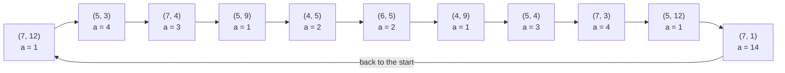

# Pell's equation: why the continued fraction of a square root gives every solution

[Syllabus](../../../SYLLABUS.md) → [Algebraic and analytic number theory](../README.md) → [Diophantine and Modular](../README.md#s07) → Pell's equation

---

## General Overview

In 1657 Pierre de Fermat challenged mathematicians in England and France to find whole numbers x and y with $`x^2 - 61y^2 = 1`$. Small cases are easy. For 60 the smallest answer is x = 31, y = 4. For 62 it is x = 63, y = 8.

For 61 the smallest answer is

- x = 1,766,319,049, a ten-digit number,
- y = 226,153,980.

Trying y = 1, 2, 3, … one at a time takes 226,153,980 tries. A **continued fraction** is faster. It writes a number as a whole part plus one over (a whole part plus one over …). Cutting it off after a few whole parts gives a fraction called a **convergent**. The continued fraction of $`\sqrt{61}`$ (root 61, the number that gives 61 when multiplied by itself) reaches the same pair at convergent number 21, counting from 0, using only small whole-number arithmetic. Bhaskara II had found this pair by a related method around 1150.

This card explains why that works for every whole number d that is not a perfect square. For a square root the list of whole parts repeats for ever. At the end of each repeat, the fraction built so far solves $`x^2 - dy^2 = 1`$ or its twin $`x^2 - dy^2 = -1`$. Every solution of the first one is one of these fractions.

The [Pell's equation](../../03-Algebra/10-For%20the%20Curious/04-pell-equation-and-root-two.md) card already solves $`x^2 - 2y^2 = 1`$ and gets every solution as a power of the first one. It leaves open where the first one comes from for other d. This card answers that.

```
Digits in the smallest x with x^2 - d y^2 = 1.  One block = one digit.

 d = 55  ██          89
 d = 56  ██          15
 d = 57  ███         151
 d = 58  █████       19603
 d = 59  ███         530
 d = 60  ██          31
 d = 61  ██████████  1766319049
 d = 62  ██          63
 d = 63  █           8
 d = 65  ███         129
 d = 66  ██          65
 d = 67  █████       48842
```

64 is missing: it is a perfect square, and then the equation has no solution with y above zero. 61 is the record: no d below 100 has a larger smallest x.

**The continued fraction of a square root repeats; the fraction cut off at the end of each repeat is a solution of $`x^2 - dy^2 = \pm 1`$; and every whole-number solution of $`x^2 - dy^2 = 1`$ is one of these fractions, so the first one found generates all of them.**

**What kind of fact this is:** a theorem about every non-square d. The repetition and the key identity are proved on this card in Why it works. One step, Legendre's test for when a fraction must be a continued-fraction stop, is stated with its source (Khinchin, chapter II). The code checks the claims for every non-square d up to 1,000, which is evidence, not proof.

---

## The formula

Some notation first, in words.

- $`[a_0; a_1, a_2, \dots]`$ is shorthand for the continued fraction $`a_0 + 1/(a_1 + 1/(a_2 + \dots))`$. The whole numbers $`a_k`$ are its **partial quotients**.
- $`p_k/q_k`$ is the fraction you get by cutting the list after $`a_k`$, called the k-th **convergent**. The [Continued fractions](../../02-Number%20theory/07-For%20the%20Curious/05-continued-fractions-and-leap-years.md) card calls these the stops. On this card q is always a denominator, never a modulus.
- A line over a block of partial quotients means the block repeats for ever.

For every whole number d that is not a perfect square, with $`a_0`$ the whole part of $`\sqrt{d}`$:

```math
\sqrt{d} = [\,a_0;\ \overline{a_1, a_2, \dots, a_{\ell-1}, 2a_0}\,], \qquad p_{k}^2 - d\,q_{k}^2 = (-1)^{k+1} c_{k+1}
```

**Read it aloud:** the partial quotients of root d repeat in blocks of length $`\ell`$, each block ending in twice the whole part; and the k-th convergent misses the equation by a small whole number $`c_{k+1}`$ that the expansion itself produces.

Here $`c_{k+1}`$ equals 1 exactly at the end of each block. So the convergents at $`k = \ell - 1, 2\ell - 1, \dots`$ give $`x^2 - dy^2 = \pm 1`$. The smallest solution of the +1 equation, the **fundamental solution** $`(x_1, y_1)`$, is

```math
(x_1, y_1) = \begin{cases} (p_{\ell-1},\, q_{\ell-1}) & \ell \text{ even} \\ (p_{2\ell-1},\, q_{2\ell-1}) & \ell \text{ odd} \end{cases} \qquad x_n + y_n\sqrt{d} = (x_1 + y_1\sqrt{d})^n
```

**Read it aloud:** take the convergent at the end of one block if the block length is even, or of two blocks if it is odd; every other solution is a power of that one.

For 61 the block is 1, 4, 3, 1, 2, 2, 1, 3, 4, 1, 14: eleven terms, an odd count. So one block gives $`29718^2 - 61 \times 3805^2 = -1`$, and two blocks give the ten-digit answer.

| Symbol | Plain meaning | In our example | Push it up and the answer… |
| --- | --- | --- | --- |
| $`d`$ | the whole number under the root, not a perfect square | 61 | no pattern: 60 gives x = 31, 61 gives ten digits |
| $`x`$, $`y`$ | the whole-number unknowns, both above zero | 1,766,319,049 and 226,153,980 | — |
| $`a_0`$ | the whole part of $`\sqrt{d}`$ | 7 | the block ends in a bigger $`2a_0`$ |
| $`a_k`$, $`[a_0; a_1, \dots]`$ | the k-th partial quotient, and the continued fraction they build | 1, 4, 3, 1, 2, … | — |
| $`\alpha_k`$ | the k-th **complete quotient**: what is left to expand after k steps, so $`a_k`$ is its whole part; $`\alpha_k'`$ is the same with $`-\sqrt{d}`$ | $`\alpha_1 = (7 + \sqrt{61})/12`$ | — |
| $`m_k`$, $`c_k`$ | the two whole numbers in $`\alpha_k = (m_k + \sqrt{d})/c_k`$ | $`m_1 = 7`$, $`c_1 = 12`$ | — |
| $`p_k`$, $`q_k`$ | top and bottom of the k-th convergent | 29718 and 3805 at k = 10 | the fraction gets closer to $`\sqrt{d}`$ |
| $`k`$ | which step, counting from 0 | 0 to 21 | — |
| $`\ell`$ | the block length, called the **period** | 11 | the first solution grows, roughly |
| $`(x_1, y_1)`$, $`(x_n, y_n)`$ | the fundamental solution, and the n-th solution | (1766319049, 226153980) for n = 1 | each step up in n multiplies x by about $`2x_1`$ |
| $`\varepsilon`$, $`\varepsilon_K`$, $`\mathbb{Q}(\sqrt{d})`$ | $`x_1 + y_1\sqrt{d}`$; the unit theorem's fundamental unit; the field of numbers $`a + b\sqrt{d}`$ with fractions a, b | $`\varepsilon_K = (39 + 5\sqrt{61})/2`$ | — |
| $`\lfloor\,\cdot\,\rfloor`$ | round down to a whole number | $`\lfloor 14/12 \rfloor = 1`$ | — |

### When it holds

- **d is not a perfect square.** For d = 64, $`\sqrt{64} = 8`$ and the expansion stops at once: $`[8]`$. Then $`x^2 - 64y^2 = (x - 8y)(x + 8y) = 1`$ forces y = 0. The code's search to y = 100,000 finds nothing.
- **The right-hand side is 1, and you watch the sign.** The block end gives $`(-1)^\ell`$. For 61 the period 11 is odd, so one block gives −1, not +1. Of the non-square d up to 1,000, 152 have an odd period.
- **You stop at the block end, not one step after.** The convergent at k = 11 is (440131, 56353), and it misses by 12, which is $`c_{12} = c_1`$.
- **x and y are positive whole numbers.** (1, 0) always solves the equation and gives nothing. Signs only flip copies of the solutions here.

---

## Why it works

### Step 0: the idea

Expanding $`\sqrt{d}`$ needs only two small whole numbers at each step, $`m_k`$ and $`c_k`$. They stay in a bounded range, so they must eventually repeat, and then the whole expansion repeats.

An identity ties each convergent to the equation: $`p_k^2 - d q_k^2`$ is always $`\pm c_{k+1}`$, so block ends give solutions. A test from approximation theory shows every solution is a convergent, so none is missed.

### Step 1: expand root d with whole numbers only

The [Continued fractions](../../02-Number%20theory/07-For%20the%20Curious/05-continued-fractions-and-leap-years.md) card builds a continued fraction by repeating two moves: write down the whole part, then flip what is left. For a fraction that is Euclid's algorithm. For $`\sqrt{d}`$ it can be done exactly, with no decimals, by tracking $`\alpha_k = (m_k + \sqrt{d})/c_k`$.

Start with $`m_0 = 0`$, $`c_0 = 1`$, $`a_0`$ = the whole part of $`\sqrt{d}`$. Then repeat:

```math
m_{k+1} = a_k c_k - m_k, \qquad c_{k+1} = \frac{d - m_{k+1}^2}{c_k}, \qquad a_{k+1} = \left\lfloor \frac{a_0 + m_{k+1}}{c_{k+1}} \right\rfloor
```

Here $`\lfloor\,\cdot\,\rfloor`$ means "round down to a whole number". The division for $`c_{k+1}`$ always comes out exact.

For 61, with $`a_0 = 7`$:

1. k = 1: $`m_1 = 1 \times 7 - 0 = 7`$, $`c_1 = (61 - 49)/1 = 12`$, $`a_1 = \lfloor 14/12 \rfloor = 1`$.
2. k = 2: $`m_2 = 12 \times 1 - 7 = 5`$, $`c_2 = (61 - 25)/12 = 3`$, $`a_2 = \lfloor 12/3 \rfloor = 4`$.
3. k = 3: $`m_3 = 3 \times 4 - 5 = 7`$, $`c_3 = (61 - 49)/3 = 4`$, $`a_3 = \lfloor 14/4 \rfloor = 3`$.

<details>
<summary>Detailed proof: the three update rules are one "whole part, then flip" step</summary>

Write $`\alpha_k = (m_k + \sqrt{d})/c_k`$. Its whole part is $`a_k`$. Subtract it:

$`\displaystyle \alpha_k - a_k = \frac{m_k - a_k c_k + \sqrt{d}}{c_k} = \frac{\sqrt{d} - m_{k+1}}{c_k}, \quad m_{k+1} = a_k c_k - m_k.`$

Flip it, and multiply top and bottom by $`\sqrt{d} + m_{k+1}`$ to clear the root from the bottom:

$`\displaystyle \alpha_{k+1} = \frac{c_k}{\sqrt{d} - m_{k+1}} = \frac{c_k\,(m_{k+1} + \sqrt{d})}{d - m_{k+1}^2} = \frac{m_{k+1} + \sqrt{d}}{c_{k+1}}.`$

**Exact division.** Suppose $`c_k`$ divides $`d - m_k^2`$. At k = 0, $`c_0 = 1`$ divides anything. For $`k \ge 1`$ it holds by the definition of $`c_k`$, which makes $`d - m_k^2 = c_k c_{k-1}`$. Since $`m_{k+1} = a_k c_k - m_k`$, the square $`m_{k+1}^2`$ leaves the same remainder as $`m_k^2`$ on division by $`c_k`$. So $`c_k`$ divides $`d - m_{k+1}^2`$ too, and $`c_{k+1}`$ is whole.

**The round-down rule.** $`\sqrt{d}`$ lies strictly between $`a_0`$ and $`a_0 + 1`$, and is not a whole number. So $`(m + \sqrt{d})/c`$ and $`(m + a_0)/c`$ have the same whole part whenever c is positive: no whole number fits between them.

</details>

### Step 2: the pair (m, c) is trapped, so it repeats

After the first step, the two numbers always satisfy

```math
0 < m_k \le a_0, \qquad 0 < c_k \le 2a_0 \qquad (k \ge 1)
```

So there are only finitely many possible pairs, and some pair must come round a second time. From then on every step repeats, because each step uses only the current pair.

More is true: the repeat starts straight after $`a_0`$. Each pair also determines the pair before it, so the steps can be run backwards without ambiguity. A path that can be run backwards uniquely and that comes back to some pair must come back to its first pair. It cannot join a cycle part way in, because the joining point would then have two different predecessors.

For 61 the pairs $`(m_k, c_k)`$ run round this cycle of eleven:



The only pair with c = 1 is (7, 1). There $`\alpha_{11} = 7 + \sqrt{61}`$, whose whole part is $`14 = 2a_0`$. The block also reads the same backwards before the 14: 1, 4, 3, 1, 2, 2, 1, 3, 4, 1. The code confirms both facts for all 969 non-square d up to 1,000. The first is proved in the fold below. The second is only checked here, to 1,000, not proved; Jacobson and Williams prove it for every d.

<details>
<summary>Detailed proof: the bounds, and why the block ends in 2a<sub>0</sub></summary>

Write $`\alpha_k' = (m_k - \sqrt{d})/c_k`$ for the **conjugate** of $`\alpha_k`$: the same expression with the sign of the root flipped.

**Claim.** For $`k \ge 1`$, $`\alpha_k > 1`$ and $`-1 < \alpha_k' < 0`$. At k = 1, $`\alpha_1 = 1/(\sqrt{d} - a_0) > 1`$ and $`\alpha_1' = -1/(\sqrt{d} + a_0)`$, which lies between −1 and 0. Then $`\alpha_{k+1} = 1/(\alpha_k - a_k) > 1`$, since $`0 < \alpha_k - a_k < 1`$. Flipping conjugates the same way as flipping the number itself, so $`\alpha_{k+1}' = 1/(\alpha_k' - a_k)`$. Since $`a_k \ge 1`$ and $`\alpha_k' < 0`$, the bottom is below −1, so $`\alpha_{k+1}'`$ lies between −1 and 0.

**Bounds.** Adding and subtracting the two numbers gives $`\alpha_k + \alpha_k' = 2m_k/c_k > 0`$ and $`\alpha_k - \alpha_k' = 2\sqrt{d}/c_k > 0`$. So $`m_k > 0`$ and $`c_k > 0`$. From $`\alpha_k' < 0`$, $`m_k < \sqrt{d}`$, so $`m_k \le a_0`$. From $`\alpha_k > 1`$, $`c_k < m_k + \sqrt{d} < 2a_0 + 1`$, so $`c_k \le 2a_0`$.

**Running backwards.** From $`\alpha_k' = a_k + 1/\alpha_{k+1}'`$, the number $`-1/\alpha_{k+1}'`$ equals $`a_k`$ plus something between 0 and 1. So $`a_k`$ is the whole part of $`-1/\alpha_{k+1}'`$, fixed by the later pair. Then $`m_k = a_k c_k - m_{k+1}`$ and $`c_k = (d - m_{k+1}^2)/c_{k+1}`$ follow. Each pair has exactly one predecessor.

**The block end.** The cycle returns to $`\alpha_1`$, say $`\alpha_{\ell+1} = \alpha_1`$. Then $`\alpha_\ell = a_\ell + 1/\alpha_1`$ and $`\sqrt{d} = a_0 + 1/\alpha_1`$, so $`\alpha_\ell = \sqrt{d} + (a_\ell - a_0)`$. That means $`c_\ell = 1`$ and $`m_\ell = a_\ell - a_0`$. Its conjugate $`m_\ell - \sqrt{d}`$ lies between −1 and 0, so $`m_\ell = a_0`$, and then $`a_\ell = 2a_0`$. Conversely $`c_k = 1`$ means $`\alpha_k = m_k + \sqrt{d}`$, whose next complete quotient is $`\alpha_1`$, so $`c_k = 1`$ happens only at block ends.

</details>

### Step 3: each convergent misses the equation by plus or minus c

The convergents are built as on the continued-fractions card: $`p_k = a_k p_{k-1} + p_{k-2}`$, the same for $`q_k`$, starting from $`p_{-1}/q_{-1} = 1/0`$ and $`p_{-2}/q_{-2} = 0/1`$.

Cutting the expansion after $`a_k`$ and putting the exact remainder $`\alpha_{k+1}`$ back in gives $`\sqrt{d}`$ exactly:

```math
\sqrt{d} = \frac{p_k\,\alpha_{k+1} + p_{k-1}}{q_k\,\alpha_{k+1} + q_{k-1}}
```

Substitute $`\alpha_{k+1} = (m_{k+1} + \sqrt{d})/c_{k+1}`$ and clear the fractions. The parts with and without $`\sqrt{d}`$ must match separately, because $`\sqrt{d}`$ is not a fraction. That gives two whole-number equations, and combining them gives the identity in the formula: $`p_k^2 - d\,q_k^2 = (-1)^{k+1} c_{k+1}`$.

Check it at k = 0: $`7^2 - 61 \times 1^2 = -12`$, and $`c_1 = 12`$ with sign $`(-1)^1`$. At k = 10, $`c_{11} = 1`$ and the sign is $`(-1)^{11}`$, so $`29718^2 - 61 \times 3805^2 = -1`$.

<details>
<summary>Detailed proof: from the exact expansion to the identity</summary>

Write m and c for $`m_{k+1}`$ and $`c_{k+1}`$. Cross-multiplying the display gives

$`\displaystyle \sqrt{d}\,\bigl(q_k (m + \sqrt{d}) + q_{k-1} c\bigr) = p_k (m + \sqrt{d}) + p_{k-1} c.`$

The parts without a root: $`d\,q_k = p_k m + p_{k-1} c`$. The parts with a root: $`q_k m + q_{k-1} c = p_k`$.

Multiply the first by $`q_k`$, the second by $`p_k`$, and subtract:

$`\displaystyle p_k^2 - d\,q_k^2 = c\,(p_k q_{k-1} - p_{k-1} q_k).`$

The bracket is $`(-1)^{k+1}`$. It is −1 at k = 0, since $`a_0 \cdot 0 - 1 \cdot 1 = -1`$. Each step changes its sign, because $`p_{k+1} q_k - p_k q_{k+1} = -(p_k q_{k-1} - p_{k-1} q_k)`$ after the recurrence is substituted.

</details>

### Step 4: every solution is a convergent

Take any solution with x and y above zero. Then x is bigger than $`y\sqrt{d}`$, and factoring $`x^2 - dy^2 = 1`$ gives

```math
\frac{x}{y} - \sqrt{d} = \frac{1}{y\,(x + y\sqrt{d})} < \frac{1}{2y^2}
```

because $`x + y\sqrt{d}`$ is bigger than $`2y`$. So $`x/y`$ sits within $`1/(2y^2)`$ of $`\sqrt{d}`$.

**Legendre's test** says that any fraction that close to a number is one of its convergents. Khinchin proves it in chapter II of *Continued Fractions*. It sharpens the continued-fractions card's statement that each stop is the best fraction of its size.

So $`x/y = p_k/q_k`$ for some k. Any common factor of x and y would divide $`x^2 - dy^2 = 1`$, so both fractions are in lowest terms, and x = $`p_k`$, y = $`q_k`$. By Step 3, $`1 = (-1)^{k+1} c_{k+1}`$. That needs $`c_{k+1} = 1`$, so $`k + 1`$ is a whole number of blocks, by Step 2. It also needs $`k + 1`$ even.

- If $`\ell`$ is even, every block end has the right sign. The first is at $`k = \ell - 1`$.
- If $`\ell`$ is odd, only even numbers of blocks work. The first is at $`k = 2\ell - 1`$.

The convergents grow with k, so the first block end with the right sign gives the smallest solution. For 61 that is k = 21. This step also proves existence: every non-square d has a period, so every non-square d has a solution.

### Step 5: the first solution generates all the others

The Pell's equation card proves this for d = 2 by running a step backwards. The same argument works for any d, in the language of powers.

Write $`\varepsilon = x_1 + y_1\sqrt{d}`$. Its **norm**, $`x_1^2 - dy_1^2`$, is 1. Norms multiply, so every power $`\varepsilon^n`$ also gives a solution.

Conversely, take any solution $`x + y\sqrt{d}`$ with x and y above zero. It is bigger than 1, so it lies between two powers: $`\varepsilon^n \le x + y\sqrt{d} < \varepsilon^{n+1}`$.

Divide by $`\varepsilon^n`$, which means multiplying by $`(x_1 - y_1\sqrt{d})^n`$, so the result still has whole-number parts. This quotient has norm 1, is at least 1, and is below $`\varepsilon`$.

Suppose the quotient were above 1. Its reciprocal, the same pair with the sign of the root flipped, would lie between 0 and 1. Adding the two gives twice the whole part, so that part is positive. Subtracting gives twice the root part, so that is positive too. The quotient would be a positive solution smaller than $`\varepsilon`$, which is impossible. So the quotient is 1, and the solution is $`\varepsilon^n`$.

Step 4 and Step 5 agree on 61. The convergents with $`p_k^2 - 61q_k^2 = +1`$ up to k = 43 sit at k = 21 and 43. The convergent at k = 43 equals $`\varepsilon^2`$, and the one at k = 65 equals $`\varepsilon^3`$.

<details>
<summary>Where this sits among units: the unit theorem for root 61</summary>

A solution $`x + y\sqrt{61}`$ has norm 1, so it is a **unit**: its reciprocal $`x - y\sqrt{61}`$ is also whole. [The unit theorem](../06-Algebraic%20Numbers/07-dirichlets-unit-theorem.md) says the units of the ring of integers of $`\mathbb{Q}(\sqrt{61})`$ are $`\pm \varepsilon_K^n`$ for one **fundamental unit** $`\varepsilon_K`$.

Because 61 leaves remainder 1 on division by 4, that ring also contains halves. Its fundamental unit is $`\varepsilon_K = (39 + 5\sqrt{61})/2`$, with norm $`(39^2 - 61 \times 5^2)/4 = -1`$.

Its cube is $`29718 + 3805\sqrt{61}`$, the one-block convergent. Its sixth power is $`\varepsilon`$, the ten-digit solution. The code computes the cube directly.

</details>

---

## Worked numbers, by hand

The first eleven steps for d = 61, from the update rules of Step 1 and the convergent recurrence of Step 3. The last column is $`p_k^2 - 61q_k^2`$.

| k | $`m_k`$ | $`c_k`$ | $`a_k`$ | $`p_k`$ | $`q_k`$ | $`p_k^2 - 61q_k^2`$ |
| ---: | ---: | ---: | ---: | ---: | ---: | ---: |
| 0 | 0 | 1 | 7 | 7 | 1 | −12 |
| 1 | 7 | 12 | 1 | 8 | 1 | 3 |
| 2 | 5 | 3 | 4 | 39 | 5 | −4 |
| 3 | 7 | 4 | 3 | 125 | 16 | 9 |
| 4 | 5 | 9 | 1 | 164 | 21 | −5 |
| 5 | 4 | 5 | 2 | 453 | 58 | 5 |
| 6 | 6 | 5 | 2 | 1070 | 137 | −9 |
| 7 | 4 | 9 | 1 | 1523 | 195 | 4 |
| 8 | 5 | 4 | 3 | 5639 | 722 | −3 |
| 9 | 7 | 3 | 4 | 24079 | 3083 | 12 |
| 10 | 5 | 12 | 1 | 29718 | 3805 | −1 |
| 11 | 7 | 1 | 14 | 440131 | 56353 | 12 |

Each value in the last column is the next row's $`c`$ with sign $`(-1)^{k+1}`$, as Step 3 says. Then square the one-block answer, which is the same as running a second block:

| Step | Arithmetic | Value |
| --- | --- | --- |
| period | first k ≥ 1 with $`c_k = 1`$ | 11, odd |
| one block | $`29718^2 - 61 \times 3805^2`$ | −1 |
| top of the square | $`29718^2 + 61 \times 3805^2`$ | 1,766,319,049 |
| bottom of the square | $`2 \times 29718 \times 3805`$ | 226,153,980 |
| check | $`x^2 - 61y^2`$ | **1** |

**The smallest solution is x = 1,766,319,049, y = 226,153,980.** The −1 pair, squared, gives +1 because $`(-1) \times (-1) = 1`$; the code confirms that the convergent at k = 21 is the same pair.

### What breaks if you drop a piece

| Mistake | Comes out at | What went wrong |
| --- | --- | --- |
| Stop after one block for d = 61 | (29718, 3805), norm −1 | The period 11 is odd, so one block gives the −1 equation |
| Take the convergent one step later, k = 11 | (440131, 56353), norm 12 | The block ends at k = 10; at k = 11, $`c_{12} = 12`$ |
| Use a perfect square, d = 64 | $`[8]`$, no solution to y = 100,000 | Hypothesis fails: $`x^2 - 64y^2`$ factors, forcing y = 0 |
| Search y = 1, 2, 3, … for d = 61 | nothing up to y = 1,000,000 | The answer needs y = 226,153,980 |

The code prints all four.

---

## Code, from first principles, and it actually runs

The code takes three independent roads. Road 1 runs the whole-number expansion of Step 1 and builds the convergents. Road 2 is brute force: for every non-square d up to 100 it tries y = 1, 2, 3, … up to 100,000 until $`dy^2 + 1`$ is a perfect square. Road 3 is algebra: it cubes $`(39 + 5\sqrt{61})/2`$, which shares no step with the expansion, and checks that squaring Road 1's one-block pair gives the two-block answer. It then checks the Step 2 facts for every non-square d up to 1,000. The only import is `math.isqrt`, a whole-number square root; Rust writes its own.

### Python

```python
# Pell's equation from the continued fraction of a square root -- the check
# behind the card.  Standard library only; math.isqrt is the one import.
# Road 1: the continued fraction of root d, run in whole numbers (m, c, a).
# Road 2: brute force, trying y = 1, 2, 3, ... until d*y*y + 1 is a square.
# Road 3: algebra, multiplying units of the form x + y*root(d).
from math import isqrt

def expand(d, terms):              # states (m_k, c_k, a_k): alpha_k = (m_k + root d) / c_k
    a0 = isqrt(d)
    m, c, a = 0, 1, a0
    out = [(m, c, a)]
    for _ in range(terms - 1):
        m = c * a - m
        c = (d - m * m) // c       # always exact: c_k divides d - m_(k+1)^2
        a = (a0 + m) // c
        out.append((m, c, a))
    return out

def convergents(states):           # p_k / q_k from p_k = a_k p_(k-1) + p_(k-2)
    p0, p1, q0, q1, out = 0, 1, 1, 0, []
    for _, _, a in states:
        p0, p1 = p1, a * p1 + p0
        q0, q1 = q1, a * q1 + q0
        out.append((p1, q1))
    return out

def period(d):                     # first k >= 1 with c_k = 1
    k = 1
    while expand(d, k + 1)[k][1] != 1:
        k += 1
    return k

def fundamental(d):                # convergent at the end of one period, or two if odd
    l = period(d)
    k = l - 1 if l % 2 == 0 else 2 * l - 1
    return convergents(expand(d, k + 1))[k]

def brute(d, ymax):                # road 2: the first y with d y^2 + 1 a perfect square
    for y in range(1, ymax + 1):
        n = d * y * y + 1
        if isqrt(n) ** 2 == n:
            return isqrt(n), y
    return None

def mul(u, v, d):                  # (x1 + y1 root d)(x2 + y2 root d)
    return (u[0] * v[0] + d * u[1] * v[1], u[0] * v[1] + u[1] * v[0])

def yn(b):
    return "yes" if b else "no"

D = 61
st = expand(D, 67)
cv = convergents(st)
norm = [p * p - D * q * q for p, q in cv]
l = period(D)
print(f"root {D}: a0 = {st[0][2]}, period length {l} ({'odd' if l % 2 else 'even'})")
print(" k m_k c_k a_k    p_k   q_k  p_k^2 - 61 q_k^2")
for k in range(12):
    print(f"{k:>2} {st[k][0]:>3} {st[k][1]:>3} {st[k][2]:>3} {cv[k][0]:>6} {cv[k][1]:>5} {norm[k]:>5}")
print("continued fraction:", [a for _, _, a in st[:12]])
ident = all(norm[k] == (-1) ** (k + 1) * st[k + 1][1] for k in range(44))
print(f"p_k^2 - 61 q_k^2 = (-1)^(k+1) c_(k+1) for k = 0..43: {yn(ident)}")
ones = [k for k in range(67) if st[k][1] == 1]
print(f"c_k = 1 at k = {ones}")
x1, y1 = fundamental(D)
print(f"one period, k = 10: ({cv[10][0]}, {cv[10][1]}), norm {norm[10]}")
print(f"two periods, k = 21: ({x1}, {y1}), norm {x1 * x1 - D * y1 * y1}; x has {len(str(x1))} digits")
print(f"(29718 + 3805 root 61)^2 = {mul(cv[10], cv[10], D)}")
h = (39, 5)                        # (39 + 5 root 61) / 2, kept as its doubled pair
h3 = mul(mul(h, h, D), h, D)
print(f"(39 + 5 root 61)/2: norm {(39 * 39 - D * 25) // 4}; cubed = {h3[0] // 8} + {h3[1] // 8} root 61")
pw, same = (1, 0), []
for n in (1, 2, 3):
    pw = mul(pw, (x1, y1), D)
    same.append(cv[22 * n - 1] == pw)
    print(f"solution {n}: convergent k = {22 * n - 1} is {cv[22 * n - 1]}; "
          f"equals power {n}: {yn(cv[22 * n - 1] == pw)}")
plus = [k for k in range(44) if norm[k] == 1]
print(f"convergents with norm +1, k = 0..43: {plus}")
YMAX = 100000
ds = [d for d in range(2, 101) if isqrt(d) ** 2 != d]
fund = {d: fundamental(d) for d in ds}
bf = {d: brute(d, YMAX) for d in ds}
agree = [d for d in ds if bf[d] == fund[d]]
none = [d for d in ds if bf[d] is None]
beyond = [d for d in ds if fund[d][1] > YMAX]
print(f"nonsquare d up to 100: {len(ds)}; brute force to y = {YMAX:,} agrees on {len(agree)}")
print(f"brute force finds nothing for d = {none}; their y = {[fund[d][1] for d in none]}, all beyond {YMAX:,}: {yn(none == beyond)}")
rec = max(ds, key=lambda d: fund[d][0])
print(f"largest smallest x below 100: d = {rec}, x = {fund[rec][0]}")
print(f"root 13: period {period(13)}, first +1 solution at k = 9: {fundamental(13)}")
for d in range(55, 68):
    if d != 64:
        n = len(str(fund[d][0]))
        print(f"bar,{d},{n},{'#' * n},x = {fund[d][0]}, y = {fund[d][1]}")
sw = [d for d in range(2, 1001) if isqrt(d) ** 2 != d]
ends = pal = bounds = onlyends = True
odd = 0
for d in sw:
    a0, L = isqrt(d), period(d)
    s = expand(d, 3 * L + 1)
    a = [t[2] for t in s[1:L + 1]]
    ends &= a[-1] == 2 * a0
    pal &= a[:-1] == a[-2::-1]
    bounds &= all(0 < t[0] <= a0 and 0 < t[1] <= 2 * a0 for t in s[1:])
    onlyends &= [k for k, t in enumerate(s) if t[1] == 1] == [0, L, 2 * L, 3 * L]
    odd += L % 2
print(f"nonsquare d up to 1,000: {len(sw)}; every period ends in 2 a0: {yn(ends)}; "
      f"rest reads the same backwards: {yn(pal)}")
print(f"0 < m_k <= a0 and 0 < c_k <= 2 a0 throughout: {yn(bounds)}; "
      f"c_k = 1 only at period ends: {yn(onlyends)}; odd periods: {odd}")
print(f"mistake, one step too far (k = 11): ({cv[11][0]}, {cv[11][1]}), norm {norm[11]}")
print(f"mistake, d = 64 a square: root 64 = [8], stops; brute force to y = {YMAX:,}: {brute(64, YMAX)}")
print(f"mistake, brute force on 61 to y = 1,000,000: {brute(D, 10 ** 6)}")
assert l == 11 and (cv[10], norm[10]) == ((29718, 3805), -1)          # one period gives -1
assert (x1, y1) == (1766319049, 226153980) and x1 * x1 - D * y1 * y1 == 1
assert mul(cv[10], cv[10], D) == (x1, y1) and h3 == (8 * 29718, 8 * 3805)   # algebra road
assert ident and ones == [0, 11, 22, 33, 44, 55, 66] and plus == [21, 43] and all(same)
assert agree == [d for d in ds if d not in beyond] and none == beyond      # brute-force road
assert ends and pal and bounds and onlyends and brute(64, YMAX) is None
print("ALL CHECKS PASS")
```

**Ran 2026-11-15 on macOS, Python 3.14.10, standard library only. All checks passed. Output, pasted from the run:**

```
root 61: a0 = 7, period length 11 (odd)
 k m_k c_k a_k    p_k   q_k  p_k^2 - 61 q_k^2
 0   0   1   7      7     1   -12
 1   7  12   1      8     1     3
 2   5   3   4     39     5    -4
 3   7   4   3    125    16     9
 4   5   9   1    164    21    -5
 5   4   5   2    453    58     5
 6   6   5   2   1070   137    -9
 7   4   9   1   1523   195     4
 8   5   4   3   5639   722    -3
 9   7   3   4  24079  3083    12
10   5  12   1  29718  3805    -1
11   7   1  14 440131 56353    12
continued fraction: [7, 1, 4, 3, 1, 2, 2, 1, 3, 4, 1, 14]
p_k^2 - 61 q_k^2 = (-1)^(k+1) c_(k+1) for k = 0..43: yes
c_k = 1 at k = [0, 11, 22, 33, 44, 55, 66]
one period, k = 10: (29718, 3805), norm -1
two periods, k = 21: (1766319049, 226153980), norm 1; x has 10 digits
(29718 + 3805 root 61)^2 = (1766319049, 226153980)
(39 + 5 root 61)/2: norm -1; cubed = 29718 + 3805 root 61
solution 1: convergent k = 21 is (1766319049, 226153980); equals power 1: yes
solution 2: convergent k = 43 is (6239765965720528801, 798920165762330040); equals power 2: yes
solution 3: convergent k = 65 is (22042834973108102061352541449, 2822295814832482312327709940); equals power 3: yes
convergents with norm +1, k = 0..43: [21, 43]
nonsquare d up to 100: 90; brute force to y = 100,000 agrees on 86
brute force finds nothing for d = [61, 73, 94, 97]; their y = [226153980, 267000, 221064, 6377352], all beyond 100,000: yes
largest smallest x below 100: d = 61, x = 1766319049
root 13: period 5, first +1 solution at k = 9: (649, 180)
bar,55,2,##,x = 89, y = 12
bar,56,2,##,x = 15, y = 2
bar,57,3,###,x = 151, y = 20
bar,58,5,#####,x = 19603, y = 2574
bar,59,3,###,x = 530, y = 69
bar,60,2,##,x = 31, y = 4
bar,61,10,##########,x = 1766319049, y = 226153980
bar,62,2,##,x = 63, y = 8
bar,63,1,#,x = 8, y = 1
bar,65,3,###,x = 129, y = 16
bar,66,2,##,x = 65, y = 8
bar,67,5,#####,x = 48842, y = 5967
nonsquare d up to 1,000: 969; every period ends in 2 a0: yes; rest reads the same backwards: yes
0 < m_k <= a0 and 0 < c_k <= 2 a0 throughout: yes; c_k = 1 only at period ends: yes; odd periods: 152
mistake, one step too far (k = 11): (440131, 56353), norm 12
mistake, d = 64 a square: root 64 = [8], stops; brute force to y = 100,000: None
mistake, brute force on 61 to y = 1,000,000: None
ALL CHECKS PASS
```

### Rust

Same numbers, same labels, built with `rustc --edition 2021 -O`. It uses u128 and i128 whole numbers, with overflow checked in the convergent and power arithmetic.

```rust
// Pell's equation from the continued fraction of a square root -- the same
// check as the Python, in Rust.  No crates; u128 and i128 with checked overflow.
// Road 1: the continued fraction of root d, run in whole numbers (m, c, a).
// Road 2: brute force, trying y = 1, 2, 3, ... until d*y*y + 1 is a square.
// Road 3: algebra, multiplying units of the form x + y*root(d).
type Pair = (u128, u128);

fn isqrt(n: u128) -> u128 {                     // whole square root, corrected after f64
    let mut r = (n as f64).sqrt() as u128;
    while r * r > n { r -= 1 }
    while (r + 1) * (r + 1) <= n { r += 1 }
    r
}

fn expand(d: u128, terms: usize) -> Vec<(u128, u128, u128)> {  // (m_k, c_k, a_k)
    let a0 = isqrt(d);
    let (mut m, mut c, mut a) = (0u128, 1u128, a0);
    let mut out = vec![(m, c, a)];
    for _ in 1..terms {
        m = c * a - m;
        c = (d - m * m) / c;                    // always exact: c_k divides d - m_(k+1)^2
        a = (a0 + m) / c;
        out.push((m, c, a));
    }
    out
}

fn ck(a: u128, b: u128) -> u128 { a.checked_mul(b).expect("overflow") }
fn ca(a: u128, b: u128) -> u128 { a.checked_add(b).expect("overflow") }

fn convergents(states: &[(u128, u128, u128)]) -> Vec<Pair> {  // p_k = a_k p_(k-1) + p_(k-2)
    let (mut p0, mut p1, mut q0, mut q1) = (0u128, 1u128, 1u128, 0u128);
    let mut out = Vec::new();
    for &(_, _, a) in states {
        let (p, q) = (ca(ck(a, p1), p0), ca(ck(a, q1), q0));
        p0 = p1; p1 = p; q0 = q1; q1 = q;
        out.push((p, q));
    }
    out
}

fn period(d: u128) -> usize {                   // first k >= 1 with c_k = 1
    let mut k = 1;
    while expand(d, k + 1)[k].1 != 1 { k += 1 }
    k
}

fn fundamental(d: u128) -> Pair {               // one period's end, or two if odd
    let l = period(d);
    let k = if l % 2 == 0 { l - 1 } else { 2 * l - 1 };
    convergents(&expand(d, k + 1))[k]
}

fn brute(d: u128, ymax: u128) -> Option<Pair> { // road 2: first y with d y^2 + 1 square
    for y in 1..=ymax {
        let n = d * y * y + 1;
        let r = isqrt(n);
        if r * r == n { return Some((r, y)) }
    }
    None
}

fn mul(u: Pair, v: Pair, d: u128) -> Pair {     // (x1 + y1 root d)(x2 + y2 root d)
    (ca(ck(u.0, v.0), ck(d, ck(u.1, v.1))), ca(ck(u.0, v.1), ck(u.1, v.0)))
}

fn norm(p: Pair, d: u128) -> i128 {
    let (x, y) = (p.0 as i128, p.1 as i128);
    x.checked_mul(x).unwrap() - (d as i128) * y.checked_mul(y).unwrap()
}

fn yn(b: bool) -> &'static str { if b { "yes" } else { "no" } }
fn show(o: Option<Pair>) -> String { match o { Some(p) => format!("{:?}", p), None => "None".into() } }
fn list<T: std::fmt::Display>(v: &[T]) -> String {
    format!("[{}]", v.iter().map(|x| x.to_string()).collect::<Vec<_>>().join(", "))
}

fn main() {
    let d: u128 = 61;
    let st = expand(d, 67);
    let cv = convergents(&st);
    let nm: Vec<i128> = (0..44).map(|k| norm(cv[k], d)).collect();
    let l = period(d);
    println!("root {}: a0 = {}, period length {} ({})", d, st[0].2, l, if l % 2 == 1 { "odd" } else { "even" });
    println!(" k m_k c_k a_k    p_k   q_k  p_k^2 - 61 q_k^2");
    for k in 0..12 {
        println!("{:>2} {:>3} {:>3} {:>3} {:>6} {:>5} {:>5}", k, st[k].0, st[k].1, st[k].2, cv[k].0, cv[k].1, nm[k]);
    }
    let cf: Vec<u128> = st[..12].iter().map(|t| t.2).collect();
    println!("continued fraction: {}", list(&cf));
    let ident = (0..44).all(|k| nm[k] == if k % 2 == 0 { -1 } else { 1 } * st[k + 1].1 as i128);
    println!("p_k^2 - 61 q_k^2 = (-1)^(k+1) c_(k+1) for k = 0..43: {}", yn(ident));
    let ones: Vec<usize> = (0..67).filter(|&k| st[k].1 == 1).collect();
    println!("c_k = 1 at k = {}", list(&ones));
    let (x1, y1) = fundamental(d);
    println!("one period, k = 10: ({}, {}), norm {}", cv[10].0, cv[10].1, nm[10]);
    println!("two periods, k = 21: ({}, {}), norm {}; x has {} digits", x1, y1, norm((x1, y1), d), x1.to_string().len());
    let sq = mul(cv[10], cv[10], d);
    println!("(29718 + 3805 root 61)^2 = ({}, {})", sq.0, sq.1);
    let h: Pair = (39, 5);                      // (39 + 5 root 61) / 2, kept as its doubled pair
    let h3 = mul(mul(h, h, d), h, d);
    println!("(39 + 5 root 61)/2: norm {}; cubed = {} + {} root 61", (39 * 39 - 61 * 25) / 4, h3.0 / 8, h3.1 / 8);
    let (mut pw, mut same) = ((1u128, 0u128), true);
    for n in 1..=3usize {
        pw = mul(pw, (x1, y1), d);
        let c = cv[22 * n - 1];
        same &= c == pw;
        println!("solution {}: convergent k = {} is ({}, {}); equals power {}: {}", n, 22 * n - 1, c.0, c.1, n, yn(c == pw));
    }
    let plus: Vec<usize> = (0..44).filter(|&k| nm[k] == 1).collect();
    println!("convergents with norm +1, k = 0..43: {}", list(&plus));
    let ymax: u128 = 100000;
    let ds: Vec<u128> = (2..101).filter(|&e| isqrt(e) * isqrt(e) != e).collect();
    let fund: Vec<Pair> = ds.iter().map(|&e| fundamental(e)).collect();
    let bf: Vec<Option<Pair>> = ds.iter().map(|&e| brute(e, ymax)).collect();
    let agree: Vec<u128> = (0..ds.len()).filter(|&i| bf[i] == Some(fund[i])).map(|i| ds[i]).collect();
    let none: Vec<u128> = (0..ds.len()).filter(|&i| bf[i].is_none()).map(|i| ds[i]).collect();
    let beyond: Vec<u128> = (0..ds.len()).filter(|&i| fund[i].1 > ymax).map(|i| ds[i]).collect();
    println!("nonsquare d up to 100: {}; brute force to y = 100,000 agrees on {}", ds.len(), agree.len());
    let ny: Vec<u128> = (0..ds.len()).filter(|&i| bf[i].is_none()).map(|i| fund[i].1).collect();
    println!("brute force finds nothing for d = {}; their y = {}, all beyond 100,000: {}", list(&none), list(&ny), yn(none == beyond));
    let ri = (0..ds.len()).max_by_key(|&i| fund[i].0).unwrap();
    println!("largest smallest x below 100: d = {}, x = {}", ds[ri], fund[ri].0);
    println!("root 13: period {}, first +1 solution at k = 9: {:?}", period(13), fundamental(13));
    for e in 55..68u128 {
        if e != 64 {
            let (x, y) = fundamental(e);
            let n = x.to_string().len();
            println!("bar,{},{},{},x = {}, y = {}", e, n, "#".repeat(n), x, y);
        }
    }
    let sw: Vec<u128> = (2..1001).filter(|&e| isqrt(e) * isqrt(e) != e).collect();
    let (mut ends, mut pal, mut bounds, mut onlyends, mut odd) = (true, true, true, true, 0);
    for &e in &sw {
        let (a0, ll) = (isqrt(e), period(e));
        let s = expand(e, 3 * ll + 1);
        let a: Vec<u128> = s[1..=ll].iter().map(|t| t.2).collect();
        ends &= a[ll - 1] == 2 * a0;
        let mid: Vec<u128> = a[..ll - 1].to_vec();
        let mut rev = mid.clone();
        rev.reverse();
        pal &= mid == rev;
        bounds &= s[1..].iter().all(|t| 0 < t.0 && t.0 <= a0 && 0 < t.1 && t.1 <= 2 * a0);
        let o: Vec<usize> = (0..s.len()).filter(|&k| s[k].1 == 1).collect();
        onlyends &= o == vec![0, ll, 2 * ll, 3 * ll];
        odd += ll % 2;
    }
    println!("nonsquare d up to 1,000: {}; every period ends in 2 a0: {}; rest reads the same backwards: {}", sw.len(), yn(ends), yn(pal));
    println!("0 < m_k <= a0 and 0 < c_k <= 2 a0 throughout: {}; c_k = 1 only at period ends: {}; odd periods: {}", yn(bounds), yn(onlyends), odd);
    println!("mistake, one step too far (k = 11): ({}, {}), norm {}", cv[11].0, cv[11].1, nm[11]);
    println!("mistake, d = 64 a square: root 64 = [8], stops; brute force to y = 100,000: {}", show(brute(64, ymax)));
    println!("mistake, brute force on 61 to y = 1,000,000: {}", show(brute(d, 1000000)));
    assert!(l == 11 && cv[10] == (29718, 3805) && nm[10] == -1);              // one period gives -1
    assert!((x1, y1) == (1766319049, 226153980) && norm((x1, y1), d) == 1);
    assert!(sq == (x1, y1) && h3 == (8 * 29718, 8 * 3805));                  // algebra road
    assert!(ident && ones == vec![0, 11, 22, 33, 44, 55, 66] && plus == vec![21, 43] && same);
    let rest: Vec<u128> = ds.iter().copied().filter(|e| !beyond.contains(e)).collect();
    assert!(agree == rest && none == beyond);                                  // brute-force road
    assert!(ends && pal && bounds && onlyends && brute(64, ymax).is_none());
    println!("ALL CHECKS PASS");
}
```

**Ran 2026-11-15 on macOS, rustc 1.98.1, no crates. All checks passed. Output, pasted from the run:**

```
root 61: a0 = 7, period length 11 (odd)
 k m_k c_k a_k    p_k   q_k  p_k^2 - 61 q_k^2
 0   0   1   7      7     1   -12
 1   7  12   1      8     1     3
 2   5   3   4     39     5    -4
 3   7   4   3    125    16     9
 4   5   9   1    164    21    -5
 5   4   5   2    453    58     5
 6   6   5   2   1070   137    -9
 7   4   9   1   1523   195     4
 8   5   4   3   5639   722    -3
 9   7   3   4  24079  3083    12
10   5  12   1  29718  3805    -1
11   7   1  14 440131 56353    12
continued fraction: [7, 1, 4, 3, 1, 2, 2, 1, 3, 4, 1, 14]
p_k^2 - 61 q_k^2 = (-1)^(k+1) c_(k+1) for k = 0..43: yes
c_k = 1 at k = [0, 11, 22, 33, 44, 55, 66]
one period, k = 10: (29718, 3805), norm -1
two periods, k = 21: (1766319049, 226153980), norm 1; x has 10 digits
(29718 + 3805 root 61)^2 = (1766319049, 226153980)
(39 + 5 root 61)/2: norm -1; cubed = 29718 + 3805 root 61
solution 1: convergent k = 21 is (1766319049, 226153980); equals power 1: yes
solution 2: convergent k = 43 is (6239765965720528801, 798920165762330040); equals power 2: yes
solution 3: convergent k = 65 is (22042834973108102061352541449, 2822295814832482312327709940); equals power 3: yes
convergents with norm +1, k = 0..43: [21, 43]
nonsquare d up to 100: 90; brute force to y = 100,000 agrees on 86
brute force finds nothing for d = [61, 73, 94, 97]; their y = [226153980, 267000, 221064, 6377352], all beyond 100,000: yes
largest smallest x below 100: d = 61, x = 1766319049
root 13: period 5, first +1 solution at k = 9: (649, 180)
bar,55,2,##,x = 89, y = 12
bar,56,2,##,x = 15, y = 2
bar,57,3,###,x = 151, y = 20
bar,58,5,#####,x = 19603, y = 2574
bar,59,3,###,x = 530, y = 69
bar,60,2,##,x = 31, y = 4
bar,61,10,##########,x = 1766319049, y = 226153980
bar,62,2,##,x = 63, y = 8
bar,63,1,#,x = 8, y = 1
bar,65,3,###,x = 129, y = 16
bar,66,2,##,x = 65, y = 8
bar,67,5,#####,x = 48842, y = 5967
nonsquare d up to 1,000: 969; every period ends in 2 a0: yes; rest reads the same backwards: yes
0 < m_k <= a0 and 0 < c_k <= 2 a0 throughout: yes; c_k = 1 only at period ends: yes; odd periods: 152
mistake, one step too far (k = 11): (440131, 56353), norm 12
mistake, d = 64 a square: root 64 = [8], stops; brute force to y = 100,000: None
mistake, brute force on 61 to y = 1,000,000: None
ALL CHECKS PASS
```

The two outputs match line for line.

### Lean

Lean proves the card's main claims for every whole number d that is not a perfect square, and checks the worked numbers for 61.

- The partial quotients of root d repeat straight after $`a_0`$, in a block that ends in $`2a_0`$.
- Take positive whole numbers x and y. Then $`x^2 - dy^2 = 1`$ exactly when $`(x, y) = (p_k, q_k)`$ at a block end with $`k + 1`$ even.
- Legendre's test, used in Step 4, is checked by Lean too, not quoted from a book.
- Take the fundamental solution $`(x_1, y_1)`$ and positive whole numbers x and y. Then $`x^2 - dy^2 = 1`$ exactly when $`x + y\sqrt{d} = (x_1 + y_1\sqrt{d})^n`$ for some $`n \ge 1`$.
- Lean confirms the worked numbers for 61: the table, the ten-digit answer, and the cube of $`(39 + 5\sqrt{61})/2`$.

The searches and counts up to 1,000, and the block reading the same backwards, are left to the Python and Rust checks.

```lean
-- Pell's equation: the positive solutions of x^2 - d y^2 = 1 are exactly the continued-fraction convergents of root d at block ends with the right sign, the expansion of root d repeats in blocks ending in twice its whole part, and every solution is a power of the smallest one.
import Mathlib.Algebra.ContinuedFractions.Computation.Basic
import Mathlib.Algebra.ContinuedFractions.Translations
import Mathlib.Algebra.Order.Floor.Defs
import Mathlib.Analysis.Real.Sqrt
import Mathlib.Algebra.Group.Even
import Mathlib.Order.Bounds.Defs
import Mathlib.Tactic.NormNum
import Mathlib.NumberTheory.Pell
import Mathlib.NumberTheory.DiophantineApproximation.ContinuedFractions
import Mathlib.Algebra.ContinuedFractions.Computation.ApproximationCorollaries
import Mathlib.Algebra.ContinuedFractions.ContinuantsRecurrence
import Mathlib.NumberTheory.Real.Irrational
import Mathlib.Tactic

open Real

namespace PellCF

/-- One step of the integer recursion `(P, Q) ↦ (a Q - P, (d - (a Q - P)^2) / Q)`. -/
noncomputable def step (d : ℕ) (pq : ℤ × ℤ) : ℤ × ℤ :=
  (⌊((pq.1 : ℝ) + √(d : ℝ)) / pq.2⌋ * pq.2 - pq.1,
   ((d : ℤ) - (⌊((pq.1 : ℝ) + √(d : ℝ)) / pq.2⌋ * pq.2 - pq.1) ^ 2) / pq.2)

noncomputable def PQ (d n : ℕ) : ℤ × ℤ := (step d)^[n] (0, 1)

noncomputable def X (d n : ℕ) : ℝ := (((PQ d n).1 : ℝ) + √(d : ℝ)) / (PQ d n).2

noncomputable def Y (d n : ℕ) : ℝ := (((PQ d n).1 : ℝ) - √(d : ℝ)) / (PQ d n).2

noncomputable def A (d n : ℕ) : ℤ := ⌊X d n⌋

lemma PQ_succ (d n : ℕ) : PQ d (n + 1) = step d (PQ d n) := by
  unfold PQ; rw [Function.iterate_succ_apply']

lemma PQ_add (d i m : ℕ) : PQ d (i + m) = (step d)^[i] (PQ d m) := by
  unfold PQ; rw [Function.iterate_add_apply]

lemma P_succ (d n : ℕ) : (PQ d (n + 1)).1 = A d n * (PQ d n).2 - (PQ d n).1 := by
  rw [PQ_succ]; rfl

lemma Q_succ (d n : ℕ) :
    (PQ d (n + 1)).2 = ((d : ℤ) - (PQ d (n + 1)).1 ^ 2) / (PQ d n).2 := by
  rw [P_succ, PQ_succ]; rfl

lemma PQ_zero (d : ℕ) : PQ d 0 = (0, 1) := rfl

lemma X_zero (d : ℕ) : X d 0 = √(d : ℝ) := by
  simp [X, PQ_zero]

lemma A_zero (d : ℕ) : A d 0 = Nat.sqrt d := by
  rw [A, X_zero, Real.floor_real_sqrt_eq_nat_sqrt]

lemma irr (d : ℕ) (hd : ¬ IsSquare d) : Irrational (√(d : ℝ)) :=
  irrational_sqrt_natCast_iff.mpr hd

lemma lin_indep (d : ℕ) (hd : ¬ IsSquare d) (u v : ℤ) (h : (u : ℝ) + v * √(d : ℝ) = 0) :
    u = 0 ∧ v = 0 := by
  have hv : v = 0 := by
    by_contra hv
    have hv' : (v : ℝ) ≠ 0 := by exact_mod_cast hv
    have : √(d : ℝ) = ((-u : ℤ) : ℝ) / (v : ℝ) := by
      push_cast; field_simp; linarith
    exact (irrational_iff_ne_rational _).mp (irr d hd) (-u) v hv this
  subst hv
  simp at h
  exact ⟨by exact_mod_cast h, rfl⟩

lemma d_sub_sq_ne (d : ℕ) (hd : ¬ IsSquare d) (P : ℤ) : (d : ℤ) - P ^ 2 ≠ 0 := by
  intro h
  apply hd
  refine ⟨P.natAbs, ?_⟩
  have : (d : ℤ) = (P.natAbs : ℤ) * (P.natAbs : ℤ) := by
    rw [Int.natAbs_mul_self' P]; linarith
  exact_mod_cast this

lemma d_ge_two (d : ℕ) (hd : ¬ IsSquare d) : 2 ≤ d := by
  by_contra h
  interval_cases d
  · exact hd ⟨0, rfl⟩
  · exact hd ⟨1, rfl⟩

lemma s_pos (d : ℕ) (hd : ¬ IsSquare d) : 1 ≤ Nat.sqrt d := by
  rw [Nat.le_sqrt]; have := d_ge_two d hd; omega

lemma sqrt_gt_one (d : ℕ) (hd : ¬ IsSquare d) : 1 < √(d : ℝ) := by
  have h2 : (2 : ℝ) ≤ d := by exact_mod_cast d_ge_two d hd
  rw [show (1 : ℝ) = √1 by simp]
  exact Real.sqrt_lt_sqrt (by norm_num) (by linarith)

lemma sqrt_sq_d (d : ℕ) : √(d : ℝ) ^ 2 = d := Real.sq_sqrt (Nat.cast_nonneg _)

lemma Q_inv (d : ℕ) (hd : ¬ IsSquare d) (n : ℕ) :
    (PQ d n).2 ≠ 0 ∧ (PQ d n).2 ∣ (d : ℤ) - (PQ d n).1 ^ 2 := by
  induction n with
  | zero => simp [PQ_zero]
  | succ n ih =>
    obtain ⟨hQ, hdvd⟩ := ih
    have hdvd' : (PQ d n).2 ∣ (d : ℤ) - (PQ d (n + 1)).1 ^ 2 := by
      rw [P_succ]
      have : (d : ℤ) - (A d n * (PQ d n).2 - (PQ d n).1) ^ 2 =
          ((d : ℤ) - (PQ d n).1 ^ 2) + (PQ d n).2 * (2 * A d n * (PQ d n).1 - A d n ^ 2 * (PQ d n).2) := by
        ring
      rw [this]; exact dvd_add hdvd (dvd_mul_right _ _)
    obtain ⟨k, hk⟩ := hdvd'
    have hq : (PQ d (n + 1)).2 = k := by
      rw [Q_succ, hk, Int.mul_ediv_cancel_left _ hQ]
    have hne := d_sub_sq_ne d hd (PQ d (n + 1)).1
    refine ⟨?_, ?_⟩
    · rw [hq]; rintro rfl; apply hne; rw [hk]; ring
    · rw [hk, hq]; exact dvd_mul_left _ _

lemma QQ (d : ℕ) (hd : ¬ IsSquare d) (n : ℕ) :
    (PQ d n).2 * (PQ d (n + 1)).2 = (d : ℤ) - (PQ d (n + 1)).1 ^ 2 := by
  have hdvd : (PQ d n).2 ∣ (d : ℤ) - (PQ d (n + 1)).1 ^ 2 := by
    rw [P_succ]
    have : (d : ℤ) - (A d n * (PQ d n).2 - (PQ d n).1) ^ 2 =
        ((d : ℤ) - (PQ d n).1 ^ 2) + (PQ d n).2 * (2 * A d n * (PQ d n).1 - A d n ^ 2 * (PQ d n).2) := by
      ring
    rw [this]; exact dvd_add (Q_inv d hd n).2 (dvd_mul_right _ _)
  rw [Q_succ]; exact Int.mul_ediv_cancel' hdvd

lemma QQ_real (d : ℕ) (hd : ¬ IsSquare d) (n : ℕ) :
    ((PQ d n).2 : ℝ) * (PQ d (n + 1)).2 = (d : ℝ) - ((PQ d (n + 1)).1 : ℝ) ^ 2 := by
  exact_mod_cast QQ d hd n

lemma fract_ne (d : ℕ) (hd : ¬ IsSquare d) (n : ℕ) : Int.fract (X d n) ≠ 0 := by
  intro h
  rw [Int.fract, sub_eq_zero] at h
  have hQ : ((PQ d n).2 : ℝ) ≠ 0 := by exact_mod_cast (Q_inv d hd n).1
  rw [X] at h
  field_simp at h
  have := lin_indep d hd ((PQ d n).1 - ⌊X d n⌋ * (PQ d n).2) 1 (by push_cast; rw [X]; linarith)
  simp at this

lemma X_succ (d : ℕ) (hd : ¬ IsSquare d) (n : ℕ) : X d (n + 1) = (X d n - A d n)⁻¹ := by
  have hQ : ((PQ d n).2 : ℝ) ≠ 0 := by exact_mod_cast (Q_inv d hd n).1
  have hQ' : ((PQ d (n + 1)).2 : ℝ) ≠ 0 := by exact_mod_cast (Q_inv d hd (n + 1)).1
  have hP : ((PQ d (n + 1)).1 : ℝ) = A d n * (PQ d n).2 - (PQ d n).1 := by
    exact_mod_cast P_succ d n
  have hne : √(d : ℝ) - (PQ d (n + 1)).1 ≠ 0 := by
    intro h
    have := lin_indep d hd (-(PQ d (n + 1)).1) 1 (by push_cast; linarith)
    simp at this
  have hQQ := QQ_real d hd n
  have hs := sqrt_sq_d d
  have e : X d n - A d n = (√(d : ℝ) - (PQ d (n + 1)).1) / (PQ d n).2 := by
    rw [X, hP]; field_simp; ring
  rw [e, inv_div, X]
  rw [div_eq_div_iff hQ' hne]
  linear_combination -hQQ + hs

lemma Y_succ (d : ℕ) (hd : ¬ IsSquare d) (n : ℕ) : Y d (n + 1) = (Y d n - A d n)⁻¹ := by
  have hQ : ((PQ d n).2 : ℝ) ≠ 0 := by exact_mod_cast (Q_inv d hd n).1
  have hQ' : ((PQ d (n + 1)).2 : ℝ) ≠ 0 := by exact_mod_cast (Q_inv d hd (n + 1)).1
  have hP : ((PQ d (n + 1)).1 : ℝ) = A d n * (PQ d n).2 - (PQ d n).1 := by
    exact_mod_cast P_succ d n
  have hne : -√(d : ℝ) - (PQ d (n + 1)).1 ≠ 0 := by
    intro h
    have := lin_indep d hd ((PQ d (n + 1)).1) 1 (by push_cast; linarith)
    simp at this
  have hQQ := QQ_real d hd n
  have hs := sqrt_sq_d d
  have e : Y d n - A d n = (-√(d : ℝ) - (PQ d (n + 1)).1) / (PQ d n).2 := by
    rw [Y, hP]; field_simp; ring
  rw [e, inv_div, Y]
  rw [div_eq_div_iff hQ' hne]
  linear_combination -hQQ + hs


lemma A_eq (d n : ℕ) : (A d n : ℝ) = ⌊X d n⌋ := rfl

lemma fract_X (d n : ℕ) : Int.fract (X d n) = X d n - A d n := rfl

lemma X_gt_one (d : ℕ) (hd : ¬ IsSquare d) (n : ℕ) : 1 < X d (n + 1) := by
  rw [X_succ d hd n, ← fract_X]
  have h0 : 0 < Int.fract (X d n) :=
    lt_of_le_of_ne (Int.fract_nonneg _) (Ne.symm (fract_ne d hd n))
  exact (one_lt_inv₀ h0).mpr (Int.fract_lt_one _)

lemma A_pos (d : ℕ) (hd : ¬ IsSquare d) (n : ℕ) : 1 ≤ A d n := by
  cases n with
  | zero => rw [A_zero]; exact_mod_cast s_pos d hd
  | succ n => exact Int.le_floor.mpr (by exact_mod_cast (X_gt_one d hd n).le)

lemma inv_bounds (t : ℝ) (ht : t < -1) : -1 < t⁻¹ ∧ t⁻¹ < 0 := by
  have hneg : t⁻¹ < 0 := inv_lt_zero.mpr (by linarith)
  refine ⟨?_, hneg⟩
  have hm : t * t⁻¹ = 1 := mul_inv_cancel₀ (by linarith)
  nlinarith

lemma Y_zero (d : ℕ) : Y d 0 = -√(d : ℝ) := by
  simp [Y, PQ_zero]

lemma Y_bounds (d : ℕ) (hd : ¬ IsSquare d) (n : ℕ) : -1 < Y d (n + 1) ∧ Y d (n + 1) < 0 := by
  induction n with
  | zero =>
    rw [Y_succ d hd 0]
    apply inv_bounds
    rw [Y_zero, A_zero]
    have := sqrt_gt_one d hd
    have : (0 : ℝ) ≤ ((Nat.sqrt d : ℤ) : ℝ) := by exact_mod_cast Nat.zero_le _
    linarith
  | succ n ih =>
    rw [Y_succ d hd (n + 1)]
    apply inv_bounds
    have : (1 : ℝ) ≤ A d (n + 1) := by exact_mod_cast A_pos d hd (n + 1)
    linarith [ih.2]

lemma bounds (d : ℕ) (hd : ¬ IsSquare d) (n : ℕ) :
    0 < (PQ d (n + 1)).2 ∧ 0 < (PQ d (n + 1)).1 ∧ (PQ d (n + 1)).1 ≤ Nat.sqrt d ∧
      (PQ d (n + 1)).2 ≤ 2 * Nat.sqrt d + 1 ∧
      √(d : ℝ) - (PQ d (n + 1)).2 < (PQ d (n + 1)).1 := by
  have hX := X_gt_one d hd n
  have hY := Y_bounds d hd n
  have hQne : ((PQ d (n + 1)).2 : ℝ) ≠ 0 := by exact_mod_cast (Q_inv d hd (n + 1)).1
  have hr1 : 1 < √(d : ℝ) := sqrt_gt_one d hd
  have hu : X d (n + 1) * ((PQ d (n + 1)).2 : ℝ) = (PQ d (n + 1)).1 + √(d : ℝ) := by
    rw [X, div_mul_cancel₀ _ hQne]
  have hv : Y d (n + 1) * ((PQ d (n + 1)).2 : ℝ) = (PQ d (n + 1)).1 - √(d : ℝ) := by
    rw [Y, div_mul_cancel₀ _ hQne]
  have hQpos : (0 : ℝ) < (PQ d (n + 1)).2 := by
    rcases lt_or_gt_of_ne hQne with h | h
    · exfalso
      nlinarith [mul_lt_mul_of_neg_right hX h, mul_lt_mul_of_neg_right hY.2 h]
    · exact h
  have h1 : ((PQ d (n + 1)).2 : ℝ) < (PQ d (n + 1)).1 + √(d : ℝ) := by nlinarith
  have h2 : ((PQ d (n + 1)).1 : ℝ) < √(d : ℝ) := by nlinarith
  have h3 : -((PQ d (n + 1)).2 : ℝ) < (PQ d (n + 1)).1 - √(d : ℝ) := by nlinarith
  have hP0 : (0 : ℝ) < (PQ d (n + 1)).1 := by linarith
  have hsr : √(d : ℝ) < (Nat.sqrt d : ℝ) + 1 := Real.real_sqrt_lt_nat_sqrt_succ
  refine ⟨by exact_mod_cast hQpos, by exact_mod_cast hP0, ?_, ?_, by linarith⟩
  · have : (PQ d (n + 1)).1 ≤ ⌊√(d : ℝ)⌋ := Int.le_floor.mpr h2.le
    rwa [Real.floor_real_sqrt_eq_nat_sqrt] at this
  · have : ((PQ d (n + 1)).2 : ℝ) < 2 * ((Nat.sqrt d : ℤ) : ℝ) + 2 := by push_cast; linarith
    have : (PQ d (n + 1)).2 < 2 * (Nat.sqrt d : ℤ) + 2 := by exact_mod_cast this
    omega

lemma stream_gen (Z : ℕ → ℝ) (h1 : ∀ i, Int.fract (Z i) ≠ 0)
    (h2 : ∀ i, (Int.fract (Z i))⁻¹ = Z (i + 1)) (n : ℕ) :
    GenContFract.IntFractPair.stream (Z 0) n = some (GenContFract.IntFractPair.of (Z n)) := by
  induction n with
  | zero => exact GenContFract.IntFractPair.stream_zero _
  | succ n ih =>
    rw [GenContFract.IntFractPair.stream_succ_of_some ih (h1 n)]
    show some (GenContFract.IntFractPair.of (Int.fract (Z n))⁻¹) = _
    rw [h2 n]

lemma s_get (d : ℕ) (hd : ¬ IsSquare d) (m i : ℕ) :
    (GenContFract.of (X d m)).s.get? i = some ⟨1, (A d (m + i + 1) : ℝ)⟩ := by
  have hs := stream_gen (fun k => X d (m + k)) (fun k => fract_ne d hd (m + k))
    (fun k => by rw [fract_X, ← X_succ d hd]; rfl) (i + 1)
  simp only [add_zero] at hs
  rw [GenContFract.get?_of_eq_some_of_succ_get?_intFractPair_stream hs]
  rfl

lemma partDens_get (d : ℕ) (hd : ¬ IsSquare d) (n : ℕ) :
    (GenContFract.of (√(d : ℝ))).partDens.get? n = some (A d (n + 1) : ℝ) := by
  rw [← X_zero, GenContFract.partDen_eq_s_b (s_get d hd 0 n), zero_add]

lemma PQ_one (d : ℕ) : PQ d 1 = ((Nat.sqrt d : ℤ), (d : ℤ) - (Nat.sqrt d : ℤ) ^ 2) := by
  have hP : (PQ d 1).1 = Nat.sqrt d := by
    rw [P_succ, A_zero, PQ_zero]; simp
  refine Prod.ext hP ?_
  rw [Q_succ, hP, PQ_zero]; simp

lemma per_of_PQ (d n : ℕ) (h : PQ d (n + 1) = PQ d 1) (i : ℕ) :
    PQ d (i + 1 + n) = PQ d (i + 1) := by
  rw [show i + 1 + n = i + (n + 1) by omega, PQ_add, h, ← PQ_add]

lemma Q_one_of_PQ (d : ℕ) (hd : ¬ IsSquare d) (n : ℕ) (h : PQ d (n + 1) = PQ d 1) :
    (PQ d n).2 = 1 := by
  have e1 := QQ d hd n
  have e0 := QQ d hd 0
  rw [h] at e1
  rw [PQ_zero] at e0
  simp only [one_mul] at e0
  have hne : (PQ d 1).2 ≠ 0 := (Q_inv d hd 1).1
  have : (PQ d n).2 * (PQ d 1).2 = 1 * (PQ d 1).2 := by rw [e1, e0]; ring
  exact mul_right_cancel₀ hne this

lemma PQ_of_Q_one (d : ℕ) (hd : ¬ IsSquare d) (n : ℕ) (h : (PQ d (n + 1)).2 = 1) :
    PQ d (n + 2) = PQ d 1 := by
  obtain ⟨-, -, hle, -, hgt⟩ := bounds d hd n
  rw [h] at hgt
  have hs : (Nat.sqrt d : ℝ) ≤ √(d : ℝ) := Real.nat_sqrt_le_real_sqrt
  have hP : (PQ d (n + 1)).1 = Nat.sqrt d := by
    have : ((Nat.sqrt d : ℤ) : ℝ) - 1 < (PQ d (n + 1)).1 := by push_cast at hgt ⊢; linarith
    have : (Nat.sqrt d : ℤ) - 1 < (PQ d (n + 1)).1 := by exact_mod_cast this
    omega
  have hA : A d (n + 1) = 2 * Nat.sqrt d := by
    rw [A, X, hP, h]
    simp only [Int.cast_one, div_one, Int.cast_natCast]
    rw [Int.floor_natCast_add, Real.floor_real_sqrt_eq_nat_sqrt]; ring
  have hP2 : (PQ d (n + 2)).1 = Nat.sqrt d := by
    rw [P_succ, hA, h, hP]; ring
  rw [PQ_one]
  refine Prod.ext hP2 ?_
  rw [Q_succ, hP2, h]; simp

lemma back (d : ℕ) (hd : ¬ IsSquare d) (m n : ℕ) (h : PQ d (m + 2) = PQ d (n + 2)) :
    PQ d (m + 1) = PQ d (n + 1) := by
  have key : ∀ k, A d (k + 1) = ⌊-(Y d (k + 2))⁻¹⌋ := by
    intro k
    rw [Y_succ d hd (k + 1), inv_inv]
    have hb := Y_bounds d hd k
    symm
    rw [Int.floor_eq_iff]
    constructor <;> linarith
  have hY : Y d (m + 2) = Y d (n + 2) := by unfold Y; rw [h]
  have hA : A d (m + 1) = A d (n + 1) := by rw [key m, key n, hY]
  have hQ : (PQ d (m + 1)).2 = (PQ d (n + 1)).2 := by
    have e1 := QQ d hd (m + 1)
    have e2 := QQ d hd (n + 1)
    rw [h] at e1
    have hne : (PQ d (n + 2)).2 ≠ 0 := (Q_inv d hd (n + 2)).1
    exact mul_right_cancel₀ hne (e1.trans e2.symm)
  have e1 := P_succ d (m + 1)
  have e2 := P_succ d (n + 1)
  rw [h] at e1
  refine Prod.ext ?_ hQ
  rw [hA, hQ] at e1
  linarith

lemma eqPQ (d : ℕ) (hd : ¬ IsSquare d) (m n : ℕ) (h : X d m = X d n) : PQ d m = PQ d n := by
  have hQm : ((PQ d m).2 : ℝ) ≠ 0 := by exact_mod_cast (Q_inv d hd m).1
  have hQn : ((PQ d n).2 : ℝ) ≠ 0 := by exact_mod_cast (Q_inv d hd n).1
  unfold X at h
  rw [div_eq_div_iff hQm hQn] at h
  have := lin_indep d hd ((PQ d m).1 * (PQ d n).2 - (PQ d n).1 * (PQ d m).2)
    ((PQ d n).2 - (PQ d m).2) (by push_cast; linarith)
  obtain ⟨h1, h2⟩ := this
  have hq : (PQ d m).2 = (PQ d n).2 := by linarith
  refine Prod.ext ?_ hq
  rw [hq] at h1
  have hne : (PQ d n).2 ≠ 0 := (Q_inv d hd n).1
  have : ((PQ d m).1 - (PQ d n).1) * (PQ d n).2 = 0 := by linarith
  rcases mul_eq_zero.mp this with h | h
  · linarith
  · exact absurd h hne

lemma desc (d : ℕ) (hd : ¬ IsSquare d) (k : ℕ) :
    ∀ i, PQ d (i + 1) = PQ d (i + k + 1) → PQ d 1 = PQ d (k + 1) := by
  intro i
  induction i with
  | zero => simp
  | succ i ih =>
    intro h
    apply ih
    have := back d hd i (i + k) (by rw [show i + 2 = i + 1 + 1 by ring, h]; congr 1; ring)
    exact this

lemma exists_period (d : ℕ) (hd : ¬ IsSquare d) : ∃ L, 0 < L ∧ PQ d (L + 1) = PQ d 1 := by
  let t : Finset (ℤ × ℤ) := (Finset.Icc 1 (Nat.sqrt d : ℤ)) ×ˢ (Finset.Icc (1 : ℤ) (2 * (Nat.sqrt d : ℤ) + 1))
  have hmaps : ∀ a ∈ Finset.range (t.card + 1), PQ d (a + 1) ∈ t := by
    intro a _
    obtain ⟨h1, h2, h3, h4, -⟩ := bounds d hd a
    simp only [t, Finset.mem_product, Finset.mem_Icc]
    omega
  obtain ⟨i, -, j, -, hij, heq⟩ :=
    Finset.exists_ne_map_eq_of_card_lt_of_maps_to (by simp) hmaps
  rcases lt_or_gt_of_ne hij with h | h
  · refine ⟨j - i, by omega, ?_⟩
    exact (desc d hd (j - i) i (by rw [heq]; congr 1; omega)).symm
  · refine ⟨i - j, by omega, ?_⟩
    exact (desc d hd (i - j) j (by rw [← heq]; congr 1; omega)).symm


lemma P_A_of_Q_one (d : ℕ) (hd : ¬ IsSquare d) (n : ℕ) (h : (PQ d (n + 1)).2 = 1) :
    (PQ d (n + 1)).1 = Nat.sqrt d ∧ A d (n + 1) = 2 * Nat.sqrt d := by
  obtain ⟨-, -, hle, -, hgt⟩ := bounds d hd n
  rw [h] at hgt
  have hs : (Nat.sqrt d : ℝ) ≤ √(d : ℝ) := Real.nat_sqrt_le_real_sqrt
  have hP : (PQ d (n + 1)).1 = Nat.sqrt d := by
    have : ((Nat.sqrt d : ℤ) : ℝ) - 1 < (PQ d (n + 1)).1 := by push_cast at hgt ⊢; linarith
    have : (Nat.sqrt d : ℤ) - 1 < (PQ d (n + 1)).1 := by exact_mod_cast this
    omega
  refine ⟨hP, ?_⟩
  rw [A, X, hP, h]
  simp only [Int.cast_one, div_one, Int.cast_natCast]
  rw [Int.floor_natCast_add, Real.floor_real_sqrt_eq_nat_sqrt]; ring

/-- `n` is a period of the partial denominators of root d. -/
def Per (d n : ℕ) : Prop :=
  ∀ i : ℕ, (GenContFract.of (√(d : ℝ))).partDens.get? (i + n) =
    (GenContFract.of (√(d : ℝ))).partDens.get? i

lemma per_iff_A (d : ℕ) (hd : ¬ IsSquare d) (n : ℕ) :
    Per d n ↔ ∀ i, A d (i + n + 1) = A d (i + 1) := by
  unfold Per
  simp only [partDens_get d hd, Option.some.injEq, Int.cast_inj]

lemma per_of_PQ' (d : ℕ) (hd : ¬ IsSquare d) (n : ℕ) (h : PQ d (n + 1) = PQ d 1) : Per d n := by
  rw [per_iff_A d hd]
  intro i
  unfold A X
  rw [show i + n + 1 = i + 1 + n by omega, per_of_PQ d n h i]

lemma PQ_of_per (d : ℕ) (hd : ¬ IsSquare d) (n : ℕ) (h : Per d n) : PQ d (n + 1) = PQ d 1 := by
  rw [per_iff_A d hd] at h
  have heq : GenContFract.of (X d 1) = GenContFract.of (X d (n + 1)) := by
    ext1
    · rw [GenContFract.of_h_eq_floor, GenContFract.of_h_eq_floor]
      have := h 0
      simp only [zero_add] at this
      change ((A d 1 : ℤ) : ℝ) = ((A d (n + 1) : ℤ) : ℝ)
      rw [this]
    · apply Stream'.Seq.ext
      intro i
      rw [s_get d hd, s_get d hd]
      have := h (i + 1)
      rw [show 1 + i + 1 = i + 1 + 1 by omega, show n + 1 + i + 1 = i + 1 + n + 1 by omega, this]
  have t1 := GenContFract.of_convergence (v := X d 1)
  have t2 := GenContFract.of_convergence (v := X d (n + 1))
  rw [heq] at t1
  exact (eqPQ d hd _ _ (tendsto_nhds_unique t1 t2)).symm

lemma per_mul (d ℓ : ℕ) (h : Per d ℓ) (j : ℕ) : Per d (j * ℓ) := by
  induction j with
  | zero => intro i; simp
  | succ j ih =>
    intro i
    rw [show i + (j + 1) * ℓ = (i + j * ℓ) + ℓ by ring, h, ih]

lemma per_sub (d a b : ℕ) (hab : Per d (a + b)) (hb : Per d b) : Per d a := by
  intro i
  rw [← hb (i + a), ← hab i, add_assoc]

lemma dvd_of_per (d ℓ : ℕ)
    (hℓ : IsLeast {n : ℕ | 0 < n ∧ ∀ i : ℕ,
      (GenContFract.of (√(d : ℝ))).partDens.get? (i + n) =
        (GenContFract.of (√(d : ℝ))).partDens.get? i} ℓ)
    (m : ℕ) (hm : Per d m) : ℓ ∣ m := by
  have hpos : 0 < ℓ := hℓ.1.1
  have hper : Per d ℓ := hℓ.1.2
  have hmod : Per d (m % ℓ) := by
    apply per_sub d (m % ℓ) (m / ℓ * ℓ) _ (per_mul d ℓ hper _)
    rw [show m % ℓ + m / ℓ * ℓ = m by rw [mul_comm]; exact Nat.mod_add_div m ℓ]
    exact hm
  apply Nat.dvd_of_mod_eq_zero
  by_contra hne
  have := hℓ.2 ⟨Nat.pos_of_ne_zero hne, hmod⟩
  have := Nat.mod_lt m hpos
  omega

/-- Numerators `p_(n-1)` of the convergents, with `p_(-1) = 1`. -/
noncomputable def pm (d : ℕ) : ℕ → ℤ
  | 0 => 1
  | 1 => A d 0
  | (n + 2) => A d (n + 1) * pm d (n + 1) + pm d n

/-- Denominators `q_(n-1)` of the convergents, with `q_(-1) = 0`. -/
noncomputable def qm (d : ℕ) : ℕ → ℤ
  | 0 => 0
  | 1 => 1
  | (n + 2) => A d (n + 1) * qm d (n + 1) + qm d n

lemma contsAux_eq (d : ℕ) (hd : ¬ IsSquare d) (n : ℕ) :
    (GenContFract.of (√(d : ℝ))).contsAux n = ⟨(pm d n : ℝ), (qm d n : ℝ)⟩ ∧
    (GenContFract.of (√(d : ℝ))).contsAux (n + 1) = ⟨(pm d (n + 1) : ℝ), (qm d (n + 1) : ℝ)⟩ := by
  induction n with
  | zero =>
    refine ⟨?_, ?_⟩
    · rw [GenContFract.zeroth_contAux_eq_one_zero]; simp [pm, qm]
    · rw [GenContFract.first_contAux_eq_h_one, GenContFract.of_h_eq_floor]
      simp only [pm, qm, Int.cast_one]
      rw [← X_zero]; rfl
  | succ n ih =>
    refine ⟨ih.2, ?_⟩
    have hs : (GenContFract.of (√(d : ℝ))).s.get? n = some ⟨1, (A d (n + 1) : ℝ)⟩ := by
      rw [← X_zero, s_get d hd 0 n, zero_add]
    rw [GenContFract.contsAux_recurrence hs ih.1 ih.2]
    simp only [pm, qm]
    push_cast
    ring_nf

lemma nums_eq (d : ℕ) (hd : ¬ IsSquare d) (k : ℕ) :
    (GenContFract.of (√(d : ℝ))).nums k = (pm d (k + 1) : ℝ) := by
  rw [GenContFract.num_eq_conts_a, GenContFract.nth_cont_eq_succ_nth_contAux,
    (contsAux_eq d hd (k + 1)).1]

lemma dens_eq (d : ℕ) (hd : ¬ IsSquare d) (k : ℕ) :
    (GenContFract.of (√(d : ℝ))).dens k = (qm d (k + 1) : ℝ) := by
  rw [GenContFract.den_eq_conts_b, GenContFract.nth_cont_eq_succ_nth_contAux,
    (contsAux_eq d hd (k + 1)).1]

lemma det (d : ℕ) (n : ℕ) :
    pm d (n + 1) * qm d n - pm d n * qm d (n + 1) = (-1) ^ (n + 1) := by
  induction n with
  | zero => simp [pm, qm]
  | succ n ih =>
    simp only [pm, qm] at ih ⊢
    rw [pow_succ]
    linear_combination (-1) * ih

lemma EF (d : ℕ) (hd : ¬ IsSquare d) (n : ℕ) :
    pm d (n + 1) * (PQ d (n + 1)).1 + pm d n * (PQ d (n + 1)).2 = d * qm d (n + 1) ∧
    qm d (n + 1) * (PQ d (n + 1)).1 + qm d n * (PQ d (n + 1)).2 = pm d (n + 1) := by
  induction n with
  | zero =>
    rw [PQ_one]; simp only [pm, qm, A_zero]; constructor <;> ring
  | succ n ih =>
    obtain ⟨E, F⟩ := ih
    have hQQ := QQ d hd (n + 1)
    have hP2 := P_succ d (n + 1)
    have hQ : (PQ d (n + 1)).2 ≠ 0 := (Q_inv d hd (n + 1)).1
    rw [hP2] at hQQ
    simp only [pm, qm]
    rw [hP2]
    constructor
    · have key : (PQ d (n + 1)).2 *
          ((A d (n + 1) * pm d (n + 1) + pm d n) * (A d (n + 1) * (PQ d (n + 1)).2 - (PQ d (n + 1)).1)
            + pm d (n + 1) * (PQ d (n + 1 + 1)).2 - d * (A d (n + 1) * qm d (n + 1) + qm d n)) = 0 := by
        linear_combination pm d (n + 1) * hQQ + (A d (n + 1) * (PQ d (n + 1)).2 - (PQ d (n + 1)).1) * E
          - (d : ℤ) * F
      rcases mul_eq_zero.mp key with h | h
      · exact absurd h hQ
      · linarith
    · have key : (PQ d (n + 1)).2 *
          ((A d (n + 1) * qm d (n + 1) + qm d n) * (A d (n + 1) * (PQ d (n + 1)).2 - (PQ d (n + 1)).1)
            + qm d (n + 1) * (PQ d (n + 1 + 1)).2 - (A d (n + 1) * pm d (n + 1) + pm d n)) = 0 := by
        linear_combination qm d (n + 1) * hQQ + (A d (n + 1) * (PQ d (n + 1)).2 - (PQ d (n + 1)).1) * F
          - E
      rcases mul_eq_zero.mp key with h | h
      · exact absurd h hQ
      · linarith

lemma norm_eq (d : ℕ) (hd : ¬ IsSquare d) (n : ℕ) :
    pm d (n + 1) ^ 2 - d * qm d (n + 1) ^ 2 = (-1) ^ (n + 1) * (PQ d (n + 1)).2 := by
  obtain ⟨E, F⟩ := EF d hd n
  have D := det d n
  linear_combination -pm d (n + 1) * F + qm d (n + 1) * E + (PQ d (n + 1)).2 * D

lemma pm_pos (d : ℕ) (hd : ¬ IsSquare d) (n : ℕ) : 1 ≤ pm d n ∧ 1 ≤ pm d (n + 1) := by
  induction n with
  | zero => exact ⟨le_refl _, by simp only [pm]; exact A_pos d hd 0⟩
  | succ n ih =>
    refine ⟨ih.2, ?_⟩
    simp only [pm]
    have := A_pos d hd (n + 1)
    nlinarith [ih.1, ih.2]

lemma qm_pos (d : ℕ) (hd : ¬ IsSquare d) (n : ℕ) : 0 ≤ qm d n ∧ 1 ≤ qm d (n + 1) := by
  induction n with
  | zero => simp [qm]
  | succ n ih =>
    refine ⟨by linarith [ih.2], ?_⟩
    simp only [qm]
    have := A_pos d hd (n + 1)
    nlinarith [ih.1, ih.2]

lemma coprime_pq (d k : ℕ) : IsCoprime (pm d (k + 1)) (qm d (k + 1)) := by
  have D := det d k
  have e : ((-1 : ℤ) ^ (k + 1)) ^ 2 = 1 := by
    rw [← pow_mul]; exact Even.neg_one_pow ⟨k + 1, by ring⟩
  refine ⟨(-1) ^ (k + 1) * qm d k, -((-1) ^ (k + 1)) * pm d k, ?_⟩
  linear_combination (-1) ^ (k + 1) * D + e

lemma approx (d : ℕ) (hd : ¬ IsSquare d) (x y : ℕ) (hy : 0 < y)
    (h : (x : ℤ) ^ 2 - d * (y : ℤ) ^ 2 = 1) :
    |√(d : ℝ) - (x : ℝ) / y| < 1 / (2 * (y : ℝ) ^ 2) := by
  have hr := sqrt_gt_one d hd
  have hs := sqrt_sq_d d
  have hyR : (0 : ℝ) < y := by exact_mod_cast hy
  have hR : (x : ℝ) ^ 2 - d * (y : ℝ) ^ 2 = 1 := by exact_mod_cast h
  have hx0 : (0 : ℝ) ≤ x := Nat.cast_nonneg _
  have hyr : 0 < (y : ℝ) * √(d : ℝ) := by positivity
  have hprod : ((x : ℝ) - y * √(d : ℝ)) * (x + y * √(d : ℝ)) = 1 := by
    linear_combination hR - (y : ℝ) ^ 2 * hs
  have hpos : 0 < (x : ℝ) - y * √(d : ℝ) := by
    by_contra hc
    push Not at hc
    nlinarith
  have hbig : 2 * (y : ℝ) < x + y * √(d : ℝ) := by nlinarith
  have e : √(d : ℝ) - (x : ℝ) / y = -(((x : ℝ) - y * √(d : ℝ)) / y) := by
    field_simp; ring
  rw [e, abs_neg, abs_of_pos (div_pos hpos hyR), div_lt_div_iff₀ hyR (by positivity)]
  nlinarith

lemma legendre (d : ℕ) (hd : ¬ IsSquare d) (x y : ℕ) (hy : 0 < y)
    (h : (x : ℤ) ^ 2 - d * (y : ℤ) ^ 2 = 1) :
    ∃ k, (x : ℤ) = pm d (k + 1) ∧ (y : ℤ) = qm d (k + 1) := by
  have hcop : IsCoprime (x : ℤ) (y : ℤ) := ⟨x, -(d * y), by linear_combination h⟩
  have hcop' : Nat.Coprime (x : ℤ).natAbs (y : ℤ).natAbs := Int.isCoprime_iff_gcd_eq_one.mp hcop
  have hy' : (0 : ℤ) < y := by exact_mod_cast hy
  set q : ℚ := ((x : ℤ) : ℚ) / ((y : ℤ) : ℚ) with hq
  have hden : (q.den : ℝ) = y := by
    have h1 : (q.den : ℤ) = y := Rat.den_div_eq_of_coprime hy' hcop'
    exact_mod_cast h1
  have hqR : (q : ℝ) = (x : ℝ) / y := by rw [hq]; push_cast; ring
  obtain ⟨k, hk⟩ := Real.exists_convs_eq_rat (ξ := √(d : ℝ)) (q := q)
    (by rw [hden, hqR]; exact approx d hd x y hy h)
  rw [GenContFract.conv_eq_num_div_den, nums_eq d hd, dens_eq d hd, hqR] at hk
  have hk' : ((pm d (k + 1) : ℚ) / (qm d (k + 1) : ℚ)) = ((x : ℤ) : ℚ) / ((y : ℤ) : ℚ) := by
    have : (((pm d (k + 1) : ℚ) / (qm d (k + 1) : ℚ) : ℚ) : ℝ) = ((((x : ℤ) : ℚ) / ((y : ℤ) : ℚ) : ℚ) : ℝ) := by
      push_cast; exact hk
    exact_mod_cast this
  have hq1 : 0 < qm d (k + 1) := (qm_pos d hd k).2
  have hc1 : Nat.Coprime (pm d (k + 1)).natAbs (qm d (k + 1)).natAbs :=
    Int.isCoprime_iff_gcd_eq_one.mp (coprime_pq d k)
  obtain ⟨e1, e2⟩ := Rat.div_int_inj hq1 hy' hc1 hcop' hk'
  exact ⟨k, e1.symm, e2.symm⟩

lemma pow_real (d : ℕ) (a : Pell.Solution₁ (d : ℤ)) (n : ℕ) :
    (((a ^ n).x : ℤ) : ℝ) + ((a ^ n).y : ℝ) * √(d : ℝ) = ((a.x : ℝ) + (a.y : ℝ) * √(d : ℝ)) ^ n := by
  induction n with
  | zero => simp
  | succ n ih =>
    rw [pow_succ a n, Pell.Solution₁.x_mul, Pell.Solution₁.y_mul, pow_succ, ← ih]
    push_cast
    linear_combination (-(((a ^ n).y : ℝ) * (a.y : ℝ))) * sqrt_sq_d d


#print axioms step
#print axioms PQ
#print axioms X
#print axioms Y
#print axioms A
#print axioms PQ_succ
#print axioms PQ_add
#print axioms P_succ
#print axioms Q_succ
#print axioms PQ_zero
#print axioms X_zero
#print axioms A_zero
#print axioms irr
#print axioms lin_indep
#print axioms d_sub_sq_ne
#print axioms d_ge_two
#print axioms s_pos
#print axioms sqrt_gt_one
#print axioms sqrt_sq_d
#print axioms Q_inv
#print axioms QQ
#print axioms QQ_real
#print axioms fract_ne
#print axioms X_succ
#print axioms Y_succ
#print axioms A_eq
#print axioms fract_X
#print axioms X_gt_one
#print axioms A_pos
#print axioms inv_bounds
#print axioms Y_zero
#print axioms Y_bounds
#print axioms bounds
#print axioms stream_gen
#print axioms s_get
#print axioms partDens_get
#print axioms PQ_one
#print axioms per_of_PQ
#print axioms Q_one_of_PQ
#print axioms PQ_of_Q_one
#print axioms back
#print axioms eqPQ
#print axioms desc
#print axioms exists_period
#print axioms P_A_of_Q_one
#print axioms Per
#print axioms per_iff_A
#print axioms per_of_PQ'
#print axioms PQ_of_per
#print axioms per_mul
#print axioms per_sub
#print axioms dvd_of_per
#print axioms pm
#print axioms qm
#print axioms contsAux_eq
#print axioms nums_eq
#print axioms dens_eq
#print axioms det
#print axioms EF
#print axioms norm_eq
#print axioms pm_pos
#print axioms qm_pos
#print axioms coprime_pq
#print axioms approx
#print axioms legendre
#print axioms pow_real

end PellCF

/-- The card's main claim (Steps 3 and 4). Let d be a whole number that is not a perfect
square, and let `ℓ` be the period of the continued fraction of root d: the least block
length after which the partial quotients `a_1, a_2, …` repeat. (Mathlib's
`(GenContFract.of √d).partDens` lists `a_1, a_2, …` from index 0, and its `nums k`,
`dens k` are the card's `p_k`, `q_k`.) Then a pair of positive whole numbers (x, y)
solves `x^2 - d y^2 = 1` exactly when it is the convergent `p_k / q_k` cut off at the end
of j blocks, `k = j ℓ - 1`, with `j ℓ` even. So every solution is a block-end
convergent, and a block end gives `+1` exactly when the number of terms used is even. -/
theorem pell_solutions_are_block_end_convergents (d : ℕ) (hd : ¬ IsSquare d) (ℓ : ℕ)
    (hℓ : IsLeast {n : ℕ | 0 < n ∧ ∀ i : ℕ,
      (GenContFract.of (√(d : ℝ))).partDens.get? (i + n) =
        (GenContFract.of (√(d : ℝ))).partDens.get? i} ℓ)
    (x y : ℕ) :
    (0 < x ∧ 0 < y ∧ (x : ℤ) ^ 2 - d * (y : ℤ) ^ 2 = 1) ↔
      ∃ j : ℕ, 1 ≤ j ∧ Even (j * ℓ) ∧
        (x : ℝ) = (GenContFract.of (√(d : ℝ))).nums (j * ℓ - 1) ∧
        (y : ℝ) = (GenContFract.of (√(d : ℝ))).dens (j * ℓ - 1) := by
  have hℓpos : 0 < ℓ := hℓ.1.1
  constructor
  · rintro ⟨hx, hy, h⟩
    obtain ⟨k, hxk, hyk⟩ := PellCF.legendre d hd x y hy h
    have hN := PellCF.norm_eq d hd k
    rw [← hxk, ← hyk, h] at hN
    have hQpos := (PellCF.bounds d hd k).1
    have hsign : ((-1 : ℤ) ^ (k + 1)) = 1 := by
      rcases neg_one_pow_eq_or ℤ (k + 1) with h1 | h1
      · exact h1
      · rw [h1] at hN; linarith
    rw [hsign, one_mul] at hN
    have hper := PellCF.per_of_PQ' d hd (k + 1) (PellCF.PQ_of_Q_one d hd k hN.symm)
    obtain ⟨c, hc⟩ := PellCF.dvd_of_per d ℓ hℓ (k + 1) hper
    have hc1 : 1 ≤ c := by
      rcases Nat.eq_zero_or_pos c with h0 | h0
      · rw [h0, mul_zero] at hc; omega
      · exact h0
    refine ⟨c, hc1, ?_, ?_, ?_⟩
    · rw [mul_comm, ← hc]; exact (neg_one_pow_eq_one_iff_even (by norm_num)).mp hsign
    · rw [mul_comm, ← hc, Nat.add_sub_cancel, PellCF.nums_eq d hd, ← hxk]; norm_cast
    · rw [mul_comm, ← hc, Nat.add_sub_cancel, PellCF.dens_eq d hd, ← hyk]; norm_cast
  · rintro ⟨j, hj, heven, hx, hy⟩
    obtain ⟨k, hk⟩ : ∃ k, j * ℓ = k + 1 :=
      ⟨j * ℓ - 1, by have := Nat.mul_le_mul hj hℓpos; omega⟩
    rw [hk, Nat.add_sub_cancel] at hx hy
    rw [hk] at heven
    have hper := PellCF.per_mul d ℓ hℓ.1.2 j
    rw [hk] at hper
    have hQ := PellCF.Q_one_of_PQ d hd (k + 1) (PellCF.PQ_of_per d hd (k + 1) hper)
    have hN := PellCF.norm_eq d hd k
    rw [hQ, Even.neg_one_pow heven, mul_one] at hN
    rw [PellCF.nums_eq d hd] at hx
    rw [PellCF.dens_eq d hd] at hy
    have hx' : (x : ℤ) = PellCF.pm d (k + 1) := by exact_mod_cast hx
    have hy' : (y : ℤ) = PellCF.qm d (k + 1) := by exact_mod_cast hy
    have hp := (PellCF.pm_pos d hd k).2
    have hq := (PellCF.qm_pos d hd k).2
    refine ⟨by omega, by omega, ?_⟩
    rw [hx', hy']; exact hN

/-- Step 2: for every whole number d that is not a perfect square, the continued fraction
of root d repeats straight after `a_0`: there is a block length `ℓ ≥ 1` with
`a_(k+ℓ) = a_k` for every `k ≥ 1`, and the block ends in `a_ℓ = 2 a_0`, twice the whole
part of root d. (In Mathlib's indexing `a_k` is `partDens.get? (k - 1)`.) -/
theorem sqrt_continued_fraction_periodic_ends_in_twice_whole_part (d : ℕ)
    (hd : ¬ IsSquare d) :
    ∃ ℓ : ℕ, 0 < ℓ ∧
      (∀ i : ℕ, (GenContFract.of (√(d : ℝ))).partDens.get? (i + ℓ) =
        (GenContFract.of (√(d : ℝ))).partDens.get? i) ∧
      (GenContFract.of (√(d : ℝ))).partDens.get? (ℓ - 1) = some (2 * (Nat.sqrt d : ℝ)) := by
  obtain ⟨L, hL, hper⟩ := PellCF.exists_period d hd
  refine ⟨L, hL, PellCF.per_of_PQ' d hd L hper, ?_⟩
  obtain ⟨k, rfl⟩ : ∃ k, L = k + 1 := ⟨L - 1, by omega⟩
  rw [Nat.add_sub_cancel, PellCF.partDens_get d hd]
  have hQ := PellCF.Q_one_of_PQ d hd (k + 1) hper
  rw [(PellCF.P_A_of_Q_one d hd k hQ).2]
  push_cast; rfl

/-- Step 5: let d be a whole number that is not a perfect square and let `(x_1, y_1)` be
the smallest solution of `x^2 - d y^2 = 1` in positive whole numbers (the fundamental
solution). Then the positive solutions are exactly the pairs (x, y) with
`x + y √d = (x_1 + y_1 √d)^n` for some `n ≥ 1`. -/
theorem pell_solutions_are_powers_of_fundamental (d : ℕ) (hd : ¬ IsSquare d)
    (x₁ y₁ : ℕ) (hx₁ : 0 < x₁) (hy₁ : 0 < y₁)
    (hsol : (x₁ : ℤ) ^ 2 - d * (y₁ : ℤ) ^ 2 = 1)
    (hmin : ∀ x y : ℕ, 0 < x → 0 < y → (x : ℤ) ^ 2 - d * (y : ℤ) ^ 2 = 1 → x₁ ≤ x)
    (x y : ℕ) :
    (0 < x ∧ 0 < y ∧ (x : ℤ) ^ 2 - d * (y : ℤ) ^ 2 = 1) ↔
      ∃ n : ℕ, 1 ≤ n ∧ (x : ℝ) + y * √(d : ℝ) = ((x₁ : ℝ) + y₁ * √(d : ℝ)) ^ n := by
  have hd2 : (2 : ℤ) ≤ d := by exact_mod_cast PellCF.d_ge_two d hd
  set a₁ : Pell.Solution₁ (d : ℤ) := Pell.Solution₁.mk x₁ y₁ hsol with ha₁
  have hax : a₁.x = x₁ := Pell.Solution₁.x_mk _ _ _
  have hay : a₁.y = y₁ := Pell.Solution₁.y_mk _ _ _
  have hfund : Pell.IsFundamental a₁ := by
    refine ⟨?_, ?_, ?_⟩
    · rw [hax]
      have hy : (1 : ℤ) ≤ y₁ := by exact_mod_cast hy₁
      have hx : (0 : ℤ) ≤ x₁ := by positivity
      nlinarith
    · rw [hay]; exact_mod_cast hy₁
    · intro b hb
      have hby := Pell.Solution₁.y_ne_zero_of_one_lt_x hb
      have hm := hmin b.x.natAbs b.y.natAbs (Int.natAbs_pos.mpr (by omega))
        (Int.natAbs_pos.mpr hby) (by
          rw [Int.natCast_natAbs, Int.natCast_natAbs, sq_abs, sq_abs]; exact b.prop)
      rw [hax]
      have e : (b.x.natAbs : ℤ) = b.x := Int.natAbs_of_nonneg (by omega)
      have : (x₁ : ℤ) ≤ (b.x.natAbs : ℤ) := by exact_mod_cast hm
      omega
  have hax0 : 0 < a₁.x := by rw [hax]; exact_mod_cast hx₁
  have hay0 : 0 < a₁.y := by rw [hay]; exact_mod_cast hy₁
  constructor
  · rintro ⟨hx, hy, h⟩
    set a : Pell.Solution₁ (d : ℤ) := Pell.Solution₁.mk x y h with ha
    have hax' : a.x = x := Pell.Solution₁.x_mk _ _ _
    have hay' : a.y = y := Pell.Solution₁.y_mk _ _ _
    obtain ⟨n, hn⟩ := hfund.eq_pow_of_nonneg (a := a) (by rw [hax']; exact_mod_cast hx)
      (by rw [hay']; positivity)
    have hn1 : 1 ≤ n := by
      rcases Nat.eq_zero_or_pos n with h0 | h0
      · rw [h0, pow_zero] at hn
        have : a.y = 0 := by rw [hn]; rfl
        rw [hay'] at this; omega
      · exact h0
    refine ⟨n, hn1, ?_⟩
    have hp := PellCF.pow_real d a₁ n
    rw [← hn, hax', hay', hax, hay] at hp
    push_cast at hp
    exact hp
  · rintro ⟨n, hn1, heq⟩
    obtain ⟨m, rfl⟩ : ∃ m, n = m + 1 := ⟨n - 1, by omega⟩
    have hp := PellCF.pow_real d a₁ (m + 1)
    rw [hax, hay] at hp
    push_cast at hp
    rw [← heq] at hp
    obtain ⟨e1, e2⟩ := PellCF.lin_indep d hd ((a₁ ^ (m + 1)).x - x) ((a₁ ^ (m + 1)).y - y)
      (by push_cast; linarith)
    have hbx := Pell.Solution₁.x_pow_pos hax0 (m + 1)
    have hby := Pell.Solution₁.y_pow_succ_pos hax0 hay0 m
    have hprop := (a₁ ^ (m + 1)).prop
    have ex : (a₁ ^ (m + 1)).x = x := by linarith
    have ey : (a₁ ^ (m + 1)).y = y := by linarith
    have hby' : 0 < (a₁ ^ (m + 1)).y := hby
    rw [ex] at hbx
    rw [ey] at hby'
    rw [ex, ey] at hprop
    exact ⟨by exact_mod_cast hbx, by exact_mod_cast hby', hprop⟩

-- The card's worked whole-number examples.

-- Fermat's challenge: the smallest solution for 61 has a ten-digit x.
example : (1766319049 : ℤ) ^ 2 - 61 * 226153980 ^ 2 = 1 := by norm_num
-- Small neighbours: 60, 62, 13.
example : (31 : ℤ) ^ 2 - 60 * 4 ^ 2 = 1 := by norm_num
example : (63 : ℤ) ^ 2 - 62 * 8 ^ 2 = 1 := by norm_num
example : (649 : ℤ) ^ 2 - 13 * 180 ^ 2 = 1 := by norm_num
-- The whole part of root 61 is 7, so the block ends in 14.
example : Nat.sqrt 61 = 7 := (Nat.eq_sqrt.2 (by norm_num)).symm
-- The first update steps for 61: c_1 = 12, c_2 = 3, c_3 = 4.
example : (61 - 7 ^ 2) / 1 = 12 ∧ (61 - 5 ^ 2) / 12 = 3 ∧ (61 - 7 ^ 2) / 3 = 4 ∧
    14 / 12 = 1 ∧ 12 / 3 = 4 ∧ 14 / 4 = 3 := by decide
-- The table column p_k^2 - 61 q_k^2 for k = 0 .. 11.
example : (7 : ℤ) ^ 2 - 61 * 1 ^ 2 = -12 ∧ (8 : ℤ) ^ 2 - 61 * 1 ^ 2 = 3 ∧
    (39 : ℤ) ^ 2 - 61 * 5 ^ 2 = -4 ∧ (125 : ℤ) ^ 2 - 61 * 16 ^ 2 = 9 ∧
    (164 : ℤ) ^ 2 - 61 * 21 ^ 2 = -5 ∧ (453 : ℤ) ^ 2 - 61 * 58 ^ 2 = 5 ∧
    (1070 : ℤ) ^ 2 - 61 * 137 ^ 2 = -9 ∧ (1523 : ℤ) ^ 2 - 61 * 195 ^ 2 = 4 ∧
    (5639 : ℤ) ^ 2 - 61 * 722 ^ 2 = -3 ∧ (24079 : ℤ) ^ 2 - 61 * 3083 ^ 2 = 12 ∧
    (29718 : ℤ) ^ 2 - 61 * 3805 ^ 2 = -1 ∧ (440131 : ℤ) ^ 2 - 61 * 56353 ^ 2 = 12 := by
  norm_num
-- The convergent recurrence p_k = a_k p_(k-1) + p_(k-2) along 7; 1, 4, 3, 1, 2, 2, 1, 3, 4, 1, 14.
example : 1 * 7 + 1 = 8 ∧ 4 * 8 + 7 = 39 ∧ 3 * 39 + 8 = 125 ∧ 1 * 125 + 39 = 164 ∧
    2 * 164 + 125 = 453 ∧ 2 * 453 + 164 = 1070 ∧ 1 * 1070 + 453 = 1523 ∧
    3 * 1523 + 1070 = 5639 ∧ 4 * 5639 + 1523 = 24079 ∧ 1 * 24079 + 5639 = 29718 ∧
    14 * 29718 + 24079 = 440131 := by norm_num
example : 1 * 1 + 0 = 1 ∧ 4 * 1 + 1 = 5 ∧ 3 * 5 + 1 = 16 ∧ 1 * 16 + 5 = 21 ∧
    2 * 21 + 16 = 58 ∧ 2 * 58 + 21 = 137 ∧ 1 * 137 + 58 = 195 ∧ 3 * 195 + 137 = 722 ∧
    4 * 722 + 195 = 3083 ∧ 1 * 3083 + 722 = 3805 ∧ 14 * 3805 + 3083 = 56353 := by norm_num
-- Squaring the one-block answer gives the two-block answer.
example : (29718 : ℕ) ^ 2 + 61 * 3805 ^ 2 = 1766319049 ∧
    2 * 29718 * 3805 = 226153980 := by norm_num
-- The fundamental unit (39 + 5 root 61)/2 has norm -1; its cube is 29718 + 3805 root 61:
-- (39 + 5√61)^3 = 8 (29718 + 3805 √61).
example : (39 : ℤ) ^ 2 - 61 * 5 ^ 2 = -4 ∧
    (39 : ℤ) ^ 3 + 3 * 39 * 5 ^ 2 * 61 = 8 * 29718 ∧
    3 * (39 : ℤ) ^ 2 * 5 + 5 ^ 3 * 61 = 8 * 3805 := by norm_num
-- The second solution, from convergent k = 43, is the square of the first.
example : (1766319049 : ℕ) ^ 2 + 61 * 226153980 ^ 2 = 6239765965720528801 ∧
    2 * 1766319049 * 226153980 = 798920165762330040 := by norm_num

#print axioms pell_solutions_are_block_end_convergents
#print axioms sqrt_continued_fraction_periodic_ends_in_twice_whole_part
#print axioms pell_solutions_are_powers_of_fundamental
```

**Checked 2026-11-15 on macOS, Lean 4.36.0-rc2, Mathlib v4.36.0-rc2. Every proof is complete and uses only Lean's standard axioms. Output, pasted from the run:**

```
'PellCF.step' depends on axioms: [propext, Classical.choice, Quot.sound]
'PellCF.PQ' depends on axioms: [propext, Classical.choice, Quot.sound]
'PellCF.X' depends on axioms: [propext, Classical.choice, Quot.sound]
'PellCF.Y' depends on axioms: [propext, Classical.choice, Quot.sound]
'PellCF.A' depends on axioms: [propext, Classical.choice, Quot.sound]
'PellCF.PQ_succ' depends on axioms: [propext, Classical.choice, Quot.sound]
'PellCF.PQ_add' depends on axioms: [propext, Classical.choice, Quot.sound]
'PellCF.P_succ' depends on axioms: [propext, Classical.choice, Quot.sound]
'PellCF.Q_succ' depends on axioms: [propext, Classical.choice, Quot.sound]
'PellCF.PQ_zero' depends on axioms: [propext, Classical.choice, Quot.sound]
'PellCF.X_zero' depends on axioms: [propext, Classical.choice, Quot.sound]
'PellCF.A_zero' depends on axioms: [propext, Classical.choice, Quot.sound]
'PellCF.irr' depends on axioms: [propext, Classical.choice, Quot.sound]
'PellCF.lin_indep' depends on axioms: [propext, Classical.choice, Quot.sound]
'PellCF.d_sub_sq_ne' depends on axioms: [propext, Classical.choice, Quot.sound]
'PellCF.d_ge_two' depends on axioms: [propext]
'PellCF.s_pos' depends on axioms: [propext, Classical.choice, Quot.sound]
'PellCF.sqrt_gt_one' depends on axioms: [propext, Classical.choice, Quot.sound]
'PellCF.sqrt_sq_d' depends on axioms: [propext, Classical.choice, Quot.sound]
'PellCF.Q_inv' depends on axioms: [propext, Classical.choice, Quot.sound]
'PellCF.QQ' depends on axioms: [propext, Classical.choice, Quot.sound]
'PellCF.QQ_real' depends on axioms: [propext, Classical.choice, Quot.sound]
'PellCF.fract_ne' depends on axioms: [propext, Classical.choice, Quot.sound]
'PellCF.X_succ' depends on axioms: [propext, Classical.choice, Quot.sound]
'PellCF.Y_succ' depends on axioms: [propext, Classical.choice, Quot.sound]
'PellCF.A_eq' depends on axioms: [propext, Classical.choice, Quot.sound]
'PellCF.fract_X' depends on axioms: [propext, Classical.choice, Quot.sound]
'PellCF.X_gt_one' depends on axioms: [propext, Classical.choice, Quot.sound]
'PellCF.A_pos' depends on axioms: [propext, Classical.choice, Quot.sound]
'PellCF.inv_bounds' depends on axioms: [propext, Classical.choice, Quot.sound]
'PellCF.Y_zero' depends on axioms: [propext, Classical.choice, Quot.sound]
'PellCF.Y_bounds' depends on axioms: [propext, Classical.choice, Quot.sound]
'PellCF.bounds' depends on axioms: [propext, Classical.choice, Quot.sound]
'PellCF.stream_gen' depends on axioms: [propext, Classical.choice, Quot.sound]
'PellCF.s_get' depends on axioms: [propext, Classical.choice, Quot.sound]
'PellCF.partDens_get' depends on axioms: [propext, Classical.choice, Quot.sound]
'PellCF.PQ_one' depends on axioms: [propext, Classical.choice, Quot.sound]
'PellCF.per_of_PQ' depends on axioms: [propext, Classical.choice, Quot.sound]
'PellCF.Q_one_of_PQ' depends on axioms: [propext, Classical.choice, Quot.sound]
'PellCF.PQ_of_Q_one' depends on axioms: [propext, Classical.choice, Quot.sound]
'PellCF.back' depends on axioms: [propext, Classical.choice, Quot.sound]
'PellCF.eqPQ' depends on axioms: [propext, Classical.choice, Quot.sound]
'PellCF.desc' depends on axioms: [propext, Classical.choice, Quot.sound]
'PellCF.exists_period' depends on axioms: [propext, Classical.choice, Quot.sound]
'PellCF.P_A_of_Q_one' depends on axioms: [propext, Classical.choice, Quot.sound]
'PellCF.Per' depends on axioms: [propext, Classical.choice, Quot.sound]
'PellCF.per_iff_A' depends on axioms: [propext, Classical.choice, Quot.sound]
'PellCF.per_of_PQ'' depends on axioms: [propext, Classical.choice, Quot.sound]
'PellCF.PQ_of_per' depends on axioms: [propext, Classical.choice, Quot.sound]
'PellCF.per_mul' depends on axioms: [propext, Classical.choice, Quot.sound]
'PellCF.per_sub' depends on axioms: [propext, Classical.choice, Quot.sound]
'PellCF.dvd_of_per' depends on axioms: [propext, Classical.choice, Quot.sound]
'PellCF.pm' depends on axioms: [propext, Classical.choice, Quot.sound]
'PellCF.qm' depends on axioms: [propext, Classical.choice, Quot.sound]
'PellCF.contsAux_eq' depends on axioms: [propext, Classical.choice, Quot.sound]
'PellCF.nums_eq' depends on axioms: [propext, Classical.choice, Quot.sound]
'PellCF.dens_eq' depends on axioms: [propext, Classical.choice, Quot.sound]
'PellCF.det' depends on axioms: [propext, Classical.choice, Quot.sound]
'PellCF.EF' depends on axioms: [propext, Classical.choice, Quot.sound]
'PellCF.norm_eq' depends on axioms: [propext, Classical.choice, Quot.sound]
'PellCF.pm_pos' depends on axioms: [propext, Classical.choice, Quot.sound]
'PellCF.qm_pos' depends on axioms: [propext, Classical.choice, Quot.sound]
'PellCF.coprime_pq' depends on axioms: [propext, Classical.choice, Quot.sound]
'PellCF.approx' depends on axioms: [propext, Classical.choice, Quot.sound]
'PellCF.legendre' depends on axioms: [propext, Classical.choice, Quot.sound]
'PellCF.pow_real' depends on axioms: [propext, Classical.choice, Quot.sound]
'pell_solutions_are_block_end_convergents' depends on axioms: [propext, Classical.choice, Quot.sound]
'sqrt_continued_fraction_periodic_ends_in_twice_whole_part' depends on axioms: [propext, Classical.choice, Quot.sound]
'pell_solutions_are_powers_of_fundamental' depends on axioms: [propext, Classical.choice, Quot.sound]
```

> [!TIP]
> **Try changing**
> Guess first, then run the Python.
> - **Search further.** Set `YMAX = 300000`. Guess which of 61, 73, 94, 97 brute force now reaches. Answer: 73 and 94, with y = 267,000 and 221,064. The run still passes, since the brute-force asserts follow `YMAX`; 61 and 97 stay out of reach.
> - **Forget the odd case.** Change `k = l - 1 if l % 2 == 0 else 2 * l - 1` to `k = l - 1`. Guess what 61 gives. Answer: (29718, 3805), which solves the −1 equation, and the second assert stops the run.
> - **A smaller odd period.** Set `D = 13`. Guess the period. Answer: 5, with $`c_k = 1`$ at k = 0, 5, 10, …, and the convergent at k = 9 is (649, 180), norm 1. The asserts pinned to 61 stop the run, and some labels still say 61.

---

## The usual mistake

> [!warning]
> **Taking the first block end as the answer without checking the sign.** For 61, one block gives (29718, 3805), and $`29718^2 - 61 \times 3805^2 = -1`$, not +1. When the period is odd, the +1 answer needs two blocks, or equally the square of the one-block pair: (1766319049, 226153980).
>
> - **Off by one in k.** The block ends where $`c_{k+1} = 1`$, at k = 10 for 61. Using k = 11 gives (440131, 56353), which misses by 12.
> - **Trusting a search.** Trying every y up to 1,000,000 for 61 finds nothing, yet a solution exists. A finished search proves nothing about bigger numbers.
> - **Forgetting the perfect squares.** For d = 64 the expansion stops at once and there is no solution with y above zero.

---

## Where you meet it in real life

- **Computer algebra and factoring.** Shanks's SQUFOF factoring method runs exactly the (m, c) expansion of Step 1 on $`\sqrt{N}`$ and looks for a $`c_k`$ that is a perfect square. The values $`c_k`$ are small because of Step 2's bound.
- **Units of number fields.** The fundamental unit of a real quadratic field, central to [The unit theorem](../06-Algebraic%20Numbers/07-dirichlets-unit-theorem.md), is computed by this expansion. For 61 it is $`(39 + 5\sqrt{61})/2`$, whose cube is the one-block convergent.
- **History of a challenge.** Fermat's 1657 challenge used d = 61. William Brouncker and John Wallis answered it in letters of 1657 and 1658, and Lagrange proved in 1771 that the continued-fraction method always works.

> **Say it back**
> The continued fraction of root d needs only two small whole numbers at each step. They are trapped in a bounded range and can be run backwards, so the expansion repeats in blocks ending in twice the whole part. Each convergent misses $`x^2 - dy^2`$ by plus or minus the next c, which is 1 exactly at block ends. Every solution is close enough to root d to be a convergent, so the first block end with sign +1 gives the smallest solution, and its powers give all the rest. For 61 the period is 11, one block gives −1, and two give x = 1,766,319,049, y = 226,153,980.

---

## What this builds on

- [The unit theorem](../06-Algebraic%20Numbers/07-dirichlets-unit-theorem.md): the units of a real quadratic field are the powers of one fundamental unit; this card computes it.
- [Continued fractions](../../02-Number%20theory/07-For%20the%20Curious/05-continued-fractions-and-leap-years.md): building a continued fraction by "whole part, then flip", and the convergents as best fractions of their size.
- [Pell's equation](../../03-Algebra/10-For%20the%20Curious/04-pell-equation-and-root-two.md): $`x^2 - 2y^2 = 1`$, norms that multiply, and every solution as a power of the first.

## Where this goes next

- [Chasing an algebraic number with fractions](10-diophantine-approximation-liouville-to-roth.md): how close fractions can come to $`\sqrt{2}`$, $`\sqrt[3]{2}`$ and other algebraic numbers; square roots are the case where the continued fraction repeats.
- [Three distances](../08-Additive%20Combinatorics%20and%20Probabilistic%20Number%20Theory/04-three-distance-theorem.md): the convergents of a number control how its multiples spread around a circle.

The rest of the shelf: [Two squares](02-sums-of-squares-and-gaussian-integers.md), [Four squares and beyond](03-four-squares-and-warings-problem.md), [Fermat's last theorem](04-fermats-last-theorem-history-and-descent.md), [Rational points on a cubic](05-elliptic-curves-over-q-and-mordell-weil.md), [Birch-Swinnerton-Dyer](06-birch-swinnerton-dyer-and-the-congruent-number-problem.md), [Modular forms](07-modular-forms-in-outline.md), [Modularity](08-modularity-and-the-proof-of-fermat.md), [The abc conjecture](09-abc-conjecture-and-szpiro.md).

This card leaves one question open: how big can the first solution get as d grows? The class number formula ties its size to the class number, and no simple rule predicts it.

---

## Sources

Verified 2026-11-15: every link below resolves to the publisher's page.

- Jacobson, Michael J., Jr., and Hugh C. Williams. *Solving the Pell Equation*. Springer, 2009. [doi:10.1007/978-0-387-84923-2](https://doi.org/10.1007/978-0-387-84923-2). The continued-fraction method, its periodicity, the symmetry of each block, and how large fundamental solutions get.
- Barbeau, Edward J. *Pell's Equation*. Springer, 2003. [doi:10.1007/b97610](https://doi.org/10.1007/b97610). Worked examples of the period and the fundamental solution, including odd periods and the −1 equation.
- Khinchin, A. Ya. *Continued Fractions*. Dover, 1997. [Publisher page](https://store.doverpublications.com/products/9780486696300). Chapter II proves the approximation results, including Legendre's test used in Step 4.
- O'Connor, J. J., and E. F. Robertson. "Pell's equation." MacTutor History of Mathematics Archive, University of St Andrews. [History topic](https://mathshistory.st-andrews.ac.uk/HistTopics/Pell/). Bhaskara II's solution for 61 around 1150, Fermat's 1657 challenge, and Lagrange's continued-fraction proof.
