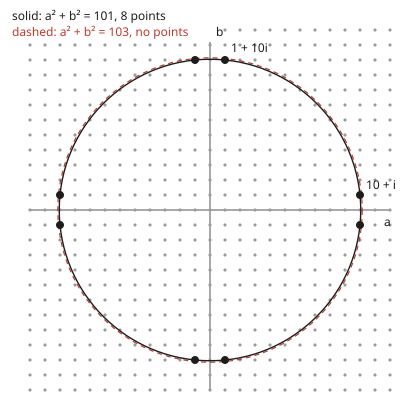

# Two squares: a prime is a sum of two squares exactly when it is 1 mod 4

[Syllabus](../../../SYLLABUS.md) → [Algebraic and analytic number theory](../README.md) → [Diophantine and Modular](../README.md#s07) → Two squares

---

## General Overview

The prime 101 is $`1 + 100`$, that is $`1^2 + 10^2`$. The prime 103 is not a sum of two squares at all. Subtract each square from 0 to 100 from 103 and look at what is left: 103, 102, 99, 94, 87, 78, 67, 54, 39, 22, 3. None of them is a square.

The difference is the remainder on division by 4. 101 leaves 1. 103 leaves 3. Fermat claimed in 1640 that this remainder decides everything for an odd prime: remainder 1, always a sum of two squares; remainder 3, never.

The "never" half is easy: a square leaves 0 or 1 on division by 4, so two squares never make remainder 3. The "always" half is the hard one. This card proves it by moving to the Gaussian integers, the numbers $`a + bi`$ with $`i \times i = -1`$. There a sum of two squares is a factorisation: $`101 = (10 + i)(10 - i)`$.

The proof also builds the two squares by a short Euclid-style calculation, and it counts every way to write a number as a sum of two squares: 8 for 101 once signs and order count, 0 for 103.

**An odd prime is a sum of two squares exactly when it splits into a Gaussian integer times its mirror image, and it splits exactly when it leaves remainder 1 on division by 4, because then it divides some $`x^2 + 1 = (x + i)(x - i)`$ without dividing either factor.**

**What kind of fact this is:** two theorems, both proved on this card in Why it works. The prime rule is Fermat's two-square theorem. The count of representations is the formula for $`r_2(n)`$. The checks add evidence, never proof: every prime up to 10,000 and every whole number up to 2,000.

### The picture: eight grid points on one circle, none on the next

<p align="center"></p>

Each dot is a pair of whole numbers $`(a, b)`$, drawn to scale. The solid circle has radius $`\sqrt{101} = 10.0499`$ and passes through 8 dots: $`(\pm 10, \pm 1)`$ and $`(\pm 1, \pm 10)`$. The dashed circle has radius $`\sqrt{103} = 10.1489`$ and misses every dot, though the two circles almost overlap. A sum of two squares is a grid point on a circle about the origin.

---

## The formula

```math
p = a^2 + b^2 \ \text{for some whole numbers } a, b \iff p = 2 \ \text{or} \ p \equiv 1 \pmod{4}
```

**Read it aloud:** a prime p is a sum of two whole squares exactly when p is 2 or leaves remainder 1 on division by 4.

The count of representations gets its own symbol. $`r_2(n)`$ is the number of ordered pairs of whole numbers $`(a, b)`$, negative ones included, with $`a^2 + b^2 = n`$. So $`(10, 1)`$, $`(1, 10)`$ and $`(-10, 1)`$ count as three different pairs. (On the class-group and unit cards of shelf 06, a bare $`r_2`$ with no argument counts complex embeddings. With an argument it means this count.)

```math
r_2(n) = 4\,\big(d_1(n) - d_3(n)\big)
```

**Read it aloud:** the number of ways to write n as a sum of two squares is four times the number of divisors of n that leave remainder 1 on division by 4, minus the number that leave remainder 3.

For 101 the divisors are 1 and 101. Both leave remainder 1, so $`r_2(101) = 4 \times (2 - 0) = 8`$. For 103 the divisors are 1 (remainder 1) and 103 (remainder 3), so $`r_2(103) = 4 \times (1 - 1) = 0`$.

| Symbol | Plain meaning | In our example | Push it up and the answer… |
| --- | --- | --- | --- |
| $`p`$ | a prime | 101; and 103 | — |
| $`q`$ | a prime leaving remainder 3 on division by 4 | 103; 3 in 45 | — |
| $`a, b`$ | whole numbers of either sign | 10 and 1 | — |
| $`i`$ | the number with $`i \times i = -1`$ | — | — |
| $`\mathbb{Z}[i]`$ | the Gaussian integers: all $`a + bi`$ with $`a, b`$ whole | $`10 + i`$ | — |
| $`\alpha, \beta, \bar\alpha`$ | Gaussian integers ($`\beta`$ is the cofactor in $`p = \alpha\beta`$) and the conjugate (mirror image) $`a - bi`$ | $`10 + i`$, $`10 - i`$ | — |
| $`N(\alpha)`$ | the norm $`\alpha\bar\alpha = a^2 + b^2`$ | 101 | — |
| $`x, c`$ | $`x`$ is a square root of $`-1`$ mod $`p`$: $`p`$ divides $`x^2 + 1`$; $`c`$ is a number that is not a square mod $`p`$, used to find $`x`$ | $`x = 10`$ or 91; $`c = 2`$ | — |
| $`n`$ | a positive whole number to write as a sum of two squares | 101; also 45, 65, 1105 | more prime factors of remainder 1 give more ways |
| $`r_2(n)`$ | the number of ordered pairs $`(a, b)`$ with $`a^2 + b^2 = n`$ | 8 for 101, 0 for 103 | — |
| $`d_1(n), d_3(n)`$ | how many divisors of $`n`$ leave remainder 1, and remainder 3, on division by 4 | 2 and 0 for 101 | $`d_1`$ up: more ways; $`d_3`$ up: fewer |
| $`e, f, k`$ | exponents: $`p`$ divides $`n`$ exactly $`e`$ times, $`q`$ exactly $`f`$ times, 2 exactly $`k`$ times | $`e = 1`$ for 101 in 101 | $`e`$ up: $`r_2`$ grows as $`e + 1`$; $`f`$ odd: $`r_2 = 0`$ |

### When it holds

- **The prime rule is for primes.** 21 leaves remainder 1 and has no representation, because $`21 = 3 \times 7`$. For a composite, use the count: $`r_2(21) = 4 \times (2 - 2) = 0`$.
- **Whole numbers only.** With real numbers every positive number is a sum of two squares, such as $`103 = (\sqrt{103})^2 + 0^2`$, and the question is empty.
- **Signs and order count in $`r_2`$.** Counting only $`a \ge b \ge 0`$ gives 1 for 101, not 8. Both conventions appear in books, so say which one.
- **The proof needs unique factorisation.** It uses that a Gaussian prime dividing a product divides one of the factors. The same argument for $`a^2 + 5b^2`$ fails, because $`\mathbb{Z}[\sqrt{-5}]`$ lacks unique factorisation (see What breaks).
- **The prime 2 is its own case.** $`2 = 1^2 + 1^2`$ and $`r_2(2) = 4`$. It leaves remainder 2, so the rule names it separately.

---

## Why it works

### Step 0: a sum of two squares is a factorisation

Multiply a Gaussian integer by its conjugate and the $`i`$ terms cancel:

```math
(a + bi)(a - bi) = a^2 + b^2
```

So $`101 = 10^2 + 1^2`$ says exactly that $`101 = (10 + i)(10 - i)`$. In general, a prime $`p`$ is a sum of two squares exactly when $`p`$ stops being prime in $`\mathbb{Z}[i]`$.

[Gaussian integers](../../03-Algebra/10-For%20the%20Curious/03-gaussian-integers-and-sums-of-two-squares.md) already supplies the tools in one line each: the norm $`N(a + bi) = a^2 + b^2`$ multiplies; the units (numbers with an inverse) are $`1, -1, i, -i`$; division with remainder works, so factorisation into Gaussian primes is unique. That card also proved the "never" half for remainder 3. The work here is the "always" half for remainder 1.

The plan: find a product that $`p`$ divides without dividing either factor. A true prime cannot do that, so $`p`$ is not a Gaussian prime.

### Step 1: for remainder 1, minus one is a square mod p

We need a whole number $`x`$ with $`x^2 + 1`$ divisible by $`p`$. Such an $`x`$ is a square root of $`-1`$ modulo $`p`$.

Fast road. Find a number $`c`$ with $`c^{(p-1)/2} \equiv -1 \pmod p`$. By Euler's criterion these are exactly the numbers that are not squares mod $`p`$, half of 1 to $`p - 1`$, so a short search finds one. Then set $`x = c^{(p-1)/4}`$. This exponent is whole because $`p - 1`$ is divisible by 4, and $`x^2 = c^{(p-1)/2} \equiv -1`$.

For 101: $`c = 2`$ works, and $`x = 2^{25} \bmod 101 = 10`$. Indeed $`10^2 + 1 = 101`$.

Second road, with no search: Wilson's theorem. It gives $`x = \big(\tfrac{p-1}{2}\big)!`$. For 101, $`50! \bmod 101 = 91`$, and $`91^2 + 1 = 8282 = 101 \times 82`$. Note that $`91 = 101 - 10`$: the two roads found the two square roots $`\pm 10`$.

<details>
<summary>Detailed proof: Wilson's road gives a square root of minus one when p leaves remainder 1</summary>

Wilson's theorem says $`(p - 1)! \equiv -1 \pmod p`$. Proof: each number from 1 to $`p - 1`$ has an inverse mod $`p`$. Pair each number with its inverse; each pair multiplies to 1. Only 1 and $`p - 1`$ are their own inverses, since $`j^2 \equiv 1`$ means $`p`$ divides $`(j - 1)(j + 1)`$. So the whole product is $`1 \times (p - 1) \equiv -1`$.

Now pair $`j`$ with $`p - j \equiv -j`$ for $`j = 1, \dots, \tfrac{p-1}{2}`$. Then

$`\displaystyle (p - 1)! \equiv \prod_{j=1}^{(p-1)/2} j\,(-j) = (-1)^{(p-1)/2} \Big(\big(\tfrac{p-1}{2}\big)!\Big)^2 .`$

When $`p \equiv 1 \pmod 4`$, the number $`\tfrac{p-1}{2}`$ is even, so the sign is $`+1`$. Together with Wilson, $`\big(\big(\tfrac{p-1}{2}\big)!\big)^2 \equiv -1`$.

When $`p \equiv 3 \pmod 4`$, the sign is $`-1`$ and the same line only says a square is $`+1`$. That is no accident: then $`-1`$ has no square root mod $`p`$ at all.

</details>

### Step 2: p divides a product but neither factor

Factor $`x^2 + 1`$ in the Gaussian integers:

```math
p \mid x^2 + 1 = (x + i)(x - i)
```

Does $`p`$ divide $`x + i`$? The quotient would be $`\tfrac{x}{p} + \tfrac{1}{p}\,i`$, and $`\tfrac{1}{p}`$ is not whole. So no. The same holds for $`x - i`$.

A Gaussian prime that divides a product divides a factor. So $`p`$ is not a Gaussian prime. It splits as $`p = \alpha\beta`$ with neither factor a unit.

Take norms. $`N(p) = p^2`$, so $`N(\alpha)\,N(\beta) = p^2`$. Neither norm is 1, because only units have norm 1. So $`N(\alpha) = p`$. Write $`\alpha = a + bi`$:

```math
p = N(\alpha) = a^2 + b^2
```

That proves the "always" half. With the "never" half from Step 0, the prime rule is proved.

### Step 3: Euclid's algorithm builds the two squares

The proof also says where $`\alpha`$ is: it is a common factor of $`p`$ and $`x + i`$. Euclid's algorithm finds a greatest common divisor in $`\mathbb{Z}[i]`$ just as in the whole numbers. Divide, round each coordinate of the quotient to the nearest whole number, keep the remainder, and repeat. Rounding to the nearest whole number leaves each coordinate off by at most a half, so each remainder has at most half the norm of the divisor, and the algorithm stops.

With $`x = 91`$ (pairs $`(a, b)`$ mean $`a + bi`$):

| Divide | Quotient, rounded | Remainder |
| --- | --- | --- |
| $`101`$ by $`91 + i`$ | $`1`$ | $`101 - (91 + i) = 10 - i`$ |
| $`91 + i`$ by $`10 - i`$ | $`9 + i`$ | $`0`$ |

The last nonzero remainder is $`10 - i`$. Times the unit $`i`$ it is $`1 + 10i`$, and its norm is $`1^2 + 10^2 = 101`$. With $`x = 10`$ the first division is already exact: $`101 = (10 - i)(10 + i)`$.

The checks run this road for all 609 primes below 10,000 that leave remainder 1. It builds $`a + bi`$ every time; the largest, 9973, comes out as $`82^2 + 57^2`$.

### Step 4: counting every representation

Unique factorisation also counts. There are three kinds of Gaussian prime, one for each remainder:

- **The prime 2** becomes $`-i(1 + i)^2`$. Both factors $`1 + i`$ and $`1 - i`$ are the same prime up to a unit.
- **A prime $`p`$ leaving remainder 1** splits into two different primes, $`p = \alpha\bar\alpha`$, as Steps 1 to 3 showed.
- **A prime $`q`$ leaving remainder 3** stays prime, with norm $`q^2`$.

A pair $`(a, b)`$ with $`a^2 + b^2 = n`$ is a Gaussian integer $`a + bi`$ with norm $`n`$. Build one from the primes of $`n`$:

- for each $`p^e`$, choose how many of the $`e`$ factors are $`\alpha`$ and how many $`\bar\alpha`$: $`e + 1`$ choices;
- for each $`q^f`$, the norm needs $`q^{f/2}`$ exactly, so $`f`$ must be even, with one choice; if $`f`$ is odd there is none;
- for $`2^k`$, take $`(1 + i)^k`$: one choice;
- finally multiply by one of the 4 units.

```math
r_2(n) = 4 \prod_{p^e} (e + 1) \ \text{ if every } f \text{ is even}, \qquad r_2(n) = 0 \ \text{ otherwise}
```

For $`101`$: one prime of remainder 1 with $`e = 1`$, so $`4 \times 2 = 8`$. For $`65 = 5 \times 13`$: $`4 \times 2 \times 2 = 16`$. For $`45 = 3^2 \times 5`$: the 3 appears twice, so $`4 \times 2 = 8`$. For $`103`$: $`f = 1`$, so 0.

The divisor form $`4\,(d_1 - d_3)`$ is the same number in another dress. The fold shows why.

<details>
<summary>Detailed proof: the product formula equals four times d1 minus d3</summary>

Give each divisor $`d`$ a sign: $`+1`$ if it leaves remainder 1 on division by 4, $`-1`$ if it leaves remainder 3, and 0 if it is even. Then $`d_1(n) - d_3(n)`$ is the sum of the signs of all divisors of $`n`$.

Remainders multiply: $`1 \times 1 \equiv 1`$, $`1 \times 3 \equiv 3`$ and $`3 \times 3 \equiv 9 \equiv 1 \pmod 4`$. So the sign of a product is the product of the signs. Every divisor of $`n`$ is a product of one divisor from each prime power in $`n`$, so the sum of signs over all divisors is a product of sums, one for each prime power:

$`\displaystyle d_1(n) - d_3(n) = \prod_{\text{prime powers in } n} \big(\text{sign}(1) + \text{sign}(\text{prime}) + \dots + \text{sign}(\text{prime}^{\text{exponent}})\big).`$

- For $`p^e`$: every power leaves remainder 1, so the sum is $`e + 1`$.
- For $`q^f`$: the signs alternate $`1, -1, 1, \dots`$, so the sum is 1 if $`f`$ is even and 0 if $`f`$ is odd.
- For $`2^k`$: only the divisor 1 is odd, so the sum is 1.

Times 4, this is the product formula above, factor for factor.

</details>

---

## Worked numbers, by hand

| Step | Arithmetic | Value |
| --- | --- | --- |
| 101 on division by 4 | $`101 = 4 \times 25 + 1`$ | remainder 1 |
| a square root of $`-1`$ mod 101 | $`x = 2^{25} \bmod 101`$ | 10 |
| check it | $`10^2 + 1 = 101 \times 1`$ | 101 |
| Euclid on $`101`$ and $`10 + i`$ | $`101 = (10 - i)(10 + i) + 0`$ | $`10 + i`$ |
| its norm | $`10^2 + 1^2`$ | **101** |
| count the pairs | $`4 \times (d_1 - d_3) = 4 \times (2 - 0)`$ | **8** |
| 103 on division by 4 | $`103 = 4 \times 25 + 3`$ | remainder 3 |
| count the pairs for 103 | $`4 \times (1 - 1)`$ | **0** |

So 101 is $`10^2 + 1^2`$, and the 8 pairs are that one up to signs and order; 103 is no sum of two squares in any way.

### What breaks if you drop a piece

| Mistake | Comes out at | What went wrong |
| --- | --- | --- |
| Count only $`a \ge b \ge 0`$ for 101 | 1, not 8 | signs and order dropped; $`r_2`$ counts them |
| Drop the factor 4 | $`d_1 - d_3 = 2`$ for 101 | the 4 units forgotten |
| Count $`d_1`$ only, for 45 | $`4 \times 4 = 16`$, not 8 | the divisors 3 and 15 must subtract |
| Use the prime rule on 21 | remainder 1, so "yes"; truly $`r_2(21) = 0`$ | 21 is not prime: 3 and 7 each appear once |
| Run the proof in $`\mathbb{Z}[\sqrt{-5}]`$ | 3 divides $`1^2 + 5 = 6`$, yet $`a^2 + 5b^2 = 3`$ has no solution | no unique factorisation, so "divides a product" no longer forces "divides a factor" |

The last row is the hypothesis that matters. In $`\mathbb{Z}[\sqrt{-5}]`$, 3 divides $`(1 + \sqrt{-5})(1 - \sqrt{-5})`$ and neither factor, yet 3 does not split into numbers of norm 3. [Ideals factor uniquely even where numbers do not](../06-Algebraic%20Numbers/04-ideals-and-unique-factorisation-in-dedekind-domains.md) repairs this with ideals.

---

## Code, from first principles, and it actually runs

The code counts; the proof is Step 2. It takes three independent roads to $`r_2(n)`$ for every $`n`$ from 1 to 2,000: a search over all pairs, the divisor count $`4\,(d_1 - d_3)`$, and the product formula. For every odd prime below 10,000 it builds $`a + bi`$ by Euclid's algorithm when the prime leaves remainder 1, and a search confirms 8 points or none. The counts 609 and 619 match the standard tables of primes by remainder. It also counts grid points in a disc of radius 100 two ways.

### Python

```python
# Two squares -- the check behind the card.  Standard library only.  The pair
# (a, b) stands for the Gaussian integer a + bi, where i times i is -1.
# Road 1 searches every pair of squares.  Road 2 counts divisors by remainder
# mod 4.  Road 3 reads the Gaussian factorisation from the prime exponents.
# For a prime p = 1 mod 4, a square root of -1 mod p and a Gaussian gcd build
# a + bi directly; a search confirms it.  Evidence runs to the stated limits.
from math import isqrt, pi
N, PMAX, R = 2000, 10000, 100
CASES = [101, 103, 2, 21, 25, 45, 65, 1105]

def mul(z, w): return (z[0] * w[0] - z[1] * w[1], z[0] * w[1] + z[1] * w[0])
def norm(z): return z[0] * z[0] + z[1] * z[1]
def rnd(u, d): return (2 * u + d) // (2 * d)          # nearest whole number to u/d
def ggcd(z, w, steps):                                # Euclid's algorithm in Z[i]
    while w != (0, 0):
        t = mul(z, (w[0], -w[1])); d = norm(w)
        q = (rnd(t[0], d), rnd(t[1], d))
        qw = mul(q, w); r = (z[0] - qw[0], z[1] - qw[1])
        assert 2 * norm(r) <= d                       # nearest rounding halves the norm
        steps.append((z, w, q, r)); z, w = w, r
    return z
def first_quadrant(z):                                # the associate with a > 0, b >= 0
    while not (z[0] > 0 and z[1] >= 0): z = (-z[1], z[0])
    return z
def factor(n):
    out, p = [], 2
    while p * p <= n:
        e = 0
        while n % p == 0: n //= p; e += 1
        if e: out.append((p, e))
        p += 1
    if n > 1: out.append((n, 1))
    return out
def r2_search(n):                                     # road 1: every (a, b), signs and order
    count = 0
    for a in range(-isqrt(n), isqrt(n) + 1):
        b2 = n - a * a; b = isqrt(b2)
        if b * b == b2: count += 1 if b == 0 else 2
    return count
def d13(n):                                           # divisors leaving 1, and 3, mod 4
    d1 = d3 = 0
    for d in range(1, n + 1):
        if n % d == 0:
            if d % 4 == 1: d1 += 1
            if d % 4 == 3: d3 += 1
    return d1, d3
def r2_divisors(n): d1, d3 = d13(n); return 4 * (d1 - d3)   # road 2
def r2_gauss(n):                                      # road 3: split each p^e between a+bi, a-bi
    ways = 4
    for p, e in factor(n):
        if p % 4 == 1: ways *= e + 1
        if p % 4 == 3 and e % 2 == 1: return 0
    return ways
def two_squares(p):                                   # p = 1 mod 4: build a + bi from scratch
    c = 2
    while pow(c, (p - 1) // 2, p) != p - 1: c += 1    # c is not a square mod p
    x = pow(c, (p - 1) // 4, p)                       # x * x = -1 mod p
    steps = []
    return x, first_quadrant(ggcd((p, 0), (x, 1), steps)), steps, c

x, g, steps, c = two_squares(101)
wil = 1
for k in range(1, 51): wil = wil * k % 101            # Wilson road: 50! mod 101
print(f"101 = 4 x {101 // 4} + {101 % 4}; 103 = 4 x {103 // 4} + {103 % 4}")
print(f"101: c = {c} is no square mod 101, x = {c}^25 mod 101 = {x}, x*x + 1 = {x * x + 1} = 101 x {(x * x + 1) // 101}")
print(f"101: Wilson road, 50! mod 101 = {wil}, and {wil}^2 + 1 = {wil * wil + 1} = 101 x {(wil * wil + 1) // 101}")
steps2 = []
g2 = first_quadrant(ggcd((101, 0), (wil, 1), steps2))
for label, xx, st, gg in (("x = 10", x, steps, g), ("x = 91", wil, steps2, g2)):
    for z, w, q, r in st: print(f"gcd step, {label}: {z} = {q} x {w} + {r}")
    print(f"101: gcd(101, {xx} + i) is {gg[0]} + {gg[1]}i up to a unit, norm {gg[0]}^2 + {gg[1]}^2 = {norm(gg)}")
sq = mul((10, 1), (10, 1))
print(f"(10 + i)^2 = {sq[0]} + {sq[1]}i, so {sq[0]}^2 + {sq[1]}^2 = {norm(sq)} = 101^2 = {101 * 101}")
print(f"103: 103 mod 4 = {103 % 4}; 103 - a^2 for a = 0..10: {[103 - a * a for a in range(11)]}")
print("n, factors, d1, d3, r2 by search, by divisors, by Gaussian exponents")
for n in CASES:
    d1, d3 = d13(n)
    print(f"{n}, {' '.join(f'{p}^{e}' for p, e in factor(n))}, {d1}, {d3}, {r2_search(n)}, {r2_divisors(n)}, {r2_gauss(n)}")
pts = sorted((a, b) for a in range(-11, 12) for b in range(-11, 12) if a * a + b * b == 101)
print(f"points with a^2 + b^2 = 101: {pts}")
print(f"points with a^2 + b^2 = 103: {[(a, b) for a in range(-11, 12) for b in range(-11, 12) if a * a + b * b == 103]}")
print(f"points with a^2 + b^2 = 45: {[(a, b) for a in range(-11, 12) for b in range(-11, 12) if a * a + b * b == 45]}")
agree = sum(1 for n in range(1, N + 1) if r2_search(n) == r2_divisors(n) == r2_gauss(n))
print(f"three roads agree for n = 1 to {N}: {agree} of {N}")
sieve = [True] * (PMAX + 1); sieve[0] = sieve[1] = False
for i in range(2, isqrt(PMAX) + 1):
    if sieve[i]: sieve[i * i::i] = [False] * len(sieve[i * i::i])
ones = [p for p in range(3, PMAX + 1) if sieve[p] and p % 4 == 1]
threes = [p for p in range(3, PMAX + 1) if sieve[p] and p % 4 == 3]
built = sum(1 for p in ones if norm(two_squares(p)[1]) == p and r2_search(p) == 8)
missed = sum(1 for p in threes if r2_search(p) == 0)
print(f"odd primes to {PMAX}: {len(ones)} are 1 mod 4, gcd road builds a + bi for {built}, search finds 8 points each")
print(f"odd primes to {PMAX}: {len(threes)} are 3 mod 4, search finds no point for {missed}")
last = two_squares(ones[-1])[1]
print(f"largest such prime below {PMAX}: {ones[-1]} = {last[0]}^2 + {last[1]}^2")
z5 = [(a, b) for a in range(0, 3) for b in range(0, 2) if a * a + 5 * b * b == 3]
print(f"Z[root -5]: 1^2 + 5 = 6 = 3 x 2, so 3 divides x^2 + 5 at x = 1, yet a^2 + 5b^2 = 3 has solutions {z5}")
print(f"what breaks: only a >= b >= 0 counts {len([1 for a, b in pts if a >= b >= 0])} for 101; "
      f"d1 - d3 without the 4 gives {d13(101)[0] - d13(101)[1]}; 4 x d1 for 45 gives {4 * d13(45)[0]}; 21 mod 4 = {21 % 4} yet r2(21) = {r2_search(21)}")
lattice = sum(2 * isqrt(R * R - a * a) + 1 for a in range(-R, R + 1))
summed = 1 + sum(r2_divisors(n) for n in range(1, R * R + 1))
print(f"circle radius {R}: lattice points {lattice}, 1 + sum of r2(n) to {R * R} = {summed}, pi x {R * R} = {pi * R * R:.4f}, gap {lattice - pi * R * R:.4f}")
print(f"figure, radius^2 101 and 103, radius {101 ** 0.5:.4f} and {103 ** 0.5:.4f}, points {pts}")
assert x * x % 101 == 100 and wil * wil % 101 == 100 and norm(g) == norm(g2) == 101 and {g, g2} <= {(10, 1), (1, 10)}
assert norm(sq) == 101 * 101 and sq == (99, 20)
assert agree == N and r2_search(101) == 8 and r2_search(103) == 0 and r2_search(45) == 8 and r2_search(65) == 16 and r2_gauss(1105) == 32
assert built == len(ones) == 609 and missed == len(threes) == 619
assert z5 == [] and lattice == summed and abs(lattice - pi * R * R) < 2 * pi * R
print("ALL CHECKS PASS")
```

**Ran 2026-11-15 on macOS, Python 3.14.10, standard library only. All checks passed. Output, pasted from the run:**

```
101 = 4 x 25 + 1; 103 = 4 x 25 + 3
101: c = 2 is no square mod 101, x = 2^25 mod 101 = 10, x*x + 1 = 101 = 101 x 1
101: Wilson road, 50! mod 101 = 91, and 91^2 + 1 = 8282 = 101 x 82
gcd step, x = 10: (101, 0) = (10, -1) x (10, 1) + (0, 0)
101: gcd(101, 10 + i) is 10 + 1i up to a unit, norm 10^2 + 1^2 = 101
gcd step, x = 91: (101, 0) = (1, 0) x (91, 1) + (10, -1)
gcd step, x = 91: (91, 1) = (9, 1) x (10, -1) + (0, 0)
101: gcd(101, 91 + i) is 1 + 10i up to a unit, norm 1^2 + 10^2 = 101
(10 + i)^2 = 99 + 20i, so 99^2 + 20^2 = 10201 = 101^2 = 10201
103: 103 mod 4 = 3; 103 - a^2 for a = 0..10: [103, 102, 99, 94, 87, 78, 67, 54, 39, 22, 3]
n, factors, d1, d3, r2 by search, by divisors, by Gaussian exponents
101, 101^1, 2, 0, 8, 8, 8
103, 103^1, 1, 1, 0, 0, 0
2, 2^1, 1, 0, 4, 4, 4
21, 3^1 7^1, 2, 2, 0, 0, 0
25, 5^2, 3, 0, 12, 12, 12
45, 3^2 5^1, 4, 2, 8, 8, 8
65, 5^1 13^1, 4, 0, 16, 16, 16
1105, 5^1 13^1 17^1, 8, 0, 32, 32, 32
points with a^2 + b^2 = 101: [(-10, -1), (-10, 1), (-1, -10), (-1, 10), (1, -10), (1, 10), (10, -1), (10, 1)]
points with a^2 + b^2 = 103: []
points with a^2 + b^2 = 45: [(-6, -3), (-6, 3), (-3, -6), (-3, 6), (3, -6), (3, 6), (6, -3), (6, 3)]
three roads agree for n = 1 to 2000: 2000 of 2000
odd primes to 10000: 609 are 1 mod 4, gcd road builds a + bi for 609, search finds 8 points each
odd primes to 10000: 619 are 3 mod 4, search finds no point for 619
largest such prime below 10000: 9973 = 82^2 + 57^2
Z[root -5]: 1^2 + 5 = 6 = 3 x 2, so 3 divides x^2 + 5 at x = 1, yet a^2 + 5b^2 = 3 has solutions []
what breaks: only a >= b >= 0 counts 1 for 101; d1 - d3 without the 4 gives 2; 4 x d1 for 45 gives 16; 21 mod 4 = 1 yet r2(21) = 0
circle radius 100: lattice points 31417, 1 + sum of r2(n) to 10000 = 31417, pi x 10000 = 31415.9265, gap 1.0735
figure, radius^2 101 and 103, radius 10.0499 and 10.1489, points [(-10, -1), (-10, 1), (-1, -10), (-1, 10), (1, -10), (1, 10), (10, -1), (10, 1)]
ALL CHECKS PASS
```

### Rust

Same numbers, same labels, built with `rustc --edition 2021 -O`.

```rust
// Two squares -- the same check as the Python, in Rust.  No crates.  The pair
// (a, b) stands for the Gaussian integer a + bi, where i times i is -1.
// Road 1 searches every pair of squares.  Road 2 counts divisors by remainder
// mod 4.  Road 3 reads the Gaussian factorisation from the prime exponents.
// For a prime p = 1 mod 4, a square root of -1 mod p and a Gaussian gcd build
// a + bi directly; a search confirms it.  Evidence runs to the stated limits.
const N: i64 = 2000;
const PMAX: i64 = 10000;
const R: i64 = 100;
const CASES: [i64; 8] = [101, 103, 2, 21, 25, 45, 65, 1105];
type G = (i64, i64);
type Step = (G, G, G, G);

fn mul(z: G, w: G) -> G { (z.0 * w.0 - z.1 * w.1, z.0 * w.1 + z.1 * w.0) }
fn norm(z: G) -> i64 { z.0 * z.0 + z.1 * z.1 }
fn rnd(u: i64, d: i64) -> i64 { (2 * u + d).div_euclid(2 * d) }   // nearest whole number to u/d
fn ggcd(mut z: G, mut w: G, steps: &mut Vec<Step>) -> G {          // Euclid's algorithm in Z[i]
    while w != (0, 0) {
        let t = mul(z, (w.0, -w.1));
        let d = norm(w);
        let q = (rnd(t.0, d), rnd(t.1, d));
        let qw = mul(q, w);
        let r = (z.0 - qw.0, z.1 - qw.1);
        assert!(2 * norm(r) <= d);                                 // nearest rounding halves the norm
        steps.push((z, w, q, r));
        z = w;
        w = r;
    }
    z
}
fn first_quadrant(mut z: G) -> G {                                 // the associate with a > 0, b >= 0
    while !(z.0 > 0 && z.1 >= 0) { z = (-z.1, z.0); }
    z
}
fn isqrt(n: i64) -> i64 {
    let mut r = (n as f64).sqrt() as i64;
    while r * r > n { r -= 1; }
    while (r + 1) * (r + 1) <= n { r += 1; }
    r
}
fn modpow(mut b: i64, mut e: i64, m: i64) -> i64 {
    let mut out = 1;
    b %= m;
    while e > 0 {
        if e & 1 == 1 { out = out * b % m; }
        b = b * b % m;
        e >>= 1;
    }
    out
}
fn factor(mut n: i64) -> Vec<(i64, i64)> {
    let (mut out, mut p) = (vec![], 2);
    while p * p <= n {
        let mut e = 0;
        while n % p == 0 { n /= p; e += 1; }
        if e > 0 { out.push((p, e)); }
        p += 1;
    }
    if n > 1 { out.push((n, 1)); }
    out
}
fn r2_search(n: i64) -> i64 {                                      // road 1: every (a, b), signs and order
    let mut count = 0;
    for a in -isqrt(n)..=isqrt(n) {
        let b2 = n - a * a;
        let b = isqrt(b2);
        if b * b == b2 { count += if b == 0 { 1 } else { 2 }; }
    }
    count
}
fn d13(n: i64) -> (i64, i64) {                                     // divisors leaving 1, and 3, mod 4
    let (mut d1, mut d3) = (0, 0);
    for d in 1..=n {
        if n % d == 0 {
            if d % 4 == 1 { d1 += 1; }
            if d % 4 == 3 { d3 += 1; }
        }
    }
    (d1, d3)
}
fn r2_divisors(n: i64) -> i64 { let (d1, d3) = d13(n); 4 * (d1 - d3) }   // road 2
fn r2_gauss(n: i64) -> i64 {                                       // road 3: split each p^e between a+bi, a-bi
    let mut ways = 4;
    for (p, e) in factor(n) {
        if p % 4 == 1 { ways *= e + 1; }
        if p % 4 == 3 && e % 2 == 1 { return 0; }
    }
    ways
}
fn two_squares(p: i64) -> (i64, G, Vec<Step>, i64) {               // p = 1 mod 4: build a + bi from scratch
    let mut c = 2;
    while modpow(c, (p - 1) / 2, p) != p - 1 { c += 1; }           // c is not a square mod p
    let x = modpow(c, (p - 1) / 4, p);                             // x * x = -1 mod p
    let mut steps = vec![];
    let g = first_quadrant(ggcd((p, 0), (x, 1), &mut steps));
    (x, g, steps, c)
}

fn main() {
    let (x, g, steps, c) = two_squares(101);
    let mut wil = 1;
    for k in 1..51 { wil = wil * k % 101; }                        // Wilson road: 50! mod 101
    println!("101 = 4 x {} + {}; 103 = 4 x {} + {}", 101 / 4, 101 % 4, 103 / 4, 103 % 4);
    println!("101: c = {} is no square mod 101, x = {}^25 mod 101 = {}, x*x + 1 = {} = 101 x {}", c, c, x, x * x + 1, (x * x + 1) / 101);
    println!("101: Wilson road, 50! mod 101 = {}, and {}^2 + 1 = {} = 101 x {}", wil, wil, wil * wil + 1, (wil * wil + 1) / 101);
    let mut steps2 = vec![];
    let g2 = first_quadrant(ggcd((101, 0), (wil, 1), &mut steps2));
    for (label, xx, st, gg) in [("x = 10", x, &steps, g), ("x = 91", wil, &steps2, g2)] {
        for (z, w, q, r) in st.iter() { println!("gcd step, {}: {:?} = {:?} x {:?} + {:?}", label, z, q, w, r); }
        println!("101: gcd(101, {} + i) is {} + {}i up to a unit, norm {}^2 + {}^2 = {}", xx, gg.0, gg.1, gg.0, gg.1, norm(gg));
    }
    let sq = mul((10, 1), (10, 1));
    println!("(10 + i)^2 = {} + {}i, so {}^2 + {}^2 = {} = 101^2 = {}", sq.0, sq.1, sq.0, sq.1, norm(sq), 101 * 101);
    let rest: Vec<i64> = (0..11).map(|a| 103 - a * a).collect();
    println!("103: 103 mod 4 = {}; 103 - a^2 for a = 0..10: {:?}", 103 % 4, rest);
    println!("n, factors, d1, d3, r2 by search, by divisors, by Gaussian exponents");
    for n in CASES {
        let (d1, d3) = d13(n);
        let fs: Vec<String> = factor(n).iter().map(|(p, e)| format!("{}^{}", p, e)).collect();
        println!("{}, {}, {}, {}, {}, {}, {}", n, fs.join(" "), d1, d3, r2_search(n), r2_divisors(n), r2_gauss(n));
    }
    let on_circle = |m: i64| -> Vec<G> {
        let mut v = vec![];
        for a in -11..12 { for b in -11..12 { if a * a + b * b == m { v.push((a, b)); } } }
        v
    };
    let pts = on_circle(101);
    println!("points with a^2 + b^2 = 101: {:?}", pts);
    println!("points with a^2 + b^2 = 103: {:?}", on_circle(103));
    println!("points with a^2 + b^2 = 45: {:?}", on_circle(45));
    let agree = (1..=N).filter(|&n| r2_search(n) == r2_divisors(n) && r2_divisors(n) == r2_gauss(n)).count() as i64;
    println!("three roads agree for n = 1 to {}: {} of {}", N, agree, N);
    let mut sieve = vec![true; (PMAX + 1) as usize];
    sieve[0] = false;
    sieve[1] = false;
    for i in 2..=isqrt(PMAX) as usize {
        if sieve[i] { let mut j = i * i; while j <= PMAX as usize { sieve[j] = false; j += i; } }
    }
    let ones: Vec<i64> = (3..=PMAX).filter(|&p| sieve[p as usize] && p % 4 == 1).collect();
    let threes: Vec<i64> = (3..=PMAX).filter(|&p| sieve[p as usize] && p % 4 == 3).collect();
    let built = ones.iter().filter(|&&p| norm(two_squares(p).1) == p && r2_search(p) == 8).count();
    let missed = threes.iter().filter(|&&p| r2_search(p) == 0).count();
    println!("odd primes to {}: {} are 1 mod 4, gcd road builds a + bi for {}, search finds 8 points each", PMAX, ones.len(), built);
    println!("odd primes to {}: {} are 3 mod 4, search finds no point for {}", PMAX, threes.len(), missed);
    let lastp = *ones.last().unwrap();
    let last = two_squares(lastp).1;
    println!("largest such prime below {}: {} = {}^2 + {}^2", PMAX, lastp, last.0, last.1);
    let mut z5: Vec<G> = vec![];
    for a in 0..3 { for b in 0..2 { if a * a + 5 * b * b == 3 { z5.push((a, b)); } } }
    println!("Z[root -5]: 1^2 + 5 = 6 = 3 x 2, so 3 divides x^2 + 5 at x = 1, yet a^2 + 5b^2 = 3 has solutions {:?}", z5);
    let top = pts.iter().filter(|&&(a, b)| a >= b && b >= 0).count();
    println!("what breaks: only a >= b >= 0 counts {} for 101; d1 - d3 without the 4 gives {}; 4 x d1 for 45 gives {}; 21 mod 4 = {} yet r2(21) = {}",
             top, d13(101).0 - d13(101).1, 4 * d13(45).0, 21 % 4, r2_search(21));
    let lattice: i64 = (-R..=R).map(|a| 2 * isqrt(R * R - a * a) + 1).sum();
    let summed: i64 = 1 + (1..=R * R).map(r2_divisors).sum::<i64>();
    let area = std::f64::consts::PI * (R * R) as f64;
    println!("circle radius {}: lattice points {}, 1 + sum of r2(n) to {} = {}, pi x {} = {:.4}, gap {:.4}",
             R, lattice, R * R, summed, R * R, area, lattice as f64 - area);
    println!("figure, radius^2 101 and 103, radius {:.4} and {:.4}, points {:?}", (101f64).sqrt(), (103f64).sqrt(), pts);
    assert!(x * x % 101 == 100 && wil * wil % 101 == 100 && norm(g) == 101 && norm(g2) == 101);
    assert!([(10, 1), (1, 10)].contains(&g) && [(10, 1), (1, 10)].contains(&g2));
    assert!(norm(sq) == 101 * 101 && sq == (99, 20));
    assert!(agree == N && r2_search(101) == 8 && r2_search(103) == 0 && r2_search(45) == 8 && r2_search(65) == 16 && r2_gauss(1105) == 32);
    assert!(built == ones.len() && ones.len() == 609 && missed == threes.len() && threes.len() == 619);
    assert!(z5.is_empty() && lattice == summed && (lattice as f64 - area).abs() < 2.0 * area / R as f64);
    println!("ALL CHECKS PASS");
}
```

**Ran 2026-11-15 on macOS, rustc 1.98.1, no crates. All checks passed. Output, pasted from the run:**

```
101 = 4 x 25 + 1; 103 = 4 x 25 + 3
101: c = 2 is no square mod 101, x = 2^25 mod 101 = 10, x*x + 1 = 101 = 101 x 1
101: Wilson road, 50! mod 101 = 91, and 91^2 + 1 = 8282 = 101 x 82
gcd step, x = 10: (101, 0) = (10, -1) x (10, 1) + (0, 0)
101: gcd(101, 10 + i) is 10 + 1i up to a unit, norm 10^2 + 1^2 = 101
gcd step, x = 91: (101, 0) = (1, 0) x (91, 1) + (10, -1)
gcd step, x = 91: (91, 1) = (9, 1) x (10, -1) + (0, 0)
101: gcd(101, 91 + i) is 1 + 10i up to a unit, norm 1^2 + 10^2 = 101
(10 + i)^2 = 99 + 20i, so 99^2 + 20^2 = 10201 = 101^2 = 10201
103: 103 mod 4 = 3; 103 - a^2 for a = 0..10: [103, 102, 99, 94, 87, 78, 67, 54, 39, 22, 3]
n, factors, d1, d3, r2 by search, by divisors, by Gaussian exponents
101, 101^1, 2, 0, 8, 8, 8
103, 103^1, 1, 1, 0, 0, 0
2, 2^1, 1, 0, 4, 4, 4
21, 3^1 7^1, 2, 2, 0, 0, 0
25, 5^2, 3, 0, 12, 12, 12
45, 3^2 5^1, 4, 2, 8, 8, 8
65, 5^1 13^1, 4, 0, 16, 16, 16
1105, 5^1 13^1 17^1, 8, 0, 32, 32, 32
points with a^2 + b^2 = 101: [(-10, -1), (-10, 1), (-1, -10), (-1, 10), (1, -10), (1, 10), (10, -1), (10, 1)]
points with a^2 + b^2 = 103: []
points with a^2 + b^2 = 45: [(-6, -3), (-6, 3), (-3, -6), (-3, 6), (3, -6), (3, 6), (6, -3), (6, 3)]
three roads agree for n = 1 to 2000: 2000 of 2000
odd primes to 10000: 609 are 1 mod 4, gcd road builds a + bi for 609, search finds 8 points each
odd primes to 10000: 619 are 3 mod 4, search finds no point for 619
largest such prime below 10000: 9973 = 82^2 + 57^2
Z[root -5]: 1^2 + 5 = 6 = 3 x 2, so 3 divides x^2 + 5 at x = 1, yet a^2 + 5b^2 = 3 has solutions []
what breaks: only a >= b >= 0 counts 1 for 101; d1 - d3 without the 4 gives 2; 4 x d1 for 45 gives 16; 21 mod 4 = 1 yet r2(21) = 0
circle radius 100: lattice points 31417, 1 + sum of r2(n) to 10000 = 31417, pi x 10000 = 31415.9265, gap 1.0735
figure, radius^2 101 and 103, radius 10.0499 and 10.1489, points [(-10, -1), (-10, 1), (-1, -10), (-1, 10), (1, -10), (1, 10), (10, -1), (10, 1)]
ALL CHECKS PASS
```

### Lean

Lean proves both theorems of this card, for every prime and every positive whole number, and checks the worked numbers.

- Take a prime $`p`$. Then $`p`$ is a sum of two squares exactly when $`p = 2`$ or $`p`$ leaves remainder 1 on division by 4.
- Take a prime $`p`$. Then $`p = \alpha\bar\alpha`$ for some Gaussian integer $`\alpha`$ exactly when $`p = 2`$ or $`p`$ leaves remainder 1 on division by 4.
- Take a positive whole number $`n`$. Then $`r_2(n) = 4(d_1(n) - d_3(n))`$, with signs and order counted.
- 101 is $`10^2 + 1^2`$, and no two squares from 0 to 100 add up to 103.
- Both roads give a square root of $`-1`$ mod 101: $`2^{25} \bmod 101 = 10`$ and $`50! \bmod 101 = 91`$.
- In the Gaussian integers $`101 = (10 + i)(10 - i)`$, and $`99^2 + 20^2 = 101^2`$.
- The largest prime case in the checks is $`9973 = 82^2 + 57^2`$.
- Take $`n`$ = 101, 103, 21, 45, 65 and 1105. Then $`d_1`$ and $`d_3`$ give $`r_2`$ = 8, 0, 0, 8, 16 and 32.

Euclid's algorithm, Wilson's road in general, the product formula and the searches to 10,000 and 2,000 are left to the Python and Rust checks.

```lean
-- Two squares: a prime is a sum of two whole squares exactly when it is 2 or leaves remainder 1 on division by 4, it is then a Gaussian integer times its mirror image, and every positive n is a sum of two squares in exactly 4 (d₁(n) − d₃(n)) ordered ways.
import Mathlib.NumberTheory.Zsqrtd.GaussianInt
import Mathlib.NumberTheory.SumTwoSquares
import Mathlib.Data.Nat.Factorial.Basic
import Mathlib.SetTheory.Cardinal.Finite
import Mathlib.NumberTheory.Zsqrtd.QuadraticReciprocity
import Mathlib.Data.Int.Interval

lemma gi_norm_eq (z : GaussianInt) : z.norm = z.re ^ 2 + z.im ^ 2 := by
  rw [Zsqrtd.norm_def]; ring

lemma gi_norm_set_finite (k : ℤ) : {z : GaussianInt | z.norm = k}.Finite := by
  have hinj : Function.Injective (fun z : GaussianInt => (z.re, z.im)) := by
    intro z w h
    simp only [Prod.mk.injEq] at h
    exact Zsqrtd.ext h.1 h.2
  apply Set.Finite.of_finite_image (f := fun z : GaussianInt => (z.re, z.im)) _ hinj.injOn
  apply ((Set.finite_Icc (-k) k).prod (Set.finite_Icc (-k) k)).subset
  rintro _ ⟨z, hz, rfl⟩
  simp only [Set.mem_ofPred_eq] at hz
  rw [gi_norm_eq] at hz
  have h1 := Int.le_self_sq z.re
  have h2 := Int.le_self_sq (-z.re)
  have h3 := Int.le_self_sq z.im
  have h4 := Int.le_self_sq (-z.im)
  rw [neg_sq] at h2 h4
  have h5 := sq_nonneg z.re
  have h6 := sq_nonneg z.im
  simp only [Set.mem_prod, Set.mem_Icc]
  refine ⟨⟨?_, ?_⟩, ?_, ?_⟩ <;> linarith

lemma gi_card_norm_one : Set.ncard {z : GaussianInt | z.norm = 1} = 4 := by
  have : {z : GaussianInt | z.norm = 1} =
      ↑({⟨1, 0⟩, ⟨-1, 0⟩, ⟨0, 1⟩, ⟨0, -1⟩} : Finset GaussianInt) := by
    ext ⟨x, y⟩
    simp only [Set.mem_ofPred_eq, Finset.coe_insert, Finset.coe_singleton, Set.mem_insert_iff,
      Set.mem_singleton_iff, Zsqrtd.ext_iff, gi_norm_eq]
    constructor
    · intro h
      have hx1 : -1 ≤ x := by nlinarith [sq_nonneg y]
      have hx2 : x ≤ 1 := by nlinarith [sq_nonneg y]
      have hy1 : -1 ≤ y := by nlinarith [sq_nonneg x]
      have hy2 : y ≤ 1 := by nlinarith [sq_nonneg x]
      interval_cases x <;> interval_cases y <;> simp_all
    · rintro (⟨rfl, rfl⟩ | ⟨rfl, rfl⟩ | ⟨rfl, rfl⟩ | ⟨rfl, rfl⟩) <;> norm_num
  rw [this, Set.ncard_coe_finset]
  decide

lemma gi_prime_of_norm_prime (π : GaussianInt) (h : π.norm.natAbs.Prime) : Prime π := by
  apply irreducible_iff_prime.1
  refine ⟨fun hu => h.ne_one (Zsqrtd.norm_eq_one_iff.2 hu), ?_⟩
  intro a b hab
  rw [hab, Zsqrtd.norm_mul, Int.natAbs_mul] at h
  rcases Nat.prime_mul_iff.1 h with ⟨_, hb⟩ | ⟨_, ha⟩
  · exact Or.inr (Zsqrtd.norm_eq_one_iff.1 hb)
  · exact Or.inl (Zsqrtd.norm_eq_one_iff.1 ha)

lemma gi_ncard_C (p n : ℕ) (hp : 0 < p) :
    Set.ncard {z : GaussianInt | (p : ℤ) * z.norm = (n : ℤ)} =
      if p ∣ n then Set.ncard {z : GaussianInt | z.norm = ((n / p : ℕ) : ℤ)} else 0 := by
  split_ifs with h
  · obtain ⟨k, rfl⟩ := h
    congr 1
    ext z
    simp only [Set.mem_ofPred_eq]
    rw [Nat.mul_div_cancel_left k hp]
    push_cast
    constructor
    · intro h; exact mul_left_cancel₀ (by exact_mod_cast hp.ne') h
    · intro h; rw [h]
  · have he : {z : GaussianInt | (p : ℤ) * z.norm = (n : ℤ)} = ∅ := by
      ext z
      simp only [Set.mem_ofPred_eq, Set.mem_empty_iff_false, iff_false]
      intro hz
      apply h
      have : (p : ℤ) ∣ (n : ℤ) := ⟨_, hz.symm⟩
      exact_mod_cast this
    rw [he, Set.ncard_empty]

lemma gi_case_two (n : ℕ) :
    Set.ncard {z : GaussianInt | z.norm = ((2 * n : ℕ) : ℤ)} =
      Set.ncard {z : GaussianInt | z.norm = (n : ℤ)} := by
  have hπ : (⟨1, 1⟩ : GaussianInt) ≠ 0 := by
    intro h; have := congrArg Zsqrtd.re h; simp at this
  have hnπ : (⟨1, 1⟩ : GaussianInt).norm = 2 := by rw [gi_norm_eq]; norm_num
  have : {z : GaussianInt | z.norm = ((2 * n : ℕ) : ℤ)} =
      (fun w => (⟨1, 1⟩ : GaussianInt) * w) '' {z : GaussianInt | z.norm = (n : ℤ)} := by
    ext z
    simp only [Set.mem_ofPred_eq, Set.mem_image]
    constructor
    · intro hz
      rw [gi_norm_eq] at hz
      push_cast at hz
      have hev : Even ((z.re + z.im) ^ 2) := ⟨n + z.re * z.im, by linear_combination hz⟩
      obtain ⟨k, hk⟩ := (Int.even_pow.1 hev).1
      have hw : (⟨1, 1⟩ : GaussianInt) * ⟨k, k - z.re⟩ = z := by
        ext <;> simp [Zsqrtd.re_mul, Zsqrtd.im_mul]; linarith
      refine ⟨⟨k, k - z.re⟩, ?_, hw⟩
      have h2 := congrArg Zsqrtd.norm hw
      rw [Zsqrtd.norm_mul, hnπ, gi_norm_eq z, hz] at h2
      linarith
    · rintro ⟨w, hw, rfl⟩
      rw [Zsqrtd.norm_mul, hnπ, hw]; push_cast; ring
  rw [this, Set.ncard_image_of_injective _ (mul_right_injective₀ hπ)]

lemma gi_case_three (p n : ℕ) (hp : p.Prime) (h3 : p % 4 = 3) :
    Set.ncard {z : GaussianInt | z.norm = ((p * n : ℕ) : ℤ)} =
      Set.ncard {z : GaussianInt | (p : ℤ) * z.norm = (n : ℤ)} := by
  have := Fact.mk hp
  have hprime : Prime (p : GaussianInt) := GaussianInt.prime_of_nat_prime_of_mod_four_eq_three p h3
  have hp0 : (p : GaussianInt) ≠ 0 := hprime.ne_zero
  have hp0' : (p : ℤ) ≠ 0 := by exact_mod_cast hp.ne_zero
  have : {z : GaussianInt | z.norm = ((p * n : ℕ) : ℤ)} =
      (fun w => (p : GaussianInt) * w) '' {z : GaussianInt | (p : ℤ) * z.norm = (n : ℤ)} := by
    ext z
    simp only [Set.mem_ofPred_eq, Set.mem_image]
    constructor
    · intro hz
      have hdvd : (p : GaussianInt) ∣ z * star z := by
        rw [← Zsqrtd.norm_eq_mul_conj, hz]; push_cast; exact dvd_mul_right _ _
      rcases hprime.dvd_or_dvd hdvd with ⟨c, hc⟩ | ⟨c, hc⟩
      · refine ⟨c, ?_, hc.symm⟩
        have h2 := congrArg Zsqrtd.norm hc
        rw [hz, Zsqrtd.norm_mul, Zsqrtd.norm_natCast] at h2
        push_cast at h2
        apply mul_left_cancel₀ hp0'
        linarith
      · refine ⟨star c, ?_, ?_⟩
        · have h2 := congrArg Zsqrtd.norm hc
          rw [Zsqrtd.norm_conj, hz, Zsqrtd.norm_mul, Zsqrtd.norm_natCast] at h2
          push_cast at h2
          rw [Zsqrtd.norm_conj]
          apply mul_left_cancel₀ hp0'
          linarith
        · have h2 := congrArg star hc
          rw [star_star, star_mul', star_natCast] at h2
          exact h2.symm
    · rintro ⟨w, hw, rfl⟩
      rw [Zsqrtd.norm_mul, Zsqrtd.norm_natCast]
      push_cast
      rw [← hw]; ring
  rw [this, Set.ncard_image_of_injective _ (mul_right_injective₀ hp0)]

lemma gi_case_one (p n : ℕ) (hp : p.Prime) (h1 : p % 4 = 1) :
    (Set.ncard {z : GaussianInt | z.norm = ((p * n : ℕ) : ℤ)} : ℤ) =
      2 * (Set.ncard {z : GaussianInt | z.norm = (n : ℤ)} : ℤ) -
        (Set.ncard {z : GaussianInt | (p : ℤ) * z.norm = (n : ℤ)} : ℤ) := by
  have := Fact.mk hp
  obtain ⟨a, b, hab⟩ := Nat.Prime.sq_add_sq (p := p) (by omega)
  set π : GaussianInt := ⟨a, b⟩ with hπdef
  have hp0 : (p : ℤ) ≠ 0 := by exact_mod_cast hp.ne_zero
  have hnπ : π.norm = p := by
    rw [gi_norm_eq]; simp only [π]; exact_mod_cast hab
  have hnπ' : (star π).norm = p := by rw [Zsqrtd.norm_conj, hnπ]
  have hπ0 : π ≠ 0 := by
    intro h; rw [h, Zsqrtd.norm_zero] at hnπ; exact hp0 hnπ.symm
  have hπ0' : star π ≠ 0 := by
    intro h; rw [h, Zsqrtd.norm_zero] at hnπ'; exact hp0 hnπ'.symm
  have hprime : Prime π := gi_prime_of_norm_prime π (by rw [hnπ]; simpa using hp)
  have hprime' : Prime (star π) := gi_prime_of_norm_prime _ (by rw [hnπ']; simpa using hp)
  have hpmul : (p : GaussianInt) = π * star π := by
    rw [← Zsqrtd.norm_eq_mul_conj, hnπ]; simp
  -- the conjugate does not divide π
  have hndvd : ¬ star π ∣ π := by
    rintro ⟨c, hc⟩
    have hn := congrArg Zsqrtd.norm hc
    rw [Zsqrtd.norm_mul, hnπ, hnπ'] at hn
    have hc1 : c.norm = 1 := by
      apply mul_left_cancel₀ hp0; linarith
    rw [gi_norm_eq] at hc1
    have hre := congrArg Zsqrtd.re hc
    have him := congrArg Zsqrtd.im hc
    simp only [π, Zsqrtd.re_mul, Zsqrtd.im_mul, Zsqrtd.star_mk] at hre him
    obtain ⟨u, v⟩ := c
    simp only at hc1 hre him
    have hu1 : -1 ≤ u := by nlinarith [sq_nonneg v]
    have hu2 : u ≤ 1 := by nlinarith [sq_nonneg v]
    have hv1 : -1 ≤ v := by nlinarith [sq_nonneg u]
    have hv2 : v ≤ 1 := by nlinarith [sq_nonneg u]
    have hsq : ∀ m : ℕ, m * m = p → False := by
      intro m hm
      rw [← hm] at hp
      rcases Nat.prime_mul_iff.1 hp with ⟨h, rfl⟩ | ⟨h, rfl⟩ <;> exact Nat.not_prime_one h
    interval_cases u <;> interval_cases v <;> norm_num at hc1
    · -- u = -1, v = 0 : a = 0
      have ha : a = 0 := by omega
      subst ha
      exact hsq b (by rw [← hab]; ring)
    · -- u = 0, v = -1 : a = -b
      have ha : a = 0 := by omega
      have hb : b = 0 := by omega
      subst ha hb
      exact hp.ne_zero (by rw [← hab]; ring)
    · -- u = 0, v = 1 : a = b
      have ha : a = b := by omega
      subst ha
      have h2 : p = 2 * (a * a) := by rw [← hab]; ring
      generalize a * a = t at h2
      omega
    · -- u = 1, v = 0 : b = 0
      have hb : b = 0 := by omega
      subst hb
      exact hsq a (by rw [← hab]; ring)
  have hnorm_mul : ∀ (w : GaussianInt), (π * w).norm = p * w.norm ∧
      (star π * w).norm = p * w.norm := by
    intro w; rw [Zsqrtd.norm_mul, Zsqrtd.norm_mul, hnπ, hnπ']; exact ⟨rfl, rfl⟩
  set S := {z : GaussianInt | z.norm = (n : ℤ)} with hSdef
  set A := (fun w => π * w) '' S with hAdef
  set B := (fun w => star π * w) '' S with hBdef
  have hunion : {z : GaussianInt | z.norm = ((p * n : ℕ) : ℤ)} = A ∪ B := by
    ext z
    simp only [Set.mem_ofPred_eq, Set.mem_union, hAdef, hBdef, Set.mem_image, hSdef]
    constructor
    · intro hz
      have hdvd : π ∣ z * star z := by
        rw [← Zsqrtd.norm_eq_mul_conj, hz]; push_cast; rw [hpmul, mul_assoc]
        exact dvd_mul_right _ _
      rcases hprime.dvd_or_dvd hdvd with ⟨c, hc⟩ | ⟨c, hc⟩
      · left
        refine ⟨c, ?_, hc.symm⟩
        have h2 := congrArg Zsqrtd.norm hc
        rw [hz, (hnorm_mul c).1] at h2
        push_cast at h2
        apply mul_left_cancel₀ hp0
        linarith
      · right
        refine ⟨star c, ?_, ?_⟩
        · have h2 := congrArg Zsqrtd.norm hc
          rw [Zsqrtd.norm_conj, hz, (hnorm_mul c).1] at h2
          push_cast at h2
          rw [Zsqrtd.norm_conj]
          apply mul_left_cancel₀ hp0
          linarith
        · have h2 := congrArg star hc
          rw [star_star, star_mul'] at h2
          exact h2.symm
    · rintro (⟨w, hw, rfl⟩ | ⟨w, hw, rfl⟩)
      · rw [(hnorm_mul w).1, hw]; push_cast; ring
      · rw [(hnorm_mul w).2, hw]; push_cast; ring
  have hinter : A ∩ B =
      (fun w => (p : GaussianInt) * w) '' {z : GaussianInt | (p : ℤ) * z.norm = (n : ℤ)} := by
    ext z
    simp only [Set.mem_inter_iff, hAdef, hBdef, Set.mem_image, hSdef, Set.mem_ofPred_eq]
    constructor
    · rintro ⟨⟨c, hc, rfl⟩, ⟨c', _, hc'⟩⟩
      have hd : star π ∣ π * c := ⟨c', hc'.symm⟩
      rcases hprime'.dvd_or_dvd hd with h | ⟨e, he⟩
      · exact absurd h hndvd
      · refine ⟨e, ?_, ?_⟩
        · rw [he, (hnorm_mul e).2] at hc; exact hc
        · rw [he, hpmul]; ring
    · rintro ⟨e, he, rfl⟩
      refine ⟨⟨star π * e, ?_, ?_⟩, ⟨π * e, ?_, ?_⟩⟩
      · rw [(hnorm_mul e).2, he]
      · rw [hpmul]; ring
      · rw [(hnorm_mul e).1, he]
      · rw [hpmul]; ring
  have hfinS : S.Finite := gi_norm_set_finite _
  have key := Set.ncard_union_add_ncard_inter A B (hfinS.image _) (hfinS.image _)
  rw [← hunion, hinter, Set.ncard_image_of_injective _ (mul_right_injective₀ hπ0),
    Set.ncard_image_of_injective _ (mul_right_injective₀ hπ0'),
    Set.ncard_image_of_injective _ (mul_right_injective₀ (by exact_mod_cast hp.ne_zero))] at key
  have key' : ((Set.ncard {z : GaussianInt | z.norm = ((p * n : ℕ) : ℤ)} : ℕ) : ℤ) +
      ((Set.ncard {z : GaussianInt | (p : ℤ) * z.norm = (n : ℤ)} : ℕ) : ℤ) =
      (S.ncard : ℤ) + (S.ncard : ℤ) := by exact_mod_cast key
  linarith

lemma gi_hecke (p n : ℕ) (hp : p.Prime) :
    (Set.ncard {z : GaussianInt | z.norm = ((p * n : ℕ) : ℤ)} : ℤ) =
      (1 + (if p % 4 = 1 then 1 else if p % 4 = 3 then -1 else 0 : ℤ)) *
          (Set.ncard {z : GaussianInt | z.norm = (n : ℤ)} : ℤ) -
        (if p % 4 = 1 then 1 else if p % 4 = 3 then -1 else 0 : ℤ) *
          (if p ∣ n then (Set.ncard {z : GaussianInt | z.norm = ((n / p : ℕ) : ℤ)} : ℤ) else 0) := by
  have hC := gi_ncard_C p n hp.pos
  rcases hp.eq_two_or_odd with h2 | hodd
  · subst h2
    rw [gi_case_two]
    norm_num
  · have h4 : p % 4 = 1 ∨ p % 4 = 3 := by omega
    rcases h4 with h1 | h3
    · rw [gi_case_one p n hp h1, hC]
      split_ifs <;> omega
    · rw [gi_case_three p n hp h3, hC]
      split_ifs <;> omega

lemma chi_four_mul (a b : ℕ) :
    (if a * b % 4 = 1 then 1 else if a * b % 4 = 3 then -1 else 0 : ℤ) =
      (if a % 4 = 1 then 1 else if a % 4 = 3 then -1 else 0 : ℤ) *
        (if b % 4 = 1 then 1 else if b % 4 = 3 then -1 else 0 : ℤ) := by
  rw [Nat.mul_mod]
  have ha : a % 4 < 4 := Nat.mod_lt _ (by norm_num)
  have hb : b % 4 < 4 := Nat.mod_lt _ (by norm_num)
  generalize a % 4 = x at ha ⊢
  generalize b % 4 = y at hb ⊢
  interval_cases x <;> interval_cases y <;> norm_num

lemma divisor_sum_hecke (f : ℕ → ℤ) (hf : ∀ a b, f (a * b) = f a * f b) (p n : ℕ)
    (hp : p.Prime) (hn : 0 < n) :
    ∑ d ∈ Nat.divisors (p * n), f d =
      (1 + f p) * ∑ d ∈ Nat.divisors n, f d -
        f p * (if p ∣ n then ∑ d ∈ Nat.divisors (n / p), f d else 0) := by
  have hpn : p * n ≠ 0 := Nat.mul_ne_zero hp.ne_zero hn.ne'
  have hinj : Function.Injective (fun e => p * e) := fun a b h =>
    Nat.eq_of_mul_eq_mul_left hp.pos h
  have hunion : Nat.divisors (p * n) =
      Nat.divisors n ∪ (Nat.divisors n).image (fun e => p * e) := by
    ext d
    simp only [Finset.mem_union, Finset.mem_image, Nat.mem_divisors]
    constructor
    · rintro ⟨hd, -⟩
      by_cases hpd : p ∣ d
      · obtain ⟨e, rfl⟩ := hpd
        right
        exact ⟨e, ⟨Nat.dvd_of_mul_dvd_mul_left hp.pos hd, hn.ne'⟩, rfl⟩
      · left
        have hcop : Nat.Coprime d p :=
          Nat.coprime_comm.mp ((Nat.Prime.coprime_iff_not_dvd hp).2 hpd)
        exact ⟨hcop.dvd_of_dvd_mul_left hd, hn.ne'⟩
    · rintro (⟨hd, -⟩ | ⟨e, ⟨he, -⟩, rfl⟩)
      · exact ⟨Dvd.dvd.mul_left hd p, hpn⟩
      · exact ⟨mul_dvd_mul_left p he, hpn⟩
  have hinter : Nat.divisors n ∩ (Nat.divisors n).image (fun e => p * e) =
      if p ∣ n then (Nat.divisors (n / p)).image (fun e => p * e) else ∅ := by
    split_ifs with h
    · ext d
      simp only [Finset.mem_inter, Finset.mem_image, Nat.mem_divisors]
      have hnp : n / p ≠ 0 := (Nat.div_pos (Nat.le_of_dvd hn h) hp.pos).ne'
      constructor
      · rintro ⟨⟨hd, -⟩, e, -, rfl⟩
        exact ⟨e, ⟨Nat.dvd_div_of_mul_dvd hd, hnp⟩, rfl⟩
      · rintro ⟨e, ⟨he, -⟩, rfl⟩
        have hpe : p * e ∣ n := Nat.mul_dvd_of_dvd_div h he
        exact ⟨⟨hpe, hn.ne'⟩, e, ⟨Dvd.dvd.trans (Dvd.intro_left p rfl) hpe, hn.ne'⟩, rfl⟩
    · ext d
      simp only [Finset.mem_inter, Finset.mem_image, Nat.mem_divisors, Finset.notMem_empty,
        iff_false]
      rintro ⟨⟨hd, -⟩, e, -, rfl⟩
      exact h (Dvd.dvd.trans (Dvd.intro e rfl) hd)
  have key := Finset.sum_union_inter (s₁ := Nat.divisors n)
    (s₂ := (Nat.divisors n).image (fun e => p * e)) (f := f)
  rw [← hunion, hinter, Finset.sum_image hinj.injOn] at key
  simp only [hf, ← Finset.mul_sum] at key
  split_ifs at key ⊢ with h
  · rw [Finset.sum_image hinj.injOn] at key
    simp only [hf, ← Finset.mul_sum] at key
    linarith
  · simp only [Finset.sum_empty] at key
    linarith

lemma sum_chi_four (s : Finset ℕ) :
    ∑ d ∈ s, (if d % 4 = 1 then 1 else if d % 4 = 3 then -1 else 0 : ℤ) =
      ((s.filter (fun d => d % 4 = 1)).card : ℤ) - ((s.filter (fun d => d % 4 = 3)).card : ℤ) := by
  induction s using Finset.induction_on with
  | empty => simp
  | insert a s ha ih =>
    rw [Finset.sum_insert ha, ih, Finset.filter_insert, Finset.filter_insert]
    by_cases h1 : a % 4 = 1
    · simp only [h1, ↓reduceIte, Finset.card_insert_of_notMem
        (fun hm => ha (Finset.mem_filter.1 hm).1)]
      push_cast; ring
    · by_cases h3 : a % 4 = 3
      · simp only [h3, ↓reduceIte, Finset.card_insert_of_notMem
          (fun hm => ha (Finset.mem_filter.1 hm).1)]
        push_cast; ring
      · simp only [h1, h3, ↓reduceIte]
        ring

lemma r2_gauss_main (n : ℕ) (hn : 0 < n) :
    (Set.ncard {z : GaussianInt | z.norm = (n : ℤ)} : ℤ) =
      4 * ∑ d ∈ Nat.divisors n, (if d % 4 = 1 then 1 else if d % 4 = 3 then -1 else 0 : ℤ) := by
  induction n using Nat.strong_induction_on with
  | _ n ih =>
  rcases Nat.lt_or_ge 1 n with h | h
  · have hp : n.minFac.Prime := Nat.minFac_prime (by omega)
    obtain ⟨m, hm⟩ := Nat.minFac_dvd n
    generalize n.minFac = p at hp hm
    have hm0 : 0 < m := by
      rcases Nat.eq_zero_or_pos m with h0 | h0
      · subst h0; omega
      · exact h0
    have hmn : m < n := by
      have := hp.two_le; rw [hm]; nlinarith
    rw [hm, gi_hecke p m hp,
      divisor_sum_hecke (fun d => (if d % 4 = 1 then 1 else if d % 4 = 3 then -1 else 0 : ℤ))
        chi_four_mul p m hp hm0, ih m hmn hm0]
    generalize (if p % 4 = 1 then (1 : ℤ) else if p % 4 = 3 then -1 else 0) = c
    by_cases hpm : p ∣ m
    · simp only [hpm, ↓reduceIte]
      have hdiv : 0 < m / p := Nat.div_pos (Nat.le_of_dvd hm0 hpm) hp.pos
      rw [ih (m / p) (lt_of_le_of_lt (Nat.div_le_self m p) hmn) hdiv]
      ring
    · simp only [hpm, ↓reduceIte]
      ring
  · have : n = 1 := by omega
    subst this
    rw [Nat.cast_one, gi_card_norm_one]
    simp

#print axioms gi_norm_eq
#print axioms gi_norm_set_finite
#print axioms gi_card_norm_one
#print axioms gi_prime_of_norm_prime
#print axioms gi_ncard_C
#print axioms gi_case_two
#print axioms gi_case_three
#print axioms gi_case_one
#print axioms gi_hecke
#print axioms chi_four_mul
#print axioms divisor_sum_hecke
#print axioms sum_chi_four
#print axioms r2_gauss_main

/-- Fermat's two-square theorem: a prime p is a sum of two whole squares, a² + b² with a and b
whole numbers of either sign, exactly when p is 2 or leaves remainder 1 on division by 4. -/
theorem prime_sum_two_squares_iff (p : ℕ) (hp : p.Prime) :
    (∃ a b : ℤ, a ^ 2 + b ^ 2 = (p : ℤ)) ↔ p = 2 ∨ p % 4 = 1 := by
  constructor
  · rintro ⟨a, b, hab⟩
    rcases hp.eq_two_or_odd with h | h
    · exact Or.inl h
    · right
      have h4 : p % 4 = 1 ∨ p % 4 = 3 := by omega
      rcases h4 with h4 | h4
      · exact h4
      · exfalso
        have hz : ∀ a b : ZMod 4, a ^ 2 + b ^ 2 ≠ (p : ZMod 4) := by
          rw [← ZMod.natCast_mod p 4, h4]; decide
        apply hz a b
        have := congrArg (Int.cast : ℤ → ZMod 4) hab
        push_cast at this
        exact this
  · intro h
    have := Fact.mk hp
    obtain ⟨a, b, hab⟩ := Nat.Prime.sq_add_sq (p := p) (by omega)
    exact ⟨a, b, by exact_mod_cast hab⟩

/-- A sum of two squares is a factorisation: a prime p splits in the Gaussian integers as
α times its conjugate (mirror image) ᾱ exactly when p is 2 or leaves remainder 1 on division by 4. -/
theorem prime_eq_mul_conj_iff (p : ℕ) (hp : p.Prime) :
    (∃ α : GaussianInt, (p : GaussianInt) = α * star α) ↔ p = 2 ∨ p % 4 = 1 := by
  rw [← prime_sum_two_squares_iff p hp]
  constructor
  · rintro ⟨α, hα⟩
    refine ⟨α.re, α.im, ?_⟩
    rw [← Zsqrtd.norm_eq_mul_conj] at hα
    have h2 : ((p : ℤ) : GaussianInt) = ((α.norm : ℤ) : GaussianInt) := by
      rw [Int.cast_natCast]; exact hα
    have h3 : (p : ℤ) = α.norm := Int.cast_injective h2
    rw [h3, gi_norm_eq]
  · rintro ⟨a, b, hab⟩
    refine ⟨⟨a, b⟩, ?_⟩
    rw [← Zsqrtd.norm_eq_mul_conj, gi_norm_eq]
    simp only
    rw [hab]
    simp

/-- The count of representations: for every positive whole number n, the number r₂(n) of ordered
pairs of whole numbers (a, b), signs and order counted, with a² + b² = n equals four times the number
of divisors of n leaving remainder 1 on division by 4, minus the number leaving remainder 3. -/
theorem r2_eq_four_mul_d1_sub_d3 (n : ℕ) (hn : 0 < n) :
    (Nat.card {q : ℤ × ℤ // q.1 ^ 2 + q.2 ^ 2 = (n : ℤ)} : ℤ) =
      4 * ((((Nat.divisors n).filter (fun d => d % 4 = 1)).card : ℤ) -
        (((Nat.divisors n).filter (fun d => d % 4 = 3)).card : ℤ)) := by
  have hcard : Nat.card {q : ℤ × ℤ // q.1 ^ 2 + q.2 ^ 2 = (n : ℤ)} =
      Set.ncard {z : GaussianInt | z.norm = (n : ℤ)} := by
    rw [← Nat.card_coe_set_eq]
    apply Nat.card_congr
    exact
      { toFun := fun q => ⟨⟨q.1.1, q.1.2⟩, by
          show Zsqrtd.norm _ = _
          rw [gi_norm_eq]; exact q.2⟩
        invFun := fun z => ⟨(z.1.re, z.1.im), by
          have h := z.2
          simp only [Set.mem_ofPred_eq, gi_norm_eq] at h
          exact h⟩
        left_inv := fun q => rfl
        right_inv := fun z => rfl }
  rw [hcard, r2_gauss_main n hn, sum_chi_four]

-- 101 leaves remainder 1 and is 10² + 1²; 103 leaves remainder 3.
example : 101 % 4 = 1 ∧ 103 % 4 = 3 := by decide
example : (10 : ℤ) ^ 2 + 1 ^ 2 = 101 := by norm_num
-- 103 minus each square from 0 to 100 is never a square.
example : ∀ a b : Fin 11, (a : ℕ) ^ 2 + (b : ℕ) ^ 2 ≠ 103 := by decide
-- A square root of −1 mod 101 two ways: 2^25 mod 101 = 10, and Wilson's 50! mod 101 = 91.
example : 2 ^ 25 % 101 = 10 ∧ (10 ^ 2 + 1) % 101 = 0 := by norm_num
example : Nat.factorial 50 % 101 = 91 ∧ 91 ^ 2 + 1 = 101 * 82 := by
  norm_num [Nat.factorial]
-- 101 = (10 + i)(10 − i) in the Gaussian integers, and (10 + i)² = 99 + 20i gives 99² + 20² = 101².
example : ((101 : ℕ) : GaussianInt) = (⟨10, 1⟩ : GaussianInt) * star ⟨10, 1⟩ := by
  ext <;> simp
example : (99 : ℤ) ^ 2 + 20 ^ 2 = 101 ^ 2 := by norm_num
-- The largest remainder-1 prime below 10,000: 9973 = 82² + 57².
example : (82 : ℤ) ^ 2 + 57 ^ 2 = 9973 := by norm_num
-- The divisor counts d₁ and d₃ for 101, 103, 21, 45, 65 and 1105, giving r₂ = 8, 0, 0, 8, 16, 32.
example : ((Nat.divisors 101).filter (fun d => d % 4 = 1)).card = 2 ∧
    ((Nat.divisors 101).filter (fun d => d % 4 = 3)).card = 0 := by decide
example : ((Nat.divisors 103).filter (fun d => d % 4 = 1)).card = 1 ∧
    ((Nat.divisors 103).filter (fun d => d % 4 = 3)).card = 1 := by decide
example : ((Nat.divisors 21).filter (fun d => d % 4 = 1)).card = 2 ∧
    ((Nat.divisors 21).filter (fun d => d % 4 = 3)).card = 2 := by decide
example : ((Nat.divisors 45).filter (fun d => d % 4 = 1)).card = 4 ∧
    ((Nat.divisors 45).filter (fun d => d % 4 = 3)).card = 2 := by decide
example : ((Nat.divisors 65).filter (fun d => d % 4 = 1)).card = 4 ∧
    ((Nat.divisors 65).filter (fun d => d % 4 = 3)).card = 0 := by decide
example : ((Nat.divisors 1105).filter (fun d => d % 4 = 1)).card = 8 ∧
    ((Nat.divisors 1105).filter (fun d => d % 4 = 3)).card = 0 := by decide +kernel

#print axioms prime_sum_two_squares_iff
#print axioms prime_eq_mul_conj_iff
#print axioms r2_eq_four_mul_d1_sub_d3
```

**Checked 2026-11-15 on macOS, Lean 4.36.0-rc2, Mathlib v4.36.0-rc2. Every proof is complete and uses only Lean's standard axioms. Output, pasted from the run:**

```
'gi_norm_eq' depends on axioms: [propext, Quot.sound]
'gi_norm_set_finite' depends on axioms: [propext, Classical.choice, Quot.sound]
'gi_card_norm_one' depends on axioms: [propext, Classical.choice, Quot.sound]
'gi_prime_of_norm_prime' depends on axioms: [propext, Classical.choice, Quot.sound]
'gi_ncard_C' depends on axioms: [propext, Classical.choice, Quot.sound]
'gi_case_two' depends on axioms: [propext, Classical.choice, Quot.sound]
'gi_case_three' depends on axioms: [propext, Classical.choice, Quot.sound]
'gi_case_one' depends on axioms: [propext, Classical.choice, Quot.sound]
'gi_hecke' depends on axioms: [propext, Classical.choice, Quot.sound]
'chi_four_mul' depends on axioms: [propext, Classical.choice, Quot.sound]
'divisor_sum_hecke' depends on axioms: [propext, Classical.choice, Quot.sound]
'sum_chi_four' depends on axioms: [propext, Classical.choice, Quot.sound]
'r2_gauss_main' depends on axioms: [propext, Classical.choice, Quot.sound]
'prime_sum_two_squares_iff' depends on axioms: [propext, Classical.choice, Quot.sound]
'prime_eq_mul_conj_iff' depends on axioms: [propext, Classical.choice, Quot.sound]
'r2_eq_four_mul_d1_sub_d3' depends on axioms: [propext, Classical.choice, Quot.sound]
```

> [!TIP]
> **Try changing**
> Guess first, then run. Each change breaks one piece of the maths, and an assert fires.
> - **Forget to subtract.** In `d13`, change `d3 += 1` to `d3 += 0`. Guess first: what does 103 get? It gets $`4 \times 1 = 4`$ instead of 0, and the third assert fires.
> - **Pick a square for c.** In `two_squares`, change `!= p - 1` to `!= 1`. Guess first: is $`x^2`$ still $`-1`$? No: the search now stops at a square $`c`$, so $`x^2 \equiv 1`$, and the first assert fires.
> - **Ignore odd exponents.** In `r2_gauss`, change `return 0` to `return 4`. Guess first: which numbers go wrong? 103 and 21 now get 4, the roads stop agreeing, and the third assert fires.
> - **Count each pair once.** In `r2_search`, change `count += 1 if b == 0 else 2` to `count += 1`. Guess first: 101 drops to 4, the search road no longer matches the divisor road, and the third assert fires.

---

## The usual mistake

> [!warning]
> **Reading "1 mod 4" as a test for any number.** The rule is about primes. 21 leaves remainder 1 and is no sum of two squares, because its primes 3 and 7 each leave remainder 3 and appear once. For a composite, factor first: every prime leaving remainder 3 must appear an even number of times.
>
> - **Forgetting signs and order.** 101 has $`r_2(101) = 8`$, not 1. Books that count only $`a \ge b \ge 0`$ say 1, so check the convention.
> - **Leaving out the remainder-3 divisors.** $`r_2`$ subtracts them. For 45, $`4 \times d_1`$ gives 16; the truth is 8: $`(\pm 3, \pm 6)`$ and $`(\pm 6, \pm 3)`$.
> - **Trusting a search as proof.** All 609 primes below 10,000 that leave remainder 1 pass, but only Step 2 covers every prime.

---

## Where you meet it in real life

- **Right triangles with whole sides.** Square $`10 + i`$ to get $`99 + 20i`$, so $`20^2 + 99^2 = 10201 = 101^2`$. Every prime leaving remainder 1 is the long side of a whole-number right triangle this way. This is the case $`n = 2`$ of $`x^n + y^n = z^n`$; [Fermat's last theorem](04-fermats-last-theorem-history-and-descent.md) takes up larger $`n`$.
- **Square drums and quantum boxes.** The vibration modes of a square drum, and the energy levels of a particle in a square box, are labelled by pairs of positive whole numbers $`(a, b)`$; the pitch, or the energy, depends only on $`a^2 + b^2`$. So $`r_2(n)`$, with the signs stripped out and the pairs with a zero dropped, counts the modes that share one pitch.
- **Grid points in a disc.** The disc of radius 100 holds 31,417 grid points; its area is $`\pi \times 10000 = 31415.9265`$, a gap of 1.0735. Summing $`r_2(n)`$ for $`n`$ up to 10,000, plus the origin, gives the same 31,417. How small that gap stays as the radius grows is Gauss's circle problem, still open as of 2026-11-15. The conjecture: for any power above 1/2, the gap stays below a fixed multiple of the radius to that power. Huxley proved in 2003 that it stays below a fixed multiple of the radius to the power 131/208, times a power of its logarithm; preprints since then claim slightly smaller powers.
- **Computer algebra.** The Euclid descent of Step 3, in a whole-number form (Brillhart 1972, in Sources), writes a large prime as $`a^2 + b^2`$ in a few steps. Variants of it run inside elliptic-curve primality proving.

> **Say it back**
> A sum of two squares is a Gaussian factorisation: $`a^2 + b^2 = (a + bi)(a - bi)`$, as in $`101 = (10 + i)(10 - i)`$. A prime leaving remainder 3, such as 103, is never a sum of two squares, since squares leave 0 or 1. A prime leaving remainder 1 has a square root $`x`$ of $`-1`$ mod $`p`$, so it divides $`(x + i)(x - i)`$ but neither factor, and unique factorisation forces it to split into $`\alpha\bar\alpha`$ with norm $`p`$. Euclid's algorithm finds $`\alpha`$, here $`10 + i`$. Counting the ways to build $`a + bi`$ from the primes gives $`r_2(n) = 4\,(d_1(n) - d_3(n))`$: 8 for 101, 0 for 103.

---

## What this builds on

- [Ideals factor uniquely even where numbers do not](../06-Algebraic%20Numbers/04-ideals-and-unique-factorisation-in-dedekind-domains.md): in its language, $`\mathbb{Z}[i]`$ has every ideal generated by one number, so the ideal $`(p)`$ splits as $`(\alpha)(\bar\alpha)`$; the prime 2 is ramified (a repeated factor), the primes leaving remainder 1 split (two different factors), and those leaving remainder 3 are inert (they stay prime).
- [Gaussian integers](../../03-Algebra/10-For%20the%20Curious/03-gaussian-integers-and-sums-of-two-squares.md): the norm, the four units, division with remainder and unique factorisation, plus the easy half of the prime rule.

## Where this goes next

- [Four squares and beyond](03-four-squares-and-warings-problem.md): with four squares every whole number is reachable, and the count of representations has a divisor formula of its own.
- [The unit-distance problem](../../25-Frontier/04-Geometry%20and%20Combinatorics/01-unit-distance-problem.md): circles through many grid points, built from numbers like 1105 with $`r_2 = 32`$, give point sets with many pairs at the same distance.
- [Complex multiplication](../../22-Algebraic%20geometry/04-Elliptic%20Curves/12-complex-multiplication.md): curves with extra symmetries, and point counts read from p = a^2 + b^2.

This card decides exactly which numbers are sums of two squares; it leaves open how far the number of grid points in a growing disc can stray from the disc's area.

---

## Sources

Verified 2026-11-15: every link below resolves to the publisher's page.

- Ireland, Kenneth, and Michael Rosen. *A Classical Introduction to Modern Number Theory*, 2nd ed. Springer, 1990. [doi:10.1007/978-1-4757-2103-4](https://doi.org/10.1007/978-1-4757-2103-4). Gaussian integers, their primes, unique factorisation and the two-square theorem.
- Cox, David A. *Primes of the Form x² + ny²*, 2nd ed. Wiley, 2013. [doi:10.1002/9781118400722](https://doi.org/10.1002/9781118400722). Fermat's claim and its history, and the step from $`a^2 + b^2`$ to other forms where unique factorisation fails.
- Zagier, D. "A One-Sentence Proof That Every Prime p ≡ 1 (mod 4) Is a Sum of Two Squares." *The American Mathematical Monthly* 97 (1990): 144. [doi:10.2307/2323918](https://doi.org/10.2307/2323918). A different proof of the "always" half, by counting the fixed points of an involution (a pairing that undoes itself).
- Brillhart, John. "Note on representing a prime as a sum of two squares." *Mathematics of Computation* 26 (1972): 1011–1013. [doi:10.1090/S0025-5718-1972-0314745-6](https://doi.org/10.1090/S0025-5718-1972-0314745-6). The Euclid descent that builds $`a`$ and $`b`$ from a square root of $`-1`$.
- Huxley, M. N. "Exponential sums and lattice points III." *Proceedings of the London Mathematical Society* 87 (2003): 591–609. [doi:10.1112/S0024611503014485](https://doi.org/10.1112/S0024611503014485). The proved bound on the gap in Gauss's circle problem, the radius to the power 131/208.
