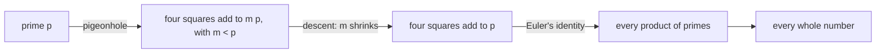

# Four squares and beyond: every integer as four squares, and how many cubes it takes

[Syllabus](../../../SYLLABUS.md) → [Algebraic and analytic number theory](../README.md) → [Diophantine and Modular](../README.md#s07) → Four squares and beyond

---

## General Overview

Try to write 7 as a sum of three squares of whole numbers. The only squares up to 7 are 0, 1 and 4. Three of them can make 0, 1, 2, 3, 4, 5, 6, 8, 9 and 12, but never 7. Four squares do it: 7 = 4 + 1 + 1 + 1.

A computer search over every whole number from 1 to 100,000 finds the same pattern everywhere. Some numbers need one square, some two, some three, and 16,664 of them need four. Not one needs five.

That is no accident of the range. In 1770 Lagrange proved that four squares are always enough, for every whole number there is. The numbers that need all four also have a clean description: they are exactly the numbers of the form $`4^e(8t + 7)`$, where e and t are whole numbers from 0 up. Seven is the smallest, with e = 0 and t = 0.

Cubes behave the same way, only worse. 23 needs nine cubes: 8 + 8 + 1 + 1 + 1 + 1 + 1 + 1 + 1, because 27 is already too big. Waring asked in 1770 whether every power has such a fixed limit. Hilbert proved in 1909 that it does.

**Every whole number is a sum of four squares, because sums of four squares multiply and every prime can be reached by shrinking a multiple of it; three squares fail exactly on the numbers $`4^e(8t + 7)`$, and for each power k a fixed number g(k) of k-th powers always suffices.**

**What kind of fact this is:** three theorems with different status. Lagrange's four-square theorem is proved on this card, completely, in Why it works. The three-square theorem is half proved here (no number $`4^e(8t + 7)`$ is three squares); the other half is stated with a source. For higher powers, the lower bound on g(k) is proved here, and the exact values are stated with sources; one question about cubes is open as of 2026-11-15. A fourth theorem, Jacobi's formula for the number of ways, is stated with a source, not proved.

### The picture: how many squares each number needs

How many of the whole numbers 1 to 100,000 need one, two, three or four squares. Each `#` stands for about 1,500 numbers; the 316 perfect squares show as one mark.

```
need 1 square    #                                           316
need 2 squares   ################                         23,712
need 3 squares   ########################################  59,308
need 4 squares   ###########                              16,664
need 5 squares                                                 0
```

---

## The formula

Lagrange's theorem says that every whole number n from 0 up can be written as

```math
n = a^2 + b^2 + c^2 + d^2
```

with a, b, c and d whole numbers, zero allowed.

**Read it aloud:** "n is the sum of the squares of four whole numbers."

For 7 the four numbers are 2, 1, 1, 1. The proof rests on Euler's four-square identity (1748), which says that the product of two sums of four squares is again a sum of four squares:

```math
(a^2+b^2+c^2+d^2)(w^2+x^2+y^2+z^2) = (aw+bx+cy+dz)^2 + (ax-bw+cz-dy)^2 + (ay-bz-cw+dx)^2 + (az+by-cx-dw)^2
```

**Read it aloud:** "Multiply two sums of four squares, and four particular mixtures of the eight numbers square and add to the same product."

Two companion statements finish the picture. Legendre's three-square theorem (1798):

```math
n = a^2 + b^2 + c^2 \quad\text{has a solution} \iff n \text{ is not of the form } 4^e(8t+7)
```

**Read it aloud:** "n is a sum of three squares exactly when n is not a power of four times a number that leaves remainder 7 on division by 8."

As a test: strip every factor of 4 from n; if what remains leaves remainder 7 on division by 8, three squares fail. For a power k, the number g(k), introduced on this card, is the fewest k-th powers that suffice for every whole number. Its lower bound is

```math
g(k) \ge 2^k + \lfloor (3/2)^k \rfloor - 2
```

**Read it aloud:** "At least two to the k, plus one and a half to the k rounded down, minus two, k-th powers are needed."

For squares that gives 4 + 2 − 2 = 4. For cubes it gives 8 + 3 − 2 = 9.

| Symbol | Plain meaning | In our example | Push it up and the answer… |
| --- | --- | --- | --- |
| $`n`$, $`r_4(n)`$ | the whole number being written as a sum; and the number of ways to write it as four squares, signs and order counted ($`r_2(n)`$ is the same count for two squares) | 7; $`r_4(7) = 64`$ | still four squares at most; more divisors give more ways |
| $`a, b, c, d`$ | the four whole numbers that are squared, zero allowed; $`a', b', c', d'`$ are their nearest remainders in the descent | 2, 1, 1, 1 | — |
| $`w, x, y, z`$ | a second set of four, multiplied in by Euler's identity | 1, 1, 1, 0, for 3 | — |
| $`p`$ | a prime | 7, then 23 | the descent may take more steps: at most 9 below 10,000 |
| $`u, v`$ | two numbers with $`u^2 + v^2 + 1`$ a multiple of $`p`$ | 2 and 3, for p = 7 | — |
| $`m`$ | the multiplier: the current four squares add to $`m p`$ | 2 for p = 7; 3 for p = 23 | more shrinking steps |
| $`r`$ | the new, smaller multiplier after one odd step | 1 for p = 23 | — |
| $`e, t`$ | the exponent and the multiple in $`4^e(8t+7)`$ | 0 and 0, for 7; 1 and 0, for 28 | the form grows rarer: share 1/6 overall |
| $`k`$ | the power: 2 for squares, 3 for cubes | 2, then 3 | more k-th powers are needed |
| $`g(k)`$ | fewest k-th powers that write every whole number | 4 for squares, 9 for cubes | about $`2^k`$ |
| $`G(k)`$ | fewest k-th powers that write every large enough number | 4 for squares; between 4 and 7 for cubes | grows more slowly than $`g(k)`$ |
| $`\lfloor (3/2)^k \rfloor`$, $`\{(3/2)^k\}`$ | one and a half to the k, rounded down; and its fractional part, the digits after the point | 2 for k = 2, 3 for k = 3 | raises the bound on g(k) |

### When it holds

- **Whole numbers, not fractions or reals.** Every positive real number is one square on its own, so the question only has teeth for whole numbers.
- **Four squares, not three.** Drop to three and 16,664 of the first 100,000 numbers fail, starting with 7.
- **Non-negative powers.** Squares cannot be negative, but cubes can. Allow negative cubes and 23 = 8 + 8 + 8 − 1 takes four cubes, not nine. g(k) counts non-negative powers only.
- **Every number, or only large ones.** g(3) = 9 because of just two numbers, 23 and 239. For large numbers fewer cubes do the job, and that count, G(3), is a different number.

---

## Why it works

### Step 0: the idea, multiply and shrink

Two facts carry the proof.

1. **Sums of four squares multiply.** Euler's identity turns two of them into one. So if every prime is a sum of four squares, every product of primes is too, and every whole number is a product of primes ([Two squares](02-sums-of-squares-and-gaussian-integers.md) uses the same plan with two squares).
2. **A multiple of a prime can be shrunk.** It is easy to find four squares that add to some multiple $`m p`$ of a prime p. A trick called descent then turns them into four squares that add to a smaller multiple, and repeats until the multiple is 1.



### Step 1: Euler's identity

Expand both sides of Euler's identity. Each side holds the sixteen products $`a^2 w^2, a^2 x^2, \ldots, d^2 z^2`$. The right side also has cross terms such as $`2abwx`$, and the signs are chosen so that every cross term appears once with a plus and once with a minus. They cancel, and the two sides agree.

The check confirms it on all 65,536 choices of the eight numbers from −1 to 2, with no failure. On real numbers: 7 = 4 + 1 + 1 + 1 and 3 = 1 + 1 + 1 + 0. With $`(a, b, c, d) = (2, 1, 1, 1)`$ and $`(w, x, y, z) = (1, 1, 1, 0)`$ the four mixtures are 4, 0, 2 and −1, and

```math
4^2 + 0^2 + 2^2 + (-1)^2 = 16 + 0 + 4 + 1 = 21 = 7 \times 3
```

The identity is not a lucky formula. Quaternions are numbers with four parts a, b, c, d, built like complex numbers but with three square roots of −1 instead of one. A quaternion's length squared is $`a^2 + b^2 + c^2 + d^2`$, and the length of a product is the product of the lengths. Euler's identity is that rule written out.

### Step 2: some multiple of p is a sum of four squares

Take an odd prime p (2 = 1 + 1 + 0 + 0 needs no work). Look at the values of $`u^2`$ for u = 0, 1, …, (p − 1)/2. They are (p + 1)/2 different remainders mod p. Two equal ones would force p to divide the difference or the sum of the two values of u, and both are positive and smaller than p.

Do the same for $`-1 - v^2`$. That gives (p + 1)/2 more different remainders. Together that is p + 1 remainders, but only p remainders exist. By the pigeonhole principle ([Pigeonhole, extended](../../04-Combinatorics%20and%20graphs/04-Inclusion-Exclusion%20and%20Pigeonhole/05-pigeonhole-extended.md)), one value of $`u^2`$ equals one value of $`-1 - v^2`$ mod p. So

```math
u^2 + v^2 + 1^2 + 0^2 = m p
```

for some whole number m. Since u and v are at most (p − 1)/2, the sum is less than $`p^2`$, so m < p. For p = 7: u = 2, v = 3 gives 4 + 9 + 1 + 0 = 14 = 2 × 7.

### Step 3: descent, shrinking the multiplier

Suppose four squares add to $`m p`$ with 1 < m < p.

- **If m is even**, an even number of the four are odd. Pair numbers of equal parity. Half the sum and half the difference of each pair are whole numbers, and their squares add to $`m p / 2`$. For p = 7, the pairs (2, 0) and (3, 1) give (1, 1, 2, 1): 1 + 1 + 4 + 1 = 7. That is 7 = 4 + 1 + 1 + 1, the opening example.
- **If m is odd**, replace each number by its nearest remainder mod m, a number between −m/2 and m/2. These four remainders square to a multiple $`r m`$ with r < m. Multiply the two sets with Euler's identity: every mixture turns out divisible by m, and dividing by m leaves four squares adding to $`r p`$.

The odd step on p = 23, with numbers from the check:

| Step | Four numbers | Sum of squares |
| --- | --- | --- |
| Pigeonhole start, u = 2, v = 8 | (2, 8, 1, 0) | 3 × 23, so m = 3 |
| Nearest remainders mod 3 | (−1, −1, 1, 0) | 3 = 3 × 1, so r = 1 |
| Euler mixtures | (−9, 6, 3, 9) | 207 = 9 × 23 |
| Divide each by m = 3 | (−3, 2, 1, 3) | 9 + 4 + 1 + 9 = 23 |

Each step lowers m, and m is a positive whole number, so the steps stop at m = 1.

<details>
<summary>Detailed proof: the descent always reaches m = 1</summary>

Let $`a^2 + b^2 + c^2 + d^2 = m p`$ with $`1 < m < p`$.

**Even m.** The sum is even, so zero, two or four of a, b, c, d are odd. Reorder them so a, b have equal parity and c, d have equal parity. Then

$`\displaystyle \left(\tfrac{a+b}{2}\right)^2 + \left(\tfrac{a-b}{2}\right)^2 + \left(\tfrac{c+d}{2}\right)^2 + \left(\tfrac{c-d}{2}\right)^2 = \tfrac{a^2+b^2+c^2+d^2}{2} = \tfrac{m}{2}\, p`$

and all four fractions are whole numbers.

**Odd m.** Choose $`a' \equiv a`$, $`b' \equiv b`$, $`c' \equiv c`$, $`d' \equiv d \pmod m`$ with each between $`-(m-1)/2`$ and $`(m-1)/2`$. Then $`a'^2 + b'^2 + c'^2 + d'^2 \equiv a^2 + b^2 + c^2 + d^2 \equiv 0 \pmod m`$, so it equals $`r m`$ for a whole number r, and

$`\displaystyle r m \le 4 \left(\tfrac{m-1}{2}\right)^2 < m^2,`$

so r < m. If r = 0, all four of a, b, c, d are multiples of m, so $`m^2`$ divides $`m p`$ and m divides p, impossible for 1 < m < p. So 0 < r < m.

Apply Euler's identity with $`(w, x, y, z) = (a', b', c', d')`$. The product is $`m p \cdot r m = m^2 r p`$. Reduce each mixture mod m, replacing the primed numbers by the unprimed ones they equal mod m:

$`\displaystyle aa' + bb' + cc' + dd' \equiv a^2 + b^2 + c^2 + d^2 \equiv 0,`$

$`\displaystyle ab' - ba' + cd' - dc' \equiv ab - ba + cd - dc = 0,`$

and the last two vanish the same way. So all four mixtures are multiples of m. Divide each by m: their squares add to $`r p`$, with 0 < r < m.

**End.** Each step replaces m by a smaller positive whole number, so after finitely many steps m = 1, and p is a sum of four squares. With Step 1, every whole number is.

</details>

The check runs this proof as a program for all 1,229 primes below 10,000. It then builds four squares for every whole number from 1 to 10,000 by multiplying the primes' answers, and adds each one up to confirm it. No prime needed more than 9 descent steps.

**How many ways.** Write $`r_4(n)`$ for the number of ways to write n as four squares, with signs and order counted, as $`r_2(n)`$ does on [Two squares](02-sums-of-squares-and-gaussian-integers.md). Jacobi's formula gives it exactly: $`r_4(n)`$ is 8 times the sum of the divisors of n that are not multiples of 4. For 7 the divisors are 1 and 7, so $`r_4(7) = 8 \times 8 = 64`$: the 2 in 4 + 1 + 1 + 1 can stand in any of four places, and each of the four numbers can take either sign. The formula is stated here, not proved; it is proved with modular forms in Diamond and Shurman's *A First Course in Modular Forms*, the source behind [Modular forms](07-modular-forms-in-outline.md). The check counts the ways by search and matches the formula for every n from 1 to 100.

### Step 4: three squares, and which numbers they miss

The half that this card proves: no number $`4^e(8t+7)`$ is a sum of three squares.

- **Remainder 7 mod 8.** Every square leaves remainder 0, 1 or 4 on division by 8 ([Congruence](../../02-Number%20theory/03-Clock%20Arithmetic/01-congruence-mod-n.md)). Three of those add to 0, 1, 2, 3, 4, 5 or 6 mod 8, never 7.
- **Factors of 4.** Every square leaves 0 or 1 mod 4. If three squares add to a multiple of 4, all three must leave 0, so all three numbers are even. Halve each and the sum drops by a factor of 4. So if 4n were three squares, n would be too. Repeating, $`4^e(8t+7)`$ would lead back to 8t + 7, which is impossible.

The other half, that every other number is a sum of three squares, is Legendre's theorem (1798), completed by Gauss (1801). Its proof needs the theory of quadratic forms in three variables and is not given here; Nathanson's book in Sources proves it.

The search agrees exactly. The numbers from 1 to 100,000 that need four squares are precisely the numbers $`4^e(8t+7)`$ in that range. Of them, 4,164 do not leave remainder 7 mod 8; the first is 28 = 4 × 7.

Their share tends to one sixth. Remainder 7 mod 8 gives one eighth of all numbers, and each extra factor of 4 adds a quarter as many again:

```math
\tfrac18\left(1 + \tfrac14 + \tfrac1{16} + \cdots\right) = \tfrac18 \cdot \tfrac43 = \tfrac16
```

| Up to | Numbers needing four squares | Share | One sixth |
| --- | ---: | ---: | ---: |
| 1,000 | 165 | 0.165000 | 0.166667 |
| 10,000 | 1,665 | 0.166500 | 0.166667 |
| 100,000 | 16,664 | 0.166640 | 0.166667 |

### Step 5: higher powers, and why 23 needs nine cubes

The lower bound for g(k) comes from one awkward number, $`n = 2^k \lfloor (3/2)^k \rfloor - 1`$. This n is below $`3^k`$, so the only k-th powers that fit are $`1`$ and $`2^k`$. The best plan uses $`\lfloor (3/2)^k \rfloor - 1`$ copies of $`2^k`$, which leaves $`2^k - 1`$, and then $`2^k - 1`$ ones. The total is $`2^k + \lfloor (3/2)^k \rfloor - 2`$.

| k | Witness n | Fewest k-th powers, by search | $`2^k + \lfloor (3/2)^k \rfloor - 2`$ |
| --- | ---: | ---: | ---: |
| 2 | 7 | 4 | 4 |
| 3 | 23 | 9 | 9 |
| 4 | 79 | 19 | 19 |
| 5 | 223 | 37 | 37 |
| 6 | 703 | 73 | 73 |

For k = 2 the witness is 7, the opening example. For cubes it is 23 = 8 + 8 + 7 × 1.

The bound is only a floor. The ceiling came in stages:

- **Every k has a finite g(k).** Hilbert proved this in 1909; Nathanson's book gives a proof.
- **Cubes: g(3) = 9.** Proved by 1912. Dickson showed in 1939 that 23 and 239 are the only numbers needing nine cubes.
- **Fourth and fifth powers.** g(4) = 19 was proved in 1986 and g(5) = 37 in 1964 (Vaughan's book gives both).
- **The general formula.** $`g(k) = 2^k + \lfloor (3/2)^k \rfloor - 2`$ holds for every k with $`2^k \{(3/2)^k\} + \lfloor (3/2)^k \rfloor \le 2^k`$, where $`\{\,\}`$ means the fractional part. Kubina and Wunderlich verified that condition for every k up to 471,600,000 in 1990. No k is known where it fails, and as of 2026-11-15 no proof rules a failure out. The check confirms the condition exactly for k = 2 to 80.

The fewest cubes for each number from 1 to 10,000, by search (each `#` is about 96 numbers; any nonzero count shows at least one mark):

```
need 1 cube    #                                            21
need 2 cubes   ##                                          202
need 3 cubes   ############                              1,129
need 4 cubes   ###################################       3,343
need 5 cubes   ########################################  3,842
need 6 cubes   ##############                            1,325
need 7 cubes   #                                           121
need 8 cubes   #                                            15
need 9 cubes   #                                             2
```

Fifteen numbers need eight cubes, the largest 454; Siksek proved in 2016 that every number above 454 needs at most seven. For all large numbers, G(3) is at most 7 (Linnik, 1943) and at least 4, because cubes leave only 0, 1 or 8 mod 9, and three of those never make 4 or 5 mod 9. **Whether G(3) is 4, 5, 6 or 7 is open as of 2026-11-15.** For fourth powers the answer is known: G(4) = 16 (Davenport, 1939).

---

## Worked numbers, by hand

The opening example, from search to proof:

| Step | Arithmetic | Value |
| --- | --- | --- |
| Squares up to 7 | 0 × 0, 1 × 1, 2 × 2 | 0, 1, 4 |
| Best three squares near 7 | 4 + 1 + 1 = 6; 4 + 4 + 0 = 8 | 7 missed |
| Legendre's test | 7 has no factor of 4; 7 mod 8 = 7 | e = 0, t = 0: three squares fail |
| Pigeonhole for p = 7 | u = 2, v = 3: 4 + 9 + 1 + 0 | 14 = 2 × 7, so m = 2 |
| Pair the parities | (2, 0) and (3, 1): half sums and half differences | (1, 1, 2, 1) |
| Add the squares | 1 + 1 + 4 + 1 | **7 = 4 + 1 + 1 + 1** |

So 7 needs exactly four squares: three cannot reach it, and the proof's own steps land on four.

### What breaks if you drop a piece

| Mistake | Comes out at | What went wrong |
| --- | --- | --- |
| Three squares instead of four | 7 unreachable; 16,664 of the first 100,000 numbers fail | Squares mod 8 are 0, 1, 4, so remainder 7 needs a fourth square |
| Plain remainders 0 to m − 1 in the descent | p = 23: (2, 2, 1, 0) = 3 × 3, so r = m = 3 and the step gains nothing | The shrink needs remainders below m/2 in size; otherwise r can equal m, and the descent can stall |
| One sign flipped in Euler's identity | 7 × 3 comes out 25, not 21 | The cross terms no longer cancel in pairs |
| Negative cubes allowed | 23 = 8 + 8 + 8 − 1, four cubes, not nine | g(k) counts non-negative powers; negatives change the question |

---

## Code, from first principles, and it actually runs

The code takes three independent roads. Road 1 searches: for every number up to 100,000 it finds the fewest squares directly, and for every number up to 10,000 the fewest cubes, by building each answer from smaller ones. The search has no cap, so a number needing five squares would show up; none does. Road 2 runs Lagrange's proof as a program (pigeonhole, descent, Euler's identity) and builds four squares for every number up to 10,000. Road 3 is Legendre's test, which must pick out exactly the numbers that Road 1 finds needing four. A last block compares the lower bound for g(k) with a search for k = 2 to 6, and a count of every way to write n up to 100 as four squares matches Jacobi's formula.

### Python

```python
# Four squares and beyond -- the check behind the card.  Standard library only.
# Road 1 searches: fewest squares for every n to 100,000, fewest cubes to 10,000.
# Road 2 runs Lagrange's proof as an algorithm (pigeonhole, descent, Euler's
# identity) and builds four squares for every n to 10,000.  Road 3 is Legendre's
# test 4^e(8t+7).  Euler's identity is checked on every quadruple from -1 to 2.
N, NB, NC = 100_000, 10_000, 10_000

def euler(a, w):                         # right side of Euler's four-square identity
    (a1, a2, a3, a4), (b1, b2, b3, b4) = a, w
    return (a1*b1 + a2*b2 + a3*b3 + a4*b4, a1*b2 - a2*b1 + a3*b4 - a4*b3,
            a1*b3 - a2*b4 - a3*b1 + a4*b2, a1*b4 + a2*b3 - a3*b2 - a4*b1)

def sq(q): return sum(x * x for x in q)
def show(q): return "(" + ", ".join(str(x) for x in q) + ")"

def prime_rep(p, log):                   # road 2: four squares for a prime p
    if p == 2:
        return (1, 1, 0, 0)
    seen = {(-1 - v * v) % p: v for v in range((p + 1) // 2)}
    u = next(u for u in range((p + 1) // 2) if (u * u) % p in seen)
    q = (u, seen[(u * u) % p], 1, 0)     # pigeonhole: u^2 + v^2 + 1 = m p
    m = sq(q) // p
    while m > 1:
        if m % 2 == 0:                   # pair equal parities, then halve
            s = sorted(q, key=lambda x: x % 2)
            new = ((s[0] + s[1]) // 2, (s[0] - s[1]) // 2, (s[2] + s[3]) // 2, (s[2] - s[3]) // 2)
            log.append(f"m = {m} at {show(q)} = {m} x {p}: halve to {show(new)}")
            q, m = new, m // 2
        else:                            # nearest remainders, multiply, divide by m
            y = tuple((x + m // 2) % m - m // 2 for x in q)
            r = sq(y) // m
            mix = euler(q, y); new = tuple(z // m for z in mix)
            log.append(f"m = {m} at {show(q)} = {m} x {p}: remainders {show(y)} = {m} x {r}, "
                       f"mixtures {show(mix)} = {sq(mix)}, / {m} = {show(new)}")
            q, m = new, r
    return q

def lowest_count(n_max, powers):         # road 1: fewest powers by dynamic programming
    f = [0] + [n_max + 1] * n_max
    for n in range(1, n_max + 1):
        f[n] = 1 + min(f[n - c] for c in powers if c <= n)
    return f

def legendre(n):                         # road 3: n = 4^e (8t + 7)?
    while n % 4 == 0:
        n //= 4
    return n % 8 == 7

print("-- 7 and three squares --")
small = [i * i for i in range(3)]
reach = sorted({x + y + z for x in small for y in small for z in small})
print(f"squares up to 7: {small}; three of them reach {reach}")
assert 7 not in reach
print(f"7 mod 8 = {7 % 8}; squares mod 8 are {sorted({x * x % 8 for x in range(8)})}")
fewest = lowest_count(N, [b ** 2 for b in range(1, 400) if b ** 2 <= N])   # no cap at four
print(f"-- fewest squares, n = 1 to {N:,} (search) --")
for k in range(1, 6):
    print(f"need {k}: {fewest[1:].count(k):,}")
assert max(fewest) == 4                  # nothing up to N needs five or more
four = [n for n in range(1, N + 1) if fewest[n] == 4]
assert four == [n for n in range(1, N + 1) if legendre(n)]
print(f"need four = numbers of the form 4^e(8t+7): {four == [n for n in range(1, N + 1) if legendre(n)]}")
print(f"need four but not 7 mod 8: {sum(1 for n in four if n % 8 != 7):,}, first {next(n for n in four if n % 8 != 7)}")
for M in (1_000, 10_000, 100_000):
    c = sum(1 for n in four if n <= M)
    print(f"share needing four up to {M:,}: {c:,} = {c / M:.6f} (1/6 = {1 / 6:.6f})")
assert abs(len(four) / N - 1 / 6) < 0.001
r4 = [0] * 101                           # r4(n): ways to write n as four squares, n <= 100
for code in range(21 ** 4):              # every (a, b, c, d) from -10 to 10
    s = sq([code // 21 ** i % 21 - 10 for i in range(4)])
    if s <= 100: r4[s] += 1
jac = [8 * sum(d for d in range(1, n + 1) if n % d == 0 and d % 4) for n in range(101)]
assert r4[1:] == jac[1:]                 # Jacobi: 8 x (sum of divisors not divisible by 4)
print(f"r4(7) by search {r4[7]}, by Jacobi 8 x {jac[7] // 8} = {jac[7]}; agree for n = 1 to 100: {r4[1:] == jac[1:]}")
print("-- Lagrange's proof run as an algorithm --")
for p in (7, 23):
    log = []
    q = prime_rep(p, log)
    print(f"p = {p}: " + "; ".join(log) + f"; {show(q)} sums to {sq(q)}")
    assert sq(q) == p
spf = list(range(NB + 1))
for i in range(2, int(NB ** 0.5) + 1):
    if spf[i] == i:
        for j in range(i * i, NB + 1, i):
            if spf[j] == j:
                spf[j] = i
reps, steps = {}, 0
for p in [i for i in range(2, NB + 1) if spf[i] == i]:
    log = []
    reps[p] = prime_rep(p, log)
    steps = max(steps, len(log))
built = 0
for n in range(1, NB + 1):
    q, k = (1, 0, 0, 0), n
    while k > 1:
        q, k = euler(q, reps[spf[k]]), k // spf[k]
    assert sq(q) == n
    built += 1
print(f"four squares built and summed for n = 1 to {NB:,}: {built:,}; primes {len(reps):,}; most descent steps {steps}")
bad = 0
for code in range(4 ** 8):
    v = [(code >> (2 * i) & 3) - 1 for i in range(8)]
    bad += sq(euler(v[:4], v[4:])) != sq(v[:4]) * sq(v[4:])
assert bad == 0
print(f"Euler's identity on all {4 ** 8:,} pairs of quadruples from -1 to 2: failures {bad}")
a, w = (2, 1, 1, 1), (1, 1, 1, 0)
e = euler(a, w)
flip = (e[0], a[0]*w[1] + a[1]*w[0] + a[2]*w[3] - a[3]*w[2], e[2], e[3])
print(f"7 x 3: {show(e)} sums to {sq(e)}; one sign flipped {show(flip)} sums to {sq(flip)}")
plain = tuple(x % 3 for x in (2, 8, 1, 0))
print(f"descent with plain remainders at p = 23, m = 3: {show(plain)} = 3 x {sq(plain) // 3}, no smaller m")
print(f"-- fewest cubes, n = 1 to {NC:,} (search) --")
fc = lowest_count(NC, [b ** 3 for b in range(1, 100) if b ** 3 <= NC])
print("need " + ", ".join(f"{k}: {fc[1:].count(k):,}" for k in range(1, 10)))
nine, eight = [n for n in range(1, NC + 1) if fc[n] == 9], [n for n in range(1, NC + 1) if fc[n] == 8]
assert nine == [23, 239] and max(eight) == 454
print(f"need nine: {nine}; need eight: {len(eight)}, largest {max(eight)}; 23 = 8 + 8 + 7 x 1")
print(f"cubes mod 9: {sorted({b ** 3 % 9 for b in range(9)})}; three of them miss",
      sorted(set(range(9)) - {(x + y + z) % 9 for x in (0, 1, 8) for y in (0, 1, 8) for z in (0, 1, 8)}))
signed = [(x, y, z, t) for x in range(-3, 4) for y in range(x, 4) for z in range(y, 4) for t in range(z, 4)
          if x ** 3 + y ** 3 + z ** 3 + t ** 3 == 23]
print(f"23 with negative cubes allowed, four cubes from -3 to 3: {signed}")
print("-- Waring: the lower bound witness n = 2^k floor(1.5^k) - 1 --")
for k in range(2, 7):
    q = 3 ** k // 2 ** k
    n, g = 2 ** k * q - 1, 2 ** k + q - 2
    f = lowest_count(n, [b ** k for b in range(1, n + 1) if b ** k <= n])[n]
    print(f"k = {k}: n = {n}, fewest by search {f}, 2^k + floor(1.5^k) - 2 = {g}")
    assert f == g
ok = [k for k in range(2, 81) if 3 ** k % 2 ** k + 3 ** k // 2 ** k <= 2 ** k]
assert len(ok) == 79
print(f"condition for g(k) = 2^k + floor(1.5^k) - 2 holds for k = 2 to 80: {len(ok)} of 79")
print("ALL CHECKS PASS")
```

**Ran 2026-11-15 on macOS, Python 3.14.10, standard library only. All checks passed. Output, pasted from the run:**

```
-- 7 and three squares --
squares up to 7: [0, 1, 4]; three of them reach [0, 1, 2, 3, 4, 5, 6, 8, 9, 12]
7 mod 8 = 7; squares mod 8 are [0, 1, 4]
-- fewest squares, n = 1 to 100,000 (search) --
need 1: 316
need 2: 23,712
need 3: 59,308
need 4: 16,664
need 5: 0
need four = numbers of the form 4^e(8t+7): True
need four but not 7 mod 8: 4,164, first 28
share needing four up to 1,000: 165 = 0.165000 (1/6 = 0.166667)
share needing four up to 10,000: 1,665 = 0.166500 (1/6 = 0.166667)
share needing four up to 100,000: 16,664 = 0.166640 (1/6 = 0.166667)
r4(7) by search 64, by Jacobi 8 x 8 = 64; agree for n = 1 to 100: True
-- Lagrange's proof run as an algorithm --
p = 7: m = 2 at (2, 3, 1, 0) = 2 x 7: halve to (1, 1, 2, 1); (1, 1, 2, 1) sums to 7
p = 23: m = 3 at (2, 8, 1, 0) = 3 x 23: remainders (-1, -1, 1, 0) = 3 x 1, mixtures (-9, 6, 3, 9) = 207, / 3 = (-3, 2, 1, 3); (-3, 2, 1, 3) sums to 23
four squares built and summed for n = 1 to 10,000: 10,000; primes 1,229; most descent steps 9
Euler's identity on all 65,536 pairs of quadruples from -1 to 2: failures 0
7 x 3: (4, 0, 2, -1) sums to 21; one sign flipped (4, 2, 2, -1) sums to 25
descent with plain remainders at p = 23, m = 3: (2, 2, 1, 0) = 3 x 3, no smaller m
-- fewest cubes, n = 1 to 10,000 (search) --
need 1: 21, 2: 202, 3: 1,129, 4: 3,343, 5: 3,842, 6: 1,325, 7: 121, 8: 15, 9: 2
need nine: [23, 239]; need eight: 15, largest 454; 23 = 8 + 8 + 7 x 1
cubes mod 9: [0, 1, 8]; three of them miss [4, 5]
23 with negative cubes allowed, four cubes from -3 to 3: [(-1, 2, 2, 2)]
-- Waring: the lower bound witness n = 2^k floor(1.5^k) - 1 --
k = 2: n = 7, fewest by search 4, 2^k + floor(1.5^k) - 2 = 4
k = 3: n = 23, fewest by search 9, 2^k + floor(1.5^k) - 2 = 9
k = 4: n = 79, fewest by search 19, 2^k + floor(1.5^k) - 2 = 19
k = 5: n = 223, fewest by search 37, 2^k + floor(1.5^k) - 2 = 37
k = 6: n = 703, fewest by search 73, 2^k + floor(1.5^k) - 2 = 73
condition for g(k) = 2^k + floor(1.5^k) - 2 holds for k = 2 to 80: 79 of 79
ALL CHECKS PASS
```

### Rust

```rust
// Four squares and beyond -- the check behind the card.  std only, no crates.
// Road 1 searches: fewest squares for every n to 100,000, fewest cubes to 10,000.
// Road 2 runs Lagrange's proof as an algorithm (pigeonhole, descent, Euler's
// identity) and builds four squares for every n to 10,000.  Road 3 is Legendre's
// test 4^e(8t+7).  Euler's identity is checked on every quadruple from -1 to 2.
type Q = [i64; 4];

fn euler(a: Q, b: Q) -> Q { // right side of Euler's four-square identity
    [a[0] * b[0] + a[1] * b[1] + a[2] * b[2] + a[3] * b[3],
     a[0] * b[1] - a[1] * b[0] + a[2] * b[3] - a[3] * b[2],
     a[0] * b[2] - a[1] * b[3] - a[2] * b[0] + a[3] * b[1],
     a[0] * b[3] + a[1] * b[2] - a[2] * b[1] - a[3] * b[0]]
}
fn sq(q: &[i64]) -> i64 { q.iter().map(|x| x * x).sum() }
fn join(v: &[i64]) -> String { v.iter().map(|x| x.to_string()).collect::<Vec<_>>().join(", ") }
fn show(q: &[i64]) -> String { format!("({})", join(q)) }
fn list(v: &[i64]) -> String { format!("[{}]", join(v)) }
fn commas(n: usize) -> String {
    let s = n.to_string();
    s.chars().enumerate().map(|(i, c)| if i > 0 && (s.len() - i) % 3 == 0 { format!(",{}", c) } else { c.to_string() }).collect()
}

fn prime_rep(p: i64, log: &mut Vec<String>) -> Q { // road 2: four squares for a prime p
    if p == 2 { return [1, 1, 0, 0]; }
    let mut seen = std::collections::HashMap::new();
    for v in 0..(p + 1) / 2 { seen.insert((-1 - v * v).rem_euclid(p), v); }
    let u = (0..(p + 1) / 2).find(|u| seen.contains_key(&(u * u % p))).unwrap();
    let mut q: Q = [u, seen[&(u * u % p)], 1, 0]; // pigeonhole: u^2 + v^2 + 1 = m p
    let mut m = sq(&q) / p;
    while m > 1 {
        if m % 2 == 0 { // pair equal parities, then halve
            let mut s = q;
            s.sort_by_key(|x| x.rem_euclid(2));
            let new = [(s[0] + s[1]) / 2, (s[0] - s[1]) / 2, (s[2] + s[3]) / 2, (s[2] - s[3]) / 2];
            log.push(format!("m = {} at {} = {} x {}: halve to {}", m, show(&q), m, p, show(&new)));
            (q, m) = (new, m / 2);
        } else { // nearest remainders, multiply, divide by m
            let y = q.map(|x| (x + m / 2).rem_euclid(m) - m / 2);
            let r = sq(&y) / m;
            let (mix, new) = (euler(q, y), euler(q, y).map(|z| z / m));
            log.push(format!("m = {} at {} = {} x {}: remainders {} = {} x {}, mixtures {} = {}, / {} = {}",
                m, show(&q), m, p, show(&y), m, r, show(&mix), sq(&mix), m, show(&new)));
            (q, m) = (new, r);
        }
    }
    q
}

fn lowest_count(n_max: usize, powers: &[usize]) -> Vec<usize> { // road 1: dynamic programming
    let mut f = vec![0; n_max + 1];
    for n in 1..=n_max {
        f[n] = 1 + powers.iter().filter(|&&c| c <= n).map(|&c| f[n - c]).min().unwrap();
    }
    f
}

fn legendre(mut n: usize) -> bool { // road 3: n = 4^e (8t + 7)?
    while n % 4 == 0 { n /= 4; }
    n % 8 == 7
}

fn main() {
    let (n_all, nb, nc) = (100_000usize, 10_000usize, 10_000usize);
    println!("-- 7 and three squares --");
    let small: Vec<i64> = (0..3).map(|i| i * i).collect();
    let mut reach: Vec<i64> = (0..27).map(|c| small[c % 3] + small[c / 3 % 3] + small[c / 9]).collect();
    reach.sort(); reach.dedup();
    println!("squares up to 7: {}; three of them reach {}", list(&small), list(&reach));
    assert!(!reach.contains(&7));
    let mut m8: Vec<i64> = (0..8).map(|x| x * x % 8).collect();
    m8.sort(); m8.dedup();
    println!("7 mod 8 = {}; squares mod 8 are {}", 7 % 8, list(&m8));
    let fewest = lowest_count(n_all, &(1..400usize).map(|b| b * b).filter(|&c| c <= n_all).collect::<Vec<_>>()); // no cap at four
    println!("-- fewest squares, n = 1 to {} (search) --", commas(n_all));
    for k in 1..=5 { println!("need {}: {}", k, commas(fewest[1..].iter().filter(|&&f| f == k).count())); }
    assert!(*fewest.iter().max().unwrap() == 4); // nothing up to n_all needs five or more
    let four: Vec<usize> = (1..=n_all).filter(|&n| fewest[n] == 4).collect();
    let leg: Vec<usize> = (1..=n_all).filter(|&n| legendre(n)).collect();
    assert!(four == leg);
    println!("need four = numbers of the form 4^e(8t+7): {}", if four == leg { "True" } else { "False" });
    let not7: Vec<&usize> = four.iter().filter(|&&n| n % 8 != 7).collect();
    println!("need four but not 7 mod 8: {}, first {}", commas(not7.len()), not7[0]);
    for mm in [1_000usize, 10_000, 100_000] {
        let c = four.iter().filter(|&&n| n <= mm).count();
        println!("share needing four up to {}: {} = {:.6} (1/6 = {:.6})", commas(mm), commas(c),
            c as f64 / mm as f64, 1.0 / 6.0);
    }
    assert!((four.len() as f64 / n_all as f64 - 1.0 / 6.0).abs() < 0.001);
    let mut r4 = vec![0usize; 101]; // r4(n): ways to write n as four squares, n <= 100
    for s in (0..21i64.pow(4)).map(|c| sq(&[c % 21 - 10, c / 21 % 21 - 10, c / 441 % 21 - 10, c / 9261 - 10]) as usize) {
        if s <= 100 { r4[s] += 1; } // every (a, b, c, d) from -10 to 10
    }
    let jac: Vec<usize> = (0..=100usize).map(|n| 8 * (1..=n).filter(|d| n % d == 0 && d % 4 != 0).sum::<usize>()).collect();
    assert!(r4[1..] == jac[1..]); // Jacobi: 8 x (sum of divisors not divisible by 4)
    let agree = if r4[1..] == jac[1..] { "True" } else { "False" };
    println!("r4(7) by search {}, by Jacobi 8 x {} = {}; agree for n = 1 to 100: {}", r4[7], jac[7] / 8, jac[7], agree);
    println!("-- Lagrange's proof run as an algorithm --");
    for p in [7i64, 23] {
        let mut log = vec![];
        let q = prime_rep(p, &mut log);
        println!("p = {}: {}; {} sums to {}", p, log.join("; "), show(&q), sq(&q));
        assert!(sq(&q) == p);
    }
    let mut spf: Vec<usize> = (0..=nb).collect();
    for i in (2..).take_while(|i| i * i <= nb) {
        if spf[i] == i { for j in (i * i..=nb).step_by(i) { if spf[j] == j { spf[j] = i; } } }
    }
    let (mut reps, mut steps) = (std::collections::HashMap::new(), 0);
    for p in (2..=nb).filter(|&i| spf[i] == i) {
        let mut log = vec![];
        reps.insert(p, prime_rep(p as i64, &mut log));
        steps = steps.max(log.len());
    }
    let mut built = 0;
    for n in 1..=nb {
        let (mut q, mut k): (Q, usize) = ([1, 0, 0, 0], n);
        while k > 1 { q = euler(q, reps[&spf[k]]); k /= spf[k]; }
        assert!(sq(&q) == n as i64);
        built += 1;
    }
    println!("four squares built and summed for n = 1 to {}: {}; primes {}; most descent steps {}",
        commas(nb), commas(built), commas(reps.len()), steps);
    let mut bad = 0;
    for code in 0..4u32.pow(8) {
        let v: Vec<i64> = (0..8).map(|i| ((code >> (2 * i)) & 3) as i64 - 1).collect();
        let (a, b): (Q, Q) = ([v[0], v[1], v[2], v[3]], [v[4], v[5], v[6], v[7]]);
        if sq(&euler(a, b)) != sq(&a) * sq(&b) { bad += 1; }
    }
    assert!(bad == 0);
    println!("Euler's identity on all {} pairs of quadruples from -1 to 2: failures {}", commas(4usize.pow(8)), bad);
    let (a, w): (Q, Q) = ([2, 1, 1, 1], [1, 1, 1, 0]);
    let e = euler(a, w);
    let flip = [e[0], a[0] * w[1] + a[1] * w[0] + a[2] * w[3] - a[3] * w[2], e[2], e[3]];
    println!("7 x 3: {} sums to {}; one sign flipped {} sums to {}", show(&e), sq(&e), show(&flip), sq(&flip));
    let plain = [2i64, 8, 1, 0].map(|x| x % 3);
    println!("descent with plain remainders at p = 23, m = 3: {} = 3 x {}, no smaller m", show(&plain), sq(&plain) / 3);
    println!("-- fewest cubes, n = 1 to {} (search) --", commas(nc));
    let cubes: Vec<usize> = (1..100usize).map(|b| b * b * b).filter(|&c| c <= nc).collect();
    let fc = lowest_count(nc, &cubes);
    let parts: Vec<String> = (1..10).map(|k| format!("{}: {}", k, commas(fc[1..].iter().filter(|&&f| f == k).count()))).collect();
    println!("need {}", parts.join(", "));
    let nine: Vec<i64> = (1..=nc).filter(|&n| fc[n] == 9).map(|n| n as i64).collect();
    let eight: Vec<usize> = (1..=nc).filter(|&n| fc[n] == 8).collect();
    assert!(nine == vec![23, 239] && *eight.iter().max().unwrap() == 454);
    println!("need nine: {}; need eight: {}, largest {}; 23 = 8 + 8 + 7 x 1", list(&nine), eight.len(), eight.iter().max().unwrap());
    let mut c9: Vec<i64> = (0..9).map(|b| b * b * b % 9).collect();
    c9.sort(); c9.dedup();
    let hit: Vec<i64> = (0..27).map(|c| (c9[c % 3] + c9[c / 3 % 3] + c9[c / 9]) % 9).collect();
    let miss: Vec<i64> = (0..9).filter(|r| !hit.contains(r)).collect();
    println!("cubes mod 9: {}; three of them miss {}", list(&c9), list(&miss));
    let mut signed = vec![];
    for x in -3i64..4 { for y in x..4 { for z in y..4 { for t in z..4 {
        if x.pow(3) + y.pow(3) + z.pow(3) + t.pow(3) == 23 { signed.push(show(&[x, y, z, t])); }
    } } } }
    println!("23 with negative cubes allowed, four cubes from -3 to 3: [{}]", signed.join(", "));
    println!("-- Waring: the lower bound witness n = 2^k floor(1.5^k) - 1 --");
    for k in 2u32..7 {
        let q = 3usize.pow(k) / 2usize.pow(k);
        let (n, g) = (2usize.pow(k) * q - 1, 2usize.pow(k) + q - 2);
        let pw: Vec<usize> = (1..=n).map(|b| b.pow(k)).take_while(|&c| c <= n).collect();
        let f = lowest_count(n, &pw)[n];
        println!("k = {}: n = {}, fewest by search {}, 2^k + floor(1.5^k) - 2 = {}", k, n, f, g);
        assert!(f == g);
    }
    let pw = |b: u128, k: u32| b.checked_pow(k).unwrap();
    let ok = (2u32..81).filter(|&k| pw(3, k) % pw(2, k) + pw(3, k) / pw(2, k) <= pw(2, k)).count();
    assert!(ok == 79);
    println!("condition for g(k) = 2^k + floor(1.5^k) - 2 holds for k = 2 to 80: {} of 79", ok);
    println!("ALL CHECKS PASS");
}
```

**Ran 2026-11-15 on macOS, rustc 1.98.1, no crates. All checks passed. Output, pasted from the run:**

```
-- 7 and three squares --
squares up to 7: [0, 1, 4]; three of them reach [0, 1, 2, 3, 4, 5, 6, 8, 9, 12]
7 mod 8 = 7; squares mod 8 are [0, 1, 4]
-- fewest squares, n = 1 to 100,000 (search) --
need 1: 316
need 2: 23,712
need 3: 59,308
need 4: 16,664
need 5: 0
need four = numbers of the form 4^e(8t+7): True
need four but not 7 mod 8: 4,164, first 28
share needing four up to 1,000: 165 = 0.165000 (1/6 = 0.166667)
share needing four up to 10,000: 1,665 = 0.166500 (1/6 = 0.166667)
share needing four up to 100,000: 16,664 = 0.166640 (1/6 = 0.166667)
r4(7) by search 64, by Jacobi 8 x 8 = 64; agree for n = 1 to 100: True
-- Lagrange's proof run as an algorithm --
p = 7: m = 2 at (2, 3, 1, 0) = 2 x 7: halve to (1, 1, 2, 1); (1, 1, 2, 1) sums to 7
p = 23: m = 3 at (2, 8, 1, 0) = 3 x 23: remainders (-1, -1, 1, 0) = 3 x 1, mixtures (-9, 6, 3, 9) = 207, / 3 = (-3, 2, 1, 3); (-3, 2, 1, 3) sums to 23
four squares built and summed for n = 1 to 10,000: 10,000; primes 1,229; most descent steps 9
Euler's identity on all 65,536 pairs of quadruples from -1 to 2: failures 0
7 x 3: (4, 0, 2, -1) sums to 21; one sign flipped (4, 2, 2, -1) sums to 25
descent with plain remainders at p = 23, m = 3: (2, 2, 1, 0) = 3 x 3, no smaller m
-- fewest cubes, n = 1 to 10,000 (search) --
need 1: 21, 2: 202, 3: 1,129, 4: 3,343, 5: 3,842, 6: 1,325, 7: 121, 8: 15, 9: 2
need nine: [23, 239]; need eight: 15, largest 454; 23 = 8 + 8 + 7 x 1
cubes mod 9: [0, 1, 8]; three of them miss [4, 5]
23 with negative cubes allowed, four cubes from -3 to 3: [(-1, 2, 2, 2)]
-- Waring: the lower bound witness n = 2^k floor(1.5^k) - 1 --
k = 2: n = 7, fewest by search 4, 2^k + floor(1.5^k) - 2 = 4
k = 3: n = 23, fewest by search 9, 2^k + floor(1.5^k) - 2 = 9
k = 4: n = 79, fewest by search 19, 2^k + floor(1.5^k) - 2 = 19
k = 5: n = 223, fewest by search 37, 2^k + floor(1.5^k) - 2 = 37
k = 6: n = 703, fewest by search 73, 2^k + floor(1.5^k) - 2 = 73
condition for g(k) = 2^k + floor(1.5^k) - 2 holds for k = 2 to 80: 79 of 79
ALL CHECKS PASS
```

### Lean

Lean proves Lagrange's theorem, the proved half of Legendre's, and the lower bound on g(k), for every whole number and every k.

- Take any whole number n. Then n is the sum of the squares of four whole numbers, zero allowed. Lean quotes this from its maths library rather than replaying the descent.
- Every square leaves remainder 0, 1 or 4 on division by 8.
- Suppose three squares add to a multiple of 4. Then all three numbers are even.
- Take any whole numbers e and t. Then $`4^e(8t+7)`$ is not a sum of three squares.
- Take any power k and any list of whole numbers whose k-th powers add to $`2^k \lfloor (3/2)^k \rfloor - 1`$. Then the list has at least $`2^k + \lfloor (3/2)^k \rfloor - 2`$ members.
- The by-hand steps check: 7 = 4 + 1 + 1 + 1, and three squares miss 7.
- Euler's identity gives 7 × 3 = 21, and the pigeonhole and descent steps for p = 7 and p = 23 check.
- Jacobi's formula at 7 gives 8 × 8 = 64.
- The witnesses for k = 2 to 6 are 7, 23, 79, 223 and 703, with bounds 4, 9, 19, 37 and 73.
- 23 = 8 + 8 + 7 × 1, and with a negative cube allowed, 23 = 8 + 8 + 8 − 1.
- Cubes leave remainder 0, 1 or 8 mod 9, and three of them never make 4 or 5 mod 9.

Searches to 100,000, the one-sixth share, the cube counts and the g(k) condition are left to the Python and Rust checks.

```lean
-- Four squares and beyond: every whole number is a sum of four squares, no number 4^e(8t + 7) is a sum of three squares, and the number 2^k ⌊(3/2)^k⌋ − 1 needs at least 2^k + ⌊(3/2)^k⌋ − 2 k-th powers.
import Mathlib.NumberTheory.SumFourSquares
import Mathlib.Algebra.Order.Floor.Semiring
import Mathlib.Data.Rat.Floor
import Mathlib.Data.Multiset.Basic
import Mathlib.NumberTheory.Divisors

/-- Squares leave remainder 0, 1 or 4 mod 8. -/
theorem sq_mod_eight (a : ℕ) : a ^ 2 % 8 = 0 ∨ a ^ 2 % 8 = 1 ∨ a ^ 2 % 8 = 4 := by
  have h : a % 8 < 8 := Nat.mod_lt _ (by norm_num)
  have : a ^ 2 % 8 = (a % 8) ^ 2 % 8 := by rw [Nat.pow_mod]
  rw [this]
  interval_cases (a % 8) <;> simp

#print axioms sq_mod_eight

/-- If three squares add to a multiple of 4, all three numbers are even. -/
theorem three_sq_mod_four_zero (a b c : ℕ) (h : (a ^ 2 + b ^ 2 + c ^ 2) % 4 = 0) :
    2 ∣ a ∧ 2 ∣ b ∧ 2 ∣ c := by
  have ha : a ^ 2 % 4 = (a % 4) ^ 2 % 4 := by rw [Nat.pow_mod]
  have hb : b ^ 2 % 4 = (b % 4) ^ 2 % 4 := by rw [Nat.pow_mod]
  have hc : c ^ 2 % 4 = (c % 4) ^ 2 % 4 := by rw [Nat.pow_mod]
  have h' : (a ^ 2 % 4 + b ^ 2 % 4 + c ^ 2 % 4) % 4 = 0 := by omega
  rw [ha, hb, hc] at h'
  have h1 : a % 4 < 4 := Nat.mod_lt _ (by norm_num)
  have h2 : b % 4 < 4 := Nat.mod_lt _ (by norm_num)
  have h3 : c % 4 < 4 := Nat.mod_lt _ (by norm_num)
  refine ⟨?_, ?_, ?_⟩ <;> rw [Nat.dvd_iff_mod_eq_zero] <;>
  · interval_cases ha4 : a % 4 <;> interval_cases hb4 : b % 4 <;> interval_cases hc4 : c % 4 <;>
      simp_all <;> omega

#print axioms three_sq_mod_four_zero

/-- Lagrange's four-square theorem: every whole number n from 0 up is the sum of the squares
of four whole numbers, zero allowed. -/
theorem every_nat_is_sum_of_four_squares (n : ℕ) :
    ∃ a b c d : ℕ, n = a ^ 2 + b ^ 2 + c ^ 2 + d ^ 2 := by
  obtain ⟨a, b, c, d, h⟩ := Nat.sum_four_squares n
  exact ⟨a, b, c, d, h.symm⟩

/-- The half of Legendre's three-square theorem proved on the card: a number of the form
4^e(8t + 7) is never the sum of three squares of whole numbers. -/
theorem not_sum_of_three_squares_of_four_pow_mul_eight_mul_add_seven (e t : ℕ) :
    ¬ ∃ a b c : ℕ, a ^ 2 + b ^ 2 + c ^ 2 = 4 ^ e * (8 * t + 7) := by
  induction e with
  | zero =>
    rintro ⟨a, b, c, h⟩
    have h8 : (a ^ 2 + b ^ 2 + c ^ 2) % 8 = 7 := by rw [h]; omega
    rcases sq_mod_eight a with ha | ha | ha <;> rcases sq_mod_eight b with hb | hb | hb <;>
      rcases sq_mod_eight c with hc | hc | hc <;> omega
  | succ e ih =>
    rintro ⟨a, b, c, h⟩
    have h4 : (a ^ 2 + b ^ 2 + c ^ 2) % 4 = 0 := by
      rw [h, pow_succ]; simp [Nat.mul_mod, Nat.mul_assoc, Nat.mul_comm 4]
    obtain ⟨⟨a', rfl⟩, ⟨b', rfl⟩, ⟨c', rfl⟩⟩ := three_sq_mod_four_zero a b c h4
    apply ih
    refine ⟨a', b', c', ?_⟩
    have : 4 * (a' ^ 2 + b' ^ 2 + c' ^ 2) = 4 * (4 ^ e * (8 * t + 7)) := by
      rw [show 4 * (4 ^ e * (8 * t + 7)) = 4 ^ (e + 1) * (8 * t + 7) by ring, ← h]; ring
    omega

/-- The lower bound for Waring's g(k): the number n = 2^k ⌊(3/2)^k⌋ − 1 cannot be written as a
sum of fewer than 2^k + ⌊(3/2)^k⌋ − 2 non-negative k-th powers. Any collection s of whole numbers
whose k-th powers add to n has at least that many members, so g(k) ≥ 2^k + ⌊(3/2)^k⌋ − 2. -/
theorem waring_lower_bound_witness (k : ℕ) (s : Multiset ℕ)
    (hs : (s.map (· ^ k)).sum = 2 ^ k * ⌊((3 : ℚ) / 2) ^ k⌋₊ - 1) :
    2 ^ k + ⌊((3 : ℚ) / 2) ^ k⌋₊ - 2 ≤ Multiset.card s := by
  rcases Nat.eq_zero_or_pos k with rfl | hk
  · simp
  set q := ⌊((3 : ℚ) / 2) ^ k⌋₊ with hq
  set n := (s.map (· ^ k)).sum with hn
  have hq1 : 1 ≤ q := Nat.le_floor (by push_cast; exact one_le_pow₀ (by norm_num))
  have hq3 : 2 ^ k * q ≤ 3 ^ k := by
    have h1 : (q : ℚ) ≤ ((3 : ℚ) / 2) ^ k := Nat.floor_le (by positivity)
    have h2 : ((2 ^ k * q : ℕ) : ℚ) ≤ ((3 ^ k : ℕ) : ℚ) := by
      push_cast
      calc (2 : ℚ) ^ k * q ≤ 2 ^ k * ((3 : ℚ) / 2) ^ k := by gcongr
        _ = 3 ^ k := by rw [← mul_pow]; norm_num
    exact_mod_cast h2
  have hP : 2 ≤ 2 ^ k := by
    calc 2 = 2 ^ 1 := by norm_num
      _ ≤ 2 ^ k := Nat.pow_le_pow_right (by norm_num) hk
  have hPq : 1 ≤ 2 ^ k * q := le_trans (by omega) (Nat.mul_le_mul hP hq1)
  have hn3 : n < 3 ^ k := by omega
  have hle2 : ∀ x ∈ s, x ≤ 2 := by
    intro x hx
    have : x ^ k ≤ n := Multiset.le_sum_of_mem (Multiset.mem_map_of_mem (fun x => x ^ k) hx)
    have : x ^ k < 3 ^ k := lt_of_le_of_lt this hn3
    have := (Nat.pow_lt_pow_iff_left (by omega)).mp this
    omega
  set a := (s.map (fun x => if x = 2 then 1 else 0)).sum with ha
  have hup : n ≤ Multiset.card s + (2 ^ k - 1) * a := by
    have : n ≤ (s.map (fun x => 1 + (2 ^ k - 1) * (if x = 2 then 1 else 0))).sum := by
      apply Multiset.sum_map_le_sum_map
      intro x hx
      have := hle2 x hx
      interval_cases x
      · rw [zero_pow (by omega)]; simp
      · simp
      · simp; omega
    rw [Multiset.sum_map_add, Multiset.map_const', Multiset.sum_replicate,
      Multiset.sum_map_mul_left] at this
    simpa [ha] using this
  have hlow : 2 ^ k * a ≤ n := by
    have : (s.map (fun x => 2 ^ k * (if x = 2 then 1 else 0))).sum ≤ n := by
      apply Multiset.sum_map_le_sum_map
      intro x hx
      split_ifs with h
      · subst h; simp
      · simp
    rw [Multiset.sum_map_mul_left] at this
    exact this
  have haq : a + 1 ≤ q := by
    have : 2 ^ k * a < 2 ^ k * q := by omega
    have := Nat.lt_of_mul_lt_mul_left this
    omega
  have hm : (2 ^ k - 1) * a ≤ (2 ^ k - 1) * (q - 1) := Nat.mul_le_mul_left _ (by omega)
  have hexp : (2 ^ k - 1) * (q - 1) + (2 ^ k + q - 2) = 2 ^ k * q - 1 := by
    obtain ⟨P, hP'⟩ : ∃ P, 2 ^ k = P + 2 := ⟨2 ^ k - 2, by omega⟩
    obtain ⟨r, hr⟩ : ∃ r, q = r + 1 := ⟨q - 1, by omega⟩
    rw [hP', hr, show P + 2 - 1 = P + 1 by omega, show r + 1 - 1 = r by omega,
      show P + 2 + (r + 1) - 2 = P + r + 1 by omega,
      show (P + 2) * (r + 1) = (P * r + P + 2 * r + 1) + 1 by ring, Nat.add_sub_cancel]
    ring
  omega

-- 7 = 4 + 1 + 1 + 1.
example : 2 ^ 2 + 1 ^ 2 + 1 ^ 2 + 1 ^ 2 = 7 := by norm_num

-- 7 is not three squares: only 0, 1 and 4 fit below 7.
example : ∀ a < 3, ∀ b < 3, ∀ c < 3, a ^ 2 + b ^ 2 + c ^ 2 ≠ 7 := by decide

-- Squares leave remainder 0, 1 or 4 mod 8.
example : ∀ a < 8, a ^ 2 % 8 = 0 ∨ a ^ 2 % 8 = 1 ∨ a ^ 2 % 8 = 4 := by decide

-- 7 and 28 are of the form 4^e(8t + 7).
example : (7 : ℕ) = 4 ^ 0 * (8 * 0 + 7) ∧ (28 : ℕ) = 4 ^ 1 * (8 * 0 + 7) := by norm_num

-- Euler's identity on 7 = 4 + 1 + 1 + 1 and 3 = 1 + 1 + 1 + 0: mixtures 4, 0, 2, −1 give 21.
example : ((2 : ℤ) ^ 2 + 1 ^ 2 + 1 ^ 2 + 1 ^ 2) * (1 ^ 2 + 1 ^ 2 + 1 ^ 2 + 0 ^ 2)
    = 4 ^ 2 + 0 ^ 2 + 2 ^ 2 + (-1) ^ 2 ∧ (4 : ℤ) ^ 2 + 0 ^ 2 + 2 ^ 2 + (-1) ^ 2 = 21 := by norm_num

-- Pigeonhole for p = 7: 4 + 9 + 1 + 0 = 14 = 2 × 7; halving gives (1, 1, 2, 1).
example : 2 ^ 2 + 3 ^ 2 + 1 ^ 2 + 0 ^ 2 = 2 * 7 ∧ 1 ^ 2 + 1 ^ 2 + 2 ^ 2 + 1 ^ 2 = 7 := by norm_num

-- Descent for p = 23: (2, 8, 1, 0) is 3 × 23, remainders (−1, −1, 1, 0) give 3, mixtures
-- (−9, 6, 3, 9) give 207 = 9 × 23, and dividing by 3 gives (−3, 2, 1, 3), which sums to 23.
example : (2 : ℤ) ^ 2 + 8 ^ 2 + 1 ^ 2 + 0 ^ 2 = 3 * 23 ∧ (-1 : ℤ) ^ 2 + (-1) ^ 2 + 1 ^ 2 + 0 ^ 2 = 3 * 1
    ∧ (-9 : ℤ) ^ 2 + 6 ^ 2 + 3 ^ 2 + 9 ^ 2 = 207 ∧ (207 : ℤ) = 9 * 23
    ∧ (-3 : ℤ) ^ 2 + 2 ^ 2 + 1 ^ 2 + 3 ^ 2 = 23 := by norm_num

-- Jacobi's formula at 7: 8 times the divisors of 7 not divisible by 4 gives 64.
example : 8 * ((Nat.divisors 7).filter (fun d => ¬ 4 ∣ d)).sum id = 64 := by decide

-- The lower-bound witnesses for k = 2 to 6: n = 7, 23, 79, 223, 703, and bounds 4, 9, 19, 37, 73.
example : [2, 3, 4, 5, 6].map (fun k => (2 ^ k * (3 ^ k / 2 ^ k) - 1, 2 ^ k + 3 ^ k / 2 ^ k - 2))
    = [(7, 4), (23, 9), (79, 19), (223, 37), (703, 73)] := by decide

-- 23 = 8 + 8 + 7 × 1, and with a negative cube allowed, 23 = 8 + 8 + 8 − 1.
example : 2 ^ 3 + 2 ^ 3 + 7 * 1 ^ 3 = 23 ∧ (2 : ℤ) ^ 3 + 2 ^ 3 + 2 ^ 3 + (-1) ^ 3 = 23 := by norm_num

-- Cubes leave remainder 0, 1 or 8 mod 9, and three of them never make 4 or 5 mod 9.
example : ∀ b < 9, b ^ 3 % 9 = 0 ∨ b ^ 3 % 9 = 1 ∨ b ^ 3 % 9 = 8 := by decide
example : ∀ x ∈ ({0, 1, 8} : Finset ℕ), ∀ y ∈ ({0, 1, 8} : Finset ℕ), ∀ z ∈ ({0, 1, 8} : Finset ℕ),
    (x + y + z) % 9 ≠ 4 ∧ (x + y + z) % 9 ≠ 5 := by decide

#print axioms every_nat_is_sum_of_four_squares
#print axioms not_sum_of_three_squares_of_four_pow_mul_eight_mul_add_seven
#print axioms waring_lower_bound_witness
```

**Checked 2026-11-15 on macOS, Lean 4.36.0-rc2, Mathlib v4.36.0-rc2. Every proof is complete and uses only Lean's standard axioms. Output, pasted from the run:**

```
'sq_mod_eight' depends on axioms: [propext, Classical.choice, Quot.sound]
'three_sq_mod_four_zero' depends on axioms: [propext, Classical.choice, Quot.sound]
'every_nat_is_sum_of_four_squares' depends on axioms: [propext, Classical.choice, Quot.sound]
'not_sum_of_three_squares_of_four_pow_mul_eight_mul_add_seven' depends on axioms: [propext, Classical.choice, Quot.sound]
'waring_lower_bound_witness' depends on axioms: [propext, Classical.choice, Quot.sound]
```

> [!TIP]
> **Try changing**
> - Guess first: how many 7th powers does the witness for k = 7 need? Change `range(2, 7)` in the Waring loop to `range(2, 8)`. Answer: n = 2,175 needs 143, matching 128 + 17 − 2.
> - Guess first: does the descent for p = 47 start odd or even? Change `(7, 23)` to `(7, 47)`. Answer: it starts at m = 7 (odd), drops to m = 2, then halves to (−3, −3, −2, −5): 9 + 9 + 4 + 25 = 47.
> - Guess first: does a ninth-cube number appear above 10,000? Set `NC` to `40_000`. Answer: no; still only 23 and 239 need nine, and 454 is still the largest needing eight.
> - Guess first: what happens with plain remainders? Replace `(x + m // 2) % m - m // 2` with `x % m`. Answer: the run never finishes. p = 23 stalls at m = 3 for two steps and escapes by luck, but p = 73 cycles at m = 5 forever; stop it by hand.

---

## The usual mistake

> [!warning]
> **Reading g(3) = 9 as "large numbers need nine cubes".** Only 23 and 239 need nine. Above 454 seven always do, and for all large numbers the true count G(3) is between 4 and 7. g(k) is set by a few small, awkward numbers; G(k) is the question about the long run.
>
> - **Testing only remainder 7 mod 8.** That misses every number with a factor of 4 stripped off first, such as 28 = 4 × 7. Below 100,000 it misses 4,164 numbers that need four squares.
> - **Taking a search as a proof.** The search to 100,000 is evidence. Lagrange's descent is the proof. Pólya's conjecture held up to 906 million and is still false.
> - **Allowing negative cubes without saying so.** Then 23 takes four cubes, 8 + 8 + 8 − 1, and the numbers g(k) no longer apply.
> - **A sign error in Euler's identity.** One flipped sign makes 7 × 3 come out 25. The signs must make every cross term cancel.

---

## Where you meet it in real life

- **Rotations in games, robots and spacecraft.** A turn in space is stored as four numbers whose squares add to 1, a unit quaternion. Combining two turns multiplies the quaternions, and Euler's identity is why the result still has squares adding to 1.
- **Zero-knowledge range proofs.** In some cryptographic protocols a prover shows that a hidden number is not negative without revealing it. The prover commits to four numbers whose squares add to the hidden one; Lagrange's theorem guarantees they exist, and fast methods find them.
- **The method behind Goldbach.** Hardy and Littlewood built their circle method (counting solutions by an integral around the unit circle in the complex plane; see [The circle method](../08-Additive%20Combinatorics%20and%20Probabilistic%20Number%20Theory/09-hardy-littlewood-circle-method.md)) in the 1920s to count solutions of Waring's problem. The same method attacks Goldbach-type questions about sums of primes ([Goldbach, twin primes and friends](../../02-Number%20theory/07-For%20the%20Curious/04-goldbach-and-open-problems.md)).

> **Say it back**
> Every whole number is a sum of four squares, and 7 = 4 + 1 + 1 + 1 shows four can be needed. Euler's identity multiplies sums of four squares, so only primes need work. For a prime, the pigeonhole principle gives four squares adding to a multiple of it, and descent shrinks the multiple to 1. Three squares fail exactly on the numbers $`4^e(8t+7)`$, about one number in six. Higher powers have fixed limits too: 9 cubes, 19 fourth powers, set by small awkward numbers such as 23.

---

## What this builds on

- [Two squares](02-sums-of-squares-and-gaussian-integers.md): the same plan with two squares and Gaussian integers, whose norms multiply as Euler's identity does here.
- [Gaussian integers](../../03-Algebra/10-For%20the%20Curious/03-gaussian-integers-and-sums-of-two-squares.md): the two-square identity, the model for Euler's four-square one.
- [Pigeonhole, extended](../../04-Combinatorics%20and%20graphs/04-Inclusion-Exclusion%20and%20Pigeonhole/05-pigeonhole-extended.md): the counting step that finds the first multiple of p.
- [Congruence](../../02-Number%20theory/03-Clock%20Arithmetic/01-congruence-mod-n.md): remainders mod 8 and mod 9, which rule out three squares and three cubes.

## Where this goes next

- [Modular forms](07-modular-forms-in-outline.md): a generating series turns "how many ways is n a sum of four squares" into Jacobi's divisor formula, which this card states without proof.
- [Fermat's last theorem](04-fermats-last-theorem-history-and-descent.md): asks when a sum of two k-th powers is itself a k-th power, and uses descent again, for k = 4.
- [The circle method](../08-Additive%20Combinatorics%20and%20Probabilistic%20Number%20Theory/09-hardy-littlewood-circle-method.md): count solutions as an integral round the circle, split into major and minor arcs.
- [Hilbert's tenth problem beyond the integers](../../25-Frontier/06-Algebra%2C%20Logic%20and%20Computation/07-hilberts-tenth-problem-over-number-fields.md): undecidable over every ring of integers, still open over the rationals.

Four squares always suffice and nine cubes always suffice, but how many cubes every large number needs, somewhere from 4 to 7, is still unknown.

---

## Sources

Verified 2026-11-15: every link below resolves to the publisher's page.

- Nathanson, Melvyn B. *Additive Number Theory: The Classical Bases*. Springer, 1996. [doi:10.1007/978-1-4757-3845-2](https://doi.org/10.1007/978-1-4757-3845-2). Proves Lagrange's four-square theorem, Legendre's three-square theorem and Hilbert's theorem that every g(k) is finite.
- Vaughan, R. C. *The Hardy-Littlewood Method*, 2nd ed. Cambridge University Press, 1997. [doi:10.1017/CBO9780511470929](https://doi.org/10.1017/CBO9780511470929). The circle method, G(k), and the history of g(4), g(5) and the bounds on G(3).
- Dickson, L. E. "All integers except 23 and 239 are sums of eight cubes." *Bulletin of the American Mathematical Society* 45 (1939). [doi:10.1090/S0002-9904-1939-07041-9](https://doi.org/10.1090/S0002-9904-1939-07041-9). The two numbers that need nine cubes.
- Kubina, Jeffrey M., and Marvin C. Wunderlich. "Extending Waring's conjecture to 471,600,000." *Mathematics of Computation* 55 (1990). [doi:10.1090/S0025-5718-1990-1035936-6](https://doi.org/10.1090/S0025-5718-1990-1035936-6). Verifies the condition behind the formula for g(k).
- Siksek, Samir. "Every integer greater than 454 is the sum of at most seven positive cubes." *Algebra & Number Theory* 10 (2016). [doi:10.2140/ant.2016.10.2093](https://doi.org/10.2140/ant.2016.10.2093). Settles the list of numbers needing eight cubes.
