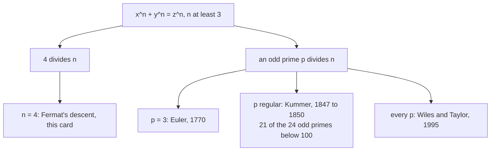

# Fermat's last theorem: the descent for n equals 4, and the ideals beyond it

[Syllabus](../../../SYLLABUS.md) → [Algebraic and analytic number theory](../README.md) → [Diophantine and Modular](../README.md#s07) → Fermat's last theorem

---

## General Overview

Squares add up to squares all the time. With the long side up to 1,000, there are 158 right triangles with whole sides that share no common factor, starting with 3, 4, 5. Fourth powers never do. Test every pair x and y up to 1,000, all 500,500 of them, and $`x^4 + y^4`$ is never even a perfect square.

A search is evidence, not proof. Around 1637 Pierre de Fermat wrote in the margin of a book that $`x^n + y^n = z^n`$ has no solution in positive whole numbers for any exponent n of 3 or more. He said the proof did not fit in the margin. The one proof of his that survives settles the exponent 4. It uses **infinite descent**: show that any solution would build a strictly smaller solution. Whole numbers cannot shrink forever, so there is no solution at all.

Descent does not reach odd prime exponents. In the 1840s Ernst Kummer factored $`x^p + y^p`$ in a bigger number system, the cyclotomic integers: whole-number combinations of the pth roots of 1. There, factorisation into primes is not always unique. Kummer's ideals repair it, and one test on the prime p, called **regular**, settles every regular exponent at once. Of the 24 odd primes below 100, 21 are regular. Only 37, 59 and 67 are not.

**A solution of $`x^4 + y^4 = z^2`$ would build a smaller one, so none exists; for an odd prime p, factoring $`x^p + y^p`$ into ideals in the cyclotomic integers settles every prime that does not divide its class number.**

**What kind of fact this is:** a theorem. The exponent-4 case is proved on this card in Why it works. Kummer's theorem on regular primes is stated with the shape of its proof and a source. The whole of Fermat's last theorem was proved in 1995 by Andrew Wiles, with Richard Taylor; that proof is the subject of [Modularity](08-modularity-and-the-proof-of-fermat.md).

### The picture: how the exponents were covered



Every exponent of 3 or more lands in one of the two middle boxes. The bottom row shows who closed each case.

---

## The formula

Notation first, in words. Here x, y and z are positive whole numbers, and n is the exponent. The descent works on a stronger equation, with a plain square on the right:

```math
x^4 + y^4 = z^2 \ \Longrightarrow\ u^4 + v^4 = w^2 \ \text{ for some positive whole } u, v, w \text{ with } w^4 < z
```

**Read it aloud:** if two fourth powers add up to a square, then two other fourth powers add up to a square whose root w is so small that its fourth power is still below z.

No smallest solution can exist, so there is no solution. Since $`z^4 = (z^2)^2`$, this covers $`x^4 + y^4 = z^4`$ too.

For an odd prime p, write $`\zeta_p = e^{2\pi i/p}`$, the pth root of 1 that sits one pth of a turn round the unit circle ([Cyclotomic fields](../05-Fields%20and%20Galois%20Theory/08-cyclotomic-extensions-and-roots-of-unity.md)). Write $`h_p`$ for the class number of the field $`\mathbb{Q}(\zeta_p)`$: the size of its class group, which measures how far its ideals are from each being generated by one number ([Class groups](../06-Algebraic%20Numbers/05-class-groups-and-the-minkowski-bound.md)). Kummer's theorem reads:

```math
p \nmid h_p \iff p \text{ divides no numerator of } B_2, B_4, \ldots, B_{p-3} \ \Longrightarrow\ x^p + y^p = z^p \text{ has no positive solution}
```

**Read it aloud:** if p does not divide the class number, which happens exactly when p divides none of the Bernoulli numbers up to index p minus 3, then the pth-power equation has no solution.

The **Bernoulli numbers** $`B_k`$ are the fractions in the formula for sums of powers: $`B_2 = 1/6`$, $`B_4 = -1/30`$, and on. A prime with $`p \nmid h_p`$ is a **regular prime**. For p = 37, the numerator of $`B_{32}`$ is a multiple of 37, so 37 is irregular.

| Symbol | Plain meaning | In our example | Push it up and the answer… |
| --- | --- | --- | --- |
| $`x, y, z`$ | a supposed solution: positive whole numbers | none exists; the near miss has x = 15, z = 353 | the descent only shrinks them |
| $`n`$ | the exponent | 4 | every n from 3 up is covered by 4 or an odd prime |
| $`r, s`$ | seeds of the first right triangle, $`r > s`$ | 17 and 8 in the near miss | — |
| $`a, b`$ | seeds of the second right triangle, $`a > b`$ | 4 and 1 | — |
| $`u, v, w`$ | the smaller solution the descent builds | 2, 1 and the missing root of 17 | $`w^4`$ stays below z |
| $`Y`$ | a whole number standing where $`y^2`$ should be | 272, not a square | — |
| $`p`$, $`q`$ | an odd prime exponent; q is any prime that might divide two of the numbers at once (Steps 2 and 5) | 3, 23, 37 | larger p need more Bernoulli numbers |
| $`\zeta_p`$ | the first pth root of 1 | $`\zeta_3`$, a third of a turn | — |
| $`h_p`$ | the class number of $`\mathbb{Q}(\zeta_p)`$ | 3 for p = 23, quoted | 1 means unique factorisation |
| $`B_k`$ | the kth Bernoulli number, a fraction | 37 divides the numerator of $`B_{32}`$ | — |
| $`m`$, $`2k`$ | an even Bernoulli index, also the power in the power sum | 32 for p = 37 | past p − 3 the test means nothing |
| $`\mathfrak{a}`$ | an ideal of $`\mathbb{Z}[\zeta_p]`$ | the ideal whose pth power is $`(x + \zeta_p y)`$ | — |

### When it holds

- **Positive whole numbers.** With zero allowed, $`0^4 + 1^4 = 1^2`$ works and says nothing. Rational solutions reduce to whole ones by clearing denominators.
- **No common factor.** The descent starts from the smallest solution, which shares no prime between x and y. Without that, the pieces in Step 5 need not be coprime, and $`2 \times 8 = 16`$ is a square while 2 is not.
- **Exponent 4, not 2.** For squares there is no second condition to exploit, and the 158 triples with z up to 1,000 stand.
- **Regular primes only, for Kummer.** For 37, 59 and 67 his argument stops. Those exponents needed other methods, and all primes were covered in 1995.

---

## Why it works

### Step 0: a set of positive whole numbers always has a smallest member

This is the **well-ordering** of the whole numbers, and descent is built on it. Suppose solutions exist. Take the one with the smallest z. If every solution builds one with a smaller z, the smallest one builds a smaller one, which is impossible.

So the work is to show the building step. It uses the right-triangle recipe twice.

### Step 1: two cases cover every exponent

If 4 divides n, then $`x^n + y^n = z^n`$ reads $`(x^{n/4})^4 + (y^{n/4})^4 = (z^{n/4})^4`$, a solution for exponent 4. If an odd prime p divides n, the same move with p in place of 4 gives a solution for exponent p. Every n from 3 up is a multiple of 4 or of an odd prime, so those cases suffice:

| n | 3 | 4 | 5 | 6 | 7 | 8 | 9 | 10 | 11 | 12 |
| --- | --- | --- | --- | --- | --- | --- | --- | --- | --- | --- |
| covered by | 3 | 4 | 5 | 3 | 7 | 4 | 3 | 5 | 11 | 4 |

### Step 2: the smallest solution shares no factor

Take the solution of $`x^4 + y^4 = z^2`$ with the smallest z. If a prime q divided both x and y, then $`q^4`$ would divide $`z^2`$, so $`q^2`$ divides z. Dividing x and y by q and z by $`q^2`$ gives a smaller solution. So x and y are coprime, and so are $`x^2, y^2, z`$.

### Step 3: the first right triangle

Now $`(x^2)^2 + (y^2)^2 = z^2`$, so $`x^2, y^2, z`$ is a right triangle with no common factor. The [Pythagorean triples](../../02-Number%20theory/07-For%20the%20Curious/01-pythagorean-triples.md) card shows that every such triple comes from two seeds by its recipe. That card calls the seeds m and n; here n is the exponent, so they are r and s. One leg is even; call it $`y^2`$. Then

```math
x^2 = r^2 - s^2, \qquad y^2 = 2rs, \qquad z = r^2 + s^2
```

with $`r > s`$ coprime, one odd and one even.

### Step 4: the second right triangle

Rearranged, $`x^2 + s^2 = r^2`$: another triple with no common factor. Since $`y^2`$ is the even leg, $`x^2`$ is odd, so x is odd. So s is even and r is odd: an even r and odd s would make $`x^2 = r^2 - s^2`$ fall 1 below a multiple of 4, and no square does that. The recipe again gives seeds $`a > b`$, coprime, one odd and one even:

```math
x = a^2 - b^2, \qquad s = 2ab, \qquad r = a^2 + b^2
```

### Step 5: the even leg splits into three squares

Put these into $`y^2 = 2rs`$:

```math
y^2 = 4\,a\,b\,(a^2 + b^2)
```

The three numbers a, b and $`a^2 + b^2`$ share no factor in pairs. Their product is $`(y/2)^2`$, a square. Coprime numbers whose product is a square are each squares ([Pythagorean triples](../../02-Number%20theory/07-For%20the%20Curious/01-pythagorean-triples.md), Step 4). So $`a = u^2`$, $`b = v^2`$ and $`a^2 + b^2 = w^2`$. That last one reads $`u^4 + v^4 = w^2`$: a new solution.

### Step 6: the new solution is smaller

$`w^2 = a^2 + b^2 = r`$, so $`w^4 = r^2 < r^2 + s^2 = z`$. The new z is below the fourth root of the old one. That contradicts the choice of the smallest solution, so there is no solution.

<details>
<summary>Detailed proof: why a, b and a² + b² share no factor</summary>

The seeds a and b are coprime by the recipe. If a prime q divided a and $`a^2 + b^2`$, it would divide $`b^2`$, so b, against coprimality. The same holds with a and b swapped.

The factor 4 is safe: $`y^2 = 4ab(a^2 + b^2)`$ makes $`y^2`$ a multiple of 4, so y is even and $`(y/2)^2 = ab(a^2 + b^2)`$ is a whole square.

The splitting lemma: write each of the three numbers as a product of primes. A prime in one of them appears in no other. In the product, a square, every prime has an even power. So every prime has an even power in each piece, and each piece is a square.

</details>

### Step 7: Kummer's factoring for an odd prime

For an odd prime p, the pth roots of 1 split the sum into p factors:

```math
x^p + y^p = (x + y)(x + \zeta_p y)(x + \zeta_p^2 y) \cdots (x + \zeta_p^{p-1} y)
```

For p = 3 the last two factors multiply back to $`x^2 - xy + y^2`$. So $`9^3 + 10^3 = 19 \times 91 = 1729`$, which is $`12^3 + 1`$: close to a cube, not a cube.

The plan copies Step 5. If $`x^p + y^p = z^p`$ and the factors share no prime, each factor should be a pth power, up to a unit (a number with an inverse in the ring). That is the step that fails. In 1847 Gabriel Lamé presented a proof that used it. But factorisation in the cyclotomic integers $`\mathbb{Z}[\zeta_p]`$, the whole-number combinations of powers of $`\zeta_p`$, is not always unique. The first failure is p = 23, where the class number is 3.

### Step 8: ideals restore unique factorisation

In $`\mathbb{Z}[\zeta_p]`$, ideals factor uniquely into prime ideals, even when numbers do not ([Class groups](../06-Algebraic%20Numbers/05-class-groups-and-the-minkowski-bound.md)). When p divides none of x, y, z, and x, y share no factor (by the same argument as Step 2), the p ideals $`(x + y), (x + \zeta_p y), \ldots, (x + \zeta_p^{p-1} y)`$ share no prime ideal, and their product is $`(z)^p`$. So each prime ideal appears in $`(x + \zeta_p y)`$ a multiple of p times, and that ideal is the pth power of an ideal: $`(x + \zeta_p y) = \mathfrak{a}^p`$.

Now $`\mathfrak{a}^p`$ is principal: generated by one number. In the class group, the class of $`\mathfrak{a}`$ has an order dividing p. That order also divides the group's size $`h_p`$, by Lagrange. If p does not divide $`h_p`$, the order is 1, so $`\mathfrak{a}`$ itself is principal. Then $`x + \zeta_p y`$ is a unit times a pth power, and the argument runs as if factoring were unique.

That settles the case where p divides none of x, y, z. The case where p divides one of them is harder; Kummer handled it for regular primes too. The full argument is in the sources.

### Step 9: Bernoulli numbers decide regularity

Computing $`h_p`$ directly is hard. Kummer proved the test in the formula: p divides $`h_p`$ exactly when p divides the numerator of some $`B_{2k}`$ with $`2 \le 2k \le p - 3`$. The check computes this two ways for every odd prime below 200.

- **Road one.** Run the Bernoulli recurrence with every fraction reduced mod p.
- **Road two.** Add up $`1^m + 2^m + \cdots + (p-1)^m`$ mod $`p^2`$, for each even m up to p − 3. The total is 0 exactly when p divides the numerator of $`B_m`$.

<details>
<summary>Why the power sum sees the Bernoulli number</summary>

The sum-of-powers formula gives, for even m,

$`\displaystyle \sum_{j=1}^{p-1} j^m = \frac{1}{m+1} \sum_{k=0}^{m} \binom{m+1}{k} B_k\, p^{m+1-k}.`$

The term with k = m is $`p B_m`$. Every other term carries $`p^2`$ or a higher power of p. For $`m \le p - 3`$, no denominator here contains p: von Staudt's theorem puts p in the denominator of $`B_k`$ only when p − 1 divides k. So the sum is $`p B_m`$ mod $`p^2`$, and it is 0 mod $`p^2`$ exactly when p divides the numerator of $`B_m`$.

</details>

Both roads find the same eight irregular primes below 200: 37, 59, 67, 101, 103, 131, 149 and 157. The prime 157 divides two numerators, $`B_{62}`$ and $`B_{110}`$.

---

## Worked numbers, by hand

There is no solution to trace, so trace the nearest thing: run the descent backwards from $`u = 2`$, $`v = 1`$. Every step works except the last square.

| Step | Arithmetic | Value |
| --- | --- | --- |
| second seeds from u, v | $`a = 2^2`$, $`b = 1^2`$ | 4 and 1 |
| odd leg | $`x = a^2 - b^2 = 16 - 1`$ | 15 |
| first seeds | $`s = 2ab`$, $`r = a^2 + b^2`$ | 8 and 17 |
| where $`y^2`$ should be | $`Y = 2rs = 2 \times 17 \times 8`$ | 272 |
| right side | $`z = r^2 + s^2 = 289 + 64`$ | 353 |
| the near miss | $`15^4 + 272^2 = 50625 + 73984`$ | **124,609 = 353²** |
| is Y a square? | $`272 = 4 \times 4 \times 1 \times 17`$ | no: 17 is not |
| the smaller instance | $`2^4 + 1^4`$ | 17, not a square |
| size drop | would-be $`w^4 = 17^2 = 289`$ | below z = 353 |

So $`15^4 + 272^2 = 353^2`$ falls short only because 272 is not a square. The descent says why: 272 is a square only if 17 is, and 17 being a square would mean $`2^4 + 1^4`$ is one.

The size drop is steep. A solution with z at most $`10^{38}`$ forces one with z at most 3,162,277,660, then 237, then 3, then 1. But $`z^2 = x^4 + y^4`$ is at least 2, so z is at least 2. Four rungs and the ladder runs out.

### What breaks if you drop a piece

| Mistake | Comes out at | What went wrong |
| --- | --- | --- |
| Run the descent on squares, exponent 2 | 158 primitive triples with z up to 1,000 | No second square condition, so nothing descends |
| Split a square product without coprimality | $`2 \times 8 = 16`$, yet 2 is not a square | gcd(2, 8) = 2; Step 2 is what makes the pieces coprime |
| Take "regular" to mean unique factorisation | p = 23: class number 3, yet 23 is regular | Regular asks only that p not divide $`h_p`$ |
| Treat a search as a proof | $`2682440^4 + 15365639^4 + 18796760^4 = 20615673^4`$ | Euler guessed three fourth powers never sum to a fourth power; false (1988) |

The code prints all four. The class number 3 is quoted from a published table, labelled so.

---

## Code, from first principles, and it actually runs

The code takes three roads. It searches 500,500 pairs for fourth powers summing to a square, and finds none (evidence only). It checks the descent's parametrisation two ways: a direct search of near misses $`x^4 + Y^2 = z^2`$ up to z = 10,000 against the list built from seeds a and b. Both give 13, and in none is Y a square. It finds the irregular primes below 200 by the Bernoulli recurrence and by power sums, and the two lists agree.

### Python

```python
# Fermat's last theorem: the descent for n = 4, and Kummer's regular primes.  Standard
# library only.  Search is evidence; the descent is the proof, so the code checks the
# descent's parametrisation two ways and computes the regular primes two ways.
from math import gcd, isqrt

def sq(n):                                 # is n a perfect square?
    return n >= 0 and isqrt(n) ** 2 == n

def root4(n):                              # largest w with w^4 <= n
    return isqrt(isqrt(n))

def icbrt(n):                              # largest c with c^3 <= n
    c = round(n ** (1 / 3))
    while c ** 3 > n: c -= 1
    while (c + 1) ** 3 <= n: c += 1
    return c

def case_for(n):                           # 4 if 4 divides n, else the smallest odd prime factor
    if n % 4 == 0: return 4
    m = n
    while m % 2 == 0: m //= 2
    return next(d for d in range(3, m + 1) if m % d == 0)

def near_miss(a, b):                       # the descent run backwards from seeds a > b
    x, s, r = a * a - b * b, 2 * a * b, a * a + b * b
    return (x, 2 * r * s, r * r + s * s)   # x^4 + Y^2 = z^2

def irregular_by_bernoulli(p):             # B_0..B_{p-3} mod p by the recurrence
    B, row, hits = [1], [1, 1], []         # row holds C(n+1, k) mod p
    for n in range(1, p - 2):
        row = [1] + [(row[k - 1] + row[k]) % p for k in range(1, len(row))] + [1]
        s = sum(row[k] * B[k] for k in range(n)) % p
        B.append(-s * pow(n + 1, p - 2, p) % p)
        if n % 2 == 0 and B[n] == 0: hits.append(n)
    return hits

def irregular_by_power_sums(p):            # p | B_m  iff  1^m + ... + (p-1)^m = 0 mod p^2
    q, hits = p * p, []
    sq_j = [j * j % q for j in range(p)]
    cur = sq_j[:]
    for m in range(2, p - 2, 2):
        if sum(cur[1:]) % q == 0: hits.append(m)
        cur = [c * s % q for c, s in zip(cur, sq_j)]
    return hits

print("exponent -> case that covers it:", " ".join(f"{n}->{case_for(n)}" for n in range(3, 13)))
N = 1000
fourth = sum(1 for x in range(1, N + 1) for y in range(x, N + 1) if sq(x**4 + y**4))
cubes = sum(1 for x in range(1, N + 1) for y in range(x, N + 1) if icbrt(x**3 + y**3) ** 3 == x**3 + y**3)
trip = sum(1 for z in range(1, N + 1) for x in range(1, z) if x % 2 == 1 and
           sq(z * z - x * x) and z * z - x * x > 0 and gcd(x, z) == 1)
print(f"pairs 1 <= x <= y <= {N} tested: {N * (N + 1) // 2}")
print(f"x^4 + y^4 a perfect square: {fourth}")
print(f"x^3 + y^3 a perfect cube: {cubes}")
print(f"contrast, primitive x^2 + y^2 = z^2 with z <= {N}: {trip}")
Z = 10000
road_a = sorted((x, isqrt(z * z - x**4), z) for x in range(1, 100, 2) for z in range(x * x + 1, Z + 1)
                if sq(z * z - x**4) and gcd(x, z) == 1)
road_b = sorted(near_miss(a, b) for a in range(2, 100) for b in range(1, a)
                if (a - b) % 2 == 1 and gcd(a, b) == 1 and near_miss(a, b)[2] <= Z)
print(f"near misses x^4 + Y^2 = z^2, x odd, primitive, z <= {Z}: search {len(road_a)}, seeds {len(road_b)}")
print("first three:", ", ".join(f"{x}^4 + {Y}^2 = {z}^2" for x, Y, z in road_a[:3]))
pieces = [(a, b, a * a + b * b) for a in range(2, 100) for b in range(1, a)
          if (a - b) % 2 == 1 and gcd(a, b) == 1 and near_miss(a, b)[2] <= Z]
coprime = all(gcd(a, b) == gcd(a, c) == gcd(b, c) == 1 for a, b, c in pieces)
match = all(near_miss(a, b)[1] == 4 * a * b * c for a, b, c in pieces)
print(f"Y = 4 a b (a^2 + b^2) in all: {'yes' if match else 'no'}; pieces pairwise coprime: {'yes' if coprime else 'no'}")
print(f"Y a square in any: {'yes' if any(sq(Y) for _, Y, _ in road_a) else 'no'}; "
      f"all three pieces squares in any: {'yes' if any(sq(a) and sq(b) and sq(c) for a, b, c in pieces) else 'no'}")
x, Y, z = near_miss(4, 1)
print(f"trace from u, v = 2, 1: a, b = 4, 1; x = {x}, s = 8, r = 17, Y = 2 r s = {Y}, z = {z}")
print(f"{x}^4 + {Y}^2 = {x**4} + {Y**2} = {z**2} = {z}^2; Y = 4 x 4 x 1 x 17, a square: {'yes' if sq(Y) else 'no'}")
print(f"2^4 + 1^4 = {2**4 + 1}, a square: {'yes' if sq(17) else 'no'}; would-be w^4 = 17^2 = {17**2} < z = {z}")
ladder, b = [10**38], 10**38
while b >= 2:
    b = root4(b - 1); ladder.append(b)
print("descent ladder, bound on z:", " -> ".join(str(v) for v in ladder), "(z >= 2 is needed)")
print(f"9^3 + 10^3 = {9**3 + 10**3} = 12^3 + {9**3 + 10**3 - 12**3} = (9 + 10)(81 - 90 + 100) = 19 x {81 - 90 + 100}")
pts = sorted({(a, e) for e in range(1, 31) for a in range(-1000, 1001)
              if gcd(a, e) == 1 and sq(a**3 - a * e**4)})
print("points on y^2 = x^3 - x, x = a/e^2 with |a| <= 1000, e <= 30: x =",
      ", ".join(f"{a}/{e * e}" for a, e in pts), "and y = 0 each")
P = 200
primes = [p for p in range(3, P) if all(p % d for d in range(2, isqrt(p) + 1))]
irr_b = [(p, irregular_by_bernoulli(p)) for p in primes]
irr_s = [(p, irregular_by_power_sums(p)) for p in primes]
bad = [(p, h) for p, h in irr_b if h]
print(f"odd primes below {P}: {len(primes)}; irregular: {len(bad)}; regular: {len(primes) - len(bad)}")
print("irregular p with index 2k, p | B_2k (Bernoulli road):", ", ".join(f"{p} at {h}" for p, h in bad))
print(f"power-sum road agrees: {'yes' if irr_s == irr_b else 'no'}")
below100 = [p for p, h in bad if p < 100]
print(f"below 100: {len([p for p in primes if p < 100])} odd primes, irregular {below100}")
h23, irr23 = 3, any(p == 23 for p, _ in bad)          # h23 quoted from a published table
print(f"quoted: class number of Q(zeta_23) = {h23}, so unique factorisation fails; "
      f"23 divides it: {'yes' if h23 % 23 == 0 else 'no'}; 23 irregular by Bernoulli: {'yes' if irr23 else 'no'}")
e4 = (2682440, 15365639, 18796760, 20615673)
print(f"Euler's pattern fails: 2682440^4 + 15365639^4 + 18796760^4 - 20615673^4 = "
      f"{e4[0]**4 + e4[1]**4 + e4[2]**4 - e4[3]**4}")
print(f"what breaks: 2 x 8 = {2 * 8}, a square, gcd(2, 8) = {gcd(2, 8)}, 2 square: {'yes' if sq(2) else 'no'}")
assert fourth == 0 and cubes == 0                       # the theorem's prediction, searched
assert road_a == road_b and len(road_a) > 0             # descent parametrisation, two roads
assert z**2 - x**4 == Y**2 and not sq(Y) and Y == 4 * 4 * 1 * 17
assert ladder[-1] <= 1 and len(ladder) == 5             # four rungs to nothing
assert irr_s == irr_b                                   # regularity, two roads
assert [p for p, _ in bad] == [37, 59, 67, 101, 103, 131, 149, 157]   # quoted table
assert (h23 % 23 == 0) == irr23                         # table and Bernoulli road agree
assert pts == [(-1, 1), (0, 1), (1, 1)]
print("ALL CHECKS PASS")
```

**Ran 2026-11-15 on macOS, Python 3.14.10, standard library only. All checks passed. Output, pasted from the run:**

```
exponent -> case that covers it: 3->3 4->4 5->5 6->3 7->7 8->4 9->3 10->5 11->11 12->4
pairs 1 <= x <= y <= 1000 tested: 500500
x^4 + y^4 a perfect square: 0
x^3 + y^3 a perfect cube: 0
contrast, primitive x^2 + y^2 = z^2 with z <= 1000: 158
near misses x^4 + Y^2 = z^2, x odd, primitive, z <= 10000: search 13, seeds 13
first three: 3^4 + 40^2 = 41^2, 5^4 + 312^2 = 313^2, 7^4 + 1200^2 = 1201^2
Y = 4 a b (a^2 + b^2) in all: yes; pieces pairwise coprime: yes
Y a square in any: no; all three pieces squares in any: no
trace from u, v = 2, 1: a, b = 4, 1; x = 15, s = 8, r = 17, Y = 2 r s = 272, z = 353
15^4 + 272^2 = 50625 + 73984 = 124609 = 353^2; Y = 4 x 4 x 1 x 17, a square: no
2^4 + 1^4 = 17, a square: no; would-be w^4 = 17^2 = 289 < z = 353
descent ladder, bound on z: 100000000000000000000000000000000000000 -> 3162277660 -> 237 -> 3 -> 1 (z >= 2 is needed)
9^3 + 10^3 = 1729 = 12^3 + 1 = (9 + 10)(81 - 90 + 100) = 19 x 91
points on y^2 = x^3 - x, x = a/e^2 with |a| <= 1000, e <= 30: x = -1/1, 0/1, 1/1 and y = 0 each
odd primes below 200: 45; irregular: 8; regular: 37
irregular p with index 2k, p | B_2k (Bernoulli road): 37 at [32], 59 at [44], 67 at [58], 101 at [68], 103 at [24], 131 at [22], 149 at [130], 157 at [62, 110]
power-sum road agrees: yes
below 100: 24 odd primes, irregular [37, 59, 67]
quoted: class number of Q(zeta_23) = 3, so unique factorisation fails; 23 divides it: no; 23 irregular by Bernoulli: no
Euler's pattern fails: 2682440^4 + 15365639^4 + 18796760^4 - 20615673^4 = 0
what breaks: 2 x 8 = 16, a square, gcd(2, 8) = 2, 2 square: no
ALL CHECKS PASS
```

### Rust

Same numbers, same labels, built with `rustc --edition 2021 -O`.

```rust
// Fermat's last theorem: the descent for n = 4, and Kummer's regular primes.  No crates.
// Search is evidence; the descent is the proof, so the code checks the descent's
// parametrisation two ways and computes the regular primes two ways.
fn gcd(mut a: i64, mut b: i64) -> i64 {
    a = a.abs(); b = b.abs();
    while b != 0 { (a, b) = (b, a % b) }
    a
}

fn isqrt(n: u128) -> u128 {                    // largest r with r^2 <= n
    let mut r = (n as f64).sqrt() as u128;
    while r * r > n { r -= 1 }
    while (r + 1) * (r + 1) <= n { r += 1 }
    r
}

fn sq(n: i128) -> bool { n >= 0 && isqrt(n as u128).pow(2) == n as u128 }

fn root4(n: u128) -> u128 { isqrt(isqrt(n)) }  // largest w with w^4 <= n

fn icbrt(n: u64) -> u64 {                      // largest c with c^3 <= n
    let mut c = (n as f64).cbrt().round() as u64;
    while c * c * c > n { c -= 1 }
    while (c + 1) * (c + 1) * (c + 1) <= n { c += 1 }
    c
}

fn case_for(n: i64) -> i64 {                   // 4 if 4 divides n, else the smallest odd prime factor
    if n % 4 == 0 { return 4 }
    let mut m = n;
    while m % 2 == 0 { m /= 2 }
    (3..=m).find(|d| m % d == 0).unwrap()
}

fn near_miss(a: i64, b: i64) -> (i64, i64, i64) { // the descent run backwards from seeds a > b
    let (x, s, r) = (a * a - b * b, 2 * a * b, a * a + b * b);
    (x, 2 * r * s, r * r + s * s)              // x^4 + Y^2 = z^2
}

fn powmod(mut b: i64, mut e: i64, m: i64) -> i64 {
    let mut r = 1;
    b %= m;
    while e > 0 { if e & 1 == 1 { r = r * b % m } b = b * b % m; e >>= 1 }
    r
}

fn irregular_by_bernoulli(p: i64) -> Vec<i64> { // B_0..B_{p-3} mod p by the recurrence
    let (mut bs, mut row, mut hits) = (vec![1i64], vec![1i64, 1], Vec::new());
    for n in 1..(p - 2) {
        let mut next = vec![1i64];
        for k in 1..row.len() { next.push((row[k - 1] + row[k]) % p) }
        next.push(1);
        row = next;
        let s = (0..n as usize).map(|k| row[k] * bs[k] % p).sum::<i64>() % p;
        bs.push((p - s * powmod(n + 1, p - 2, p) % p) % p);
        if n % 2 == 0 && bs[n as usize] == 0 { hits.push(n) }
    }
    hits
}

fn irregular_by_power_sums(p: i64) -> Vec<i64> { // p | B_m iff 1^m + ... + (p-1)^m = 0 mod p^2
    let (q, mut hits) = (p * p, Vec::new());
    let sq_j: Vec<i64> = (0..p).map(|j| j * j % q).collect();
    let mut cur = sq_j.clone();
    let mut m = 2;
    while m < p - 2 {
        if cur[1..].iter().sum::<i64>() % q == 0 { hits.push(m) }
        cur = cur.iter().zip(&sq_j).map(|(c, s)| c * s % q).collect();
        m += 2;
    }
    hits
}

fn yn(c: bool) -> &'static str { if c { "yes" } else { "no" } }

fn main() {
    let cases: Vec<String> = (3..13).map(|n| format!("{}->{}", n, case_for(n))).collect();
    println!("exponent -> case that covers it: {}", cases.join(" "));
    let n_max: i128 = 1000;
    let (mut fourth, mut cubes, mut trip) = (0, 0, 0);
    for x in 1..=n_max {
        for y in x..=n_max {
            if sq(x.pow(4) + y.pow(4)) { fourth += 1 }
            let s = (x.pow(3) + y.pow(3)) as u64;
            if icbrt(s).pow(3) == s { cubes += 1 }
        }
    }
    for z in 1..=n_max as i64 {
        for x in (1..z).step_by(2) {
            let d = z * z - x * x;
            if d > 0 && sq(d as i128) && gcd(x, z) == 1 { trip += 1 }
        }
    }
    println!("pairs 1 <= x <= y <= {} tested: {}", n_max, n_max * (n_max + 1) / 2);
    println!("x^4 + y^4 a perfect square: {}", fourth);
    println!("x^3 + y^3 a perfect cube: {}", cubes);
    println!("contrast, primitive x^2 + y^2 = z^2 with z <= {}: {}", n_max, trip);
    let zmax: i64 = 10000;
    let mut road_a = Vec::new();
    for x in (1..100i64).step_by(2) {
        for z in (x * x + 1)..=zmax {
            let d = z * z - x.pow(4);
            if sq(d as i128) && gcd(x, z) == 1 { road_a.push((x, isqrt(d as u128) as i64, z)) }
        }
    }
    road_a.sort();
    let mut pieces = Vec::new();
    for a in 2..100i64 {
        for b in 1..a {
            if (a - b) % 2 == 1 && gcd(a, b) == 1 && near_miss(a, b).2 <= zmax { pieces.push((a, b, a * a + b * b)) }
        }
    }
    let mut road_b: Vec<(i64, i64, i64)> = pieces.iter().map(|&(a, b, _)| near_miss(a, b)).collect();
    road_b.sort();
    println!("near misses x^4 + Y^2 = z^2, x odd, primitive, z <= {}: search {}, seeds {}", zmax, road_a.len(), road_b.len());
    let first: Vec<String> = road_a[..3].iter().map(|(x, y, z)| format!("{}^4 + {}^2 = {}^2", x, y, z)).collect();
    println!("first three: {}", first.join(", "));
    let coprime = pieces.iter().all(|&(a, b, c)| gcd(a, b) == 1 && gcd(a, c) == 1 && gcd(b, c) == 1);
    let matched = pieces.iter().all(|&(a, b, c)| near_miss(a, b).1 == 4 * a * b * c);
    println!("Y = 4 a b (a^2 + b^2) in all: {}; pieces pairwise coprime: {}", yn(matched), yn(coprime));
    let all3 = pieces.iter().any(|&(a, b, c)| sq(a as i128) && sq(b as i128) && sq(c as i128));
    println!("Y a square in any: {}; all three pieces squares in any: {}",
             yn(road_a.iter().any(|&(_, y, _)| sq(y as i128))), yn(all3));
    let (x, y, z) = near_miss(4, 1);
    println!("trace from u, v = 2, 1: a, b = 4, 1; x = {}, s = 8, r = 17, Y = 2 r s = {}, z = {}", x, y, z);
    println!("{}^4 + {}^2 = {} + {} = {} = {}^2; Y = 4 x 4 x 1 x 17, a square: {}",
             x, y, x.pow(4), y * y, z * z, z, yn(sq(y as i128)));
    println!("2^4 + 1^4 = {}, a square: {}; would-be w^4 = 17^2 = {} < z = {}", 16 + 1, yn(sq(17)), 17 * 17, z);
    let (mut ladder, mut b) = (vec![10u128.pow(38)], 10u128.pow(38));
    while b >= 2 { b = root4(b - 1); ladder.push(b) }
    let lad: Vec<String> = ladder.iter().map(|v| v.to_string()).collect();
    println!("descent ladder, bound on z: {} (z >= 2 is needed)", lad.join(" -> "));
    println!("9^3 + 10^3 = {} = 12^3 + {} = (9 + 10)(81 - 90 + 100) = 19 x {}", 729 + 1000, 1729 - 1728, 81 - 90 + 100);
    let mut pts = Vec::new();
    for a in -1000..=1000i64 {
        for e in 1..=30i64 {
            if gcd(a, e) == 1 && sq((a.pow(3) - a * e.pow(4)) as i128) { pts.push((a, e)) }
        }
    }
    pts.sort();
    let px: Vec<String> = pts.iter().map(|(a, e)| format!("{}/{}", a, e * e)).collect();
    println!("points on y^2 = x^3 - x, x = a/e^2 with |a| <= 1000, e <= 30: x = {} and y = 0 each", px.join(", "));
    let pmax: i64 = 200; let primes: Vec<i64> = (3..pmax).filter(|&p| (2..).take_while(|d| d * d <= p).all(|d| p % d != 0)).collect();
    let irr_b: Vec<(i64, Vec<i64>)> = primes.iter().map(|&p| (p, irregular_by_bernoulli(p))).collect();
    let irr_s: Vec<(i64, Vec<i64>)> = primes.iter().map(|&p| (p, irregular_by_power_sums(p))).collect();
    let bad: Vec<&(i64, Vec<i64>)> = irr_b.iter().filter(|(_, h)| !h.is_empty()).collect();
    println!("odd primes below {}: {}; irregular: {}; regular: {}", pmax, primes.len(), bad.len(), primes.len() - bad.len());
    let bl: Vec<String> = bad.iter().map(|(p, h)| format!("{} at {:?}", p, h)).collect();
    println!("irregular p with index 2k, p | B_2k (Bernoulli road): {}", bl.join(", "));
    println!("power-sum road agrees: {}", yn(irr_s == irr_b));
    let below100: Vec<i64> = bad.iter().map(|(p, _)| *p).filter(|&p| p < 100).collect();
    println!("below 100: {} odd primes, irregular {:?}", primes.iter().filter(|&&p| p < 100).count(), below100);
    let (h23, irr23) = (3, bad.iter().any(|(p, _)| *p == 23)); // h23 quoted from a published table
    println!("quoted: class number of Q(zeta_23) = {}, so unique factorisation fails; 23 divides it: {}; 23 irregular by Bernoulli: {}",
             h23, yn(h23 % 23 == 0), yn(irr23));
    let e4: [i128; 4] = [2682440, 15365639, 18796760, 20615673];
    println!("Euler's pattern fails: 2682440^4 + 15365639^4 + 18796760^4 - 20615673^4 = {}",
             e4[0].pow(4) + e4[1].pow(4) + e4[2].pow(4) - e4[3].pow(4));
    println!("what breaks: 2 x 8 = {}, a square, gcd(2, 8) = {}, 2 square: {}", 2 * 8, gcd(2, 8), yn(sq(2)));
    assert!(fourth == 0 && cubes == 0);                      // the theorem's prediction, searched
    assert!(road_a == road_b && !road_a.is_empty());         // descent parametrisation, two roads
    assert!(z * z - x.pow(4) == y * y && !sq(y as i128) && y == 4 * 4 * 1 * 17);
    assert!(*ladder.last().unwrap() <= 1 && ladder.len() == 5); // four rungs to nothing
    assert!(irr_s == irr_b);                                 // regularity, two roads
    assert!(bad.iter().map(|(p, _)| *p).collect::<Vec<i64>>() == vec![37, 59, 67, 101, 103, 131, 149, 157]);
    assert!((h23 % 23 == 0) == irr23);                       // table and Bernoulli road agree
    assert!(pts == vec![(-1, 1), (0, 1), (1, 1)]);
    println!("ALL CHECKS PASS");
}
```

**Ran 2026-11-15 on macOS, rustc 1.98.1, no crates. All checks passed. Output, pasted from the run:**

```
exponent -> case that covers it: 3->3 4->4 5->5 6->3 7->7 8->4 9->3 10->5 11->11 12->4
pairs 1 <= x <= y <= 1000 tested: 500500
x^4 + y^4 a perfect square: 0
x^3 + y^3 a perfect cube: 0
contrast, primitive x^2 + y^2 = z^2 with z <= 1000: 158
near misses x^4 + Y^2 = z^2, x odd, primitive, z <= 10000: search 13, seeds 13
first three: 3^4 + 40^2 = 41^2, 5^4 + 312^2 = 313^2, 7^4 + 1200^2 = 1201^2
Y = 4 a b (a^2 + b^2) in all: yes; pieces pairwise coprime: yes
Y a square in any: no; all three pieces squares in any: no
trace from u, v = 2, 1: a, b = 4, 1; x = 15, s = 8, r = 17, Y = 2 r s = 272, z = 353
15^4 + 272^2 = 50625 + 73984 = 124609 = 353^2; Y = 4 x 4 x 1 x 17, a square: no
2^4 + 1^4 = 17, a square: no; would-be w^4 = 17^2 = 289 < z = 353
descent ladder, bound on z: 100000000000000000000000000000000000000 -> 3162277660 -> 237 -> 3 -> 1 (z >= 2 is needed)
9^3 + 10^3 = 1729 = 12^3 + 1 = (9 + 10)(81 - 90 + 100) = 19 x 91
points on y^2 = x^3 - x, x = a/e^2 with |a| <= 1000, e <= 30: x = -1/1, 0/1, 1/1 and y = 0 each
odd primes below 200: 45; irregular: 8; regular: 37
irregular p with index 2k, p | B_2k (Bernoulli road): 37 at [32], 59 at [44], 67 at [58], 101 at [68], 103 at [24], 131 at [22], 149 at [130], 157 at [62, 110]
power-sum road agrees: yes
below 100: 24 odd primes, irregular [37, 59, 67]
quoted: class number of Q(zeta_23) = 3, so unique factorisation fails; 23 divides it: no; 23 irregular by Bernoulli: no
Euler's pattern fails: 2682440^4 + 15365639^4 + 18796760^4 - 20615673^4 = 0
what breaks: 2 x 8 = 16, a square, gcd(2, 8) = 2, 2 square: no
ALL CHECKS PASS
```

The two outputs match line for line.

### Lean

Lean proves the descent for exponent 4, every exponent that 4 divides, Kummer's ideal step for odd primes, and the card's worked numbers.

- Take positive whole numbers x, y and z. Then $`x^4 + y^4`$ is never $`z^2`$.
- Suppose 4 divides n, and x, y and z are positive whole numbers. Then $`x^n + y^n`$ is never $`z^n`$.
- Suppose p is an odd prime not dividing $`h_p`$, and a nonzero ideal $`\mathfrak{a}`$ has $`\mathfrak{a}^p`$ principal. Then $`\mathfrak{a}`$ itself is principal.
- Every exponent from 3 to 12 is a multiple of 4 or of an odd prime.
- The near miss holds: $`15^4 + 272^2 = 353^2`$, while 272 and 17 are not squares.
- The would-be $`w^4 = 17^2 = 289`$ sits below z = 353.
- The descent ladder from $`10^{38}`$ runs 3,162,277,660, then 237, then 3, then 1.
- Coprimality matters: $`2 \times 8 = 16`$ is a square, yet 2 is not.
- Kummer's factoring for p = 3 gives $`9^3 + 10^3 = 19 \times 91 = 12^3 + 1`$.
- Euler's guess fails: $`2682440^4 + 15365639^4 + 18796760^4 = 20615673^4`$.
- There are 24 odd primes below 100.

The pair search, the regular primes below 200 and Kummer's full theorem are left to the Python and Rust checks and the sources.

```lean
-- Fermat's last theorem: two fourth powers of positive whole numbers never add up to a square, so no exponent that 4 divides has a solution, and in the field of pth roots of 1 an ideal whose pth power is principal is itself principal when p does not divide the class number.
import Mathlib.NumberTheory.FLT.Four
import Mathlib.NumberTheory.NumberField.ClassNumber
import Mathlib.NumberTheory.Cyclotomic.Basic
import Mathlib.Algebra.Group.Nat.Even
import Mathlib.Tactic.NormNum

open NumberField

/-! Whole numbers are `ℕ`. A solution is three positive whole numbers. The field of pth roots
of 1 is `CyclotomicField p ℚ`, its cyclotomic integers are `𝓞 (CyclotomicField p ℚ)`, and its
class number `h_p` is `NumberField.classNumber (CyclotomicField p ℚ)`. Kummer's full theorem on
regular primes is only stated on the card, with a source, so it is not stated here. -/

/-- Fermat's descent for exponent 4. There are no positive whole numbers x, y and z with
x⁴ + y⁴ = z²: two fourth powers never add up to a square. -/
theorem no_fourth_powers_sum_to_square (x y z : ℕ) (hx : 0 < x) (hy : 0 < y) (hz : 0 < z) :
    x ^ 4 + y ^ 4 ≠ z ^ 2 := by
  have _ := hz
  intro h
  have h' : (x : ℤ) ^ 4 + (y : ℤ) ^ 4 = (z : ℤ) ^ 2 := by exact_mod_cast h
  exact not_fermat_42 (by exact_mod_cast hx.ne') (by exact_mod_cast hy.ne') h'

/-- Every exponent that 4 divides is covered. If 4 divides n, then x^n + y^n = z^n has no
solution in positive whole numbers x, y, z; with n = 4 this is x⁴ + y⁴ ≠ z⁴. -/
theorem no_solution_when_four_divides_exponent (n x y z : ℕ) (hn : 4 ∣ n)
    (hx : 0 < x) (hy : 0 < y) (hz : 0 < z) :
    x ^ n + y ^ n ≠ z ^ n := by
  exact fermatLastTheoremFour.mono hn x y z hx.ne' hy.ne' hz.ne'

/-- Kummer's ideal step (Step 8). Let p be an odd prime that does not divide the class number
h_p of the field of pth roots of 1. If a nonzero ideal 𝔞 of the cyclotomic integers has a
principal pth power 𝔞^p, then 𝔞 itself is principal: generated by one number. -/
theorem ideal_principal_of_pow_principal_of_not_dvd_classNumber (p : ℕ) (hp : p.Prime)
    (hodd : Odd p) (hreg : ¬ p ∣ classNumber (CyclotomicField p ℚ))
    (I : Ideal (𝓞 (CyclotomicField p ℚ))) (hI : I ≠ ⊥) (hpow : (I ^ p).IsPrincipal) :
    I.IsPrincipal := by
  have _ := hodd
  have _ := hI
  exact Ideal.IsPrincipal.of_isPrincipal_pow_of_coprime
    ((hp.coprime_iff_not_dvd).mpr hreg) hpow

-- The search size: all pairs 1 ≤ x ≤ y ≤ 1,000 number 500,500.
example : 1000 * 1001 / 2 = 500500 := by norm_num

-- The case table: each exponent from 3 to 12 is a multiple of 4 or of an odd prime.
example : 3 ∣ 3 ∧ 4 ∣ 4 ∧ 5 ∣ 5 ∧ 3 ∣ 6 ∧ 7 ∣ 7 ∧ 4 ∣ 8 ∧ 3 ∣ 9 ∧ 5 ∣ 10 ∧ 11 ∣ 11 ∧ 4 ∣ 12 := by
  decide

-- The descent run backwards from u, v = 2, 1: seeds a, b = 4, 1, then x = 15, s = 8, r = 17.
example : (2 : ℕ) ^ 2 = 4 ∧ (1 : ℕ) ^ 2 = 1 := by norm_num
example : 4 ^ 2 - 1 ^ 2 = 15 ∧ 2 * 4 * 1 = 8 ∧ 4 ^ 2 + 1 ^ 2 = 17 := by norm_num
example : 2 * 17 * 8 = 272 ∧ 17 ^ 2 + 8 ^ 2 = 353 := by norm_num

-- The near miss: 15⁴ + 272² = 50,625 + 73,984 = 124,609 = 353².
example : 15 ^ 4 = 50625 ∧ 272 ^ 2 = 73984 ∧ 50625 + 73984 = 124609 ∧ 353 ^ 2 = 124609 := by
  norm_num
example : 15 ^ 4 + 272 ^ 2 = 353 ^ 2 := by norm_num

-- 272 = 4 × 4 × 1 × 17 is not a square, because 17 = 2⁴ + 1⁴ is not.
example : 272 = 4 * 4 * 1 * 17 ∧ ¬ IsSquare (272 : ℕ) := by decide +kernel
example : 2 ^ 4 + 1 ^ 4 = 17 ∧ ¬ IsSquare (17 : ℕ) := by decide +kernel

-- The size drop: the would-be w⁴ = 17² = 289 is below z = 353.
example : 17 ^ 2 = 289 ∧ 289 < 353 := by norm_num

-- The descent ladder: the largest fourth root below each bound.
-- 10³⁸ gives 3,162,277,660, then 237, then 3, then 1.
example : 3162277660 ^ 4 ≤ 10 ^ 38 - 1 ∧ 10 ^ 38 - 1 < 3162277661 ^ 4 := by norm_num
example : 237 ^ 4 ≤ 3162277660 - 1 ∧ 3162277660 - 1 < 238 ^ 4 := by norm_num
example : 3 ^ 4 ≤ 237 - 1 ∧ 237 - 1 < 4 ^ 4 := by norm_num
example : 1 ^ 4 ≤ 3 - 1 ∧ 3 - 1 < 2 ^ 4 := by norm_num

-- Zero breaks the hypothesis: 0⁴ + 1⁴ = 1².
example : 0 ^ 4 + 1 ^ 4 = 1 ^ 2 := by norm_num

-- Squares do have solutions: 3² + 4² = 5².
example : 3 ^ 2 + 4 ^ 2 = 5 ^ 2 := by norm_num

-- Splitting a square product needs coprimality: 2 × 8 = 16 is a square, gcd(2, 8) = 2,
-- and 2 is not a square.
example : 2 * 8 = 16 ∧ IsSquare (16 : ℕ) ∧ Nat.gcd 2 8 = 2 ∧ ¬ IsSquare (2 : ℕ) := by decide +kernel

-- Kummer's factoring for p = 3: 9³ + 10³ = 1,729 = 12³ + 1 = (9 + 10)(81 − 90 + 100) = 19 × 91.
example : 9 ^ 3 + 10 ^ 3 = 1729 ∧ 12 ^ 3 + 1 = 1729 ∧ 19 * 91 = 1729 := by norm_num
example : (9 + 10 : ℤ) * (81 - 90 + 100) = 9 ^ 3 + 10 ^ 3 := by norm_num

-- Euler's pattern fails (1988): three fourth powers that sum to a fourth power.
example : 2682440 ^ 4 + 15365639 ^ 4 + 18796760 ^ 4 = 20615673 ^ 4 := by norm_num

-- Of the 24 odd primes below 100, the card lists 37, 59 and 67 as irregular.
example : ((Finset.range 100).filter (fun p => p.Prime ∧ p ≠ 2)).card = 24 := by decide

#print axioms no_fourth_powers_sum_to_square
#print axioms no_solution_when_four_divides_exponent
#print axioms ideal_principal_of_pow_principal_of_not_dvd_classNumber
```

**Checked 2026-11-15 on macOS, Lean 4.36.0-rc2, Mathlib v4.36.0-rc2. Every proof is complete and uses only Lean's standard axioms. Output, pasted from the run:**

```
'no_fourth_powers_sum_to_square' depends on axioms: [propext, Classical.choice, Quot.sound]
'no_solution_when_four_divides_exponent' depends on axioms: [propext, Classical.choice, Quot.sound]
'ideal_principal_of_pow_principal_of_not_dvd_classNumber' depends on axioms: [propext, Classical.choice, Quot.sound]
```

> [!TIP]
> **Try changing**
> Guess first, then run it.
> - **A wider search.** Set `N = 2000` in the Python. Guess the count of fourth-power sums that are squares. It stays 0, and the run takes longer.
> - **A taller ladder.** Change both `10**38` to `10**100` in the Python. The ladder reads 10^100, 9999999999999999999999999, 1778279, 36, 2, 1: five rungs, and the ladder assert stops it.
> - **More primes.** Set `P = 300`. Six more irregular primes appear: 233, 257, 263, 271, 283 and 293. That gives 14 of 61, and the assert pinned to the list below 200 stops it.

---

## The usual mistake

> [!warning]
> **Thinking the exponent-4 descent proves Fermat's last theorem.** It settles 4 and its multiples only. The step that makes it work, a square leg splitting into squares, needs the fourth power to be a square of a square. Odd primes took Kummer's ideals for the regular ones, and modular forms in 1995 for all.
>
> - **Skipping the common-factor step.** Without it the pieces need not be coprime: $`2 \times 8 = 16`$ is a square, and 2 is not.
> - **Reading regular as unique factorisation.** For p = 23 the class number is 3, so factoring is not unique, yet 23 is regular.
> - **Trusting a search.** No pair below 1,000 gives a fourth-power sum that is a square. Euler's similar guess for three fourth powers failed: $`2682440^4 + 15365639^4 + 18796760^4 = 20615673^4`$.
> - **Testing the wrong Bernoulli numbers.** Only $`B_2`$ to $`B_{p-3}`$ count. For 37 the hit is $`B_{32}`$. $`B_{p-1}`$ has p in its denominator (von Staudt's theorem), and beyond it p can divide a numerator even when p is regular, so those indices decide nothing.

---

## Where you meet it in real life

- **Post-quantum cryptography.** The ML-KEM key exchange standard computes in the ring of polynomials mod $`x^{256} + 1`$. That polynomial is the cyclotomic polynomial of the 512th roots of 1, so the ring is a cyclotomic ring like Kummer's.
- **Proving programs stop.** A loop terminates if each pass lowers a positive whole-number measure. That is descent, with the same well-ordering as Step 0.
- **Elliptic-curve cryptography.** The curves used to sign web traffic belong to the same family as the shelf's cubic $`y^2 = x^3 - x`$, computed with remainders mod a large prime. Over the fractions, a descent like this card's shows that cubic has no points besides x = −1, 0 and 1 and the curve's zero; the check's search finds just those.

> **Say it back**
> Fermat's last theorem says $`x^n + y^n = z^n`$ has no positive whole solutions for n of 3 or more. Every n is a multiple of 4 or of an odd prime, so those cases suffice. For 4, a solution of $`x^4 + y^4 = z^2`$ gives two right triangles, and the even leg splits into three squares that form a smaller solution, so none exists. For an odd prime p, Kummer factored $`x^p + y^p`$ into ideals of the cyclotomic integers and settled every regular prime: those not dividing the class number, read off the Bernoulli numbers. Below 100 only 37, 59 and 67 are irregular, and the full theorem was proved in 1995.

---

## What this builds on

- [Class groups](../06-Algebraic%20Numbers/05-class-groups-and-the-minkowski-bound.md): ideals factor uniquely, and the class number counts how far they are from principal.
- [Cyclotomic fields](../05-Fields%20and%20Galois%20Theory/08-cyclotomic-extensions-and-roots-of-unity.md): the roots of 1 that split $`x^p + y^p`$ into p factors.
- [Pythagorean triples](../../02-Number%20theory/07-For%20the%20Curious/01-pythagorean-triples.md): every primitive triple comes from two seeds, used twice in the descent.

## Where this goes next

- [Rational points on a cubic](05-elliptic-curves-over-q-and-mordell-weil.md): a twin descent proves $`a^4 - b^4 = c^2`$ has no positive solution. A solution would put the point $`(a^2/b^2,\, ac/b^3)`$ on the shelf's curve $`y^2 = x^3 - x`$, whose only rational points besides the curve's zero O have y = 0. A search over fractions finds just x = −1, 0, 1.
- [The abc conjecture](09-abc-conjecture-and-szpiro.md): a single inequality that would give Fermat for all large exponents at once.
- Beal's conjecture: the same equation with three different exponents.

Kummer's test is exact, yet whether infinitely many primes are regular is open as of 2026-11-15, though infinitely many are known to be irregular.

---

## Sources

Verified 2026-11-15: every link below resolves to the publisher's page.

- Edwards, Harold M. *Fermat's Last Theorem: A Genetic Introduction to Algebraic Number Theory*. Springer, Graduate Texts in Mathematics 50, 1977. [doi:10.1007/978-1-4684-9307-8](https://doi.org/10.1007/978-1-4684-9307-8). Fermat's descent, Lamé's error and Kummer's ideals, told in historical order.
- Ireland, Kenneth, and Michael Rosen. *A Classical Introduction to Modern Number Theory*, 2nd ed. Springer, 1990. [doi:10.1007/978-1-4757-2103-4](https://doi.org/10.1007/978-1-4757-2103-4). The exponent-4 proof, Bernoulli numbers, and Kummer's regular primes.
- Washington, Lawrence C. *Introduction to Cyclotomic Fields*, 2nd ed. Springer, 1997. [doi:10.1007/978-1-4612-1934-7](https://doi.org/10.1007/978-1-4612-1934-7). Kummer's criterion and the class number tables, including 3 for p = 23.
- Wiles, Andrew. "Modular Elliptic Curves and Fermat's Last Theorem." *Annals of Mathematics* 141 (1995). [doi:10.2307/2118559](https://doi.org/10.2307/2118559). The proof for every exponent.
- Elkies, Noam D. "On A⁴ + B⁴ + C⁴ = D⁴." *Mathematics of Computation* 51 (1988). [doi:10.1090/S0025-5718-1988-0930224-9](https://doi.org/10.1090/S0025-5718-1988-0930224-9). The counterexample to Euler's guess quoted in What breaks.
