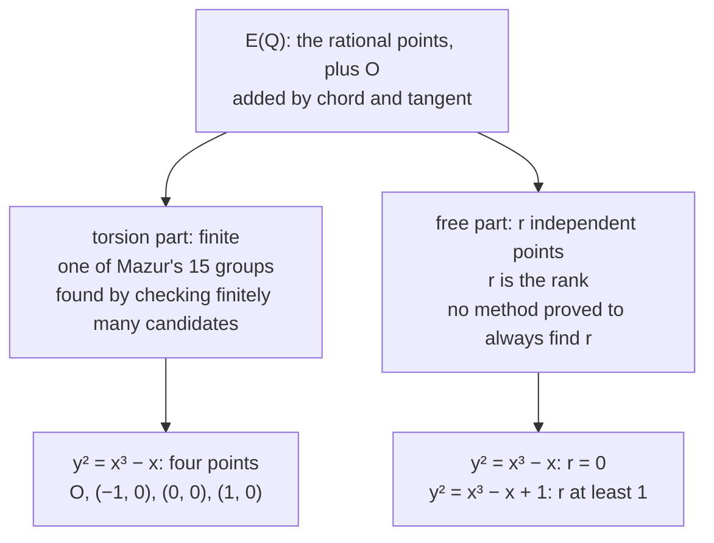

# Rational points on a cubic: a finitely generated group with a rank nobody can always find

[Syllabus](../../../SYLLABUS.md) → [Algebraic and analytic number theory](../README.md) → [Diophantine and Modular](../README.md#s07) → Rational points on a cubic

---

## General Overview

Take the curve $`y^2 = x^3 - x`$ and ask which fractions $`x`$ and $`y`$ make it true. Three answers are easy to see. The right side factors as $`x(x - 1)(x + 1)`$, so $`x = -1`$, $`0`$ or $`1`$ with $`y = 0`$ all work.

A computer search finds nothing else. It tries every fraction $`x = k/e^2`$, with $`k`$ and $`e`$ whole numbers, $`\lvert k\rvert`$ and $`e^2`$ up to 900, and only those three points turn up. A search is evidence, not proof. The proof goes back to Fermat in the 1600s: there really are no other points.

Change one number and the picture changes. The neighbouring curve $`y^2 = x^3 - x + 1`$ has points without end: (1, 1), (−1, 1), (0, −1), (3, −5), (5, 11), (1/4, 7/8), and on, with longer and longer fractions.

Both curves are **elliptic curves**: cubics $`y^2 = x^3 + ax + b`$ with no sharp point or self-crossing. The chord and tangent rule of [Elliptic curves](../../05-Geometry%20and%20trig/06-Beyond%20Euclid/05-elliptic-curves-and-point-addition.md) adds two points to give a third. It uses only adding, subtracting, multiplying and dividing, so two rational points (points whose coordinates are fractions) add to a rational point. The rational points, with one extra point $`O`$ as zero, form a **group**.

Mordell proved in 1922 that this group always has a finite list of points that builds all the others. The list has two kinds of member. Some points return to $`O`$ after a few additions; they make up the **torsion** part. The rest are independent points that never return; their number is the **rank**.

**The rational points on an elliptic curve form a group under chord and tangent, and that group is always a finite torsion part combined with r independent points of infinite order; for y² = x³ − x it is just four points, O and three points of order 2, and r = 0.**

**What kind of fact this is:** the general statement is the Mordell–Weil theorem, stated here with its source and its proof in outline. The four-point answer for $`y^2 = x^3 - x`$ is proved on this card in Why it works, resting on Fermat's theorem about $`X^4 - Y^4 = Z^2`$, whose descent is given there in a fold. No method is proved to find the rank of every curve: that is open as of 2026-11-15.

### The picture: the group splits in two



The torsion side is a finite search. The rank side is the hard one.

---

## The formula

Notation first. $`E`$ names the curve. $`E(\mathbb{Q})`$, read "E of Q", is the set of its rational points together with $`O`$. $`O`$ is the zero point from [Elliptic curves](../../05-Geometry%20and%20trig/06-Beyond%20Euclid/05-elliptic-curves-and-point-addition.md), pictured at the top of every vertical line. $`nP`$ is the point $`P`$ added to itself $`n`$ times.

The chord and tangent rule, restated in one line: for points $`(x_1, y_1)`$ and $`(x_2, y_2)`$, find the slope $`m`$ of the line through them, or of the tangent when they agree.

```math
m = \frac{y_2 - y_1}{x_2 - x_1} \ \text{ or } \ m = \frac{3x_1^2 + a}{2y_1}, \qquad x_3 = m^2 - x_1 - x_2, \qquad y_3 = m(x_1 - x_3) - y_1
```

A vertical line, including a vertical tangent where $`y = 0`$, gives $`O`$. The Mordell–Weil theorem says what the whole group looks like:

```math
E(\mathbb{Q}) \cong E(\mathbb{Q})_{\mathrm{tors}} \times \mathbb{Z}^{r}
```

**Read it aloud:** the rational points have the same structure as a finite group of torsion points paired with lists of $`r`$ whole numbers.

In plain terms there are torsion points and $`r`$ points $`P_1, \dots, P_r`$ such that every rational point is exactly one torsion point plus $`n_1 P_1 + \dots + n_r P_r`$, for one choice of whole numbers $`n_1, \dots, n_r`$. The sign $`\cong`$ means "matches one for one, in a way that respects adding".

For our curve the answer is

```math
E(\mathbb{Q}) = \{O, (-1, 0), (0, 0), (1, 0)\} \cong \mathbb{Z}/2 \times \mathbb{Z}/2, \qquad r = 0
```

Here $`\mathbb{Z}/2`$ is Z mod 2: the remainders 0 and 1 under addition, where 1 + 1 = 0.

| Symbol | Plain meaning | In our example | Push it up and the answer… |
| --- | --- | --- | --- |
| $`E`$; $`a`$, $`b`$; $`c`$ | the curve $`y^2 = x^3 + ax + b`$ and its whole-number coefficients; a whole number that clears fractions from them | $`a = -1`$, $`b = 0`$; no clearing needed | a different curve, a different group |
| $`D = 4a^3 + 27b^2`$ | the test number: zero means a cusp or crossing | $`\lvert D\rvert = 4`$; 23 for the neighbour | more torsion candidates to check |
| $`E(\mathbb{Q})`$, $`O`$; $`E(\mathbb{Q})/2E(\mathbb{Q})`$ | rational points plus the zero point; those points counted up to adding a double | four points; the same four, as every double is $`O`$ | — |
| $`P`$, $`Q`$; $`(x, y)`$ | points of $`E`$ and their coordinates | $`P = (0, 0)`$; $`Q = (1, 1)`$ on the neighbour | — |
| $`m`$ | slope of the chord or tangent | 0 along $`y = 0`$ | the third crossing moves |
| $`nP`$ | $`P`$ added to itself $`n`$ times | $`2P = O`$; $`6Q = (1/4, 7/8)`$ | longer fractions, unless $`P`$ is torsion |
| $`E(\mathbb{Q})_{\mathrm{tors}}`$ | torsion: points with $`nP = O`$ for some $`n \ge 1`$ | all four points | stays within Mazur's list |
| $`r`$; $`\mathbb{Z}^r`$; $`P_i`$, $`n_i`$ | the rank; lists of $`r`$ whole numbers; the $`r`$ independent points and the whole numbers multiplying them | $`r = 0`$, so no $`P_i`$; at least 1 for the neighbour | infinitely many points once $`r \ge 1`$ |
| $`\cong`$; $`\mathbb{Z}/2`$ | same structure; Z mod 2 | $`\mathbb{Z}/2 \times \mathbb{Z}/2`$ | — |
| $`k`$, $`e`$, $`h`$; $`H`$ | $`x = k/e^2`$ and $`y = h/e^3`$ in lowest terms; search height $`\max(\lvert k\rvert, e^2)`$ | $`H \le 900`$ | the search reaches further points |
| $`p`$; $`N_p`$ | a prime; points of $`E`$ counted mod $`p`$, $`O`$ included | $`N_3 = 4`$, $`N_5 = 8`$ | — |
| $`X`$, $`Y`$, $`Z`$; $`j`$, $`f`$, $`g`$, $`s`$, $`t`$, $`u`$, $`v`$, $`w`$ | positive whole numbers in $`X^4 - Y^4 = Z^2`$; helper whole numbers in the proofs, each defined where it appears | none exist | — |

### When it holds

- **No cusp or crossing: $`D \ne 0`$.** For $`y^2 = x^3`$, $`D = 0`$, and the points other than the cusp add like all the fractions under ordinary addition. That group is not finitely generated, so Mordell–Weil fails.
- **Rational numbers, or a number field.** Weil extended the theorem in 1929 to points with coordinates in any number field (a finite extension of the fractions). Over the real numbers the points form continuous curves, far too many for any finite list to build.
- **Whole coefficients for the torsion test.** Nagell–Lutz (below) needs whole $`a`$ and $`b`$. Clear fractions first: replacing $`x`$ by $`x/c^2`$ and $`y`$ by $`y/c^3`$ multiplies $`a`$ by $`c^4`$ and $`b`$ by $`c^6`$.
- **A good prime for the counting test.** Counting points mod $`p`$ bounds the torsion only when $`p`$ is odd and does not divide $`D`$. Mod 2 the curve has 3 points, and 3 is not a multiple of 4.
- **Finitely generated is not finite.** Once $`r \ge 1`$, the multiples of one point never repeat, so there are infinitely many points.

---

## Why it works

### Step 0: closed under the rule, then a descent

The chord and tangent rule uses only the four operations, so fractions in give fractions out. That makes $`E(\mathbb{Q})`$ a group inside the group of all points ([Elliptic curves](../../05-Geometry%20and%20trig/06-Beyond%20Euclid/05-elliptic-curves-and-point-addition.md) proves the group laws, associativity only for points in general position; [The group law](../../22-Algebraic%20geometry/04-Elliptic%20Curves/01-elliptic-curves-and-the-group-law.md) covers the remaining cases).

Mordell's idea is a descent, the method of [Fermat's last theorem](04-fermats-last-theorem-history-and-descent.md): show that a large point is a small point plus twice another point, and that halving shrinks the size of the fractions. Then a finite list of small points builds everything. Steps 1 to 3 settle our curve completely; Step 4 gives the general proof in outline.

### Step 1: the four points add by chord and tangent

The three points on the x-axis lie on one line, $`y = 0`$. Its slope is 0, so for $`(-1, 0) + (0, 0)`$:

```math
x_3 = 0^2 - (-1) - 0 = 1, \qquad y_3 = 0 \cdot (-1 - 1) - 0 = 0
```

The sum is $`(1, 0)`$. A point with $`y = 0`$ has a vertical tangent: the tangent slope would divide by $`2y = 0`$. So each of the three points doubles to $`O`$, and each has order 2.

| + | O | (−1, 0) | (0, 0) | (1, 0) |
| --- | --- | --- | --- | --- |
| **O** | O | (−1, 0) | (0, 0) | (1, 0) |
| **(−1, 0)** | (−1, 0) | O | (1, 0) | (0, 0) |
| **(0, 0)** | (0, 0) | (1, 0) | O | (−1, 0) |
| **(1, 0)** | (1, 0) | (0, 0) | (−1, 0) | O |

A group of four members is either $`\mathbb{Z}/4`$, with a member of order 4, or $`\mathbb{Z}/2 \times \mathbb{Z}/2`$, where every member doubles to zero ([Direct products](../../03-Algebra/08-Groups/07-direct-products.md) sets the two side by side). Here every member doubles to $`O`$, so the four points form $`\mathbb{Z}/2 \times \mathbb{Z}/2`$.

### Step 2: no other torsion, by a finite check

The **Nagell–Lutz theorem** limits where torsion points can be. If $`a`$ and $`b`$ are whole and $`P = (x, y)`$ is a torsion point other than $`O`$, then $`x`$ and $`y`$ are whole, and either $`y = 0`$ or $`y^2`$ divides $`D = 4a^3 + 27b^2`$. [Torsion points](../../22-Algebraic%20geometry/04-Elliptic%20Curves/04-torsion-and-nagell-lutz.md) proves it, one half in outline; Silverman's book in the Sources gives the full proof.

For $`y^2 = x^3 - x`$, $`\lvert D\rvert = \lvert 4(-1)^3 + 0\rvert = 4`$. So $`y`$ is 0, 1 or 2.

- $`y = 0`$: $`x^3 - x = 0`$ gives $`x = -1, 0, 1`$, the three known points.
- $`y = 1`$: $`x^3 - x = 1`$. A whole root must divide 1, and $`x = \pm 1`$ gives 0. No root.
- $`y = 2`$: $`x^3 - x = 4`$. A whole root must divide 4; $`\pm1, \pm2, \pm4`$ give $`0, 0, \pm 6, \pm 60`$. No root.

So the torsion is exactly the four points. **Mazur's theorem** (Publications Mathématiques de l'IHÉS 47, 1977) says what torsion can ever occur over the rationals: $`\mathbb{Z}/n`$ for $`n`$ from 1 to 10 or 12, or $`\mathbb{Z}/2 \times \mathbb{Z}/2n`$ for $`n`$ from 1 to 4. Ours is the case $`\mathbb{Z}/2 \times \mathbb{Z}/2`$. [Torsion points](../../22-Algebraic%20geometry/04-Elliptic%20Curves/04-torsion-and-nagell-lutz.md) teaches the list.

A second road needs no Nagell–Lutz. For an odd prime $`p`$ not dividing $`D`$, reducing mod $`p`$ sends different torsion points to different points mod $`p`$ (Koblitz, in the Sources, proves this for this curve). So the torsion count divides every $`N_p`$. The code counts $`N_3 = 4`$, $`N_5 = 8`$, $`N_7 = 8`$, $`N_{11} = 12`$; their greatest common divisor is 4.

### Step 3: rank 0, because $`X^4 - Y^4 = Z^2`$ has no solutions

Suppose a rational point has $`y \ne 0`$. Its denominators have a fixed shape: $`x = k/e^2`$ and $`y = h/e^3`$ in lowest terms. The reason: if a prime appears $`j`$ times in the denominator of $`x`$, it appears $`3j`$ times in $`x^3 - x`$. That count must be even, as it is for $`y^2`$, so $`j`$ is even.

Clearing denominators turns the curve into a product of three whole numbers:

```math
h^2 = k\,(k - e^2)\,(k + e^2)
```

The three factors share no prime except possibly 2. A product of numbers with no common factor is a square only if each factor is a square, up to sign. Matching the squares gives positive whole numbers with $`X^4 - Y^4 = Z^2`$. For example, if $`k`$ is even and positive, then $`k = u^2`$, $`k - e^2 = v^2`$ and $`k + e^2 = w^2`$, and multiplying the last two gives $`u^4 - e^4 = (vw)^2`$.

Fermat proved that $`X^4 - Y^4 = Z^2`$ has no solution in positive whole numbers. His descent is like the one [Fermat's last theorem](04-fermats-last-theorem-history-and-descent.md) runs for $`x^4 + y^4 = z^2`$: a solution would build a smaller one, forever. The second fold below gives it in full; Koblitz, in the Sources, gives it too. So no rational point has $`y \ne 0`$. Every rational point is one of the four, and none has infinite order: $`r = 0`$.

<details>
<summary>Detailed proof: every sign and parity case leads to X⁴ − Y⁴ = Z²</summary>

Write $`x = k/e^2`$, $`y = h/e^3`$ with $`e \ge 1`$, $`\gcd(k, e) = 1`$ and $`h \ne 0`$. Then $`k \ne 0`$, since $`x = 0`$ forces $`y = 0`$. Any common prime of $`k`$ and $`k \pm e^2`$ divides $`e`$, which is impossible. A common prime of $`k - e^2`$ and $`k + e^2`$ divides $`2k`$ and $`2e^2`$, so it is 2.

**Case A: $`k`$ and $`e`$ not both odd.** Then $`k - e^2`$ and $`k + e^2`$ are odd, and the three factors share no prime. Their product is $`h^2 > 0`$, so each is a square up to sign. Since $`k - e^2 < k + e^2`$, a positive product leaves two sign patterns.

If $`k > 0`$, all three are positive: $`k = u^2`$, $`k - e^2 = v^2`$, $`k + e^2 = w^2`$, so

$`\displaystyle u^4 - e^4 = (vw)^2.`$

If $`k < 0`$, then $`k = -u^2`$, $`k - e^2 = -v^2`$, $`k + e^2 = w^2`$, so

$`\displaystyle e^4 - u^4 = (e^2 - k)(e^2 + k) = (vw)^2.`$

**Case B: $`k`$ and $`e`$ both odd.** Write $`k - e^2 = 2s`$ and $`k + e^2 = 2t`$. Then $`t - s = e^2`$ and $`t + s = k`$, so $`s`$ and $`t`$ share no prime, and $`h^2 = 4kst`$ with $`k`$, $`s`$, $`t`$ sharing no prime. Each is a square up to sign.

If $`k > 0`$, then $`s`$ and $`t`$ have the same sign and sum to $`k > 0`$, so all three are positive: $`k = u^2`$, $`s = v^2`$, $`t = w^2`$. Then $`w^2 - v^2 = e^2`$ and $`w^2 + v^2 = u^2`$, so

$`\displaystyle w^4 - v^4 = (eu)^2.`$

If $`k < 0`$, then $`s < 0 < t`$: $`k = -u^2`$, $`s = -v^2`$, $`t = w^2`$. Then $`w^2 + v^2 = e^2`$ and $`v^2 - w^2 = u^2`$, so

$`\displaystyle v^4 - w^4 = (eu)^2.`$

In all four cases every letter is a positive whole number, so each gives a solution of $`X^4 - Y^4 = Z^2`$. The next fold rules that out. Hence $`y = 0`$ for every rational point.

</details>

<details>
<summary>Detailed proof: X⁴ − Y⁴ = Z² has no solution in positive whole numbers</summary>

Suppose solutions exist, and take the one with the smallest $`X`$. If a prime divided $`X`$ and $`Y`$, its fourth power would divide $`Z^2`$, so its square would divide $`Z`$, and dividing out would give a smaller solution. So $`X`$ and $`Y`$ share no prime, and

$`\displaystyle (Y^2)^2 + Z^2 = (X^2)^2`$

is a right triangle with no common factor. The recipe of [Pythagorean triples](../../02-Number%20theory/07-For%20the%20Curious/01-pythagorean-triples.md) gives seeds $`f > g > 0`$, sharing no prime, one odd and one even, with $`X^2 = f^2 + g^2`$ and legs $`f^2 - g^2`$ and $`2fg`$.

**Case 1: $`Y`$ odd.** Then $`Y^2`$ is the odd leg, $`f^2 - g^2`$, and

$`\displaystyle f^4 - g^4 = (f^2 + g^2)(f^2 - g^2) = (XY)^2.`$

That is a solution with $`f < X`$, since $`f^2 < f^2 + g^2 = X^2`$.

**Case 2: $`Y`$ even.** Then $`Y^2 = 2fg`$. Now $`f^2 + g^2 = X^2`$ is itself a right triangle with no common factor, so the recipe gives seeds $`s > t > 0`$, sharing no prime, with $`X = s^2 + t^2`$: the even one of $`f`$ and $`g`$ is $`2st`$, the odd one $`s^2 - t^2`$. So

$`\displaystyle Y^2 = 2fg = 4\,s\,t\,(s^2 - t^2).`$

The three numbers $`s`$, $`t`$ and $`s^2 - t^2`$ share no prime: a prime in $`s`$ and $`s^2 - t^2`$ would divide $`t`$. Their product is $`(Y/2)^2`$, a square, so each is a square: $`s = u^2`$, $`t = v^2`$, $`s^2 - t^2 = w^2`$. That reads

$`\displaystyle u^4 - v^4 = w^2,`$

a solution with $`u \le u^2 = s < s^2 + t^2 = X`$.

Either way there is a solution with a smaller $`X`$, against the choice of the smallest. So there is no solution.

</details>

This is the same fact as Fermat's right-triangle theorem: no right triangle with rational sides has area 1. In the language of [Birch-Swinnerton-Dyer](06-birch-swinnerton-dyer-and-the-congruent-number-problem.md), 1 is not a congruent number.

### Step 4: Mordell–Weil in general, in outline

The general proof has two halves (Silverman and Tate give it in full for curves with a point of order 2, which covers ours).

1. **Weak Mordell–Weil.** The group $`E(\mathbb{Q})/2E(\mathbb{Q})`$, the points counted up to adding a double, is finite. The proof reduces this to finitely many square classes of whole numbers, as Step 3 did with $`k`$, $`k - e^2`$ and $`k + e^2`$.
2. **Height descent.** The height of $`x = k/e^2`$ is roughly $`\log \max(\lvert k\rvert, e^2)`$. Doubling a point roughly multiplies its height by 4. So writing a point as a fixed representative plus twice another point roughly halves the height, and repeating reaches the finitely many points below a fixed height.

Together these give a finite list of generators. A group with addition in any order and a finite list of generators is a finite group times $`\mathbb{Z}^r`$: the structure theorem stated on [Smith normal form](../../17-Topology/05-Homology/03-computing-homology-by-smith-normal-form.md). That is the formula.

### Step 5: why the rank is hard to find

The proof does not hand over the generators. The finite group $`E(\mathbb{Q})/2E(\mathbb{Q})`$ is the trouble: descent gives an upper bound for its size, and a search gives a lower bound. When the two meet, the rank is known. When they do not, nobody can tell whether a point is missing or the bound is too generous.

The gap is measured by the **Tate–Shafarevich group**, a group of "fake" solutions that pass every local test (a solution mod every prime power, and one in real numbers) and still have no rational point. It is conjectured to be finite. If it is, a long enough descent plus search always finds the rank. That is unproved, open as of 2026-11-15, and the [Birch-Swinnerton-Dyer](06-birch-swinnerton-dyer-and-the-congruent-number-problem.md) conjecture predicts the rank in another way.

The neighbour curve shows the easy half. Nagell–Lutz allows six whole points, $`(0, \pm1)`$ and $`(\pm1, \pm1)`$, since $`y^2 = 1`$ divides 23. Each has a multiple with a fractional coordinate: $`6 \cdot (1, 1) = (1/4, 7/8)`$. So none is torsion, the torsion is $`\{O\}`$, and $`Q = (1, 1)`$ has infinite order: rank at least 1.

---

## Worked numbers, by hand

| Step | Arithmetic | Value |
| --- | --- | --- |
| factor the cubic | $`x^3 - x = x(x - 1)(x + 1)`$ | points (−1, 0), (0, 0), (1, 0) |
| chord along $`y = 0`$ | $`m = 0`$; $`x_3 = 0 + 1 - 0`$ | (−1, 0) + (0, 0) = (1, 0) |
| tangent at (0, 0) | slope $`(0 - 1)/(2 \cdot 0)`$: vertical | 2 · (0, 0) = O |
| orders | O, (−1, 0), (0, 0), (1, 0) | 1, 2, 2, 2: no order 4 |
| Nagell–Lutz test number | $`\lvert 4(-1)^3 + 27 \cdot 0^2\rvert`$ | 4, so $`y \in \{0, 1, 2\}`$ |
| $`y = 1`$ and $`y = 2`$ | whole roots of $`x^3 - x = 1`$, of $`x^3 - x = 4`$ | none: values 0, 0, ±6, ±60 |
| counts mod 3, 5, 7, 11 | $`\gcd(4, 8, 8, 12)`$ | 4: torsion has at most 4 points |
| any point with $`y \ne 0`$ | leads to $`X^4 - Y^4 = Z^2`$ | impossible (Fermat) |
| **the answer** | | $`E(\mathbb{Q})`$ **= four points,** $`\cong \mathbb{Z}/2 \times \mathbb{Z}/2`$, **r = 0** |

The curve $`y^2 = x^3 - x`$ has exactly four rational points, all of order 2, and no point that generates infinitely many more.

### What breaks if you drop a piece

| Mistake | Comes out at | What went wrong |
| --- | --- | --- |
| Use a cusp, $`y^2 = x^3`$ | (1, 1) + (1/4, 1/8) = (1/9, 1/27); the ratios $`x/y`$ go 1 + 2 = 3 | $`D = 0`$: the points add like all fractions, which no finite list generates |
| Call a whole point torsion | (1, 1) on the neighbour passes Nagell–Lutz, yet 6 · (1, 1) = (1/4, 7/8) | the test is necessary, not sufficient: (1, 1) has infinite order |
| Count mod the bad prime 2 | $`N_2 = 3`$; gcd with 4 is 1 | 2 divides the curve's discriminant; reduction mod 2 merges points |
| Read four points as $`\mathbb{Z}/4`$ | orders 1, 2, 2, 2 | $`\mathbb{Z}/4`$ needs a point of order 4; none exists |

The code prints every row.

---

## Code, from first principles, and it actually runs

Both programs add points with exact fractions (Python's Fraction; in Rust a small struct written here). They take **four roads**. Road 1 builds the group table by chord and tangent and finds every order. Road 2 runs the Nagell–Lutz candidate check on both curves. Road 3 counts points mod the good primes up to 29 and takes the greatest common divisor. Road 4 searches every $`x = k/e^2`$ up to height 900 for points, and every $`X^4 - Y^4`$ up to 300 for a square. Roads 1, 2 and 3 reach the torsion count 4 independently; Road 4 is evidence for rank 0, whose proof is Step 3.

### Python

```python
# Rational points on y^2 = x^3 - x: Mordell-Weil with torsion and rank, the check behind the card.
# Standard library only: Fraction is exact fractions, isqrt an exact whole-number square root.
from fractions import Fraction as F
from math import gcd, isqrt

def add(p, q, a):                    # chord-tangent rule on y^2 = x^3 + a x + b; None is O
    if p is None: return q
    if q is None: return p
    if p[0] == q[0] and p[1] == -q[1]: return None   # vertical line, tangents at y = 0 too
    m = (3 * p[0] ** 2 + a) / (2 * p[1]) if p == q else (q[1] - p[1]) / (q[0] - p[0])
    x = m * m - p[0] - q[0]
    return (x, m * (p[0] - x) - p[1])

def show(p): return "O" if p is None else f"({p[0]}, {p[1]})"
def whole(p): return p is None or (p[0].denominator == 1 and p[1].denominator == 1)

# Road 1: chord and tangent on the four obvious points
pts = [None, (F(-1), F(0)), (F(0), F(0)), (F(1), F(0))]
print("group table of y^2 = x^3 - x (row + column):")
for p in pts: print(f"  {show(p):>8} |", " ".join(f"{show(add(p, q, -1)):>8}" for q in pts))
def order(p, a):
    k, s = 1, p
    while s is not None and k <= 12: k, s = k + 1, add(s, p, a)
    return k
orders = [order(p, -1) for p in pts]
print("orders of O, (-1, 0), (0, 0), (1, 0):", orders, "-> no point of order 4, so Z/2 x Z/2")
assert add(pts[1], pts[2], -1) == pts[3]                      # the chord along y = 0, by hand
assert all(add(p, q, -1) in pts for p in pts for q in pts) and max(orders) == 2

# Road 2: Nagell-Lutz -- a torsion point has whole coordinates, and y = 0 or y^2 | 4a^3 + 27b^2
def nagell_lutz(a, b):
    D = abs(4 * a ** 3 + 27 * b ** 2)
    ys = [0] + [y for y in range(1, isqrt(D) + 1) if D % (y * y) == 0]
    cands = []
    for y in ys:
        c = b - y * y                                         # x^3 + a x + c = 0, whole roots
        for x in range(-1 - abs(a) - abs(c), 2 + abs(a) + abs(c)):
            if x ** 3 + a * x + c == 0: cands += [(F(x), F(y))] + ([(F(x), F(-y))] if y else [])
    return D, ys, cands
print("y = 2: x^3 - x at x = 1, -1, 2, -2, 4, -4:", ", ".join(str(x ** 3 - x) for x in (1, -1, 2, -2, 4, -4)), "(never 4)")
for a, b, name in ((-1, 0, "x^3 - x"), (-1, 1, "x^3 - x + 1")):
    D, ys, cands = nagell_lutz(a, b)
    print(f"y^2 = {name}: |4a^3 + 27b^2| = {D}; allowed y: {ys}; candidates: {len(cands)}")
    tors = [None]
    for p in cands:
        k, s = 1, p
        while s is not None and whole(s) and k <= 12: k, s = k + 1, add(s, p, a)
        if s is None: tors.append(p)
        print(f"  {show(p)}: " + (f"order {k}" if s is None else f"{k}P = {show(s)}, not whole: infinite order"))
    print(f"  torsion subgroup: {len(tors)} point(s)")
    if b == 0: tors0 = tors
assert tors0 == pts                                          # the search finds exactly the table

# Road 3: reduction mod good primes; torsion embeds in each E(GF(p)), so its size divides the gcd
def count_mod(p, a, b): return 1 + sum((y * y - x ** 3 - a * x - b) % p == 0 for x in range(p) for y in range(p))
for a, b, D, name in ((-1, 0, 4, "x^3 - x"), (-1, 1, 23, "x^3 - x + 1")):
    cs = [(p, count_mod(p, a, b)) for p in (3, 5, 7, 11, 13, 17, 19, 23, 29) if 2 * D % p]
    g = 0
    for _, c in cs: g = gcd(g, c)
    print(f"y^2 = {name}, points mod p: " + ", ".join(f"{p}:{c}" for p, c in cs) + f"; gcd {g}")
    if b == 0: g0 = g
assert g0 == len(tors0)                                       # 4 points, reached a second way

# Road 4: rank. Search the box H = max(|k|, e^2) <= 900 for x = k/e^2, y = h/e^3 on both curves
HB = 900                                                      # the search box
def search(a, b, H=HB):
    found = []
    for e in range(1, isqrt(H) + 1):
        for k in range(-H, H + 1):
            if gcd(k, e) != 1: continue
            r = k ** 3 + a * k * e ** 4 + b * e ** 6
            if r >= 0 and isqrt(r) ** 2 == r: found.append((F(k, e * e), F(isqrt(r), e ** 3)))
    return found
f0, f1 = search(-1, 0), search(-1, 1)
print(f"box H <= {HB}: y^2 = x^3 - x has {len(f0)} points with y >= 0: {', '.join(show(p) for p in f0)}")
print(f"box H <= {HB}: y^2 = x^3 - x + 1 has {len(f1)} points with y >= 0, e.g. {show(f1[-1])}")
assert [p for p in f0] == pts[1:]                             # nothing beyond the torsion
Q, mult = (F(1), F(1)), [None]
for k in range(6): mult.append(add(mult[-1], Q, -1))
print("multiples of Q = (1, 1) on y^2 = x^3 - x + 1:", ", ".join(show(p) for p in mult[1:]))
quart = [(X, Y) for X in range(2, 301) for Y in range(1, X) if isqrt(X ** 4 - Y ** 4) ** 2 == X ** 4 - Y ** 4]
print(f"X^4 - Y^4 = Z^2 with 0 < Y < X <= 300: {len(quart)} solutions (Fermat: none ever)")
assert quart == [] and not whole(mult[6])                     # rank 0 evidence; Q of infinite order
assert all(p[1] ** 2 == p[0] ** 3 - p[0] + 1 for p in mult[1:] + f1)   # every point on its curve

# What breaks: a cusp, a bad prime, a whole point that is not torsion
c = add((F(1), F(1)), (F(1, 4), F(1, 8)), 0)
ok = all(add((F(1, s * s), F(1, s ** 3)), (F(1, t * t), F(1, t ** 3)), 0) == (F(1, (s + t) ** 2), F(1, (s + t) ** 3))
         for s in range(1, 7) for t in range(1, 7))
print(f"cusp y^2 = x^3: (1, 1) + (1/4, 1/8) = {show(c)}; x/y adds as fractions on 36 pairs: {'yes' if ok else 'no'}")
print(f"bad prime 2: y^2 = x^3 - x mod 2 has {count_mod(2, -1, 0)} points; gcd with 4 is {gcd(4, count_mod(2, -1, 0))}")
assert c == (F(1, 9), F(1, 27)) and ok and count_mod(2, -1, 0) == 3
print("ALL CHECKS PASS")
```

**Ran 2026-11-15 on macOS, Python 3.14.10, standard library only. All checks passed. Output, pasted from the run:**

```
group table of y^2 = x^3 - x (row + column):
         O |        O  (-1, 0)   (0, 0)   (1, 0)
   (-1, 0) |  (-1, 0)        O   (1, 0)   (0, 0)
    (0, 0) |   (0, 0)   (1, 0)        O  (-1, 0)
    (1, 0) |   (1, 0)   (0, 0)  (-1, 0)        O
orders of O, (-1, 0), (0, 0), (1, 0): [1, 2, 2, 2] -> no point of order 4, so Z/2 x Z/2
y = 2: x^3 - x at x = 1, -1, 2, -2, 4, -4: 0, 0, 6, -6, 60, -60 (never 4)
y^2 = x^3 - x: |4a^3 + 27b^2| = 4; allowed y: [0, 1, 2]; candidates: 3
  (-1, 0): order 2
  (0, 0): order 2
  (1, 0): order 2
  torsion subgroup: 4 point(s)
y^2 = x^3 - x + 1: |4a^3 + 27b^2| = 23; allowed y: [0, 1]; candidates: 6
  (-1, 1): 3P = (1/4, 7/8), not whole: infinite order
  (-1, -1): 3P = (1/4, -7/8), not whole: infinite order
  (0, 1): 2P = (1/4, -7/8), not whole: infinite order
  (0, -1): 2P = (1/4, 7/8), not whole: infinite order
  (1, 1): 6P = (1/4, 7/8), not whole: infinite order
  (1, -1): 6P = (1/4, -7/8), not whole: infinite order
  torsion subgroup: 1 point(s)
y^2 = x^3 - x, points mod p: 3:4, 5:8, 7:8, 11:12, 13:8, 17:16, 19:20, 23:24, 29:40; gcd 4
y^2 = x^3 - x + 1, points mod p: 3:7, 5:8, 7:12, 11:10, 13:19, 17:14, 19:22, 29:37; gcd 1
box H <= 900: y^2 = x^3 - x has 3 points with y >= 0: (-1, 0), (0, 0), (1, 0)
box H <= 900: y^2 = x^3 - x + 1 has 12 points with y >= 0, e.g. (-223/784, 24655/21952)
multiples of Q = (1, 1) on y^2 = x^3 - x + 1: (1, 1), (-1, 1), (0, -1), (3, -5), (5, 11), (1/4, 7/8)
X^4 - Y^4 = Z^2 with 0 < Y < X <= 300: 0 solutions (Fermat: none ever)
cusp y^2 = x^3: (1, 1) + (1/4, 1/8) = (1/9, 1/27); x/y adds as fractions on 36 pairs: yes
bad prime 2: y^2 = x^3 - x mod 2 has 3 points; gcd with 4 is 1
ALL CHECKS PASS
```

### Rust

```rust
// Rational points on y^2 = x^3 - x: Mordell-Weil with torsion and rank, the check behind the card.
// Standard library only: exact fractions and an exact whole-number square root, written here.
#[derive(Clone, Copy, PartialEq, Debug)]
struct R { n: i128, d: i128 }                       // n/d in lowest terms, d > 0
fn gcd(a: i128, b: i128) -> i128 { if b == 0 { a.abs() } else { gcd(b, a % b) } }
fn r(n: i128, d: i128) -> R {
    assert!(d != 0);
    let g = gcd(n, d) * d.signum();
    R { n: n / g, d: d / g }
}
fn ri(n: i128) -> R { r(n, 1) }
fn mul(a: R, b: R) -> R { r(a.n.checked_mul(b.n).unwrap(), a.d.checked_mul(b.d).unwrap()) }
fn div(a: R, b: R) -> R { r(a.n.checked_mul(b.d).unwrap(), a.d.checked_mul(b.n).unwrap()) }
fn add_r(a: R, b: R) -> R {
    r(a.n.checked_mul(b.d).unwrap().checked_add(b.n.checked_mul(a.d).unwrap()).unwrap(), a.d.checked_mul(b.d).unwrap())
}
fn neg(a: R) -> R { R { n: -a.n, d: a.d } }
fn sub(a: R, b: R) -> R { add_r(a, neg(b)) }
fn fs(a: R) -> String { if a.d == 1 { format!("{}", a.n) } else { format!("{}/{}", a.n, a.d) } }
type P = Option<(R, R)>;                             // None is the point O

fn add(p: P, q: P, a: i128) -> P {                   // chord-tangent rule on y^2 = x^3 + a x + b
    let (p, q) = match (p, q) { (None, _) => return q, (_, None) => return p, (Some(p), Some(q)) => (p, q) };
    if p.0 == q.0 && p.1 == neg(q.1) { return None; } // vertical line, tangents at y = 0 too
    let m = if p == q { div(add_r(mul(ri(3), mul(p.0, p.0)), ri(a)), mul(ri(2), p.1)) }
            else { div(sub(q.1, p.1), sub(q.0, p.0)) };
    let x = sub(sub(mul(m, m), p.0), q.0);
    Some((x, sub(mul(m, sub(p.0, x)), p.1)))
}
fn show(p: P) -> String { match p { None => "O".to_string(), Some((x, y)) => format!("({}, {})", fs(x), fs(y)) } }
fn whole(p: P) -> bool { match p { None => true, Some((x, y)) => x.d == 1 && y.d == 1 } }
fn isqrt(v: i128) -> i128 {
    let mut s = (v as f64).sqrt() as i128;
    while s * s > v { s -= 1; }
    while (s + 1) * (s + 1) <= v { s += 1; }
    s
}
fn order(p: P, a: i128) -> i64 {
    let (mut k, mut s) = (1, p);
    while s.is_some() && k <= 12 { k += 1; s = add(s, p, a); }
    k
}
fn nagell_lutz(a: i128, b: i128) -> (i128, Vec<i128>, Vec<P>) {
    let dd = (4 * a * a * a + 27 * b * b).abs();
    let mut ys = vec![0];
    for y in 1..=isqrt(dd) { if dd % (y * y) == 0 { ys.push(y); } }
    let mut c = Vec::new();
    for &y in &ys {
        let cc = b - y * y;                          // x^3 + a x + cc = 0, whole roots
        for x in (-1 - a.abs() - cc.abs())..(2 + a.abs() + cc.abs()) {
            if x * x * x + a * x + cc == 0 {
                c.push(Some((ri(x), ri(y))));
                if y != 0 { c.push(Some((ri(x), ri(-y)))); }
            }
        }
    }
    (dd, ys, c)
}
fn count_mod(p: i128, a: i128, b: i128) -> i128 {
    let mut c = 1;
    for x in 0..p { for y in 0..p { if (y * y - x * x * x - a * x - b).rem_euclid(p) == 0 { c += 1; } } }
    c
}
fn search(a: i128, b: i128, h: i128) -> Vec<P> {
    let mut f = Vec::new();
    for e in 1..=isqrt(h) {
        for k in -h..=h {
            if gcd(k, e) != 1 { continue; }
            let v = k * k * k + a * k * e.pow(4) + b * e.pow(6);
            if v >= 0 && isqrt(v) * isqrt(v) == v { f.push(Some((r(k, e * e), r(isqrt(v), e.pow(3))))); }
        }
    }
    f
}
fn join(v: &[P]) -> String { v.iter().map(|&p| show(p)).collect::<Vec<_>>().join(", ") }

fn main() {
    // Road 1: chord and tangent on the four obvious points
    let pts: Vec<P> = vec![None, Some((ri(-1), ri(0))), Some((ri(0), ri(0))), Some((ri(1), ri(0)))];
    println!("group table of y^2 = x^3 - x (row + column):");
    for &p in &pts {
        let row: Vec<String> = pts.iter().map(|&q| format!("{:>8}", show(add(p, q, -1)))).collect();
        println!("  {:>8} | {}", show(p), row.join(" "));
    }
    let orders: Vec<i64> = pts.iter().map(|&p| order(p, -1)).collect();
    println!("orders of O, (-1, 0), (0, 0), (1, 0): {:?} -> no point of order 4, so Z/2 x Z/2", orders);
    assert!(add(pts[1], pts[2], -1) == pts[3]);
    assert!(pts.iter().all(|&p| pts.iter().all(|&q| pts.contains(&add(p, q, -1)))) && *orders.iter().max().unwrap() == 2);

    // Road 2: Nagell-Lutz
    let v: Vec<String> = [1i128, -1, 2, -2, 4, -4].iter().map(|&x| (x * x * x - x).to_string()).collect();
    println!("y = 2: x^3 - x at x = 1, -1, 2, -2, 4, -4: {} (never 4)", v.join(", "));
    let mut tors0 = Vec::new();
    for &(a, b, name) in &[(-1i128, 0i128, "x^3 - x"), (-1, 1, "x^3 - x + 1")] {
        let (dd, ys, cands) = nagell_lutz(a, b);
        println!("y^2 = {}: |4a^3 + 27b^2| = {}; allowed y: {:?}; candidates: {}", name, dd, ys, cands.len());
        let mut tors: Vec<P> = vec![None];
        for &p in &cands {
            let (mut k, mut s) = (1, p);
            while s.is_some() && whole(s) && k <= 12 { k += 1; s = add(s, p, a); }
            if s.is_none() { tors.push(p); println!("  {}: order {}", show(p), k); }
            else { println!("  {}: {}P = {}, not whole: infinite order", show(p), k, show(s)); }
        }
        println!("  torsion subgroup: {} point(s)", tors.len());
        if b == 0 { tors0 = tors; }
    }
    assert!(tors0 == pts);

    // Road 3: reduction mod good primes
    let mut g0 = 0;
    for &(a, b, dd, name) in &[(-1i128, 0i128, 4i128, "x^3 - x"), (-1, 1, 23, "x^3 - x + 1")] {
        let cs: Vec<(i128, i128)> = [3, 5, 7, 11, 13, 17, 19, 23, 29].iter().filter(|&&p| 2 * dd % p != 0).map(|&p| (p, count_mod(p, a, b))).collect();
        let g = cs.iter().fold(0, |g, &(_, c)| gcd(g, c));
        let s: Vec<String> = cs.iter().map(|&(p, c)| format!("{}:{}", p, c)).collect();
        println!("y^2 = {}, points mod p: {}; gcd {}", name, s.join(", "), g);
        if b == 0 { g0 = g; }
    }
    assert!(g0 == tors0.len() as i128);

    // Road 4: rank. Search the box H = max(|k|, e^2) <= 900 for x = k/e^2, y = h/e^3 on both curves
    let hb = 900;                                    // the search box
    let (f0, f1) = (search(-1, 0, hb), search(-1, 1, hb));
    println!("box H <= {}: y^2 = x^3 - x has {} points with y >= 0: {}", hb, f0.len(), join(&f0));
    println!("box H <= {}: y^2 = x^3 - x + 1 has {} points with y >= 0, e.g. {}", hb, f1.len(), show(*f1.last().unwrap()));
    assert!(f0[..] == pts[1..]);
    let q: P = Some((ri(1), ri(1)));
    let mut mult: Vec<P> = vec![None];
    for _ in 0..6 { let last = *mult.last().unwrap(); mult.push(add(last, q, -1)); }
    println!("multiples of Q = (1, 1) on y^2 = x^3 - x + 1: {}", join(&mult[1..]));
    let mut quart = 0;
    for x in 2..=300i128 { for y in 1..x { let v = x.pow(4) - y.pow(4); if isqrt(v) * isqrt(v) == v { quart += 1; } } }
    println!("X^4 - Y^4 = Z^2 with 0 < Y < X <= 300: {} solutions (Fermat: none ever)", quart);
    assert!(quart == 0 && !whole(mult[6]));
    let on = |p: P| { let (x, y) = p.unwrap(); mul(y, y) == add_r(sub(mul(x, mul(x, x)), x), ri(1)) };
    assert!(mult[1..].iter().chain(f1.iter()).all(|&p| on(p)));   // every point on its curve

    // What breaks: a cusp, a bad prime, a whole point that is not torsion
    let c = add(Some((ri(1), ri(1))), Some((r(1, 4), r(1, 8))), 0);
    let mut ok = true;
    for s in 1..7i128 { for t in 1..7i128 {
        let u = add(Some((r(1, s * s), r(1, s.pow(3)))), Some((r(1, t * t), r(1, t.pow(3)))), 0);
        ok &= u == Some((r(1, (s + t).pow(2)), r(1, (s + t).pow(3))));
    } }
    println!("cusp y^2 = x^3: (1, 1) + (1/4, 1/8) = {}; x/y adds as fractions on 36 pairs: {}", show(c), if ok { "yes" } else { "no" });
    println!("bad prime 2: y^2 = x^3 - x mod 2 has {} points; gcd with 4 is {}", count_mod(2, -1, 0), gcd(4, count_mod(2, -1, 0)));
    assert!(c == Some((r(1, 9), r(1, 27))) && ok && count_mod(2, -1, 0) == 3);
    println!("ALL CHECKS PASS");
}
```

**Ran 2026-11-15 on macOS, rustc 1.98.1, no crates. All checks passed. Output, pasted from the run:**

```
group table of y^2 = x^3 - x (row + column):
         O |        O  (-1, 0)   (0, 0)   (1, 0)
   (-1, 0) |  (-1, 0)        O   (1, 0)   (0, 0)
    (0, 0) |   (0, 0)   (1, 0)        O  (-1, 0)
    (1, 0) |   (1, 0)   (0, 0)  (-1, 0)        O
orders of O, (-1, 0), (0, 0), (1, 0): [1, 2, 2, 2] -> no point of order 4, so Z/2 x Z/2
y = 2: x^3 - x at x = 1, -1, 2, -2, 4, -4: 0, 0, 6, -6, 60, -60 (never 4)
y^2 = x^3 - x: |4a^3 + 27b^2| = 4; allowed y: [0, 1, 2]; candidates: 3
  (-1, 0): order 2
  (0, 0): order 2
  (1, 0): order 2
  torsion subgroup: 4 point(s)
y^2 = x^3 - x + 1: |4a^3 + 27b^2| = 23; allowed y: [0, 1]; candidates: 6
  (-1, 1): 3P = (1/4, 7/8), not whole: infinite order
  (-1, -1): 3P = (1/4, -7/8), not whole: infinite order
  (0, 1): 2P = (1/4, -7/8), not whole: infinite order
  (0, -1): 2P = (1/4, 7/8), not whole: infinite order
  (1, 1): 6P = (1/4, 7/8), not whole: infinite order
  (1, -1): 6P = (1/4, -7/8), not whole: infinite order
  torsion subgroup: 1 point(s)
y^2 = x^3 - x, points mod p: 3:4, 5:8, 7:8, 11:12, 13:8, 17:16, 19:20, 23:24, 29:40; gcd 4
y^2 = x^3 - x + 1, points mod p: 3:7, 5:8, 7:12, 11:10, 13:19, 17:14, 19:22, 29:37; gcd 1
box H <= 900: y^2 = x^3 - x has 3 points with y >= 0: (-1, 0), (0, 0), (1, 0)
box H <= 900: y^2 = x^3 - x + 1 has 12 points with y >= 0, e.g. (-223/784, 24655/21952)
multiples of Q = (1, 1) on y^2 = x^3 - x + 1: (1, 1), (-1, 1), (0, -1), (3, -5), (5, 11), (1/4, 7/8)
X^4 - Y^4 = Z^2 with 0 < Y < X <= 300: 0 solutions (Fermat: none ever)
cusp y^2 = x^3: (1, 1) + (1/4, 1/8) = (1/9, 1/27); x/y adds as fractions on 36 pairs: yes
bad prime 2: y^2 = x^3 - x mod 2 has 3 points; gcd with 4 is 1
ALL CHECKS PASS
```

> [!TIP]
> **Try changing**
> - **Guess first:** does a bigger search box find more points? Set `HB = 2500`. The output still shows 3 points on $`y^2 = x^3 - x`$ and still 12 on the neighbour: its next point is further out. A search never proves a list complete.
> - **Guess first:** what torsion does $`y^2 = x^3 - 25x`$ have? In Road 2, change `(-1, 0, "x^3 - x")` to `(-25, 0, "x^3 - 25x")`. The test number is 62,500 and nine values of $`y`$ are allowed, yet only (−5, 0), (0, 0) and (5, 0) survive: four torsion points again. The assert comparing with the table of $`y^2 = x^3 - x`$ then stops the run. A torsion test says nothing about the rank: this curve has rank 1.
> - **Guess first:** what if the tangent slope forgets $`a`$? In `add`, change `3 * p[0] ** 2 + a` to `3 * p[0] ** 2`. The four-point table is unchanged, since its tangents are vertical, but the multiples of (1, 1) leave the curve and an assert stops the run.

---

## The usual mistake

> [!warning]
> **Reading "finitely generated" as "finitely many points".** Mordell–Weil promises a finite list of generators, not a finite set. The neighbour $`y^2 = x^3 - x + 1`$ has trivial torsion and rank at least 1, so its points never run out: (1, 1), (−1, 1), (0, −1), (3, −5), (5, 11), (1/4, 7/8), and on. Only rank 0 gives a finite list, as for $`y^2 = x^3 - x`$.
>
> - **Whole coordinates taken as torsion.** Nagell–Lutz only lists candidates. (1, 1) passes it on the neighbour, but 6 · (1, 1) = (1/4, 7/8), so it has infinite order.
> - **A search taken as proof of rank 0.** Height 900 finds 3 points on $`y^2 = x^3 - x`$, and height 2500 finds the same 12 on the neighbour. The proof of rank 0 is Fermat's descent.
> - **Counting at a bad prime.** Mod 2, $`y^2 = x^3 - x`$ has 3 points; the gcd with 4 is 1, which would wrongly say there is no torsion.
> - **Four points read as $`\mathbb{Z}/4`$.** Here every point doubles to $`O`$: orders 1, 2, 2, 2, so the group is $`\mathbb{Z}/2 \times \mathbb{Z}/2`$.

---

## Where you meet it in real life

- **Right triangles with a given area.** A whole number $`n`$ is the area of a right triangle with rational sides exactly when $`y^2 = x^3 - n^2 x`$ has positive rank. Rank 0 for $`n = 1`$ is why no such triangle has area 1; [Birch-Swinnerton-Dyer](06-birch-swinnerton-dyer-and-the-congruent-number-problem.md) takes up the general question.
- **Fermat's last theorem.** The exponent-4 case and the rank of $`y^2 = x^3 - x`$ are the same descent. The full proof for every exponent runs through elliptic curves over $`\mathbb{Q}`$; see [Modularity](08-modularity-and-the-proof-of-fermat.md).
- **Whole-number equations.** Siegel proved in 1929 that an elliptic curve has only finitely many points with whole coordinates. Searches for whole solutions of equations such as $`y^2 = x^3 + c`$ start from a Mordell–Weil basis.
- **Cryptography.** [Elliptic curves](../../14-Applied%20and%20computational/04-Cryptography/06-elliptic-curve-cryptography.md) on the cryptography shelf uses the same group law, but on a curve mod a large prime: the counts $`N_p`$ of Road 3.

> **Say it back**
> The chord and tangent rule turns the rational points of an elliptic curve into a group. Mordell–Weil says the group is a finite torsion part plus $`r`$ independent points of infinite order, $`r`$ being the rank. Torsion is found by a finite check: Nagell–Lutz lists the candidates, and point counts mod good primes bound the total. For $`y^2 = x^3 - x`$ the torsion is the four points O, (−1, 0), (0, 0), (1, 0), and the rank is 0 because any other point would solve $`X^4 - Y^4 = Z^2`$. In general nobody has a method proved to always find the rank.

---

## What this builds on

- [Fermat's last theorem](04-fermats-last-theorem-history-and-descent.md): Fermat's descent for $`x^4 + y^4 = z^2`$, the same method that rules out $`X^4 - Y^4 = Z^2`$ in Step 3, and the idea behind Mordell's proof.
- [Elliptic curves](../../05-Geometry%20and%20trig/06-Beyond%20Euclid/05-elliptic-curves-and-point-addition.md): the chord and tangent rule, the zero point $`O`$ and the group laws, used here without re-proof.
- [Groups](../../03-Algebra/08-Groups/01-groups.md): what a group is; [Direct products](../../03-Algebra/08-Groups/07-direct-products.md) then sets $`\mathbb{Z}/4`$ beside $`\mathbb{Z}/2 \times \mathbb{Z}/2`$.
- [Smith normal form](../../17-Topology/05-Homology/03-computing-homology-by-smith-normal-form.md): the structure theorem that turns "finitely generated" into a finite part times $`\mathbb{Z}^r`$.

## Where this goes next

- [Birch-Swinnerton-Dyer](06-birch-swinnerton-dyer-and-the-congruent-number-problem.md): a conjecture that reads the rank off the curve's counts $`N_p`$, and the congruent-number problem it would settle.
- [Modularity](08-modularity-and-the-proof-of-fermat.md): every elliptic curve over $`\mathbb{Q}`$ comes from a modular form, the route to Fermat for every exponent.
- [Mordell-Weil](../../22-Algebraic%20geometry/04-Elliptic%20Curves/06-mordell-weil-and-rank.md): heights, and a complete descent for $`y^2 = x^3 - 2`$, a curve of rank 1, in the algebraic-geometry wing.
- [Birch and Swinnerton-Dyer](../../22-Algebraic%20geometry/04-Elliptic%20Curves/08-birch-and-swinnerton-dyer-statement.md): the conjecture with its $`L`$-function, in the algebraic-geometry wing.
- [Torsion points](../../22-Algebraic%20geometry/04-Elliptic%20Curves/04-torsion-and-nagell-lutz.md): Nagell–Lutz proved, one half in outline, and Mazur's list in detail.
- [The L-function of a modular form](12-l-functions-of-modular-forms.md): a Mellin transform that inherits the form's symmetry.

The question this card leaves open: given a curve, is there a method guaranteed to stop with its rank?

---

## Sources

Verified 2026-11-15: every link below resolves to the publisher's page.

- Silverman, Joseph H., and John T. Tate. *Rational Points on Elliptic Curves*, 2nd ed. Springer, 2015. [doi:10.1007/978-3-319-18588-0](https://doi.org/10.1007/978-3-319-18588-0). The chord and tangent rule, Nagell–Lutz, and a complete proof of Mordell's theorem for curves with a point of order 2.
- Silverman, Joseph H. *The Arithmetic of Elliptic Curves*, 2nd ed. Springer, 2009. [doi:10.1007/978-0-387-09494-6](https://doi.org/10.1007/978-0-387-09494-6). Mordell–Weil over number fields, heights, the Nagell–Lutz bound $`y^2 \mid 4a^3 + 27b^2`$, and the Tate–Shafarevich group.
- Koblitz, Neal. *Introduction to Elliptic Curves and Modular Forms*, 2nd ed. Springer, 1993. [doi:10.1007/978-1-4612-0909-6](https://doi.org/10.1007/978-1-4612-0909-6). Chapter I: congruent numbers and the curves $`y^2 = x^3 - n^2 x`$, their four torsion points found by counting mod primes, and why 1 is not congruent.
- Mazur, Barry. "Modular curves and the Eisenstein ideal." *Publications Mathématiques de l'IHÉS* 47 (1977), 33–186. [doi:10.1007/BF02684339](https://doi.org/10.1007/BF02684339). The list of fifteen torsion groups possible over the rationals.
