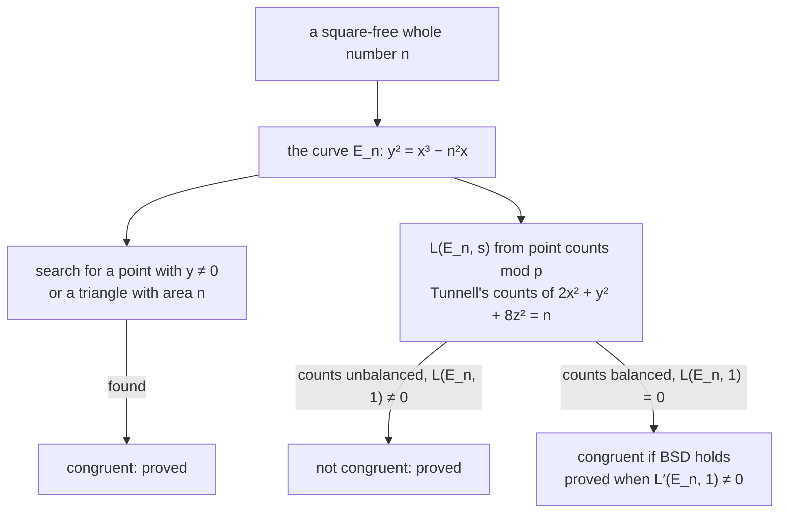
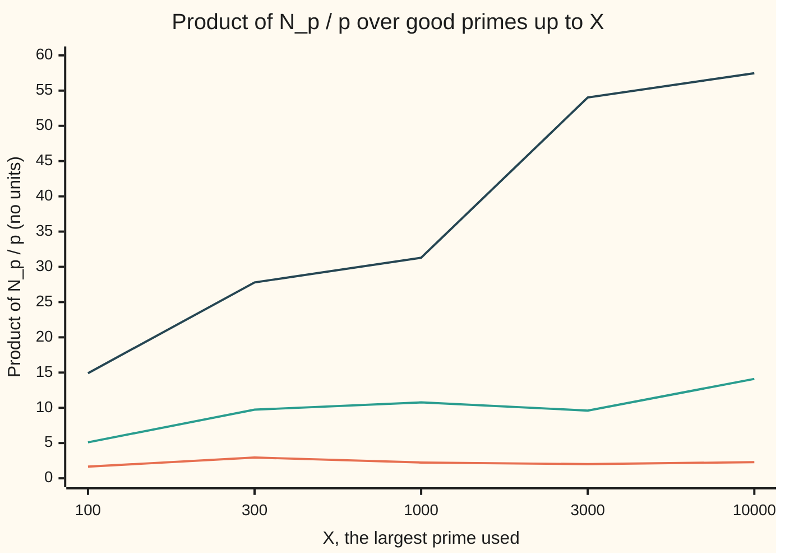

# Birch-Swinnerton-Dyer: a curve's rank read off its L-function

[Syllabus](../../../SYLLABUS.md) → [Algebraic and analytic number theory](../README.md) → [Diophantine and Modular](../README.md#s07) → Birch-Swinnerton-Dyer

---

## General Overview

The 3-4-5 triangle has a square corner and area 6: half of 3 times 4. So 6 is the area of a right triangle whose sides are whole numbers.

Now allow fractions. A whole number is a **congruent number** when it is the area of a right triangle whose three sides are all fractions. The word is old (from Latin *congruum*) and has nothing to do with the ≡ of wing 02. 6 is congruent, through 3-4-5. 5 is congruent, through the sides 3/2, 20/3 and 41/6. Fermat proved that 1 is not.

Which numbers are congruent? A search can prove a yes, by finding a triangle. It can never prove a no. And some triangles are huge: the one the code checks for 23 has a long side of 905141617/72306780.

The way in is a curve. For each $`n`$ there is a cubic curve $`E_n`$, and $`n`$ is congruent exactly when that curve has infinitely many points with fraction coordinates. The Birch and Swinnerton-Dyer conjecture (BSD) says that "how many" can be read off a function built from counting the curve's points modulo primes. Tunnell turned that function into a count of whole solutions to $`2x^2 + y^2 + 8z^2 = n`$, which anyone can do by hand.

**A whole number n is the area of a rational right triangle exactly when the curve y² = x³ − n²x has rank at least 1, and the Birch and Swinnerton-Dyer conjecture says the rank is the order to which the curve's L-function vanishes at s = 1; for 6 that order is 1, and the 3-4-5 triangle supplies the point.**

**What kind of fact this is:** the general statement is a conjecture, unproved as of 2026-11-15. It is proved when the L-function vanishes to order 0 or 1 (Coates and Wiles 1977 for these curves, then Gross, Zagier and Kolyvagin by 1990). "6 is congruent" is proved on this card by the triangle. Tunnell's test is proved in the "no" direction; its "yes" direction rests on BSD.

### The picture: two roads to a verdict



For 6, both roads end at "congruent". For 1, 2 and 3 the right-hand road proves "not congruent".

---

## The formula

**The curve.** For a whole number $`n`$, let $`E_n`$ be the curve $`y^2 = x^3 - n^2 x`$. For $`n = 6`$ it is $`y^2 = x^3 - 36x`$. Its rational points, together with the zero point $`O`$, form the group $`E_n(\mathbb{Q})`$ of [Rational points on a cubic](05-elliptic-curves-over-q-and-mordell-weil.md). The **rank** $`r`$ is the number of independent points that never return to $`O`$.

**Counting mod p.** For a prime $`p`$, let $`N_p`$ be the number of solutions of the curve's equation with $`x`$ and $`y`$ taken mod $`p`$, plus 1 for $`O`$. Define

```math
a_p = p + 1 - N_p
```

**Hasse's bound** says $`\lvert a_p\rvert \le 2\sqrt{p}`$: the count stays near $`p + 1`$. Both are taught in the algebraic-geometry wing, on [The curve mod p](../../22-Algebraic%20geometry/04-Elliptic%20Curves/05-reduction-mod-p-and-hasse.md) and [The L-function](../../22-Algebraic%20geometry/04-Elliptic%20Curves/07-l-functions-of-elliptic-curves.md). For $`E_6`$ at $`p = 5`$: $`N_5 = 8`$, so $`a_5 = -2`$, and $`a_5^2 = 4 \le 4 \cdot 5 = 20`$.

**The L-function.** Glue the counts into one function of a variable $`s`$:

```math
L(E_n, s) = \prod_{p \nmid 2n} \frac{1}{1 - a_p\, p^{-s} + p^{1 - 2s}}
```

The product runs over primes $`p`$ not dividing $`2n`$, the **good** primes. At the bad primes the factor is 1 for these curves. The product converges absolutely for $`s`$ above 3/2; whether it converges at $`s = 1`$ is unknown. [Modularity](08-modularity-and-the-proof-of-fermat.md) extends $`L(E_n, s)`$ to every $`s`$, including $`s = 1`$.

**The conjecture, weak form.**

```math
\mathrm{rank}\, E(\mathbb{Q}) = \mathrm{ord}_{s=1}\, L(E, s)
```

**Read it aloud:** the number of independent rational points equals the order to which the L-function vanishes at s equals 1. That order, $`\mathrm{ord}_{s=1}`$, is the **analytic rank**: 0 if $`L(E, 1) \ne 0`$, 1 if $`L(E, 1) = 0`$ but its slope $`L'(E, 1) \ne 0`$, and so on.

**Tunnell's test.** For square-free odd $`n`$ (no square above 1 divides it), count whole solutions:

```math
A_n = \#\{2x^2 + y^2 + 8z^2 = n\}, \qquad B_n = \#\{2x^2 + y^2 + 32z^2 = n\}
```

If $`n`$ is congruent, then $`A_n = 2B_n`$. If BSD holds for $`E_n`$, the converse holds too. For even $`n`$, use $`4x^2`$ in place of $`2x^2`$ and $`n/2`$ in place of $`n`$. For $`n = 6`$: $`4x^2 + y^2 + 8z^2 = 3`$ has no solution, nor does the 32 version, and 0 = 2 × 0.

| Symbol | Plain meaning | In our example | Push it up and the answer… |
| --- | --- | --- | --- |
| $`n`$ | the candidate area, square-free | 6 | — |
| $`E_n`$; $`O`$ | the curve $`y^2 = x^3 - n^2 x`$; its zero point | $`y^2 = x^3 - 36x`$ | — |
| $`a`$, $`b`$, $`c`$; $`u`$, $`v`$ | legs and long side; Pythagorean seeds | 3, 4, 5; seeds 2 and 1 | — |
| $`x`$, $`y`$; $`P`$; $`t`$ | coordinates; a point; $`x/n`$, in the twist of Step 2 | $`P = (25/4, 35/8)`$ | $`2P`$ has 7-digit fractions |
| $`r`$ | rank: independent points of infinite order | 1 | more triangles of area $`n`$ |
| $`p`$; $`N_p`$; $`X`$ | a prime; points mod $`p`$, with $`O`$; the largest prime used | $`N_5 = 8`$; $`X`$ up to 10,000 | — |
| $`a_p`$; $`a_k`$ | $`p + 1 - N_p`$; its extension to every whole $`k`$ | $`a_5 = -2`$, $`a_{13} = -6`$ | fewer points mod $`p`$, larger $`L(E, 1)`$ |
| $`s`$; $`L(E_n, s)`$; $`\mathrm{ord}_{s=1}`$ | the variable; the L-function; its order of vanishing at 1 | $`L(E_6, 1) = 0`$, order 1 | predicted rank goes up |
| $`N`$ | the conductor, a number built from the bad primes that sets the scale of the mirror rule: $`32n^2`$ for odd $`n`$, $`16n^2`$ for even | 576 | more terms needed |
| $`w`$ | the sign in the functional equation, ±1 | −1 | — |
| $`A_n`$, $`B_n`$ | Tunnell's counts | 0 and 0 | — |
| $`\Omega`$; $`\Gamma(0, z)`$ | the period of $`E_1`$, the integral of $`1/\sqrt{x^3 - x}`$ from 1 to infinity; the tail integral in the fold | 2.622057554292 | — |

### When it holds

- **Square-free n.** Tunnell's counts assume it. For 24 = 4 × 6 they come out 8 and 0, "not congruent", yet the 6-8-10 triangle has area 24.
- **An elliptic curve over the rationals.** The curve must have no cusp or self-crossing. Without modularity, $`L(E, s)`$ is not even defined at $`s = 1`$.
- **Good primes only in the product.** At $`p = 3`$, $`E_6`$ becomes $`y^2 = x^3`$ mod 3, which has a cusp. The good-prime factor is wrong there.
- **The sign decides parity, not the order.** $`w = -1`$ forces $`L(E, 1) = 0`$. $`w = +1`$ allows it: 34 has $`w = +1`$, yet $`L(E_{34}, 1) = 0`$ and 34 is congruent.
- **Balanced counts are not a proof.** $`A_n = 2B_n`$ proves "congruent" only with BSD, or with a point, or with $`L'(E_n, 1) \ne 0`$.

---

## Why it works

### Step 0: an area is three squares spaced n apart

Take legs $`a`$, $`b`$, long side $`c`$, and area $`n = ab/2`$. Then $`(a + b)^2 = c^2 + 4n`$ and $`(a - b)^2 = c^2 - 4n`$. Divide by 4:

```math
\left(\tfrac{c}{2}\right)^2 - n, \qquad \left(\tfrac{c}{2}\right)^2, \qquad \left(\tfrac{c}{2}\right)^2 + n \quad \text{are all squares}
```

For 3-4-5 and $`n = 6`$, with $`x = 25/4`$: the three numbers are 1/4, 25/4 and 49/4, the squares of 1/2, 5/2 and 7/2.

Multiply the three: $`(x - n)\,x\,(x + n) = x^3 - n^2 x`$. A product of squares is a square, so it equals some $`y^2`$. Here $`y^2 = 1225/64`$ and $`y = 35/8`$. That puts $`P = (25/4, 35/8)`$ on $`E_6`$.

The road runs back too. The tangent at $`P`$ gives $`2P`$ with $`x = 1442401/19600 = (1201/140)^2`$. Reading off the three squares gives a new triangle: legs 7/10 and 120/7, long side 1201/70, area 6. The general triangle-to-point map belongs to [What curves answer](../../22-Algebraic%20geometry/04-Elliptic%20Curves/10-modularity-and-the-congruent-number-problem.md).

[Pythagorean triples](../../02-Number%20theory/07-For%20the%20Curious/01-pythagorean-triples.md) builds every whole-number right triangle from two seeds $`u > v`$. Its area is $`uv(u - v)(u + v)`$. Remove square factors and the result is congruent: seeds 2 and 1 give area 6.

### Step 1: congruent means rank at least 1

The points with $`y = 0`$ are $`O`$, $`(0, 0)`$ and $`(\pm n, 0)`$. They are torsion: each doubles to $`O`$. For every $`n`$ they are the whole torsion part (Koblitz, chapter I, by counting points mod primes as on [Rational points on a cubic](05-elliptic-curves-over-q-and-mordell-weil.md)).

So a point with $`y \ne 0`$ has infinite order, and the rank is at least 1. $`P = (25/4, 35/8)`$ also fails the Nagell–Lutz test (torsion points have whole coordinates), a second reason. The converse holds as well: a point with $`y \ne 0`$ gives a triangle. So:

```math
n \text{ is congruent} \iff \mathrm{rank}\, E_n(\mathbb{Q}) \ge 1
```

For $`n = 1`$, [Rational points on a cubic](05-elliptic-curves-over-q-and-mordell-weil.md) proves rank 0 by Fermat's descent. That is "1 is not congruent".

### Step 2: counting mod p

$`N_p`$ is a finite count, done by trying every pair $`(x, y)`$ mod $`p`$. A full count is a proof for that prime. For $`E_6`$:

| p | 5 | 7 | 11 | 13 | 17 | 19 | 23 | 29 | 31 | 37 |
| --- | --- | --- | --- | --- | --- | --- | --- | --- | --- | --- |
| $`N_p`$ | 8 | 8 | 12 | 20 | 20 | 20 | 24 | 40 | 32 | 36 |
| $`a_p`$ | −2 | 0 | 0 | −6 | −2 | 0 | 0 | −10 | 0 | 2 |

Each $`a_p^2 \le 4p`$, as Hasse's bound says. Every prime with $`p`$ ≡ 3 mod 4 gives $`a_p = 0`$, a pattern special to these curves.

A second road to the same table: put $`x = nt`$. Then $`x^3 - n^2 x = n^3(t^3 - t)`$, so $`E_n`$ is $`E_1`$ with every value multiplied by $`n^3`$. Mod $`p`$ that flips each square test by the Legendre symbol $`(n/p)`$ (+1 if $`n`$ is a square mod $`p`$, −1 if not), so $`a_p(E_n) = (n/p)\, a_p(E_1)`$.

### Step 3: many points mod p hint at many rational points

At $`s = 1`$, each Euler factor is $`1/(1 - a_p/p + 1/p) = p/N_p`$. So, read naively, $`L(E, 1)`$ looks like the reciprocal of $`\prod N_p/p`$. That is a heuristic only, as the end of this step explains.

Birch and Swinnerton-Dyer's idea, from computer runs in the early 1960s: a curve with many rational points has them mod every $`p`$ too. Then $`N_p`$ tends to exceed $`p`$, the product $`\prod N_p/p`$ grows, and $`L`$ at 1 is pushed to 0. They saw the product grow like a power of $`\log X`$, the power being the rank.



The lowest line is $`E_1`$ (rank 0): it hovers near 2. The middle line is $`E_6`$ (rank 1): it climbs. The top line is $`E_{34}`$, whose L-function vanishes to even order at least 2: it climbs fastest. This is evidence, not proof: nobody knows whether the product converges at $`s = 1`$. Goldfeld (1982) proved that if it does, for a rank-0 curve, the limit is $`\sqrt{2}/L(E, 1)`$, not $`1/L(E, 1)`$. For $`E_1`$ that is 2.1574 against 1.5255, and the bottom line ends at 2.29, nearer the first.

### Step 4: the sign forces a zero

Modularity gives $`L(E, s)`$ a functional equation: a mirror rule linking $`s`$ and $`2 - s`$, with a sign $`w = \pm 1`$. Its scale is set by the curve's **conductor** $`N`$, a number built from the bad primes: 576 for $`E_6`$. (This is not the conductor of a character.) If $`w = -1`$, then $`L(E, 1) = -L(E, 1)`$, so $`L(E, 1) = 0`$ and the order is odd.

For $`E_n`$ with square-free $`n`$, $`w = +1`$ when $`n`$ ≡ 1, 2 or 3 mod 8, and $`w = -1`$ when $`n`$ ≡ 5, 6 or 7 mod 8 (Koblitz, in the Sources). The code does not assume this rule: it finds $`w`$ by testing the mirror rule numerically, and gets $`-1.000000000`$ for 6.

The same equation gives a fast series. With $`a_k`$ built from the $`a_p`$ by multiplying,

```math
L(E, 1) = (1 + w) \sum_{k \ge 1} \frac{a_k}{k}\, e^{-2\pi k/\sqrt{N}}
```

So BSD predicts that every square-free $`n`$ ≡ 5, 6 or 7 mod 8 is congruent. That is open in general as of 2026-11-15. The best proved results cover special families: for example, every prime ≡ 5 or 7 mod 8 is congruent (Heegner's method of 1952, carried through by Monsky in 1990).

### Step 5: Tunnell's counts are the L-value

Tunnell (1983) proved that $`L(E_n, 1)`$ is a fixed positive number times $`(A_n - 2B_n)^2`$. The code checks the number: $`\Omega / (16\sqrt{n})`$ for odd $`n`$, and $`\Omega / (8\sqrt{n})`$ for even $`n`$ with the even-case counts. It matches to six decimals for every square-free $`n`$ up to 23.

Chain the proved pieces:

1. $`n`$ congruent gives rank at least 1 (Step 1).
2. Coates and Wiles (1977): for these curves, $`L(E_n, 1) \ne 0`$ forces rank 0. So rank at least 1 gives $`L(E_n, 1) = 0`$.
3. Tunnell's formula turns $`L(E_n, 1) = 0`$ into $`A_n = 2B_n`$.

Read backwards, unbalanced counts prove "not congruent", with no conjecture. Balanced counts give $`L(E_n, 1) = 0`$; BSD then gives rank at least 1, and so a triangle.

<details>
<summary>Where proof ends: the rank 1 case without BSD</summary>

Gross and Zagier (1986) showed that when $`L(E, 1) = 0`$ and $`L'(E, 1) \ne 0`$, a specific point built from the curve's modular parametrisation, a Heegner point, has infinite order. So the rank is at least 1. Kolyvagin (1988 to 1990), with a non-vanishing theorem of Bump, Friedberg and Hoffstein (1990), showed the rank is then exactly 1.

For $`E_6`$ the code computes, with $`\Gamma(0, z) = \int_z^\infty e^{-t}/t \, dt`$ (an incomplete gamma integral),

$`\displaystyle L'(E_6, 1) = 2 \sum_{k \ge 1} \frac{a_k}{k} \Gamma\!\left(0, \frac{2\pi k}{24}\right) = 1.9024600490,`$

which is far from 0. So 6 would be proved congruent even with no triangle in hand. A rigorous version adds a bound on the tail of the sum; past the code's 2,000 terms it is far below the printed digits.

For analytic rank 2 or more, nothing is proved. For 34 the computed $`L(E_{34}, 1)`$ is 0 to ten places, and a point, $`(-16, 120)`$, settles that 34 is congruent. Its rank is 2, found by a separate descent (LMFDB, curve 18496.j3, which also lists analytic rank 2), but no theorem links rank and order of vanishing beyond order 1.

</details>

### Step 6: the strong form, in one sentence

The strong form predicts the leading coefficient too: $`L'(E, 1)`$, for rank 1, equals the period times the regulator (the size of the generators) times the Tamagawa factor (a product of local factors, one per bad prime) times the order of the Tate–Shafarevich group, Sha (the fake solutions of [Rational points on a cubic](05-elliptic-curves-over-q-and-mordell-weil.md)), divided by the torsion count squared. For $`E_6`$, the table's period 2.140901028075231, regulator 0.888625874839619, Tamagawa factor 16, analytic order of Sha 1 and torsion 4 give 1.9024600490, the computed value. The table's period counts both real pieces of the curve, so it is $`2\Omega/\sqrt{6}`$, which the code recomputes as 2.140901028075. Its order of Sha is the analytic one: the value the formula itself predicts, rounded. [Birch and Swinnerton-Dyer](../../22-Algebraic%20geometry/04-Elliptic%20Curves/08-birch-and-swinnerton-dyer-statement.md), in the algebraic-geometry wing, owns these terms.

---

## Worked numbers, by hand

| Step | Arithmetic | Value |
| --- | --- | --- |
| the triangle | 3, 4, 5; half of 3 × 4 | area 6 |
| half the long side, squared | $`(5/2)^2`$ | $`x = 25/4`$ |
| three squares | $`25/4 - 6`$, $`25/4`$, $`25/4 + 6`$ | 1/4, 25/4, 49/4 |
| their product | $`(1/4)(25/4)(49/4)`$ | 1225/64 = $`(35/8)^2`$ |
| the point | on $`y^2 = x^3 - 36x`$ | $`P = (25/4, 35/8)`$ |
| torsion? | $`y \ne 0`$, not whole | infinite order: rank ≥ 1 |
| one count mod 5 | 8 points, so $`a_5 = 5 + 1 - 8`$ | −2; $`4 \le 20`$ |
| the sign | 6 ≡ 6 mod 8 | $`w = -1`$: $`L(E_6, 1) = 0`$ |
| the slope | the series in the fold | $`L'(E_6, 1) = 1.9024600490`$ |
| Tunnell, even case | $`4x^2 + y^2 + 8z^2 = 3`$ and the 32 version | 0 and 0: balanced |
| **the answer** | | **6 is congruent; rank 1 = analytic rank 1** |

Every road agrees: the curve for area 6 has rank 1, and its L-function vanishes to order exactly 1, as BSD says.

### What breaks if you drop a piece

| Mistake | Comes out at | What went wrong |
| --- | --- | --- |
| Decide by n mod 8 alone | 34 ≡ 2 mod 8 called "not congruent"; yet counts 8 = 2 × 4, $`L(E_{34}, 1) = 0`$, point $`(-16, 120)`$ | $`w = +1`$ allows an even order 2 |
| Run Tunnell on 24 = 4 × 6 | counts 8 and 0: "not congruent" | not square-free; 6-8-10 has area 24 |
| Forget the sign in the series | $`L(E_6, 1)`$ = 1.2893431325, not 0 | the series holds only with the factor $`1 + w`$ |

The code prints all three.

---

## Code, from first principles, and it actually runs

Both programs use exact fractions for points, count points mod $`p`$ by trying every pair, and compute L-values from those counts. They take **five roads**. Road 1 turns the 3-4-5 triangle into a point, doubles it, and reads a new triangle back. Road 2 counts $`E_6`$ mod $`p`$ by brute force and by the twist rule. Road 3 builds the growing product of the chart. Road 4 finds the sign $`w`$ from the functional equation and sums the L-series, computes the period two ways, and sets Goldfeld's limit for $`E_1`$ beside the end of the chart. Road 5 runs Tunnell's counts, and for every square-free $`n`$ up to 23 makes three verdicts agree: the counts, the sign, and a triangle from Pythagorean seeds up to 400 (or, for 23, a quoted triangle checked exactly). The period and regulator for the strong form are quoted from the LMFDB table, labelled so; the period is also recomputed from $`\Omega`$.

### Python

```python
# Birch-Swinnerton-Dyer and the congruent number problem -- the check behind the card.
# Standard library only.  Fraction is exact fractions; every point count, L-value, period and
# Tunnell count is computed here.  E_n is the curve y^2 = x^3 - n^2 x; E_6 belongs to area 6.
from fractions import Fraction as F
from math import gcd, isqrt, sqrt, exp, log, pi, sin

def sq(r): return r >= 0 and isqrt(r.numerator) ** 2 == r.numerator and isqrt(r.denominator) ** 2 == r.denominator
def root(r): return F(isqrt(r.numerator), isqrt(r.denominator))
def on(n, x, y): return y * y == x ** 3 - n * n * x

# Road 1: the 3-4-5 triangle gives three squares spaced 6 apart, and so a point on E_6
a, b, c, n = 3, 4, 5, 6
x = F(c * c, 4)
print(f"triangle {a}, {b}, {c}: area {a * b // 2}; x - 6, x, x + 6 = {x - 6}, {x}, {x + 6}")
print(f"roots: {root(x - 6)}, {root(x)}, {root(x + 6)}; product {(x - 6) * x * (x + 6)} = y^2")
y = root((x - 6) * x * (x + 6))
print(f"point P = ({x}, {y}) on y^2 = x^3 - 36x: {'yes' if on(6, x, y) else 'no'}; not whole, so infinite order")
assert (x, y) == (F(25, 4), F(35, 8)) and on(6, x, y) and y.denominator > 1
m = (3 * x * x - 36) / (2 * y); x2 = m * m - 2 * x; y2 = m * (x - x2) - y      # tangent at P
h, s, d = root(x2), root(x2 + 6), root(x2 - 6)                       # read a triangle back
print(f"2P = ({x2}, {y2}); triangle back: legs {s - d}, {s + d}, long side {2 * h}, area {(s - d) * (s + d) / 2}")
assert on(6, x2, y2) and (s - d) ** 2 + (s + d) ** 2 == (2 * h) ** 2 and (s - d) * (s + d) / 2 == 6

# Road 2: count points mod p by brute force, and by the twist rule a_p(E_n) = (n/p) a_p(E_1)
def leg(v, p):
    v %= p
    return 0 if v == 0 else (1 if pow(v, (p - 1) // 2, p) == 1 else -1)
X = 10000
sieve = bytearray([1]) * (X + 1)
for i in range(2, 101):
    if sieve[i]: sieve[i * i::i] = bytearray(len(sieve[i * i::i]))
P = [p for p in range(3, X + 1) if sieve[p]]
a1 = {p: -sum(leg(t * t * t - t, p) for t in range(p)) for p in P}   # a_p of y^2 = x^3 - x
def ap(n, p): return 0 if n % p == 0 else leg(n, p) * a1[p]
rows = []
for p in (5, 7, 11, 13, 17, 19, 23, 29, 31, 37):
    Np = 1 + sum((v * v - u ** 3 + 36 * u) % p == 0 for u in range(p) for v in range(p))
    rows.append(f"{p}:{Np}/{p + 1 - Np}")
    assert p + 1 - Np == ap(6, p) and (p + 1 - Np) ** 2 <= 4 * p and (p % 4 == 1 or Np == p + 1)
print("E_6 mod p, p:N_p/a_p (brute force = twist rule; Hasse |a_p| <= 2 sqrt p holds):", ", ".join(rows))

# Road 3: the Euler product prod N_p/p that Birch and Swinnerton-Dyer watched grow
for n in (1, 6, 34):
    prod, out, marks = 1.0, [], [100, 300, 1000, 3000, 10000]
    for p in P:
        if n % p == 0: continue
        while marks and p > marks[0]: out.append(f"{prod:.2f}"); marks.pop(0)
        prod *= (p + 1 - ap(n, p)) / p
    print(f"chart n = {n}: prod N_p/p for p up to 100, 300, 1000, 3000, 10000:", ", ".join(out + [f"{prod:.2f}"]))
    if n == 1: end1 = prod                                       # E_1's product at 10000

# Road 4: the L-function at s = 1 from a_m, with its sign found from the functional equation
def coeffs(n, M):
    am = [0, 1] + [0] * (M - 1)
    for k in range(2, M + 1):
        p = next(q for q in [2] + P if k % q == 0)
        e, r = 0, k
        while r % p == 0: r //= p; e += 1
        pk = [1, 0 if (2 * n) % p == 0 else ap(n, p)]
        for _ in range(e - 1): pk.append(pk[-1] * pk[1] - (0 if (2 * n) % p == 0 else p) * pk[-2])
        am[k] = pk[e] * am[r]
    return am
def E1(z):                                   # exponential integral: series below 1, continued fraction above
    if z < 1: return -0.5772156649015329 - log(z) - sum((-z) ** k / (k * fact(k)) for k in range(1, 40))
    bb, cc, dd = z + 1, 1e300, 1 / (z + 1); hh = dd
    for i in range(1, 200):
        an = -i * i; bb += 2; dd = 1 / (an * dd + bb); cc = bb + an / cc; hh *= cc * dd
    return hh * exp(-z)
def fact(k): return 1 if k < 2 else k * fact(k - 1)
def lvals(n, M=2000):
    N = 32 * n * n if n % 2 else 16 * n * n
    am = coeffs(n, M)
    f = lambda t: sum(am[k] * exp(-2 * pi * k * t) for k in range(1, M + 1))
    t = 1.2 / sqrt(N); w = f(1 / (N * t)) / (N * t * t * f(t))
    L = 2 * sum(am[k] / k * exp(-2 * pi * k / sqrt(N)) for k in range(1, M + 1))
    dL = 2 * sum(am[k] / k * E1(2 * pi * k / sqrt(N)) for k in range(1, M + 1))
    return N, w, (L if w > 0 else 0.0), (dL if w < 0 else 0.0), L
def agm(u, v):
    for _ in range(30): u, v = (u + v) / 2, sqrt(u * v)
    return u
om = pi / agm(1, sqrt(2)); K = 2000                               # period of E_1, two ways
om2 = 2 * (pi / 2 / K / 3) * sum((1 if j in (0, K) else 4 if j % 2 else 2) / sqrt(1 + sin(j * pi / 2 / K) ** 2) for j in range(K + 1))
print(f"period of y^2 = x^3 - x: by AGM {om:.12f}, by Simpson {om2:.12f}; doubled over sqrt 6, for E_6: {2 * om / sqrt(6):.12f}")
assert abs(om - om2) < 1e-12
L1 = lvals(1)[2]                                     # rank 0: Goldfeld's limit, if the product converges at s = 1
print(f"n = 1: sqrt 2 / L(E_1, 1) = {sqrt(2) / L1:.4f}, 1 / L(E_1, 1) = {1 / L1:.4f}; chart ends at {end1:.2f}")
assert abs(end1 - sqrt(2) / L1) < abs(end1 - 1 / L1)

# Road 5: Tunnell's counts of whole solutions; the test says 'congruent' when the first is twice the second
def tunnell(n):
    k, q = (n, 2) if n % 2 else (n // 2, 4)
    r = isqrt(k) + 1
    cnt = lambda c: sum(q * u * u + v * v + c * z * z == k for u in range(-r, r + 1) for v in range(-r, r + 1) for z in range(-r, r + 1))
    return cnt(8), cnt(32)
sf = list(range(1201))                                            # square-free parts
for dd in range(2, 35):
    for k in range(dd * dd, 1201, dd * dd):
        while sf[k] % (dd * dd) == 0: sf[k] //= dd * dd
seeds = {}
for mm in range(2, 401):
    for kk in range(1, mm):
        if (mm - kk) % 2 and gcd(mm, kk) == 1:
            seeds.setdefault(sf[mm] * sf[kk] * sf[mm - kk] * sf[mm + kk], (mm, kk))
print("n | n mod 8 | counts | sign | L(E_n, 1) | scaled L | verdict | witness")
for n in [k for k in range(1, 24) if all(k % (j * j) for j in range(2, 7))]:
    A, B = tunnell(n)
    N, w, L, dL, _ = lvals(n)
    scaled = (16 if n % 2 else 8) * sqrt(n) * L / om
    wit = f"seeds {seeds[n]}" if n in seeds else ("23 triangle below" if n == 23 else "-")
    print(f"{n:2d} | {n % 8} | {A}, {B} | {'+' if w > 0 else '-'} | {L:.10f} | {scaled:.6f} | "
          f"{'congruent' if A == 2 * B else 'not congruent'} | {wit}")
    assert abs(abs(w) - 1) < 1e-9 and abs(scaled - (A - 2 * B) ** 2) < 1e-6   # L matches Tunnell
    assert (A == 2 * B) == (w < 0) == (n in seeds or n == 23)                # three roads agree
a23, b23, c23, D = 80155 * 3485, 41496 * 20748, 905141617, 72306780       # sides over D
print(f"23 triangle: {80155}/{20748}, {41496}/{3485}, {c23}/{D}; Pythagoras {'yes' if a23 ** 2 + b23 ** 2 == c23 ** 2 else 'no'}; "
      f"area {F(80155 * 41496, 2 * 20748 * 3485)}")
assert a23 ** 2 + b23 ** 2 == c23 ** 2 and 80155 * 41496 == 46 * 20748 * 3485
N, w, L, dL, _ = lvals(6)
print(f"E_6: conductor {N}, sign {w:+.9f}, L(E_6, 1) = 0 forced, L'(E_6, 1) = {dL:.10f}: analytic rank 1")
assert w < 0 and dL > 0.5
per, reg = 2.140901028075231, 0.888625874839619          # quoted from the LMFDB table, curve 576.c3
strong = per * reg * 16 / 4 ** 2                               # period x regulator x Tamagawa 16 / torsion 4 squared
print(f"strong form, table's period {per}, regulator {reg}, Tamagawa factor 16, analytic Sha 1, torsion 4: {strong:.10f}")
assert abs(strong - dL) < 1e-9 and abs(2 * om / sqrt(6) - per) < 1e-12        # the quoted period, recomputed

# What breaks
N, w, L, _, wrong = lvals(6)
print(f"sign forgotten for n = 6: the + formula gives {wrong:.10f}, not 0")
N, w, L, _, _ = lvals(34)
print(f"n = 34 is 2 mod 8, yet sign {w:+.0f}, L(E_34, 1) = {abs(L):.10f}, counts {tunnell(34)}, point (-16, 120) on E_34: "
      f"{'yes' if on(34, F(-16), F(120)) else 'no'}")
print(f"n = 24, not square-free: counts {tunnell(24)} say 'not congruent', yet 6, 8, 10 has area 24")
assert abs(L) < 1e-9 and w > 0 and tunnell(24) == (8, 0) and abs(wrong - 1.2893431325) < 1e-9
print("ALL CHECKS PASS")
```

**Ran 2026-11-15 on macOS, Python 3.14.10, standard library only. All checks passed. Output, pasted from the run:**

```
triangle 3, 4, 5: area 6; x - 6, x, x + 6 = 1/4, 25/4, 49/4
roots: 1/2, 5/2, 7/2; product 1225/64 = y^2
point P = (25/4, 35/8) on y^2 = x^3 - 36x: yes; not whole, so infinite order
2P = (1442401/19600, -1726556399/2744000); triangle back: legs 7/10, 120/7, long side 1201/70, area 6
E_6 mod p, p:N_p/a_p (brute force = twist rule; Hasse |a_p| <= 2 sqrt p holds): 5:8/-2, 7:8/0, 11:12/0, 13:20/-6, 17:20/-2, 19:20/0, 23:24/0, 29:40/-10, 31:32/0, 37:36/2
chart n = 1: prod N_p/p for p up to 100, 300, 1000, 3000, 10000: 1.65, 2.95, 2.24, 2.01, 2.29
chart n = 6: prod N_p/p for p up to 100, 300, 1000, 3000, 10000: 5.10, 9.74, 10.77, 9.61, 14.10
chart n = 34: prod N_p/p for p up to 100, 300, 1000, 3000, 10000: 14.91, 27.79, 31.29, 54.02, 57.47
period of y^2 = x^3 - x: by AGM 2.622057554292, by Simpson 2.622057554292; doubled over sqrt 6, for E_6: 2.140901028075
n = 1: sqrt 2 / L(E_1, 1) = 2.1574, 1 / L(E_1, 1) = 1.5255; chart ends at 2.29
n | n mod 8 | counts | sign | L(E_n, 1) | scaled L | verdict | witness
 1 | 1 | 2, 2 | + | 0.6555143886 | 4.000000 | not congruent | -
 2 | 2 | 2, 2 | + | 0.9270373387 | 4.000000 | not congruent | -
 3 | 3 | 4, 4 | + | 1.5138456348 | 16.000000 | not congruent | -
 5 | 5 | 0, 0 | - | 0.0000000000 | 0.000000 | congruent | seeds (5, 4)
 6 | 6 | 0, 0 | - | 0.0000000000 | 0.000000 | congruent | seeds (2, 1)
 7 | 7 | 0, 0 | - | 0.0000000000 | 0.000000 | congruent | seeds (16, 9)
10 | 2 | 4, 4 | + | 1.6583348055 | 16.000000 | not congruent | -
11 | 3 | 12, 4 | + | 0.7905800988 | 16.000000 | not congruent | -
13 | 5 | 0, 0 | - | 0.0000000000 | 0.000000 | congruent | seeds (325, 36)
14 | 6 | 0, 0 | - | 0.0000000000 | 0.000000 | congruent | seeds (8, 1)
15 | 7 | 0, 0 | - | 0.0000000000 | 0.000000 | congruent | seeds (4, 1)
17 | 1 | 16, 4 | + | 2.5437694712 | 64.000000 | not congruent | -
19 | 3 | 12, 4 | + | 0.6015412581 | 16.000000 | not congruent | -
21 | 5 | 0, 0 | - | 0.0000000000 | 0.000000 | congruent | seeds (4, 3)
22 | 6 | 0, 0 | - | 0.0000000000 | 0.000000 | congruent | seeds (50, 49)
23 | 7 | 0, 0 | - | 0.0000000000 | 0.000000 | congruent | 23 triangle below
23 triangle: 80155/20748, 41496/3485, 905141617/72306780; Pythagoras yes; area 23
E_6: conductor 576, sign -1.000000000, L(E_6, 1) = 0 forced, L'(E_6, 1) = 1.9024600490: analytic rank 1
strong form, table's period 2.140901028075231, regulator 0.888625874839619, Tamagawa factor 16, analytic Sha 1, torsion 4: 1.9024600490
sign forgotten for n = 6: the + formula gives 1.2893431325, not 0
n = 34 is 2 mod 8, yet sign +1, L(E_34, 1) = 0.0000000000, counts (8, 4), point (-16, 120) on E_34: yes
n = 24, not square-free: counts (8, 0) say 'not congruent', yet 6, 8, 10 has area 24
ALL CHECKS PASS
```

### Rust

Same numbers, same labels, built with `rustc --edition 2021 -O`.

```rust
// Birch-Swinnerton-Dyer and the congruent number problem -- the same check as the Python, in Rust.
// No crates.  A small exact-fraction struct stands in for Fraction; every point count, L-value,
// period and Tunnell count is computed here.  E_n is the curve y^2 = x^3 - n^2 x.
use std::collections::HashMap;
use std::f64::consts::PI;
#[derive(Clone, Copy, PartialEq, Debug)]
struct Q { n: i128, d: i128 }
fn g(a: i128, b: i128) -> i128 { if b == 0 { a.abs() } else { g(b, a % b) } }
fn q(n: i128, d: i128) -> Q { let k = g(n, d) * d.signum(); Q { n: n / k, d: d / k } }
fn add(a: Q, b: Q) -> Q { q(a.n.checked_mul(b.d).unwrap().checked_add(b.n.checked_mul(a.d).unwrap()).unwrap(), a.d.checked_mul(b.d).unwrap()) }
fn sub(a: Q, b: Q) -> Q { add(a, Q { n: -b.n, d: b.d }) }
fn mul(a: Q, b: Q) -> Q { q(a.n.checked_mul(b.n).unwrap(), a.d.checked_mul(b.d).unwrap()) }
fn div(a: Q, b: Q) -> Q { q(a.n.checked_mul(b.d).unwrap(), a.d.checked_mul(b.n).unwrap()) }
fn w(k: i128) -> Q { Q { n: k, d: 1 } }
fn isq(v: i128) -> i128 { let mut r = (v as f64).sqrt() as i128; while r * r > v { r -= 1 } while (r + 1) * (r + 1) <= v { r += 1 } r }
fn root(r: Q) -> Q { q(isq(r.n), isq(r.d)) }
fn show(r: Q) -> String { if r.d == 1 { format!("{}", r.n) } else { format!("{}/{}", r.n, r.d) } }
fn on(n: i128, x: Q, y: Q) -> bool { mul(y, y) == sub(mul(mul(x, x), x), mul(w(n * n), x)) }
fn yn(b: bool) -> &'static str { if b { "yes" } else { "no" } }
fn mpow(mut b: u64, mut e: u64, m: u64) -> u64 { let mut r = 1; b %= m; while e > 0 { if e & 1 == 1 { r = r * b % m } b = b * b % m; e >>= 1 } r }
fn leg(v: i64, p: i64) -> i64 { let v = v.rem_euclid(p); if v == 0 { 0 } else if mpow(v as u64, (p as u64 - 1) / 2, p as u64) == 1 { 1 } else { -1 } }
fn fact(k: i32) -> f64 { if k < 2 { 1.0 } else { k as f64 * fact(k - 1) } }
fn e1(z: f64) -> f64 {
    if z < 1.0 { return -0.5772156649015329 - z.ln() - (1..40).map(|k| (-z).powf(k as f64) / (k as f64 * fact(k))).sum::<f64>() }
    let (mut bb, mut cc, mut dd) = (z + 1.0, 1e300, 1.0 / (z + 1.0)); let mut hh = dd;
    for i in 1..200 { let an = -((i * i) as f64); bb += 2.0; dd = 1.0 / (an * dd + bb); cc = bb + an / cc; hh *= cc * dd }
    hh * (-z).exp()
}
struct Ctx { p: Vec<i64>, a1: HashMap<i64, i64> }
impl Ctx {
    fn ap(&self, n: i64, p: i64) -> i64 { if n % p == 0 { 0 } else { leg(n, p) * self.a1[&p] } }
    fn coeffs(&self, n: i64, m: usize) -> Vec<i64> {
        let mut am = vec![0i64; m + 1]; am[1] = 1;
        for k in 2..=m as i64 {
            let p = *std::iter::once(&2).chain(self.p.iter()).find(|&&q| k % q == 0).unwrap();
            let (mut e, mut r) = (0, k); while r % p == 0 { r /= p; e += 1 }
            let bad = (2 * n) % p == 0;
            let mut pk = vec![1, if bad { 0 } else { self.ap(n, p) }];
            for _ in 0..e - 1 { let l = pk.len(); pk.push(pk[l - 1] * pk[1] - (if bad { 0 } else { p }) * pk[l - 2]) }
            am[k as usize] = pk[e] * am[r as usize];
        }
        am
    }
    fn lvals(&self, n: i64) -> (i64, f64, f64, f64, f64) {
        let mm = 2000; let nn = if n % 2 == 1 { 32 * n * n } else { 16 * n * n }; let nf = nn as f64;
        let am = self.coeffs(n, mm);
        let f = |t: f64| (1..=mm).map(|k| am[k] as f64 * (-2.0 * PI * k as f64 * t).exp()).sum::<f64>();
        let t = 1.2 / nf.sqrt(); let wv = f(1.0 / (nf * t)) / (nf * t * t * f(t));
        let l = 2.0 * (1..=mm).map(|k| am[k] as f64 / k as f64 * (-2.0 * PI * k as f64 / nf.sqrt()).exp()).sum::<f64>();
        let dl = 2.0 * (1..=mm).map(|k| am[k] as f64 / k as f64 * e1(2.0 * PI * k as f64 / nf.sqrt())).sum::<f64>();
        (nn, wv, if wv > 0.0 { l } else { 0.0 }, if wv < 0.0 { dl } else { 0.0 }, l)
    }
}
fn tunnell(n: i64) -> (i64, i64) {
    let (k, qq) = if n % 2 == 1 { (n, 2) } else { (n / 2, 4) };
    let r = (k as f64).sqrt() as i64 + 1;
    let cnt = |c: i64| { let mut s = 0; for u in -r..=r { for v in -r..=r { for z in -r..=r { if qq * u * u + v * v + c * z * z == k { s += 1 } } } } s };
    (cnt(8), cnt(32))
}
fn main() {
    // Road 1: the 3-4-5 triangle gives three squares spaced 6 apart, and so a point on E_6
    let x = q(25, 4); let six = w(6);
    println!("triangle 3, 4, 5: area 6; x - 6, x, x + 6 = {}, {}, {}", show(sub(x, six)), show(x), show(add(x, six)));
    let prod = mul(mul(sub(x, six), x), add(x, six));
    println!("roots: {}, {}, {}; product {} = y^2", show(root(sub(x, six))), show(root(x)), show(root(add(x, six))), show(prod));
    let y = root(prod);
    println!("point P = ({}, {}) on y^2 = x^3 - 36x: {}; not whole, so infinite order", show(x), show(y), yn(on(6, x, y)));
    assert!(x == q(25, 4) && y == q(35, 8) && on(6, x, y) && y.d > 1);
    let m = div(sub(mul(w(3), mul(x, x)), w(36)), mul(w(2), y));
    let x2 = sub(mul(m, m), mul(w(2), x)); let y2 = sub(mul(m, sub(x, x2)), y);
    let (h, s, d) = (root(x2), root(add(x2, six)), root(sub(x2, six)));
    let area = div(mul(sub(s, d), add(s, d)), w(2));
    println!("2P = ({}, {}); triangle back: legs {}, {}, long side {}, area {}", show(x2), show(y2), show(sub(s, d)), show(add(s, d)), show(mul(w(2), h)), show(area));
    let (l1, l2, hy) = (sub(s, d), add(s, d), mul(w(2), h));
    assert!(on(6, x2, y2) && add(mul(l1, l1), mul(l2, l2)) == mul(hy, hy) && area == six);
    // Road 2: count points mod p by brute force, and by the twist rule a_p(E_n) = (n/p) a_p(E_1)
    let xm = 10000usize; let mut sieve = vec![true; xm + 1];
    for i in 2..101 { if sieve[i] { let mut j = i * i; while j <= xm { sieve[j] = false; j += i } } }
    let p: Vec<i64> = (3..=xm).filter(|&i| sieve[i]).map(|i| i as i64).collect();
    let a1: HashMap<i64, i64> = p.iter().map(|&pp| (pp, -(0..pp).map(|t| leg(t * t * t - t, pp)).sum::<i64>())).collect();
    let cx = Ctx { p: p.clone(), a1 };
    let mut rows = vec![];
    for &pp in &[5i64, 7, 11, 13, 17, 19, 23, 29, 31, 37] {
        let mut np = 1; for u in 0..pp { for v in 0..pp { if (v * v - u * u * u + 36 * u).rem_euclid(pp) == 0 { np += 1 } } }
        rows.push(format!("{}:{}/{}", pp, np, pp + 1 - np));
        assert!(pp + 1 - np == cx.ap(6, pp) && (pp + 1 - np).pow(2) <= 4 * pp && (pp % 4 == 1 || np == pp + 1));
    }
    println!("E_6 mod p, p:N_p/a_p (brute force = twist rule; Hasse |a_p| <= 2 sqrt p holds): {}", rows.join(", "));
    // Road 3: the Euler product prod N_p/p that Birch and Swinnerton-Dyer watched grow
    let mut end1 = 0.0f64;                               // E_1's product at 10000
    for &n in &[1i64, 6, 34] {
        let (mut pr, mut out, mut marks) = (1.0f64, vec![], vec![100i64, 300, 1000, 3000, 10000]);
        for &pp in &p {
            if n % pp == 0 { continue }
            while !marks.is_empty() && pp > marks[0] { out.push(format!("{:.2}", pr)); marks.remove(0); }
            pr *= (pp + 1 - cx.ap(n, pp)) as f64 / pp as f64;
        }
        out.push(format!("{:.2}", pr));
        println!("chart n = {}: prod N_p/p for p up to 100, 300, 1000, 3000, 10000: {}", n, out.join(", "));
        if n == 1 { end1 = pr }
    }
    // Road 4: the L-function at s = 1, and the period of E_1 two ways
    let (mut u, mut v) = (1.0f64, 2f64.sqrt()); for _ in 0..30 { let t = (u + v) / 2.0; v = (u * v).sqrt(); u = t }
    let om = PI / u; let kk = 2000;
    let om2 = 2.0 * (PI / 2.0 / kk as f64 / 3.0) * (0..=kk).map(|j| (if j == 0 || j == kk { 1.0 } else if j % 2 == 1 { 4.0 } else { 2.0 }) / (1.0 + (j as f64 * PI / 2.0 / kk as f64).sin().powi(2)).sqrt()).sum::<f64>();
    println!("period of y^2 = x^3 - x: by AGM {:.12}, by Simpson {:.12}; doubled over sqrt 6, for E_6: {:.12}", om, om2, 2.0 * om / 6f64.sqrt());
    assert!((om - om2).abs() < 1e-12);
    let l1 = cx.lvals(1).2;                              // rank 0: Goldfeld's limit, if the product converges at s = 1
    println!("n = 1: sqrt 2 / L(E_1, 1) = {:.4}, 1 / L(E_1, 1) = {:.4}; chart ends at {:.2}", 2f64.sqrt() / l1, 1.0 / l1, end1);
    assert!((end1 - 2f64.sqrt() / l1).abs() < (end1 - 1.0 / l1).abs());
    // Road 5: Tunnell's counts, against the L-value and against triangles from Pythagorean seeds
    let mut sf: Vec<i64> = (0..1201).collect();
    for dd in 2..35i64 { let mut k = dd * dd; while k < 1201 { while sf[k as usize] % (dd * dd) == 0 { sf[k as usize] /= dd * dd } k += dd * dd } }
    let mut seeds: HashMap<i64, (i64, i64)> = HashMap::new();
    for mm in 2..401i64 { for kq in 1..mm { if (mm - kq) % 2 == 1 && g(mm as i128, kq as i128) == 1 {
        seeds.entry(sf[mm as usize] * sf[kq as usize] * sf[(mm - kq) as usize] * sf[(mm + kq) as usize]).or_insert((mm, kq));
    } } }
    println!("n | n mod 8 | counts | sign | L(E_n, 1) | scaled L | verdict | witness");
    for n in (1..24i64).filter(|k| (2..7).all(|j| k % (j * j) != 0)) {
        let (a, b) = tunnell(n); let (_, wv, l, _, _) = cx.lvals(n);
        let scaled = (if n % 2 == 1 { 16.0 } else { 8.0 }) * (n as f64).sqrt() * l / om;
        let wit = match seeds.get(&n) { Some(&(s1, s2)) => format!("seeds ({}, {})", s1, s2), None => (if n == 23 { "23 triangle below" } else { "-" }).to_string() };
        println!("{:2} | {} | {}, {} | {} | {:.10} | {:.6} | {} | {}", n, n % 8, a, b, if wv > 0.0 { "+" } else { "-" }, l, scaled,
                 if a == 2 * b { "congruent" } else { "not congruent" }, wit);
        assert!((wv.abs() - 1.0).abs() < 1e-9 && (scaled - ((a - 2 * b) * (a - 2 * b)) as f64).abs() < 1e-6);
        assert!((a == 2 * b) == (wv < 0.0) && (wv < 0.0) == (seeds.contains_key(&n) || n == 23));
    }
    let (a23, b23, c23, dd) = (80155i128 * 3485, 41496i128 * 20748, 905141617i128, 72306780i128);
    println!("23 triangle: 80155/20748, 41496/3485, {}/{}; Pythagoras {}; area {}", c23, dd, yn(a23 * a23 + b23 * b23 == c23 * c23), show(q(80155 * 41496, 2 * 20748 * 3485)));
    assert!(a23 * a23 + b23 * b23 == c23 * c23 && 80155i128 * 41496 == 46 * 20748 * 3485);
    let (nn, wv, _, dl, wrong) = cx.lvals(6);
    println!("E_6: conductor {}, sign {:+.9}, L(E_6, 1) = 0 forced, L'(E_6, 1) = {:.10}: analytic rank 1", nn, wv, dl);
    assert!(wv < 0.0 && dl > 0.5);
    let (per, reg) = (2.140901028075231f64, 0.888625874839619f64);      // quoted from the LMFDB table, curve 576.c3
    let strong = per * reg * 16.0 / 4f64.powi(2);
    println!("strong form, table's period {}, regulator {}, Tamagawa factor 16, analytic Sha 1, torsion 4: {:.10}", per, reg, strong);
    assert!((strong - dl).abs() < 1e-9 && (2.0 * om / 6f64.sqrt() - per).abs() < 1e-12);   // the quoted period, recomputed
    // What breaks
    println!("sign forgotten for n = 6: the + formula gives {:.10}, not 0", wrong);
    let (_, w34, l34, _, _) = cx.lvals(34);
    println!("n = 34 is 2 mod 8, yet sign {:+.0}, L(E_34, 1) = {:.10}, counts {:?}, point (-16, 120) on E_34: {}", w34, l34.abs(), tunnell(34), yn(on(34, w(-16), w(120))));
    println!("n = 24, not square-free: counts {:?} say 'not congruent', yet 6, 8, 10 has area 24", tunnell(24));
    assert!(l34.abs() < 1e-9 && w34 > 0.0 && tunnell(24) == (8, 0) && (wrong - 1.2893431325).abs() < 1e-9);
    println!("ALL CHECKS PASS");
}
```

**Ran 2026-11-15 on macOS, rustc 1.98.1, no crates. All checks passed. Output, pasted from the run:**

```
triangle 3, 4, 5: area 6; x - 6, x, x + 6 = 1/4, 25/4, 49/4
roots: 1/2, 5/2, 7/2; product 1225/64 = y^2
point P = (25/4, 35/8) on y^2 = x^3 - 36x: yes; not whole, so infinite order
2P = (1442401/19600, -1726556399/2744000); triangle back: legs 7/10, 120/7, long side 1201/70, area 6
E_6 mod p, p:N_p/a_p (brute force = twist rule; Hasse |a_p| <= 2 sqrt p holds): 5:8/-2, 7:8/0, 11:12/0, 13:20/-6, 17:20/-2, 19:20/0, 23:24/0, 29:40/-10, 31:32/0, 37:36/2
chart n = 1: prod N_p/p for p up to 100, 300, 1000, 3000, 10000: 1.65, 2.95, 2.24, 2.01, 2.29
chart n = 6: prod N_p/p for p up to 100, 300, 1000, 3000, 10000: 5.10, 9.74, 10.77, 9.61, 14.10
chart n = 34: prod N_p/p for p up to 100, 300, 1000, 3000, 10000: 14.91, 27.79, 31.29, 54.02, 57.47
period of y^2 = x^3 - x: by AGM 2.622057554292, by Simpson 2.622057554292; doubled over sqrt 6, for E_6: 2.140901028075
n = 1: sqrt 2 / L(E_1, 1) = 2.1574, 1 / L(E_1, 1) = 1.5255; chart ends at 2.29
n | n mod 8 | counts | sign | L(E_n, 1) | scaled L | verdict | witness
 1 | 1 | 2, 2 | + | 0.6555143886 | 4.000000 | not congruent | -
 2 | 2 | 2, 2 | + | 0.9270373387 | 4.000000 | not congruent | -
 3 | 3 | 4, 4 | + | 1.5138456348 | 16.000000 | not congruent | -
 5 | 5 | 0, 0 | - | 0.0000000000 | 0.000000 | congruent | seeds (5, 4)
 6 | 6 | 0, 0 | - | 0.0000000000 | 0.000000 | congruent | seeds (2, 1)
 7 | 7 | 0, 0 | - | 0.0000000000 | 0.000000 | congruent | seeds (16, 9)
10 | 2 | 4, 4 | + | 1.6583348055 | 16.000000 | not congruent | -
11 | 3 | 12, 4 | + | 0.7905800988 | 16.000000 | not congruent | -
13 | 5 | 0, 0 | - | 0.0000000000 | 0.000000 | congruent | seeds (325, 36)
14 | 6 | 0, 0 | - | 0.0000000000 | 0.000000 | congruent | seeds (8, 1)
15 | 7 | 0, 0 | - | 0.0000000000 | 0.000000 | congruent | seeds (4, 1)
17 | 1 | 16, 4 | + | 2.5437694712 | 64.000000 | not congruent | -
19 | 3 | 12, 4 | + | 0.6015412581 | 16.000000 | not congruent | -
21 | 5 | 0, 0 | - | 0.0000000000 | 0.000000 | congruent | seeds (4, 3)
22 | 6 | 0, 0 | - | 0.0000000000 | 0.000000 | congruent | seeds (50, 49)
23 | 7 | 0, 0 | - | 0.0000000000 | 0.000000 | congruent | 23 triangle below
23 triangle: 80155/20748, 41496/3485, 905141617/72306780; Pythagoras yes; area 23
E_6: conductor 576, sign -1.000000000, L(E_6, 1) = 0 forced, L'(E_6, 1) = 1.9024600490: analytic rank 1
strong form, table's period 2.140901028075231, regulator 0.888625874839619, Tamagawa factor 16, analytic Sha 1, torsion 4: 1.9024600490
sign forgotten for n = 6: the + formula gives 1.2893431325, not 0
n = 34 is 2 mod 8, yet sign +1, L(E_34, 1) = 0.0000000000, counts (8, 4), point (-16, 120) on E_34: yes
n = 24, not square-free: counts (8, 0) say 'not congruent', yet 6, 8, 10 has area 24
ALL CHECKS PASS
```

The two outputs match line for line.

### Lean

Lean proves the road from triangle to point both ways for every $`n`$, and the two counting rules mod $`p`$ for every prime.

- Take a whole number $`n`$ above 0. Then $`n`$ is congruent exactly when $`E_n`$ has a point with fraction coordinates and $`y \ne 0`$.
- Take a prime $`p`$ ≡ 3 mod 4 and any whole number $`n`$. Then $`N_p = p + 1`$, so $`a_p = 0`$.
- Take an odd prime $`p`$ that does not divide $`n`$. Then $`a_p(E_n) = (n/p)\, a_p(E_1)`$, the twist rule of Step 2.
- The 3-4-5 triangle has area 6. Its three squares 1/4, 25/4 and 49/4 give $`P = (25/4, 35/8)`$ on $`E_6`$.
- The point $`2P`$ lies on $`E_6`$, with $`x = (1201/140)^2`$. The triangle read back from it, legs 7/10 and 120/7, has area 6.
- The triangles for 5, 23 and 24 check, and the point $`(-16, 120)`$ lies on $`E_{34}`$.
- All ten counts $`N_p`$ in Step 2's table check, and each $`a_p`$ obeys Hasse's bound.
- Tunnell's counts come out as printed for 1, 2, 3, 5, 6, 11, 17, 24 and 34.

The chart, the sign $`w`$, the L-values and the strong form are left to the Python and Rust checks.

```lean
-- Birch-Swinnerton-Dyer: a whole number n above 0 is the area of a right triangle with fraction sides exactly when the curve y² = x³ − n²x has a rational point with y ≠ 0, the curve's point counts mod p obey the twist rule and give a_p = 0 for p ≡ 3 mod 4, and the card's triangles, points, counts mod p and Tunnell counts check out.
import Mathlib.AlgebraicGeometry.EllipticCurve.Affine.Basic
import Mathlib.NumberTheory.LegendreSymbol.Basic
import Mathlib.Data.ZMod.Basic
import Mathlib.Data.Int.Interval
import Mathlib.Algebra.Order.Ring.Int
import Mathlib.Tactic.NormNum

namespace BirchSwinnertonDyerCongruentNumber

open Finset

/-- `n` is a congruent number: the area of a right triangle whose three sides are positive
fractions (legs `a`, `b`, long side `c`). -/
def IsCongruent (n : ℕ) : Prop :=
  ∃ a b c : ℚ, 0 < a ∧ 0 < b ∧ 0 < c ∧ a ^ 2 + b ^ 2 = c ^ 2 ∧ a * b / 2 = n

/-- The curve `E_n : y² = x³ − n²x`, as a Mathlib Weierstrass curve over a commutative ring `R`
(coefficients `a₁ = a₂ = a₃ = a₆ = 0`, `a₄ = −n²`). -/
def E (R : Type*) [CommRing R] (n : ℤ) : WeierstrassCurve R :=
  ⟨0, 0, 0, -((n : R) ^ 2), 0⟩

/-- `N_p` for `E_n`: the number of pairs `(x, y)` mod `p` with `y² = x³ − n²x`, plus 1 for the
zero point `O`. Then `a_p = p + 1 − N_p`. -/
def Np (p : ℕ) [NeZero p] (n : ℤ) : ℕ :=
  #(univ.filter (fun q : ZMod p × ZMod p => q.2 ^ 2 = q.1 ^ 3 - (n : ZMod p) ^ 2 * q.1)) + 1

/-- The whole numbers `x` with `|x| ≤ m` and `a x² ≤ m`: the only values a coordinate with
coefficient `a ≥ 1` can take in a solution of `a x² + b y² + c z² = m`. -/
def coordRange (a m : ℕ) : Finset ℤ :=
  (Icc (-(m : ℤ)) m).filter (fun x => (a : ℤ) * x ^ 2 ≤ m)

/-- The number of whole solutions `(x, y, z)` of `a x² + b y² + c z² = m`, for `a, b, c ≥ 1`.
Every solution has each coordinate in its `coordRange`, so searching those ranges counts them all. -/
def formCount (a b c m : ℕ) : ℕ :=
  #((coordRange a m ×ˢ coordRange b m ×ˢ coordRange c m).filter
    (fun t : ℤ × ℤ × ℤ => (a : ℤ) * t.1 ^ 2 + b * t.2.1 ^ 2 + c * t.2.2 ^ 2 = m))

/-- Tunnell's count `A_n`: solutions of `2x² + y² + 8z² = n` for odd `n`; for even `n`,
of `4x² + y² + 8z² = n/2`. -/
def tunnellA (n : ℕ) : ℕ := if n % 2 = 1 then formCount 2 1 8 n else formCount 4 1 8 (n / 2)

/-- Tunnell's count `B_n`: solutions of `2x² + y² + 32z² = n` for odd `n`; for even `n`,
of `4x² + y² + 32z² = n/2`. -/
def tunnellB (n : ℕ) : ℕ := if n % 2 = 1 then formCount 2 1 32 n else formCount 4 1 32 (n / 2)

theorem point_of_triangle (n a b c : ℚ) (hb0 : b ≠ 0) (habc : a ^ 2 + b ^ 2 = c ^ 2)
    (hab : a * b = 2 * n) :
    (2 * n ^ 2 * (a + c) / b ^ 2) ^ 2 = (n * (a + c) / b) ^ 3 - n ^ 2 * (n * (a + c) / b) := by
  field_simp
  linear_combination (n ^ 3 * (a + c) * b) * habc - (2 * n ^ 3 * (a + c) ^ 2) * hab

#print axioms point_of_triangle

theorem Np_eq_sum (p : ℕ) [Fact p.Prime] (hp2 : p ≠ 2) (n : ℤ) :
    (Np p n : ℤ) = p + 1 + ∑ x : ZMod p, quadraticChar (ZMod p) (x ^ 3 - (n : ZMod p) ^ 2 * x) := by
  have hF : ringChar (ZMod p) ≠ 2 := (ZMod.ringChar_zmod_n p).substr hp2
  have h1 : #(univ.filter (fun q : ZMod p × ZMod p => q.2 ^ 2 = q.1 ^ 3 - (n : ZMod p) ^ 2 * q.1))
      = ∑ x : ZMod p, #(univ.filter (fun y : ZMod p => y ^ 2 = x ^ 3 - (n : ZMod p) ^ 2 * x)) := by
    rw [Finset.card_filter, Fintype.sum_prod_type]
    simp only [Finset.card_filter]
  unfold Np
  rw [h1]
  push_cast
  have h2 : ∀ x : ZMod p, ((#(univ.filter (fun y : ZMod p => y ^ 2 = x ^ 3 - (n : ZMod p) ^ 2 * x)) : ℕ) : ℤ)
      = quadraticChar (ZMod p) (x ^ 3 - (n : ZMod p) ^ 2 * x) + 1 := by
    intro x
    rw [← quadraticChar_card_sqrts hF]
    congr 2
    ext y; simp
  simp only [h2, Finset.sum_add_distrib, Finset.sum_const, Finset.card_univ, ZMod.card]
  simp
  ring

#print axioms Np_eq_sum

/-- Step 0 and Step 1 of the card: a whole number `n > 0` is congruent (the area of a right
triangle with fraction sides) exactly when the curve `E_n : y² = x³ − n²x` has a rational point
with `y ≠ 0`. The triangle `a, b, c` gives the point with `x = (c/2)²`, and the point gives the
triangle back. -/
theorem congruent_iff_exists_point_with_y_ne_zero (n : ℕ) (hn : 0 < n) :
    IsCongruent n ↔ ∃ x y : ℚ, (E ℚ n).toAffine.Equation x y ∧ y ≠ 0 := by
  have hnq : (0 : ℚ) < n := by exact_mod_cast hn
  constructor
  · rintro ⟨a, b, c, ha, hb, hc, habc, harea⟩
    refine ⟨n * (a + c) / b, 2 * n ^ 2 * (a + c) / b ^ 2, ?_, ?_⟩
    · rw [WeierstrassCurve.Affine.equation_iff]
      simp only [E]
      push_cast
      have hab : a * b = 2 * n := by linarith
      have hb0 : b ≠ 0 := hb.ne'
      have key := point_of_triangle (n : ℚ) a b c hb0 habc hab
      linear_combination key
    · positivity
  · rintro ⟨x, y, hxy, hy⟩
    rw [WeierstrassCurve.Affine.equation_iff] at hxy
    simp only [E] at hxy
    push_cast at hxy
    have hxy' : y ^ 2 = x * (x ^ 2 - n ^ 2) := by linear_combination hxy
    have hx0 : x ≠ 0 := by rintro rfl; simp at hxy'; exact hy hxy'
    have hx2 : x ^ 2 - n ^ 2 ≠ 0 := by
      intro h; rw [h, mul_zero] at hxy'; exact hy (pow_eq_zero_iff (by norm_num) |>.mp hxy')
    refine ⟨|(x ^ 2 - n ^ 2) / y|, |2 * n * x / y|, |(x ^ 2 + n ^ 2) / y|, ?_, ?_, ?_, ?_, ?_⟩
    · exact abs_pos.mpr (div_ne_zero hx2 hy)
    · exact abs_pos.mpr (div_ne_zero (mul_ne_zero (mul_ne_zero two_ne_zero hnq.ne') hx0) hy)
    · exact abs_pos.mpr (div_ne_zero (by positivity) hy)
    · rw [sq_abs, sq_abs, sq_abs]
      field_simp
      ring
    · rw [← abs_mul]
      have : (x ^ 2 - n ^ 2) / y * (2 * n * x / y) = 2 * n := by
        rw [div_mul_div_comm, div_eq_iff (mul_ne_zero hy hy)]
        linear_combination (-2 * (n : ℚ)) * hxy'
      rw [this, abs_of_pos (by positivity)]
      ring

/-- The pattern in the card's table: for every prime `p ≡ 3 mod 4`, the curve `y² = x³ − n²x`
has exactly `p + 1` points mod `p` counting `O`, so `a_p = 0`. -/
theorem a_p_eq_zero_of_prime_three_mod_four (p : ℕ) [Fact p.Prime] (hp : p % 4 = 3) (n : ℤ) :
    Np p n = p + 1 := by
  have hp2 : p ≠ 2 := by omega
  have hF : ringChar (ZMod p) ≠ 2 := (ZMod.ringChar_zmod_n p).substr hp2
  have hneg : quadraticChar (ZMod p) (-1) = -1 := by
    rw [quadraticChar_neg_one hF, ZMod.card]
    exact ZMod.χ₄_nat_three_mod_four hp
  set S := ∑ x : ZMod p, quadraticChar (ZMod p) (x ^ 3 - (n : ZMod p) ^ 2 * x) with hS
  have hS2 : S = -S := by
    conv_lhs => rw [hS, ← Equiv.sum_comp (Equiv.neg (ZMod p))]
    rw [hS, ← Finset.sum_neg_distrib]
    refine Finset.sum_congr rfl (fun x _ => ?_)
    have : (-x) ^ 3 - (n : ZMod p) ^ 2 * (-x) = (-1) * (x ^ 3 - (n : ZMod p) ^ 2 * x) := by ring
    simp only [Equiv.neg_apply, this, map_mul, hneg]
    ring
  have hS0 : S = 0 := by linarith
  have := Np_eq_sum p hp2 n
  rw [← hS, hS0] at this
  exact_mod_cast this

/-- The twist rule of Step 2: putting `x = n t` turns `E_n` into `E_1` with every value
multiplied by `n³`, so for a good odd prime `p` (one not dividing `2n`),
`a_p(E_n) = (n/p) · a_p(E_1)`, with `(n/p)` the Legendre symbol. -/
theorem a_p_twist_rule (p : ℕ) [Fact p.Prime] (hp2 : p ≠ 2) (n : ℤ) (hpn : ¬ (p : ℤ) ∣ n) :
    (p : ℤ) + 1 - Np p n = legendreSym p n * ((p : ℤ) + 1 - Np p 1) := by
  have hn : (n : ZMod p) ≠ 0 := by
    rwa [Ne, ZMod.intCast_zmod_eq_zero_iff_dvd]
  rw [Np_eq_sum p hp2 n, Np_eq_sum p hp2 1]
  have hsq : quadraticChar (ZMod p) (n : ZMod p) ^ 2 = 1 := quadraticChar_sq_one hn
  have key : ∑ x : ZMod p, quadraticChar (ZMod p) (x ^ 3 - (n : ZMod p) ^ 2 * x)
      = quadraticChar (ZMod p) (n : ZMod p) *
        ∑ x : ZMod p, quadraticChar (ZMod p) (x ^ 3 - ((1 : ℤ) : ZMod p) ^ 2 * x) := by
    rw [← Equiv.sum_comp (Equiv.mulLeft₀ (n : ZMod p) hn), Finset.mul_sum]
    refine Finset.sum_congr rfl (fun x _ => ?_)
    have : ((n : ZMod p) * x) ^ 3 - (n : ZMod p) ^ 2 * ((n : ZMod p) * x)
        = (n : ZMod p) * ((n : ZMod p) ^ 2 * (x ^ 3 - ((1 : ℤ) : ZMod p) ^ 2 * x)) := by
      push_cast; ring
    simp only [Equiv.mulLeft₀_apply, this, map_mul, map_pow, hsq, one_mul]
  rw [key]
  unfold legendreSym
  ring

/-! ## The card's worked numbers -/

-- The 3-4-5 triangle: area 6, so 6 is congruent.
example : (3 : ℚ) ^ 2 + 4 ^ 2 = 5 ^ 2 ∧ (3 : ℚ) * 4 / 2 = 6 := by norm_num
example : IsCongruent 6 := ⟨3, 4, 5, by norm_num⟩

-- Three squares spaced 6 apart: 25/4 − 6, 25/4, 25/4 + 6 are (1/2)², (5/2)², (7/2)².
example : (25 / 4 : ℚ) - 6 = (1 / 2) ^ 2 ∧ (25 / 4 : ℚ) = (5 / 2) ^ 2 ∧ (25 / 4 : ℚ) + 6 = (7 / 2) ^ 2 := by
  norm_num

-- Their product is 1225/64 = (35/8)², so P = (25/4, 35/8) lies on y² = x³ − 36x.
example : (1 / 4 : ℚ) * (25 / 4) * (49 / 4) = 1225 / 64 ∧ (1225 / 64 : ℚ) = (35 / 8) ^ 2 := by norm_num
example : (E ℚ 6).toAffine.Equation (25 / 4) (35 / 8) := by
  norm_num [E, WeierstrassCurve.Affine.equation_iff]

-- 2P = (1442401/19600, −1726556399/2744000) lies on E_6, and x(2P) = (1201/140)².
example : (E ℚ 6).toAffine.Equation (1442401 / 19600) (-1726556399 / 2744000) := by
  norm_num [E, WeierstrassCurve.Affine.equation_iff]
example : (1442401 / 19600 : ℚ) = (1201 / 140) ^ 2 := by norm_num

-- The triangle read back from 2P: legs 7/10 and 120/7, long side 1201/70, area 6.
example : (7 / 10 : ℚ) ^ 2 + (120 / 7) ^ 2 = (1201 / 70) ^ 2 ∧ (7 / 10 : ℚ) * (120 / 7) / 2 = 6 := by
  norm_num

-- 5 is congruent: sides 3/2, 20/3, 41/6.
example : IsCongruent 5 := ⟨3 / 2, 20 / 3, 41 / 6, by norm_num⟩

-- 23 is congruent: sides 80155/20748, 41496/3485, 905141617/72306780.
example : IsCongruent 23 := ⟨80155 / 20748, 41496 / 3485, 905141617 / 72306780, by norm_num⟩

-- 24 is congruent through 6-8-10, though 24 is not square-free.
example : IsCongruent 24 := ⟨6, 8, 10, by norm_num⟩

-- 34 is congruent: the point (−16, 120) lies on E_34.
example : (E ℚ 34).toAffine.Equation (-16) 120 := by
  norm_num [E, WeierstrassCurve.Affine.equation_iff]

-- The table of N_p for E_6.
example : Np 5 6 = 8 := by decide
example : Np 7 6 = 8 := by decide
example : Np 11 6 = 12 := by decide
example : Np 13 6 = 20 := by decide
example : Np 17 6 = 20 := by decide
example : Np 19 6 = 20 := by decide
example : Np 23 6 = 24 := by decide
example : Np 29 6 = 40 := by decide
example : Np 31 6 = 32 := by decide
example : Np 37 6 = 36 := by decide

-- Hasse's bound a_p² ≤ 4p on the table: (p, a_p) for p = 5, ..., 37.
example : [((5 : ℤ), (-2 : ℤ)), (7, 0), (11, 0), (13, -6), (17, -2), (19, 0), (23, 0), (29, -10),
    (31, 0), (37, 2)].all (fun q => q.2 ^ 2 ≤ 4 * q.1) = true := by decide

-- Tunnell's counts (A_n, B_n) from the card's table and its "What breaks".
example : tunnellA 1 = 2 ∧ tunnellB 1 = 2 := by decide
example : tunnellA 2 = 2 ∧ tunnellB 2 = 2 := by decide
example : tunnellA 3 = 4 ∧ tunnellB 3 = 4 := by decide
example : tunnellA 5 = 0 ∧ tunnellB 5 = 0 := by decide
example : tunnellA 6 = 0 ∧ tunnellB 6 = 0 := by decide
example : tunnellA 11 = 12 ∧ tunnellB 11 = 4 := by decide
example : tunnellA 17 = 16 ∧ tunnellB 17 = 4 := by decide
example : tunnellA 34 = 8 ∧ tunnellB 34 = 4 := by decide
example : tunnellA 24 = 8 ∧ tunnellB 24 = 0 := by decide

#print axioms congruent_iff_exists_point_with_y_ne_zero
#print axioms a_p_eq_zero_of_prime_three_mod_four
#print axioms a_p_twist_rule

end BirchSwinnertonDyerCongruentNumber
```

**Checked 2026-11-15 on macOS, Lean 4.36.0-rc2, Mathlib v4.36.0-rc2. Every proof is complete and uses only Lean's standard axioms. Output, pasted from the run:**

```
'BirchSwinnertonDyerCongruentNumber.point_of_triangle' depends on axioms: [propext, Classical.choice, Quot.sound]
'BirchSwinnertonDyerCongruentNumber.Np_eq_sum' depends on axioms: [propext, Classical.choice, Quot.sound]
'BirchSwinnertonDyerCongruentNumber.congruent_iff_exists_point_with_y_ne_zero' depends on axioms: [propext, Classical.choice, Quot.sound]
'BirchSwinnertonDyerCongruentNumber.a_p_eq_zero_of_prime_three_mod_four' depends on axioms: [propext, Classical.choice, Quot.sound]
'BirchSwinnertonDyerCongruentNumber.a_p_twist_rule' depends on axioms: [propext, Classical.choice, Quot.sound]
```

> [!TIP]
> **Try changing**
> - Guess first: which square-free numbers from 24 to 39 does the test call congruent? Change `range(1, 24)` to `range(1, 40)` in the table loop. The run stops at 29: counts 0 and 0, sign −, but no seeds up to 400 give area 29. Its triangle needs bigger fractions.
> - Guess first: how few seeds still witness every congruent number up to 23? Change `range(2, 401)` to `range(2, 101)`. The run stops at 13, whose seeds are 325 and 36.
> - Guess first: is $`L'(E_5, 1)`$ above or below that of $`E_6`$? Change `lvals(6)` to `lvals(5)` on the E_6 line. It prints conductor 800 and 2.2273703795, then the strong-form assert fails: the quoted period and regulator belong to $`E_6`$.
> - Guess first: how many terms does the series need? Set `M=100` in `lvals`. The run stops at 5: the sign test gives −1.00000003, not −1 to nine places.

---

## The usual mistake

> [!warning]
> **Treating BSD as the proof that 6 is congruent.** The triangle 3-4-5 proves it, with no conjecture. BSD is unproved as of 2026-11-15. What it adds is a prediction for numbers where no triangle has been found, and a reason the search should succeed.
>
> Smaller traps:
> - **Reading Tunnell's test as an "if and only if".** Unbalanced counts prove "not congruent". Balanced counts prove nothing alone. For 29 the counts are 0 and 0, yet the seeds up to 400 find no triangle: 29 is congruent, but its triangle needs much bigger fractions, and the counts alone do not show it.
> - **Deciding by n mod 8.** It gives the sign $`w`$, so the parity of the order, not the order. 34 ≡ 2 mod 8 is congruent.
> - **Skipping the square-free step.** 24 gives counts 8 and 0 and looks non-congruent; divide out the 4 and it is 6.
> - **Dropping the sign from the series.** For 6 that gives 1.2893431325 in place of 0, and the wrong verdict.

---

## Where you meet it in real life

- **The Clay Millennium Prizes.** BSD is one of the seven problems named in 2000, with a million dollars for a proof.
- **Computer algebra and curve tables.** Rank computations in large curve databases, such as the LMFDB, rest on L-values: an analytic rank of 0 or 1 is turned into a proved rank by the results above.
- **Elliptic-curve cryptography.** The counts $`N_p`$ and Hasse's bound are the group sizes used in elliptic-curve keys ([Elliptic curves](../../14-Applied%20and%20computational/04-Cryptography/06-elliptic-curve-cryptography.md)).
- **A thousand-year-old puzzle.** Arab mathematicians of the 10th century listed congruent numbers. Tunnell's test is the first that can be run by hand on any $`n`$.

> **Say it back**
> A congruent number is the area of a right triangle with fraction sides; 6 is one, through 3-4-5. A triangle of area n gives three squares spaced n apart, and so a point of infinite order on y² = x³ − n²x: n is congruent exactly when that curve's rank is at least 1. The Birch and Swinnerton-Dyer conjecture says the rank equals the order to which L(E, s), built from point counts mod primes, vanishes at s = 1. Tunnell turned L(E_n, 1) into a count of whole solutions, which proves "not congruent" outright and "congruent" if BSD holds. For 6 the sign forces L(E_6, 1) = 0, and L′(E_6, 1) = 1.9024600490 is not 0: order 1, rank 1.

---

## What this builds on

- [Rational points on a cubic](05-elliptic-curves-over-q-and-mordell-weil.md): the group $`E(\mathbb{Q})`$, torsion and rank, Nagell–Lutz, and the proof that $`y^2 = x^3 - x`$ has rank 0.
- [Dirichlet L-functions](../03-Characters%20and%20L-functions/03-dirichlet-l-functions.md): the model for an L-function as a product over primes; $`L(E, s)`$ follows the same plan. The model for a functional equation is zeta's, on [The functional equation](../02-The%20Zeta%20Function%20and%20the%20Prime%20Number%20Theorem/02-functional-equation-proved.md).
- [Pythagorean triples](../../02-Number%20theory/07-For%20the%20Curious/01-pythagorean-triples.md): every whole-number right triangle from two seeds, whose area, with square factors removed, lists congruent numbers.

## Where this goes next

- [Modular forms](07-modular-forms-in-outline.md): the next card. The $`a_k`$ of this card are the coefficients of a modular form; that is where the functional equation comes from.
- [Birch and Swinnerton-Dyer](../../22-Algebraic%20geometry/04-Elliptic%20Curves/08-birch-and-swinnerton-dyer-statement.md): the strong form in full, with the regulator, the local factors and the Tate–Shafarevich group.
- [What curves answer](../../22-Algebraic%20geometry/04-Elliptic%20Curves/10-modularity-and-the-congruent-number-problem.md): the general map from triangles to points, and how modularity gives $`L(E_n, s)`$ its meaning at $`s = 1`$.

The question this card leaves open: when $`L(E, s)`$ vanishes to order 2 or more, why should the curve have that many independent points?

---

## Sources

Verified 2026-11-15: every link below resolves to the publisher's page.

- Birch, B. J., and H. P. F. Swinnerton-Dyer. "Notes on elliptic curves. II." *Journal für die reine und angewandte Mathematik* 218 (1965), 79–108. [doi:10.1515/crll.1965.218.79](https://doi.org/10.1515/crll.1965.218.79). The conjecture, from products of $`N_p/p`$ computed by machine.
- Tunnell, J. B. "A classical Diophantine problem and modular forms of weight 3/2." *Inventiones Mathematicae* 72 (1983), 323–334. [doi:10.1007/BF01389327](https://doi.org/10.1007/BF01389327). The counting test and the formula linking it to $`L(E_n, 1)`$.
- Gross, Benedict H., and Don B. Zagier. "Heegner points and derivatives of L-series." *Inventiones Mathematicae* 84 (1986), 225–320. [doi:10.1007/BF01388809](https://doi.org/10.1007/BF01388809). Rank at least 1 when $`L'(E, 1) \ne 0`$.
- Koblitz, Neal. *Introduction to Elliptic Curves and Modular Forms*, 2nd ed. Springer, 1993. [doi:10.1007/978-1-4612-0909-6](https://doi.org/10.1007/978-1-4612-0909-6). Congruent numbers and the curves $`E_n`$, their torsion, the sign rule mod 8, Coates–Wiles and Tunnell's theorem.
- The LMFDB Collaboration. *The L-functions and Modular Forms Database*, elliptic curves 576.c3 and 18496.j3. [lmfdb.org/EllipticCurve/Q/576/c/3](https://www.lmfdb.org/EllipticCurve/Q/576/c/3) and [lmfdb.org/EllipticCurve/Q/18496/j/3](https://www.lmfdb.org/EllipticCurve/Q/18496/j/3). The table quoted for the period, regulator, Tamagawa factor and analytic order of Sha of $`E_6`$, a cross-check of $`L'(E_6, 1)`$ and the rank, and the rank 2 of $`E_{34}`$.
