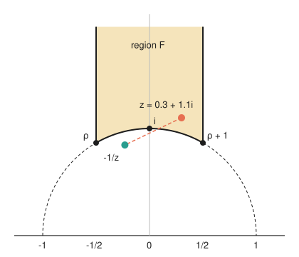

# Modular forms: so symmetric on the half plane that the coefficients count things

[Syllabus](../../../SYLLABUS.md) → [Algebraic and analytic number theory](../README.md) → [Diophantine and Modular](../README.md#s07) → Modular forms

---

## General Overview

In 1916 Srinivasa Ramanujan multiplied out an infinite product. Start with $`q`$, then multiply by $`(1 - q)^{24}`$, by $`(1 - q^2)^{24}`$, by $`(1 - q^3)^{24}`$, and so on for ever. Collect the powers of $`q`$. The coefficients begin 1, −24, 252, −1472, 4830, −6048. He called the coefficient of $`q^n`$ the number $`\tau(n)`$, read "tau of n".

The numbers look random, yet they obey rules. The sixth is the second times the third: −24 × 252 = −6048. Every $`\tau(n)`$ leaves the same remainder mod 691 as the sum of the 11th powers of the divisors of $`n`$. Ramanujan found these rules by computing; the first was proved a year later.

The reason is symmetry. Put a complex number $`z`$ with positive imaginary part in place of the exponent: $`q = e^{2\pi i z}`$. The series then becomes a function $`\Delta(z)`$, read "delta of z", with a strong symmetry. Turning $`z`$ into $`-1/z`$ multiplies its value by exactly $`z^{12}`$. Such functions are called **modular forms**. They are so constrained that any series with this symmetry and no constant term is a constant times $`\Delta`$. Both rules above come from that fact.

The same pinning makes other series count things. A modular form of weight 4 counts the points of a record-setting lattice in 8 dimensions. A form of weight 2 counts the solutions of $`y^2 = x^3 - x`$ mod each prime, the shelf's house curve.

**A modular form is a holomorphic function on the upper half plane that changes only by the factor (cz + d)^k under the whole-number matrix moves its level N allows, and stays bounded at the cusps (infinity and the fractions on the real line); k is its weight, its coefficients come from writing it as a series in q = e^(2πiz), and each space of forms is finite-dimensional, so a few coefficients fix all the others.**

**What kind of fact this is:** definitions, plus theorems stated in outline with sources. The dimension of every space of level 1 is proved in outline on this card in Why it works, with the key contour argument in a fold. The rules for $`\tau(n)`$ are stated with their proofs' shape and sources (Mordell 1917, Deligne 1974). The link between the level-32 form and $`y^2 = x^3 - x`$ is a theorem, a special case of [Modularity](08-modularity-and-the-proof-of-fermat.md). The code checks each claim to $`q^{40}`$ or to the prime 37: evidence, not proof.

### The picture: the region every point can be moved into

<p align="center"></p>

To scale, 150 units per 1, with 0 at (210, 330); the coordinates are the `figure,` line of both runs. $`F`$ is the strip $`-1/2 \le \mathrm{Re}\, z \le 1/2`$ above the circle $`|z| = 1`$. The point $`z = 0.3 + 1.1i`$ has size 1.140175 and lies in $`F`$. Its image $`-1/z`$ has size 0.877058 and lies below the arc.

---

## The formula

**The upper half plane.** $`\mathbb{H}`$ is the set of complex numbers $`z`$ with positive imaginary part. A whole-number matrix with determinant 1 moves it by one of the maps of [Mobius transformations](../../07-Complex%20analysis/07-Conformal%20Maps%20and%20Harmonic%20Functions/02-mobius-transformations-and-the-point-at-infinity.md):

```math
\begin{pmatrix} a & b \\ c & d \end{pmatrix} \in \mathrm{SL}_2(\mathbb{Z}): \qquad z \mapsto \frac{az + b}{cz + d}, \qquad ad - bc = 1
```

$`\mathrm{SL}_2(\mathbb{Z})`$, read "S L two of Z", is the group of all such matrices. It is made from two moves: $`T`$, the shift $`z \mapsto z + 1`$, and $`S`$, the flip $`z \mapsto -1/z`$.

**The definition.** A modular form of weight $`k`$ and level $`N`$ is a holomorphic function $`f`$ on $`\mathbb{H}`$ (one with a complex derivative everywhere there) such that

```math
f\!\left(\frac{az + b}{cz + d}\right) = (cz + d)^k\, f(z) \quad \text{for every matrix in } \mathrm{SL}_2(\mathbb{Z}) \text{ with } N \mid c
```

and, for every matrix in $`\mathrm{SL}_2(\mathbb{Z})`$, $`(cz + d)^{-k} f\big((az + b)/(cz + d)\big)`$ stays bounded as the imaginary part of $`z`$ grows. At level 1 this is just $`f`$ bounded, since every matrix is allowed. At higher levels it also keeps $`f`$ tame as $`z`$ nears each fraction on the real line: these points, with infinity, are the **cusps**. Level 1 means every matrix. Level 32 means only the matrices whose bottom-left entry is a multiple of 32.

**Read it aloud:** "Move z by any allowed matrix, and f changes only by the fixed factor c z plus d, raised to the weight."

**The q-expansion.** The shift $`T`$ has $`c = 0`$, $`d = 1`$, so $`f(z + 1) = f(z)`$. A holomorphic function of period 1 that stays bounded as the imaginary part of $`z`$ grows is a power series in $`q = e^{2\pi i z}`$:

```math
f(z) = \sum_{n \ge 0} a_n q^n, \qquad \Delta(z) = q \prod_{n \ge 1} (1 - q^n)^{24} = \sum_{n \ge 1} \tau(n)\, q^n = \frac{E_4^3 - E_6^2}{1728}
```

Here $`E_4 = 1 + 240 \sum \sigma_3(n) q^n`$ and $`E_6 = 1 - 504 \sum \sigma_5(n) q^n`$ are the **Eisenstein series**, and $`\sigma_k(n)`$ is the sum of the $`k`$th powers of the divisors of $`n`$. A **cusp form** is a form that tends to 0 at every cusp: each bounded quantity in the definition tends to 0. At level 1 that means $`a_0 = 0`$; $`\Delta`$ is one.

**The dimension.** $`M_k`$ is the set of all forms of weight $`k`$ and level 1, and $`S_k`$ its cusp forms. Both are vector spaces: sums and constant multiples of forms are forms. For even $`k \ge 0`$:

```math
\dim M_k = \left\lfloor \frac{k}{12} \right\rfloor + \begin{cases} 0 & k \equiv 2 \pmod{12} \\ 1 & \text{otherwise} \end{cases}, \qquad \dim S_k = \dim M_k - 1 \ \ (k \ge 4)
```

For odd $`k`$ the space is 0 at level 1: the matrix $`-I`$ gives $`f = (-1)^k f`$.

| Symbol | Plain meaning | In our example | Push it up and the answer… |
| --- | --- | --- | --- |
| $`\mathbb{H}`$; $`z`$, $`u`$ | the upper half plane; points in it | $`z = 0.3 + 1.1i`$; $`u = -0.015625 + 0.03125i`$ | larger imaginary part, smaller $`q`$, faster series |
| $`a, b, c, d`$; $`S`$, $`T`$; $`I`$ | entries of a matrix in $`\mathrm{SL}_2(\mathbb{Z})`$; the flip and the shift; the identity matrix | $`S`$: $`a = d = 0`$, $`b = -1`$, $`c = 1`$ | — |
| $`k`$ | the **weight**: the power of $`cz + d`$ | 12 for $`\Delta`$; 2 at level 32 | larger spaces $`M_k`$ |
| $`N`$ | the **level**: which matrices must be respected | 1 for $`\Delta`$; 32 for the curve's form | fewer matrices, more forms |
| $`f`$; $`M_k`$, $`S_k`$ | a modular form; all forms, and cusp forms, of weight $`k`$, level 1 | $`\Delta \in S_{12}`$ | — |
| $`q = e^{2\pi i z}`$ | the series variable; on this card $`q`$ is never a modulus | $`\lvert q \rvert = e^{-2\pi \times 1.1} = 0.000996`$ at $`z = 0.3 + 1.1i`$ | — |
| $`a_n`$ | the coefficient of $`q^n`$ | $`a_n = \tau(n)`$ for $`\Delta`$ | — |
| $`\Delta`$; $`\tau(n)`$ | the weight-12 cusp form; Ramanujan's tau, **not** the divisor count of wing 07 | $`\tau(2) = -24`$, $`\tau(3) = 252`$ | $`\lvert\tau(p)\rvert`$ is at most $`2p^{5.5}`$ (Deligne) |
| $`E_k`$, $`G_k`$; $`\sigma_k(n)`$ | Eisenstein series of weight $`k`$ ($`E_2`$ is the near-miss, $`G_k`$ the unscaled lattice sum); sum of $`k`$th powers of divisors | $`E_4 = 1 + 240q + 2160q^2 + \dots`$ | — |
| $`F`$; $`i`$, $`\rho`$ | the region of the picture; its point $`i`$ and corner $`\rho = -1/2 + (\sqrt 3/2)\, i`$ | $`\rho = -0.5 + 0.866025i`$ | — |
| $`\mathrm{ord}_{z_0}(f)`$ | the order of the zero of $`f`$ at the point $`z_0`$ (at $`\infty`$: the first $`n`$ with $`a_n \ne 0`$) | $`\mathrm{ord}_\infty(\Delta) = 1`$ | — |
| $`\dim M_k`$ | how many forms are needed to build every form of weight $`k`$ | 2 for $`k = 12`$ | grows by 1 for each 12 added to $`k`$ |

### Reading the weight and level

- **The weight is the exponent in the factor.** For $`\Delta`$, the flip $`S`$ has $`cz + d = z`$, so $`\Delta(-1/z) = z^{12}\Delta(z)`$: weight 12. The run confirms it at $`z = 0.3 + 1.1i`$; with $`z^{11}`$ the two sides disagree.
- **The level read off a form is the smallest $`N`$ that works.** The product $`q \prod (1 - q^{4n})^2 (1 - q^{8n})^2`$ respects the matrix with $`c = 32`$, $`d = 1`$ with factor $`(32u + 1)^2`$: weight 2, level 32. With $`c = 16`$ it fails, so its level is not 16.

### When it holds

- **Holomorphic on all of $`\mathbb{H}`$.** Allow poles and the dimension count fails: $`\Delta/E_4^3`$ has weight 0 and stays bounded at the cusp, but it has a pole at $`\rho`$, where $`E_4`$ vanishes (weight 4 allows zeros totalling 1/3, all at $`\rho`$). Its powers give infinitely many independent functions of weight 0.
- **Bounded at every cusp.** At level 1 this rules out negative powers of $`q`$: without it, $`1/\Delta`$ would count as a form of weight −12. At level 2, bounded as $`\mathrm{Im}\, z`$ grows is not enough. $`\Delta(2z)/\Delta(z)`$ is holomorphic on $`\mathbb{H}`$ (Step 4: $`\Delta`$ has no zero there), unchanged by every matrix with $`2 \mid c`$, and tends to 0 as $`\mathrm{Im}\, z`$ grows, yet it blows up as $`z`$ nears the cusp 0. Its powers would be infinitely many independent forms of weight 0.
- **Every matrix of the group, not just the shift.** The weight-2 series $`E_2 = 1 - 24\sum \sigma_1(n) q^n`$ has period 1, yet $`E_2(-1/z) - z^2 E_2(z) = -6iz/\pi`$, not 0. It is not a form, and $`M_2 = 0`$ survives.
- **Even weight.** The matrix $`-I`$ is always allowed, and gives $`f = (-1)^k f`$. Odd weight forces $`f = 0`$.
- **A fixed level.** Raising the level adds forms; the formula above is for level 1 only.

---

## Why it works

### Step 0: one small region holds all the information

The shift $`T`$ and the flip $`S`$ move any point of $`\mathbb{H}`$ into the region $`F`$ of the picture. So a modular form is known everywhere once it is known on $`F`$. $`F`$ is small: it reaches infinity only through one narrow strip, the **cusp**, and there $`q`$ tends to 0.

On such a region the number of zeros of a form is fixed by its weight: $`k/12`$ of them. That one count makes each space finite-dimensional, and a small space forces the rules on the coefficients.

### Step 1: the shift gives the q-series

The map $`z \mapsto q = e^{2\pi i z}`$ wraps each vertical strip of width 1 once around the punctured unit disc. It is the same exponential that places the roots of unity in [Cyclotomic fields](../05-Fields%20and%20Galois%20Theory/08-cyclotomic-extensions-and-roots-of-unity.md), with $`z`$ in place of $`k/n`$. A holomorphic function of period 1 becomes a holomorphic function of $`q`$, and a Laurent series in $`q`$. The bound at the cusp removes negative powers. The coefficients $`a_n`$ are this series.

### Step 2: the flip gives the weight, and Δ is a form

The Eisenstein series come from a lattice sum: $`G_k(z) = \sum (mz + n)^{-k}`$ over whole numbers $`m, n`$ not both 0. A matrix move only reorders the pairs $`(m, n)`$, and pulls out the factor $`(cz + d)^k`$. So $`G_k`$ has weight $`k`$ for each even $`k \ge 4`$. Scaled to start with 1, $`G_4`$ and $`G_6`$ are $`E_4`$ and $`E_6`$.

Products of forms add weights. So $`E_4^3`$ and $`E_6^2`$ both have weight 12. Their constant terms are both 1, so their difference is a cusp form: it starts $`(720 + 1008)q = 1728q`$. Dividing by 1728 gives $`\Delta`$.

Jacobi's product formula says this equals $`q \prod (1 - q^n)^{24}`$ (Serre, Chapter VII). The code multiplies out both sides and they agree to $`q^{40}`$.

### Step 3: the zero count, and why each space is finite

The **valence formula** counts the zeros of a nonzero form $`f`$ of weight $`k`$ and level 1, with the two corner points counted in part:

```math
\mathrm{ord}_\infty(f) + \tfrac12\, \mathrm{ord}_i(f) + \tfrac13\, \mathrm{ord}_\rho(f) + \sum_{\text{other } z_0 \in F} \mathrm{ord}_{z_0}(f) = \frac{k}{12}
```

**Read it aloud:** the zeros of a form, counted in $`F`$ with the corners $`i`$ and $`\rho`$ weighted one half and one third, always total the weight over 12.

The finite dimension follows at once. Let $`m = \lfloor k/12 \rfloor`$. Suppose a form has $`a_0 = a_1 = \dots = a_m = 0`$. Then its zero at the cusp has order more than $`k/12`$, and the left side exceeds the right. So the form is 0. A form is fixed by its first $`m + 1`$ coefficients, and $`\dim M_k \le m + 1`$.

<details>
<summary>Detailed proof sketch: the valence formula by a contour integral around F</summary>

Integrate $`f'/f`$ around the boundary of $`F`$, cut off at a large height and with small arcs around $`i`$, $`\rho`$ and $`\rho + 1`$. By [The argument principle](../../07-Complex%20analysis/06-Real%20Integrals%20and%20Counting%20Zeros/06-the-argument-principle.md) (walk a closed path and count how often the output turns around 0), the integral divided by $`2\pi i`$ counts the zeros inside.

- **The top edge.** In the variable $`q`$ it is a small clockwise circle around $`q = 0`$. It gives $`-\mathrm{ord}_\infty(f)`$.
- **The two vertical sides.** $`T`$ carries one onto the other in the opposite direction, and $`f(z + 1) = f(z)`$, so they cancel.
- **The two halves of the arc.** $`S`$ carries one onto the other in the opposite direction. From $`f(-1/z) = z^k f(z)`$ comes

$`\displaystyle \frac{f'(-1/z)}{f(-1/z)}\, \frac{1}{z^2} = \frac{k}{z} + \frac{f'(z)}{f(z)}.`$

The $`f'/f`$ parts cancel. The $`k/z`$ part, integrated over the arc from $`\rho`$ to $`i`$ (one twelfth of a full turn), gives $`k/12`$.

- **The small arcs.** Around $`i`$ the cut-out arc is half a circle, giving $`-\tfrac12 \mathrm{ord}_i(f)`$. The arcs at $`\rho`$ and $`\rho + 1`$ are each one sixth of a circle, together $`-\tfrac13 \mathrm{ord}_\rho(f)`$.

The total equals the zeros strictly inside $`F`$. Moving the boundary terms across gives the formula. The full argument, with the cut-offs handled, is Serre, Chapter VII, Theorem 3.

</details>

### Step 4: the exact dimension

Apply the valence formula to $`\Delta`$: weight 12, so the zeros total 1. $`\Delta`$ already has a simple zero at the cusp, so it has no zero in $`\mathbb{H}`$. Dividing a cusp form of weight $`k`$ by $`\Delta`$ therefore gives a form of weight $`k - 12`$. So:

```math
M_k = \mathbb{C}\, E_k \oplus \Delta\, M_{k - 12}, \qquad \dim M_k = 1 + \dim M_{k-12} \quad (k \ge 4)
```

The small cases come from the valence formula directly. Weight 0 gives only constants. Weight 2 would need zeros totalling 1/6, which no mix of $`1, \tfrac12, \tfrac13`$ can make, so $`M_2 = 0`$. Weights 4 to 10 have one form each, $`E_4, E_6, E_4^2, E_4 E_6`$. The recursion then gives the formula. Equivalently, the products $`E_4^a E_6^b`$ with $`4a + 6b = k`$ form a basis. The code counts those products for every even $`k`$ up to 36 and gets the formula's numbers each time. It also checks the products are independent: their first coefficients form a matrix with nonzero determinant.

### Step 5: why the coefficients obey rules

A small space forces identities. Two forms of the same weight that agree in enough leading coefficients are equal.

- **Hecke's multiplicativity.** $`S_{12}`$ has dimension 1: it holds only multiples of $`\Delta`$. Hecke operators $`T_n`$ (averaging maps over matrices of determinant $`n`$, not the shift $`T`$; see [Hecke operators](11-hecke-operators-and-eigenforms.md)) send $`S_{12}`$ into itself. So $`T_n \Delta`$ is a multiple of $`\Delta`$, and reading the coefficients gives $`\tau(mn) = \tau(m)\tau(n)`$ when $`\gcd(m, n) = 1`$, and $`\tau(p^{r+1}) = \tau(p)\tau(p^r) - p^{11}\tau(p^{r-1})`$. Mordell proved this in 1917 (Diamond and Shurman, Chapter 5). The code checks every case up to 40.
- **The 691 rule.** $`E_{12} = 1 + \tfrac{65520}{691}\sum \sigma_{11}(n) q^n`$ and $`\Delta`$ span $`M_{12}`$. The theta series of the Leech lattice (a 24-dimensional grid of points whose $`q^n`$ coefficient counts its points at squared length $`2n`$) has weight 12. Its constant term is 1 and it has no points of squared length 2. That fixes it as $`E_{12} - \tfrac{65520}{691}\Delta`$, with coefficients $`\tfrac{65520}{691}(\sigma_{11}(n) - \tau(n))`$. Counts are whole numbers and 691 shares no factor with 65520, so 691 divides $`\sigma_{11}(n) - \tau(n)`$.
- **Ramanujan's bound.** $`\lvert \tau(p) \rvert \le 2p^{11/2}`$ for every prime $`p`$. Deligne proved it in 1974 from [The Weil conjectures](../../22-Algebraic%20geometry/08-Sheaf%20Cohomology%20and%20Differentials/07-weil-conjectures-and-etale-cohomology.md), by methods far beyond this card. The code prints $`\tau(p)/(2p^{5.5})`$ for primes to 37; all lie in $`[-1, 1]`$.
- **Counting by theta series.** The 8-dimensional lattice $`E_8`$ has a theta series of weight 4, by the Poisson formula of [Poisson summation and sampling](../../20-Harmonic%20analysis/02-The%20Fourier%20Transform/08-poisson-summation-and-sampling.md). $`M_4`$ has dimension 1 and the constant term is 1, so the series is $`E_4`$: there are $`240\sigma_3(n)`$ lattice points of squared length $`2n`$.

### Step 6: level 32 and the house curve

At level 32 fewer matrices must be respected, so more forms exist. One of weight 2 is

```math
f(z) = q \prod_{n \ge 1} (1 - q^{4n})^2 (1 - q^{8n})^2 = \sum_{n \ge 1} a_n q^n
```

For each odd prime $`p`$, its coefficient $`a_p`$ equals $`p`$ minus the number of solutions of $`y^2 \equiv x^3 - x \pmod p`$. This is the modularity theorem for the curve of [Rational points on a cubic](05-elliptic-curves-over-q-and-mordell-weil.md), proved for this curve long before the general case. The code checks it for every prime from 3 to 37.

---

## Worked numbers, by hand

The form $`\Delta`$, by both roads, then its rules.

| Step | Arithmetic | Value |
| --- | --- | --- |
| $`(1 - q)^{24}`$, first terms | binomial coefficients | $`1 - 24q + 276q^2 - 2024q^3`$ |
| $`\tau(1)`$, $`\tau(2)`$ | $`q \times (1 - 24q + \dots)`$; only $`(1 - q)^{24}`$ reaches $`q^1`$ | $`1`$, $`-24`$ |
| $`\tau(3)`$ | $`276`$ from $`(1 - q)^{24}`$, plus $`-24`$ from $`(1 - q^2)^{24}`$ | $`252`$ |
| $`q^1`$ of $`E_4^3`$ and $`E_6^2`$ | $`3 \times 240`$; $`2 \times (-504)`$ | $`720`$; $`-1008`$ |
| $`\tau(1)`$ by Eisenstein | $`(720 + 1008)/1728`$ | $`1`$ |
| $`\tau(2)`$ by Eisenstein | $`(179280 - 220752)/1728`$ | $`-24`$ |
| multiplicativity | $`\tau(6) = \tau(2)\tau(3) = -24 \times 252`$ | $`-6048`$ |
| the 691 rule at $`n = 2`$ | $`\sigma_{11}(2) - \tau(2) = 2049 - (-24) = 2073`$ | $`3 \times 691`$ |
| weight 12 at $`z = 0.3 + 1.1i`$ | $`1000\,\Delta(-1/z)`$ against $`1000\, z^{12}\Delta(z)`$ | **both $`1.142188333 - 4.707980481i`$** |

The two roads give the same coefficients, the rules hold, and the flip multiplies $`\Delta`$ by exactly $`z^{12}`$: $`\Delta`$ is a cusp form of weight 12 and level 1.

### What breaks if you drop a piece

| Mistake | Comes out at | What went wrong |
| --- | --- | --- |
| Weight 11 for $`\Delta`$ | $`1000\, z^{11}\Delta(z) = -3.720093869 - 2.052924086i`$, against $`1.142188333 - 4.707980481i`$ | the factor is $`z^{12}`$; any other power breaks the match |
| $`E_2`$ taken as a form of weight 2 | $`E_2(-1/z) - z^2E_2(z) = 2.100845249 - 0.572957795i`$, which is $`-6iz/\pi`$ | period 1 alone is not enough; the flip fails, as $`M_2 = 0`$ demands |
| Multiplicativity used for $`4 = 2 \times 2`$ | $`\tau(2)^2 = 576`$, but $`\tau(4) = -1472`$ | 2 and 2 share a factor; prime powers need the $`p^{11}`$ rule |
| $`E_{12}`$ alone as the Leech count | $`65520 \times 2049/691 = 194284.3415`$ points | not a whole number; the $`\Delta`$ term is needed |
| Weight 1 at level 32 | $`(32u + 1) f(u) = -0.169228069 + 0.081426340i`$, against $`f(u/(32u + 1)) = -0.166040375 - 0.128514899i`$ | the curve's form has weight 2 |

---

## Code, from first principles, and it actually runs

Both programs build every series by hand and evaluate it with a small complex-number routine. They take **three roads** to $`\Delta`$: the product multiplied out, the Eisenstein formula $`(E_4^3 - E_6^2)/1728`$, and the weight-12 rule tested numerically at a point. They check the Hecke rules, the 691 rule and Ramanujan's bound on every case up to 40. The dimension is reached two ways: by the formula, and by counting products $`E_4^a E_6^b`$ and testing their independence with a determinant mod a large prime. The $`E_8`$ count is brute force against $`240\sigma_3(n)`$, and so is the four-square count against Jacobi's formula. The level-32 form is tested against its matrix and against point counts of $`y^2 = x^3 - x`$.

### Python

```python
# Modular forms in outline -- the check behind the card.  Standard library only.
# Delta = q (1 - q)^24 (1 - q^2)^24 ... is the weight-12, level-1 cusp form, and
# its coefficients are Ramanujan's tau(n).  Here q = e^(2 pi i z), not a modulus.
from math import pi, exp, cos, sin
N, MOD = 40, 1_000_000_007            # series kept to q^40; a prime for ranks

def mul(a, b, m=0):                   # product of two series, cut at q^N
    c = [0] * (N + 1)
    for i, x in enumerate(a):
        for j in range(N + 1 - i):
            c[i + j] += x * b[j]
    return [v % m for v in c] if m else c

def sigma(k, n): return sum(d ** k for d in range(1, n + 1) if n % d == 0)
def eis(c, k): return [1] + [c * sigma(k, n) for n in range(1, N + 1)]
def yn(b): return "yes" if b else "no"
def primes(n): return [p for p in range(2, n + 1) if all(p % d for d in range(2, p))]

P = [1] + [0] * N                     # road 1: multiply out the product
for n in range(1, N + 1):
    for _ in range(24):
        for i in range(N, n - 1, -1):
            P[i] -= P[i - n]          # times (1 - q^n)
tau = [0] + P[:N]                     # Delta = q * P, so tau(n) = P[n - 1]
E4, E6 = eis(240, 3), eis(-504, 5)    # road 2: Eisenstein series
E43, E62 = mul(mul(E4, E4), E4), mul(E6, E6)
D = [(x - y) // 1728 for x, y in zip(E43, E62)]
one = [1] + [0] * N
for _ in range(24): one = [one[i] - (one[i - 1] if i else 0) for i in range(N + 1)]
print("(1 - q)^24 starts", one[:4])
print("E4 starts", E4[:4], "; E6 starts", E6[:4])
print(f"E4^3: q {E43[1]}, q^2 {E43[2]};  E6^2: q {E62[1]}, q^2 {E62[2]}")
print("tau(1..12):", tau[1:13])
print(f"product and (E4^3 - E6^2)/1728 agree to q^{N}:", yn(D == [0] + tau[1:]))

def cexp(w): return complex(exp(w.real) * cos(w.imag), exp(w.real) * sin(w.imag))
def series(c, z): q = cexp(2j * pi * z); return sum(c[n] * q ** n for n in range(N + 1))
def show(w): return f"{w.real:.9f} {'+' if w.imag >= 0 else '-'} {abs(w.imag):.9f}i"
z = complex(0.3, 1.1); w = -1 / z
dz, dw = series([0] + tau[1:], z), series([0] + tau[1:], w)
E2 = eis(-24, 1)
gap, pred = series(E2, w) - z ** 2 * series(E2, z), -6j * z / pi
print(f"z = {show(z)}; -1/z = {show(w)}; |z| = {abs(z):.6f}, |-1/z| = {abs(w):.6f}; |q| = {abs(cexp(2j * pi * z)):.6f}")
print(f"Delta(z) x 1000 = {show(1000 * dz)}")
print(f"Delta(-1/z) x 1000 = {show(1000 * dw)}")
print(f"z^12 Delta(z) x 1000 = {show(1000 * z ** 12 * dz)}")
print(f"weight 11 instead: z^11 Delta(z) x 1000 = {show(1000 * z ** 11 * dz)}")
print(f"E2(-1/z) - z^2 E2(z) = {show(gap)}; -6iz/pi = {show(pred)}")

cop = pp = 0
for m in range(2, N + 1):
    for n in range(m + 1, N // m + 1):
        if all(m % d or n % d for d in range(2, m + 1)):
            assert tau[m * n] == tau[m] * tau[n]; cop += 1
for p in primes(N):
    r = p
    while r * p <= N:
        assert tau[r * p] == tau[p] * tau[r] - p ** 11 * tau[r // p]; pp += 1; r *= p
print(f"Hecke relations to {N}: {cop} coprime pairs, {pp} prime-power steps, all hold")
print(f"mistake, 4 = 2 x 2 not coprime: tau(4) = {tau[4]}, tau(2)^2 = {tau[2] ** 2}")
cong = all((sigma(11, n) - tau[n]) % 691 == 0 for n in range(1, N + 1))
print(f"sigma11(n) - tau(n) divisible by 691 for n = 1..{N}: {yn(cong)}; "
      f"n = 2: {sigma(11, 2)} - ({tau[2]}) = {sigma(11, 2) - tau[2]} = {(sigma(11, 2) - tau[2]) // 691} x 691")
xs = [tau[p] / (2 * p ** 5.5) for p in primes(N)]
deligne = all(tau[p] ** 2 <= 4 * p ** 11 for p in primes(N))
print("tau(p)/(2 p^5.5), p = 2..37:", ", ".join(f"{x:.3f}" for x in xs), "; all in [-1, 1]:", yn(deligne))

def det_mod(M):                       # determinant mod MOD, by elimination
    M, d = [r[:] for r in M], 1
    for c in range(len(M)):
        piv = next((r for r in range(c, len(M)) if M[r][c]), None)
        if piv is None: return 0
        M[c], M[piv] = M[piv], M[c]; d = d * M[c][c] % MOD
        inv = pow(M[c][c], MOD - 2, MOD)
        for r in range(c + 1, len(M)):
            f = M[r][c] * inv % MOD
            M[r] = [(x - f * y) % MOD for x, y in zip(M[r], M[c])]
    return d
dims, counts, pinned = [], [], True
for k in range(0, 37, 2):
    dims.append(k // 12 + (0 if k % 12 == 2 else 1))
    mons = [(a, (k - 4 * a) // 6) for a in range(k // 4 + 1) if (k - 4 * a) % 6 == 0]
    counts.append(len(mons))
    rows = []
    for a, b in mons:
        s = one[:1] + [0] * N
        for _ in range(a): s = mul(s, E4, MOD)
        for _ in range(b): s = mul(s, E6, MOD)
        rows.append(s[:len(mons)])
    pinned = pinned and (not mons or det_mod(rows) != 0)
print("dim M_k, k = 0, 2, ..., 36, by floor(k/12) + [k not 2 mod 12]:", dims)
print("count of products E4^a E6^b of weight k:                    ", counts)
print(f"each space pinned by its first dim coefficients (det mod {MOD} nonzero):", yn(pinned))

e8 = [0] * 4                          # doubled coordinates y = 2x, norm = sum(y^2)/4
def walk(vals, pre, s, sq):
    if len(pre) == 8:
        if s % 4 == 0 and sq % 8 == 0 and 0 < sq <= 24: e8[sq // 8] += 1
        return
    for v in vals:
        if sq + v * v <= 24: walk(vals, pre + [v], s + v, sq + v * v)
walk([-4, -2, 0, 2, 4], [], 0, 0); walk([-3, -1, 1, 3], [], 0, 0)
print(f"E8 vectors of norm 2, 4, 6 by brute force: {e8[1:]}; 240 sigma3(n): {E4[1:4]}")
leech = [65520 * (sigma(11, n) - tau[n]) // 691 for n in range(1, 5)]
print(f"Leech vectors of norm 2, 4, 6, 8 from E12 - (65520/691) Delta: {leech}")
print(f"mistake, E12 alone: 65520 x {sigma(11, 2)}/691 = {65520 * sigma(11, 2) / 691:.4f}, not a whole number")
r4 = [0] * (N + 1)                    # four squares by brute force, against Jacobi's divisor formula
for s in (x * x + y * y + z * z + t * t for x in range(-6, 7) for y in range(-6, 7) for z in range(-6, 7) for t in range(-6, 7)):
    if s <= N: r4[s] += 1
jac = [8 * sum(d for d in range(1, n + 1) if n % d == 0 and d % 4) for n in range(N + 1)]
print(f"four squares, ways for n = 1..8: {r4[1:9]}; 8 x (divisors not divisible by 4): {jac[1:9]}; equal to n = {N}: {yn(r4[1:] == jac[1:])}")
M = 400                               # level 32: q (1 - q^4)^2 (1 - q^8)^2 (1 - q^12)^2 ...
g = [1] + [0] * M
for n in range(1, M // 4 + 1):
    for m in (4 * n, 8 * n):
        for _ in range(2):
            for i in range(M, m - 1, -1): g[i] -= g[i - m]
def f32(z): q = cexp(2j * pi * z); return sum(g[n] * q ** (n + 1) for n in range(M + 1))
u = complex(-1, 2) / 64; c = 32 * u + 1; fu, fv = f32(u), f32(u / c)
print(f"level 32: u = {show(u)}, 32u + 1 = {show(c)}, u/(32u + 1) = {show(u / c)}")
print(f"f(u) = {show(fu)}")
print(f"f(u/(32u + 1)) = {show(fv)}; (32u + 1)^2 f(u) = {show(c ** 2 * fu)}")
print(f"weight 1 instead: (32u + 1) f(u) = {show(c * fu)}")
ap = [g[p - 1] for p in primes(N)[1:]]
pts = [p - sum(1 for x in range(p) for y in range(p) if (y * y - x ** 3 + x) % p == 0) for p in primes(N)[1:]]
print("level 32, weight 2, a_p for p = 3..37:", ap)
print("p minus the points of y^2 = x^3 - x mod p:  ", pts)
print(f"figure, z = ({z.real:.6f}, {z.imag:.6f}), -1/z = ({w.real:.6f}, {w.imag:.6f}), "
      f"rho = (-0.500000, {3 ** 0.5 / 2:.6f}), i = (0, 1)")

assert D == [0] + tau[1:] and tau[1:6] == [1, -24, 252, -1472, 4830]    # two roads
assert abs(dw - z ** 12 * dz) < 1e-12 * abs(dw)                         # weight 12
assert abs(gap - pred) < 1e-9 and abs(dw - z ** 11 * dz) > 1e-4         # E2 and wrong weight fail
assert cong and deligne and tau[4] != tau[2] ** 2 and r4[1:] == jac[1:]   # Jacobi's four squares
assert dims == counts and pinned and e8[1:] == E4[1:4]                  # dimension; E8 count
assert leech[:3] == [0, 196560, 16773120] and ap == pts and abs(fv - c ** 2 * fu) < 1e-9                 # Conway-Sloane; the curve
print("ALL CHECKS PASS")
```

**Ran 2026-11-15 on macOS, Python 3.14.10, standard library only. All checks passed. Output, pasted from the run:**

```
(1 - q)^24 starts [1, -24, 276, -2024]
E4 starts [1, 240, 2160, 6720] ; E6 starts [1, -504, -16632, -122976]
E4^3: q 720, q^2 179280;  E6^2: q -1008, q^2 220752
tau(1..12): [1, -24, 252, -1472, 4830, -6048, -16744, 84480, -113643, -115920, 534612, -370944]
product and (E4^3 - E6^2)/1728 agree to q^40: yes
z = 0.300000000 + 1.100000000i; -1/z = -0.230769231 + 0.846153846i; |z| = 1.140175, |-1/z| = 0.877058; |q| = 0.000996
Delta(z) x 1000 = -0.288388270 + 0.961351735i
Delta(-1/z) x 1000 = 1.142188333 - 4.707980481i
z^12 Delta(z) x 1000 = 1.142188333 - 4.707980481i
weight 11 instead: z^11 Delta(z) x 1000 = -3.720093869 - 2.052924086i
E2(-1/z) - z^2 E2(z) = 2.100845249 - 0.572957795i; -6iz/pi = 2.100845249 - 0.572957795i
Hecke relations to 40: 22 coprime pairs, 7 prime-power steps, all hold
mistake, 4 = 2 x 2 not coprime: tau(4) = -1472, tau(2)^2 = 576
sigma11(n) - tau(n) divisible by 691 for n = 1..40: yes; n = 2: 2049 - (-24) = 2073 = 3 x 691
tau(p)/(2 p^5.5), p = 2..37: -0.265, 0.299, 0.346, -0.188, 0.500, -0.216, -0.590, 0.494, 0.302, 0.581, -0.166, -0.216 ; all in [-1, 1]: yes
dim M_k, k = 0, 2, ..., 36, by floor(k/12) + [k not 2 mod 12]: [1, 0, 1, 1, 1, 1, 2, 1, 2, 2, 2, 2, 3, 2, 3, 3, 3, 3, 4]
count of products E4^a E6^b of weight k:                     [1, 0, 1, 1, 1, 1, 2, 1, 2, 2, 2, 2, 3, 2, 3, 3, 3, 3, 4]
each space pinned by its first dim coefficients (det mod 1000000007 nonzero): yes
E8 vectors of norm 2, 4, 6 by brute force: [240, 2160, 6720]; 240 sigma3(n): [240, 2160, 6720]
Leech vectors of norm 2, 4, 6, 8 from E12 - (65520/691) Delta: [0, 196560, 16773120, 398034000]
mistake, E12 alone: 65520 x 2049/691 = 194284.3415, not a whole number
four squares, ways for n = 1..8: [8, 24, 32, 24, 48, 96, 64, 24]; 8 x (divisors not divisible by 4): [8, 24, 32, 24, 48, 96, 64, 24]; equal to n = 40: yes
level 32: u = -0.015625000 + 0.031250000i, 32u + 1 = 0.500000000 + 1.000000000i, u/(32u + 1) = 0.018750000 + 0.025000000i
f(u) = -0.002550156 + 0.167952992i
f(u/(32u + 1)) = -0.166040375 - 0.128514899i; (32u + 1)^2 f(u) = -0.166040375 - 0.128514899i
weight 1 instead: (32u + 1) f(u) = -0.169228069 + 0.081426340i
level 32, weight 2, a_p for p = 3..37: [0, -2, 0, 0, 6, 2, 0, 0, -10, 0, -2]
p minus the points of y^2 = x^3 - x mod p:   [0, -2, 0, 0, 6, 2, 0, 0, -10, 0, -2]
figure, z = (0.300000, 1.100000), -1/z = (-0.230769, 0.846154), rho = (-0.500000, 0.866025), i = (0, 1)
ALL CHECKS PASS
```

### Rust

```rust
// Modular forms in outline -- the same check as the Python, in Rust.  No crates.
// Delta = q (1 - q)^24 (1 - q^2)^24 ... is the weight-12, level-1 cusp form, and
// its coefficients are Ramanujan's tau(n).  Here q = e^(2 pi i z), not a modulus.
use std::f64::consts::PI;
const N: usize = 40;
const MOD: i128 = 1_000_000_007;

#[derive(Clone, Copy)]
struct C { re: f64, im: f64 }               // a small complex-number struct
impl C {
    fn add(self, o: C) -> C { C { re: self.re + o.re, im: self.im + o.im } }
    fn sub(self, o: C) -> C { C { re: self.re - o.re, im: self.im - o.im } }
    fn mul(self, o: C) -> C { C { re: self.re * o.re - self.im * o.im, im: self.re * o.im + self.im * o.re } }
    fn scale(self, s: f64) -> C { C { re: self.re * s, im: self.im * s } }
    fn abs(self) -> f64 { (self.re * self.re + self.im * self.im).sqrt() }
    fn inv(self) -> C { let d = self.re * self.re + self.im * self.im; C { re: self.re / d, im: -self.im / d } }
    fn exp(self) -> C { let r = self.re.exp(); C { re: r * self.im.cos(), im: r * self.im.sin() } }
    fn pow(self, k: u32) -> C { (0..k).fold(C { re: 1.0, im: 0.0 }, |a, _| a.mul(self)) }
}
fn show(w: C) -> String { format!("{:.9} {} {:.9}i", w.re, if w.im >= 0.0 { "+" } else { "-" }, w.im.abs()) }
fn mul(a: &[i128], b: &[i128], m: i128) -> Vec<i128> {   // product of two series, cut at q^N
    let mut c = vec![0i128; N + 1];
    for i in 0..=N {
        for j in 0..=N - i {
            c[i + j] = c[i + j].checked_add(a[i].checked_mul(b[j]).unwrap()).unwrap();
            if m > 0 { c[i + j] %= m }
        }
    }
    if m > 0 { c.iter().map(|v| v.rem_euclid(m)).collect() } else { c }
}
fn sigma(k: u32, n: usize) -> i128 { (1..=n).filter(|d| n % d == 0).map(|d| (d as i128).pow(k)).sum() }
fn eis(c: i128, k: u32) -> Vec<i128> { (0..=N).map(|n| if n == 0 { 1 } else { c * sigma(k, n) }).collect() }
fn yn(b: bool) -> &'static str { if b { "yes" } else { "no" } }
fn primes(n: usize) -> Vec<usize> { (2..=n).filter(|&p| (2..p).all(|d| p % d != 0)).collect() }
fn series(c: &[i128], z: C) -> C {
    let q = C { re: 0.0, im: 2.0 * PI }.mul(z).exp();
    (0..=N).fold(C { re: 0.0, im: 0.0 }, |s, n| s.add(q.pow(n as u32).scale(c[n] as f64)))
}
fn powmod(mut b: i128, mut e: i128) -> i128 {
    let mut r = 1;
    while e > 0 { if e & 1 == 1 { r = r * b % MOD } b = b * b % MOD; e >>= 1 }
    r
}
fn det_mod(mut m: Vec<Vec<i128>>) -> i128 {             // determinant mod MOD, by elimination
    let mut d = 1;
    for c in 0..m.len() {
        let piv = match (c..m.len()).find(|&r| m[r][c] != 0) { Some(r) => r, None => return 0 };
        m.swap(c, piv);
        d = d * m[c][c] % MOD;
        let inv = powmod(m[c][c], MOD - 2);
        for r in c + 1..m.len() {
            let f = m[r][c] * inv % MOD;
            let row_c = m[c].clone();
            for (x, y) in m[r].iter_mut().zip(row_c.iter()) { *x = (*x - f * y).rem_euclid(MOD) }
        }
    }
    d
}
fn walk(vals: &[i64], len: usize, s: i64, sq: i64, e8: &mut [u64; 4]) {   // doubled coordinates y = 2x
    if len == 8 {
        if s % 4 == 0 && sq % 8 == 0 && sq > 0 && sq <= 24 { e8[(sq / 8) as usize] += 1 }
        return;
    }
    for &v in vals { if sq + v * v <= 24 { walk(vals, len + 1, s + v, sq + v * v, e8) } }
}

fn main() {
    let mut p = vec![0i128; N + 1]; p[0] = 1;            // road 1: multiply out the product
    for n in 1..=N { for _ in 0..24 { for i in (n..=N).rev() { p[i] -= p[i - n] } } }
    let mut tau = vec![0i128]; tau.extend_from_slice(&p[..N]);
    let (e4, e6) = (eis(240, 3), eis(-504, 5));         // road 2: Eisenstein series
    let (e43, e62) = (mul(&mul(&e4, &e4, 0), &e4, 0), mul(&e6, &e6, 0));
    let d: Vec<i128> = e43.iter().zip(e62.iter()).map(|(x, y)| (x - y).div_euclid(1728)).collect();
    let mut one = vec![0i128; N + 1]; one[0] = 1; for _ in 0..24 { for i in (1..=N).rev() { one[i] -= one[i - 1] } }
    println!("(1 - q)^24 starts {:?}", &one[..4]);
    println!("E4 starts {:?} ; E6 starts {:?}", &e4[..4], &e6[..4]);
    println!("E4^3: q {}, q^2 {};  E6^2: q {}, q^2 {}", e43[1], e43[2], e62[1], e62[2]);
    println!("tau(1..12): {:?}", &tau[1..13]);
    let mut t0 = tau.clone(); t0[0] = 0;
    println!("product and (E4^3 - E6^2)/1728 agree to q^{}: {}", N, yn(d == t0));

    let z = C { re: 0.3, im: 1.1 }; let w = z.inv().scale(-1.0);
    let (dz, dw) = (series(&t0, z), series(&t0, w));
    let e2 = eis(-24, 1);
    let gap = series(&e2, w).sub(z.pow(2).mul(series(&e2, z)));
    let pred = C { re: 0.0, im: -6.0 / PI }.mul(z);
    println!("z = {}; -1/z = {}; |z| = {:.6}, |-1/z| = {:.6}; |q| = {:.6}", show(z), show(w), z.abs(), w.abs(),
             C { re: 0.0, im: 2.0 * PI }.mul(z).exp().abs());
    println!("Delta(z) x 1000 = {}", show(dz.scale(1000.0)));
    println!("Delta(-1/z) x 1000 = {}", show(dw.scale(1000.0)));
    println!("z^12 Delta(z) x 1000 = {}", show(z.pow(12).mul(dz).scale(1000.0)));
    println!("weight 11 instead: z^11 Delta(z) x 1000 = {}", show(z.pow(11).mul(dz).scale(1000.0)));
    println!("E2(-1/z) - z^2 E2(z) = {}; -6iz/pi = {}", show(gap), show(pred));

    let (mut cop, mut pp) = (0, 0);
    for m in 2..=N { for n in m + 1..=N / m {
        if (2..=m).all(|d| m % d != 0 || n % d != 0) { assert!(tau[m * n] == tau[m] * tau[n]); cop += 1 }
    } }
    for &p in &primes(N) {
        let mut r = p;
        while r * p <= N {
            assert!(tau[r * p] == tau[p] * tau[r] - (p as i128).pow(11) * tau[r / p]); pp += 1; r *= p;
        }
    }
    println!("Hecke relations to {}: {} coprime pairs, {} prime-power steps, all hold", N, cop, pp);
    println!("mistake, 4 = 2 x 2 not coprime: tau(4) = {}, tau(2)^2 = {}", tau[4], tau[2] * tau[2]);
    let cong = (1..=N).all(|n| (sigma(11, n) - tau[n]) % 691 == 0); let s2 = sigma(11, 2);
    println!("sigma11(n) - tau(n) divisible by 691 for n = 1..{}: {}; n = 2: {} - ({}) = {} = {} x 691",
             N, yn(cong), s2, tau[2], s2 - tau[2], (s2 - tau[2]) / 691);
    let xs: Vec<String> = primes(N).iter().map(|&p| format!("{:.3}", tau[p] as f64 / (2.0 * (p as f64).powf(5.5)))).collect();
    let deligne = primes(N).iter().all(|&p| tau[p] * tau[p] <= 4 * (p as i128).pow(11));
    println!("tau(p)/(2 p^5.5), p = 2..37: {} ; all in [-1, 1]: {}", xs.join(", "), yn(deligne));

    let (e4m, e6m) = (e4.iter().map(|v| v.rem_euclid(MOD)).collect::<Vec<_>>(), e6.iter().map(|v| v.rem_euclid(MOD)).collect::<Vec<_>>());
    let (mut dims, mut counts, mut pinned) = (vec![], vec![], true);
    for k in (0..=36usize).step_by(2) {
        dims.push(k / 12 + if k % 12 == 2 { 0 } else { 1 });
        let mons: Vec<(usize, usize)> = (0..=k / 4).filter(|a| (k - 4 * a) % 6 == 0).map(|a| (a, (k - 4 * a) / 6)).collect();
        counts.push(mons.len());
        let mut rows = vec![];
        for &(a, b) in &mons {
            let mut s = vec![0i128; N + 1]; s[0] = 1;
            for _ in 0..a { s = mul(&s, &e4m, MOD) }
            for _ in 0..b { s = mul(&s, &e6m, MOD) }
            rows.push(s[..mons.len()].to_vec());
        }
        pinned = pinned && (mons.is_empty() || det_mod(rows) != 0);
    }
    println!("dim M_k, k = 0, 2, ..., 36, by floor(k/12) + [k not 2 mod 12]: {:?}", dims);
    println!("count of products E4^a E6^b of weight k:                     {:?}", counts);
    println!("each space pinned by its first dim coefficients (det mod {} nonzero): {}", MOD, yn(pinned));

    let mut e8 = [0u64; 4]; walk(&[-4, -2, 0, 2, 4], 0, 0, 0, &mut e8); walk(&[-3, -1, 1, 3], 0, 0, 0, &mut e8);
    println!("E8 vectors of norm 2, 4, 6 by brute force: {:?}; 240 sigma3(n): {:?}", &e8[1..], &e4[1..4]);
    let leech: Vec<i128> = (1..=4).map(|n| 65520 * (sigma(11, n) - tau[n]) / 691).collect();
    println!("Leech vectors of norm 2, 4, 6, 8 from E12 - (65520/691) Delta: {:?}", leech);
    println!("mistake, E12 alone: 65520 x {}/691 = {:.4}, not a whole number", s2, 65520.0 * s2 as f64 / 691.0);
    let mut r4 = vec![0i128; N + 1];                     // four squares by brute force, against Jacobi's divisor formula
    for x in -6i64..=6 { for y in -6i64..=6 { for z in -6i64..=6 { for t in -6i64..=6 { let s = (x * x + y * y + z * z + t * t) as usize; if s <= N { r4[s] += 1 } } } } }
    let jac: Vec<i128> = (0..=N).map(|n| 8 * (1..=n).filter(|d| n % d == 0 && d % 4 != 0).map(|d| d as i128).sum::<i128>()).collect();
    println!("four squares, ways for n = 1..8: {:?}; 8 x (divisors not divisible by 4): {:?}; equal to n = {}: {}", &r4[1..9], &jac[1..9], N, yn(r4[1..] == jac[1..]));
    const M: usize = 400;                                // level 32: q (1 - q^4)^2 (1 - q^8)^2 ...
    let mut g = vec![0i128; M + 1]; g[0] = 1;
    for n in 1..=M / 4 { for m in [4 * n, 8 * n] { for _ in 0..2 { for i in (m..=M).rev() { g[i] -= g[i - m] } } } }
    let f32 = |z: C| { let q = C { re: 0.0, im: 2.0 * PI }.mul(z).exp();
        (0..=M).fold(C { re: 0.0, im: 0.0 }, |s, n| s.add(q.pow(n as u32 + 1).scale(g[n] as f64))) };
    let u = C { re: -1.0 / 64.0, im: 2.0 / 64.0 }; let c = u.scale(32.0).add(C { re: 1.0, im: 0.0 });
    let v = u.mul(c.inv()); let (fu, fv) = (f32(u), f32(v));
    println!("level 32: u = {}, 32u + 1 = {}, u/(32u + 1) = {}", show(u), show(c), show(v));
    println!("f(u) = {}", show(fu));
    println!("f(u/(32u + 1)) = {}; (32u + 1)^2 f(u) = {}", show(fv), show(c.pow(2).mul(fu)));
    println!("weight 1 instead: (32u + 1) f(u) = {}", show(c.mul(fu)));
    let ap: Vec<i128> = primes(N)[1..].iter().map(|&p| g[p - 1]).collect();
    let pts: Vec<i128> = primes(N)[1..].iter().map(|&p| {
        let p = p as i128;
        p - (0..p).map(|x| (0..p).filter(|y| (y * y - x * x * x + x).rem_euclid(p) == 0).count() as i128).sum::<i128>()
    }).collect();
    println!("level 32, weight 2, a_p for p = 3..37: {:?}", ap);
    println!("p minus the points of y^2 = x^3 - x mod p:   {:?}", pts);
    println!("figure, z = ({:.6}, {:.6}), -1/z = ({:.6}, {:.6}), rho = (-0.500000, {:.6}), i = (0, 1)",
             z.re, z.im, w.re, w.im, 3f64.sqrt() / 2.0);

    assert!(d == t0 && tau[1..6] == [1, -24, 252, -1472, 4830]);               // two roads
    assert!(dw.sub(z.pow(12).mul(dz)).abs() < 1e-12 * dw.abs());                // weight 12
    assert!(gap.sub(pred).abs() < 1e-9 && dw.sub(z.pow(11).mul(dz)).abs() > 1e-4);
    assert!(cong && deligne && tau[4] != tau[2] * tau[2] && r4[1..] == jac[1..]);   // Jacobi's four squares
    assert!(dims == counts && pinned && e8[1..].iter().zip(&e4[1..4]).all(|(a, b)| *a as i128 == *b));
    assert!(leech[..3] == [0, 196560, 16773120] && ap == pts && fv.sub(c.pow(2).mul(fu)).abs() < 1e-9);                 // Conway-Sloane; the curve
    println!("ALL CHECKS PASS");
}
```

**Ran 2026-11-15 on macOS, rustc 1.98.1, no crates. All checks passed. Output, pasted from the run:**

```
(1 - q)^24 starts [1, -24, 276, -2024]
E4 starts [1, 240, 2160, 6720] ; E6 starts [1, -504, -16632, -122976]
E4^3: q 720, q^2 179280;  E6^2: q -1008, q^2 220752
tau(1..12): [1, -24, 252, -1472, 4830, -6048, -16744, 84480, -113643, -115920, 534612, -370944]
product and (E4^3 - E6^2)/1728 agree to q^40: yes
z = 0.300000000 + 1.100000000i; -1/z = -0.230769231 + 0.846153846i; |z| = 1.140175, |-1/z| = 0.877058; |q| = 0.000996
Delta(z) x 1000 = -0.288388270 + 0.961351735i
Delta(-1/z) x 1000 = 1.142188333 - 4.707980481i
z^12 Delta(z) x 1000 = 1.142188333 - 4.707980481i
weight 11 instead: z^11 Delta(z) x 1000 = -3.720093869 - 2.052924086i
E2(-1/z) - z^2 E2(z) = 2.100845249 - 0.572957795i; -6iz/pi = 2.100845249 - 0.572957795i
Hecke relations to 40: 22 coprime pairs, 7 prime-power steps, all hold
mistake, 4 = 2 x 2 not coprime: tau(4) = -1472, tau(2)^2 = 576
sigma11(n) - tau(n) divisible by 691 for n = 1..40: yes; n = 2: 2049 - (-24) = 2073 = 3 x 691
tau(p)/(2 p^5.5), p = 2..37: -0.265, 0.299, 0.346, -0.188, 0.500, -0.216, -0.590, 0.494, 0.302, 0.581, -0.166, -0.216 ; all in [-1, 1]: yes
dim M_k, k = 0, 2, ..., 36, by floor(k/12) + [k not 2 mod 12]: [1, 0, 1, 1, 1, 1, 2, 1, 2, 2, 2, 2, 3, 2, 3, 3, 3, 3, 4]
count of products E4^a E6^b of weight k:                     [1, 0, 1, 1, 1, 1, 2, 1, 2, 2, 2, 2, 3, 2, 3, 3, 3, 3, 4]
each space pinned by its first dim coefficients (det mod 1000000007 nonzero): yes
E8 vectors of norm 2, 4, 6 by brute force: [240, 2160, 6720]; 240 sigma3(n): [240, 2160, 6720]
Leech vectors of norm 2, 4, 6, 8 from E12 - (65520/691) Delta: [0, 196560, 16773120, 398034000]
mistake, E12 alone: 65520 x 2049/691 = 194284.3415, not a whole number
four squares, ways for n = 1..8: [8, 24, 32, 24, 48, 96, 64, 24]; 8 x (divisors not divisible by 4): [8, 24, 32, 24, 48, 96, 64, 24]; equal to n = 40: yes
level 32: u = -0.015625000 + 0.031250000i, 32u + 1 = 0.500000000 + 1.000000000i, u/(32u + 1) = 0.018750000 + 0.025000000i
f(u) = -0.002550156 + 0.167952992i
f(u/(32u + 1)) = -0.166040375 - 0.128514899i; (32u + 1)^2 f(u) = -0.166040375 - 0.128514899i
weight 1 instead: (32u + 1) f(u) = -0.169228069 + 0.081426340i
level 32, weight 2, a_p for p = 3..37: [0, -2, 0, 0, 6, 2, 0, 0, -10, 0, -2]
p minus the points of y^2 = x^3 - x mod p:   [0, -2, 0, 0, 6, 2, 0, 0, -10, 0, -2]
figure, z = (0.300000, 1.100000), -1/z = (-0.230769, 0.846154), rho = (-0.500000, 0.866025), i = (0, 1)
ALL CHECKS PASS
```

### Lean

Lean proves the dimension of $`M_k`$ for every even weight, the coefficient rule, and the weight-12 cusp forms, all at level 1.

- Take any even weight $`k \ge 0`$. Then $`M_k`$ is finite-dimensional, of dimension $`\lfloor k/12 \rfloor`$, plus 1 unless $`k \equiv 2 \pmod{12}`$.
- Suppose a form in $`M_k`$ has $`a_n = 0`$ for every $`n \le \lfloor k/12 \rfloor`$. Then the form is 0.
- Every cusp form of weight 12 and level 1 is a constant times $`\Delta`$.
- The formula gives the dimensions the run prints for $`k = 0, 2, \dots, 36`$.
- The worked table's arithmetic checks: $`3 \times 240 = 720`$, $`2 \times (-504) = -1008`$, and $`(720 + 1008)/1728 = 1`$.
- Also 179,280 − 220,752 = −24 × 1,728, so the Eisenstein road gives $`\tau(2) = -24`$.
- Take $`\tau(2) = -24`$ and $`\tau(3) = 252`$. Then $`\tau(2)\tau(3) = -6048`$.
- Lean computes $`\sigma_{11}(2) = 2049`$, and checks $`2049 - (-24) = 2073 = 3 \times 691`$.
- Lean computes $`240\sigma_3(n)`$ as 240, 2,160 and 6,720 for $`n = 1, 2, 3`$, the $`E_8`$ counts.

Computing $`\tau(n)`$, the rules up to 40, the lattice counts and the level-32 form are left to the Python and Rust checks.

```lean
-- Modular forms: every space of level-1 modular forms of even weight k is finite-dimensional with dimension floor(k/12), plus 1 unless k is 2 mod 12, and a form is fixed by its first floor(k/12) + 1 coefficients.
import Mathlib.NumberTheory.ModularForms.LevelOne.DimensionFormula
import Mathlib.NumberTheory.ArithmeticFunction.Misc

open ModularForm UpperHalfPlane
open scoped MatrixGroups ArithmeticFunction.sigma

/-- The dimension of level-1 modular forms: for every even weight `k ≥ 0`, the space `M_k` of
holomorphic functions on the upper half plane with `f((az + b)/(cz + d)) = (cz + d)^k f(z)` for
every matrix in `SL₂(ℤ)` and bounded at the cusp is finite-dimensional, and its dimension is
`⌊k/12⌋`, plus 1 unless `k ≡ 2 (mod 12)`. -/
theorem dim_modular_forms_level_one (k : ℕ) (hk : Even k) :
    FiniteDimensional ℂ (ModularForm 𝒮ℒ (k : ℤ)) ∧
      Module.finrank ℂ (ModularForm 𝒮ℒ (k : ℤ)) = k / 12 + if k % 12 = 2 then 0 else 1 := by
  refine ⟨inferInstance, Module.finrank_eq_of_rank_eq ?_⟩
  rw [dimension_level_one k hk]
  by_cases h : k % 12 = 2
  · have h' : k ≡ 2 [MOD 12] := h
    simp [h, h']
  · have h' : ¬ k ≡ 2 [MOD 12] := h
    simp [h, h']

/-- A few coefficients fix the form: if a level-1 modular form of weight `k` has
`a_0 = a_1 = ⋯ = a_m = 0` in its q-expansion, where `m = ⌊k/12⌋`, then the form is 0. -/
theorem modular_form_eq_zero_of_first_coeffs_zero (k : ℕ) (f : ModularForm 𝒮ℒ (k : ℤ))
    (h : ∀ n ≤ k / 12, (qExpansion 1 f).coeff n = 0) : f = 0 := by
  refine sturm_bound_levelOne_nat ?_
  have hle : ((k / 12 + 1 : ℕ) : ℕ∞) ≤ (qExpansion 1 f).order := by
    refine PowerSeries.le_order _ _ fun i hi => h i ?_
    have : i < k / 12 + 1 := by exact_mod_cast hi
    omega
  refine lt_of_lt_of_le ?_ hle
  exact_mod_cast Nat.lt_succ_self _

/-- Every cusp form of weight 12 and level 1 is a constant times `Δ`. -/
theorem cusp_form_weight_twelve_eq_smul_discriminant (f : CuspForm 𝒮ℒ 12) :
    ∃ c : ℂ, f = c • CuspForm.discriminant := by
  obtain ⟨c, hc⟩ := CuspForm.exists_smul_discriminant_of_weight_eq_twelve f
  exact ⟨c, hc.symm⟩

-- The dimensions for k = 0, 2, ..., 36, as printed by the card's run.
example : (List.range 19).map (fun i => 2 * i / 12 + if 2 * i % 12 = 2 then 0 else 1) =
    [1, 0, 1, 1, 1, 1, 2, 1, 2, 2, 2, 2, 3, 2, 3, 3, 3, 3, 4] := by decide

-- The q coefficients of E₄³ and E₆²: 3 × 240 and 2 × (−504); their difference over 1728 is τ(1).
example : (3 * 240 : ℤ) = 720 ∧ (2 * (-504) : ℤ) = -1008 ∧ (720 - (-1008) : ℤ) / 1728 = 1 := by
  norm_num

-- τ(2) by Eisenstein series: (179280 − 220752)/1728 = −24.
example : ((179280 - 220752 : ℤ)) = -24 * 1728 := by norm_num

-- Multiplicativity: τ(6) = τ(2) τ(3) = −24 × 252 = −6048.
example : (-24 : ℤ) * 252 = -6048 := by norm_num

-- The 691 rule at n = 2: σ₁₁(2) − τ(2) = 2049 − (−24) = 2073 = 3 × 691.
example : σ 11 2 = 2049 ∧ ((2049 : ℤ) - (-24) = 3 * 691) := by
  refine ⟨by decide, by norm_num⟩

-- The E₈ lattice counts 240 σ₃(n) for n = 1, 2, 3: 240, 2160, 6720.
example : 240 * σ 3 1 = 240 ∧ 240 * σ 3 2 = 2160 ∧ 240 * σ 3 3 = 6720 := by decide

#print axioms dim_modular_forms_level_one
#print axioms modular_form_eq_zero_of_first_coeffs_zero
#print axioms cusp_form_weight_twelve_eq_smul_discriminant
```

**Checked 2026-11-15 on macOS, Lean 4.36.0-rc2, Mathlib v4.36.0-rc2. Every proof is complete and uses only Lean's standard axioms. Output, pasted from the run:**

```
'dim_modular_forms_level_one' depends on axioms: [propext, Classical.choice, Quot.sound]
'modular_form_eq_zero_of_first_coeffs_zero' depends on axioms: [propext, Classical.choice, Quot.sound]
'cusp_form_weight_twelve_eq_smul_discriminant' depends on axioms: [propext, Classical.choice, Quot.sound]
```

> [!TIP]
> **Try changing**
> - **Guess first:** does the weight-12 rule depend on the test point? Set `z = complex(0.1, 2.0)`. Answer: no. Both sides read $`14.492779036 + 0.417051825i`$ (times 1000), and every check passes.
> - **Guess first:** do the dimension formula and the product count keep agreeing? Change `range(0, 37, 2)` to `range(0, 49, 2)`. Answer: yes, up to weight 48, where both give 5, and the determinants stay nonzero.
> - **Guess first:** is the curve's form also of level 16? Change `c = 32 * u + 1` to `c = 16 * u + 1`. Answer: no. The two sides come out equal and opposite, $`0.126761667 - 0.050572693i`$ against its negative, and the last assert stops the run.
> - **Guess first:** what if the product uses power 23 instead of 24? Change `range(24)` in road 1 to `range(23)`. Answer: the product no longer equals $`(E_4^3 - E_6^2)/1728`$, and the first assert stops the run.

---

## The usual mistake

> [!warning]
> **Taking period 1 for modularity.** Any power series in $`q`$ has period 1. The content of a modular form is the flip $`z \mapsto -1/z`$ with its factor $`z^k`$. $`E_2`$ has period 1 and integer coefficients, yet $`E_2(-1/z) - z^2E_2(z) = -6iz/\pi`$, which is $`2.100845249 - 0.572957795i`$ at $`z = 0.3 + 1.1i`$. Without the flip there is no zero count and no finite dimension.
>
> - **Reading $`\tau(n)`$ as the divisor count.** On this card $`\tau(n)`$ is Ramanujan's: $`\tau(2) = -24`$, while 2 has two divisors.
> - **Reading $`q`$ as a modulus or a prime power.** Here $`q = e^{2\pi i z}`$, a complex number of size below 1: 0.000996 at $`z = 0.3 + 1.1i`$.
> - **Using multiplicativity on shared factors.** $`\tau(2)^2 = 576`$, but $`\tau(4) = -1472`$.

---

## Where you meet it in real life

- **Sphere packing.** Viazovska proved in 2016 that the $`E_8`$ lattice packs equal balls most densely in 8 dimensions, using a function built from modular forms. The same method, with the Leech lattice's 196560 shortest vectors, settled 24 dimensions.
- **Counting sums of squares.** The number of ways to write $`n`$ as a sum of four squares, signs and order counted, is a coefficient of a weight-2 form of level 4. That space is small enough to force Jacobi's formula: 8 times the sum of the divisors of $`n`$ that 4 does not divide. For $`n = 2`$ it gives $`8 \times (1 + 2) = 24`$, and the code checks every $`n`$ up to 40 by brute force. [Four squares and beyond](03-four-squares-and-warings-problem.md) proves there is always at least one way.
- **Fermat's last theorem.** A solution of $`x^n + y^n = z^n`$ would give an elliptic curve whose modular form has impossible properties. See [Modularity](08-modularity-and-the-proof-of-fermat.md).
- **Elliptic curves.** The level-32 form's coefficients are the point counts of $`y^2 = x^3 - x`$ mod primes. Those counts feed the $`L`$-function of [Birch-Swinnerton-Dyer](06-birch-swinnerton-dyer-and-the-congruent-number-problem.md).

> **Say it back**
> A modular form is a holomorphic function on the upper half plane that changes only by $`(cz + d)^k`$ under the matrices of its group. The exponent $`k`$ is the weight and the group, set by the level $`N`$, is the symmetry it must respect. Period 1 makes it a series in $`q = e^{2\pi i z}`$, and the flip $`z \mapsto -1/z`$ fixes the count of its zeros at $`k/12`$. So each space is finite: at level 1 and weight 12 it has dimension 2, and the cusp forms only $`\Delta`$. That smallness is why Ramanujan's $`\tau(n)`$ is multiplicative and why theta series count lattice points exactly.

---

## What this builds on

- [Cyclotomic fields](../05-Fields%20and%20Galois%20Theory/08-cyclotomic-extensions-and-roots-of-unity.md): the exponential $`e^{2\pi i \cdot k/n}`$ that places roots of unity on the circle; here $`q = e^{2\pi i z}`$ is the same map with $`z`$ free.
- [Mobius transformations](../../07-Complex%20analysis/07-Conformal%20Maps%20and%20Harmonic%20Functions/02-mobius-transformations-and-the-point-at-infinity.md): maps $`(az + b)/(cz + d)`$ that compose like matrices; $`\mathrm{SL}_2(\mathbb{Z})`$ is the whole-number part.
- [Conformal maps](../../07-Complex%20analysis/07-Conformal%20Maps%20and%20Harmonic%20Functions/01-conformal-maps.md): holomorphic functions and their angle-keeping behaviour, the kind of function a modular form must be. The contour argument of Step 3 is [The argument principle](../../07-Complex%20analysis/06-Real%20Integrals%20and%20Counting%20Zeros/06-the-argument-principle.md).
- [Symmetry](../../05-Geometry%20and%20trig/06-Beyond%20Euclid/04-symmetry-and-tilings.md): a group of moves and a region that tiles the plane; $`F`$ is the tile for $`\mathrm{SL}_2(\mathbb{Z})`$ on the half plane.

## Where this goes next

- [Modularity](08-modularity-and-the-proof-of-fermat.md): every elliptic curve over the rationals has a weight-2 form, as the house curve does at level 32, and Fermat follows.
- [What curves answer](../../22-Algebraic%20geometry/04-Elliptic%20Curves/10-modularity-and-the-congruent-number-problem.md): what the modular form of a curve says about its rational points.
- [Sphere packing, solved in dimensions 8 and 24](../../25-Frontier/04-Geometry%20and%20Combinatorics/06-sphere-packing-and-viazovska.md): the $`E_8`$ and Leech theta series used to prove the best packings.
- [Hecke operators](11-hecke-operators-and-eigenforms.md): averaging a modular form over matrices of determinant n, and why tau is multiplicative.
- [The L-function of a modular form](12-l-functions-of-modular-forms.md): a Mellin transform that inherits the form's symmetry.

The question this card leaves open: which sequences of numbers, beyond these, are secretly the coefficients of a modular form?

---

## Sources

Verified 2026-11-15: every link below resolves to the publisher's page.

- Diamond, Fred, and Jerry Shurman. *A First Course in Modular Forms*. Springer, 2005. [doi:10.1007/978-0-387-27226-9](https://doi.org/10.1007/978-0-387-27226-9). Weight, level, congruence subgroups, Hecke operators, dimension formulas and the modularity theorem.
- Serre, Jean-Pierre. *A Course in Arithmetic*. Springer, 1973. [doi:10.1007/978-1-4684-9884-4](https://doi.org/10.1007/978-1-4684-9884-4). Chapter VII: the fundamental domain, the valence formula with proof, $`\dim M_k`$, $`\Delta`$, Hecke operators and theta series of even lattices.
- Koblitz, Neal. *Introduction to Elliptic Curves and Modular Forms*, 2nd ed. Springer, 1993. [doi:10.1007/978-1-4612-0909-6](https://doi.org/10.1007/978-1-4612-0909-6). Modular forms reached from the congruent-number curves $`y^2 = x^3 - n^2x`$, including $`y^2 = x^3 - x`$.
- Deligne, Pierre. "La conjecture de Weil. I." *Publications Mathématiques de l'IHÉS* 43 (1974), 273–307. [doi:10.1007/BF02684373](https://doi.org/10.1007/BF02684373). The proof of Ramanujan's bound $`\lvert\tau(p)\rvert \le 2p^{11/2}`$.
- Viazovska, Maryna S. "The sphere packing problem in dimension 8." *Annals of Mathematics* 185 (2017), 991–1015. [doi:10.4007/annals.2017.185.3.7](https://doi.org/10.4007/annals.2017.185.3.7). The $`E_8`$ packing proved optimal with a function built from modular forms.
