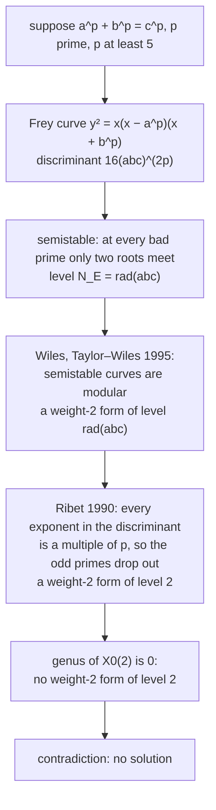

# Modularity: every rational elliptic curve is a modular form, and Fermat follows

[Syllabus](../../../SYLLABUS.md) → [Algebraic and analytic number theory](../README.md) → [Diophantine and Modular](../README.md#s07) → Modularity

---

## General Overview

Suppose someone hands over three positive whole numbers $`a`$, $`b`$, $`c`$ and a prime $`p`$ of 5 or more with $`a^p + b^p = c^p`$. In 1984 Gerhard Frey saw what to do with them. Build the cubic curve whose three crossings of the x-axis sit at $`0`$, $`a^p`$ and $`-b^p`$:

```math
y^2 = x\,(x - a^p)\,(x + b^p)
```

This is the **Frey curve**. Its three roots sit at gaps $`a^p`$, $`b^p`$ and $`a^p + b^p = c^p`$ from each other. Every gap is a perfect pth power. For a prime $`p`$ of 5 or more, no elliptic curve over the rationals can look like that. The rest of the story proves it.

No Fermat triple exists, so the card runs the machine on a stand-in that does: $`3^2 + 4^2 = 5^2`$, with $`p = 2`$. Its curve is $`y^2 = x(x - 9)(x + 16)`$. The gaps are 9, 16 and 25. They fix the curve's **discriminant**, the number that is zero exactly when the curve has a sharp point or self-crossing: $`16 \times 60^4 = 207{,}360{,}000`$.

The contradiction needs two theorems. **Modularity** says every elliptic curve over the rationals comes from a modular form: its point counts mod each prime are the coefficients of one special function. **Ribet's theorem** says the Frey curve's form could then be moved down to level 2. At level 2 there are no such forms at all. The code counts them: zero.

**Every elliptic curve over the rationals has its point counts written into a weight-2 modular form; a Fermat solution's Frey curve would need such a form at level 2, where none exists.**

**What kind of fact this is:** a theorem, stated here with its sources and its proof in outline. Wiles (1995), with Taylor and Wiles (1995), proved modularity for semistable curves, which is enough for Fermat. Breuil, Conrad, Diamond and Taylor (2001) proved it for every curve. The card proves the Frey curve's discriminant and bad primes, and checks the point-count match for $`y^2 = x^3 - x`$ to 100: that check is evidence, not proof.

### The picture: the chain of the proof



Each arrow is one theorem. The top two boxes are algebra this card does by hand; the last box is a count the code makes.

---

## The formula

Notation first, in words. An **elliptic curve** $`E`$ is a cubic $`y^2 = x^3 + \dots`$ with no sharp point or self-crossing. Its rational points form a group ([Rational points on a cubic](05-elliptic-curves-over-q-and-mordell-weil.md)). Here $`\ell`$ is any prime, and $`\#E(\mathrm{GF}(\ell))`$ counts the points of $`E`$ with coordinates in Z mod $`\ell`$, plus the zero point $`O`$. The **trace** at $`\ell`$ is

```math
a_\ell = \ell + 1 - \#E(\mathrm{GF}(\ell))
```

It measures how far the count strays from its typical size $`\ell + 1`$. ([The curve mod p](../../22-Algebraic%20geometry/04-Elliptic%20Curves/05-reduction-mod-p-and-hasse.md) gives Hasse's bound $`\lvert a_\ell\rvert \le 2\sqrt{\ell}`$.)

A **weight-2 modular form of level $`N`$** is a function $`f`$ on the upper half plane $`\mathbb{H}`$, written as a power series in $`q = e^{2\pi i z}`$. Under every matrix of $`\mathrm{SL}_2(\mathbb{Z})`$ whose lower-left entry is a multiple of $`N`$, it changes only by the factor $`(cz + d)^2`$, where $`c`$ and $`d`$ are the matrix's bottom row (this $`c`$ is not Fermat's). Those matrices form the group $`\Gamma_0(N)`$; [Modular forms](07-modular-forms-in-outline.md) tells the level-1 story. A **newform** is such a form that vanishes at the cusps (the edge points of the half plane), is not borrowed from a smaller level, is an eigenvector of every Hecke operator $`T_n`$ (the averaging maps of that card), and has $`a_1 = 1`$.

The **modularity theorem** says: for every elliptic curve $`E`$ over $`\mathbb{Q}`$ there is a newform of weight 2 and level $`N_E`$ with

```math
f(z) = \sum_{n \ge 1} a_n q^n, \qquad a_\ell(f) = \ell + 1 - \#E(\mathrm{GF}(\ell)) \ \text{ for every prime } \ell \nmid N_E
```

**Read it aloud:** some modular form has, as its coefficient of q to the ell, ell plus one minus the curve's point count mod ell, at every prime ell outside the conductor.

The **conductor** $`N_E`$ is a whole number built from the primes where $`E`$ goes bad mod $`\ell`$; [The curve mod p](../../22-Algebraic%20geometry/04-Elliptic%20Curves/05-reduction-mod-p-and-hasse.md) finds those primes, and [The L-function](../../22-Algebraic%20geometry/04-Elliptic%20Curves/07-l-functions-of-elliptic-curves.md) defines the conductor from them. For the house curve $`y^2 = x^3 - x`$ it is 32, and the form is

```math
f(z) = q \prod_{n \ge 1} (1 - q^{4n})^2 (1 - q^{8n})^2 = q - 2q^5 + \cdots
```

For the Frey curve, three facts carry the proof:

```math
\Delta = 16\,(abc)^{2p}, \qquad N_E = \mathrm{rad}(abc), \qquad \dim S_2(\Gamma_0(2)) = 0
```

Here $`\mathrm{rad}(n)`$, the **radical**, is the product of the distinct primes dividing $`n`$: $`\mathrm{rad}(60) = 2 \times 3 \times 5 = 30`$. $`S_2(\Gamma_0(N))`$ is the space of weight-2 cusp forms of level $`N`$.

**Read it aloud:** the discriminant is sixteen times abc to the power two p, the conductor is the product of the primes of abc, and level two has no weight-two cusp forms.

| Symbol | Plain meaning | In our example | Push it up and the answer… |
| --- | --- | --- | --- |
| $`a, b, c`$; $`A, B, C`$ | a supposed Fermat solution, coprime, $`b`$ even; $`A = a^p`$, $`B = b^p`$, $`C = c^p`$ | stand-in 3, 4, 5; 9, 16, 25 | more bad primes |
| $`p`$; $`n`$ | the prime exponent; any exponent | 2 in the stand-in; at least 5 in the proof | discriminant exponents grow |
| $`E`$; $`x, y`$; $`e_1, e_2, e_3`$; $`X, Y`$ | the Frey curve $`y^2 = x(x - A)(x + B)`$; its coordinates; its roots; new coordinates used at 2 | $`y^2 = x(x - 9)(x + 16)`$; roots 0, 9, −16 | — |
| $`\Delta`$, $`c_4`$; $`v_\ell(n)`$ | discriminant, zero exactly when two roots meet; a second invariant, $`16(A^2 + AB + B^2)`$ for the Frey curve; how many times $`\ell`$ divides $`n`$ | 207,360,000; $`v_3(\Delta) = 4`$; for 9, 12, 15: $`v_3(\Delta) = 16`$, $`v_3(c_4) = 4`$ | more singular primes possible |
| $`\ell`$ | a prime used for counting mod $`\ell`$ | 3, 5, 7, … | — |
| $`\#E(\mathrm{GF}(\ell))`$, $`a_\ell`$; $`O`$, $`P`$ | points mod $`\ell`$ with $`O`$; the trace $`\ell + 1 -`$ count; the zero point and any point | for $`y^2 = x^3 - x`$ at 5: 8 and $`-2`$ | — |
| $`N_E`$; $`\mathrm{rad}(n)`$ | conductor; product of the distinct primes of $`n`$ | 32 for the house curve; $`\mathrm{rad}(60) = 30`$ | a higher level |
| $`f`$, $`q`$, $`z`$, $`a_n`$, $`T_n`$; $`\mathbb{H}`$ | the modular form, $`q = e^{2\pi i z}`$ with $`z`$ in the half plane, its coefficients, the Hecke operators; the upper half plane | $`q - 2q^5 + \cdots`$ | — |
| $`\Gamma_0(N)`$, $`N`$; $`\mathrm{SL}_2(\mathbb{Z})`$; $`c, d`$ | matrices with lower-left entry a multiple of $`N`$; the level; all whole-number matrices of determinant 1; a matrix's bottom row | levels 2, 11, 30, 32 | more forms |
| $`S_2(\Gamma_0(N))`$; $`X_0(N)`$, $`g(N)`$ | weight-2 cusp forms of level $`N`$; the surface whose genus $`g(N)`$ counts them | $`g = 0`$ at 2, 1 at 11, 3 at 30 | grows roughly like $`N/12`$ |
| $`\mu`$, $`\nu_2`$, $`\nu_3`$, $`\nu_\infty`$ | the index of $`\Gamma_0(N)`$; points fixed by a rotation of order 2 or 3; cusps | 3, 1, 0, 2 at level 2 | $`\mu`$ raises the genus, the rest lower it |

### When it holds

- **Over the rationals.** The theorem is about curves with fractional coefficients. Over other number fields modularity is proved only in some cases; the planned wing-25 cards give the status.
- **No common factor.** Step 2 needs it to keep the three roots from all meeting mod an odd prime. A common factor is always divided out first. For $`p = 2`$ that only rescales the equation: $`9^2 + 12^2 = 15^2`$ gives $`y^2 = x(x - 81)(x + 144)`$, whose roots all meet mod 3, but $`x = 9X`$, $`y = 27Y`$ turns it back into the 3, 4, 5 curve, which has a node there. For odd $`p`$ a common factor $`d`$ replaces $`y^2`$ by $`d\,y^2`$ in the curve built from $`a/d`$, $`b/d`$, $`c/d`$ (a quadratic twist), and that curve can have a true cusp at primes dividing $`d`$ an odd number of times.
- **A prime exponent of 5 or more.** Ribet's step needs the mod-p picture of $`E`$ (Step 4) to be irreducible. A theorem of Mazur on rational isogenies supplies this for $`p \ge 5`$. Euler and Fermat settled the exponents 3 and 4 ([Fermat's last theorem](04-fermats-last-theorem-history-and-descent.md)), and every $`n \ge 3`$ has a factor 4 or an odd prime.
- **The right normalisation at 2.** Ordering the triple so $`a^p \equiv -1 \pmod 4`$ and $`b`$ is even makes $`32 \mid b^p`$, and then a change of variables makes $`E`$ semistable at 2 too. The stand-in fails the sign: 9 is 1 mod 4, as every odd square is, so its level is 240, not 30 (Step 3).

---

## Why it works

### Step 0: turn a solution into a curve that is too clean

A Fermat solution is one equation. A curve carries far more structure: point counts at every prime, a conductor, a modular form. Frey packs $`a^p`$, $`b^p`$, $`c^p`$ into the curve's gaps between roots, so the discriminant is a 2p-th power times 16. The proof then shows no modular form can carry so clean a curve.

### Step 1: the discriminant is 16 times the squared root gaps

For $`y^2 = (x - e_1)(x - e_2)(x - e_3)`$ the discriminant is $`16\,(e_1 - e_2)^2 (e_1 - e_3)^2 (e_2 - e_3)^2`$. It is zero exactly when two roots meet, which is when the curve gets a node or a cusp. With roots $`0`$, $`A`$, $`-B`$ the three gaps are $`A`$, $`B`$ and $`A + B = C`$, so

```math
\Delta = 16\,(ABC)^2 = 16\,(a^p b^p c^p)^2 = 16\,(abc)^{2p}
```

The stand-in gives $`16 \times (9 \times 16 \times 25)^2 = 16 \times 3{,}600^2 = 207{,}360{,}000`$. The code reaches it a second way, from the expanded curve $`x^3 + a_2x^2 + a_4x`$ with $`a_2 = B - A`$, $`a_4 = -AB`$ and the formula $`16\,a_4^2(a_2^2 - 4a_4)`$. The two agree on all 2,203 coprime pairs $`A, B`$ up to 60. The identity $`(B - A)^2 + 4AB = (A + B)^2`$ is why.

### Step 2: semistable, because only two roots ever meet

Take an odd prime $`\ell`$. Mod $`\ell`$, two roots meet exactly when $`\ell`$ divides one of the gaps $`A`$, $`B`$, $`C`$. All three meet only if $`\ell`$ divides two gaps, and then it divides all of $`a`$, $`b`$, $`c`$. They are coprime, so that never happens.

Two roots meeting gives a **node**: the curve crosses itself mod $`\ell`$, like a figure eight. Three give a **cusp**, a sharp point. A curve with only nodes at its bad primes is **semistable**. For the stand-in the bad odd primes are 3 and 5, the odd primes of $`abc = 60`$. Both are nodes. The code finds this by comparing roots, and again by testing where the cubic and its slope vanish together.

At 2 a change of variables, $`x = 4X`$ and $`y = 8Y + 4X`$, turns the discriminant into $`(abc)^{2p}/2^8`$ and leaves a node, once $`a^p \equiv -1 \pmod 4`$ and $`32 \mid b^p`$. For a semistable curve the conductor is the product of its bad primes, each to the first power, so

```math
N_E = \mathrm{rad}(abc)
```

Ribet's paper starts from these facts about the Frey curve; Diamond and Shurman give the background.

### Step 3: modularity gives a form of level rad(abc)

The Taniyama–Shimura–Weil conjecture, from the 1950s and 1960s, said every elliptic curve over $`\mathbb{Q}`$ is modular. In 1995 Wiles, with the Taylor–Wiles paper supplying a key step, proved it for every semistable curve. That covers the Frey curve, so there would be a weight-2 newform $`f`$ of level $`\mathrm{rad}(abc)`$ with $`a_\ell(f) = \ell + 1 - \#E(\mathrm{GF}(\ell))`$ at every good prime.

What "modular" means is visible on the house curve. Count the points of $`y^2 = x^3 - x`$ mod 5: $`x = 0, 1, 4`$ give $`y = 0`$; $`x = 2`$ gives $`y^2 = 6 \equiv 1`$, so $`y = \pm 1`$; $`x = 3`$ gives $`y^2 = 24 \equiv 4`$, so $`y = \pm 2`$. That is 7 points plus $`O`$: 8, so $`a_5 = 5 + 1 - 8 = -2`$. Expand the product $`q(1 - q^4)^2 \cdots`$ and its $`q^5`$ coefficient is $`-2`$. The code repeats this for all 24 odd primes below 100 and every one matches. (Cremona's tables list this curve as 32a2, with conductor 32.)

The stand-in Frey curve $`y^2 = x(x - 9)(x + 16)`$ is modular too, and the code shows it. At each of the 22 odd primes below 100 that do not divide 60, its trace equals the $`q^\ell`$ coefficient of the level-15 form $`q\prod(1 - q^n)(1 - q^{3n})(1 - q^{5n})(1 - q^{15n})`$, times the sign $`(-1)^{(\ell - 1)/2}`$. That sign multiplies the level by 16, so the stand-in's level is $`16 \times 15 = 240`$. It is not $`\mathrm{rad}(60) = 30`$ because 9 is 1 mod 4, so the sign normalisation fails; the sign $`(-1)^{(\ell - 1)/2}`$ is that failure. The flipped curve $`y^2 = x(x + 9)(x - 16)`$ matches the level-15 form with no sign, 22 of 22. After $`x = 4X`$, $`y = 8Y + 4X`$ its discriminant is 50,625, which is odd, so its level is 15: since 16 is not a multiple of 32, the prime 2 drops out entirely.

<details>
<summary>The shape of Wiles's proof, in words</summary>

The trace $`a_\ell`$ is the trace of a 2 by 2 matrix. The matrix records how the symmetry Frob at $`\ell`$ (the Galois symmetry that acts mod $`\ell`$ like raising to the $`\ell`$-th power) moves the points of $`E`$ whose order is a power of 3. That family of matrices is the **3-adic Galois representation** of $`E`$.

1. **Start mod 3.** The points with $`3P = O`$ give the representation mod 3. Langlands and Tunnell had proved, by 1981, that such a mod-3 representation comes from some modular form.
2. **Lift.** Wiles showed that, under conditions semistability supplies, every lift of a modular mod-3 representation is again modular. The core is an equality "R = T": a ring R that lists all lifts equals a Hecke algebra T that lists the modular ones. Comparing their sizes is where the Taylor–Wiles paper closed the gap found in the 1993 announcement.
3. **Switch primes when 3 fails.** If the mod-3 representation is reducible, Wiles worked mod 5 instead. He built a second curve with the same mod-5 representation and an irreducible mod-3 one. The mod-3 argument proves that curve modular, and lifting at 5 then proves $`E`$ modular.

Breuil, Conrad, Diamond and Taylor extended step 2 to the last remaining curves, those whose conductor is divisible by 27, which finished every curve over $`\mathbb{Q}`$ in 2001.

</details>

### Step 4: Ribet moves the form down to level 2

Look at $`E`$ only mod $`p`$: the points with $`pP = O`$, and the traces $`a_\ell`$ mod $`p`$. Call this the **mod-p picture**. At an odd prime $`\ell`$ dividing $`abc`$, the discriminant's exponent is

```math
v_\ell(\Delta) = 2p \cdot v_\ell(abc), \quad \text{a multiple of } p
```

where $`v_\ell(n)`$ counts how many times $`\ell`$ divides $`n`$. For the stand-in both exponents are 4, a multiple of 2. Tate's theory of nodes says that when this exponent is a multiple of $`p`$, the mod-p picture cannot see $`\ell`$ at all. At $`\ell = p`$ a variant of the same statement holds.

Serre conjectured in 1985 that such a picture, if it comes from a form at all, comes from a form whose level drops the invisible primes. Ribet proved the case needed in 1990: a form of level $`N\ell`$ whose mod-p picture cannot see $`\ell`$ is matched mod $`p`$ by a form of level $`N`$. Drop the odd primes of $`abc`$ one at a time and the level falls to 2.

### Step 5: there are no forms at level 2

The number of independent weight-2 cusp forms of level $`N`$ equals the genus (the number of holes) of a surface called $`X_0(N)`$. Diamond and Shurman give its formula:

```math
g(N) = 1 + \frac{\mu}{12} - \frac{\nu_2}{4} - \frac{\nu_3}{3} - \frac{\nu_\infty}{2}
```

Here $`\mu`$ is the index of $`\Gamma_0(N)`$ in $`\mathrm{SL}_2(\mathbb{Z})`$, $`\nu_2`$ and $`\nu_3`$ count special points fixed by a rotation of order 2 or 3, and $`\nu_\infty`$ counts cusps. At $`N = 2`$: $`\mu = 3`$, $`\nu_2 = 1`$, $`\nu_3 = 0`$, $`\nu_\infty = 2`$, so $`g = 1 + 3/12 - 1/4 - 0 - 2/2 = 0`$.

No form at level 2 means no form for Ribet to land on. The Frey curve cannot be modular; Wiles says it is. So the curve, and the solution it came from, cannot exist. That is **Fermat's last theorem**: $`x^n + y^n = z^n`$ has no solution in positive whole numbers for $`n \ge 3`$.

The code computes $`\mu`$, $`\nu_2`$, $`\nu_3`$ by the product formulas and again by brute counts (pairs mod $`N`$ and roots of $`x^2 + 1`$ and $`x^2 + x + 1`$), for every $`N`$ to 50. The genus is 0 at the levels 1 to 10, 12, 13, 16, 18 and 25. The first level with a form is 11, the smallest conductor of any curve over $`\mathbb{Q}`$.

---

## Worked numbers, by hand

| Step | Arithmetic | Value |
| --- | --- | --- |
| stand-in triple | $`3^2 + 4^2 = 5^2`$, so $`A, B, C`$ | 9, 16, 25 |
| root gaps | roots 0, 9, −16 | 9, 16, 25 |
| product, squared | $`9 \times 16 \times 25 = 3{,}600`$; $`3{,}600^2`$ | 12,960,000 |
| discriminant | $`16 \times 12{,}960{,}000 = 16 \times 60^4`$ | **207,360,000** |
| bad odd primes | odd primes of $`abc = 60`$ | 3 and 5, both nodes |
| exponents of 3, 5 in $`\Delta`$ | $`2p \times 1`$ each | 4 and 4 |
| radical | $`\mathrm{rad}(60)`$ | 30 |
| stand-in's own level | traces match the level-15 form up to sign, 22 of 22; $`16 \times 15`$ | 240 |
| house curve mod 5 | 7 points plus $`O`$; $`5 + 1 - 8`$ | $`a_5 = -2`$, matches $`q^5`$ |
| forms at level 2 | $`1 + 3/12 - 1/4 - 2/2`$ | **0** |

The discriminant is a perfect $`2p`$-th power times 16, and the level-2 count is zero: the two facts the contradiction rests on.

### What breaks if you drop a piece

| Mistake | Comes out at | What went wrong |
| --- | --- | --- |
| Reading a cusp off $`9^2 + 12^2 = 15^2`$, a triple with a common factor | a triple root mod 3 | the equation is not minimal: $`v_3(\Delta) = 16`$ and $`v_3(c_4) = 4`$, and $`x = 9X`$, $`y = 27Y`$ gives the 3, 4, 5 curve, with a node at 3 |
| Stopping after modularity, at level $`\mathrm{rad}(abc) = 30`$ (a true Frey curve whose abc has primes 2, 3, 5) | genus 3: three forms exist | without Ribet's level lowering, nothing clashes |
| Reading the discriminant as the level | 207,360,000 instead of 240 | the level keeps each odd bad prime once, not the discriminant's exponent |

The code prints all three.

---

## Code, from first principles, and it actually runs

The script takes three independent roads to the discriminant: root gaps, coefficients and the closed formula. It takes two to the bad primes: comparing roots, and a brute-force test where the cubic and its slope vanish together. It counts points mod every odd prime below 100 and compares them with the coefficients of the product $`q\prod(1 - q^{4n})^2(1 - q^{8n})^2`$, expanded from scratch, and checks the stand-in's own traces against a level-15 form, with the sign, and the flipped curve's without it. It tests the 9, 12, 15 equation for minimality and rescales it to the 3, 4, 5 curve. It counts weight-2 forms of every level to 50 by the genus formula, with the formula's parts recounted by brute force.

### Python

```python
# Modularity and the proof of Fermat -- the check behind the card.  Standard
# library only.  Part 1 builds the Frey curve y^2 = x(x - A)(x + B), A + B = C,
# for the stand-in 3^2 + 4^2 = 5^2: its discriminant three ways, its bad primes
# two ways.  Part 2 counts points on y^2 = x^3 - x mod every odd prime below 100
# and compares them with the coefficients of a modular form of level 32.
# Part 3 counts weight-2 forms of level N by the genus formula, two ways.
from fractions import Fraction
from math import gcd, prod

def primes_upto(n): return [p for p in range(2, n + 1) if all(p % d for d in range(2, p))]
def prime_factors(n): return [p for p in primes_upto(n) if n % p == 0]
def rad(n):
    out = 1
    for p in prime_factors(n): out *= p
    return out
def val(n, p):                                   # how many times p divides n
    k = 0
    while n % p == 0: n //= p; k += 1
    return k

# Part 1: the Frey curve.  Roots 0, A, -B; in expanded form x^3 + a2 x^2 + a4 x.
def disc_roots(A, B): return 16 * (A * B * (A + B)) ** 2      # differences A, B, A + B
def disc_coeffs(A, B):
    a2, a4 = B - A, -A * B
    return 16 * a4 ** 2 * (a2 ** 2 - 4 * a4)
def disc_long(a1, a2, a4):                       # y^2 + a1 xy = x^3 + a2 x^2 + a4 x: Delta, c4
    b2, b4, b8 = a1 * a1 + 4 * a2, 2 * a4, -a4 * a4
    return -b2 * b2 * b8 - 8 * b4 ** 3, b2 * b2 - 24 * b4
def meeting_roots(A, B, l):                      # road 1: compare the roots mod l
    r = [0, A % l, (-B) % l]
    return max(r.count(x) for x in r)
def singular_kind(A, B, l):                      # road 2: brute-force derivative test
    a2, a4 = B - A, -A * B
    for x in range(l):
        if (x ** 3 + a2 * x * x + a4 * x) % l == 0 and (3 * x * x + 2 * a2 * x + a4) % l == 0:
            return 3 if (3 * x + a2) % l == 0 else 2
    return 1
def bad_odd(A, B, bound):
    return [(l, singular_kind(A, B, l)) for l in primes_upto(bound)[1:] if singular_kind(A, B, l) > 1]

a, b, c, p = 3, 4, 5, 2
A, B = a ** p, b ** p
D = disc_roots(A, B)
print(f"stand-in: {a}^{p} + {b}^{p} = {c}^{p}; Frey curve y^2 = x(x - {A})(x + {B})")
print(f"root differences {A}, {B}, {A + B}; product {A * B * (A + B):,}; squared {(A * B * (A + B)) ** 2:,}")
print(f"discriminant from the roots: {D:,}")
print(f"discriminant from the coefficients: {disc_coeffs(A, B):,}")
print(f"16(abc)^(2p) = 16 x {a * b * c}^{2 * p} = {16 * (a * b * c) ** (2 * p):,}")
bad = bad_odd(A, B, 50)
print(f"odd primes below 50 where the curve is singular: {[l for l, k in bad]}")
print(f"roots meeting there: {[meeting_roots(A, B, l) for l, k in bad]} (2 = node, 3 = cusp)")
print(f"odd primes dividing abc = {a * b * c}: {prime_factors(a * b * c)[1:]}")
print(f"exponents of 3 and 5 in the discriminant: {val(D, 3)}, {val(D, 5)}; 2p x exponent in abc: "
      f"{2 * p * val(a * b * c, 3)}, {2 * p * val(a * b * c, 5)}")
pairs = [(x, y) for x in range(1, 61) for y in range(1, 61) if gcd(x, y) == 1]
same = all(disc_roots(x, y) == disc_coeffs(x, y) for x, y in pairs)
print(f"Delta = 16(ABC)^2 by both formulas for all {len(pairs):,} coprime pairs A, B up to 60: {'yes' if same else 'no'}")

# Part 2: points of y^2 = x^3 - x mod l against q * prod (1 - q^4n)^2 (1 - q^8n)^2.
def count_points(l, a2=0, a4=-1):                # y^2 = x^3 + a2 x^2 + a4 x mod l
    sq = [0] * l
    for y in range(l): sq[y * y % l] += 1
    return 1 + sum(sq[(x ** 3 + a2 * x * x + a4 * x) % l] for x in range(l))   # 1 for O
def q_product(parts, M):                         # q * prod of (1 - q^(m n))^k, to q^M
    f = [0] * (M + 1); f[0] = 1
    for m, k in parts:
        for step in [m * n for n in range(1, M // m + 1)] * k:
            for i in range(M, step - 1, -1): f[i] -= f[i - step]     # times 1 - q^step
    return [0] + f[:M]
M = 100
coef = q_product([(4, 2), (8, 2)], M)
odd = primes_upto(M)[1:]
ap = {l: l + 1 - count_points(l) for l in odd}
print("prime l | points mod l | a_l = l + 1 - points | q^l coefficient of the form")
for l in odd[:8]:
    print(f"{l:7} | {count_points(l):12} | {ap[l]:20} | {coef[l]:27}")
agree = sum(ap[l] == coef[l] for l in odd)
print(f"agreement for odd primes below {M}: {agree} of {len(odd)}")
print(f"primes 3 mod 4 with a_l = 0: {sum(ap[l] == 0 for l in odd if l % 4 == 3)} of {sum(l % 4 == 3 for l in odd)}")
f15 = q_product([(1, 1), (3, 1), (5, 1), (15, 1)], M)          # the level-15 newform
good = [l for l in odd if (a * b * c) % l]
twist = sum(l + 1 - count_points(l, B - A, -A * B) == (-1) ** (l // 2) * f15[l] for l in good)
print(f"stand-in: a_l = (-1)^((l-1)/2) x (q^l coefficient of the level-15 form), "
      f"odd primes below {M} not dividing abc: {twist} of {len(good)}")
print(f"so the stand-in, A = {A} = {A % 4} mod 4, fails the sign: level 16 x 15 = {16 * 15}, "
      f"not rad(abc) = {rad(a * b * c)}")
flip = sum(l + 1 - count_points(l, A - B, -A * B) == f15[l] for l in good)   # y^2 = x(x + A)(x - B)
D15, c4f = disc_long(1, (A - B - 1) // 4, -(A * B) // 16)       # flipped, after x = 4X, y = 8Y + 4X
print(f"flipped y^2 = x(x + {A})(x - {B}): a_l = q^l coefficient of the level-15 form, no sign: {flip} of {len(good)}")
print(f"its model at 2: discriminant {D15:,} = 3^{val(D15, 3)} x 5^{val(D15, 5)}, odd; "
      f"gcd(c4, discriminant) = {gcd(c4f, D15)}: level 15, 2 drops out")

# Part 3: the genus of X0(N) = number of independent weight-2 cusp forms of level N.
def phi(n): return sum(gcd(k, n) == 1 for k in range(1, n + 1))
def genus_formula(N):
    ps = prime_factors(N)
    mu = Fraction(N)
    for q in ps: mu *= Fraction(q + 1, q)
    n2 = 0 if N % 4 == 0 else prod([1 + (0 if q == 2 else 1 if q % 4 == 1 else -1) for q in ps])
    n3 = 0 if N % 9 == 0 else prod([1 + (0 if q == 3 else 1 if q % 3 == 1 else -1) for q in ps])
    cusps = sum(phi(gcd(d, N // d)) for d in range(1, N + 1) if N % d == 0)
    return int(mu), n2, n3, cusps
def genus_brute(N):                              # count P^1(Z mod N) and the two fixed-point equations
    mu = sum(gcd(gcd(x, y), N) == 1 for x in range(N) for y in range(N)) // phi(N)
    n2 = sum((x * x + 1) % N == 0 for x in range(N))
    n3 = sum((x * x + x + 1) % N == 0 for x in range(N))
    return mu, n2, n3
def genus(mu, n2, n3, cusps): return 1 + Fraction(mu, 12) - Fraction(n2, 4) - Fraction(n3, 3) - Fraction(cusps, 2)

G = {N: genus(*genus_formula(N)) for N in range(1, 51)}
roads = all(genus_formula(N)[:3] == genus_brute(N) for N in range(1, 51))
for N in [2, 11, 30, 32]:
    mu, n2, n3, cu = genus_formula(N)
    print(f"level {N:2}: index {mu}, nu2 {n2}, nu3 {n3}, cusps {cu} -> genus {G[N]}")
print(f"index, nu2, nu3 by formula and by brute count agree for N = 1 to 50: {'yes' if roads else 'no'}")
zero = [N for N in range(1, 51) if G[N] == 0]
print(f"levels up to 50 with no weight-2 cusp form: {zero}")
print(f"first level with a form: {min(N for N in G if G[N] > 0)}")

# What breaks
A2, B2 = 9 ** 2, 12 ** 2                         # 9, 12, 15 share the factor 3
D2, c42 = disc_long(0, B2 - A2, -A2 * B2)
print(f"mistake 1, common factor 9^2 + 12^2 = 15^2: roots meeting mod 3 = {meeting_roots(A2, B2, 3)}, "
      f"but v3(Delta) = {val(D2, 3)}, v3(c4) = {val(c42, 3)}: the equation is not minimal")
same3 = all(count_points(l, B2 - A2, -A2 * B2) == count_points(l, B - A, -A * B) for l in odd[1:])
print(f"   x = 9X, y = 27Y gives y^2 = x(x - {A2 // 9})(x + {B2 // 9}), the 3, 4, 5 curve: roots meeting mod 3 = "
      f"{meeting_roots(A2 // 9, B2 // 9, 3)}, a node; same point counts mod 5 to {odd[-1]}: {'yes' if same3 else 'no'}")
print(f"mistake 2, stopping at level rad(abc) = {rad(a * b * c)}: genus {G[30]}, so forms exist and nothing clashes")
print(f"mistake 3, discriminant taken as the level: {D:,} instead of {16 * 15}")

assert D == disc_coeffs(A, B) == 16 * (a * b * c) ** (2 * p) == 207360000 and same      # three roads
assert [l for l, k in bad] == prime_factors(a * b * c)[1:] and all(k == 2 for l, k in bad)
assert [meeting_roots(A, B, l) for l, k in bad] == [k for l, k in bad]                  # two roads
assert agree == len(odd) == 24 and ap[5] == -2 and twist == len(good) == 22             # modularity, evidence
assert roads and zero == [1, 2, 3, 4, 5, 6, 7, 8, 9, 10, 12, 13, 16, 18, 25]            # quoted genus-0 list
assert G[11] == 1 and G[32] == 1 and G[30] == 3 and meeting_roots(A2, B2, 3) == singular_kind(A2, B2, 3) == 3
assert val(D2, 3) == 16 and val(c42, 3) == 4 and D2 == 3 ** 12 * D and same3 and meeting_roots(A2 // 9, B2 // 9, 3) == 2
assert flip == len(good) == 22 and D15 * 2 ** 12 == D and D15 == 3 ** 4 * 5 ** 4 and gcd(c4f, D15) == 1
print("ALL CHECKS PASS")
```

**Ran 2026-11-15 on macOS, Python 3.14.10, standard library only. All checks passed. Output, pasted from the run:**

```
stand-in: 3^2 + 4^2 = 5^2; Frey curve y^2 = x(x - 9)(x + 16)
root differences 9, 16, 25; product 3,600; squared 12,960,000
discriminant from the roots: 207,360,000
discriminant from the coefficients: 207,360,000
16(abc)^(2p) = 16 x 60^4 = 207,360,000
odd primes below 50 where the curve is singular: [3, 5]
roots meeting there: [2, 2] (2 = node, 3 = cusp)
odd primes dividing abc = 60: [3, 5]
exponents of 3 and 5 in the discriminant: 4, 4; 2p x exponent in abc: 4, 4
Delta = 16(ABC)^2 by both formulas for all 2,203 coprime pairs A, B up to 60: yes
prime l | points mod l | a_l = l + 1 - points | q^l coefficient of the form
      3 |            4 |                    0 |                           0
      5 |            8 |                   -2 |                          -2
      7 |            8 |                    0 |                           0
     11 |           12 |                    0 |                           0
     13 |            8 |                    6 |                           6
     17 |           16 |                    2 |                           2
     19 |           20 |                    0 |                           0
     23 |           24 |                    0 |                           0
agreement for odd primes below 100: 24 of 24
primes 3 mod 4 with a_l = 0: 13 of 13
stand-in: a_l = (-1)^((l-1)/2) x (q^l coefficient of the level-15 form), odd primes below 100 not dividing abc: 22 of 22
so the stand-in, A = 9 = 1 mod 4, fails the sign: level 16 x 15 = 240, not rad(abc) = 30
flipped y^2 = x(x + 9)(x - 16): a_l = q^l coefficient of the level-15 form, no sign: 22 of 22
its model at 2: discriminant 50,625 = 3^4 x 5^4, odd; gcd(c4, discriminant) = 1: level 15, 2 drops out
level  2: index 3, nu2 1, nu3 0, cusps 2 -> genus 0
level 11: index 12, nu2 0, nu3 0, cusps 2 -> genus 1
level 30: index 72, nu2 0, nu3 0, cusps 8 -> genus 3
level 32: index 48, nu2 0, nu3 0, cusps 8 -> genus 1
index, nu2, nu3 by formula and by brute count agree for N = 1 to 50: yes
levels up to 50 with no weight-2 cusp form: [1, 2, 3, 4, 5, 6, 7, 8, 9, 10, 12, 13, 16, 18, 25]
first level with a form: 11
mistake 1, common factor 9^2 + 12^2 = 15^2: roots meeting mod 3 = 3, but v3(Delta) = 16, v3(c4) = 4: the equation is not minimal
   x = 9X, y = 27Y gives y^2 = x(x - 9)(x + 16), the 3, 4, 5 curve: roots meeting mod 3 = 2, a node; same point counts mod 5 to 97: yes
mistake 2, stopping at level rad(abc) = 30: genus 3, so forms exist and nothing clashes
mistake 3, discriminant taken as the level: 207,360,000 instead of 240
ALL CHECKS PASS
```

### Rust

Same numbers, same labels, built with `rustc --edition 2021 -O`.

```rust
// Modularity and the proof of Fermat -- the same check as the Python, in Rust.
// No crates.  Part 1 builds the Frey curve y^2 = x(x - A)(x + B), A + B = C,
// for the stand-in 3^2 + 4^2 = 5^2: its discriminant three ways, its bad primes
// two ways.  Part 2 counts points on y^2 = x^3 - x mod every odd prime below 100
// and compares them with the coefficients of a modular form of level 32.
// Part 3 counts weight-2 forms of level N by the genus formula, two ways.

fn gcd(a: i64, b: i64) -> i64 { if b == 0 { a.abs() } else { gcd(b, a % b) } }
fn primes_upto(n: i64) -> Vec<i64> { (2..=n).filter(|&p| (2..p).all(|d| p % d != 0)).collect() }
fn prime_factors(n: i64) -> Vec<i64> { primes_upto(n).into_iter().filter(|p| n % p == 0).collect() }
fn rad(n: i64) -> i64 { prime_factors(n).iter().product() }
fn val(mut n: i128, p: i128) -> u32 { let mut k = 0; while n % p == 0 { n /= p; k += 1 } k }
fn md(x: i64, l: i64) -> i64 { x.rem_euclid(l) }
fn commas(n: i128) -> String {
    let s = n.to_string();
    let mut out = String::new();
    for (i, ch) in s.chars().enumerate() {
        if i > 0 && (s.len() - i) % 3 == 0 { out.push(',') }
        out.push(ch);
    }
    out
}
fn yn(b: bool) -> &'static str { if b { "yes" } else { "no" } }

// Part 1: the Frey curve.  Roots 0, A, -B; in expanded form x^3 + a2 x^2 + a4 x.
fn disc_roots(a: i128, b: i128) -> i128 {
    let d = a.checked_mul(b).and_then(|t| t.checked_mul(a + b)).unwrap();
    16 * d.checked_mul(d).unwrap()
}
fn disc_coeffs(a: i128, b: i128) -> i128 {
    let (a2, a4) = (b - a, -a * b);
    16i128.checked_mul(a4 * a4).and_then(|t| t.checked_mul(a2 * a2 - 4 * a4)).unwrap()
}
fn disc_long(a1: i128, a2: i128, a4: i128) -> (i128, i128) {   // y^2 + a1 xy = x^3 + a2 x^2 + a4 x: Delta, c4
    let (b2, b4, b8) = (a1 * a1 + 4 * a2, 2 * a4, -a4.checked_mul(a4).unwrap());
    ((-b2 * b2).checked_mul(b8).unwrap() - 8 * b4.pow(3), b2 * b2 - 24 * b4) }
fn meeting_roots(a: i64, b: i64, l: i64) -> usize {
    let r = [0, md(a, l), md(-b, l)];
    r.iter().map(|x| r.iter().filter(|y| *y == x).count()).max().unwrap()
}
fn singular_kind(a: i64, b: i64, l: i64) -> usize {
    let (a2, a4) = (b - a, -a * b);
    for x in 0..l {
        if md(x * x * x + a2 * x * x + a4 * x, l) == 0 && md(3 * x * x + 2 * a2 * x + a4, l) == 0 {
            return if md(3 * x + a2, l) == 0 { 3 } else { 2 };
        }
    }
    1
}

fn count_points(l: i64, a2: i64, a4: i64) -> i64 {      // y^2 = x^3 + a2 x^2 + a4 x mod l
    let mut sq = vec![0i64; l as usize];
    for y in 0..l { sq[(y * y % l) as usize] += 1 }
    1 + (0..l).map(|x| sq[md(x * x * x + a2 * x * x + a4 * x, l) as usize]).sum::<i64>()
}
fn q_product(parts: &[(usize, usize)], m: usize) -> Vec<i64> {   // q * prod of (1 - q^(m n))^k
    let mut f = vec![0i64; m + 1];
    f[0] = 1;
    for &(mm, k) in parts { for _ in 0..k { for n in 1..=m / mm {
        let s = mm * n;
        for i in (s..=m).rev() { f[i] -= f[i - s] }
    } } }
    std::iter::once(0).chain(f[..m].iter().copied()).collect()
}
fn phi(n: i64) -> i64 { (1..=n).filter(|&k| gcd(k, n) == 1).count() as i64 }
fn genus_formula(n: i64) -> (i64, i64, i64, i64) {
    let ps = prime_factors(n);
    let mu = ps.iter().fold(n, |m, q| m / q * (q + 1));
    let n2 = if n % 4 == 0 { 0 } else { ps.iter().map(|&q| 1 + if q == 2 { 0 } else if q % 4 == 1 { 1 } else { -1 }).product() };
    let n3 = if n % 9 == 0 { 0 } else { ps.iter().map(|&q| 1 + if q == 3 { 0 } else if q % 3 == 1 { 1 } else { -1 }).product() };
    let cusps = (1..=n).filter(|d| n % d == 0).map(|d| phi(gcd(d, n / d))).sum();
    (mu, n2, n3, cusps)
}
fn genus_brute(n: i64) -> (i64, i64, i64) {
    let mut pairs = 0;
    for x in 0..n { for y in 0..n { if gcd(gcd(x, y), n) == 1 { pairs += 1 } } }
    let n2 = (0..n).filter(|x| (x * x + 1) % n == 0).count() as i64;
    let n3 = (0..n).filter(|x| (x * x + x + 1) % n == 0).count() as i64;
    (pairs / phi(n), n2, n3)
}
fn genus(n: i64) -> i64 {
    let (mu, n2, n3, cu) = genus_formula(n);
    let twelve_g = 12 + mu - 3 * n2 - 4 * n3 - 6 * cu;
    assert!(twelve_g % 12 == 0);
    twelve_g / 12
}

fn main() {
    let (a, b, c, p) = (3i64, 4i64, 5i64, 2u32);
    let (aa, bb) = (a.pow(p), b.pow(p));
    let d = disc_roots(aa as i128, bb as i128);
    let abc = a * b * c;
    println!("stand-in: {}^{} + {}^{} = {}^{}; Frey curve y^2 = x(x - {})(x + {})", a, p, b, p, c, p, aa, bb);
    let prd = (aa * bb * (aa + bb)) as i128;
    println!("root differences {}, {}, {}; product {}; squared {}", aa, bb, aa + bb, commas(prd), commas(prd * prd));
    println!("discriminant from the roots: {}", commas(d));
    println!("discriminant from the coefficients: {}", commas(disc_coeffs(aa as i128, bb as i128)));
    let pred = 16 * (abc as i128).pow(2 * p);
    println!("16(abc)^(2p) = 16 x {}^{} = {}", abc, 2 * p, commas(pred));
    let bad: Vec<(i64, usize)> = primes_upto(50)[1..].iter().map(|&l| (l, singular_kind(aa, bb, l))).filter(|t| t.1 > 1).collect();
    let bad_l: Vec<i64> = bad.iter().map(|t| t.0).collect();
    let meet: Vec<usize> = bad.iter().map(|t| meeting_roots(aa, bb, t.0)).collect();
    println!("odd primes below 50 where the curve is singular: {:?}", bad_l);
    println!("roots meeting there: {:?} (2 = node, 3 = cusp)", meet);
    println!("odd primes dividing abc = {}: {:?}", abc, &prime_factors(abc)[1..]);
    println!("exponents of 3 and 5 in the discriminant: {}, {}; 2p x exponent in abc: {}, {}", val(d, 3), val(d, 5),
             2 * p * val(abc as i128, 3), 2 * p * val(abc as i128, 5));
    let mut npairs = 0;
    let mut same = true;
    for x in 1..61i128 { for y in 1..61i128 { if gcd(x as i64, y as i64) == 1 {
        npairs += 1;
        same &= disc_roots(x, y) == disc_coeffs(x, y);
    } } }
    println!("Delta = 16(ABC)^2 by both formulas for all {} coprime pairs A, B up to 60: {}", commas(npairs), yn(same));

    let m = 100usize;
    let coef = q_product(&[(4, 2), (8, 2)], m);
    let odd: Vec<i64> = primes_upto(m as i64)[1..].to_vec();
    let ap = |l: i64| l + 1 - count_points(l, 0, -1);
    println!("prime l | points mod l | a_l = l + 1 - points | q^l coefficient of the form");
    for &l in &odd[..8] { println!("{:7} | {:12} | {:20} | {:27}", l, count_points(l, 0, -1), ap(l), coef[l as usize]) }
    let agree = odd.iter().filter(|&&l| ap(l) == coef[l as usize]).count();
    println!("agreement for odd primes below {}: {} of {}", m, agree, odd.len());
    let three: Vec<i64> = odd.iter().copied().filter(|l| l % 4 == 3).collect();
    println!("primes 3 mod 4 with a_l = 0: {} of {}", three.iter().filter(|&&l| ap(l) == 0).count(), three.len());
    let f15 = q_product(&[(1, 1), (3, 1), (5, 1), (15, 1)], m);
    let good: Vec<i64> = odd.iter().copied().filter(|l| abc % l != 0).collect();
    let twist = good.iter().filter(|&&l| {
        let sign = if l % 4 == 1 { 1 } else { -1 };
        l + 1 - count_points(l, bb - aa, -aa * bb) == sign * f15[l as usize]
    }).count();
    println!("stand-in: a_l = (-1)^((l-1)/2) x (q^l coefficient of the level-15 form), odd primes below {} not dividing abc: {} of {}",
             m, twist, good.len());
    println!("so the stand-in, A = {} = {} mod 4, fails the sign: level 16 x 15 = {}, not rad(abc) = {}", aa, aa.rem_euclid(4), 16 * 15, rad(abc));
    let flip = good.iter().filter(|&&l| l + 1 - count_points(l, aa - bb, -aa * bb) == f15[l as usize]).count();
    let (d15, c4f) = disc_long(1, ((aa - bb - 1) as i128).div_euclid(4), (-(aa * bb) as i128).div_euclid(16));
    println!("flipped y^2 = x(x + {})(x - {}): a_l = q^l coefficient of the level-15 form, no sign: {} of {}", aa, bb, flip, good.len());
    println!("its model at 2: discriminant {} = 3^{} x 5^{}, odd; gcd(c4, discriminant) = {}: level 15, 2 drops out",
             commas(d15), val(d15, 3), val(d15, 5), gcd(c4f as i64, d15 as i64));

    let roads = (1..=50).all(|n| { let (mu, n2, n3, _) = genus_formula(n); (mu, n2, n3) == genus_brute(n) });
    for n in [2, 11, 30, 32] {
        let (mu, n2, n3, cu) = genus_formula(n);
        println!("level {:2}: index {}, nu2 {}, nu3 {}, cusps {} -> genus {}", n, mu, n2, n3, cu, genus(n));
    }
    println!("index, nu2, nu3 by formula and by brute count agree for N = 1 to 50: {}", yn(roads));
    let zero: Vec<i64> = (1..=50).filter(|&n| genus(n) == 0).collect();
    println!("levels up to 50 with no weight-2 cusp form: {:?}", zero);
    println!("first level with a form: {}", (1..=50).find(|&n| genus(n) > 0).unwrap());

    let (a2, b2) = (81i64, 144i64);
    let (d2, c42) = disc_long(0, (b2 - a2) as i128, (-a2 * b2) as i128);
    println!("mistake 1, common factor 9^2 + 12^2 = 15^2: roots meeting mod 3 = {}, but v3(Delta) = {}, v3(c4) = {}: the equation is not minimal",
             meeting_roots(a2, b2, 3), val(d2, 3), val(c42, 3));
    let same3 = odd[1..].iter().all(|&l| count_points(l, b2 - a2, -a2 * b2) == count_points(l, bb - aa, -aa * bb));
    println!("   x = 9X, y = 27Y gives y^2 = x(x - {})(x + {}), the 3, 4, 5 curve: roots meeting mod 3 = {}, a node; same point counts mod 5 to {}: {}",
             a2 / 9, b2 / 9, meeting_roots(a2 / 9, b2 / 9, 3), odd[odd.len() - 1], yn(same3));
    println!("mistake 2, stopping at level rad(abc) = {}: genus {}, so forms exist and nothing clashes", rad(abc), genus(30));
    println!("mistake 3, discriminant taken as the level: {} instead of {}", commas(d), 16 * 15);

    assert!(d == disc_coeffs(aa as i128, bb as i128) && d == pred && d == 207360000 && same);
    assert!(bad_l == prime_factors(abc)[1..].to_vec() && bad.iter().all(|t| t.1 == 2));
    assert!(meet == bad.iter().map(|t| t.1).collect::<Vec<usize>>());
    assert!(agree == odd.len() && agree == 24 && ap(5) == -2 && twist == good.len() && twist == 22);
    assert!(roads && zero == vec![1, 2, 3, 4, 5, 6, 7, 8, 9, 10, 12, 13, 16, 18, 25]);
    assert!(genus(11) == 1 && genus(32) == 1 && genus(30) == 3 && meeting_roots(a2, b2, 3) == 3 && singular_kind(a2, b2, 3) == 3);
    assert!(val(d2, 3) == 16 && val(c42, 3) == 4 && d2 == 3i128.pow(12) * d && same3 && meeting_roots(a2 / 9, b2 / 9, 3) == 2);
    assert!(flip == good.len() && flip == 22 && d15 * 4096 == d && d15 == 81 * 625 && gcd(c4f as i64, d15 as i64) == 1);
    println!("ALL CHECKS PASS");
}
```

**Ran 2026-11-15 on macOS, rustc 1.98.1, no crates. All checks passed. Output, pasted from the run:**

```
stand-in: 3^2 + 4^2 = 5^2; Frey curve y^2 = x(x - 9)(x + 16)
root differences 9, 16, 25; product 3,600; squared 12,960,000
discriminant from the roots: 207,360,000
discriminant from the coefficients: 207,360,000
16(abc)^(2p) = 16 x 60^4 = 207,360,000
odd primes below 50 where the curve is singular: [3, 5]
roots meeting there: [2, 2] (2 = node, 3 = cusp)
odd primes dividing abc = 60: [3, 5]
exponents of 3 and 5 in the discriminant: 4, 4; 2p x exponent in abc: 4, 4
Delta = 16(ABC)^2 by both formulas for all 2,203 coprime pairs A, B up to 60: yes
prime l | points mod l | a_l = l + 1 - points | q^l coefficient of the form
      3 |            4 |                    0 |                           0
      5 |            8 |                   -2 |                          -2
      7 |            8 |                    0 |                           0
     11 |           12 |                    0 |                           0
     13 |            8 |                    6 |                           6
     17 |           16 |                    2 |                           2
     19 |           20 |                    0 |                           0
     23 |           24 |                    0 |                           0
agreement for odd primes below 100: 24 of 24
primes 3 mod 4 with a_l = 0: 13 of 13
stand-in: a_l = (-1)^((l-1)/2) x (q^l coefficient of the level-15 form), odd primes below 100 not dividing abc: 22 of 22
so the stand-in, A = 9 = 1 mod 4, fails the sign: level 16 x 15 = 240, not rad(abc) = 30
flipped y^2 = x(x + 9)(x - 16): a_l = q^l coefficient of the level-15 form, no sign: 22 of 22
its model at 2: discriminant 50,625 = 3^4 x 5^4, odd; gcd(c4, discriminant) = 1: level 15, 2 drops out
level  2: index 3, nu2 1, nu3 0, cusps 2 -> genus 0
level 11: index 12, nu2 0, nu3 0, cusps 2 -> genus 1
level 30: index 72, nu2 0, nu3 0, cusps 8 -> genus 3
level 32: index 48, nu2 0, nu3 0, cusps 8 -> genus 1
index, nu2, nu3 by formula and by brute count agree for N = 1 to 50: yes
levels up to 50 with no weight-2 cusp form: [1, 2, 3, 4, 5, 6, 7, 8, 9, 10, 12, 13, 16, 18, 25]
first level with a form: 11
mistake 1, common factor 9^2 + 12^2 = 15^2: roots meeting mod 3 = 3, but v3(Delta) = 16, v3(c4) = 4: the equation is not minimal
   x = 9X, y = 27Y gives y^2 = x(x - 9)(x + 16), the 3, 4, 5 curve: roots meeting mod 3 = 2, a node; same point counts mod 5 to 97: yes
mistake 2, stopping at level rad(abc) = 30: genus 3, so forms exist and nothing clashes
mistake 3, discriminant taken as the level: 207,360,000 instead of 240
ALL CHECKS PASS
```

The two outputs match line for line.

### Lean

Lean proves Steps 1 and 2 and the cut to prime exponents of 5 or more, for every exponent.

- Suppose $`a^p + b^p = c^p`$. Then the Frey curve $`y^2 = x(x - a^p)(x + b^p)`$ has discriminant $`16(abc)^{2p}`$, as in Step 1.
- Suppose $`a`$ and $`b`$ have no common factor, and $`a^p + b^p = c^p`$. Then the roots $`0`$, $`a^p`$, $`-b^p`$ never all meet mod a prime.
- Suppose $`a^p + b^p = c^p`$ has no solution in positive whole numbers for any prime $`p`$ of 5 or more. Then Fermat's last theorem holds for every $`n \ge 3`$.
- The stand-in curve $`y^2 = x(x - 9)(x + 16)`$ has discriminant 207,360,000, which is $`16 \times 60^4`$.
- The primes 3 and 5 each divide that discriminant exactly 4 times, and $`\mathrm{rad}(60) = 30`$.
- The flipped curve's discriminant at 2 is 50,625, which is $`3^4 \times 5^4`$, and $`2^{12} \times 50{,}625 = 207{,}360{,}000`$.
- Mod 5, $`y^2 = x^3 - x`$ has 7 points, plus $`O`$ makes 8, so $`a_5 = -2`$.
- At level 2 the genus is $`1 + 3/12 - 1/4 - 0 - 2/2 = 0`$.
- The triple $`9^2 + 12^2 = 15^2`$ gives a discriminant $`3^{12}`$ times the stand-in's.

Modularity, Ribet's theorem, the point counts and the genus counts to 50 are left to the sources and the Python and Rust checks.

```lean
-- Modularity: the Frey curve y² = x(x − a^p)(x + b^p) of a supposed solution of a^p + b^p = c^p has discriminant 16(abc)^(2p), its three roots never all meet mod a prime when a and b are coprime, and Fermat's last theorem follows from the prime exponents of 5 or more.
import Mathlib.AlgebraicGeometry.EllipticCurve.Weierstrass
import Mathlib.NumberTheory.FLT.Three
import Mathlib.NumberTheory.FLT.Four
import Mathlib.Data.ZMod.Basic
import Mathlib.Data.Nat.Prime.Basic

/-- The Frey curve of a supposed solution a^p + b^p = c^p, as a Weierstrass curve over the
rationals: y² = x(x − a^p)(x + b^p) = x³ + (b^p − a^p)x² − a^p b^p x. -/
def freyCurve (a b : ℤ) (p : ℕ) : WeierstrassCurve ℚ :=
  { a₁ := 0, a₂ := ((b ^ p - a ^ p : ℤ) : ℚ), a₃ := 0, a₄ := ((-(a ^ p * b ^ p) : ℤ) : ℚ), a₆ := 0 }

/-- The Frey curve's discriminant. If whole numbers a, b, c satisfy a^p + b^p = c^p, the curve
y² = x(x − a^p)(x + b^p) over the rationals has roots 0, a^p and −b^p, whose gaps are a^p, b^p
and a^p + b^p = c^p, so its discriminant is 16 times the squared product of the gaps:
Δ = 16(a^p b^p c^p)² = 16(abc)^(2p). -/
theorem frey_curve_discriminant (a b c : ℤ) (p : ℕ) (h : a ^ p + b ^ p = c ^ p) :
    (freyCurve a b p).Δ = 16 * (((a * b * c : ℤ) : ℚ)) ^ (2 * p) := by
  have hc : ((c : ℚ)) ^ p = (a : ℚ) ^ p + (b : ℚ) ^ p := by exact_mod_cast h.symm
  rw [pow_mul', Int.cast_mul, Int.cast_mul, mul_pow, mul_pow, hc]
  simp only [freyCurve, WeierstrassCurve.Δ, WeierstrassCurve.b₂, WeierstrassCurve.b₄,
    WeierstrassCurve.b₆, WeierstrassCurve.b₈]
  push_cast
  ring

/-- The Frey curve is semistable away from 2 because only two roots ever meet. If a and b have
no common factor and a^p + b^p = c^p, then at every prime ℓ the three roots 0, a^p and −b^p of
the Frey curve are never all equal mod ℓ (all three meeting would make ℓ divide both a and b). -/
theorem frey_curve_roots_never_all_meet (a b c : ℤ) (p ℓ : ℕ) (hℓ : ℓ.Prime)
    (hab : IsCoprime a b) (h : a ^ p + b ^ p = c ^ p) :
    ¬ ((0 : ZMod ℓ) = ((a ^ p : ℤ) : ZMod ℓ) ∧ ((a ^ p : ℤ) : ZMod ℓ) = ((-(b ^ p) : ℤ) : ZMod ℓ)) := by
  rintro ⟨h0, h1⟩
  have hℓ' : Prime (ℓ : ℤ) := Nat.prime_iff_prime_int.mp hℓ
  have ha : (ℓ : ℤ) ∣ a ^ p := (ZMod.intCast_zmod_eq_zero_iff_dvd _ _).mp h0.symm
  have hb0 : ((-(b ^ p) : ℤ) : ZMod ℓ) = 0 := h1.symm.trans h0.symm
  have hb : (ℓ : ℤ) ∣ -(b ^ p) := (ZMod.intCast_zmod_eq_zero_iff_dvd _ _).mp hb0
  rw [dvd_neg] at hb
  exact hℓ'.not_isUnit (hab.isUnit_of_dvd' (hℓ'.dvd_of_dvd_pow ha) (hℓ'.dvd_of_dvd_pow hb))

/-- Prime exponents of 5 or more are all that is left. Euler settled the exponent 3 and Fermat
the exponent 4, and every n ≥ 3 has a factor 4 or an odd prime, so if a^p + b^p = c^p has no
solution in positive whole numbers for every prime p ≥ 5, then x^n + y^n = z^n has none for
every n ≥ 3: Fermat's last theorem. -/
theorem fermat_of_prime_exponents_at_least_five
    (h : ∀ p : ℕ, p.Prime → 5 ≤ p → FermatLastTheoremFor p) : FermatLastTheorem := by
  refine FermatLastTheorem.of_odd_primes (fun p hp hodd => ?_)
  rcases (show p = 3 ∨ 5 ≤ p by
    have h2 := hp.two_le
    have hne2 : p ≠ 2 := by rintro rfl; exact absurd hodd (by decide)
    have hne4 : p ≠ 4 := by rintro rfl; exact absurd hodd (by decide)
    omega) with rfl | h5
  · exact fermatLastTheoremThree
  · exact h p hp h5

-- The stand-in 3² + 4² = 5² with p = 2: A, B, C = 9, 16, 25 and the curve y² = x(x − 9)(x + 16).
example : (3 : ℤ) ^ 2 + 4 ^ 2 = 5 ^ 2 := by norm_num
example : (9 : ℕ) * 16 * 25 = 3600 ∧ 3600 ^ 2 = 12960000 ∧ 16 * 12960000 = 207360000 := by norm_num
example : (16 : ℕ) * 60 ^ 4 = 207360000 := by norm_num
-- The discriminant read from the expanded curve x³ + 7x² − 144x by Mathlib's formula.
example : (freyCurve 3 4 2).Δ = 207360000 := by
  norm_num [freyCurve, WeierstrassCurve.Δ, WeierstrassCurve.b₂, WeierstrassCurve.b₄,
    WeierstrassCurve.b₆, WeierstrassCurve.b₈]
-- The exponents of 3 and 5 in the discriminant are 4 and 4, both multiples of 2p = 4.
example : 3 ^ 4 ∣ 207360000 ∧ ¬ 3 ^ 5 ∣ 207360000 ∧ 5 ^ 4 ∣ 207360000 ∧ ¬ 5 ^ 5 ∣ 207360000 := by
  decide
-- rad(60) = 2 × 3 × 5 = 30.
example : ((Finset.range 61).filter (fun q => q.Prime ∧ q ∣ 60)).prod id = 30 := by decide
-- The flipped curve after x = 4X, y = 8Y + 4X: discriminant 50,625 = 3⁴ × 5⁴, and 2¹² × 50,625 = 207,360,000.
example : (50625 : ℕ) = 3 ^ 4 * 5 ^ 4 ∧ 50625 * 2 ^ 12 = 207360000 := by norm_num
-- The house curve y² = x³ − x mod 5: 7 affine points, plus O makes 8, so a₅ = 5 + 1 − 8 = −2.
example : ((Finset.univ : Finset (ZMod 5 × ZMod 5)).filter
    (fun q => q.2 ^ 2 = q.1 ^ 3 - q.1)).card = 7 := by decide
example : (5 : ℤ) + 1 - 8 = -2 := by norm_num
-- No weight-2 cusp form at level 2: genus 1 + μ/12 − ν₂/4 − ν₃/3 − ν∞/2 with μ = 3, ν₂ = 1, ν₃ = 0, ν∞ = 2.
example : (1 : ℚ) + 3 / 12 - 1 / 4 - 0 / 3 - 2 / 2 = 0 := by norm_num
-- What breaks: 9² + 12² = 15² gives y² = x(x − 81)(x + 144), whose discriminant is 3¹² times the 3, 4, 5 one.
example : (freyCurve 9 12 2).Δ = 3 ^ 12 * 207360000 := by
  norm_num [freyCurve, WeierstrassCurve.Δ, WeierstrassCurve.b₂, WeierstrassCurve.b₄,
    WeierstrassCurve.b₆, WeierstrassCurve.b₈]

#print axioms frey_curve_discriminant
#print axioms frey_curve_roots_never_all_meet
#print axioms fermat_of_prime_exponents_at_least_five
```

**Checked 2026-11-15 on macOS, Lean 4.36.0-rc2, Mathlib v4.36.0-rc2. Every proof is complete and uses only Lean's standard axioms. Output, pasted from the run:**

```
'frey_curve_discriminant' depends on axioms: [propext, Classical.choice, Quot.sound]
'frey_curve_roots_never_all_meet' depends on axioms: [propext, Classical.choice, Quot.sound]
'fermat_of_prime_exponents_at_least_five' depends on axioms: [propext, Classical.choice, Quot.sound]
```

> [!TIP]
> **Try changing**
> Guess first, then run it. The asserts are pinned to the stand-in and the bound 100, so expect one to stop the program.
> - **Another triple.** Set `a, b, c, p = 5, 12, 13, 2`. Guess the bad odd primes first. The run gives 3, 5 and 13, all nodes, and a discriminant of 5,922,408,960,000; the first assert stops it.
> - **Count further.** Set `M = 400`. All 77 odd primes below 400 still match, and all 40 primes that are 3 mod 4 have trace 0. The fourth assert stops it, since it expects 24.
> - **Break the form.** In the line `coef = q_product(...)`, change `(8, 2)` to `(8, 1)`, so $`(1 - q^{8n})`$ appears once. Only 15 of the 24 primes still match, and the fourth assert stops it.

---

## The usual mistake

> [!warning]
> **Thinking Wiles proved Fermat directly, or proved all of modularity in 1995.** Wiles's theorem, with the Taylor–Wiles step, covers semistable curves only. Fermat needs three more pieces: Frey's curve, Ribet's level lowering, and the count of zero forms at level 2. Modularity for every curve over the rationals came in 2001, from Breuil, Conrad, Diamond and Taylor.
>
> - **Discriminant for conductor.** The stand-in's discriminant is 207,360,000; its level is 240. The level keeps each odd bad prime once.
> - **Reading a cusp off an equation that is not minimal.** With $`9^2 + 12^2 = 15^2`$ all three roots of $`y^2 = x(x - 81)(x + 144)`$ meet mod 3. But $`x = 9X`$, $`y = 27Y`$ turns it into the 3, 4, 5 curve, which has a node at 3. Divide out the common factor first.
> - **Treating the match as the proof.** All 24 odd primes below 100 match for $`y^2 = x^3 - x`$. That is evidence; the theorem is what makes it hold at every prime.
> - **Stopping at modularity.** At level 30 there are 3 forms, so a modular Frey curve alone contradicts nothing.

---

## Where you meet it in real life

- **Other equations solved the same way.** The modular method settled $`x^n + y^n = 2z^n`$ (Darmon and Merel, 1997). It also showed the only perfect powers among the Fibonacci numbers are 0, 1, 8 and 144 (Bugeaud, Mignotte and Siksek, 2006).
- **The Birch–Swinnerton-Dyer conjecture.** The proved cases, for analytic rank 0 or 1, need the curve's L-function to come from a modular form. Modularity supplies that for every curve over $`\mathbb{Q}`$; see [Birch-Swinnerton-Dyer](06-birch-swinnerton-dyer-and-the-congruent-number-problem.md).
- **Tables of elliptic curves.** Curves are catalogued by conductor, and modularity means each conductor's curves match the weight-2 newforms of that level. Level 11 is the first with a form, and 11 is the smallest conductor of any curve over $`\mathbb{Q}`$.
- **The Langlands programme.** Matching Galois representations with modular forms is its first great case. The same lifting method later proved the Sato–Tate law for how the traces $`a_\ell`$ are spread.

> **Say it back**
> A supposed Fermat solution builds the Frey curve, whose roots differ by $`a^p`$, $`b^p`$ and $`c^p`$. Its discriminant is $`16(abc)^{2p}`$, it is semistable, and its conductor is $`\mathrm{rad}(abc)`$. Wiles and Taylor proved semistable curves are modular, so the curve would have a weight-2 form. Ribet showed that form's mod-p picture could be moved to level 2. There are no weight-2 forms at level 2, so no solution exists.

---

## What this builds on

- [Modular forms](07-modular-forms-in-outline.md): weight, level, the half plane and the q-expansion, at level 1.
- [Rational points on a cubic](05-elliptic-curves-over-q-and-mordell-weil.md): elliptic curves over $`\mathbb{Q}`$, their group of points, and the house curve $`y^2 = x^3 - x`$ counted mod primes.

## Where this goes next

- [Fermat's last theorem, proved in 1995 and reported formalised in 2026](../../25-Frontier/03-Primes%20and%20Numbers/06-fermats-last-theorem-formalised.md): the full history and the current status of the proof.
- [What curves answer](../../22-Algebraic%20geometry/04-Elliptic%20Curves/10-modularity-and-the-congruent-number-problem.md): what modularity and L-functions say about rank and points.
- [The abc conjecture](09-abc-conjecture-and-szpiro.md): the same Frey curve, read for how large its discriminant can be against its conductor.

The proof leaves open how far the modular method reaches: which other equations, over which other fields, can be beaten by a curve that is too clean.

---

## Sources

Verified 2026-11-15: every link below resolves to the publisher's page.

- Wiles, Andrew. "Modular Elliptic Curves and Fermat's Last Theorem." *Annals of Mathematics* 141 (1995), 443–551. [doi:10.2307/2118559](https://doi.org/10.2307/2118559). Modularity of semistable curves, and Fermat as its corollary.
- Taylor, Richard, and Andrew Wiles. "Ring-Theoretic Properties of Certain Hecke Algebras." *Annals of Mathematics* 141 (1995), 553–572. [doi:10.2307/2118560](https://doi.org/10.2307/2118560). The R = T step that closed the gap.
- Ribet, Kenneth A. "On modular representations of Gal(Q̄/Q) arising from modular forms." *Inventiones Mathematicae* 100 (1990), 431–476. [doi:10.1007/BF01231195](https://doi.org/10.1007/BF01231195). Level lowering, and the Frey curve's semistability and conductor.
- Breuil, Christophe, Brian Conrad, Fred Diamond, and Richard Taylor. "On the modularity of elliptic curves over Q: wild 3-adic exercises." *Journal of the American Mathematical Society* 14 (2001), 843–939. [doi:10.1090/S0894-0347-01-00370-8](https://doi.org/10.1090/S0894-0347-01-00370-8). Modularity for every curve over the rationals.
- Diamond, Fred, and Jerry Shurman. *A First Course in Modular Forms*. Springer, Graduate Texts in Mathematics 228, 2005. [doi:10.1007/978-0-387-27226-9](https://doi.org/10.1007/978-0-387-27226-9). The genus formula for $`X_0(N)`$, newforms, and an outline of how Fermat follows.
