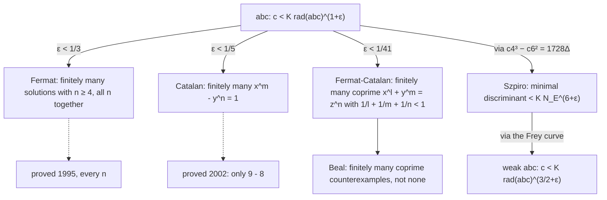

# The abc conjecture: sums whose prime factors are all small are rare

[Syllabus](../../../SYLLABUS.md) → [Algebraic and analytic number theory](../README.md) → [Diophantine and Modular](../README.md#s07) → The abc conjecture

---

## General Overview

Take the sum 1 + 8 = 9. Write each number as a product of primes: 1, then $`8 = 2^3`$, then $`9 = 3^2`$. Only two different primes appear in the whole sum, 2 and 3. Their product is 6, and 6 is smaller than the answer 9.

That almost never happens. For 2 + 3 = 5 the primes are 2, 3 and 5, and their product is 30, far above 5. Count every sum a + b = c with a < b, no common factor and c below 1,000: there are 151,895 of them. Only 31 behave like 1 + 8 = 9.

The **abc conjecture** says these exceptions are not just rare but tame. When c beats the product of its primes, it beats it only by a small power. That one inequality, if true, would settle large parts of Fermat's last theorem, Catalan's equation and Beal's question in a few lines each.

The same sum is the only answer to Catalan's equation: $`3^2 - 2^3 = 1`$ is the one case of two perfect powers (whole numbers raised to a power of 2 or more) that are 1 apart, proved in 2002.

**If a + b = c with no common factor, then c is less than a constant, fixed by ε, times the product of the distinct primes in abc, raised to the power 1 + ε, for any small ε > 0.**

**What kind of fact this is:** a conjecture, not accepted as proved as of 2026-11-15. Its current status belongs to the frontier wing's planned card. On this card three things are proved: that the ε cannot be dropped, that abc would imply the Fermat, Catalan and Fermat-Catalan results in the picture, and that Szpiro's curve inequality implies a weaker abc. That abc implies Szpiro is stated with sources. Every search count is evidence only.

### The picture: what abc would decide



Solid arrows are implications proved on this card or stated with a source. Dotted arrows lead to what was later proved without abc.

---

## The formula

Notation first, in words. The **radical** of a whole number n, written $`\mathrm{rad}(n)`$, is the product of the distinct primes dividing n, each taken once. So $`\mathrm{rad}(72) = \mathrm{rad}(2^3 \cdot 3^2) = 6`$. Here log is the natural logarithm, as in wing 07.

```math
a + b = c,\ \ \gcd(a, b) = 1 \ \Longrightarrow\ c < K_\varepsilon \, \mathrm{rad}(abc)^{1 + \varepsilon}
```

**Read it aloud:** for every small ε there is a constant $`K_\varepsilon`$ such that whenever two coprime positive whole numbers add up to c, c is less than $`K_\varepsilon`$ times the radical of abc to the power one plus ε.

The **quality** of a triple measures how far c beats its radical, on a log scale:

```math
\text{quality}(a, b, c) = \frac{\log c}{\log \mathrm{rad}(abc)}
```

A **hit** is a triple with quality above 1, that is $`\mathrm{rad}(abc) < c`$. For 1 + 8 = 9 the quality is log 9 / log 6 = 1.2263. abc says the same thing as: for each ε, only finitely many triples have quality above 1 + ε.

Szpiro's conjecture is the version for elliptic curves. It compares a curve's minimal discriminant $`\Delta_{\min}`$ with its conductor $`N_E`$, both defined in Why it works, Step 5:

```math
|\Delta_{\min}(E)| < K_\varepsilon \, N_E^{\,6 + \varepsilon}
```

**Read it aloud:** the size of a curve's smallest discriminant is less than a constant times its conductor to the power six plus ε.

| Symbol | Plain meaning | In our example | Push it up and the answer… |
| --- | --- | --- | --- |
| $`a, b, c`$ | positive whole numbers with a + b = c and no common factor | 1, 8, 9 | larger c makes a hit rarer |
| $`\mathrm{rad}(n)`$ | product of the distinct primes dividing n | rad(72) = 6 | a higher power of the same prime leaves it unchanged |
| quality | log c over log rad(abc) | 1.2263 | above 1 means a hit |
| $`\varepsilon`$ | a small positive exponent margin | below 1/3 for Fermat | smaller ε needs a larger constant |
| $`K_\varepsilon`$ | the constant abc promises; no value is known | unknown | — |
| $`x, y, z`$ | a supposed solution of a power equation | 3, 2 in $`3^2 - 2^3 = 1`$ | — |
| $`l, m, n`$ | exponents; n alone is Fermat's exponent | 2 and 3 for Catalan | larger exponents leave less room |
| $`k`$ | index of the family $`c = 3^{2^k}`$ | 1 to 5 | c/rad about doubles each step |
| $`E`$, $`A`$, $`B`$ | the Frey curve $`y^2 = x(x - A)(x + B)`$ built from a triple | A = 1, B = 8 | — |
| $`\Delta`$, $`\Delta_{\min}`$, $`e_1, e_2, e_3`$ | discriminant of an equation; the smallest one for the curve; the cubic's three roots | Δ = 82,944 | — |
| $`N_E`$ | conductor: built from the primes where the curve breaks | 15 for 1 + 80 = 81 | — |
| $`c_4`$, $`c_6`$ | two more invariants of the curve's equation; $`c_4 = 16(A^2 + AB + B^2)`$ for the Frey curve | 1,168 for 1 + 8 = 9; 6,481 for 1 + 80 = 81 after the change of variable | — |

### When it holds

- **No common factor.** Without it, 512 + 512 = 1024 has radical 2 and quality 10.0000, and doubling both sides makes quality as large as wanted.
- **The radical, not the product.** The product 1 × 8 × 9 = 72 is always above c, so a bound on it says nothing.
- **The ε is needed.** With exponent exactly 1, the family 1 + (c − 1) = c with $`c = 3^{2^k}`$ gives c/rad = 21.3333 at k = 5, and it doubles at each k. No fixed constant holds.
- **A constant that is not known.** abc gives a finite list of exceptions but no size for $`K_\varepsilon`$. So it bounds Fermat's exponent without saying where the bound is.

---

## Why it works

abc is unproved, so this section does two jobs. It says why abc is believed, and it proves what abc would imply.

### Step 0: small radicals need high powers, and addition ignores powers

A number has a small radical only if it is built from high powers of few primes, like $`8 = 2^3`$ and $`9 = 3^2`$. Such numbers are sparse. A hit needs a, b and c all to be of this kind at once, and coprime, so each uses its own primes.

Addition and multiplication do not coordinate. Adding two numbers built from 2 and 3 tells us nothing about the primes of their sum. So hits should be rare, and very high quality should be rarer still. This is a heuristic, not a proof.

The search agrees. Among coprime triples, the share of hits falls from 4.00e-03 below 100 to 2.75e-07 below 100,000.

### Step 1: the ε cannot be dropped

Take c = $`3^{2^k}`$ and b = c − 1, with a = 1. Factor b repeatedly as a difference of squares:

```math
3^{2^k} - 1 = (3 - 1)(3 + 1)(3^2 + 1)(3^4 + 1)\cdots(3^{2^{k-1}} + 1)
```

There are k + 1 factors, and every one is even. The factor 3 + 1 = 4 brings a second 2. So $`2^{k+2}`$ divides b.

The radical counts 2 once, so $`\mathrm{rad}(b) \le 2 \cdot b / 2^{k+2} = b/2^{k+1}`$. With c a power of 3 and a = 1:

```math
\frac{c}{\mathrm{rad}(abc)} \ \ge\ \frac{c}{3\, b / 2^{k+1}} \ >\ \frac{2^{k+1}}{3}
```

So c/rad grows without bound, and no inequality $`c < K\, \mathrm{rad}(abc)`$ with a fixed K can hold. The check confirms the lower bound exactly, in whole numbers, for k = 1 to 5. The quality still falls, from 1.2920 at k = 2 to 1.0953 at k = 5. That fits abc: c beats the radical, but only by a power that shrinks toward 1.

### Step 2: abc bounds Fermat for exponents 4 and up

Suppose $`x^n + y^n = z^n`$ with no common factor, as on [Fermat's last theorem](04-fermats-last-theorem-history-and-descent.md). Put $`a = x^n`$, $`b = y^n`$, $`c = z^n`$. The radical ignores exponents, and x and y are below z, so

```math
\mathrm{rad}(abc) = \mathrm{rad}(xyz) \le xyz < z^3
```

abc then gives $`z^n < K_\varepsilon\, z^{3(1+\varepsilon)}`$. For $`n \ge 4`$ the exponent 3(1 + ε) is below n exactly when ε < 1/3, because the largest 3/n with n ≥ 4 is 3/4. So $`z^{\,n - 3 - 3\varepsilon}`$ is below $`K_\varepsilon`$. That bounds both z and n: only finitely many solutions remain, for all exponents from 4 up together.

If the explicit inequality $`c < \mathrm{rad}(abc)^2`$ held for every triple, the same steps would give $`z^n < z^6`$, so n < 6. That inequality holds for every triple in the search, whose best quality is 1.5679. It is unproved.

### Step 3: abc bounds Catalan's equation, which our example solves

Catalan's equation is $`x^m - y^n = 1`$ with all four numbers at least 2. Write it as $`1 + y^n = x^m`$. Then $`\mathrm{rad}(abc) \le xy`$. Here x equals $`c^{1/m}`$ and y is below $`c^{1/n}`$, so:

```math
\mathrm{rad}(abc) \le xy < c^{1/m}\, c^{1/n} \le c^{5/6}
```

The 5/6 comes from m = 2, n = 3, the largest value of 1/m + 1/n once m = n = 2 is ruled out ($`x^2 - y^2 = 1`$ has no positive solution). abc with ε < 1/5 gives $`c < K_\varepsilon c^{(5/6)(1+\varepsilon)}`$, a power of c below 1, so c is bounded.

Catalan's equation was settled in full without abc: $`3^2 - 2^3 = 1`$ is the only solution (Mihăilescu, published 2004). The check finds 8, 9 as the only consecutive perfect powers up to 1,000,000.

### Step 4: Fermat-Catalan and Beal

The **Fermat-Catalan equation** is $`x^l + y^m = z^n`$ with x, y, z coprime and $`1/l + 1/m + 1/n < 1`$. The same steps give $`\mathrm{rad}(abc) \le xyz < c^{1/l + 1/m + 1/n} \le c^{41/42}`$. So abc with ε < 1/41 leaves only finitely many solutions, over all exponents together.

The search up to 1,000,000 finds five, including our 1 + 8 = 9 as $`1 + 2^3 = 3^2`$:

- $`2^5 + 7^2 = 3^4`$
- $`2^7 + 17^3 = 71^2`$
- $`13^2 + 7^3 = 2^9`$
- $`3^5 + 11^4 = 122^2`$

For each fixed set of exponents, finiteness is proved without abc (Darmon and Granville, 1995). abc would add finiteness across all exponents at once.

**Beal's conjecture** asks for more: if $`x^l + y^m = z^n`$ with all exponents at least 3, then x, y, z share a prime. abc gives only finitely many coprime counterexamples, not none. The search finds 0 coprime solutions, and 25 with a shared prime, such as $`3^3 + 6^3 = 3^5`$ (27 + 216 = 243).

<details>
<summary>Detailed proof: the largest 1/l + 1/m + 1/n below 1 is 41/42</summary>

Order the exponents so that $`l \le m \le n`$.

If l = m = 2, the sum is 1/2 + 1/2 + 1/n, above 1 for every n, so no case arises.

If l is 3 or more, the largest sum below 1 is at (3, 3, 4): 11/12, which is below 41/42.

If l = 2 and m is 5 or more, the sum is at most $`1/2 + 1/5 + 1/5 = 9/10`$.

If l = 2 and m = 4, n must be 5 or more, so the sum is at most $`1/2 + 1/4 + 1/5 = 19/20`$.

If l = 2 and m = 3, n must be 7 or more, so the sum is at most $`1/2 + 1/3 + 1/7 = 41/42`$.

Every case is at most 41/42, and (2, 3, 7) reaches it. The check confirms the value by exact fractions over every exponent below 40.

</details>

### Step 5: Szpiro's conjecture, through the Frey curve

The [Modularity](08-modularity-and-the-proof-of-fermat.md) card builds the **Frey curve** E from a triple: $`y^2 = x(x - A)(x + B)`$. Its three roots are 0, A and −B.

The **discriminant** Δ of a cubic equation $`y^2 = (x - e_1)(x - e_2)(x - e_3)`$ is $`16\big((e_1 - e_2)(e_2 - e_3)(e_3 - e_1)\big)^2`$. It is zero exactly when two roots meet. For the Frey curve the root gaps are A, B and A + B, so $`\Delta = 16(AB(A+B))^2`$. For 1 + 8 = 9 that is $`16 \cdot 72^2 = 82{,}944`$.

Two more terms, taught in the algebraic-geometry wing on [Weierstrass form](../../22-Algebraic%20geometry/04-Elliptic%20Curves/02-weierstrass-forms-discriminant-and-j-invariant.md), [The curve mod p](../../22-Algebraic%20geometry/04-Elliptic%20Curves/05-reduction-mod-p-and-hasse.md) and [The L-function](../../22-Algebraic%20geometry/04-Elliptic%20Curves/07-l-functions-of-elliptic-curves.md):

- The **minimal discriminant** $`\Delta_{\min}`$: one curve has many whole-number equations, related by changes of variable that scale Δ by a 12th power. $`\Delta_{\min}`$ is the smallest Δ among them.
- The **conductor** $`N_E`$: built from the primes where the curve, read mod p, gets a repeated root. If every such repeated root is a double root, a node (two branches crossing), the curve is **semistable**, and $`N_E = \mathrm{rad}(\Delta_{\min})`$.

A quick test settles both. A second invariant of the equation, $`c_4`$, is $`16(A^2 + AB + B^2)`$ for the Frey curve. If $`c_4`$ shares no prime with Δ, the equation is minimal and the curve is semistable. For 1 + 8 = 9, $`c_4 = 1{,}168`$ shares 16 with Δ: the test fails at 2, because 8 is not a multiple of 16, so the change of variable below is not available. The explicit case is therefore 1 + 80 = 81.

Take 1 + 80 = 81, written as A = −81, B = 80, so A + B = −1. Since 16 divides 80 and −81 is 3 more than a multiple of 4, a change of variable divides Δ by $`2^{12}`$:

| Quantity | Value |
| --- | --- |
| first Δ = 16(abc)² | 671,846,400 |
| $`\Delta_{\min}`$ = (abc)²/2⁸ | 164,025 |
| $`c_4`$ after the change, 16(A² + AB + B²)/2⁴ | 6,481 |
| gcd($`c_4`$, Δ) | 1, so minimal and semistable |
| $`N_E`$ = rad($`\Delta_{\min}`$) | 15 |
| rad(abc) | 30 |
| log $`\Delta_{\min}`$ / log $`N_E`$ | 4.4341, below Szpiro's 6 |

The prime 2 drops out of the conductor because this minimal equation, read mod 2, has no repeated root. For 1 + 6560 = 6561 the ratio is 4.1618, with $`N_E`$ = rad(abc) = 1,230.

**Szpiro gives a weak abc.** For a semistable Frey curve, $`N_E \le \mathrm{rad}(abc)`$ and $`|\Delta_{\min}| = (abc)^2/2^8`$. Since the larger of a and b is at least c/2, $`abc \ge c^2/2`$. Szpiro then gives

```math
\frac{c^4}{2^{10}} \le |\Delta_{\min}| < K_\varepsilon\, \mathrm{rad}(abc)^{6 + \varepsilon}
```

so c is below a constant times $`\mathrm{rad}(abc)^{3/2 + \varepsilon/4}`$. This covers triples whose even number is a multiple of 16; other triples need a bounded correction at the prime 2, in the sources. In the other direction, abc implies Szpiro, by applying abc to the identity $`c_4^3 - c_6^2 = 1728\,\Delta`$ (stated, with the proof in Lang 1990 and Bombieri and Gubler; $`c_6`$ is a third invariant).

---

## Worked numbers, by hand

| Step | Arithmetic | Value |
| --- | --- | --- |
| factor each number | 1, $`8 = 2^3`$, $`9 = 3^2`$ | primes 2 and 3 |
| radical | rad(72) = 2 × 3 | 6 |
| compare | 6 against c = 9 | 6 < 9: a hit |
| quality | log 9 / log 6 | 1.2263 |
| contrast | 2 + 3 = 5: rad = 30, quality | 0.4732 |
| how rare | hits among coprime triples, c below 1,000 | 31 of 151,895 |
| Catalan reading | $`3^2 - 2^3`$ | 1 |
| Frey curve | $`\Delta = 16 \cdot 72^2`$ | 82,944 |
| verdict | quality above 1 | **a hit, quality 1.2263** |

So 1 + 8 = 9 is a hit of quality 1.2263, one of only 31 below 1,000. abc says such triples exist but never reach quality far above 1 more than finitely often.

The best triples below 100,000 reach quality 1.5679, at 1 + 4374 = 4375 (radical 210). Higher quality is known further out: 2 + 3¹⁰·109 = 23⁵ = 6,436,343 has radical 15,042 and quality 1.6299. It has been the highest known since 1987; the check confirms its arithmetic, not its rank.

| Below | Coprime triples | Hits | Share |
| --- | ---: | ---: | ---: |
| 100 | 1,501 | 6 | 4.00e-03 |
| 1,000 | 151,895 | 31 | 2.04e-04 |
| 10,000 | 15,196,742 | 120 | 7.90e-06 |
| 100,000 | 1,519,805,376 | 418 | 2.75e-07 |

### What breaks if you drop a piece

| Mistake | Comes out at | What went wrong |
| --- | --- | --- |
| Use the product, not the radical | 1 × 8 × 9 = 72 | The product always exceeds c, so the bound is empty |
| Drop the ε (exponent exactly 1) | c/rad = 21.3333 at k = 5, doubling | The family $`3^{2^k}`$ beats every fixed constant |
| Allow a common factor | 512 + 512 = 1024: radical 2, quality 10.0000 | Scaling a triple by a prime power inflates quality freely |
| Use the first Δ in Szpiro | 671,846,400 against $`\Delta_{\min}`$ = 164,025 | Szpiro is about the minimal equation |
| Drop coprimality in Beal | 27 + 216 = 243, all exponents 3 or more | Shared primes give 25 solutions below 1,000,000 |

---

## Code, from first principles, and it actually runs

The code computes radicals two ways, by a sieve and by trial division, and checks they agree up to 3,000. It counts hits below 100,000 by a pruned search, which tries only those a whose radical is at most c / rad(c), and checks the count of 31 below 1,000 by brute force, and the 151,895 coprime triples below 1,000 by a gcd count. It finds the radicals in the family $`3^{2^k}`$ from the product formula and by direct factoring. It finds the exponent limits as exact fractions, and it builds Frey curves from their coefficient formulas, checking Δ against $`16(abc)^2`$ and $`(abc)^2/2^8`$, $`c_4`$ against its closed form, and the conductor against rad(abc). These are four independent cross-checks, and every count is evidence, not proof.

### Python

```python
# The abc conjecture: radicals of a + b = c, and what abc would decide.  Standard library only.
# abc is open, so every count here is evidence.  Roads: radical by sieve against trial division;
# hit count by a pruned search against brute force; Frey discriminant two ways.
from math import gcd, log
from fractions import Fraction as F

def primes_of(n):                           # trial division: the set of primes dividing n
    out, p = set(), 2
    while p * p <= n:
        while n % p == 0:
            out.add(p); n //= p
        p += 1
    if n > 1: out.add(n)
    return out

def rad_trial(n):
    r = 1
    for p in primes_of(n): r *= p
    return r

def rad_sieve(N):                           # rad[m] = product of the primes dividing m
    rad = [1] * (N + 1)
    for p in range(2, N + 1):
        if rad[p] == 1:                     # untouched so far: p is prime
            for m in range(p, N + 1, p): rad[m] *= p
    return rad

def qual(a, b, c): return log(c) / log(rad_trial(a * b * c))

print("example: 1 + 8 = 9")
print("rad(1*8*9) =", rad_trial(72), " c =", 9, " quality =", f"{qual(1, 8, 9):.4f}")
print("typical: 2 + 3 = 5   rad =", rad_trial(30), " quality =", f"{qual(2, 3, 5):.4f}")
assert rad_trial(72) == 6 and rad_trial(2 * 3 * 5) == 30   # trial division against the factorisations

print("\nfamily 1 + (3^(2^k) - 1) = 3^(2^k): c/rad grows without bound")
fam = []
for k in range(1, 6):
    c = 3 ** (2 ** k); b = c - 1
    ps = {3}
    for j in range(k):                      # b = 2 * (3+1)(3^2+1)...(3^(2^(k-1))+1)
        ps |= primes_of(3 ** (2 ** j) + 1)
    r = 1
    for p in ps: r *= p
    if k <= 4: assert r == rad_trial(b * c)  # second road for the radical
    assert b % 2 ** (k + 2) == 0 and 3 * c > 2 ** (k + 1) * r   # exact: c/rad > 2^(k+1)/3
    fam.append(c / r)
    print(f"k={k}  c={c:>20,}  rad={r:>14,}  c/rad={c / r:12.4f}  lower bound={2 ** (k + 1) / 3:.4f}"
          f"  quality={log(c) / log(r):.4f}")

N = 10 ** 5
rad = rad_sieve(N)
assert all(rad[m] == rad_trial(m) for m in range(1, 3001))
order = sorted(range(1, N + 1), key=lambda a: rad[a])
hits = []
for c in range(3, N + 1):                   # coprime a < b, a + b = c, rad(abc) < c
    bound = c // rad[c]
    for a in order:
        if rad[a] > bound: break
        b = c - a
        if a < b and gcd(a, b) == 1 and rad[a] * rad[b] * rad[c] < c: hits.append((a, b, c))
brute = sum(1 for c in range(3, 1000) for a in range(1, (c + 1) // 2)
            if gcd(a, c) == 1 and rad_trial(a * (c - a) * c) < c)
assert brute == sum(1 for h in hits if h[2] < 1000) == 31
print("\nhits: coprime a < b with a + b = c, c below the bound, and rad(abc) < c")
phi = list(range(N + 1))                    # Euler's phi by sieve: coprime a < c/2 number phi(c)/2
for p in range(2, N + 1):
    if phi[p] == p:
        for m in range(p, N + 1, p): phi[m] -= phi[m] // p
for M in (100, 1000, 10 ** 4, 10 ** 5):
    h, total = sum(1 for t in hits if t[2] < M), sum(phi[c] // 2 for c in range(3, M))
    print(f"c < {M:>7,}  hits={h:>4}  all triples={total:>13,}  share={h / total:.2e}")
    assert M > 1000 or total == sum(1 for c in range(3, M) for a in range(1, (c + 1) // 2) if gcd(a, c) == 1)
print("brute force below 1,000 agrees: 31")
top = sorted(hits, key=lambda t: -qual(*t))
print("highest quality, c <= 100,000:")
for t in top[:6]: print(f"  {t[0]} + {t[1]} = {t[2]}   rad={rad_trial(t[0] * t[1] * t[2]):,}   quality={qual(*t):.4f}")
print("triples with quality > 1.4:", sum(1 for t in hits if qual(*t) > 1.4))
assert max(qual(*t) for t in hits) < 2      # c < rad^2 holds throughout the search
a, b, c = 2, 3 ** 10 * 109, 23 ** 5; assert a + b == c
print(f"record: 2 + 3^10*109 = 23^5 = {c:,}   rad={rad_trial(a * b * c):,}   quality={qual(a, b, c):.4f}")

print("\nexponent room: rad(x^n y^n z^n) = rad(xyz) < z^3, so c < rad^2 forces n < 6")
s1 = max(F(3, n) for n in range(4, 40))
print(f"largest 3/n, n >= 4 (Fermat) = {s1}, abc bites for eps < {1 / s1 - 1}")
s2 = max(F(1, m) + F(1, n) for m in range(2, 40) for n in range(m, 40) if (m, n) != (2, 2))
s3 = max(t for l in range(2, 40) for m in range(l, 40) for n in range(m, 40)
         if (t := F(1, l) + F(1, m) + F(1, n)) < 1)
print(f"largest 1/m + 1/n (Catalan) = {s2}, abc bites for eps < {1 / s2 - 1}")
print(f"largest 1/l + 1/m + 1/n below 1 = {s3}, abc bites for eps < {1 / s3 - 1}")
assert s1 == F(3, 4) and s2 == F(5, 6) and s3 == F(41, 42)
print("\nwhat breaks")
print("product instead of radical: 1*8*9 =", 1 * 8 * 9, "(always above c)")
print(f"no epsilon, fixed K: family c/rad at k=5 is {fam[-1]:.4f}")
print(f"common factor: 512 + 512 = 1024, rad = {rad_trial(512 * 512 * 1024)}, "
      f"quality = {log(1024) / log(2):.4f}")

L = 10 ** 6                                 # perfect powers up to L, highest exponent kept
pw = {}
for e in range(2, L.bit_length()):          # 2^e <= L needs e below L's bit length
    x = 2
    while x ** e <= L:
        pw[x ** e] = (x, e); x += 1
pw[1] = (1, 10 ** 9)                        # 1 = 1^e for every e
vals = sorted(pw)
print(f"\nconsecutive perfect powers up to {L:,}:",
      [(u, v) for u, v in zip(vals[1:], vals[2:]) if v - u == 1])
fc, beal, beal_nc = [], 0, []
for i, u in enumerate(vals):
    for v in vals[i:]:
        w = u + v
        if w > L: break
        if w in pw and gcd(u, v) == 1:
            el, em, en = pw[u][1], pw[v][1], pw[w][1]
            if 1 / el + 1 / em + 1 / en < 1: fc.append((pw[u], pw[v], pw[w]))
            if min(el, em, en) >= 3: beal += 1
        elif w in pw and min(pw[u][1], pw[v][1], pw[w][1]) >= 3 and u > 1: beal_nc.append((u, v, w))
print(f"Fermat-Catalan solutions, coprime, 1/l + 1/m + 1/n < 1, up to {L:,}:")
for s in fc: print("  " + " + ".join(f"{x}^{e if x > 1 else 'any'}" for x, e in s[:2]) + f" = {s[2][0]}^{s[2][1]}")
print("coprime with all exponents >= 3 (Beal):", beal)
print("not coprime, all exponents >= 3:", len(beal_nc), " first:", beal_nc[0], " also 27 + 216 = 243:",
      (27, 216, 243) in beal_nc)
assert len(fc) == 5 and beal == 0 and (27, 216, 243) in beal_nc

print("\nFrey curves")
def invariants(a1, a2, a4):                 # y^2 + a1 xy = x^3 + a2 x^2 + a4 x
    b2, b4, b8 = a1 * a1 + 4 * a2, 2 * a4, -a4 * a4
    return -b2 * b2 * b8 - 8 * b4 ** 3, b2 * b2 - 24 * b4      # discriminant, c4
d, c4 = invariants(0, 7, -8)                # y^2 = x(x - 1)(x + 8), from 1 + 8 = 9
print("1 + 8 = 9: y^2 = x(x-1)(x+8)  disc =", f"{d:,}", " 16(abc)^2 =", f"{16 * 72 ** 2:,}",
      " c4 =", f"{c4:,}", " gcd(c4, disc) =", gcd(c4, d))
assert d == 16 * 72 ** 2 and c4 == 16 * (1 + 8 + 64)  # Tate's c4 against 16(A^2 + AB + B^2)
for c in (81, 6561):                        # 1 + (c-1) = c with A = -c, B = c - 1, 16 | B
    A, B = -c, c - 1                        # y^2 = x(x - A)(x + B), rescaled to a minimal model
    d, c4 = invariants(1, (B - A - 1) // 4, -A * B // 16)
    n_e = rad_trial(d)                      # semistable, so N = rad(disc): 2 drops out unless 32 | B
    assert d == (A * B) ** 2 // 2 ** 8 and gcd(c4, d) == 1 and n_e == rad_trial(B * c) // (2 if B % 32 else 1)
    print(f"1 + {B} = {c}: first disc 16(abc)^2 = {16 * (B * c) ** 2:,}, minimal disc = {d:,} = (abc)^2/2^8"
          f"\n   c4 = {c4:,}   gcd(c4, disc) = 1   conductor = {n_e:,}"
          f"   rad(abc) = {rad_trial(B * c):,}   log disc/log N = {log(d) / log(n_e):.4f}")
print("ALL CHECKS PASS")
```

**Ran 2026-11-15 on macOS, Python 3.14.10, standard library only. All checks passed. Output, pasted from the run:**

```
example: 1 + 8 = 9
rad(1*8*9) = 6  c = 9  quality = 1.2263
typical: 2 + 3 = 5   rad = 30  quality = 0.4732

family 1 + (3^(2^k) - 1) = 3^(2^k): c/rad grows without bound
k=1  c=                   9  rad=             6  c/rad=      1.5000  lower bound=1.3333  quality=1.2263
k=2  c=                  81  rad=            30  c/rad=      2.7000  lower bound=2.6667  quality=1.2920
k=3  c=               6,561  rad=         1,230  c/rad=      5.3341  lower bound=5.3333  quality=1.2353
k=4  c=          43,046,721  rad=     4,035,630  c/rad=     10.6667  lower bound=10.6667  quality=1.1556
k=5  c=1,853,020,188,851,841  rad=86,860,321,352,430  c/rad=     21.3333  lower bound=21.3333  quality=1.0953

hits: coprime a < b with a + b = c, c below the bound, and rad(abc) < c
c <     100  hits=   6  all triples=        1,501  share=4.00e-03
c <   1,000  hits=  31  all triples=      151,895  share=2.04e-04
c <  10,000  hits= 120  all triples=   15,196,742  share=7.90e-06
c < 100,000  hits= 418  all triples=1,519,805,376  share=2.75e-07
brute force below 1,000 agrees: 31
highest quality, c <= 100,000:
  1 + 4374 = 4375   rad=210   quality=1.5679
  343 + 59049 = 59392   rad=1,218   quality=1.5471
  37 + 32768 = 32805   rad=1,110   quality=1.4829
  1 + 2400 = 2401   rad=210   quality=1.4557
  7168 + 78125 = 85293   rad=2,730   quality=1.4350
  3 + 125 = 128   rad=30   quality=1.4266
triples with quality > 1.4: 6
record: 2 + 3^10*109 = 23^5 = 6,436,343   rad=15,042   quality=1.6299

exponent room: rad(x^n y^n z^n) = rad(xyz) < z^3, so c < rad^2 forces n < 6
largest 3/n, n >= 4 (Fermat) = 3/4, abc bites for eps < 1/3
largest 1/m + 1/n (Catalan) = 5/6, abc bites for eps < 1/5
largest 1/l + 1/m + 1/n below 1 = 41/42, abc bites for eps < 1/41

what breaks
product instead of radical: 1*8*9 = 72 (always above c)
no epsilon, fixed K: family c/rad at k=5 is 21.3333
common factor: 512 + 512 = 1024, rad = 2, quality = 10.0000

consecutive perfect powers up to 1,000,000: [(8, 9)]
Fermat-Catalan solutions, coprime, 1/l + 1/m + 1/n < 1, up to 1,000,000:
  1^any + 2^3 = 3^2
  2^5 + 7^2 = 3^4
  2^7 + 17^3 = 71^2
  13^2 + 7^3 = 2^9
  3^5 + 11^4 = 122^2
coprime with all exponents >= 3 (Beal): 0
not coprime, all exponents >= 3: 25  first: (8, 8, 16)  also 27 + 216 = 243: True

Frey curves
1 + 8 = 9: y^2 = x(x-1)(x+8)  disc = 82,944  16(abc)^2 = 82,944  c4 = 1,168  gcd(c4, disc) = 16
1 + 80 = 81: first disc 16(abc)^2 = 671,846,400, minimal disc = 164,025 = (abc)^2/2^8
   c4 = 6,481   gcd(c4, disc) = 1   conductor = 15   rad(abc) = 30   log disc/log N = 4.4341
1 + 6560 = 6561: first disc 16(abc)^2 = 29,639,285,965,209,600, minimal disc = 7,236,153,800,100 = (abc)^2/2^8
   c4 = 43,040,161   gcd(c4, disc) = 1   conductor = 1,230   rad(abc) = 1,230   log disc/log N = 4.1618
ALL CHECKS PASS
```

### Rust

Same numbers, same labels, built with `rustc --edition 2021 -O`.

```rust
// The abc conjecture: radicals of a + b = c, and what abc would decide.  Rust std only, no crates.
// abc is open, so every count here is evidence.  Roads: radical by sieve against trial division;
// hit count by a pruned search against brute force; Frey discriminant two ways.
use std::collections::{BTreeMap, BTreeSet};
fn gcd(a: i128, b: i128) -> i128 { if b == 0 { a.abs() } else { gcd(b, a % b) } }
fn primes_of(mut n: u128) -> BTreeSet<u128> { // trial division: the set of primes dividing n
    let (mut out, mut p) = (BTreeSet::new(), 2u128);
    while p * p <= n {
        while n % p == 0 { out.insert(p); n /= p; }
        p += 1; }
    if n > 1 { out.insert(n); }
    out
}
fn rad_trial(n: u128) -> u128 { primes_of(n).iter().product() }
fn qual(a: u128, b: u128, c: u128) -> f64 { (c as f64).ln() / (rad_trial(a * b * c) as f64).ln() }
fn commas(n: u128) -> String {
    let (s, mut out) = (n.to_string(), String::new());
    for (i, ch) in s.chars().enumerate() {
        if i > 0 && (s.len() - i) % 3 == 0 { out.push(','); }
        out.push(ch);
    }
    out
}
fn sci(x: f64) -> String { // Python's {:.2e}: two-digit exponent with sign
    let s = format!("{:.2e}", x);
    let (m, e) = s.split_once('e').unwrap();
    let e: i32 = e.parse().unwrap();
    format!("{}e{}{:02}", m, if e < 0 { '-' } else { '+' }, e.abs())
}
fn frac(n: i128, d: i128) -> (i128, i128) { let g = gcd(n, d); (n / g, d / g) }
fn invariants(a1: i128, a2: i128, a4: i128) -> (i128, i128) { // y^2 + a1 xy = x^3 + a2 x^2 + a4 x
    let (b2, b4, b8) = (a1 * a1 + 4 * a2, 2 * a4, -a4.checked_mul(a4).unwrap());
    let d = (-b2 * b2).checked_mul(b8).unwrap() - 8 * b4.pow(3);
    (d, b2 * b2 - 24 * b4) // discriminant, c4
}
fn main() {
    println!("example: 1 + 8 = 9");
    println!("rad(1*8*9) = {}  c = 9  quality = {:.4}", rad_trial(72), qual(1, 8, 9));
    println!("typical: 2 + 3 = 5   rad = {}  quality = {:.4}", rad_trial(30), qual(2, 3, 5));
    assert!(rad_trial(72) == 6 && rad_trial(2 * 3 * 5) == 30); // trial division against the factorisations

    println!("\nfamily 1 + (3^(2^k) - 1) = 3^(2^k): c/rad grows without bound");
    let mut fam = Vec::new();
    for k in 1..6u32 {
        let (c, b) = (3u128.pow(2u32.pow(k)), 3u128.pow(2u32.pow(k)) - 1);
        let mut ps = BTreeSet::from([3u128]);
        for j in 0..k { ps.extend(primes_of(3u128.pow(2u32.pow(j)) + 1)); }
        let r: u128 = ps.iter().product();
        if k <= 4 { assert_eq!(r, rad_trial(b * c)); } // second road for the radical
        let lb = 2f64.powi(k as i32 + 1) / 3.0;
        assert!(b % 2u128.pow(k + 2) == 0 && 3 * c > 2u128.pow(k + 1) * r); // exact: c/rad > 2^(k+1)/3
        fam.push(c as f64 / r as f64);
        println!("k={}  c={:>20}  rad={:>14}  c/rad={:12.4}  lower bound={:.4}  quality={:.4}",
            k, commas(c), commas(r), c as f64 / r as f64, lb, (c as f64).ln() / (r as f64).ln());
    }

    const N: usize = 100_000;
    let mut rad = vec![1u128; N + 1];
    for p in 2..=N {
        if rad[p] == 1 { let mut m = p; while m <= N { rad[m] *= p as u128; m += p; } }
    }
    assert!((1..=3000).all(|m| rad[m] == rad_trial(m as u128)));
    let mut order: Vec<usize> = (1..=N).collect();
    order.sort_by_key(|&a| rad[a]);
    let mut hits: Vec<(u128, u128, u128)> = Vec::new();
    for c in 3..=N {
        let bound = c as u128 / rad[c];
        for &a in &order {
            if rad[a] > bound { break; }
            if 2 * a >= c { continue; }
            let b = c - a;
            if gcd(a as i128, b as i128) == 1 && rad[a] * rad[b] * rad[c] < c as u128 { hits.push((a as u128, b as u128, c as u128)); }
        }
    }
    let brute = (3..1000u128).map(|c| (1..(c + 1) / 2)
        .filter(|&a| gcd(a as i128, c as i128) == 1 && rad_trial(a * (c - a) * c) < c).count()).sum::<usize>();
    assert!(brute == hits.iter().filter(|h| h.2 < 1000).count() && brute == 31);
    println!("\nhits: coprime a < b with a + b = c, c below the bound, and rad(abc) < c");
    let mut phi: Vec<u128> = (0..=N as u128).collect();
    for p in 2..=N {
        if phi[p] == p as u128 { let mut m = p; while m <= N { phi[m] -= phi[m] / p as u128; m += p; } }
    }
    for m in [100usize, 1000, 10_000, 100_000] {
        let h = hits.iter().filter(|t| t.2 < m as u128).count();
        let total: u128 = (3..m).map(|c| phi[c] / 2).sum();
        println!("c < {:>7}  hits={:>4}  all triples={:>13}  share={}",
            commas(m as u128), h, commas(total), sci(h as f64 / total as f64));
        assert!(m > 1000 || total == (3..m).map(|c| (1..(c + 1) / 2).filter(|&a| gcd(a as i128, c as i128) == 1).count() as u128).sum::<u128>());
    }
    println!("brute force below 1,000 agrees: 31");
    let mut top = hits.clone(); // stable sort, best quality first
    top.sort_by(|x, y| qual(y.0, y.1, y.2).partial_cmp(&qual(x.0, x.1, x.2)).unwrap());
    println!("highest quality, c <= 100,000:");
    for t in &top[..6] {
        println!("  {} + {} = {}   rad={}   quality={:.4}", t.0, t.1, t.2, commas(rad_trial(t.0 * t.1 * t.2)), qual(t.0, t.1, t.2));
    }
    println!("triples with quality > 1.4: {}", hits.iter().filter(|t| qual(t.0, t.1, t.2) > 1.4).count());
    assert!(hits.iter().all(|t| qual(t.0, t.1, t.2) < 2.0)); // c < rad^2 holds throughout the search
    let (a, b, c) = (2u128, 3u128.pow(10) * 109, 23u128.pow(5));
    assert_eq!(a + b, c);
    println!("record: 2 + 3^10*109 = 23^5 = {}   rad={}   quality={:.4}", commas(c), commas(rad_trial(a * b * c)), qual(a, b, c));

    println!("\nexponent room: rad(x^n y^n z^n) = rad(xyz) < z^3, so c < rad^2 forces n < 6");
    let s1 = (4..40i128).map(|n| frac(3, n)).max_by(|x, y| (x.0 * y.1).cmp(&(y.0 * x.1))).unwrap();
    let e1 = frac(s1.1 - s1.0, s1.0);
    println!("largest 3/n, n >= 4 (Fermat) = {}/{}, abc bites for eps < {}/{}", s1.0, s1.1, e1.0, e1.1);
    let (mut s2, mut s3) = ((0i128, 1i128), (0i128, 1i128));
    for l in 2..40i128 {
        for m in l..40 {
            if (l, m) != (2, 2) && (l + m) * s2.1 > s2.0 * l * m { s2 = frac(l + m, l * m); }
            for n in m..40 {
                let (nu, de) = (m * n + l * n + l * m, l * m * n);
                if nu < de && nu * s3.1 > s3.0 * de { s3 = frac(nu, de); } } } }
    let (e2, e3) = (frac(s2.1 - s2.0, s2.0), frac(s3.1 - s3.0, s3.0));
    println!("largest 1/m + 1/n (Catalan) = {}/{}, abc bites for eps < {}/{}", s2.0, s2.1, e2.0, e2.1);
    println!("largest 1/l + 1/m + 1/n below 1 = {}/{}, abc bites for eps < {}/{}", s3.0, s3.1, e3.0, e3.1);
    assert!(s1 == (3, 4) && s2 == (5, 6) && s3 == (41, 42));
    println!("\nwhat breaks");
    println!("product instead of radical: 1*8*9 = {} (always above c)", 1 * 8 * 9);
    println!("no epsilon, fixed K: family c/rad at k=5 is {:.4}", fam[fam.len() - 1]);
    println!("common factor: 512 + 512 = 1024, rad = {}, quality = {:.4}", rad_trial(512 * 512 * 1024), 1024f64.ln() / 2f64.ln());

    const L: u128 = 1_000_000; // perfect powers up to L, highest exponent kept
    let mut pw: BTreeMap<u128, (u128, u32)> = BTreeMap::new();
    for e in 2..(128 - L.leading_zeros()) { // 2^e <= L needs e below L's bit length
        let mut x = 2u128;
        while x.pow(e) <= L { pw.insert(x.pow(e), (x, e)); x += 1; }
    }
    pw.insert(1, (1, 1_000_000_000)); // 1 = 1^e for every e
    let vals: Vec<u128> = pw.keys().cloned().collect();
    let consec: Vec<String> = vals[1..].windows(2).filter(|w| w[1] - w[0] == 1).map(|w| format!("({}, {})", w[0], w[1])).collect();
    println!("\nconsecutive perfect powers up to {}: [{}]", commas(L), consec.join(", "));
    let (mut fc, mut beal, mut beal_nc) = (Vec::new(), 0, Vec::new());
    for (i, &u) in vals.iter().enumerate() {
        for &v in &vals[i..] {
            let w = u + v;
            if w > L { break; }
            if let Some(&pwv) = pw.get(&w) {
                let (el, em, en) = (pw[&u].1 as f64, pw[&v].1 as f64, pwv.1 as f64);
                if gcd(u as i128, v as i128) == 1 {
                    if 1.0 / el + 1.0 / em + 1.0 / en < 1.0 { fc.push((pw[&u], pw[&v], pwv)); }
                    if el.min(em).min(en) >= 3.0 { beal += 1; }
                } else if el.min(em).min(en) >= 3.0 && u > 1 { beal_nc.push((u, v, w)); }
            }
        }
    }
    println!("Fermat-Catalan solutions, coprime, 1/l + 1/m + 1/n < 1, up to {}:", commas(L));
    let show = |p: (u128, u32)| if p.0 > 1 { format!("{}^{}", p.0, p.1) } else { format!("{}^any", p.0) };
    for s in &fc { println!("  {} + {} = {}^{}", show(s.0), show(s.1), s.2 .0, s.2 .1); }
    println!("coprime with all exponents >= 3 (Beal): {}", beal);
    let has = beal_nc.contains(&(27, 216, 243));
    println!("not coprime, all exponents >= 3: {}  first: {:?}  also 27 + 216 = 243: {}",
        beal_nc.len(), beal_nc[0], if has { "True" } else { "False" });
    assert!(fc.len() == 5 && beal == 0 && has);

    println!("\nFrey curves");
    let (d, c4) = invariants(0, 7, -8); // y^2 = x(x - 1)(x + 8), from 1 + 8 = 9
    println!("1 + 8 = 9: y^2 = x(x-1)(x+8)  disc = {}  16(abc)^2 = {}  c4 = {}  gcd(c4, disc) = {}",
        commas(d as u128), commas(16 * 72 * 72), commas(c4 as u128), gcd(c4, d));
    assert!(d == 16 * 72 * 72 && c4 == 16 * (1 + 8 + 64)); // Tate's c4 against 16(A^2 + AB + B^2)
    for c in [81i128, 6561] { // 1 + (c-1) = c with A = -c, B = c - 1, 16 | B
        let (a_, b_) = (-c, c - 1); // y^2 = x(x - A)(x + B), rescaled to a minimal model
        let (d, c4) = invariants(1, (b_ - a_ - 1) / 4, -a_ * b_ / 16);
        let n_e = rad_trial(d as u128); // semistable, so N = rad(disc): 2 drops out unless 32 | B
        assert!(d == (a_ * b_).pow(2) / 256 && gcd(c4, d) == 1 && n_e == rad_trial((b_ * c) as u128) / if b_ % 32 == 0 { 1 } else { 2 });
        println!("1 + {} = {}: first disc 16(abc)^2 = {}, minimal disc = {} = (abc)^2/2^8\n   c4 = {}   gcd(c4, disc) = 1   conductor = {}   rad(abc) = {}   log disc/log N = {:.4}",
            b_, c, commas((16 * (b_ * c).pow(2)) as u128), commas(d as u128), commas(c4 as u128), commas(n_e), commas(rad_trial((b_ * c) as u128)), (d as f64).ln() / (n_e as f64).ln());
    }
    println!("ALL CHECKS PASS");
}
```

**Ran 2026-11-15 on macOS, rustc 1.98.1, no crates. All checks passed. Output, pasted from the run:**

```
example: 1 + 8 = 9
rad(1*8*9) = 6  c = 9  quality = 1.2263
typical: 2 + 3 = 5   rad = 30  quality = 0.4732

family 1 + (3^(2^k) - 1) = 3^(2^k): c/rad grows without bound
k=1  c=                   9  rad=             6  c/rad=      1.5000  lower bound=1.3333  quality=1.2263
k=2  c=                  81  rad=            30  c/rad=      2.7000  lower bound=2.6667  quality=1.2920
k=3  c=               6,561  rad=         1,230  c/rad=      5.3341  lower bound=5.3333  quality=1.2353
k=4  c=          43,046,721  rad=     4,035,630  c/rad=     10.6667  lower bound=10.6667  quality=1.1556
k=5  c=1,853,020,188,851,841  rad=86,860,321,352,430  c/rad=     21.3333  lower bound=21.3333  quality=1.0953

hits: coprime a < b with a + b = c, c below the bound, and rad(abc) < c
c <     100  hits=   6  all triples=        1,501  share=4.00e-03
c <   1,000  hits=  31  all triples=      151,895  share=2.04e-04
c <  10,000  hits= 120  all triples=   15,196,742  share=7.90e-06
c < 100,000  hits= 418  all triples=1,519,805,376  share=2.75e-07
brute force below 1,000 agrees: 31
highest quality, c <= 100,000:
  1 + 4374 = 4375   rad=210   quality=1.5679
  343 + 59049 = 59392   rad=1,218   quality=1.5471
  37 + 32768 = 32805   rad=1,110   quality=1.4829
  1 + 2400 = 2401   rad=210   quality=1.4557
  7168 + 78125 = 85293   rad=2,730   quality=1.4350
  3 + 125 = 128   rad=30   quality=1.4266
triples with quality > 1.4: 6
record: 2 + 3^10*109 = 23^5 = 6,436,343   rad=15,042   quality=1.6299

exponent room: rad(x^n y^n z^n) = rad(xyz) < z^3, so c < rad^2 forces n < 6
largest 3/n, n >= 4 (Fermat) = 3/4, abc bites for eps < 1/3
largest 1/m + 1/n (Catalan) = 5/6, abc bites for eps < 1/5
largest 1/l + 1/m + 1/n below 1 = 41/42, abc bites for eps < 1/41

what breaks
product instead of radical: 1*8*9 = 72 (always above c)
no epsilon, fixed K: family c/rad at k=5 is 21.3333
common factor: 512 + 512 = 1024, rad = 2, quality = 10.0000

consecutive perfect powers up to 1,000,000: [(8, 9)]
Fermat-Catalan solutions, coprime, 1/l + 1/m + 1/n < 1, up to 1,000,000:
  1^any + 2^3 = 3^2
  2^5 + 7^2 = 3^4
  2^7 + 17^3 = 71^2
  13^2 + 7^3 = 2^9
  3^5 + 11^4 = 122^2
coprime with all exponents >= 3 (Beal): 0
not coprime, all exponents >= 3: 25  first: (8, 8, 16)  also 27 + 216 = 243: True

Frey curves
1 + 8 = 9: y^2 = x(x-1)(x+8)  disc = 82,944  16(abc)^2 = 82,944  c4 = 1,168  gcd(c4, disc) = 16
1 + 80 = 81: first disc 16(abc)^2 = 671,846,400, minimal disc = 164,025 = (abc)^2/2^8
   c4 = 6,481   gcd(c4, disc) = 1   conductor = 15   rad(abc) = 30   log disc/log N = 4.4341
1 + 6560 = 6561: first disc 16(abc)^2 = 29,639,285,965,209,600, minimal disc = 7,236,153,800,100 = (abc)^2/2^8
   c4 = 43,040,161   gcd(c4, disc) = 1   conductor = 1,230   rad(abc) = 1,230   log disc/log N = 4.1618
ALL CHECKS PASS
```

The two outputs match line for line.

### Lean

Lean proves that the ε is needed and what abc implies for Fermat and Catalan, but not abc, which is open.

- Suppose abc holds, and $`x^n + y^n = z^n`$ with x and y positive and no common factor. Then only finitely many solutions have n ≥ 4, all n together.
- Suppose abc holds, and $`x^m - y^n = 1`$ with x, y, m and n all at least 2. Then there are only finitely many solutions.
- Take any fixed constant K. Then some coprime a + b = c has $`c \ge K\, \mathrm{rad}(abc)`$. So the ε cannot be dropped.
- The radicals of 1 + 8 = 9 and 2 + 3 = 5 are 6 and 30, as on the card.
- Take $`c = 3^{2^k}`$ for k = 1 to 5. Then each radical is as printed, and $`3c > 2^{k+1}\, \mathrm{rad}(abc)`$.
- Three of the best triples below 100,000 have radicals 210, 1,218 and 30. The 1987 record has radical 15,042.
- With a common factor, 512 + 512 = 1024 has radical 2.
- The sum 1/2 + 1/3 + 1/7 is exactly 41/42.
- The four Fermat-Catalan solutions listed and Beal's 27 + 216 = 243 are exact.
- For the Frey curve of 1 + 8 = 9, Δ = 82,944 and $`c_4`$ = 1,168, with gcd 16.
- For 1 + 80 = 81, the table's arithmetic is exact: 164,025, 6,481, gcd 1, and radicals 15 and 30.
- For 1 + 6560 = 6561, (abc)²/2⁸ = 7,236,153,800,100, and its radical is 1,230 = rad(abc).

The searches, quality decimals and exponent limits are left to the Python and Rust checks; Lean does not prove the Fermat-Catalan or Szpiro steps.

```lean
-- The abc conjecture: if abc holds, Fermat's equation with exponents 4 and up and Catalan's equation have only finitely many solutions, the ε in abc cannot be dropped, and the card's whole-number examples are exact.
import Mathlib.RingTheory.Radical.NatInt
import Mathlib.Analysis.SpecialFunctions.Pow.Real
import Mathlib.Tactic.Simproc.Factors
import Mathlib.Tactic.NormNum.GCD

open UniqueFactorizationMonoid

/-- The abc conjecture in radical form (open; the card does not prove it): for every ε > 0
there is a constant K such that whenever a + b = c with a, b positive whole numbers and no
common factor, c < K · rad(abc)^(1 + ε), where rad(n) is the product of the distinct primes
dividing n. -/
def ABCConjecture : Prop :=
  ∀ ε : ℝ, 0 < ε → ∃ K : ℝ, ∀ a b c : ℕ, 0 < a → 0 < b → a + b = c → Nat.Coprime a b →
    (c : ℝ) < K * ((radical (a * b * c) : ℕ) : ℝ) ^ (1 + ε)


/-- If r^6 ≤ c^5 and c < K · r^(1 + 1/10), then c < K^12. -/
lemma abc_helper_bound (K : ℝ) (c r : ℕ) (hc : 0 < c) (hr : r ^ 6 ≤ c ^ 5)
    (h : (c : ℝ) < K * (r : ℝ) ^ (1 + 1 / 10 : ℝ)) : (c : ℝ) < K ^ 12 := by
  have hC : (0 : ℝ) < c := by exact_mod_cast hc
  have hR : (0 : ℝ) ≤ r := by positivity
  have h1 : (r : ℝ) ^ (1 + 1 / 10 : ℝ) ≤ (c : ℝ) ^ (11 / 12 : ℝ) := by
    have ha : (0 : ℝ) ≤ (r : ℝ) ^ (1 + 1 / 10 : ℝ) := by positivity
    have hb : (0 : ℝ) ≤ (c : ℝ) ^ (11 / 12 : ℝ) := by positivity
    rw [← pow_le_pow_iff_left₀ ha hb (by norm_num : (60 : ℕ) ≠ 0)]
    rw [← Real.rpow_mul_natCast hR, ← Real.rpow_mul_natCast hC.le]
    have e1 : (1 + 1 / 10 : ℝ) * ((60 : ℕ) : ℝ) = ((66 : ℕ) : ℝ) := by norm_num
    have e2 : (11 / 12 : ℝ) * ((60 : ℕ) : ℝ) = ((55 : ℕ) : ℝ) := by norm_num
    rw [e1, e2, Real.rpow_natCast, Real.rpow_natCast]
    have : r ^ 66 ≤ c ^ 55 := by
      calc r ^ 66 = (r ^ 6) ^ 11 := by ring
        _ ≤ (c ^ 5) ^ 11 := Nat.pow_le_pow_left hr 11
        _ = c ^ 55 := by ring
    exact_mod_cast this
  have hK : 0 < K := by
    by_contra hK
    rw [not_lt] at hK
    have : K * (r : ℝ) ^ (1 + 1 / 10 : ℝ) ≤ 0 :=
      mul_nonpos_of_nonpos_of_nonneg hK (by positivity)
    linarith
  have h2 : (c : ℝ) < K * (c : ℝ) ^ (11 / 12 : ℝ) :=
    lt_of_lt_of_le h (mul_le_mul_of_nonneg_left h1 hK.le)
  have hsplit : (c : ℝ) = (c : ℝ) ^ (11 / 12 : ℝ) * (c : ℝ) ^ (1 / 12 : ℝ) := by
    rw [← Real.rpow_add hC]; norm_num
  have hpos : 0 < (c : ℝ) ^ (11 / 12 : ℝ) := by positivity
  have h3 : (c : ℝ) ^ (1 / 12 : ℝ) < K := by
    nth_rewrite 1 [hsplit] at h2
    rw [mul_comm K] at h2
    exact lt_of_mul_lt_mul_left h2 hpos.le
  have h4 : ((c : ℝ) ^ (1 / 12 : ℝ)) ^ 12 < K ^ 12 :=
    pow_lt_pow_left₀ h3 (by positivity) (by norm_num)
  rwa [← Real.rpow_mul_natCast hC.le, show (1 / 12 : ℝ) * ((12 : ℕ) : ℝ) = 1 by norm_num,
    Real.rpow_one] at h4

#print axioms abc_helper_bound

/-- For the ε-family: 3^(2^k) = 2^(k+1) · m + 1 for some m. -/
lemma abc_helper_three_pow (k : ℕ) : ∃ m : ℕ, 3 ^ (2 ^ k) = 2 ^ (k + 1) * m + 1 := by
  induction k with
  | zero => exact ⟨1, by norm_num⟩
  | succ k ih =>
    obtain ⟨m, hm⟩ := ih
    refine ⟨2 ^ k * m ^ 2 + m, ?_⟩
    rw [pow_succ 2 k, pow_mul, hm]
    ring

#print axioms abc_helper_three_pow

/-- The exponent count behind abc ⇒ Catalan: (y·x)^6 ≤ (x^m)^5. -/
lemma abc_helper_catalan_pow (x y m n : ℕ) (hx : 2 ≤ x) (hy : 2 ≤ y) (hm : 2 ≤ m)
    (hn : 2 ≤ n) (h : x ^ m = y ^ n + 1) : (y * x) ^ 6 ≤ (x ^ m) ^ 5 := by
  have hyn : y ^ n ≤ x ^ m := by omega
  rcases Nat.lt_or_ge 2 m with hm3 | hm2
  · have h1 : x ^ 6 ≤ (x ^ m) ^ 2 := by
      rw [← pow_mul]; exact Nat.pow_le_pow_right (by omega) (by omega)
    have h2 : y ^ 6 ≤ (x ^ m) ^ 3 := by
      calc y ^ 6 ≤ y ^ (n * 3) := Nat.pow_le_pow_right (by omega) (by omega)
        _ = (y ^ n) ^ 3 := by rw [pow_mul]
        _ ≤ (x ^ m) ^ 3 := Nat.pow_le_pow_left hyn 3
    calc (y * x) ^ 6 = y ^ 6 * x ^ 6 := by ring
      _ ≤ (x ^ m) ^ 3 * (x ^ m) ^ 2 := Nat.mul_le_mul h2 h1
      _ = (x ^ m) ^ 5 := by ring
  · have hm2' : m = 2 := by omega
    subst hm2'
    rcases Nat.lt_or_ge 2 n with hn3 | hn2
    · have h2 : y ^ 6 ≤ (x ^ 2) ^ 2 := by
        calc y ^ 6 ≤ y ^ (n * 2) := Nat.pow_le_pow_right (by omega) (by omega)
          _ = (y ^ n) ^ 2 := by rw [pow_mul]
          _ ≤ (x ^ 2) ^ 2 := Nat.pow_le_pow_left hyn 2
      calc (y * x) ^ 6 = y ^ 6 * (x ^ 2) ^ 3 := by ring
        _ ≤ (x ^ 2) ^ 2 * (x ^ 2) ^ 3 := Nat.mul_le_mul_right _ h2
        _ = (x ^ 2) ^ 5 := by ring
    · have hn2' : n = 2 := by omega
      subst hn2'
      exfalso
      have hyx : y < x := by nlinarith
      nlinarith

#print axioms abc_helper_catalan_pow

/-- abc bounds Fermat for exponents 4 and up: if the abc conjecture holds, then the equation
x^n + y^n = z^n with x, y positive, no common factor and n ≥ 4 has only finitely many
solutions (x, y, z, n), all exponents from 4 up taken together. -/
theorem abc_implies_fermat_finitely_many (habc : ABCConjecture) :
    {(x, y, z, n) : ℕ × ℕ × ℕ × ℕ |
      0 < x ∧ 0 < y ∧ 4 ≤ n ∧ Nat.Coprime x y ∧ x ^ n + y ^ n = z ^ n}.Finite := by
  obtain ⟨K, hK⟩ := habc (1 / 10) (by norm_num)
  set N := ⌈K ^ 12⌉₊
  refine ((Set.finite_Iic N).prod ((Set.finite_Iic N).prod
    ((Set.finite_Iic N).prod (Set.finite_Iic N)))).subset ?_
  rintro ⟨x, y, z, n⟩ ⟨hx, hy, hn, hxy, h⟩
  have hn0 : n ≠ 0 := by omega
  have hxn : 0 < x ^ n := by positivity
  have hyn : 0 < y ^ n := by positivity
  have hz : 2 ≤ z := by
    by_contra hz
    have : z ^ n ≤ 1 := by
      calc z ^ n ≤ 1 ^ n := Nat.pow_le_pow_left (by omega) n
        _ = 1 := one_pow n
    omega
  have hxz : x < z := lt_of_pow_lt_pow_left₀ n (by positivity) (by omega)
  have hyz : y < z := lt_of_pow_lt_pow_left₀ n (by positivity) (by omega)
  have key := hK (x ^ n) (y ^ n) (z ^ n) hxn hyn h (Nat.Coprime.pow n n hxy)
  have hr : radical (x ^ n * y ^ n * z ^ n) ≤ x * y * z := by
    rw [← mul_pow, ← mul_pow, radical_pow _ hn0]
    exact Nat.le_of_dvd (by positivity) radical_dvd_self
  have hr6 : radical (x ^ n * y ^ n * z ^ n) ^ 6 ≤ (z ^ n) ^ 5 := by
    calc radical (x ^ n * y ^ n * z ^ n) ^ 6 ≤ (x * y * z) ^ 6 := Nat.pow_le_pow_left hr 6
      _ ≤ (z * z * z) ^ 6 := Nat.pow_le_pow_left
          (Nat.mul_le_mul (Nat.mul_le_mul hxz.le hyz.le) le_rfl) 6
      _ = z ^ 18 := by ring
      _ ≤ z ^ (n * 5) := Nat.pow_le_pow_right (by omega) (by omega)
      _ = (z ^ n) ^ 5 := by rw [pow_mul]
  have hb := abc_helper_bound K (z ^ n) _ (by positivity) hr6 key
  have hzN : z ^ n ≤ N := by
    have : ((z ^ n : ℕ) : ℝ) ≤ (N : ℝ) := hb.le.trans (Nat.le_ceil _)
    exact_mod_cast this
  have h1 : z ≤ z ^ n := Nat.le_self_pow hn0 z
  have h2 : n < 2 ^ n := Nat.lt_two_pow_self
  have h3 : 2 ^ n ≤ z ^ n := Nat.pow_le_pow_left hz n
  simp only [Set.mem_prod, Set.mem_Iic]
  omega

/-- abc bounds Catalan's equation: if the abc conjecture holds, then x^m - y^n = 1, written
x^m = y^n + 1, with all four of x, y, m, n at least 2 has only finitely many solutions. -/
theorem abc_implies_catalan_finitely_many (habc : ABCConjecture) :
    {(x, y, m, n) : ℕ × ℕ × ℕ × ℕ |
      2 ≤ x ∧ 2 ≤ y ∧ 2 ≤ m ∧ 2 ≤ n ∧ x ^ m = y ^ n + 1}.Finite := by
  obtain ⟨K, hK⟩ := habc (1 / 10) (by norm_num)
  set N := ⌈K ^ 12⌉₊
  refine ((Set.finite_Iic N).prod ((Set.finite_Iic N).prod
    ((Set.finite_Iic N).prod (Set.finite_Iic N)))).subset ?_
  rintro ⟨x, y, m, n⟩ ⟨hx, hy, hm, hn, h⟩
  have hyn : 0 < y ^ n := by positivity
  have key := hK 1 (y ^ n) (x ^ m) one_pos hyn (by omega) (Nat.coprime_one_left _)
  have hr : radical (1 * y ^ n * x ^ m) ≤ y * x := by
    rw [one_mul]
    refine Nat.le_of_dvd (by positivity) (radical_mul_dvd.trans (mul_dvd_mul ?_ ?_))
    · exact radical_pow_dvd.trans radical_dvd_self
    · exact radical_pow_dvd.trans radical_dvd_self
  have hr6 : radical (1 * y ^ n * x ^ m) ^ 6 ≤ (x ^ m) ^ 5 :=
    (Nat.pow_le_pow_left hr 6).trans (abc_helper_catalan_pow x y m n hx hy hm hn h)
  have hb := abc_helper_bound K (x ^ m) _ (by positivity) hr6 key
  have hxN : x ^ m ≤ N := by
    have : ((x ^ m : ℕ) : ℝ) ≤ (N : ℝ) := hb.le.trans (Nat.le_ceil _)
    exact_mod_cast this
  have h1 : x ≤ x ^ m := Nat.le_self_pow (by omega) x
  have h2 : y ≤ y ^ n := Nat.le_self_pow (by omega) y
  have h3 : m < 2 ^ m := Nat.lt_two_pow_self
  have h4 : 2 ^ m ≤ x ^ m := Nat.pow_le_pow_left hx m
  have h5 : n < 2 ^ n := Nat.lt_two_pow_self
  have h6 : 2 ^ n ≤ y ^ n := Nat.pow_le_pow_left hy n
  simp only [Set.mem_prod, Set.mem_Iic]
  omega

/-- The ε cannot be dropped: there is no fixed constant K with c < K · rad(abc) for every
a + b = c with a, b positive and no common factor. (The family 1 + (3^(2^k) - 1) = 3^(2^k)
has c/rad(abc) > 2^(k+1)/3, which grows without bound.) -/
theorem epsilon_cannot_be_dropped :
    ¬ ∃ K : ℝ, ∀ a b c : ℕ, 0 < a → 0 < b → a + b = c → Nat.Coprime a b →
      (c : ℝ) < K * ((radical (a * b * c) : ℕ) : ℝ) := by
  rintro ⟨K, hK⟩
  set k := ⌈6 * K⌉₊
  obtain ⟨m, hm⟩ := abc_helper_three_pow k
  have hmpos : 0 < m := by
    rcases Nat.eq_zero_or_pos m with h0 | h0
    · subst h0
      have : 3 ≤ 3 ^ (2 ^ k) := Nat.le_self_pow (by positivity) 3
      omega
    · exact h0
  have key := hK 1 (2 ^ (k + 1) * m) (3 ^ (2 ^ k)) one_pos (by positivity) (by rw [hm]; ring)
    (Nat.coprime_one_left _)
  have hrad2 : radical (2 : ℕ) = 2 := by
    rw [Nat.radical_eq_prod_primeFactors, Nat.prime_two.primeFactors, Finset.prod_singleton]
  have hrad3 : radical (3 : ℕ) = 3 := by
    rw [Nat.radical_eq_prod_primeFactors, Nat.prime_three.primeFactors, Finset.prod_singleton]
  have hr : radical (1 * (2 ^ (k + 1) * m) * 3 ^ (2 ^ k)) ≤ 6 * m := by
    rw [one_mul]
    refine Nat.le_of_dvd (by positivity) ?_
    have hd : radical (2 ^ (k + 1) * m * 3 ^ (2 ^ k)) ∣ 2 * m * 3 := by
      refine radical_mul_dvd.trans (mul_dvd_mul (radical_mul_dvd.trans (mul_dvd_mul ?_ ?_)) ?_)
      · rw [radical_pow _ (by omega), hrad2]
      · exact radical_dvd_self
      · rw [radical_pow _ (by positivity), hrad3]
    simpa [mul_comm, mul_left_comm, mul_assoc] using hd
  have hrR : ((radical (1 * (2 ^ (k + 1) * m) * 3 ^ (2 ^ k)) : ℕ) : ℝ) ≤ 6 * m := by
    exact_mod_cast hr
  have hcR : ((3 ^ (2 ^ k) : ℕ) : ℝ) = 2 ^ (k + 1) * m + 1 := by rw [hm]; push_cast; ring
  have hk : 6 * K ≤ (k : ℝ) := Nat.le_ceil _
  have hk2 : (k : ℝ) ≤ 2 ^ (k + 1) := by
    have : k < 2 ^ (k + 1) := (Nat.lt_two_pow_self).trans (Nat.pow_lt_pow_right (by norm_num) (by omega))
    exact_mod_cast this.le
  have hmR : (0 : ℝ) < m := by exact_mod_cast hmpos
  rw [hcR] at key
  rcases le_or_gt K 0 with hK0 | hK0
  · have : K * ((radical (1 * (2 ^ (k + 1) * m) * 3 ^ (2 ^ k)) : ℕ) : ℝ) ≤ 0 :=
      mul_nonpos_of_nonpos_of_nonneg hK0 (by positivity)
    have : (0 : ℝ) ≤ 2 ^ (k + 1) * m := by positivity
    linarith
  · have h1 : K * ((radical (1 * (2 ^ (k + 1) * m) * 3 ^ (2 ^ k)) : ℕ) : ℝ) ≤ K * (6 * m) :=
      mul_le_mul_of_nonneg_left hrR hK0.le
    have h2 : K * (6 * m) ≤ 2 ^ (k + 1) * (m : ℝ) := by
      have : 6 * K ≤ (2 : ℝ) ^ (k + 1) := hk.trans hk2
      nlinarith
    linarith

-- rad(72) = rad(2^3 · 3^2) = 6.
example : radical (72 : ℕ) = 6 := by
  rw [Nat.radical_eq_prod_primeFactors]; norm_num [Nat.primeFactors]
-- 1 + 8 = 9 is a hit: rad(1 · 8 · 9) = 6 < 9; 3^2 - 2^3 = 1 is the same sum read as Catalan.
example : 1 + 8 = 9 ∧ radical (1 * 8 * 9 : ℕ) = 6 ∧ 6 < 9 ∧ 3 ^ 2 - 2 ^ 3 = 1 := by
  rw [Nat.radical_eq_prod_primeFactors]; norm_num [Nat.primeFactors]
-- 2 + 3 = 5 is typical: rad(2 · 3 · 5) = 30, far above 5.
example : radical (2 * 3 * 5 : ℕ) = 30 := by
  rw [Nat.radical_eq_prod_primeFactors]; norm_num [Nat.primeFactors]
-- The family c = 3^(2^k), b = c - 1, k = 1 to 5: rad(abc) as printed, and 3c > 2^(k+1) rad(abc).
example : radical (1 * (3 ^ 2 - 1) * 3 ^ 2 : ℕ) = 6 ∧ 3 * 3 ^ 2 > 2 ^ 2 * 6 := by
  rw [Nat.radical_eq_prod_primeFactors]; norm_num [Nat.primeFactors]
example : radical (1 * (3 ^ 4 - 1) * 3 ^ 4 : ℕ) = 30 ∧ 3 * 3 ^ 4 > 2 ^ 3 * 30 := by
  rw [Nat.radical_eq_prod_primeFactors]; norm_num [Nat.primeFactors]
example : radical (1 * (3 ^ 8 - 1) * 3 ^ 8 : ℕ) = 1230 ∧ 3 * 3 ^ 8 > 2 ^ 4 * 1230 := by
  rw [Nat.radical_eq_prod_primeFactors]; norm_num [Nat.primeFactors]
example : radical (1 * (3 ^ 16 - 1) * 3 ^ 16 : ℕ) = 4035630 ∧
    3 * 3 ^ 16 > 2 ^ 5 * 4035630 := by
  rw [Nat.radical_eq_prod_primeFactors]; norm_num [Nat.primeFactors]
example : radical (1 * (3 ^ 32 - 1) * 3 ^ 32 : ℕ) = 86860321352430 ∧
    3 ^ 32 = 1853020188851841 ∧ 3 * 3 ^ 32 > 2 ^ 6 * 86860321352430 := by
  rw [Nat.radical_eq_prod_primeFactors]; norm_num [Nat.primeFactors]
-- The best triples below 100,000 and the 1987 record: radicals 210, 1,218, 30 and 15,042.
example : 1 + 4374 = 4375 ∧ radical (1 * 4374 * 4375 : ℕ) = 210 := by
  rw [Nat.radical_eq_prod_primeFactors]; norm_num [Nat.primeFactors]
example : 343 + 59049 = 59392 ∧ radical (343 * 59049 * 59392 : ℕ) = 1218 := by
  rw [Nat.radical_eq_prod_primeFactors]; norm_num [Nat.primeFactors]
example : 3 + 125 = 128 ∧ radical (3 * 125 * 128 : ℕ) = 30 := by
  rw [Nat.radical_eq_prod_primeFactors]; norm_num [Nat.primeFactors]
example : 2 + 3 ^ 10 * 109 = 23 ^ 5 ∧ 23 ^ 5 = 6436343 ∧
    radical (2 * (3 ^ 10 * 109) * 23 ^ 5 : ℕ) = 15042 := by
  rw [Nat.radical_eq_prod_primeFactors]; norm_num [Nat.primeFactors]
-- A common factor breaks it: 512 + 512 = 1024 has radical 2.
example : 512 + 512 = 1024 ∧ Nat.gcd 512 512 = 512 ∧ radical (512 * 512 * 1024 : ℕ) = 2 := by
  rw [Nat.radical_eq_prod_primeFactors]; norm_num [Nat.primeFactors]
-- The largest 1/l + 1/m + 1/n below 1 is reached at (2, 3, 7): 41/42.
example : (1 / 2 + 1 / 3 + 1 / 7 : ℚ) = 41 / 42 := by norm_num
-- The Fermat-Catalan solutions found, and Beal's 27 + 216 = 243 with a shared prime 3.
example : 2 ^ 5 + 7 ^ 2 = 3 ^ 4 ∧ 2 ^ 7 + 17 ^ 3 = 71 ^ 2 ∧ 13 ^ 2 + 7 ^ 3 = 2 ^ 9 ∧
    3 ^ 5 + 11 ^ 4 = 122 ^ 2 ∧ 3 ^ 3 + 6 ^ 3 = 3 ^ 5 := by norm_num
-- Frey curve of 1 + 8 = 9: Δ = 16 · 72^2 = 82,944, c4 = 16(1 + 8 + 64) = 1,168, gcd 16.
example : 16 * (1 * 8 * 9) ^ 2 = 82944 ∧ 16 * (1 ^ 2 + 1 * 8 + 8 ^ 2) = 1168 ∧
    Nat.gcd 1168 82944 = 16 := by norm_num
-- Frey curve of 1 + 80 = 81 (A = -81, B = 80): first Δ 671,846,400, minimal Δ 164,025,
-- c4 = 16(A^2 + AB + B^2)/2^4 = 6,481, gcd(c4, Δmin) = 1, conductor rad(Δmin) = 15, rad(abc) = 30.
example : 16 * (1 * 80 * 81) ^ 2 = 671846400 ∧ (1 * 80 * 81) ^ 2 / 2 ^ 8 = 164025 ∧
    16 * ((-81 : ℤ) ^ 2 + (-81) * 80 + 80 ^ 2) / 2 ^ 4 = 6481 ∧ Nat.gcd 6481 164025 = 1 ∧
    radical (164025 : ℕ) = 15 ∧ radical (1 * 80 * 81 : ℕ) = 30 := by
  simp only [Nat.radical_eq_prod_primeFactors]; norm_num [Nat.primeFactors]
-- Frey curve of 1 + 6560 = 6561: minimal Δ 7,236,153,800,100, conductor 1,230 = rad(abc).
example : (1 * 6560 * 6561) ^ 2 / 2 ^ 8 = 7236153800100 ∧
    radical (7236153800100 : ℕ) = 1230 ∧ radical (1 * 6560 * 6561 : ℕ) = 1230 := by
  simp only [Nat.radical_eq_prod_primeFactors]; norm_num [Nat.primeFactors]

#print axioms abc_implies_fermat_finitely_many
#print axioms abc_implies_catalan_finitely_many
#print axioms epsilon_cannot_be_dropped
```

**Checked 2026-11-19 on macOS, Lean 4.36.0-rc2, Mathlib v4.36.0-rc2. Every proof is complete and uses only Lean's standard axioms. Output, pasted from the run:**

```
'abc_helper_bound' depends on axioms: [propext, Classical.choice, Quot.sound]
'abc_helper_three_pow' depends on axioms: [propext]
'abc_helper_catalan_pow' depends on axioms: [propext, Classical.choice, Quot.sound]
'abc_implies_fermat_finitely_many' depends on axioms: [propext, Classical.choice, Quot.sound]
'abc_implies_catalan_finitely_many' depends on axioms: [propext, Classical.choice, Quot.sound]
'epsilon_cannot_be_dropped' depends on axioms: [propext, Classical.choice, Quot.sound]
```

> [!TIP]
> **Try changing**
> Guess first, then run it.
> - **A larger search.** Set `N = 10 ** 6` in the Python and add `10 ** 6` to the list of bounds. Guess the hits below a million. There are 1,268, and the run takes about a minute. The new triple 121 + 255879 = 256000 enters the top six at quality 1.4889.
> - **More perfect powers.** Set `L = 10 ** 7`. Guess how many Fermat-Catalan solutions appear. Still 5: the next known one is far larger. Shared-prime Beal solutions rise from 25 to 36.
> - **A bigger Frey curve.** Add 43046721 to `(81, 6561)`. Guess the Szpiro ratio. It is 4.2579, still below 6, with conductor 4,035,630 = rad(abc).

---

## The usual mistake

> [!warning]
> **Thinking abc would prove Fermat's last theorem outright.** abc gives only finitely many solutions with n of 4 or more, and no known constant says where they stop. Only an explicit form, such as $`c < \mathrm{rad}(abc)^2`$, gives a number: n < 6. The full theorem came from modularity in 1995.
>
> - **Using the product instead of the radical.** 1 × 8 × 9 = 72 is above 9, as every product is. The radical counts each prime once: 6.
> - **Forgetting the ε.** The family $`3^{2^k}`$ has c/rad = 21.3333 at k = 5 and doubles each step, so a fixed constant with exponent 1 fails.
> - **Reading abc as Beal.** abc allows finitely many coprime counterexamples; Beal says none. The search finds 0 up to 1,000,000, which is evidence only.
> - **Trusting the search.** Every triple below 100,000 has quality below 2, yet a check to N is never proof.

---

## Where you meet it in real life

- **Polynomials.** The Mason–Stothers theorem is abc for polynomials, and it is proved: if a + b = c with no common factor and not all three constant, the largest degree among a, b and c is less than the number of distinct roots of abc. It gives short proofs of Fermat for polynomials.
- **Search projects.** Volunteer computing projects have searched for hits with c far beyond 100,000, and they rank what they find by quality, as the check does.
- **Elliptic curve tables.** Published tables of curves list each curve's minimal discriminant and conductor, the two numbers Szpiro compares.

> **Say it back**
> The radical of a number is the product of its distinct primes. For a + b = c with no common factor, the radical of abc is usually far above c; 1 + 8 = 9, with radical 6, is one of 31 exceptions below 1,000. abc says c can beat the radical only by a power 1 + ε, and the family $`3^{2^k}`$ shows the ε is needed. If true, abc leaves finitely many solutions to Fermat with n of 4 or more, to Catalan, and to Fermat-Catalan over all exponents. Szpiro's conjecture says the same for elliptic curves, through the Frey curve.

---

## What this builds on

- [Fermat's last theorem](04-fermats-last-theorem-history-and-descent.md): the equation and its history; this card shows how one inequality would cover all large exponents at once.
- [Modularity](08-modularity-and-the-proof-of-fermat.md): the Frey curve and its discriminant, used here for Szpiro's conjecture.
- [Rational points on a cubic](05-elliptic-curves-over-q-and-mordell-weil.md): what an elliptic curve is, and the shelf's curve $`y^2 = x^3 - x = x(x - 1)(x + 1)`$, which is the Frey curve of 1 + 1 = 2.

## Where this goes next

- [Chasing an algebraic number with fractions](10-diophantine-approximation-liouville-to-roth.md): another inequality with an ε margin, where Roth's theorem proves exponent 2 + ε.
- The abc conjecture (planned): the frontier wing's card on where abc stands now.
- Beal's conjecture (planned): the frontier wing's card on the equation with three different exponents, and its prize.

Is there any triple of quality above 2? None is known, and abc does not forbid it.

---

## Sources

Verified 2026-11-15: every link below resolves to the publisher's page.

- Lang, Serge. "Old and New Conjectured Diophantine Inequalities." *Bulletin of the American Mathematical Society* 23 (1990). [doi:10.1090/S0273-0979-1990-15899-9](https://doi.org/10.1090/S0273-0979-1990-15899-9). abc, Szpiro's conjecture, and how each implies the other.
- Bombieri, Enrico, and Walter Gubler. *Heights in Diophantine Geometry*. Cambridge University Press, 2006. [doi:10.1017/CBO9780511542879](https://doi.org/10.1017/CBO9780511542879). The abc conjecture, Frey curves and their consequences, with proofs.
- Silverman, Joseph H. *The Arithmetic of Elliptic Curves*, 2nd ed. Springer, 2009. [doi:10.1007/978-0-387-09494-6](https://doi.org/10.1007/978-0-387-09494-6). Minimal discriminants, the invariants $`c_4`$ and $`c_6`$, and semistable reduction.
- Darmon, Henri, and Andrew Granville. "On the Equations $`z^m = F(x, y)`$ and $`Ax^p + By^q = Cz^r`$." *Bulletin of the London Mathematical Society* 27 (1995). [doi:10.1112/blms/27.6.513](https://doi.org/10.1112/blms/27.6.513). Finitely many coprime solutions for each fixed set of exponents.
- Mihăilescu, Preda. "Primary Cyclotomic Units and a Proof of Catalan's Conjecture." *Journal für die reine und angewandte Mathematik* 572 (2004). [doi:10.1515/crll.2004.048](https://doi.org/10.1515/crll.2004.048). The proof that 8 and 9 are the only consecutive perfect powers.
