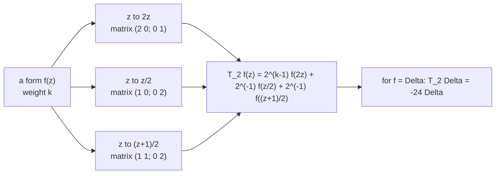

# Hecke operators: averaging a modular form over matrices of determinant n, and why tau is multiplicative

[Syllabus](../../../SYLLABUS.md) → [Algebraic and analytic number theory](../README.md) → [Diophantine and Modular](../README.md#s07) → Hecke operators

---

## General Overview

In 1916 Ramanujan listed the coefficients of $`\Delta = q(1 - q)^{24}(1 - q^2)^{24}\cdots`$, the weight-12 cusp form of [Modular forms](07-modular-forms-in-outline.md), with $`q = e^{2\pi i z}`$ for a point $`z`$ of the upper half-plane. He called the coefficient of $`q^n`$ the number $`\tau(n)`$. The list starts 1, −24, 252, −1472, 4830, −6048.

Two patterns stand out. The sixth number is the second times the third: $`(-24)(252) = -6048`$. The fourth is not the second squared: $`(-24)^2 = 576`$, but $`\tau(4) = -1472`$. It misses by exactly $`2^{11} = 2048`$. Mordell proved both rules in 1917. Hecke explained them in 1937.

A **Hecke operator** $`T_n`$ averages a modular form over the matrices of determinant $`n`$. For $`n = 2`$ there are three moves: $`z \mapsto 2z`$, $`z \mapsto z/2`$ and $`z \mapsto (z + 1)/2`$. The average is again a form of the same weight and level. The weight-12 cusp forms are only the multiples of $`\Delta`$, so the average of $`\Delta`$ is a multiple of $`\Delta`$. Its coefficients then give both rules.

The same rules hold at level 11. The form $`q - 2q^2 - q^3 + 2q^4 + q^5 + 2q^6 - \cdots`$ has $`a_6 = a_2 a_3 = 2`$, $`a_4 = a_2^2 - 2 = 2`$ and $`a_9 = a_3^2 - 3 = -2`$. In larger spaces no single form is forced, yet the rules survive, because all the operators can be made diagonal at once.

**Averaging a modular form over the matrices of determinant n gives another form of the same kind; these averages multiply like their indices when the indices are coprime ($`T_m T_n = T_{mn}`$), and are self-adjoint, so the cusp forms have a basis of common eigenvectors; at level 1 each one, scaled to start with q, has multiplicative coefficients.**

**What kind of fact this is:** theorems. The coefficient formula and $`T_m T_n = T_{mn}`$ are proved in full in Why it works. Self-adjointness is proved in outline, with the full proof in Diamond and Shurman, Chapter 5. Ramanujan's bound is only stated (Deligne, 1974). The checks to $`q^{130}`$ are evidence, not proof.

### The picture: the three moves behind T_2



Each arrow is one matrix of determinant 2, one from each class. The weights $`2^{k-1}`$ and $`2^{-1}`$ are the formula's $`n^{k-1}d^{-k}`$ with $`d = 1`$ and $`d = 2`$.

---

## The formula

**The level.** For a whole number $`N \ge 1`$, the group $`\Gamma_0(N)`$, read "gamma nought of N", holds the matrices of $`\mathrm{SL}_2(\mathbb{Z})`$ whose lower-left entry is a multiple of $`N`$:

```math
\Gamma_0(N) = \left\{ \begin{pmatrix} a & b \\ c & d \end{pmatrix} \in \mathrm{SL}_2(\mathbb{Z}) : N \mid c \right\}
```

A form of level $`N`$ respects the moves $`z \mapsto (az + b)/(cz + d)`$ of [Mobius transformations](../../07-Complex%20analysis/07-Conformal%20Maps%20and%20Harmonic%20Functions/02-mobius-transformations-and-the-point-at-infinity.md) for these matrices only. The **index** of $`\Gamma_0(N)`$ counts its cosets, as in [Cosets and Lagrange's theorem](../../03-Algebra/08-Groups/04-cosets-and-lagranges-theorem.md). Mod 11 there are 1320 matrices of determinant 1, and 110 of them have $`c = 0`$. Reduction mod 11 sends $`\mathrm{SL}_2(\mathbb{Z})`$ onto those 1320 and $`\Gamma_0(11)`$ onto those 110, so $`\Gamma_0(11)`$ has index $`1320/110 = 12`$.

**The operator.** Let $`f`$ be a form of weight $`k`$ and level $`N`$, and let $`n`$ share no factor with $`N`$:

```math
(T_n f)(z) = n^{k-1} \sum_{ud = n}\ \sum_{b = 0}^{d - 1} d^{-k}\, f\!\left(\frac{uz + b}{d}\right)
```

**Read it aloud:** for every split of n as u times d, and every shift b below d, move z to (uz + b) over d, weight f there by d to the minus k, add up, and scale by n to the k − 1.

The moves are the matrices $`\begin{pmatrix} u & b \\ 0 & d \end{pmatrix}`$. There are $`\sigma_1(n)`$ of them, the sum of the divisors of $`n`$: 3 for $`n = 2`$.

**The same operator on coefficients.** With $`f = \sum a_m q^m`$ and $`q = e^{2\pi i z}`$ (never a modulus on this card):

```math
a_m(T_n f) = \sum_{u \mid \gcd(m, n),\ \gcd(u, N) = 1} u^{k-1}\, a_{mn/u^2}(f), \qquad a_m(T_p f) = a_{pm} + p^{k-1} a_{m/p} \ \ (p \nmid N)
```

The last term counts only when $`p \mid m`$. For $`p \mid N`$ the condition $`\gcd(u, N) = 1`$ leaves $`a_m(U_p f) = a_{pm}`$; this operator $`U_p`$ is often still written $`T_p`$.

**The rules.** For coprime $`m, n`$, and each prime $`p`$ not dividing $`N`$:

```math
T_m T_n = T_{mn}, \qquad T_p T_{p^r} = T_{p^{r+1}} + p^{k-1}\, T_{p^{r-1}}
```

An **eigenform** is a nonzero form with $`T_n f = \lambda_n f`$ for every $`n`$; the number $`\lambda_n`$ is its **eigenvalue**. Scaled to $`a_1 = 1`$, it has $`\lambda_n = a_n`$ and

```math
a_{mn} = a_m a_n \ \ (\gcd(m, n) = 1), \qquad a_{p^{r+1}} = a_p\, a_{p^r} - p^{k-1} a_{p^{r-1}} \ \ (p \nmid N), \qquad a_{p^r} = a_p^r \ \ (p \mid N)
```

**The Petersson inner product.** For cusp forms $`f, g`$ of weight $`k`$, with $`z = x + iy`$ and $`F`$ a region that every point can be moved into (pictured on [Modular forms](07-modular-forms-in-outline.md)):

```math
\langle f, g \rangle = \int_{F} f(z)\, \overline{g(z)}\, y^{k}\, \frac{dx\, dy}{y^2}, \qquad \langle T_n f, g \rangle = \langle f, T_n g \rangle \ \ (\gcd(n, N) = 1)
```

| Symbol | Plain meaning | In our example | Push it up and the answer… |
| --- | --- | --- | --- |
| $`\Gamma_0(N)`$; $`N`$ | matrices with $`N \mid c`$; the level | $`\Gamma_0(11)`$, index 12 | fewer matrices, more forms |
| $`a, b, c, d`$; $`\alpha`$, $`\gamma`$; $`S`$ | matrix entries ($`b`$ is the shift in $`T_n`$); a move of determinant $`n`$, a matrix of the group; the flip $`z \mapsto -1/z`$ | $`b = 1`$, $`d = 2`$ for $`z \mapsto (z + 1)/2`$ | — |
| $`k`$ | the weight | 12 for $`\Delta`$; 2 at level 11; 24 | larger $`p^{k-1}`$ term |
| $`S_k`$ | cusp forms of weight $`k`$, level 1 | $`S_{12}`$: multiples of $`\Delta`$; $`S_{24}`$: basis $`g_1, g_2`$ | more eigenforms |
| $`n, m, l`$; $`p, r`$; $`u, d`$; $`\sigma_1(n)`$ | indices of operators and coefficients; a prime, an exponent; entries with $`ud = n`$; the number of moves | $`n = 2, 3, 6`$; $`\sigma_1(2) = 3`$ | more moves |
| $`T_n`$; $`U_p`$ | the Hecke operator; its form at $`p \mid N`$ | $`T_2 \Delta = -24\Delta`$; $`U_{11} f = f`$ | — |
| $`a_m`$; $`\tau(n)`$ | the coefficient of $`q^m`$; Ramanujan's tau, not the divisor count | $`\tau(2) = -24`$; $`a_2 = -2`$ at level 11 | — |
| $`\lambda_n`$ | the eigenvalue | $`540 + 12\sqrt{144169}`$ for $`T_2`$ on $`S_{24}`$ | real, by self-adjointness |
| $`\langle f, g \rangle`$; $`F`$; $`x, y`$ | Petersson inner product; its region; parts of $`z`$ | $`\langle g_1, g_1 \rangle = 5.9638915 \times 10^{-5}`$ | — |
| $`z`$; $`q`$ | a point $`x + iy`$ with $`y > 0`$; $`e^{2\pi i z}`$ | $`z = 0.3 + 1.1i`$ | — |
| $`\eta(z)`$; $`E_4`$ | Dedekind's eta, $`q^{1/24}\prod (1 - q^n)`$; the weight-4 Eisenstein series | $`\eta(z)^2\eta(11z)^2 = q - 2q^2 - \cdots`$ | — |
| $`g_1, g_2`$ | $`\Delta E_4^3`$ and $`\Delta^2`$ | $`g_1 = q + 696q^2 + \cdots`$ | — |

### When it holds

- **$`p`$ not dividing the level, for the $`p^{k-1}`$ term.** At level 11, $`a_{121} = a_{11}^2 = 1`$; the good-prime rule would give −10.
- **Coprime indices, for $`T_m T_n = T_{mn}`$.** In fact $`T_2 T_2 = T_4 + 2^{11} T_1`$; on an arbitrary series the $`q^1`$ coefficients read 8193 against 1.
- **Cusp forms, for the inner product.** A cusp form decays like $`e^{-2\pi y}`$ up the cusp, so the integral converges. An Eisenstein series tends to 1 there, and the integral diverges.
- **The weight $`y^k`$.** It makes $`f\bar g\, y^k`$ unchanged by the group. At weight 24 the integrand carries $`y^{k-2} = y^{22}`$ against $`dx\, dy`$. With $`y^{20}`$ for $`y^{22}`$, the adjoint test fails.
- **Real eigenvalues, not whole ones.** On $`S_{24}`$ the eigenvalues of $`T_2`$ are $`540 \pm 12\sqrt{144169}`$.

---

## Why it works

### Step 0: a form only cares about classes of matrices

A form does not change, apart from its fixed factor, when $`z`$ is moved by the group. So a matrix $`\alpha`$ of determinant $`n`$ and any $`\gamma\alpha`$, with $`\gamma`$ in the group, move $`f`$ the same way. Only the class of $`\alpha`$ matters, and there are $`\sigma_1(n)`$ classes.

The group also shuffles these classes among themselves. So a sum over one matrix per class has the same symmetry as $`f`$. That sum is $`T_n f`$.

### Step 1: one matrix from each class

Euclid's algorithm on the first column row-reduces (adds whole multiples of one row to the other, and swaps rows) every whole-number matrix of determinant $`n`$, by a matrix of $`\mathrm{SL}_2(\mathbb{Z})`$, to $`\begin{pmatrix} u & b \\ 0 & d \end{pmatrix}`$ with $`ud = n`$ and $`0 \le b < d`$. Different matrices of this shape lie in different classes. For each divisor $`d`$ of $`n`$ there are $`d`$ shifts, so the count is $`\sigma_1(n)`$.

For $`n = 2`$: one move with $`d = 1`$, two with $`d = 2`$. Two matrices lie in the same class exactly when their rows span the same lattice (the whole-number combinations of the rows): multiplying by $`\gamma`$ on the left recombines the rows, and $`\gamma^{-1}`$ undoes it. The code counts these lattices by brute force and finds 3, 4, 7, 6, 12 classes for $`n = 2`$ to 6, which are $`\sigma_1(n)`$. Each class holds exactly one of the shapes above. At level $`N`$ with $`\gcd(n, N) = 1`$ the same matrices serve.

### Step 2: the average is a form again

Take $`\gamma`$ in the group and a representative $`\alpha_j`$. The product $`\alpha_j\gamma`$ has determinant $`n`$, so it is $`\gamma'\alpha_i`$ for some $`\gamma'`$ in the group and some representative $`\alpha_i`$. As $`j`$ runs over the classes, so does $`i`$, each once.

So moving $`z`$ by $`\gamma`$ only reorders the terms of $`T_n f`$ and pulls out $`(cz + d)^k`$. The weights $`n^{k-1}d^{-k}`$ are the factor $`\det(\alpha)^{k-1}(0 \cdot z + d)^{-k}`$ that this bookkeeping needs. Cusp forms go to cusp forms.

### Step 3: the shifts pick out coefficients

Put $`f = \sum a_m q^m`$ into the formula. A move with bottom entry $`d`$ turns $`q^m`$ into $`e^{2\pi i m (uz + b)/d}`$. Summing over the $`d`$ shifts adds the roots of unity $`e^{2\pi i m b/d}`$. They total $`d`$ when $`d \mid m`$ and 0 otherwise.

So only the terms with $`d \mid m`$ survive, and each carries $`n^{k-1} d^{1-k} = u^{k-1}`$. Collecting the coefficient of $`q^m`$ gives the coefficient formula. For $`\Delta`$ it reads $`a_m(T_2 \Delta) = \tau(2m) + 2^{11}\tau(m/2)`$:

- $`m = 1`$: $`\tau(2) = -24`$.
- $`m = 2`$: $`\tau(4) + 2048\,\tau(1) = -1472 + 2048 = 576`$.
- $`m = 3`$: $`\tau(6) = -6048`$.

These are $`-24`$ times 1, −24 and 252: $`T_2\Delta = -24\Delta`$. The code also evaluates the three-move average numerically at $`z = 0.3 + 1.1i`$, a separate road.

### Step 4: the operators multiply like their indices

For coprime $`m, n`$, the coefficients of $`T_m T_n f`$ are a double sum over $`u \mid \gcd(l, m)`$ and $`v \mid \gcd(lm/u^2, n)`$. Since $`v`$ shares no factor with $`m`$, the pairs $`(u, v)`$ match the divisors $`uv`$ of $`\gcd(l, mn)`$ one for one. That is the formula for $`T_{mn}`$.

For $`p \cdot p`$ the matching fails. The term $`p^{k-1} a_l`$ appears once more in $`T_p T_p`$ than in $`T_{p^2}`$. That surplus is $`p^{k-1} T_1`$, where $`T_1`$ changes nothing.

<details>
<summary>Detailed proof: T_m T_n = T_mn for coprime m, n, and the prime-power rule</summary>

Take level 1; at level $`N`$ every divisor below is also coprime to $`N`$. Write $`b_j = a_j(T_n f)`$. Then

$`\displaystyle a_l(T_m T_n f) = \sum_{u \mid (l, m)} u^{k-1}\, b_{lm/u^2} = \sum_{u \mid (l, m)}\ \sum_{v \mid (lm/u^2,\, n)} (uv)^{k-1}\, a_{lmn/(uv)^2}.`$

Because $`\gcd(m, n) = 1`$, $`v`$ shares no factor with $`m/u`$ or $`u`$. So $`v \mid lm/u^2`$ exactly when $`v \mid l`$. A divisor $`w`$ of $`(l, mn)`$ splits in one way only as $`w = uv`$ with $`u \mid (l, m)`$ and $`v \mid (l, n)`$. The double sum becomes

$`\displaystyle \sum_{w \mid (l, mn)} w^{k-1}\, a_{lmn/w^2} = a_l(T_{mn} f).`$

For $`T_p T_p`$, now $`b_j = a_{pj} + p^{k-1} a_{j/p}`$, where $`a_x = 0`$ unless $`x`$ is a whole number. The term $`u = 1`$ gives $`b_{lp} = a_{lp^2} + p^{k-1} a_l`$. The term $`u = p`$, present when $`p \mid l`$, gives $`p^{k-1} b_{l/p} = p^{k-1} a_l + p^{2k-2} a_{l/p^2}`$. Against

$`\displaystyle a_l(T_{p^2} f) = a_{lp^2} + [p \mid l]\, p^{k-1} a_l + p^{2k-2} a_{l/p^2},`$

where $`[p \mid l]`$ is 1 when $`p`$ divides $`l`$ and 0 otherwise, the surplus is exactly $`p^{k-1} a_l`$. So $`T_p T_p = T_{p^2} + p^{k-1} T_1`$. The same bookkeeping with $`p^r`$ gives the general rule (Serre, Chapter VII, Section 5).

</details>

The code tests both identities on an arbitrary series, which is no modular form at all.

### Step 5: Δ is an eigenform, so τ is multiplicative

$`S_{12}`$ holds only multiples of $`\Delta`$, as [Modular forms](07-modular-forms-in-outline.md) proves from the zero count. By Step 2, $`T_n \Delta`$ lies in $`S_{12}`$, so $`T_n\Delta = \lambda_n \Delta`$. The $`q^1`$ coefficient of $`T_n \Delta`$ is $`\tau(n)`$, since only $`u = 1`$ divides $`\gcd(1, n)`$. So $`\lambda_n = \tau(n)`$.

Reading the $`q^m`$ coefficient of $`T_n\Delta = \tau(n)\Delta`$:

- For coprime $`m, n`$ only $`u = 1`$ appears: $`\tau(mn) = \tau(m)\tau(n)`$, so $`\tau(6) = (-24)(252) = -6048`$.
- For $`n = p`$, $`m = p^r`$: $`\tau(p^{r+1}) + p^{11}\tau(p^{r-1}) = \tau(p)\tau(p^r)`$, so $`\tau(4) = 576 - 2048 = -1472`$.

The code confirms all 115 coprime pairs with $`mn \le 130`$ and 13 prime-power steps.

### Step 6: the inner product, and why T_n is self-adjoint

The measure $`dx\, dy / y^2`$ is unchanged by every matrix move. And $`f\bar g\, y^k`$ is unchanged by the group, because $`\mathrm{Im}(\gamma z) = y / \lvert cz + d \rvert^2`$ cancels the two factors $`(cz + d)^k`$. So the integral does not depend on which region $`F`$ is used.

Self-adjointness comes from one matrix identity. Moving a move $`\alpha`$ from $`f`$ to $`g`$ replaces it by its adjugate $`n\alpha^{-1}`$ (swap the diagonal entries, negate the other two). For $`\alpha = \begin{pmatrix} 1 & 0 \\ 0 & n \end{pmatrix}`$ that is $`\begin{pmatrix} n & 0 \\ 0 & 1 \end{pmatrix}`$, which the flip $`S = \begin{pmatrix} 0 & -1 \\ 1 & 0 \end{pmatrix}`$, the move $`z \mapsto -1/z`$, turns back into $`\alpha`$. So the adjoint of $`T_n`$ is $`T_n`$.

<details>
<summary>Proof sketch: why the adjoint of T_n is T_n</summary>

Take one move $`\alpha = \begin{pmatrix} a & b \\ c & d \end{pmatrix}`$ of determinant $`n`$. Write $`f|\alpha`$ for $`f`$ moved by $`\alpha`$ with its factor, $`(f|\alpha)(z) = n^{k-1}(cz + d)^{-k} f(\alpha z)`$, and $`\alpha' = n\,\alpha^{-1} = \begin{pmatrix} d & -b \\ -c & a \end{pmatrix}`$. Put $`w = \alpha z`$. Then $`\alpha' w = z`$, the two factors multiply to $`(cz + d)(-cw + a) = n`$, and $`\mathrm{Im}\, z = n\, \mathrm{Im}\, w / \lvert -cw + a \rvert^2`$. Put all three into the integrand; the powers of $`n`$ and of $`-cw + a`$ cancel:

$`\displaystyle (f|\alpha)(z)\, \overline{g(z)}\, (\mathrm{Im}\, z)^{k} = f(w)\, \overline{(g|\alpha')(w)}\, (\mathrm{Im}\, w)^{k}.`$

The measure $`dx\, dy / y^2`$ is unchanged, so

$`\displaystyle \langle f|\alpha,\, g \rangle = \langle f,\, g|\alpha' \rangle,`$

where the left side is the integral over a region $`R`$ for the smaller group $`\Gamma \cap \alpha^{-1}\Gamma\alpha`$, with $`\Gamma`$ the group of the level, and the right side is the same integral over $`\alpha R`$.

The matrices of determinant $`n`$ split into double cosets $`\Gamma \begin{pmatrix} a & 0 \\ 0 & d \end{pmatrix} \Gamma`$ (every product of a group matrix, that diagonal matrix and another group matrix), one for each $`a \mid d`$ with $`ad = n`$. The adjugate of $`\begin{pmatrix} a & 0 \\ 0 & d \end{pmatrix}`$ is $`\begin{pmatrix} d & 0 \\ 0 & a \end{pmatrix} = S \begin{pmatrix} a & 0 \\ 0 & d \end{pmatrix} S^{-1}`$, so each double coset is its own set of adjugates. At level $`N`$ this holds when $`\gcd(n, N) = 1`$. One more fact lets the one-move identity be summed: the representatives $`\alpha_j`$ can be chosen to serve for the classes $`\Gamma\alpha_j`$ and $`\alpha_j\Gamma`$ at once (Diamond and Shurman, Section 5.5). Taking adjugates turns $`\alpha_j\Gamma`$ into $`\Gamma\alpha_j'`$, so the $`\alpha_j'`$ are again one matrix per class. Summing $`\langle f|\alpha_j, g \rangle = \langle f, g|\alpha_j' \rangle`$ over $`j`$ gives $`\langle T_n f, g \rangle = \langle f, T_n g \rangle`$. The full argument is Diamond and Shurman, Section 5.5.

</details>

### Step 7: commuting self-adjoint operators share an eigenbasis

Each space of cusp forms is finite-dimensional ([Modular forms](07-modular-forms-in-outline.md)), with the Petersson inner product on it. The $`T_n`$ with $`\gcd(n, N) = 1`$ are self-adjoint (Step 6), and they all commute. The prime-power rule makes $`T_{p^r}`$ a polynomial in $`T_p`$, so the two commute. Operators of coprime index multiply in either order (Step 4). And every $`T_n`$ is a product of such $`T_{p^r}`$.

[The spectral theorem](../../03-Algebra/07-Eigenvalues%20and%20Symmetric%20Matrices/04-spectral-theorem.md) diagonalises one self-adjoint map, with real eigenvalues and perpendicular eigenvectors. To diagonalise all the $`T_n`$ at once, split the space into the eigenspaces of one $`T_p`$. Any other $`T_m`$ commutes with it, so it maps each eigenspace into itself: if $`T_p f = \lambda f`$, then $`T_p(T_m f) = T_m(T_p f) = \lambda\, T_m f`$. Inside each eigenspace $`T_m`$ is still self-adjoint, so the spectral theorem splits it further. Repeat with the $`T_p`$ one prime at a time. The number of pieces only grows and never passes the dimension, so after some prime it stays fixed. From then on every $`T_p`$ acts on each piece as a single number. That gives a basis of common eigenvectors, perpendicular to each other, with real eigenvalues.

At level 1 such a form has $`a_1 \ne 0`$: if $`a_1 = 0`$ then $`a_n = \lambda_n a_1 = 0`$ for every $`n`$. So it scales to $`a_1 = 1`$, and Step 5's reading makes its coefficients multiplicative.

**The case $`S_{24}`$, where nothing is forced.** Its basis is $`g_1 = \Delta E_4^3 = q + 696q^2 + \cdots`$ and $`g_2 = \Delta^2 = q^2 - 48q^3 + \cdots`$. There $`T_2`$ has the matrix with columns $`(696, 20736000)`$ and $`(1, 384)`$, far from symmetric. Yet its eigenvalues are real:

```math
\lambda^2 - 1080\lambda - 20468736 = 0, \qquad \lambda = 540 \pm 12\sqrt{144169} = 5096.351172,\ -4016.351172
```

The eigenform for the first is $`g_1 + (-156 + 12\sqrt{144169})\, g_2`$, with $`a_2 = 540 + 12\sqrt{144169}`$ and $`a_3 = 169740 - 576\sqrt{144169}`$. Their product, $`-904836528 + 1725840\sqrt{144169}`$, is exactly $`a_6`$. The two eigenforms are perpendicular under the Petersson product. In naive coordinates their cosine is −1.000000: almost opposite.

### Step 8: level 11 and the curve

At level 11 the weight-2 cusp forms are one-dimensional ([Modularity](08-modularity-and-the-proof-of-fermat.md) counts them). The only form is

```math
f(z) = \eta(z)^2 \eta(11z)^2 = q \prod_{n \ge 1} (1 - q^n)^2 (1 - q^{11n})^2 = q - 2q^2 - q^3 + 2q^4 + q^5 + 2q^6 - 2q^7 - 2q^9 - \cdots
```

Every $`T_n`$, and $`U_{11}`$, maps this space to itself. So $`f`$ is an eigenform with $`a_1 = 1`$, and the rules hold with $`p^{k-1} = p`$. Eichler proved in 1954, the first case of modularity, that $`a_p`$ is $`p`$ minus the number of solutions of $`y^2 + y = x^3 - x^2 - 10x - 20`$ mod $`p`$, for each prime $`p \ne 11`$. The code checks every prime up to 47.

---

## Worked numbers, by hand

| Step | Arithmetic | Value |
| --- | --- | --- |
| moves for $`T_2`$ | $`d = 1`$: one; $`d = 2`$: shifts 0, 1 | 3 |
| $`a_1(T_2\Delta)`$ | $`\tau(2)`$ | $`-24`$ |
| $`a_2(T_2\Delta)`$ | $`\tau(4) + 2^{11}\tau(1) = -1472 + 2048`$ | $`576 = (-24)(-24)`$ |
| $`a_3(T_2\Delta)`$ | $`\tau(6)`$ | $`-6048 = (-24)(252)`$ |
| coprime rule | $`\tau(6) = \tau(2)\tau(3) = (-24)(252)`$ | **−6048** |
| prime-power rule | $`\tau(4) = \tau(2)^2 - 2^{11} = 576 - 2048`$ | **−1472** |
| level 11, coprime | $`a_6 = a_2 a_3 = (-2)(-1)`$ | 2 |
| level 11, prime powers | $`a_4 = a_2^2 - 2 = 4 - 2`$; $`a_9 = a_3^2 - 3 = 1 - 3`$ | 2; −2 |
| level 11, bad prime | $`a_{121} = a_{11}^2 = 1^2`$ | 1 |

Ramanujan's two patterns are the equation $`T_n\Delta = \tau(n)\Delta`$ read one coefficient at a time. At level 11 the same equation predicts every coefficient from the prime ones.

### What breaks if you drop a piece

| Mistake | Comes out at | What went wrong |
| --- | --- | --- |
| $`\tau(4) = \tau(2)^2`$ | 576, against −1472 | 2 and 2 share a factor; prime powers carry the $`2^{11}`$ term |
| $`T_2 T_2 = T_4`$ on any series | $`q^1`$ coefficient 8193, against 1 | the missing term is $`2^{11} T_1`$ |
| 11 treated as a good prime at level 11 | $`a_{121} = 1 - 11 = -10`$, against 1 | at $`p \mid N`$ the operator is $`U_p`$, with no $`p^{k-1}`$ term |
| $`y^{20}`$ in the inner product at weight 24 | $`\langle T_2 g_1, g_2\rangle = 5.2150286 \times 10^{-5}`$, against $`\langle g_1, T_2 g_2\rangle = 2.1194702 \times 10^{-5}`$ | only the weight $`y^{k}`$ makes the integrand invariant |
| Coefficients paired directly | $`\langle T_2 g_1, g_2\rangle = 20736000`$, against $`\langle g_1, T_2 g_2 \rangle = 1`$ | self-adjointness belongs to the Petersson product |

The code prints every row.

---

## Code, from first principles, and it actually runs

Both programs build every series from its product and apply $`T_n`$ by the coefficient formula. They take **four independent roads**:

1. The coefficient formula gives $`T_n \Delta = \tau(n)\Delta`$ exactly.
2. The matrix average, evaluated numerically at $`z = 0.3 + 1.1i`$, agrees.
3. The level-11 coefficients match point counts on the curve.
4. Simpson's rule computes the Petersson integral on $`S_{24}`$ and confirms self-adjointness, where the matrix alone looks lopsided.

A brute-force coset count mod 11 gives the index, and a brute-force count of lattices gives the $`\sigma_1(n)`$ classes of Step 1. The $`S_{24}`$ eigenform is exact, as pairs $`(x, y)`$ meaning $`x + y\sqrt{144169}`$.

### Python

```python
# Hecke operators and eigenforms -- the check behind the card.  Standard library
# only.  Here q = e^(2 pi i z), never a modulus, and tau(n) is Ramanujan's.
from math import pi, exp, cos, sin, sqrt, gcd, floor, log10
L = 130                                    # every series is kept to q^L

def product(parts):                        # q * prod over n of (1 - q^(c n))^e
    P = [1] + [0] * L
    for c, e in parts:
        for n in range(1, L // c + 1):
            for _ in range(e):
                for i in range(L, c * n - 1, -1): P[i] -= P[i - c * n]
    return [0] + P[:L]

def mul(a, b): return [sum(a[i] * b[n - i] for i in range(n + 1)) for n in range(L + 1)]
def sigma(k, n): return sum(d ** k for d in range(1, n + 1) if n % d == 0)
def yn(b): return "yes" if b else "no"
def primes(n): return [p for p in range(2, n + 1) if all(p % d for d in range(2, p))]

def T(a, n, k, N=1):                       # Hecke T_n on coefficients, weight k, level N
    return [sum(d ** (k - 1) * a[m * n // (d * d)] for d in range(1, n + 1)
                if m % d == 0 and n % d == 0 and gcd(d, N) == 1) for m in range((len(a) - 1) // n + 1)]

def cexp(w): return complex(exp(w.real) * cos(w.imag), exp(w.real) * sin(w.imag))
def ev(a, z, top):                         # sum of a[n] q^n for n <= top, by Horner
    q, s = cexp(2j * pi * z), 0j
    for n in range(top, 0, -1): s = (s + a[n]) * q
    return s
def show(w): return f"{w.real:.9f} {'+' if w.imag >= 0 else '-'} {abs(w.imag):.9f}i"
def sci(x): e = floor(log10(abs(x))); return f"{x / 10 ** e:.7f}e{e}"

def matrix_average(a, n, k, z):            # road 2: average f over (a b; 0 d), ad = n, 0 <= b < d
    s = 0j
    for d in range(1, n + 1):
        if n % d == 0:
            for b in range(d): s += ev(a, ((n // d) * z + b) / d, L) * (n ** (k - 1) / d ** k)
    return s

sl2 = [(a, b, c, d) for a in range(11) for b in range(11) for c in range(11) for d in range(11) if (a * d - b * c) % 11 == 1]
g0 = [m for m in sl2 if m[2] == 0]
print(f"Gamma_0(11): {len(sl2)} matrices in SL2(Z mod 11), {len(g0)} with c = 0; index {len(sl2) // len(g0)}")
def span(v, w, n): return frozenset(((i * v[0] + j * w[0]) % n, (i * v[1] + j * w[1]) % n) for i in range(n) for j in range(n))
lat = [{S for v in range(n * n) for w in range(n * n) for S in [span(divmod(v, n), divmod(w, n), n)] if len(S) == n} for n in range(2, 7)]
reps = [{span((n // d, b), (0, d), n) for d in range(1, n + 1) if n % d == 0 for b in range(d)} for n in range(2, 7)]
print("classes of determinant-n matrices (row lattices of index n), n = 2..6:", [len(x) for x in lat],
      "; classes holding a (u b; 0 d), 0 <= b < d:", [len(x) for x in reps], "; sigma_1(n):", [sigma(1, n) for n in range(2, 7)])

tau = product([(1, 24)])
print("tau(1..12):", tau[1:13])
print("T_2 Delta starts:", T(tau, 2, 12)[1:6], "; -24 x Delta starts:", [-24 * t for t in tau[1:6]])
eig = all(T(tau, n, 12)[:21] == [tau[n] * t for t in tau[:21]] for n in range(2, 7))
print(f"T_n Delta = tau(n) Delta to q^20 for n = 2..6: {yn(eig)}")
z = complex(0.3, 1.1)
for n in (2, 3):
    print(f"z = {z.real} + {z.imag}i, n = {n}: matrix average x 1000 = {show(1000 * matrix_average(tau, n, 12, z))}; "
          f"tau(n) Delta(z) x 1000 = {show(1000 * tau[n] * ev(tau, z, L))}")

s = [(7 * m * m + 3 * m) % 13 - 6 for m in range(L + 1)]   # an arbitrary series, weight 12
print("arbitrary series s starts:", s[1:9])
print(f"T_2 T_3 s = T_6 s = T_3 T_2 s to q^20: {yn(T(T(s, 3, 12), 2, 12)[:21] == T(s, 6, 12)[:21] == T(T(s, 2, 12), 3, 12)[:21])}")
t22, t4 = T(T(s, 2, 12), 2, 12), T(s, 4, 12)
print(f"T_2 T_2 s = T_4 s + 2^11 s to q^30: {yn(all(t22[m] == t4[m] + 2048 * s[m] for m in range(31)))}; "
      f"mistake, T_2 T_2 = T_4: at q^1 {t22[1]} against {t4[1]}")

def hecke_rules(a, k, N, top):             # coprime pairs and prime-power steps up to top
    cop = pp = 0
    for m in range(2, top + 1):
        for n in range(m + 1, top // m + 1):
            if gcd(m, n) == 1: assert a[m * n] == a[m] * a[n]; cop += 1
    for p in primes(top):
        if N % p:
            r = p
            while r * p <= top: assert a[r * p] == a[p] * a[r] - p ** (k - 1) * a[r // p]; pp += 1; r *= p
    return cop, pp
print("Delta, coprime pairs and prime-power steps to q^130, all hold:", hecke_rules(tau, 12, 1, L))
print(f"tau(6) = {tau[6]} = ({tau[2]})({tau[3]});  tau(4) = {tau[2] ** 2} - {2 ** 11} = {tau[4]}")

f = product([(1, 2), (11, 2)])            # eta(z)^2 eta(11z)^2, level 11, weight 2
print("level 11, a(1..12):", f[1:13])
ps = [p for p in primes(47) if p != 11]
cnt = [p - sum(1 for x in range(p) for y in range(p) if (y * y + y - x ** 3 + x * x + 10 * x + 20) % p == 0) for p in ps]
print("a_p, p = 2..47 but 11:          ", [f[p] for p in ps])
print("p minus points of y^2 + y = x^3 - x^2 - 10x - 20 mod p:", cnt)
print(f"level 11: a6 = {f[6]} = a2 a3, a4 = {f[2] ** 2} - 2 = {f[4]}, a9 = {f[3] ** 2} - 3 = {f[9]}, a11 = {f[11]}, a121 = {f[121]}")
print("level 11, coprime pairs and prime-power steps (p not 11) to q^130, all hold:", hecke_rules(f, 2, 11, L))
print(f"mistake, a121 = a11^2 - 11 as if 11 were good: {f[11] ** 2 - 11}, against {f[121]}")
w = 2 * ev(f, 2 * z, L) + (ev(f, z / 2, L) + ev(f, (z + 1) / 2, L)) / 2
print(f"level 11 at z: 2 f(2z) + (f(z/2) + f((z+1)/2))/2 = {show(w)}; -2 f(z) = {show(-2 * ev(f, z, L))}")
h = product([(4, 2), (8, 2)])             # the house curve y^2 = x^3 - x, level 32
print(f"level 32: a3 = {h[3]}, a5 = {h[5]}, a9 = {h[9]} = a3^2 - 3, a25 = {h[25]} = a5^2 - 5, a45 = {h[45]} = a9 a5")

E4 = [1] + [240 * sigma(3, n) for n in range(1, L + 1)]
g1, g2 = mul(tau, mul(E4, mul(E4, E4)))[:41], mul(tau, tau)[:41]   # basis of S_24, to q^40
print("S_24: g1 = Delta E4^3 starts", g1[1:5], "; g2 = Delta^2 starts", g2[1:5])
def coords(g):                             # g = x g1 + y g2, checked on every coefficient
    x = g[1]; y = g[2] - x * g1[2]; assert all(g[i] == x * g1[i] + y * g2[i] for i in range(len(g))); return x, y
def mat(n): c1, c2 = coords(T(g1, n, 24)), coords(T(g2, n, 24)); return [[c1[0], c2[0]], [c1[1], c2[1]]]
def mm(A, B): return [[sum(A[i][k] * B[k][j] for k in range(2)) for j in range(2)] for i in range(2)]
A2, A3, A6 = mat(2), mat(3), mat(6)
print("T_2 on (g1, g2), columns are images:", A2, "; T_3:", A3)
print(f"T_2 T_3 = T_3 T_2 = T_6 as matrices: {yn(mm(A2, A3) == mm(A3, A2) == A6)}")
tr, det = A2[0][0] + A2[1][1], A2[0][0] * A2[1][1] - A2[0][1] * A2[1][0]
disc = tr * tr - 4 * det; D = 144169
print(f"T_2: trace {tr}, det {det}, discriminant {disc} = 24^2 x {D}; eigenvalues 540 +/- 12 r, r = sqrt({D}): "
      f"{540 + 12 * sqrt(D):.6f}, {540 - 12 * sqrt(D):.6f}")
def zm(u, v): return (u[0] * v[0] + D * u[1] * v[1], u[0] * v[1] + u[1] * v[0])   # x + y r
ef = [(g1[n] - 156 * g2[n], 12 * g2[n]) for n in range(41)]   # g1 + (-156 + 12 r) g2
print(f"eigenform a(2) = {ef[2]}, a(3) = {ef[3]}, as (x, y) meaning x + y r")
okT = all(T([e[i] for e in ef], n, 24)[:13] == [zm(ef[n], e)[i] for e in ef[:13]] for n in (2, 3) for i in (0, 1))
print(f"T_2 and T_3 fix it up to a(n), to q^12: {yn(okT)}; a(6) = a(2) a(3) = {zm(ef[2], ef[3])}: {yn(zm(ef[2], ef[3]) == ef[6])}")

NX, NT, TOP = 240, 1200, 16                # Simpson over x in [-1/2, 1/2], y = sqrt(1 - x^2) + t, t in [0, 6]
G, B = [[0.0, 0.0], [0.0, 0.0]], [[0.0, 0.0], [0.0, 0.0]]   # B: the mistake, y^20 for y^22
for i in range(NX + 1):
    x = -0.5 + i / NX; wx = 1 if i in (0, NX) else (4 if i % 2 else 2)
    for j in range(NT + 1):
        y = sqrt(1 - x * x) + 6 * j / NT; wt = 1 if j in (0, NT) else (4 if j % 2 else 2)
        u, v = ev(g1, complex(x, y), TOP), ev(g2, complex(x, y), TOP)
        for W, e in ((G, 22), (B, 20)):
            m = wx * wt * y ** e / (9 * NX * NT) * 6
            W[0][0] += m * abs(u) ** 2; W[1][1] += m * abs(v) ** 2; W[0][1] += m * (u * v.conjugate()).real
G[1][0], B[1][0] = G[0][1], B[0][1]
print(f"Petersson <g1,g1> = {sci(G[0][0])}, <g1,g2> = {sci(G[0][1])}, <g2,g2> = {sci(G[1][1])}")
def adj(W): return A2[0][0] * W[0][1] + A2[1][0] * W[1][1], A2[0][1] * W[0][0] + A2[1][1] * W[0][1]
(l, r), (lb, rb) = adj(G), adj(B)
print(f"<T_2 g1, g2> = {sci(l)}; <g1, T_2 g2> = {sci(r)}; naive coefficient pairing gives {A2[1][0]} against {A2[0][1]}")
print(f"mistake, y^20 in place of y^22: {sci(lb)} against {sci(rb)}")
vp, vm = (1, -156 + 12 * sqrt(D)), (1, -156 - 12 * sqrt(D))
def ip(a, b): return sum(a[i] * G[i][j] * b[j] for i in range(2) for j in range(2))
cosP, cosN = ip(vp, vm) / sqrt(ip(vp, vp) * ip(vm, vm)), (1 + vp[1] * vm[1]) / sqrt((1 + vp[1] ** 2) * (1 + vm[1] ** 2))
print(f"the two eigenforms: Petersson cosine below 1e-6: {yn(abs(cosP) < 1e-6)}; naive coordinate cosine {cosN:.6f}")

assert len(sl2) // len(g0) == 12
assert lat == reps and [len(x) for x in lat] == [sigma(1, n) for n in range(2, 7)]
assert eig and tau[6] == tau[2] * tau[3] == -6048 and tau[4] == tau[2] ** 2 - 2 ** 11 == -1472
assert abs(matrix_average(tau, 3, 12, z) - 252 * ev(tau, z, L)) < 1e-9 * abs(252 * ev(tau, z, L))
assert t22[1] != t4[1] and cnt == [f[p] for p in ps] and abs(w + 2 * ev(f, z, L)) < 1e-12
assert (f[6], f[4], f[9]) == (2, 2, -2) and f[121] == f[11] ** 2 and mm(A2, A3) == A6 and disc == 576 * D
assert (h[9], h[25], h[45]) == (h[3] ** 2 - 3, h[5] ** 2 - 5, h[9] * h[5]) == (-3, -1, 6)
assert okT and abs(l - r) < 1e-6 * abs(l) and abs(lb - rb) > 0.1 * abs(lb) and abs(cosP) < 1e-6
print("ALL CHECKS PASS")
```

**Ran 2026-11-24 on macOS, Python 3.14.10, standard library only. All checks passed. Output, pasted from the run:**

```
Gamma_0(11): 1320 matrices in SL2(Z mod 11), 110 with c = 0; index 12
classes of determinant-n matrices (row lattices of index n), n = 2..6: [3, 4, 7, 6, 12] ; classes holding a (u b; 0 d), 0 <= b < d: [3, 4, 7, 6, 12] ; sigma_1(n): [3, 4, 7, 6, 12]
tau(1..12): [1, -24, 252, -1472, 4830, -6048, -16744, 84480, -113643, -115920, 534612, -370944]
T_2 Delta starts: [-24, 576, -6048, 35328, -115920] ; -24 x Delta starts: [-24, 576, -6048, 35328, -115920]
T_n Delta = tau(n) Delta to q^20 for n = 2..6: yes
z = 0.3 + 1.1i, n = 2: matrix average x 1000 = 6.921318473 - 23.072441635i; tau(n) Delta(z) x 1000 = 6.921318473 - 23.072441635i
z = 0.3 + 1.1i, n = 3: matrix average x 1000 = -72.673843962 + 242.260637164i; tau(n) Delta(z) x 1000 = -72.673843962 + 242.260637164i
arbitrary series s starts: [4, 2, 1, 1, 2, 4, -6, -2]
T_2 T_3 s = T_6 s = T_3 T_2 s to q^20: yes
T_2 T_2 s = T_4 s + 2^11 s to q^30: yes; mistake, T_2 T_2 = T_4: at q^1 8193 against 1
Delta, coprime pairs and prime-power steps to q^130, all hold: (115, 13)
tau(6) = -6048 = (-24)(252);  tau(4) = 576 - 2048 = -1472
level 11, a(1..12): [1, -2, -1, 2, 1, 2, -2, 0, -2, -2, 1, -2]
a_p, p = 2..47 but 11:           [-2, -1, 1, -2, 4, -2, 0, -1, 0, 7, 3, -8, -6, 8]
p minus points of y^2 + y = x^3 - x^2 - 10x - 20 mod p: [-2, -1, 1, -2, 4, -2, 0, -1, 0, 7, 3, -8, -6, 8]
level 11: a6 = 2 = a2 a3, a4 = 4 - 2 = 2, a9 = 1 - 3 = -2, a11 = 1, a121 = 1
level 11, coprime pairs and prime-power steps (p not 11) to q^130, all hold: (115, 12)
mistake, a121 = a11^2 - 11 as if 11 were good: -10, against 1
level 11 at z: 2 f(2z) + (f(z/2) + f((z+1)/2))/2 = 0.000612511 - 0.001897331i; -2 f(z) = 0.000612511 - 0.001897331i
level 32: a3 = 0, a5 = -2, a9 = -3 = a3^2 - 3, a25 = -1 = a5^2 - 5, a45 = 6 = a9 a5
S_24: g1 = Delta E4^3 starts [1, 696, 162252, 12831808] ; g2 = Delta^2 starts [0, 1, -48, 1080]
T_2 on (g1, g2), columns are images: [[696, 1], [20736000, 384]] ; T_3: [[162252, -48], [-995328000, 177228]]
T_2 T_3 = T_3 T_2 = T_6 as matrices: yes
T_2: trace 1080, det -20468736, discriminant 83041344 = 24^2 x 144169; eigenvalues 540 +/- 12 r, r = sqrt(144169): 5096.351172, -4016.351172
eigenform a(2) = (540, 12), a(3) = (169740, -576), as (x, y) meaning x + y r
T_2 and T_3 fix it up to a(n), to q^12: yes; a(6) = a(2) a(3) = (-904836528, 1725840): yes
Petersson <g1,g1> = 5.9638915e-5, <g1,g2> = 1.6057147e-9, <g2,g2> = 2.8519450e-12
<T_2 g1, g2> = 6.0255509e-5; <g1, T_2 g2> = 6.0255509e-5; naive coefficient pairing gives 20736000 against 1
mistake, y^20 in place of y^22: 5.2150286e-5 against 2.1194702e-5
the two eigenforms: Petersson cosine below 1e-6: yes; naive coordinate cosine -1.000000
ALL CHECKS PASS
```

### Rust

Same numbers, same labels, built with `rustc --edition 2021 -O`.

```rust
// Hecke operators and eigenforms -- the same check as the Python, in Rust.  No
// crates.  Here q = e^(2 pi i z), never a modulus, and tau(n) is Ramanujan's.
use std::collections::BTreeSet;
use std::f64::consts::PI;
const L: usize = 130;                     // every series is kept to q^L
type V = Vec<i128>;

#[derive(Clone, Copy)]
struct C { re: f64, im: f64 }
fn c(re: f64, im: f64) -> C { C { re, im } }
impl std::ops::Add for C { type Output = C; fn add(self, o: C) -> C { c(self.re + o.re, self.im + o.im) } }
impl std::ops::Mul for C { type Output = C; fn mul(self, o: C) -> C { c(self.re * o.re - self.im * o.im, self.re * o.im + self.im * o.re) } }
fn sc(a: C, t: f64) -> C { c(a.re * t, a.im * t) }
fn cexp(w: C) -> C { c(w.re.exp() * w.im.cos(), w.re.exp() * w.im.sin()) }
fn ev(a: &[i128], z: C, top: usize) -> C {    // sum of a[n] q^n for n <= top, by Horner
    let q = cexp(c(-2.0 * PI * z.im, 2.0 * PI * z.re));
    let mut s = c(0.0, 0.0);
    for n in (1..=top).rev() { s = (s + c(a[n] as f64, 0.0)) * q }
    s
}
fn show(w: C) -> String { format!("{:.9} {} {:.9}i", w.re, if w.im >= 0.0 { "+" } else { "-" }, w.im.abs()) }
fn sci(x: f64) -> String { let e = x.abs().log10().floor(); format!("{:.7}e{}", x / 10f64.powf(e), e as i64) }
fn yn(b: bool) -> &'static str { if b { "yes" } else { "no" } }
fn gcd(a: i128, b: i128) -> i128 { if b == 0 { a } else { gcd(b, a % b) } }
fn sigma(k: u32, n: i128) -> i128 { (1..=n).filter(|d| n % d == 0).map(|d| d.pow(k)).sum() }
fn primes(n: usize) -> Vec<usize> { (2..=n).filter(|&p| (2..p).all(|d| p % d != 0)).collect() }
fn lst<T: std::fmt::Display>(v: &[T]) -> String { format!("[{}]", v.iter().map(|x| x.to_string()).collect::<Vec<_>>().join(", ")) }

fn product(parts: &[(usize, usize)]) -> V {   // q * prod over n of (1 - q^(c n))^e
    let mut p: V = vec![0; L + 1]; p[0] = 1;
    for &(c, e) in parts { for n in 1..=L / c { for _ in 0..e { for i in (c * n..=L).rev() { p[i] -= p[i - c * n] } } } }
    let mut out = vec![0]; out.extend_from_slice(&p[..L]); out
}
fn mul(a: &[i128], b: &[i128], top: usize) -> V {
    (0..=top).map(|n| (0..=n).map(|i| a[i].checked_mul(b[n - i]).unwrap()).fold(0i128, |s, t| s.checked_add(t).unwrap())).collect()
}
fn t(a: &[i128], n: usize, k: u32, lev: i128) -> V {  // Hecke T_n on coefficients, weight k, level N
    (0..=(a.len() - 1) / n).map(|m| (1..=n).filter(|&d| m % d == 0 && n % d == 0 && gcd(d as i128, lev) == 1)
        .map(|d| (d as i128).pow(k - 1).checked_mul(a[m * n / (d * d)]).unwrap()).sum()).collect()
}
fn matrix_average(a: &[i128], n: usize, k: i32, z: C) -> C {  // road 2: (a b; 0 d), ad = n, 0 <= b < d
    let mut s = c(0.0, 0.0);
    for d in (1..=n).filter(|d| n % d == 0) { for b in 0..d {
        let w = c(((n / d) as f64 * z.re + b as f64) / d as f64, (n / d) as f64 * z.im / d as f64);
        s = s + sc(ev(a, w, L), (n as f64).powi(k - 1) / (d as f64).powi(k)) } }
    s
}
fn hecke_rules(a: &[i128], k: u32, lev: usize, top: usize) -> (usize, usize) {
    let (mut cop, mut pp) = (0, 0);
    for m in 2..=top { for n in m + 1..=top / m { if gcd(m as i128, n as i128) == 1 { assert!(a[m * n] == a[m] * a[n]); cop += 1 } } }
    for p in primes(top) { if lev % p != 0 { let mut r = p;
        while r * p <= top { assert!(a[r * p] == a[p] * a[r] - (p as i128).pow(k - 1) * a[r / p]); pp += 1; r *= p } } }
    (cop, pp)
}
fn span(v: (usize, usize), w: (usize, usize), n: usize) -> u64 {   // the lattice rows v, w span, mod n, as a bit mask
    let mut s = 0u64; for i in 0..n { for j in 0..n { s |= 1 << ((i * v.0 + j * w.0) % n * n + (i * v.1 + j * w.1) % n) } } s
}
const D: i128 = 144169;
fn zm(u: (i128, i128), v: (i128, i128)) -> (i128, i128) {   // (x, y) means x + y r, r = sqrt(D)
    (u.0.checked_mul(v.0).unwrap() + D.checked_mul(u.1).unwrap().checked_mul(v.1).unwrap(), u.0 * v.1 + u.1 * v.0)
}
fn mm(a: &[[i128; 2]; 2], b: &[[i128; 2]; 2]) -> [[i128; 2]; 2] {
    let mut o = [[0; 2]; 2];
    for i in 0..2 { for j in 0..2 { o[i][j] = a[i][0] * b[0][j] + a[i][1] * b[1][j] } } o
}

fn main() {
    let mut sl2 = 0; let mut g0 = 0;
    for a in 0..11i64 { for b in 0..11 { for c2 in 0..11 { for d in 0..11 { if (a * d - b * c2).rem_euclid(11) == 1 { sl2 += 1; if c2 == 0 { g0 += 1 } } } } } }
    println!("Gamma_0(11): {} matrices in SL2(Z mod 11), {} with c = 0; index {}", sl2, g0, sl2 / g0);
    let lat: Vec<BTreeSet<u64>> = (2..7).map(|n| (0..n * n).flat_map(|v| (0..n * n).map(move |w| span((v / n, v % n), (w / n, w % n), n)))
        .filter(|s| s.count_ones() as usize == n).collect()).collect();
    let reps: Vec<BTreeSet<u64>> = (2..7).map(|n| (1..=n).filter(|d| n % d == 0).flat_map(|d| (0..d).map(move |b| span((n / d, b), (0, d), n))).collect()).collect();
    let (nl, nr): (Vec<i128>, Vec<i128>) = (lat.iter().map(|x| x.len() as i128).collect(), reps.iter().map(|x| x.len() as i128).collect());
    let sig1: Vec<i128> = (2..7).map(|n| sigma(1, n)).collect();
    println!("classes of determinant-n matrices (row lattices of index n), n = 2..6: {} ; classes holding a (u b; 0 d), 0 <= b < d: {} ; sigma_1(n): {}",
             lst(&nl), lst(&nr), lst(&sig1));
    let tau = product(&[(1, 24)]);
    println!("tau(1..12): {}", lst(&tau[1..13]));
    let m24: V = tau[1..6].iter().map(|x| -24 * x).collect();
    println!("T_2 Delta starts: {} ; -24 x Delta starts: {}", lst(&t(&tau, 2, 12, 1)[1..6]), lst(&m24));
    let eig = (2..7).all(|n| t(&tau, n, 12, 1)[..21] == tau[..21].iter().map(|x| tau[n] * x).collect::<V>()[..]);
    println!("T_n Delta = tau(n) Delta to q^20 for n = 2..6: {}", yn(eig));
    let z = c(0.3, 1.1);
    for n in [2usize, 3] {
        println!("z = {} + {}i, n = {}: matrix average x 1000 = {}; tau(n) Delta(z) x 1000 = {}", z.re, z.im, n,
                 show(sc(matrix_average(&tau, n, 12, z), 1000.0)), show(sc(ev(&tau, z, L), 1000.0 * tau[n] as f64)));
    }
    let s: V = (0..=L as i128).map(|m| (7 * m * m + 3 * m) % 13 - 6).collect();   // an arbitrary series, weight 12
    println!("arbitrary series s starts: {}", lst(&s[1..9]));
    let (t6, t23, t32) = (t(&s, 6, 12, 1), t(&t(&s, 3, 12, 1), 2, 12, 1), t(&t(&s, 2, 12, 1), 3, 12, 1));
    println!("T_2 T_3 s = T_6 s = T_3 T_2 s to q^20: {}", yn(t23[..21] == t6[..21] && t6[..21] == t32[..21]));
    let (t22, t4) = (t(&t(&s, 2, 12, 1), 2, 12, 1), t(&s, 4, 12, 1));
    println!("T_2 T_2 s = T_4 s + 2^11 s to q^30: {}; mistake, T_2 T_2 = T_4: at q^1 {} against {}",
             yn((0..31).all(|m| t22[m] == t4[m] + 2048 * s[m])), t22[1], t4[1]);
    let (cp, pp) = hecke_rules(&tau, 12, 1, L);
    println!("Delta, coprime pairs and prime-power steps to q^130, all hold: ({}, {})", cp, pp);
    println!("tau(6) = {} = ({})({});  tau(4) = {} - {} = {}", tau[6], tau[2], tau[3], tau[2] * tau[2], 2048, tau[4]);

    let f = product(&[(1, 2), (11, 2)]);       // eta(z)^2 eta(11z)^2, level 11, weight 2
    println!("level 11, a(1..12): {}", lst(&f[1..13]));
    let ps: Vec<usize> = primes(47).into_iter().filter(|&p| p != 11).collect();
    let cnt: V = ps.iter().map(|&p| { let p = p as i128; p - (0..p).map(|x| (0..p).filter(|y| (y * y + y - x * x * x + x * x + 10 * x + 20).rem_euclid(p) == 0).count() as i128).sum::<i128>() }).collect();
    let fp: V = ps.iter().map(|&p| f[p]).collect();
    println!("a_p, p = 2..47 but 11:           {}", lst(&fp));
    println!("p minus points of y^2 + y = x^3 - x^2 - 10x - 20 mod p: {}", lst(&cnt));
    println!("level 11: a6 = {} = a2 a3, a4 = {} - 2 = {}, a9 = {} - 3 = {}, a11 = {}, a121 = {}", f[6], f[2] * f[2], f[4], f[3] * f[3], f[9], f[11], f[121]);
    let (cp, pp) = hecke_rules(&f, 2, 11, L);
    println!("level 11, coprime pairs and prime-power steps (p not 11) to q^130, all hold: ({}, {})", cp, pp);
    println!("mistake, a121 = a11^2 - 11 as if 11 were good: {}, against {}", f[11] * f[11] - 11, f[121]);
    let w = sc(ev(&f, sc(z, 2.0), L), 2.0) + sc(ev(&f, sc(z, 0.5), L) + ev(&f, c((z.re + 1.0) / 2.0, z.im / 2.0), L), 0.5);
    let fz = sc(ev(&f, z, L), -2.0);
    println!("level 11 at z: 2 f(2z) + (f(z/2) + f((z+1)/2))/2 = {}; -2 f(z) = {}", show(w), show(fz));
    let h = product(&[(4, 2), (8, 2)]);       // the house curve y^2 = x^3 - x, level 32
    println!("level 32: a3 = {}, a5 = {}, a9 = {} = a3^2 - 3, a25 = {} = a5^2 - 5, a45 = {} = a9 a5", h[3], h[5], h[9], h[25], h[45]);

    let e4: V = (0..=40).map(|n| if n == 0 { 1 } else { 240 * sigma(3, n) }).collect();
    let (g1, g2) = (mul(&tau, &mul(&e4, &mul(&e4, &e4, 40), 40), 40), mul(&tau, &tau, 40));   // basis of S_24
    println!("S_24: g1 = Delta E4^3 starts {} ; g2 = Delta^2 starts {}", lst(&g1[1..5]), lst(&g2[1..5]));
    let coords = |g: &V| -> (i128, i128) { let x = g[1]; let y = g[2] - x * g1[2];
        assert!((0..g.len()).all(|i| g[i] == x * g1[i] + y * g2[i])); (x, y) };
    let mat = |n: usize| { let (a, b) = (coords(&t(&g1, n, 24, 1)), coords(&t(&g2, n, 24, 1))); [[a.0, b.0], [a.1, b.1]] };
    let (a2, a3, a6) = (mat(2), mat(3), mat(6));
    let ms = |m: &[[i128; 2]; 2]| format!("[[{}, {}], [{}, {}]]", m[0][0], m[0][1], m[1][0], m[1][1]);
    println!("T_2 on (g1, g2), columns are images: {} ; T_3: {}", ms(&a2), ms(&a3));
    println!("T_2 T_3 = T_3 T_2 = T_6 as matrices: {}", yn(mm(&a2, &a3) == mm(&a3, &a2) && mm(&a3, &a2) == a6));
    let (tr, det) = (a2[0][0] + a2[1][1], a2[0][0] * a2[1][1] - a2[0][1] * a2[1][0]);
    let (disc, rd) = (tr * tr - 4 * det, (D as f64).sqrt());
    println!("T_2: trace {}, det {}, discriminant {} = 24^2 x {}; eigenvalues 540 +/- 12 r, r = sqrt({}): {:.6}, {:.6}", tr, det, disc, D, D, 540.0 + 12.0 * rd, 540.0 - 12.0 * rd);
    let ef: Vec<(i128, i128)> = (0..=40).map(|n| (g1[n] - 156 * g2[n], 12 * g2[n])).collect();
    println!("eigenform a(2) = ({}, {}), a(3) = ({}, {}), as (x, y) meaning x + y r", ef[2].0, ef[2].1, ef[3].0, ef[3].1);
    let ok_t = [2usize, 3].iter().all(|&n| (0..2).all(|i| { let comp: V = ef.iter().map(|e| if i == 0 { e.0 } else { e.1 }).collect();
        let lhs = t(&comp, n, 24, 1); (0..13).all(|m| { let r = zm(ef[n], ef[m]); lhs[m] == if i == 0 { r.0 } else { r.1 } }) }));
    let a6e = zm(ef[2], ef[3]);
    println!("T_2 and T_3 fix it up to a(n), to q^12: {}; a(6) = a(2) a(3) = ({}, {}): {}", yn(ok_t), a6e.0, a6e.1, yn(a6e == ef[6]));

    let (nx, nt, top) = (240usize, 1200usize, 16usize);   // Simpson: x in [-1/2, 1/2], y = sqrt(1 - x^2) + t
    let (mut g, mut bm) = ([[0.0f64; 2]; 2], [[0.0f64; 2]; 2]);   // bm: the mistake, y^20 for y^22
    for i in 0..=nx { let x = -0.5 + i as f64 / nx as f64; let wx = if i == 0 || i == nx { 1 } else if i % 2 == 1 { 4 } else { 2 };
        for j in 0..=nt { let y = (1.0 - x * x).sqrt() + 6.0 * j as f64 / nt as f64; let wt = if j == 0 || j == nt { 1 } else if j % 2 == 1 { 4 } else { 2 };
            let (u, v) = (ev(&g1, c(x, y), top), ev(&g2, c(x, y), top));
            for (w, e) in [(&mut g, 22.0), (&mut bm, 20.0)] {
                let m = (wx * wt) as f64 * y.powf(e) / (9 * nx * nt) as f64 * 6.0;
                w[0][0] += m * u.re.hypot(u.im).powf(2.0); w[1][1] += m * v.re.hypot(v.im).powf(2.0);
                w[0][1] += m * (u * c(v.re, -v.im)).re; } } }
    g[1][0] = g[0][1]; bm[1][0] = bm[0][1];
    println!("Petersson <g1,g1> = {}, <g1,g2> = {}, <g2,g2> = {}", sci(g[0][0]), sci(g[0][1]), sci(g[1][1]));
    let adj = |w: &[[f64; 2]; 2]| (a2[0][0] as f64 * w[0][1] + a2[1][0] as f64 * w[1][1], a2[0][1] as f64 * w[0][0] + a2[1][1] as f64 * w[0][1]);
    let ((l, r), (lb, rb)) = (adj(&g), adj(&bm));
    println!("<T_2 g1, g2> = {}; <g1, T_2 g2> = {}; naive coefficient pairing gives {} against {}", sci(l), sci(r), a2[1][0], a2[0][1]);
    println!("mistake, y^20 in place of y^22: {} against {}", sci(lb), sci(rb));
    let (vp, vm) = ([1.0, -156.0 + 12.0 * rd], [1.0, -156.0 - 12.0 * rd]);
    let ip = |a: &[f64; 2], b: &[f64; 2]| { let mut s = 0.0; for i in 0..2 { for j in 0..2 { s += a[i] * g[i][j] * b[j] } } s };
    let cos_p = ip(&vp, &vm) / (ip(&vp, &vp) * ip(&vm, &vm)).sqrt();
    let cos_n = (1.0 + vp[1] * vm[1]) / ((1.0 + vp[1].powf(2.0)) * (1.0 + vm[1].powf(2.0))).sqrt();
    println!("the two eigenforms: Petersson cosine below 1e-6: {}; naive coordinate cosine {:.6}", yn(cos_p.abs() < 1e-6), cos_n);

    assert!(sl2 / g0 == 12);
    assert!(lat == reps && nl == sig1);
    assert!(eig && tau[6] == tau[2] * tau[3] && tau[6] == -6048 && tau[4] == tau[2] * tau[2] - 2048 && tau[4] == -1472);
    let (m3, d3) = (matrix_average(&tau, 3, 12, z), sc(ev(&tau, z, L), 252.0));
    assert!((m3.re - d3.re).hypot(m3.im - d3.im) < 1e-9 * d3.re.hypot(d3.im));
    assert!(t22[1] != t4[1] && cnt == fp && (w.re - fz.re).hypot(w.im - fz.im) < 1e-12);
    assert!((f[6], f[4], f[9]) == (2, 2, -2) && f[121] == f[11] * f[11] && mm(&a2, &a3) == a6 && disc == 576 * D);
    assert!((h[9], h[25], h[45]) == (h[3] * h[3] - 3, h[5] * h[5] - 5, h[9] * h[5]) && (h[9], h[25], h[45]) == (-3, -1, 6));
    assert!(ok_t && (l - r).abs() < 1e-6 * l.abs() && (lb - rb).abs() > 0.1 * lb.abs() && cos_p.abs() < 1e-6);
    println!("ALL CHECKS PASS");
}
```

**Ran 2026-11-24 on macOS, rustc 1.98.1, no crates. All checks passed. Output, pasted from the run:**

```
Gamma_0(11): 1320 matrices in SL2(Z mod 11), 110 with c = 0; index 12
classes of determinant-n matrices (row lattices of index n), n = 2..6: [3, 4, 7, 6, 12] ; classes holding a (u b; 0 d), 0 <= b < d: [3, 4, 7, 6, 12] ; sigma_1(n): [3, 4, 7, 6, 12]
tau(1..12): [1, -24, 252, -1472, 4830, -6048, -16744, 84480, -113643, -115920, 534612, -370944]
T_2 Delta starts: [-24, 576, -6048, 35328, -115920] ; -24 x Delta starts: [-24, 576, -6048, 35328, -115920]
T_n Delta = tau(n) Delta to q^20 for n = 2..6: yes
z = 0.3 + 1.1i, n = 2: matrix average x 1000 = 6.921318473 - 23.072441635i; tau(n) Delta(z) x 1000 = 6.921318473 - 23.072441635i
z = 0.3 + 1.1i, n = 3: matrix average x 1000 = -72.673843962 + 242.260637164i; tau(n) Delta(z) x 1000 = -72.673843962 + 242.260637164i
arbitrary series s starts: [4, 2, 1, 1, 2, 4, -6, -2]
T_2 T_3 s = T_6 s = T_3 T_2 s to q^20: yes
T_2 T_2 s = T_4 s + 2^11 s to q^30: yes; mistake, T_2 T_2 = T_4: at q^1 8193 against 1
Delta, coprime pairs and prime-power steps to q^130, all hold: (115, 13)
tau(6) = -6048 = (-24)(252);  tau(4) = 576 - 2048 = -1472
level 11, a(1..12): [1, -2, -1, 2, 1, 2, -2, 0, -2, -2, 1, -2]
a_p, p = 2..47 but 11:           [-2, -1, 1, -2, 4, -2, 0, -1, 0, 7, 3, -8, -6, 8]
p minus points of y^2 + y = x^3 - x^2 - 10x - 20 mod p: [-2, -1, 1, -2, 4, -2, 0, -1, 0, 7, 3, -8, -6, 8]
level 11: a6 = 2 = a2 a3, a4 = 4 - 2 = 2, a9 = 1 - 3 = -2, a11 = 1, a121 = 1
level 11, coprime pairs and prime-power steps (p not 11) to q^130, all hold: (115, 12)
mistake, a121 = a11^2 - 11 as if 11 were good: -10, against 1
level 11 at z: 2 f(2z) + (f(z/2) + f((z+1)/2))/2 = 0.000612511 - 0.001897331i; -2 f(z) = 0.000612511 - 0.001897331i
level 32: a3 = 0, a5 = -2, a9 = -3 = a3^2 - 3, a25 = -1 = a5^2 - 5, a45 = 6 = a9 a5
S_24: g1 = Delta E4^3 starts [1, 696, 162252, 12831808] ; g2 = Delta^2 starts [0, 1, -48, 1080]
T_2 on (g1, g2), columns are images: [[696, 1], [20736000, 384]] ; T_3: [[162252, -48], [-995328000, 177228]]
T_2 T_3 = T_3 T_2 = T_6 as matrices: yes
T_2: trace 1080, det -20468736, discriminant 83041344 = 24^2 x 144169; eigenvalues 540 +/- 12 r, r = sqrt(144169): 5096.351172, -4016.351172
eigenform a(2) = (540, 12), a(3) = (169740, -576), as (x, y) meaning x + y r
T_2 and T_3 fix it up to a(n), to q^12: yes; a(6) = a(2) a(3) = (-904836528, 1725840): yes
Petersson <g1,g1> = 5.9638915e-5, <g1,g2> = 1.6057147e-9, <g2,g2> = 2.8519450e-12
<T_2 g1, g2> = 6.0255509e-5; <g1, T_2 g2> = 6.0255509e-5; naive coefficient pairing gives 20736000 against 1
mistake, y^20 in place of y^22: 5.2150286e-5 against 2.1194702e-5
the two eigenforms: Petersson cosine below 1e-6: yes; naive coordinate cosine -1.000000
ALL CHECKS PASS
```

The two outputs match line for line.

### Lean

Lean proves the coefficient rules for every weight, level and series, and checks the worked numbers exactly.

- Take coprime $`m`$ and $`n`$. Then $`T_m T_n = T_{mn}`$ on every series.
- Take a prime $`p`$ not dividing $`N`$, any series and $`r \ge 1`$. Then $`T_p T_{p^r} = T_{p^{r+1}} + p^{k-1} T_{p^{r-1}}`$ on it.
- Take any series with $`T_n f = \lambda_n f`$ for every $`n \ge 1`$, and $`a_1 = 1`$. Then $`a_{mn} = a_m a_n`$ for coprime $`m`$ and $`n`$.
- Take that series, a prime $`p`$ not dividing $`N`$, and $`r \ge 1`$. Then $`a_{p^{r+1}} = a_p a_{p^r} - p^{k-1} a_{p^{r-1}}`$.
- The product for $`\Delta`$ gives $`\tau(1)`$ to $`\tau(6)`$ as 1, −24, 252, −1472, 4830 and −6048.
- The coefficient formula gives $`T_2\Delta`$ as −24, 576, −6048 to $`q^3`$, which is −24 times $`\Delta`$.
- The level-11 product gives $`a_1`$ to $`a_9`$ as 1, −2, −1, 2, 1, 2, −2, 0 and −2.
- The sums $`(-24)(252) = -6048`$ and $`(-24)^2 - 2^{11} = -1472`$ are checked, and so are the level-11 ones.

The matrix average, the Petersson product, the eigenbasis and the curve's point counts are left to the Python and Rust checks.

```lean
-- Hecke operators: on q-expansion coefficients the Hecke operators satisfy T_m T_n = T_mn for coprime m and n and the prime-power rule, and an eigenform scaled to a_1 = 1 has multiplicative coefficients.
import Mathlib.NumberTheory.Divisors
import Mathlib.Algebra.BigOperators.Group.Finset.Basic
import Mathlib.Tactic.NormNum
import Mathlib

open Finset

/-- The Hecke operator `T_n` of weight `k` and level `N` on the coefficients of a q-series
`f = ∑ a_m q^m`: `a_l(T_n f) = ∑ u^(k-1) a_(l n / u²)`, the sum over the divisors `u` of
`gcd(l, n)` that share no factor with `N`. -/
def heckeCoeff {R : Type*} [CommRing R] (N k n : ℕ) (a : ℕ → R) : ℕ → R :=
  fun l => ∑ u ∈ (Nat.gcd l n).divisors with Nat.Coprime u N, (u : R) ^ (k - 1) * a (l * n / u ^ 2)

/-- `T_1` is the identity. -/
theorem heckeCoeff_one {R : Type*} [CommRing R] (N k : ℕ) (a : ℕ → R) :
    heckeCoeff N k 1 a = a := by
  funext l
  simp [heckeCoeff, Finset.filter_singleton]

/-- The coefficient `q^1` of `T_n f` is `a_n`. -/
theorem heckeCoeff_at_one {R : Type*} [CommRing R] (N k n : ℕ) (a : ℕ → R) :
    heckeCoeff N k n a 1 = a n := by
  simp [heckeCoeff, Finset.filter_singleton]

/-- When `gcd(l, n)` is a power `p^t` of a prime not dividing `N`, the sum runs over `p^i`, `i ≤ t`. -/
theorem heckeCoeff_of_gcd_eq_pow {R : Type*} [CommRing R] (N k : ℕ) {p : ℕ} (hp : p.Prime)
    (hpN : ¬ p ∣ N) (a : ℕ → R) {n l t : ℕ} (h : Nat.gcd l n = p ^ t) :
    heckeCoeff N k n a l =
      ∑ i ∈ range (t + 1), ((p ^ i : ℕ) : R) ^ (k - 1) * a (l * n / (p ^ i) ^ 2) := by
  have hcop : p.Coprime N := (Nat.Prime.coprime_iff_not_dvd hp).2 hpN
  unfold heckeCoeff
  rw [h, Finset.filter_true_of_mem, Nat.sum_divisors_prime_pow hp]
  intro x hx
  exact Nat.Coprime.coprime_dvd_left (Nat.dvd_of_mem_divisors hx) (Nat.Coprime.pow_left t hcop)

/-- `a_(p l)(T_(p^(s+1)) f) = a_(p l p^(s+1)) + p^(k-1) a_l(T_(p^s) f)`. -/
theorem heckeCoeff_pow_succ_mul {R : Type*} [CommRing R] (N k : ℕ) {p : ℕ} (hp : p.Prime)
    (hpN : ¬ p ∣ N) (s : ℕ) (a : ℕ → R) (l : ℕ) :
    heckeCoeff N k (p ^ (s + 1)) a (p * l) =
      a (p * l * p ^ (s + 1)) + (p : R) ^ (k - 1) * heckeCoeff N k (p ^ s) a l := by
  obtain ⟨t, -, ht⟩ := (Nat.dvd_prime_pow hp).1 (Nat.gcd_dvd_right l (p ^ s))
  have ht' : Nat.gcd (p * l) (p ^ (s + 1)) = p ^ (t + 1) := by
    rw [pow_succ', Nat.gcd_mul_left, ht, pow_succ']
  rw [heckeCoeff_of_gcd_eq_pow N k hp hpN a ht', heckeCoeff_of_gcd_eq_pow N k hp hpN a ht,
    Finset.sum_range_succ', Finset.mul_sum, add_comm]
  congr 1
  · simp
  · apply Finset.sum_congr rfl
    intro i _
    have hp0 : 0 < p := hp.pos
    rw [show p * l * p ^ (s + 1) = (p * p) * (l * p ^ s) by ring,
      show (p ^ (i + 1)) ^ 2 = (p * p) * (p ^ i) ^ 2 by ring,
      Nat.mul_div_mul_left _ _ (Nat.mul_pos hp0 hp0)]
    push_cast
    ring

/-- If `p ∤ l` then `a_l(T_(p^s) f) = a_(l p^s)`. -/
theorem heckeCoeff_pow_of_not_dvd {R : Type*} [CommRing R] (N k : ℕ) {p : ℕ} (hp : p.Prime)
    (hpN : ¬ p ∣ N) (s : ℕ) (a : ℕ → R) {l : ℕ} (hl : ¬ p ∣ l) :
    heckeCoeff N k (p ^ s) a l = a (l * p ^ s) := by
  have h : Nat.gcd l (p ^ s) = p ^ 0 := by
    rw [pow_zero]
    exact Nat.Coprime.pow_right s
      (Nat.coprime_comm.1 ((Nat.Prime.coprime_iff_not_dvd hp).2 hl))
  rw [heckeCoeff_of_gcd_eq_pow N k hp hpN a h]
  simp

/-- Hecke operators multiply like their indices: for coprime `m` and `n`, at any weight `k` and
level `N`, applying `T_n` and then `T_m` to any q-series gives `T_(mn)` of it. -/
theorem hecke_mul_of_coprime {R : Type*} [CommRing R] (N k : ℕ) {m n : ℕ}
    (hmn : Nat.Coprime m n) (a : ℕ → R) :
    heckeCoeff N k m (heckeCoeff N k n a) = heckeCoeff N k (m * n) a := by
  funext l
  rcases Nat.eq_zero_or_pos m with rfl | hm
  · have : n = 1 := by simpa using hmn
    subst this
    simp [heckeCoeff_one]
  rcases Nat.eq_zero_or_pos n with rfl | hn
  · have : m = 1 := by simpa using hmn
    subst this
    simp [heckeCoeff_one]
  unfold heckeCoeff
  rw [Finset.sum_congr rfl (g := fun u => ∑ v ∈ (Nat.gcd l n).divisors with Nat.Coprime v N,
      ((u * v : ℕ) : R) ^ (k - 1) * a (l * (m * n) / (u * v) ^ 2))]
  · rw [← Finset.sum_product' (f := fun u v => ((u * v : ℕ) : R) ^ (k - 1) *
      a (l * (m * n) / (u * v) ^ 2))]
    apply Finset.sum_nbij' (fun x => x.1 * x.2) (fun w => (Nat.gcd w m, Nat.gcd w n))
    · rintro ⟨u, v⟩ hx
      simp only [Finset.mem_product, Finset.mem_filter, Nat.mem_divisors] at hx ⊢
      obtain ⟨⟨⟨hu, -⟩, huN⟩, ⟨⟨hv, -⟩, hvN⟩⟩ := hx
      have huv : u.Coprime v :=
        (hmn.coprime_dvd_left (hu.trans (Nat.gcd_dvd_right _ _))).coprime_dvd_right
          (hv.trans (Nat.gcd_dvd_right _ _))
      refine ⟨⟨Nat.dvd_gcd (huv.mul_dvd_of_dvd_of_dvd (hu.trans (Nat.gcd_dvd_left _ _))
        (hv.trans (Nat.gcd_dvd_left _ _))) (Nat.mul_dvd_mul (hu.trans (Nat.gcd_dvd_right _ _))
        (hv.trans (Nat.gcd_dvd_right _ _))), (Nat.gcd_pos_of_pos_right l (Nat.mul_pos hm hn)).ne'⟩,
        Nat.Coprime.mul_left huN hvN⟩
    · intro w hw
      simp only [Finset.mem_product, Finset.mem_filter, Nat.mem_divisors] at hw ⊢
      obtain ⟨⟨hw, -⟩, hwN⟩ := hw
      have hwl : w ∣ l := hw.trans (Nat.gcd_dvd_left _ _)
      exact ⟨⟨⟨Nat.gcd_dvd_gcd_of_dvd_left m hwl, (Nat.gcd_pos_of_pos_right l hm).ne'⟩,
          Nat.Coprime.coprime_dvd_left (Nat.gcd_dvd_left w m) hwN⟩,
        ⟨⟨Nat.gcd_dvd_gcd_of_dvd_left n hwl, (Nat.gcd_pos_of_pos_right l hn).ne'⟩,
          Nat.Coprime.coprime_dvd_left (Nat.gcd_dvd_left w n) hwN⟩⟩
    · rintro ⟨u, v⟩ hx
      simp only [Finset.mem_product, Finset.mem_filter, Nat.mem_divisors] at hx
      obtain ⟨⟨⟨hu, -⟩, -⟩, ⟨⟨hv, -⟩, -⟩⟩ := hx
      have hum : u ∣ m := hu.trans (Nat.gcd_dvd_right _ _)
      have hvn : v ∣ n := hv.trans (Nat.gcd_dvd_right _ _)
      have hvm : v.Coprime m := (hmn.coprime_dvd_right hvn).symm
      have hun : u.Coprime n := hmn.coprime_dvd_left hum
      simp only [Prod.mk.injEq]
      exact ⟨by rw [hvm.gcd_mul_right_cancel u, Nat.gcd_eq_left hum],
        by rw [hun.gcd_mul_left_cancel v, Nat.gcd_eq_left hvn]⟩
    · intro w hw
      simp only [Finset.mem_filter, Nat.mem_divisors] at hw
      obtain ⟨⟨hw, -⟩, -⟩ := hw
      show Nat.gcd w m * Nat.gcd w n = w
      rw [← Nat.Coprime.gcd_mul w hmn, Nat.gcd_eq_left (hw.trans (Nat.gcd_dvd_right _ _))]
    · intro x _
      rfl
  · intro u hu
    simp only [Finset.mem_filter, Nat.mem_divisors] at hu
    obtain ⟨⟨hu, -⟩, -⟩ := hu
    have hum : u ∣ m := hu.trans (Nat.gcd_dvd_right _ _)
    have hun : u.Coprime n := hmn.coprime_dvd_left hum
    have hu0 : 0 < u := Nat.pos_of_dvd_of_pos hum hm
    obtain ⟨l1, rfl⟩ := hu.trans (Nat.gcd_dvd_left _ _)
    obtain ⟨m1, rfl⟩ := hum
    have hm1 : m1.Coprime n := hmn.coprime_dvd_left (dvd_mul_left m1 u)
    have hdiv : u * l1 * (u * m1) / u ^ 2 = l1 * m1 := by
      rw [show u * l1 * (u * m1) = u ^ 2 * (l1 * m1) by ring,
        Nat.mul_div_cancel_left _ (by positivity)]
    rw [hdiv, hm1.gcd_mul_right_cancel l1, hun.gcd_mul_left_cancel l1, Finset.mul_sum]
    apply Finset.sum_congr rfl
    intro v hv
    simp only [Finset.mem_filter, Nat.mem_divisors] at hv
    obtain ⟨⟨hv, -⟩, -⟩ := hv
    have hv0 : 0 < v := Nat.pos_of_ne_zero (by rintro rfl; simp at hv; omega)
    obtain ⟨l2, rfl⟩ := hv.trans (Nat.gcd_dvd_left _ _)
    obtain ⟨n2, rfl⟩ := hv.trans (Nat.gcd_dvd_right _ _)
    rw [show v * l2 * m1 * (v * n2) = v ^ 2 * (l2 * m1 * n2) by ring,
      show u * (v * l2) * (u * m1 * (v * n2)) = (u * v) ^ 2 * (l2 * m1 * n2) by ring,
      Nat.mul_div_cancel_left _ (by positivity), Nat.mul_div_cancel_left _ (by positivity)]
    push_cast
    ring

/-- The prime-power rule: for a prime `p` not dividing the level `N`,
`T_p T_(p^(r+1)) = T_(p^(r+2)) + p^(k-1) T_(p^r)` on every q-series. -/
theorem hecke_prime_pow_rule {R : Type*} [CommRing R] (N k : ℕ) {p : ℕ} (hp : p.Prime)
    (hpN : ¬ p ∣ N) (r : ℕ) (a : ℕ → R) :
    heckeCoeff N k p (heckeCoeff N k (p ^ (r + 1)) a) =
      heckeCoeff N k (p ^ (r + 2)) a + (p : R) ^ (k - 1) • heckeCoeff N k (p ^ r) a := by
  have hT := heckeCoeff_pow_succ_mul (R := R) N k hp hpN
  have hp1 : ∀ (b : ℕ → R) (l : ℕ), heckeCoeff N k p b (p * l) = b (p * l * p) +
      (p : R) ^ (k - 1) * b l := by
    intro b l
    have h := hT 0 b l
    rw [pow_zero, heckeCoeff_one, zero_add, pow_one] at h
    exact h
  have hp2 : ∀ (b : ℕ → R) (l : ℕ), ¬ p ∣ l → heckeCoeff N k p b l = b (l * p) := by
    intro b l hl
    have h := heckeCoeff_pow_of_not_dvd N k hp hpN 1 b hl
    rw [pow_one] at h
    exact h
  funext l
  simp only [Pi.add_apply, Pi.smul_apply, smul_eq_mul]
  by_cases hl : p ∣ l
  · obtain ⟨l', rfl⟩ := hl
    have h2 : heckeCoeff N k (p ^ (r + 2)) a (p * l') =
        a (p * l' * p ^ (r + 2)) + (p : R) ^ (k - 1) * heckeCoeff N k (p ^ (r + 1)) a l' :=
      hT (r + 1) a l'
    rw [hp1, show p * l' * p = p * (p * l') by ring, hT r a (p * l'), h2,
      show p * (p * l') * p ^ (r + 1) = p * l' * p ^ (r + 2) by ring]
    ring
  · rw [hp2 _ _ hl, mul_comm l p, hT r a l, heckeCoeff_pow_of_not_dvd N k hp hpN _ a hl,
      heckeCoeff_pow_of_not_dvd N k hp hpN _ a hl,
      show p * l * p ^ (r + 1) = l * p ^ (r + 2) by ring]

/-- An eigenform has multiplicative coefficients: if `T_n f = λ_n f` for every `n ≥ 1` and
`a_1 = 1`, then `a_(mn) = a_m a_n` for coprime `m, n`, and
`a_(p^(r+2)) = a_p a_(p^(r+1)) - p^(k-1) a_(p^r)` for each prime `p` not dividing `N`. -/
theorem eigenform_coeff_multiplicative {R : Type*} [CommRing R] (N k : ℕ) (a : ℕ → R)
    (lam : ℕ → R) (heig : ∀ n, 0 < n → heckeCoeff N k n a = lam n • a) (h1 : a 1 = 1) :
    (∀ m n, Nat.Coprime m n → a (m * n) = a m * a n) ∧
      (∀ p, p.Prime → ¬ p ∣ N → ∀ r, a (p ^ (r + 2)) =
        a p * a (p ^ (r + 1)) - (p : R) ^ (k - 1) * a (p ^ r)) := by
  have hlam : ∀ n, 0 < n → lam n = a n := by
    intro n hn
    have h := congrFun (heig n hn) 1
    rw [heckeCoeff_at_one, Pi.smul_apply, smul_eq_mul, h1, mul_one] at h
    exact h.symm
  have hval : ∀ n, 0 < n → ∀ l, heckeCoeff N k n a l = a n * a l := by
    intro n hn l
    rw [heig n hn, Pi.smul_apply, smul_eq_mul, hlam n hn]
  refine ⟨fun m n hmn => ?_, fun p hp hpN r => ?_⟩
  · rcases Nat.eq_zero_or_pos n with rfl | hn
    · have : m = 1 := by simpa using hmn
      subst this
      simp [h1]
    rw [← heckeCoeff_at_one N k (m * n) a, ← hecke_mul_of_coprime N k hmn a,
      heckeCoeff_at_one, hval n hn]
    ring
  · have h := congrFun (hecke_prime_pow_rule N k hp hpN r a) 1
    simp only [Pi.add_apply, Pi.smul_apply, smul_eq_mul, heckeCoeff_at_one] at h
    rw [hval _ (pow_pos hp.pos _)] at h
    linear_combination -h

/-! ### The card's worked numbers, computed exactly -/

/-- Multiply a truncated series (a list of coefficients) by `1 - q^n`. -/
def mulOneSub (n : ℕ) (P : List ℤ) : List ℤ :=
  (List.range P.length).map fun i => P.getD i 0 - if n ≤ i then P.getD (i - n) 0 else 0

/-- The coefficients of `q ∏ (1 - q^(c j))^e` over the given pairs `(c, e)`, for `q^0` to `q^L`. -/
def etaProduct (L : ℕ) (parts : List (ℕ × ℕ)) : List ℤ :=
  0 :: parts.foldl (fun P ce => (List.range L).foldl
    (fun Q j => (List.range ce.2).foldl (fun S _ => mulOneSub (ce.1 * (j + 1)) S) Q) P)
    (1 :: List.replicate (L - 1) 0)

/-- Ramanujan's `τ(0..6)`, the coefficients of `Δ = q ∏ (1 - q^n)^24`. -/
example : etaProduct 6 [(1, 24)] = [0, 1, -24, 252, -1472, 4830, -6048] := by decide +kernel

/-- `τ(6) = τ(2) τ(3)` and `τ(4) = τ(2)² - 2^11`. -/
example : (-6048 : ℤ) = (-24) * 252 ∧ (-1472 : ℤ) = (-24) ^ 2 - 2 ^ 11 := by norm_num

/-- `T_2 Δ = -24 Δ` on the coefficients `q^1` to `q^3`, from the coefficient formula. -/
example : (List.range 3).map (fun m => heckeCoeff 1 12 2
    (fun i => (etaProduct 6 [(1, 24)]).getD i 0) (m + 1)) = [-24, 576, -6048] := by decide +kernel

/-- Level 11: `η(z)² η(11z)² = q - 2q² - q³ + 2q⁴ + q⁵ + 2q⁶ - 2q⁷ + 0q⁸ - 2q⁹ + ⋯`. -/
example : etaProduct 9 [(1, 2), (11, 2)] = [0, 1, -2, -1, 2, 1, 2, -2, 0, -2] := by decide +kernel

/-- Level 11: `a_6 = a_2 a_3 = 2`, `a_4 = a_2² - 2 = 2`, `a_9 = a_3² - 3 = -2`. -/
example : (2 : ℤ) = (-2) * (-1) ∧ (2 : ℤ) = (-2) ^ 2 - 2 ∧ (-2 : ℤ) = (-1) ^ 2 - 3 := by norm_num

#print axioms heckeCoeff_one
#print axioms heckeCoeff_at_one
#print axioms heckeCoeff_of_gcd_eq_pow
#print axioms heckeCoeff_pow_succ_mul
#print axioms heckeCoeff_pow_of_not_dvd
#print axioms hecke_mul_of_coprime
#print axioms hecke_prime_pow_rule
#print axioms eigenform_coeff_multiplicative
```

**Checked 2026-11-24 on macOS, Lean 4.36.0-rc2, Mathlib v4.36.0-rc2. Every proof is complete and uses only Lean's standard axioms. Output, pasted from the run:**

```
'heckeCoeff_one' depends on axioms: [propext, Classical.choice, Quot.sound]
'heckeCoeff_at_one' depends on axioms: [propext, Classical.choice, Quot.sound]
'heckeCoeff_of_gcd_eq_pow' depends on axioms: [propext, Classical.choice, Quot.sound]
'heckeCoeff_pow_succ_mul' depends on axioms: [propext, Classical.choice, Quot.sound]
'heckeCoeff_pow_of_not_dvd' depends on axioms: [propext, Classical.choice, Quot.sound]
'hecke_mul_of_coprime' depends on axioms: [propext, Classical.choice, Quot.sound]
'hecke_prime_pow_rule' depends on axioms: [propext, Classical.choice, Quot.sound]
'eigenform_coeff_multiplicative' depends on axioms: [propext, Classical.choice, Quot.sound]
```

> [!TIP]
> **Try changing**
> - **Guess first:** does $`T_n\Delta = \tau(n)\Delta`$ depend on the point? Set `z = complex(0.1, 0.9)`. Answer: no. For $`n = 2`$ both sides read $`-65.709057233 - 42.911411834i`$ (times 1000).
> - **Guess first:** is $`T_2 T_3 = T_6`$ about modular forms only? Change the arbitrary series to `(5 * m * m + m) % 17 - 8`. Answer: no, every check passes; the $`T_2 T_2`$ gap becomes −4088 against 8.
> - **Guess first:** does any power of $`y`$ make $`T_2`$ self-adjoint? Change `(G, 22)` to `(G, 24)`. Answer: no. The sides read $`7.3339821 \times 10^{-5}`$ and $`2.0740101 \times 10^{-4}`$, and the last assert stops the run.
> - **Guess first:** may the good-prime rule be used at 11 on level 11? Change `hecke_rules(f, 2, 11, L)` to `hecke_rules(f, 2, 1, L)`. Answer: no. The step at $`a_{121}`$ fails its assert.

---

## The usual mistake

> [!warning]
> **Reading multiplicativity as complete.** The rule $`a_{mn} = a_m a_n`$ needs $`m`$ and $`n`$ coprime. For Δ, $`\tau(2)^2 = 576`$, but $`\tau(4) = -1472`$. The gap $`2^{11}`$ is the extra term in $`T_2 T_2 = T_4 + 2^{11} T_1`$, part of the theorem.
>
> - **The good-prime rule at a prime of the level.** At level 11, $`a_{11}^2 - 11 = -10`$, but $`a_{121} = 1`$.
> - **Expecting whole-number eigenvalues.** On $`S_{24}`$, $`T_2`$ has eigenvalues 5096.351172 and −4016.351172.
> - **Judging self-adjointness by the matrix.** Its off-diagonal entries are 20736000 and 1, yet under the Petersson product both sides read $`6.0255509 \times 10^{-5}`$.

---

## Where you meet it in real life

- **Ramanujan's tau.** Every $`\tau(n)`$ follows from the values at primes. Deligne proved in 1974 that $`\lvert\tau(p)\rvert \le 2p^{11/2}`$, as Ramanujan guessed; this card only states it.
- **Elliptic curve tables.** Curves over $`\mathbb{Q}`$ are listed by level beside their eigenforms. At level 11, $`a_5 = 1`$ and $`a_{23} = -1`$ are point counts mod 5 and 23. [Modularity](08-modularity-and-the-proof-of-fermat.md) rests on these eigenforms.
- **The house curve.** $`y^2 = x^3 - x`$ has a level-32 eigenform with $`a_3 = 0`$, $`a_5 = -2`$. The rules predict $`a_9 = -3`$, $`a_{25} = (-2)^2 - 5 = -1`$ and $`a_{45} = 6`$, and the product agrees. So point counts mod primes on [Rational points on a cubic](05-elliptic-curves-over-q-and-mordell-weil.md) fix the whole form.

> **Say it back**
> The Hecke operator $`T_n`$ averages a form over one matrix of determinant $`n`$ per class, and gives a form of the same weight and level. On coefficients it is $`a_m(T_n f) = \sum u^{k-1} a_{mn/u^2}`$. The operators multiply like their indices when those are coprime, and the Petersson product makes them self-adjoint. So cusp forms have a basis of common eigenforms; at level 1, scaled to $`a_1 = 1`$, they have $`a_{mn} = a_m a_n`$ for coprime $`m, n`$ and a three-term rule at prime powers. Δ is alone in $`S_{12}`$, so $`\tau(6) = -6048`$ and $`\tau(4) = -1472`$ follow.

---

## What this builds on

- [Modular forms](07-modular-forms-in-outline.md): $`\Delta`$, $`\tau(n)`$, weight, level, and the small dimension that makes $`\Delta`$ an eigenform.
- [Modularity](08-modularity-and-the-proof-of-fermat.md): the level-11 and level-32 forms of elliptic curves, and the newforms this card's eigenforms become.
- [Mobius transformations](../../07-Complex%20analysis/07-Conformal%20Maps%20and%20Harmonic%20Functions/02-mobius-transformations-and-the-point-at-infinity.md): the moves $`z \mapsto (az + b)/(cz + d)`$, which compose like matrices.
- [Cosets and Lagrange's theorem](../../03-Algebra/08-Groups/04-cosets-and-lagranges-theorem.md): the index of $`\Gamma_0(11)`$, and the classes of matrices that $`T_n`$ averages over.
- [The spectral theorem](../../03-Algebra/07-Eigenvalues%20and%20Symmetric%20Matrices/04-spectral-theorem.md): real eigenvalues and perpendicular eigenvectors for one self-adjoint map; Step 7 extends it to commuting maps.
- [Adjoints](../../18-Functional%20analysis/03-Bounded%20Operators/03-adjoints-self-adjoint-and-unitary-operators.md): what self-adjoint means for an operator on a space of functions.

## Where this goes next

- [The L-function of a modular form](12-l-functions-of-modular-forms.md): the next card. Multiplicative coefficients give an Euler product, and newforms pin down one eigenform per system of eigenvalues.
- [The L-function](../../22-Algebraic%20geometry/04-Elliptic%20Curves/07-l-functions-of-elliptic-curves.md): a curve's point counts packed into one series, which the eigenform's coefficients match.
- [What curves answer](../../22-Algebraic%20geometry/04-Elliptic%20Curves/10-modularity-and-the-congruent-number-problem.md): what the eigenform of a curve says about its rational points.

The question this card leaves open: at level $`N`$, which eigenforms are new, and does each system of eigenvalues belong to exactly one of them?

---

## Sources

Verified 2026-11-24: every link below resolves to the publisher's page.

- Diamond, Fred, and Jerry Shurman. *A First Course in Modular Forms*. Springer, 2005. [doi:10.1007/978-0-387-27226-9](https://doi.org/10.1007/978-0-387-27226-9). Chapter 5: $`\Gamma_0(N)`$, Hecke operators, the Petersson product, self-adjointness and eigenform bases.
- Serre, Jean-Pierre. *A Course in Arithmetic*. Springer, 1973. [doi:10.1007/978-1-4684-9884-4](https://doi.org/10.1007/978-1-4684-9884-4). Chapter VII, Section 5: Hecke operators at level 1, their coefficient formula, and $`\tau`$ as an eigenvalue.
- Hecke, Erich. "Über Modulfunktionen und die Dirichletschen Reihen mit Eulerscher Produktentwicklung. I." *Mathematische Annalen* 114 (1937), 1–28. [doi:10.1007/BF01594160](https://doi.org/10.1007/BF01594160). The original operators and their Euler products.
- Petersson, Hans. "Konstruktion der sämtlichen Lösungen einer Riemannschen Funktionalgleichung durch Dirichletreihen mit Eulerscher Produktentwicklung I." *Mathematische Annalen* 116 (1939), 401–412. [doi:10.1007/BF01597364](https://doi.org/10.1007/BF01597364). Uses the inner product now named after him to show the Hecke operators are self-adjoint.
- Deligne, Pierre. "La conjecture de Weil. I." *Publications Mathématiques de l'IHÉS* 43 (1974), 273–307. [doi:10.1007/BF02684373](https://doi.org/10.1007/BF02684373). The proof of $`\lvert\tau(p)\rvert \le 2p^{11/2}`$.
