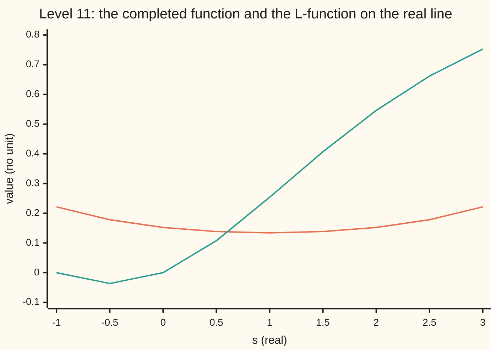

# The L-function of a modular form: a Mellin transform that inherits the form's symmetry

[Syllabus](../../../SYLLABUS.md) → [Algebraic and analytic number theory](../README.md) → [Diophantine and Modular](../README.md#s07) → The L-function of a modular form

---

## General Overview

Take the cubic curve $`y^2 + y = x^3 - x^2`$ and count its points modulo small primes, adding one point $`O`$ at infinity. Mod 2 it has 5 points, mod 3 it has 5, mod 5 it has 5, mod 7 it has 10 and mod 13 it has 10. Subtract each count from $`p + 1`$: the gaps are $`a_2 = -2`$, $`a_3 = -1`$, $`a_5 = 1`$, $`a_7 = -2`$, $`a_{13} = 4`$.

Now multiply out an infinite product, $`q(1 - q)^2(1 - q^{11})^2(1 - q^2)^2(1 - q^{22})^2 \cdots`$. Its coefficients begin $`1, -2, -1, 2, 1, 2, -2, 0, -2, -2, 1, -2, 4`$. The coefficient of $`q^p`$ is the same gap $`a_p`$, at every prime the code tries: all 303 primes below 2,000. The product is a modular form of level 11, and the match is a theorem.

This card turns those coefficients into one function, $`L(f, s) = \sum a_n n^{-s}`$. The series converges absolutely only when the real part of $`s`$ is above 3/2. Yet the form's symmetry, the flip $`z \mapsto -1/(11z)`$, passes through a Mellin transform (an integral that weighs a function by a power $`y^{s-1}`$) and becomes a mirror in $`s`$. That mirror extends $`L(f, s)`$ to every complex $`s`$. At $`s = 1`$, where the series is far too slow to use, the function has the value 0.253841861. That is the number the [Birch-Swinnerton-Dyer](06-birch-swinnerton-dyer-and-the-congruent-number-problem.md) conjecture reads.

**A cusp form's L-function is its Mellin transform up the imaginary axis, so the form's Fricke symmetry becomes a mirror Λ(s) = ±Λ(k − s) that extends it to every s, and for a normalised newform it is a product of one factor per prime.**

**What kind of fact this is:** theorems. The continuation and the functional equation (Hecke, 1936) are proved on this card in Why it works, from the Fricke relation. The Euler product is proved here from the Hecke rules of [Hecke operators](11-hecke-operators-and-eigenforms.md). Newform theory (Atkin and Lehner, 1970), the dimension count and the match with the curve (Eichler, 1954) are stated with sources. The code checks each one on numbers: evidence, not proof.

### The picture: the mirror at s = 1



Orange: the completed function $`\Lambda(f, s)`$, a mirror image about $`s = 1`$. Green: $`L(f, s)`$ itself, with no symmetry, and zero at $`s = 0`$ and $`s = -1`$. Both lines are printed by the checks. Left of $`s = 3/2`$ the series no longer converges absolutely; every value there comes from the Mellin integral.

---

## The formula

Notation first, in words. As on [Modular forms](07-modular-forms-in-outline.md), $`z`$ is a point of the upper half plane $`\mathbb{H}`$ and $`q = e^{2\pi i z}`$; on this card $`q`$ is never a modulus. $`\Gamma_0(N)`$ is the group of whole-number matrices $`\begin{pmatrix} a & b \\ c & d \end{pmatrix}`$ with $`ad - bc = 1`$ and $`N \mid c`$. $`S_k(\Gamma_0(N))`$ is the space of cusp forms of weight $`k`$ and level $`N`$: forms for that group that tend to 0 at every cusp. On this card $`\Lambda`$ is the completed L-function, never von Mangoldt's $`\Lambda(n)`$.

**The example.** Dedekind's eta function is $`\eta(z) = q^{1/24}\prod_{n \ge 1}(1 - q^n)`$. Our form is

```math
f(z) = \eta(z)^2\,\eta(11z)^2 = q \prod_{n \ge 1} (1 - q^n)^2 (1 - q^{11n})^2 = \sum_{n \ge 1} a_n q^n \in S_2(\Gamma_0(11))
```

**The Fricke relation.** The map $`W_N: z \mapsto -1/(Nz)`$ sends a cusp form of level $`N`$ to another one. For our form it gives back the form itself:

```math
f\!\left(-\frac{1}{11z}\right) = -11\, z^2 f(z), \qquad \text{for a form the flip sends to } \pm \text{ itself: } f\!\left(-\frac{1}{Nz}\right) = \varepsilon\, N^{k/2} z^k f(z), \ \ \varepsilon = \pm 1
```

**The L-function, its completion and its mirror.**

```math
L(f, s) = \sum_{n \ge 1} \frac{a_n}{n^s}, \qquad \Lambda(f, s) = \Big(\frac{\sqrt N}{2\pi}\Big)^{s} \Gamma(s)\, L(f, s) = N^{s/2}\int_0^\infty f(iy)\, y^{s-1}\, dy, \qquad \Lambda(f, s) = w\, \Lambda(f, k - s)
```

Here $`w = \varepsilon\, i^k`$, the **sign** of the functional equation. For our form $`\varepsilon = -1`$ and $`i^2 = -1`$, so $`w = +1`$ and $`\Lambda(f, s) = \Lambda(f, 2 - s)`$.

**Read it aloud:** "The L-function adds the coefficients a-n over n to the s. Times root N over two pi to the s and gamma of s, it becomes the Mellin transform of f up the imaginary axis, and that completed function at s equals w times itself at k minus s."

**The Euler product of a normalised newform.**

```math
L(f, s) = \prod_{p \nmid N} \frac{1}{1 - a_p p^{-s} + p^{k-1-2s}} \prod_{p \mid N} \frac{1}{1 - a_p p^{-s}}, \qquad \text{at } p = 2: \ \frac{1}{1 + 2 \cdot 2^{-s} + 2^{1-2s}}
```

**Read it aloud:** "At a prime that does not divide the level, the factor is one over one minus a-p p to the minus s plus p to the k minus one minus two s; at a prime that divides the level, the last term is missing."

| Symbol | Plain meaning | In our example | Push it up and the answer… |
| --- | --- | --- | --- |
| $`z`$, $`q`$ | a point of $`\mathbb{H}`$; the series variable $`e^{2\pi i z}`$ | $`z = 0.1 + 0.4i`$ in the Fricke check | larger $`\mathrm{Im}\, z`$, smaller $`q`$ |
| $`f`$, $`\eta`$; $`a_n`$, $`b_n`$ | the cusp form and Dedekind's eta; its coefficients; those of the oldform test | $`a_2 = -2`$, $`a_{13} = 4`$; $`b_4 = 0`$ | — |
| $`k`$; $`N`$ | the weight; the level | 2; 11 | the mirror point $`k/2`$ moves right |
| $`\Gamma_0(N)`$; $`S_k(\Gamma_0(N))`$ | matrices with $`N \mid c`$; cusp forms of weight $`k`$, level $`N`$ | $`\dim S_2(\Gamma_0(11)) = 1`$ | more room: dimension 2 at level 22 |
| $`W_N`$; $`\varepsilon`$ | the Fricke flip $`z \mapsto -1/(Nz)`$; its eigenvalue sign | $`\varepsilon = -1`$ | — |
| $`s`$ | the complex input of the L-function | $`s = 1`$, the centre | the series converges absolutely for $`\mathrm{Re}\, s > 3/2`$ |
| $`L(f, s)`$ | the L-function | $`L(f, 1) = 0.253841861`$ | tends to 1 as $`s`$ grows; 0.752723147 at 3 |
| $`\Lambda(f, s)`$; $`w`$ | the completed function; the sign $`\varepsilon i^k`$ | $`\Lambda(f, 1) = 0.133992261`$; $`w = +1`$ | — |
| $`\Gamma(s)`$ | the gamma function | $`\Gamma(3) = 2`$ | grows like a factorial |
| $`y`$; $`t`$, $`\phi(t)`$ | height on the imaginary axis; the rescaled height $`t = \sqrt N y`$ and $`\phi(t) = f(it/\sqrt N)`$ | $`y`$ from 0 to infinity; $`t \ge 1`$ | $`\phi(t)`$ falls fast: like $`e^{-2\pi t/\sqrt{11}}`$ |
| $`p`$; $`X`$ | a prime; shorthand $`X = p^{-s}`$ | $`p = 2`$, $`s = 2`$: $`X = 1/4`$ | — |
| $`E`$; $`\#E(\mathbb{F}_p)`$ | the curve $`y^2 + y = x^3 - x^2`$; its points mod $`p`$, $`O`$ included | 5 at $`p = 2`$; 10 at $`p = 13`$ | stays within $`2\sqrt p`$ of $`p + 1`$ |

### When it holds

- **A cusp form, not just a modular form.** The Mellin integral needs $`f(iy) \to 0`$ as $`y`$ grows. A form with a constant term, such as an Eisenstein series, gives a divergent integral, and its $`\Lambda`$ has poles at $`s = 0`$ and $`s = k`$, as zeta's completed function has at 0 and 1.
- **The true level inside $`\sqrt N`$.** The mirror needs exactly $`N^{s/2}`$. Drop the $`\sqrt{11}`$ and the two sides disagree: 0.075957388 at $`s = 0.5`$ against 0.022902014 at $`s = 1.5`$.
- **An eigenform of the Fricke flip.** If $`f(-1/(Nz))`$ is a different form $`g`$, the proof gives $`\Lambda(f, s)`$ in terms of $`\Lambda(g, k - s)`$, not of itself. At level 11 the space has dimension 1, so this is automatic.
- **A normalised newform for the Euler product.** The oldform $`f(z) + f(2z)`$ of level 22 has $`b_2 = -1`$ and $`b_4 = 0`$. A factor of either shape needs $`b_4 = 1`$ or $`b_4 = -1`$.
- **The short factor at a prime dividing the level.** The full quadratic at 11 predicts $`a_{121} = 1 - 11 = -10`$; the true coefficient is 1.

---

## Why it works

### Step 0: a symmetry in y becomes a symmetry in s

The Mellin transform weighs a function by $`y^{s-1}`$ ([The Mellin transform](../../07-Complex%20analysis/09-Special%20Functions%20and%20the%20Zeta%20Function/07-mellin-transform.md)). Replacing $`y`$ by $`1/y`$ turns $`y^{s}`$ into $`y^{-s}`$. So if a function looks the same after $`y \mapsto 1/(Ny)`$, its transform looks the same after $`s \mapsto k - s`$.

On the imaginary axis the Fricke flip is exactly $`y \mapsto 1/(Ny)`$. So the form's own symmetry becomes the L-function's mirror. This is the proof of [The functional equation](../02-The%20Zeta%20Function%20and%20the%20Prime%20Number%20Theorem/02-functional-equation-proved.md) for zeta, with a cusp form in place of the theta function. A cusp form has no constant term, so no poles appear.

### Step 1: the series converges for large s

A cusp form has $`|a_n| \le C n^{k/2}`$ for some constant $`C`$ (Hecke's bound), so the series converges absolutely for $`\mathrm{Re}\, s > k/2 + 1 = 2`$. Deligne's theorem, $`|a_p| \le 2p^{(k-1)/2}`$, improves this to $`\mathrm{Re}\, s > (k + 1)/2`$, which is 3/2 here; for our form it is Hasse's bound on the curve. The code finds $`|a_p|/(2\sqrt p)`$ at most 0.973684 for primes below 2,000.

<details>
<summary>Detailed proof: Hecke's bound on the coefficients</summary>

The function $`y^{k/2}|f(x + iy)|`$ does not change under $`\Gamma_0(N)`$: the factor $`|cz + d|^k`$ from $`f`$ cancels the factor $`|cz + d|^{-k}`$ from the imaginary part. It tends to 0 at every cusp, because $`f`$ is a cusp form. So it is bounded on all of $`\mathbb{H}`$, say by $`C_0`$.

A coefficient is an average along a horizontal line at any height $`y`$:

$`\displaystyle a_n = \int_0^1 f(x + iy)\, e^{-2\pi i n (x + iy)}\, dx.`$

So $`|a_n| \le C_0\, y^{-k/2} e^{2\pi n y}`$. Take $`y = 1/n`$: $`|a_n| \le C_0 e^{2\pi} n^{k/2}`$.

</details>

### Step 2: the L-function is a Mellin transform

The Mellin transform of $`e^{-2\pi n y}`$ is $`\Gamma(s)(2\pi n)^{-s}`$: the gamma integral, stretched by $`2\pi n`$ ([The gamma function](../../07-Complex%20analysis/09-Special%20Functions%20and%20the%20Zeta%20Function/02-gamma-function.md)). On the imaginary axis $`f(iy) = \sum a_n e^{-2\pi n y}`$, a real number for our form. Transform term by term:

```math
\int_0^\infty f(iy)\, y^{s-1}\, dy = \sum_{n \ge 1} a_n\, \Gamma(s)\, (2\pi n)^{-s} = (2\pi)^{-s}\, \Gamma(s)\, L(f, s), \qquad \mathrm{Re}\, s > 2
```

Swapping sum and integral is allowed here because Step 1 makes everything absolutely convergent. Multiply by $`N^{s/2}`$ and the left side is $`\Lambda(f, s)`$.

### Step 3: the Fricke flip on the imaginary axis

$`W_N`$ maps $`S_k(\Gamma_0(N))`$ to itself. The reason: conjugating a matrix of $`\Gamma_0(N)`$ by the flip gives another one, $`\begin{pmatrix} d & -c/N \\ -Nb & a \end{pmatrix}`$. Applying the flip twice gives back $`z`$. So on a space of dimension 1, the flip sends $`f`$ to $`\pm`$ itself.

$`S_2(\Gamma_0(11))`$ has dimension 1. Its dimension equals the genus of a curve attached to $`\Gamma_0(11)`$, given by a counting formula (Diamond and Shurman, Chapter 3; [Modularity](08-modularity-and-the-proof-of-fermat.md) computes it), and the code evaluates it. The sign is read off at one point: at $`z = 0.1 + 0.4i`$ both $`f(-1/(11z))`$ and $`-11z^2 f(z)`$ come out at $`0.132102346 + 0.003036287i`$. So $`\varepsilon = -1`$. Dedekind's law $`\eta(-1/z) = \sqrt{z/i}\,\eta(z)`$ gives the same relation directly.

Put $`z = iy`$. Then $`-1/(Niy) = i/(Ny)`$, and the relation reads

```math
f\!\left(\frac{i}{Ny}\right) = w\, N^{k/2}\, y^k f(iy), \qquad w = \varepsilon\, i^k
```

For us, $`f(i/(11y)) = 11 y^2 f(iy)`$: the value high up the axis fixes the value low down.

### Step 4: fold the integral at the fixed point

The flip $`y \mapsto 1/(Ny)`$ fixes $`y = 1/\sqrt N`$. Split the integral there. On the lower piece, substitute $`y = 1/(Nu)`$ and use Step 3. Both pieces then run over $`y \ge 1/\sqrt N`$ only. Rescaling by $`t = \sqrt N y`$ gives

```math
\Lambda(f, s) = \int_1^\infty \phi(t)\,\big(t^{s-1} + w\, t^{k-1-s}\big)\, dt, \qquad \phi(t) = f\!\left(\frac{it}{\sqrt N}\right)
```

<details>
<summary>Detailed proof: the substitution on the lower piece</summary>

Write $`g(y) = f(iy)`$. On $`0 < y < 1/\sqrt N`$ put $`y = 1/(Nu)`$, so $`u`$ runs from infinity down to $`1/\sqrt N`$ and $`dy = -du/(Nu^2)`$. Step 3 gives $`g(1/(Nu)) = w N^{k/2} u^k g(u)`$. Turning the limits round removes the minus sign:

$`\displaystyle N^{s/2}\int_0^{1/\sqrt N} g(y)\, y^{s-1}\, dy = N^{s/2}\int_{1/\sqrt N}^\infty w N^{k/2} u^k g(u)\, (Nu)^{1-s}\, \frac{du}{Nu^2} = w\, N^{(k-s)/2}\int_{1/\sqrt N}^\infty g(u)\, u^{k-1-s}\, du.`$

The upper piece is $`N^{s/2}\int_{1/\sqrt N}^\infty g(y)\, y^{s-1}\, dy`$. In both, put $`y = t/\sqrt N`$ (or $`u = t/\sqrt N`$). The powers of $`N`$ cancel exactly: $`N^{s/2} N^{-s/2} = 1`$ and $`N^{(k-s)/2} N^{-(k-s)/2} = 1`$. What is left is the formula of Step 4.

</details>

### Step 5: read off the continuation and the mirror

$`\phi(t)`$ falls like $`e^{-2\pi t/\sqrt N}`$, faster than any power of $`t`$ grows. So the integral of Step 4 converges for every complex $`s`$, and defines a holomorphic function everywhere. It agrees with $`\Lambda(f, s)`$ for $`\mathrm{Re}\, s > 2`$, so it is the continuation.

Replace $`s`$ by $`k - s`$. The two powers $`t^{s-1}`$ and $`t^{k-1-s}`$ swap. Since $`w^2 = 1`$, the result is $`w`$ times the original: $`\Lambda(f, k - s) = w\Lambda(f, s)`$.

Two consequences:

- **Trivial zeros.** $`L(f, s) = \Lambda(f, s)\,(2\pi/\sqrt N)^s / \Gamma(s)`$, and $`1/\Gamma(s)`$ is 0 at $`s = 0, -1, -2, \ldots`$. So $`L(f, s)`$ vanishes there; the chart shows the zeros at 0 and −1.
- **A fast formula at the centre.** At $`s = 1`$ with $`k = 2`$, $`w = 1`$, Step 4 integrates in closed form: $`L(f, 1) = 2\sum (a_n/n)\, e^{-2\pi n/\sqrt N}`$. The terms shrink like $`e^{-2\pi n/\sqrt{11}}`$, so a few dozen terms already give 0.253841861.

### Step 6: newforms

A level $`N`$ holds forms that really belong to a smaller level. If $`g`$ is a cusp form of level $`M`$, with $`M`$ a proper divisor of $`N`$, and $`dM \mid N`$, then $`g(dz)`$ is a form of level $`N`$: an **oldform**. At level 22, $`f(z)`$ and $`f(2z)`$ are oldforms, and the genus count gives dimension 2, so they fill the space.

The **newforms** are what is left. Atkin and Lehner (1970) proved that the forms orthogonal to all oldforms (under the Petersson inner product of [Hecke operators](11-hecke-operators-and-eigenforms.md), the integral of $`f\bar g\, y^k\, dx\, dy / y^2`$ over a fundamental region) have a basis of eigenforms of every Hecke operator and of $`W_N`$. Scaled to $`a_1 = 1`$, each is a **normalised newform**, and it is determined by its $`a_p`$ for all but finitely many $`p`$ (multiplicity one).

Level 1 has no cusp form of weight 2, so level 11 has no oldforms. Our $`f`$ is a normalised newform.

### Step 7: the Euler product from the Hecke rules

[Hecke operators](11-hecke-operators-and-eigenforms.md) proves that a normalised eigenform satisfies two rules:

- $`a_{mn} = a_m a_n`$ when $`\gcd(m, n) = 1`$;
- $`a_{p^{r+1}} = a_p a_{p^r} - p^{k-1} a_{p^{r-1}}`$ for $`p \nmid N`$, and $`a_{p^{r}} = a_p^r`$ for $`p \mid N`$.

The first rule splits $`L(f, s)`$ into one series per prime, $`\sum_r a_{p^r} X^r`$ with $`X = p^{-s}`$. Multiply that series by $`1 - a_p X + p^{k-1}X^2`$. The coefficient of $`X`$ is $`a_p - a_p = 0`$. For $`X^{r+1}`$ it is $`a_{p^{r+1}} - a_p a_{p^r} + p^{k-1}a_{p^{r-1}}`$, which the second rule makes 0. Only the 1 survives, so the series is $`1/(1 - a_p X + p^{k-1}X^2)`$. At $`p \mid N`$ the same argument gives $`1/(1 - a_p X)`$.

At $`p = 2`$ this is $`1/(1 + 2X + 2X^2)`$. Its series is $`1, -2, 2, 0, -4, 8, -8, 0, 16, -32, 32`$, which the code compares with $`a_{2^k}`$ from the product for $`k \le 10`$. At 11, $`a_{11} = 1`$, so $`a_{121} = a_{1331} = 1`$.

### Step 8: the match with the curve

For our $`f`$, $`a_p = p + 1 - \#E(\mathbb{F}_p)`$ at every prime $`p`$, including 11, where the curve has a node and 11 points. Eichler proved this in 1954; it is the first case of [Modularity](08-modularity-and-the-proof-of-fermat.md). [Hecke operators](11-hecke-operators-and-eigenforms.md) matches the same form with $`y^2 + y = x^3 - x^2 - 10x - 20`$ instead. Both are right: the two curves are linked by a map of degree 5 (they are isogenous), so they have the same number of points mod every prime and the same form. So $`L(f, s)`$ is the curve's $`L(E, s)`$, and everything above applies to it.

---

## Worked numbers, by hand

| Step | Arithmetic | Value |
| --- | --- | --- |
| $`a_2`$ from the product | only $`(1 - q)^2 = 1 - 2q + q^2`$ reaches $`q \cdot q`$ | $`-2`$ |
| $`a_3`$ from the product | $`q^2`$ of $`(1 - 2q + q^2)(1 - 2q^2)`$: $`1 - 2`$ | $`-1`$ |
| $`\#E(\mathbb{F}_2)`$ | $`y^2 + y`$ and $`x^3 - x^2`$ are both even: 2 × 2 pairs, plus $`O`$ | 5, so $`a_2 = 3 - 5 = -2`$ |
| $`\#E(\mathbb{F}_{13})`$ | counted by the code | 10, so $`a_{13} = 14 - 10 = 4`$ |
| $`a_4`$ from the Euler factor | $`a_2^2 - 2 = 4 - 2`$ | $`2`$, as in the product |
| Euler factor at 2, $`s = 2`$ | $`1/(1 + 2/4 + 2/16)`$ | $`8/13`$ |
| Fricke sign | $`\varepsilon = -1`$, $`i^2 = -1`$ | $`w = +1`$ |
| the mirror at $`s = 0.5`$ and $`1.5`$ | $`\Lambda(f, 0.5)`$ and $`\Lambda(f, 1.5)`$ by the whole integral | both 0.138330579 |
| the centre | $`\Lambda(f, 1) = 0.133992261`$, times $`2\pi/\sqrt{11}`$ | **$`L(f, 1) = 0.253841861`$** |

$`L(f, 1)`$ is not 0. By [Birch-Swinnerton-Dyer](06-birch-swinnerton-dyer-and-the-congruent-number-problem.md), in the case already proved (Kolyvagin), the curve $`y^2 + y = x^3 - x^2`$ has only finitely many rational points.

### What breaks if you drop a piece

| Mistake | Comes out at | What went wrong |
| --- | --- | --- |
| No $`\sqrt{11}`$ in $`\Lambda`$ | 0.075957388 at $`s = 0.5`$, 0.022902014 at $`s = 1.5`$ | the mirror needs the level's own scale $`N^{s/2}`$ |
| The level-1 flip $`z \mapsto -1/z`$ | $`f(-1/z) = -0.000000323 + 0.000000200i`$ against $`z^2 f(z) = -0.012009304 - 0.000276026i`$ | $`f`$ has level 11; only $`-1/(11z)`$ maps it to itself |
| The series used at $`s = 0.5`$ | partial sums 0.628, 0.359, −1.912 at 500, 1,000, 2,000 terms; $`L(f, 0.5) = 0.107419969`$ | left of $`\mathrm{Re}\, s = 3/2`$ the series loses absolute convergence, and at 0.5 it diverges; only the integral reaches there |
| Good-prime factor at 11 | predicts $`a_{121} = -10`$; the true value is 1 | 11 divides the level, so its factor is linear |
| Oldform $`f(z) + f(2z)`$ at level 22 | $`b_4 = 0`$; a factor at 2 needs 1 or −1 | not a newform: no Euler product |

---

## Code, from first principles, and it actually runs

Both programs multiply out the product to $`q^{2000}`$ in whole numbers and count the curve's points mod every prime below 2,000. They reach $`\Lambda(f, s)`$ by **three roads**. Road A is the whole Mellin integral from 0 to infinity, by the trapezoid rule in $`\log y`$; it never uses the Fricke relation. Road B is the folded formula of Step 4, with each piece an incomplete gamma integral computed by its continued fraction. Road C, at $`s = 3`$ only, is the Dirichlet series and the Euler product. The checks assert that A meets B at nine points, that A is a mirror image about 1, and that C meets A. They also check the Hecke rules, the factor at 2, the Fricke relation at a point and the genus counts.

### Python

```python
# L-functions of modular forms -- the check behind the card.  Standard library only.
# f = q prod (1 - q^n)^2 (1 - q^(11n))^2, weight 2, level 11; q = e^(2 pi i z), not a modulus.
# Lambda(s) = (sqrt 11 / 2 pi)^s Gamma(s) L(f, s) is the completed L-function, not von Mangoldt.
from math import pi, exp, sqrt, gcd, cos, sin
from fractions import Fraction
M, K = 2000, 600                      # coefficients to q^M; K terms for numerical series
c = [1] + [0] * M                     # road 1 to a_n: multiply out the product
for m in range(1, M + 1):
    for step in ([m, m, 11 * m, 11 * m] if 11 * m <= M else [m, m]):
        for i in range(M, step - 1, -1):
            c[i] -= c[i - step]
a = [0] + c[:M]                       # f = q * c, so a_n = c[n - 1]
primes = [p for p in range(2, M + 1) if all(p % d for d in range(2, int(p ** 0.5) + 1))]
def count(p):                         # points of y^2 + y = x^3 - x^2 over F_p, O included
    ways = [0] * p
    for y in range(p): ways[(y * y + y) % p] += 1
    return 1 + sum(ways[(x ** 3 - x * x) % p] for x in range(p))
def fmt(v): return f"{v:.9f}"
print("a_1..a_13 from the product:", a[1:14])
print("#E(F_p) for p = 2, 3, 5, 7, 11, 13:", [count(p) for p in (2, 3, 5, 7, 11, 13)])
ap = {p: p + 1 - count(p) for p in primes}          # road 2 to a_p: count points
assert [ap[p] for p in (2, 3, 5, 7, 13)] == [-2, -1, 1, -2, 4] == [a[p] for p in (2, 3, 5, 7, 13)]
assert all(ap[p] == a[p] for p in primes)
worst = max(abs(a[p]) / (2 * sqrt(p)) for p in primes if p != 11)
print(f"a_p = p + 1 - #E(F_p) for all {len(primes)} primes below {M}: yes; max |a_p|/(2 sqrt p) = {worst:.6f}")
assert worst <= 1
pairs = sum(1 for m in range(2, M + 1) for n in range(m + 1, M // m + 1) if gcd(m, n) == 1)
assert all(a[m * n] == a[m] * a[n] for m in range(2, M + 1) for n in range(m + 1, M // m + 1) if gcd(m, n) == 1)
steps = 0
for p in primes:
    q, r = p, p * p
    while r <= M:
        want = a[p] * a[q] - (0 if p == 11 else p) * a[q // p]
        assert a[r] == want; steps += 1; q, r = r, r * p
print(f"Hecke rules to {M}: {pairs} coprime pairs, {steps} prime-power steps, all hold; a_121 = {a[121]}, a_1331 = {a[1331]}")
e = [1, -2]                           # 1/(1 + 2X + 2X^2) as a series in X = 2^(-s)
while len(e) < 11: e.append(-2 * e[-1] - 2 * e[-2])
print("Euler factor at 2, series:", e, "; a_(2^k):", [a[2 ** k] for k in range(11)])
assert e == [a[2 ** k] for k in range(11)]
print("Euler factor at 2, s = 2:", 1 / (1 + Fraction(2, 4) + Fraction(2, 16)))
print("mistake, good-prime factor at 11: predicts a_121 =", a[11] ** 2 - 11, "but a_121 =", a[121])
b = [0] + [a[n] + (a[n // 2] if n % 2 == 0 else 0) for n in range(1, 9)]   # f(z) + f(2z), level 22
print(f"mistake, oldform f(z) + f(2z) at level 22: b_2 = {b[2]}, b_4 = {b[4]}; an Euler factor needs {b[2] ** 2} or {b[2] ** 2 - 2}")
def genus(N):                         # dim S_2(Gamma_0(N)) = genus of X_0(N)
    ps = [p for p in primes if N % p == 0]
    mu = N
    for p in ps: mu = mu * (p + 1) // p
    v2 = 0 if N % 4 == 0 else sum(1 for x in range(N) if (x * x + 1) % N == 0)
    v3 = 0 if N % 9 == 0 else sum(1 for x in range(N) if (x * x + x + 1) % N == 0)
    vc = sum(sum(1 for k in range(1, g + 1) if gcd(k, g) == 1) for d in range(1, N + 1) if N % d == 0 for g in [gcd(d, N // d)])
    return 1 + Fraction(mu, 12) - Fraction(v2, 4) - Fraction(v3, 3) - Fraction(vc, 2)
print("dim S_2(Gamma_0(N)) by the genus formula: N = 11:", genus(11), "; N = 22:", genus(22))
assert genus(11) == 1 and genus(22) == 2
def fz(z):                            # f(z) = sum a_n q^n at a point of the upper half plane
    q = complex(exp(-2 * pi * z.imag) * cos(2 * pi * z.real), exp(-2 * pi * z.imag) * sin(2 * pi * z.real))
    s, w = 0j, 1 + 0j
    for n in range(1, K + 1): w *= q; s += a[n] * w
    return s
def cs(w): return f"{w.real:.9f} {'+' if w.imag >= 0 else '-'} {abs(w.imag):.9f}i"
z = complex(0.1, 0.4)
L, R = fz(-1 / (11 * z)), -11 * z * z * fz(z)
print("z = 0.1 + 0.4i: f(-1/(11z)) =", cs(L), "; -11 z^2 f(z) =", cs(R))
assert abs(L - R) < 1e-10
print("mistake, level-1 flip: f(-1/z) =", cs(fz(-1 / z)), "; z^2 f(z) =", cs(z * z * fz(z)))
def g(y):                             # f on the imaginary axis, a real number
    x, w, s = exp(-2 * pi * y), 1.0, 0.0
    for n in range(1, K + 1): w *= x; s += a[n] * w
    return s
h, us = 0.05, [-4.2 + 0.05 * j for j in range(133)]   # road A: the whole Mellin integral, u = log y
gs = [g(exp(u)) for u in us]
def lam_direct(s): return 11 ** (s / 2) * h * sum(v * exp(s * u) for v, u in zip(gs, us))
def gam_inc(s, x):                    # Gamma(s, x) by its continued fraction
    bb = x + 1 - s; cc = 1e300; d = 1 / bb; hh = d
    for i in range(1, 300):
        an = -i * (i - s); bb += 2; d = 1 / (an * d + bb); cc = bb + an / cc; hh *= d * cc
    return exp(-x) * x ** s * hh
def lam_split(s):                     # road B: the proof's formula, only y above 1/sqrt 11
    tot = 0.0
    for n in range(1, 41):
        cn = 2 * pi * n / sqrt(11)
        tot += a[n] * (cn ** -s * gam_inc(s, cn) + cn ** (s - 2) * gam_inc(2 - s, cn))
    return tot
sq = sqrt(pi)
rg = {-1: 0, -0.5: -0.5 / sq, 0: 0, 0.5: 1 / sq, 1: 1, 1.5: 2 / sq, 2: 1, 2.5: 4 / (3 * sq), 3: 0.5}   # 1/Gamma(s)
print("s, Lambda by the whole integral, by the split formula, L(f, s):")
for s in sorted(rg):
    A, B = lam_direct(s), lam_split(s)
    print(f"{s:5.1f}: {fmt(A)} {fmt(B)} {fmt(A * (2 * pi / sqrt(11)) ** s * rg[s])}")
    assert abs(A - B) < 1e-9 and abs(A - lam_direct(2 - s)) < 1e-9
dir3 = (sqrt(11) / (2 * pi)) ** 3 * 2 * sum(a[n] / n ** 3 for n in range(1, M + 1))
eul = 1.0
for p in primes: eul /= (1 - a[p] * p ** -3 + (0 if p == 11 else p * p ** -6))
eul3 = (sqrt(11) / (2 * pi)) ** 3 * 2 * eul
print(f"Lambda(3) by the Dirichlet series to {M}: {dir3:.7f}; by the Euler product to {M}: {eul3:.7f}")
assert abs(dir3 - lam_direct(3)) < 1e-6 and abs(eul3 - lam_direct(3)) < 1e-6
L1 = 2 * sum(a[n] / n * exp(-2 * pi * n / sqrt(11)) for n in range(1, 41))
print("L(f, 1) = 2 sum (a_n/n) e^(-2 pi n/sqrt 11) =", fmt(L1))
assert abs(L1 - lam_direct(1) * 2 * pi / sqrt(11)) < 1e-9
print("mistake, no sqrt 11 in Lambda: s = 0.5 gives", fmt(11 ** -0.25 * lam_direct(0.5)), "; s = 1.5 gives", fmt(11 ** -0.75 * lam_direct(1.5)))
true5 = lam_direct(0.5) * (2 * pi / sqrt(11)) ** 0.5 / sq
part = [sum(a[n] / sqrt(n) for n in range(1, N + 1)) for N in (500, 1000, 2000)]
print("mistake, the series at s = 0.5, partial sums to 500, 1000, 2000:", ", ".join(f"{v:.3f}" for v in part), "; L(f, 0.5) =", fmt(true5))
print("ALL CHECKS PASS")
```

**Ran 2026-11-24 on macOS, Python 3.14.10, standard library only. All checks passed. Output, pasted from the run:**

```
a_1..a_13 from the product: [1, -2, -1, 2, 1, 2, -2, 0, -2, -2, 1, -2, 4]
#E(F_p) for p = 2, 3, 5, 7, 11, 13: [5, 5, 5, 10, 11, 10]
a_p = p + 1 - #E(F_p) for all 303 primes below 2000: yes; max |a_p|/(2 sqrt p) = 0.973684
Hecke rules to 2000: 3406 coprime pairs, 30 prime-power steps, all hold; a_121 = 1, a_1331 = 1
Euler factor at 2, series: [1, -2, 2, 0, -4, 8, -8, 0, 16, -32, 32] ; a_(2^k): [1, -2, 2, 0, -4, 8, -8, 0, 16, -32, 32]
Euler factor at 2, s = 2: 8/13
mistake, good-prime factor at 11: predicts a_121 = -10 but a_121 = 1
mistake, oldform f(z) + f(2z) at level 22: b_2 = -1, b_4 = 0; an Euler factor needs 1 or -1
dim S_2(Gamma_0(N)) by the genus formula: N = 11: 1 ; N = 22: 2
z = 0.1 + 0.4i: f(-1/(11z)) = 0.132102346 + 0.003036287i ; -11 z^2 f(z) = 0.132102346 + 0.003036287i
mistake, level-1 flip: f(-1/z) = -0.000000323 + 0.000000200i ; z^2 f(z) = -0.012009304 - 0.000276026i
s, Lambda by the whole integral, by the split formula, L(f, s):
 -1.0: 0.221418900 0.221418900 0.000000000
 -0.5: 0.178082779 0.178082779 -0.036498518
  0.0: 0.152147142 0.152147142 0.000000000
  0.5: 0.138330579 0.138330579 0.107419969
  1.0: 0.133992261 0.133992261 0.253841861
  1.5: 0.138330579 0.138330579 0.407003873
  2.0: 0.152147142 0.152147142 0.546048036
  2.5: 0.178082779 0.178082779 0.661750898
  3.0: 0.221418900 0.221418900 0.752723147
Lambda(3) by the Dirichlet series to 2000: 0.2214189; by the Euler product to 2000: 0.2214189
L(f, 1) = 2 sum (a_n/n) e^(-2 pi n/sqrt 11) = 0.253841861
mistake, no sqrt 11 in Lambda: s = 0.5 gives 0.075957388 ; s = 1.5 gives 0.022902014
mistake, the series at s = 0.5, partial sums to 500, 1000, 2000: 0.628, 0.359, -1.912 ; L(f, 0.5) = 0.107419969
ALL CHECKS PASS
```

### Rust

```rust
// L-functions of modular forms -- the same check as the Python, in Rust.  No crates.
// f = q prod (1 - q^n)^2 (1 - q^(11n))^2, weight 2, level 11; q = e^(2 pi i z), not a modulus.
// Lambda(s) = (sqrt 11 / 2 pi)^s Gamma(s) L(f, s) is the completed L-function, not von Mangoldt.
use std::f64::consts::PI;
const M: usize = 2000;
const K: usize = 600;
#[derive(Clone, Copy)]
struct C { re: f64, im: f64 }                 // a small complex-number struct
impl C {
    fn add(self, o: C) -> C { C { re: self.re + o.re, im: self.im + o.im } }
    fn sub(self, o: C) -> C { C { re: self.re - o.re, im: self.im - o.im } }
    fn mul(self, o: C) -> C { C { re: self.re * o.re - self.im * o.im, im: self.re * o.im + self.im * o.re } }
    fn scale(self, s: f64) -> C { C { re: self.re * s, im: self.im * s } }
    fn abs(self) -> f64 { (self.re * self.re + self.im * self.im).sqrt() }
    fn inv(self) -> C { let d = self.re * self.re + self.im * self.im; C { re: self.re / d, im: -self.im / d } }
}
fn cs(w: C) -> String { format!("{:.9} {} {:.9}i", w.re, if w.im >= 0.0 { "+" } else { "-" }, w.im.abs()) }
fn gcd(a: usize, b: usize) -> usize { if b == 0 { a } else { gcd(b, a % b) } }
fn count(p: usize) -> i64 {                   // points of y^2 + y = x^3 - x^2 over F_p, O included
    let mut ways = vec![0i64; p];
    for y in 0..p { ways[(y * y + y) % p] += 1 }
    1 + (0..p).map(|x| ways[(x * x * x + p * p - x * x % p) % p]).sum::<i64>()
}
fn fz(a: &[i128], z: C) -> C {               // f(z) = sum a_n q^n at a point of the upper half plane
    let r = (-2.0 * PI * z.im).exp();
    let q = C { re: r * (2.0 * PI * z.re).cos(), im: r * (2.0 * PI * z.re).sin() };
    let (mut s, mut w) = (C { re: 0.0, im: 0.0 }, C { re: 1.0, im: 0.0 });
    for n in 1..=K { w = w.mul(q); s = s.add(w.scale(a[n] as f64)) }
    s
}
fn g(a: &[i128], y: f64) -> f64 {            // f on the imaginary axis, a real number
    let (x, mut w, mut s) = ((-2.0 * PI * y).exp(), 1.0, 0.0);
    for n in 1..=K { w *= x; s += a[n] as f64 * w }
    s
}
fn gam_inc(s: f64, x: f64) -> f64 {          // Gamma(s, x) by its continued fraction
    let (mut bb, mut cc) = (x + 1.0 - s, 1e300);
    let mut d = 1.0 / bb;
    let mut hh = d;
    for i in 1..300 {
        let an = -(i as f64) * (i as f64 - s);
        bb += 2.0; d = 1.0 / (an * d + bb); cc = bb + an / cc; hh *= d * cc;
    }
    (-x).exp() * x.powf(s) * hh
}
fn main() {
    let mut c = vec![0i128; M + 1];          // road 1 to a_n: multiply out the product
    c[0] = 1;
    for m in 1..=M {
        let steps = if 11 * m <= M { vec![m, m, 11 * m, 11 * m] } else { vec![m, m] };
        for step in steps { for i in (step..=M).rev() { c[i] = c[i].checked_sub(c[i - step]).unwrap() } }
    }
    let mut a = vec![0i128; M + 1];
    for n in 1..=M { a[n] = c[n - 1] }
    let primes: Vec<usize> = (2..=M).filter(|&p| (2..).take_while(|d| d * d <= p).all(|d| p % d != 0)).collect();
    println!("a_1..a_13 from the product: {:?}", &a[1..14]);
    println!("#E(F_p) for p = 2, 3, 5, 7, 11, 13: {:?}", [2, 3, 5, 7, 11, 13].iter().map(|&p| count(p)).collect::<Vec<_>>());
    let ap = |p: usize| p as i64 + 1 - count(p);                // road 2 to a_p: count points
    assert!([2, 3, 5, 7, 13].iter().map(|&p| ap(p)).collect::<Vec<_>>() == vec![-2, -1, 1, -2, 4]);
    assert!([2, 3, 5, 7, 13].iter().all(|&p| ap(p) as i128 == a[p]));
    assert!(primes.iter().all(|&p| ap(p) as i128 == a[p]));
    let worst = primes.iter().filter(|&&p| p != 11).map(|&p| (a[p] as f64).abs() / (2.0 * (p as f64).sqrt())).fold(0.0, f64::max);
    println!("a_p = p + 1 - #E(F_p) for all {} primes below {}: yes; max |a_p|/(2 sqrt p) = {:.6}", primes.len(), M, worst);
    assert!(worst <= 1.0);
    let mut pairs = 0;
    for m in 2..=M { for n in (m + 1)..=(M / m) { if gcd(m, n) == 1 { assert!(a[m * n] == a[m] * a[n]); pairs += 1 } } }
    let mut steps = 0;
    for &p in &primes {
        let (mut q, mut r) = (p, p * p);
        while r <= M {
            let want = a[p] * a[q] - (if p == 11 { 0 } else { p as i128 }) * a[q / p];
            assert!(a[r] == want); steps += 1; q = r; r *= p;
        }
    }
    println!("Hecke rules to {}: {} coprime pairs, {} prime-power steps, all hold; a_121 = {}, a_1331 = {}", M, pairs, steps, a[121], a[1331]);
    let mut e: Vec<i128> = vec![1, -2];      // 1/(1 + 2X + 2X^2) as a series in X = 2^(-s)
    while e.len() < 11 { let k = e.len(); e.push(-2 * e[k - 1] - 2 * e[k - 2]) }
    let pw: Vec<i128> = (0..11).map(|k| a[1 << k]).collect();
    println!("Euler factor at 2, series: {:?} ; a_(2^k): {:?}", e, pw);
    assert!(e == pw);
    let (num, den) = (16i64, 16 + 8 + 2);    // 1/(1 + 2/4 + 2/16) = 16/26
    println!("Euler factor at 2, s = 2: {}/{}", num / gcd(16, 26) as i64, den / gcd(16, 26) as i64);
    println!("mistake, good-prime factor at 11: predicts a_121 = {} but a_121 = {}", a[11] * a[11] - 11, a[121]);
    let b = |n: usize| a[n] + if n % 2 == 0 { a[n / 2] } else { 0 };   // f(z) + f(2z), level 22
    println!("mistake, oldform f(z) + f(2z) at level 22: b_2 = {}, b_4 = {}; an Euler factor needs {} or {}", b(2), b(4), b(2) * b(2), b(2) * b(2) - 2);
    let genus12 = |n: usize| -> i64 {        // 12 x dim S_2(Gamma_0(N)), from the genus formula
        let mut mu = n;
        for &p in primes.iter().filter(|&&p| n % p == 0) { mu = mu * (p + 1) / p }
        let v2 = if n % 4 == 0 { 0 } else { (0..n).filter(|x| (x * x + 1) % n == 0).count() };
        let v3 = if n % 9 == 0 { 0 } else { (0..n).filter(|x| (x * x + x + 1) % n == 0).count() };
        let vc: usize = (1..=n).filter(|d| n % d == 0).map(|d| { let g = gcd(d, n / d); (1..=g).filter(|k| gcd(*k, g) == 1).count() }).sum();
        12 + mu as i64 - 3 * v2 as i64 - 4 * v3 as i64 - 6 * vc as i64
    };
    assert!(genus12(11) == 12 && genus12(22) == 24);
    println!("dim S_2(Gamma_0(N)) by the genus formula: N = 11: {} ; N = 22: {}", genus12(11) / 12, genus12(22) / 12);
    let z = C { re: 0.1, im: 0.4 };
    let minus = C { re: -1.0, im: 0.0 };
    let l = fz(&a, minus.mul(z.scale(11.0).inv()));
    let r = z.mul(z).scale(-11.0).mul(fz(&a, z));
    println!("z = 0.1 + 0.4i: f(-1/(11z)) = {} ; -11 z^2 f(z) = {}", cs(l), cs(r));
    assert!(l.sub(r).abs() < 1e-10);
    println!("mistake, level-1 flip: f(-1/z) = {} ; z^2 f(z) = {}", cs(fz(&a, minus.mul(z.inv()))), cs(z.mul(z).mul(fz(&a, z))));
    let h = 0.05;                            // road A: the whole Mellin integral, u = log y
    let us: Vec<f64> = (0..133).map(|j| -4.2 + 0.05 * j as f64).collect();
    let gs: Vec<f64> = us.iter().map(|&u| g(&a, u.exp())).collect();
    let lam_direct = |s: f64| { let mut t = 0.0; for (v, u) in gs.iter().zip(&us) { t += v * (s * u).exp() } 11f64.powf(s / 2.0) * h * t };
    let lam_split = |s: f64| {               // road B: the proof's formula, only y above 1/sqrt 11
        let mut tot = 0.0;
        for n in 1..=40 {
            let cn = 2.0 * PI * n as f64 / 11f64.sqrt();
            tot += a[n] as f64 * (cn.powf(-s) * gam_inc(s, cn) + cn.powf(s - 2.0) * gam_inc(2.0 - s, cn));
        }
        tot
    };
    let sq = PI.sqrt();
    let rg = [(-1.0, 0.0), (-0.5, -0.5 / sq), (0.0, 0.0), (0.5, 1.0 / sq), (1.0, 1.0), (1.5, 2.0 / sq), (2.0, 1.0), (2.5, 4.0 / (3.0 * sq)), (3.0, 0.5)];
    println!("s, Lambda by the whole integral, by the split formula, L(f, s):");
    for &(s, rgs) in &rg {
        let (aa, bb) = (lam_direct(s), lam_split(s));
        println!("{:5.1}: {:.9} {:.9} {:.9}", s, aa, bb, aa * (2.0 * PI / 11f64.sqrt()).powf(s) * rgs);
        assert!((aa - bb).abs() < 1e-9 && (aa - lam_direct(2.0 - s)).abs() < 1e-9);
    }
    let pre = (11f64.sqrt() / (2.0 * PI)).powf(3.0) * 2.0;
    let mut sum3 = 0.0;
    for n in 1..=M { sum3 += a[n] as f64 / (n as f64).powf(3.0) }
    let mut eul = 1.0;
    for &p in &primes { let pf = p as f64; eul /= 1.0 - a[p] as f64 * pf.powf(-3.0) + if p == 11 { 0.0 } else { pf * pf.powf(-6.0) } }
    let (dir3, eul3) = (pre * sum3, pre * eul);
    println!("Lambda(3) by the Dirichlet series to {}: {:.7}; by the Euler product to {}: {:.7}", M, dir3, M, eul3);
    assert!((dir3 - lam_direct(3.0)).abs() < 1e-6 && (eul3 - lam_direct(3.0)).abs() < 1e-6);
    let mut l1 = 0.0;
    for n in 1..=40 { l1 += a[n] as f64 / n as f64 * (-2.0 * PI * n as f64 / 11f64.sqrt()).exp() }
    l1 *= 2.0;
    println!("L(f, 1) = 2 sum (a_n/n) e^(-2 pi n/sqrt 11) = {:.9}", l1);
    assert!((l1 - lam_direct(1.0) * 2.0 * PI / 11f64.sqrt()).abs() < 1e-9);
    println!("mistake, no sqrt 11 in Lambda: s = 0.5 gives {:.9} ; s = 1.5 gives {:.9}", 11f64.powf(-0.25) * lam_direct(0.5), 11f64.powf(-0.75) * lam_direct(1.5));
    let true5 = lam_direct(0.5) * (2.0 * PI / 11f64.sqrt()).powf(0.5) / sq;
    let part: Vec<String> = [500, 1000, 2000].iter().map(|&nn| { let mut t = 0.0; for n in 1..=nn { t += a[n] as f64 / (n as f64).sqrt() } format!("{:.3}", t) }).collect();
    println!("mistake, the series at s = 0.5, partial sums to 500, 1000, 2000: {} ; L(f, 0.5) = {:.9}", part.join(", "), true5);
    println!("ALL CHECKS PASS");
}
```

**Ran 2026-11-24 on macOS, rustc 1.98.1, no crates. All checks passed. Output, pasted from the run:**

```
a_1..a_13 from the product: [1, -2, -1, 2, 1, 2, -2, 0, -2, -2, 1, -2, 4]
#E(F_p) for p = 2, 3, 5, 7, 11, 13: [5, 5, 5, 10, 11, 10]
a_p = p + 1 - #E(F_p) for all 303 primes below 2000: yes; max |a_p|/(2 sqrt p) = 0.973684
Hecke rules to 2000: 3406 coprime pairs, 30 prime-power steps, all hold; a_121 = 1, a_1331 = 1
Euler factor at 2, series: [1, -2, 2, 0, -4, 8, -8, 0, 16, -32, 32] ; a_(2^k): [1, -2, 2, 0, -4, 8, -8, 0, 16, -32, 32]
Euler factor at 2, s = 2: 8/13
mistake, good-prime factor at 11: predicts a_121 = -10 but a_121 = 1
mistake, oldform f(z) + f(2z) at level 22: b_2 = -1, b_4 = 0; an Euler factor needs 1 or -1
dim S_2(Gamma_0(N)) by the genus formula: N = 11: 1 ; N = 22: 2
z = 0.1 + 0.4i: f(-1/(11z)) = 0.132102346 + 0.003036287i ; -11 z^2 f(z) = 0.132102346 + 0.003036287i
mistake, level-1 flip: f(-1/z) = -0.000000323 + 0.000000200i ; z^2 f(z) = -0.012009304 - 0.000276026i
s, Lambda by the whole integral, by the split formula, L(f, s):
 -1.0: 0.221418900 0.221418900 0.000000000
 -0.5: 0.178082779 0.178082779 -0.036498518
  0.0: 0.152147142 0.152147142 0.000000000
  0.5: 0.138330579 0.138330579 0.107419969
  1.0: 0.133992261 0.133992261 0.253841861
  1.5: 0.138330579 0.138330579 0.407003873
  2.0: 0.152147142 0.152147142 0.546048036
  2.5: 0.178082779 0.178082779 0.661750898
  3.0: 0.221418900 0.221418900 0.752723147
Lambda(3) by the Dirichlet series to 2000: 0.2214189; by the Euler product to 2000: 0.2214189
L(f, 1) = 2 sum (a_n/n) e^(-2 pi n/sqrt 11) = 0.253841861
mistake, no sqrt 11 in Lambda: s = 0.5 gives 0.075957388 ; s = 1.5 gives 0.022902014
mistake, the series at s = 0.5, partial sums to 500, 1000, 2000: 0.628, 0.359, -1.912 ; L(f, 0.5) = 0.107419969
ALL CHECKS PASS
```

### Lean

Lean proves the continuation, the mirror and the Euler product for every weight and level, and checks the worked numbers exactly.

- Take a cusp form of weight $`k \ge 1`$ and level $`N`$, and $`\mathrm{Re}\, s > k/2 + 1`$. Then the series converges absolutely, and $`\Lambda(f, s) = (\sqrt N/2\pi)^s\,\Gamma(s)\,L(f, s)`$.
- Take a cusp form of weight $`k \ge 1`$ and level $`N`$ that the Fricke flip sends to $`\pm`$ itself. Then $`\Lambda(f, s)`$, the Mellin integral, is holomorphic at every complex $`s`$.
- Take the same form. Then $`\Lambda(f, s) = w\,\Lambda(f, k - s)`$ for every $`s`$, with $`w = \varepsilon\, i^k`$.
- Take coefficients with $`a_1 = 1`$ that obey the Hecke rules of Step 7, and an $`s`$ where the series converges absolutely. Then $`L(f, s)`$ is the Euler product, with the short factor at each prime dividing $`N`$.
- The product gives $`a_1`$ to $`a_{13}`$ as 1, −2, −1, 2, 1, 2, −2, 0, −2, −2, 1, −2 and 4.
- The curve has 5, 5, 5, 10, 11 and 10 points mod 2, 3, 5, 7, 11 and 13, $`O`$ included.
- Subtracting from $`p + 1`$ gives $`a_2, a_3, a_5, a_7, a_{13}`$ as −2, −1, 1, −2 and 4.
- The factor at 2 expands as 1, −2, 2, 0, −4, 8, −8, 0, 16, −32, 32.
- The sums $`a_4 = (-2)^2 - 2 = 2`$ and the wrong $`a_{121} = 1 - 11 = -10`$ are checked.
- So are the factor $`8/13`$ at $`s = 2`$, the sign $`w = +1`$ and the dimensions 1 and 2.

The values, the sign at level 11, the Hecke rules for our $`f`$ and the curve match are left to the Python and Rust checks.

```lean
-- The L-function of a modular form: a cusp form whose Fricke flip sends it to plus or minus itself has an entire completed L-function, its Mellin transform, with the mirror Λ(s) = ε i^k Λ(k − s), and coefficients obeying the Hecke rules give the Euler product.
import Mathlib.NumberTheory.ModularForms.LFunction
import Mathlib.NumberTheory.ModularForms.CongruenceSubgroups
import Mathlib.NumberTheory.EulerProduct.Basic
import Mathlib.NumberTheory.LSeries.Basic
import Mathlib.Data.ZMod.Basic

open Complex CongruenceSubgroup
open UpperHalfPlane hiding I

set_option autoImplicit false

lemma natCast_pow_cpow_eq (p e : ℕ) (s : ℂ) : (((p ^ e : ℕ) : ℂ)) ^ s = ((p : ℂ) ^ s) ^ e := by
  induction e with
  | zero => simp
  | succ e ih => rw [pow_succ, Nat.cast_mul, natCast_mul_natCast_cpow, ih, pow_succ]

#print axioms natCast_pow_cpow_eq

lemma sqrt_natCast_cpow (N : ℕ) (hN : N ≠ 0) (w : ℂ) :
    ((Real.sqrt N : ℝ) : ℂ) ^ w = (N : ℂ) ^ (w / 2) := by
  have h1 : (0 : ℝ) < Real.sqrt N := Real.sqrt_pos.mpr (by positivity)
  rw [cpow_def_of_ne_zero (ofReal_ne_zero.mpr h1.ne'), cpow_def_of_ne_zero (by exact_mod_cast hN),
    ← ofReal_log h1.le, Real.log_sqrt (Nat.cast_nonneg _), ← ofReal_natCast,
    ← ofReal_log (Nat.cast_nonneg _)]
  push_cast
  ring_nf

#print axioms sqrt_natCast_cpow

/-- The card's main claim (Steps 2 to 5). Let `f` be a cusp form of weight `k ≥ 1` and level `N`
(a cusp form for `Γ₀(N)`) whose Fricke flip `z ↦ -1/(Nz)` sends it to `±` itself:
`f(-1/(Nz)) = ε N^(k/2) z^k f(z)` with `ε = ±1`. Then the completed L-function
`Λ(f, s) = N^(s/2) ∫₀^∞ f(iy) y^(s-1) dy` extends to a holomorphic function of every complex `s`,
and it satisfies the mirror `Λ(f, s) = w Λ(f, k - s)` with sign `w = ε i^k`. -/
theorem completed_L_function_entire_and_functional_equation
    (N : ℕ) [NeZero N] {k : ℤ} (hk : 0 < k)
    (f : CuspForm (Gamma0 N : Subgroup (GL (Fin 2) ℝ)) k) (ε : ℂ) (hε : ε = 1 ∨ ε = -1)
    (hfricke : ∀ z : ℍ,
      f (ofComplex (-1 / ((N : ℂ) * (z : ℂ)))) = ε * ((Real.sqrt N : ℝ) : ℂ) ^ k * (z : ℂ) ^ k * f z) :
    Differentiable ℂ (fun s : ℂ => (N : ℂ) ^ (s / 2) * mellin (fun y : ℝ => f (ofComplex (I * y))) s) ∧
    ∀ s : ℂ,
      (N : ℂ) ^ (s / 2) * mellin (fun y : ℝ => f (ofComplex (I * y))) s =
        ε * I ^ k * ((N : ℂ) ^ ((k - s) / 2) * mellin (fun y : ℝ => f (ofComplex (I * y))) (k - s)) := by
  have hN : N ≠ 0 := NeZero.ne N
  have hN0 : (N : ℂ) ≠ 0 := by exact_mod_cast hN
  set F : ℝ → ℂ := fun y : ℝ => f (ofComplex (I * y)) with hF
  have hdiff : Differentiable ℂ (mellin F) := by
    rw [hF, ← CuspForm.Λ_eq_mellin hk f]; exact CuspForm.differentiable_Λ hk f
  refine ⟨?_, ?_⟩
  · exact (Differentiable.const_cpow (by fun_prop) (Or.inl hN0)).mul hdiff
  set c : ℂ := ε * ((Real.sqrt N : ℝ) : ℂ) ^ k * I ^ k with hc
  have hkey : ∀ y : ℝ, 0 < y → F ((N * y)⁻¹) = (y : ℂ) ^ (k : ℂ) • (c * F y) := by
    intro y hy
    have hz : 0 < (I * (y : ℂ)).im := by simpa using hy
    have := hfricke (ofComplex (I * y))
    rw [ofComplex_apply_of_im_pos hz] at this
    have harg : (-1 / ((N : ℂ) * (I * (y : ℂ)))) = I * (((N * y)⁻¹ : ℝ) : ℂ) := by
      push_cast
      field_simp
      rw [I_sq]
      ring
    rw [harg] at this
    simp only [hF]
    rw [this, cpow_intCast, smul_eq_mul, hc, ofComplex_apply_of_im_pos hz]
    change _ * ((I * (y : ℂ)) ^ k) * _ = _
    rw [mul_zpow]
    ring
  -- the Mellin transform of `y ↦ F (1/(N y))`, computed two ways
  have h1 : ∀ s : ℂ, mellin (fun y : ℝ => F ((N * y)⁻¹)) s = (N : ℂ) ^ (-s) * mellin F (-s) := by
    intro s
    have hNpos : (0 : ℝ) < N := by exact_mod_cast Nat.pos_of_ne_zero hN
    rw [mellin_comp_mul_left (fun t => F t⁻¹) s hNpos, mellin_comp_inv, smul_eq_mul, ofReal_natCast]
  have h2 : ∀ s : ℂ, mellin (fun y : ℝ => F ((N * y)⁻¹)) s = c * mellin F (s + k) := by
    intro s
    rw [← smul_eq_mul, ← mellin_const_smul, ← mellin_cpow_smul]
    exact MeasureTheory.setIntegral_congr_fun measurableSet_Ioi (fun y hy => by
      simp only [hkey y hy, smul_eq_mul])
  intro s
  have hfe : (N : ℂ) ^ s * mellin F s = c * mellin F (k - s) := by
    have := (h1 (-s)).symm.trans (h2 (-s))
    rw [neg_neg, neg_add_eq_sub] at this
    exact this
  have hNk : ((Real.sqrt N : ℝ) : ℂ) ^ k = (N : ℂ) ^ (s / 2) * (N : ℂ) ^ ((k - s) / 2) := by
    rw [← cpow_intCast, sqrt_natCast_cpow N hN, ← cpow_add _ _ hN0]
    congr 1
    ring
  have hNs : (N : ℂ) ^ s = (N : ℂ) ^ (s / 2) * (N : ℂ) ^ (s / 2) := by
    rw [← cpow_add _ _ hN0]
    congr 1
    ring
  have hne : (N : ℂ) ^ (s / 2) ≠ 0 := cpow_ne_zero_iff.mpr (Or.inl hN0)
  apply mul_left_cancel₀ hne
  rw [hNs, hc, hNk] at hfe
  linear_combination hfe

/-- Step 2: where the series converges absolutely (`Re s > k/2 + 1`), the completed function
`N^(s/2) ∫₀^∞ f(iy) y^(s-1) dy` of a cusp form of weight `k ≥ 1` and level `N` equals
`(√N / 2π)^s Γ(s) L(f, s)`, where `L(f, s) = ∑ aₙ n^(-s)` is built from the coefficients `aₙ` of
the expansion `f = ∑ aₙ qⁿ`, `q = e^(2πiz)`. -/
theorem completed_L_function_eq_gamma_mul_dirichlet_series
    (N : ℕ) [NeZero N] {k : ℤ} (hk : 0 < k)
    (f : CuspForm (Gamma0 N : Subgroup (GL (Fin 2) ℝ)) k) {s : ℂ} (hs : (k : ℝ) / 2 + 1 < s.re) :
    Summable (fun n : ℕ => (qExpansion 1 f).coeff n / (n : ℂ) ^ s) ∧
    (N : ℂ) ^ (s / 2) * mellin (fun y : ℝ => f (ofComplex (I * y))) s =
      (((Real.sqrt N : ℝ) : ℂ) / (2 * (Real.pi : ℂ))) ^ s * Gamma s *
        ∑' n : ℕ, (qExpansion 1 f).coeff n / (n : ℂ) ^ s := by
  have hw : Subgroup.strictWidthInfty ((Gamma0 N : Subgroup (GL (Fin 2) ℝ))) = 1 :=
    Subgroup.strictWidthInfty_eq_one_of_T_mem (Gamma0_mem.mpr (by simp [ModularGroup.T]))
  have hL := CuspForm.hasSum_L hk f hs
  rw [hw] at hL
  simp only [ofReal_one, one_cpow, one_mul] at hL
  refine ⟨hL.summable, ?_⟩
  have hkpos : (0 : ℝ) < k := by exact_mod_cast hk
  have hspos : 0 < s.re := by linarith
  have hs0 : s ≠ 0 := ne_zero_of_re_pos hspos
  rw [hL.tsum_eq, ← CuspForm.Λ_eq_mellin hk f, ModularForm.L_apply_of_ne_zero hk f hs0]
  have hN : N ≠ 0 := NeZero.ne N
  have h2pi : (2 * (Real.pi : ℂ)) = ((2 * Real.pi : ℝ) : ℂ) := by push_cast; ring
  have hpi0 : (0 : ℝ) < 2 * Real.pi := by positivity
  have hcp : ((2 * Real.pi : ℝ) : ℂ) ^ s ≠ 0 :=
    cpow_ne_zero_iff.mpr (Or.inl (ofReal_ne_zero.mpr hpi0.ne'))
  have hGam := Gamma_ne_zero_of_re_pos hspos
  rw [h2pi, div_cpow_ofReal_nonneg (Real.sqrt_nonneg _) hpi0.le, sqrt_natCast_cpow N hN,
    Gammaℂ_def, cpow_neg, ← h2pi]
  rw [← h2pi] at hcp
  field_simp

/-- Step 7: the Euler product. If the coefficients `aₙ` obey the Hecke rules of a normalised
eigenform of weight `k` and level `N` (`a₁ = 1`; `a_(mn) = a_m a_n` for coprime `m, n`;
`a_(p^(r+1)) = a_p a_(p^r) - p^(k-1) a_(p^(r-1))` for `p ∤ N`; `a_(p^r) = a_p^r` for `p ∣ N`),
then wherever `L(f, s) = ∑ aₙ n^(-s)` converges absolutely it is the product over primes of
`1/(1 - a_p p^(-s) + p^(k-1-2s))` for `p ∤ N` and `1/(1 - a_p p^(-s))` for `p ∣ N`. -/
theorem euler_product_of_hecke_rules
    (N : ℕ) (k : ℤ) (a : ℕ → ℂ) {s : ℂ}
    (h1 : a 1 = 1)
    (hmul : ∀ m n : ℕ, Nat.Coprime m n → a (m * n) = a m * a n)
    (hgood : ∀ p : ℕ, p.Prime → ¬ p ∣ N → ∀ r : ℕ,
      a (p ^ (r + 2)) = a p * a (p ^ (r + 1)) - (p : ℂ) ^ ((k : ℂ) - 1) * a (p ^ r))
    (hbad : ∀ p : ℕ, p.Prime → p ∣ N → ∀ r : ℕ, a (p ^ r) = a p ^ r)
    (hs : LSeriesSummable a s) :
    HasProd
      (fun p : Nat.Primes =>
        if (p : ℕ) ∣ N then (1 - a p * (p : ℂ) ^ (-s))⁻¹
        else (1 - a p * (p : ℂ) ^ (-s) + (p : ℂ) ^ ((k : ℂ) - 1 - 2 * s))⁻¹)
      (LSeries a s) := by
  have hf₁ : LSeries.term a s 1 = 1 := by simp [h1]
  have hm : ∀ {m n : ℕ}, Nat.Coprime m n →
      LSeries.term a s (m * n) = LSeries.term a s m * LSeries.term a s n := by
    intro m n hmn
    rcases Nat.eq_zero_or_pos m with rfl | hm0
    · simp
    rcases Nat.eq_zero_or_pos n with rfl | hn0
    · simp
    rw [LSeries.term_of_ne_zero (Nat.mul_ne_zero hm0.ne' hn0.ne'),
      LSeries.term_of_ne_zero hm0.ne', LSeries.term_of_ne_zero hn0.ne', hmul m n hmn,
      Nat.cast_mul, natCast_mul_natCast_cpow, mul_div_mul_comm]
  have hsum : Summable (‖LSeries.term a s ·‖) := summable_norm_iff.mpr hs
  have hE := EulerProduct.eulerProduct_hasProd hf₁ hm hsum (LSeries.term_zero a s)
  rw [show LSeries a s = ∑' n, LSeries.term a s n from rfl]
  convert hE using 1
  funext p
  have hp := p.prop
  have hp0 : (p : ℂ) ≠ 0 := by exact_mod_cast hp.ne_zero
  set x : ℂ := (p : ℂ) ^ (-s) with hx
  have hterm : ∀ e : ℕ, LSeries.term a s ((p : ℕ) ^ e) = a ((p : ℕ) ^ e) * x ^ e := by
    intro e
    rw [LSeries.term_of_ne_zero (pow_ne_zero _ hp.ne_zero), natCast_pow_cpow_eq, hx, cpow_neg,
      inv_pow, div_eq_mul_inv]
  have hb : Summable (fun e : ℕ => a ((p : ℕ) ^ e) * x ^ e) := by
    have := hs.comp_injective (Nat.pow_right_injective hp.two_le)
    simpa [Function.comp_def, hterm] using this
  simp_rw [hterm]
  split_ifs with hpN
  · have hgeo : ∀ e : ℕ, a ((p : ℕ) ^ e) * x ^ e = (a p * x) ^ e := by
      intro e; rw [hbad p hp hpN e, mul_pow]
    simp_rw [hgeo] at hb ⊢
    rw [tsum_geometric_of_norm_lt_one (summable_geometric_iff_norm_lt_one.mp hb)]
  · set S := ∑' e : ℕ, a ((p : ℕ) ^ e) * x ^ e with hS
    have hb1 : Summable (fun e : ℕ => a ((p : ℕ) ^ (e + 1)) * x ^ (e + 1)) :=
      (summable_nat_add_iff 1).mpr hb
    have hb2 : Summable (fun e : ℕ => a ((p : ℕ) ^ (e + 2)) * x ^ (e + 2)) :=
      (summable_nat_add_iff 2).mpr hb
    have hS1 : S = 1 + ∑' e : ℕ, a ((p : ℕ) ^ (e + 1)) * x ^ (e + 1) := by
      rw [hS, hb.tsum_eq_zero_add]; simp [h1]
    have hS2 : ∑' e : ℕ, a ((p : ℕ) ^ (e + 1)) * x ^ (e + 1) =
        a p * x + ∑' e : ℕ, a ((p : ℕ) ^ (e + 2)) * x ^ (e + 2) := by
      rw [hb1.tsum_eq_zero_add]; simp
    have hrec : ∀ e : ℕ, a ((p : ℕ) ^ (e + 2)) * x ^ (e + 2) =
        (a p * x) * (a ((p : ℕ) ^ (e + 1)) * x ^ (e + 1)) -
          ((p : ℂ) ^ ((k : ℂ) - 1) * x ^ 2) * (a ((p : ℕ) ^ e) * x ^ e) := by
      intro e; rw [hgood p hp hpN e]; ring
    have hS3 : ∑' e : ℕ, a ((p : ℕ) ^ (e + 2)) * x ^ (e + 2) =
        (a p * x) * (S - 1) - ((p : ℂ) ^ ((k : ℂ) - 1) * x ^ 2) * S := by
      simp_rw [hrec]
      have hT : ∑' e : ℕ, a ((p : ℕ) ^ (e + 1)) * x ^ (e + 1) = S - 1 := by rw [hS1]; ring
      rw [(hb1.mul_left _).tsum_sub (hb.mul_left _), tsum_mul_left, tsum_mul_left, hT]
    have hpow : (p : ℂ) ^ ((k : ℂ) - 1 - 2 * s) = (p : ℂ) ^ ((k : ℂ) - 1) * x ^ 2 := by
      rw [hx, show (k : ℂ) - 1 - 2 * s = ((k : ℂ) - 1) + (-s + -s) by ring,
        cpow_add _ _ hp0, cpow_add _ _ hp0, sq]
    rw [hpow]
    symm
    apply eq_inv_of_mul_eq_one_left
    linear_combination hS1 + hS2 + hS3

/-! The card's whole-number worked examples, for `f = q ∏ (1 - qⁿ)² (1 - q¹¹ⁿ)²` of level 11
and the curve `y² + y = x³ - x²`. -/

-- The product multiplied out to `q¹³`: `a₁, …, a₁₃ = 1, -2, -1, 2, 1, 2, -2, 0, -2, -2, 1, -2, 4`.
example :
    ([1, 1, 11, 11, 2, 2, 3, 3, 4, 4, 5, 5, 6, 6, 7, 7, 8, 8, 9, 9, 10, 10, 11, 11, 12, 12].foldl
      (fun (c : List ℤ) (st : ℕ) =>
        (List.range 13).map (fun i => c.getD i 0 - if st ≤ i then c.getD (i - st) 0 else 0))
      (1 :: List.replicate 12 0)) = [1, -2, -1, 2, 1, 2, -2, 0, -2, -2, 1, -2, 4] := by
  decide

-- Points of the curve mod p, the point `O` included, and `a_p = p + 1 - #E(F_p)`.
example : (Finset.univ.filter (fun xy : ZMod 2 × ZMod 2 =>
    xy.2 ^ 2 + xy.2 = xy.1 ^ 3 - xy.1 ^ 2)).card + 1 = 5 := by decide
example : (Finset.univ.filter (fun xy : ZMod 3 × ZMod 3 =>
    xy.2 ^ 2 + xy.2 = xy.1 ^ 3 - xy.1 ^ 2)).card + 1 = 5 := by decide
example : (Finset.univ.filter (fun xy : ZMod 5 × ZMod 5 =>
    xy.2 ^ 2 + xy.2 = xy.1 ^ 3 - xy.1 ^ 2)).card + 1 = 5 := by decide
example : (Finset.univ.filter (fun xy : ZMod 7 × ZMod 7 =>
    xy.2 ^ 2 + xy.2 = xy.1 ^ 3 - xy.1 ^ 2)).card + 1 = 10 := by decide
example : (Finset.univ.filter (fun xy : ZMod 11 × ZMod 11 =>
    xy.2 ^ 2 + xy.2 = xy.1 ^ 3 - xy.1 ^ 2)).card + 1 = 11 := by decide
example : (Finset.univ.filter (fun xy : ZMod 13 × ZMod 13 =>
    xy.2 ^ 2 + xy.2 = xy.1 ^ 3 - xy.1 ^ 2)).card + 1 = 10 := by decide
example : ((2 + 1 - 5 : ℤ), (3 + 1 - 5 : ℤ), (5 + 1 - 5 : ℤ), (7 + 1 - 10 : ℤ), (13 + 1 - 10 : ℤ))
    = (-2, -1, 1, -2, 4) := by decide

-- The Euler factor at 2, `1/(1 + 2X + 2X²)`, as a series: `e_(r+2) = -2 e_(r+1) - 2 e_r`.
example :
    ((List.range 9).foldl (fun (e : List ℤ) _ => e ++ [-2 * e.getD (e.length - 1) 0 - 2 * e.getD (e.length - 2) 0])
      [1, -2]) = [1, -2, 2, 0, -4, 8, -8, 0, 16, -32, 32] := by
  decide

-- `a₄ = a₂² - 2 = 2`, and the good-prime factor at 11 would wrongly predict `a₁₂₁ = 1 - 11 = -10`.
example : ((-2 : ℤ) ^ 2 - 2, (1 : ℤ) ^ 2 - 11) = (2, -10) := by decide

-- The Euler factor at 2 at `s = 2`: `1/(1 + 2/4 + 2/16) = 8/13`.
example : (1 : ℚ) / (1 + 2 / 4 + 2 / 16) = 8 / 13 := by norm_num

-- The sign at level 11: `ε = -1`, `k = 2`, so `w = ε i² = +1`.
example : (-1 : ℂ) * I ^ (2 : ℤ) = 1 := by norm_num

-- The genus count `1 + μ/12 - ν₂/4 - ν₃/3 - ν_∞/2`: dimension 1 at level 11, 2 at level 22.
example : (1 + 12 / 12 - 0 / 4 - 0 / 3 - 2 / 2 : ℚ) = 1 ∧ (1 + 36 / 12 - 0 / 4 - 0 / 3 - 4 / 2 : ℚ) = 2 := by
  norm_num

#print axioms completed_L_function_entire_and_functional_equation
#print axioms completed_L_function_eq_gamma_mul_dirichlet_series
#print axioms euler_product_of_hecke_rules
```

**Checked 2026-11-24 on macOS, Lean 4.36.0-rc2, Mathlib v4.36.0-rc2. Every proof is complete and uses only Lean's standard axioms. Output, pasted from the run:**

```
'natCast_pow_cpow_eq' depends on axioms: [propext, Classical.choice, Quot.sound]
'sqrt_natCast_cpow' depends on axioms: [propext, Classical.choice, Quot.sound]
'completed_L_function_entire_and_functional_equation' depends on axioms: [propext, Classical.choice, Quot.sound]
'completed_L_function_eq_gamma_mul_dirichlet_series' depends on axioms: [propext, Classical.choice, Quot.sound]
'euler_product_of_hecke_rules' depends on axioms: [propext, Classical.choice, Quot.sound]
```

> [!TIP]
> **Try changing**
> - Guess first: does the Fricke relation hold at a different point? Set `z = complex(0.3, 0.2)`. Answer: yes; the two sides still agree and every check passes.
> - Guess first: how many terms does the folded formula need? Change `range(1, 41)` in `lam_split` to `range(1, 16)`, then to `range(1, 6)`. Answer: 15 terms still pass; 5 terms fail the agreement assert, since the terms shrink like $`e^{-2\pi n/\sqrt{11}}`$.
> - Guess first: can road A cope with fewer coefficients? Set `K = 100`. Answer: no; at the low end of the grid, close to $`y = 0`$, the series needs hundreds of terms, and the assert comparing roads A and B fails.
> - Guess first: what if the curve is wrong? Change `x ** 3 - x * x` to `x ** 3 + x * x` in `count`. Answer: the point counts no longer match the form, and the first assert fails.

---

## The usual mistake

> [!warning]
> **Evaluating $`L(f, s)`$ by its series outside the region where the series converges absolutely.** The series $`\sum a_n n^{-s}`$ converges absolutely only for $`\mathrm{Re}\, s > 3/2`$. Further left it converges, if at all, too slowly to use. At $`s = 0.5`$ it diverges: its partial sums run 0.628, 0.359, −1.912, while $`L(f, 0.5) = 0.107419969`$. The value at the centre, $`L(f, 1) = 0.253841861`$, comes from the Mellin integral, not from summing the series.
>
> - **Reading $`\Lambda`$ as von Mangoldt's function.** Here $`\Lambda(f, s)`$ is the completed L-function.
> - **Putting the mirror at 1/2.** With this card's $`s`$, a form of weight $`k`$ is mirrored about $`k/2`$: about 1 for weight 2. Some books shift $`s`$ so the centre is 1/2; the numbers do not move.
> - **Using the good-prime factor at a prime of the level.** At 11 it predicts $`a_{121} = -10`$; the true value is 1.
> - **Forgetting the sign.** $`w = -1`$ forces $`\Lambda(f, k/2) = 0`$. Here $`w = +1`$, which allows a nonzero centre value, and indeed 0.253841861 is not 0.

---

## Where you meet it in real life

- **Birch-Swinnerton-Dyer.** The conjecture reads a curve's rank off the order of vanishing of $`L(E, s)`$ at 1. That order only makes sense because of this card's continuation. Here it is 0.253841861, not 0.
- **Tables of elliptic curves.** Published tables list $`L(E, 1)`$ for every curve up to large conductors. They use the folded formula of Step 4, which needs only about $`\sqrt N`$ terms.
- **The sign as a rank test.** When $`w = -1`$, the mirror forces $`L(E, 1) = 0`$ with no computation. BSD then predicts odd rank, and so at least one point of infinite order.
- **Fermat's last theorem.** The proof needs the newforms of Step 6: a form of level 2 and weight 2 would have to exist, and there is none. See [Modularity](08-modularity-and-the-proof-of-fermat.md).

> **Say it back**
> A cusp form's coefficients $`a_n`$ make the series $`L(f, s) = \sum a_n n^{-s}`$, which converges absolutely only for large $`s`$. Up to the factor $`(\sqrt N/2\pi)^s\Gamma(s)`$, that series is the Mellin transform of the form up the imaginary axis. The Fricke flip $`z \mapsto -1/(Nz)`$ sends the form to $`\pm`$ itself, and on the axis it is $`y \mapsto 1/(Ny)`$. Folding the integral at the flip's fixed point gives a formula valid for every $`s`$ and a mirror $`\Lambda(s) = w\Lambda(k - s)`$. For a normalised newform, the Hecke rules turn the series into one factor per prime, and for level 11 these factors are the point counts of $`y^2 + y = x^3 - x^2`$.

---

## What this builds on

- [Hecke operators](11-hecke-operators-and-eigenforms.md): the two rules on the coefficients of a normalised eigenform, which Step 7 turns into the Euler product.
- [Rational points on a cubic](05-elliptic-curves-over-q-and-mordell-weil.md): the curve, its rational points and the zero point $`O`$.
- [Birch-Swinnerton-Dyer](06-birch-swinnerton-dyer-and-the-congruent-number-problem.md): $`L(E, s)`$ and the question about $`s = 1`$ that this card makes meaningful.
- [The Mellin transform](../../07-Complex%20analysis/09-Special%20Functions%20and%20the%20Zeta%20Function/07-mellin-transform.md): the transform, and its rule that stretching by $`c`$ multiplies by $`c^{-s}`$.
- [The gamma function](../../07-Complex%20analysis/09-Special%20Functions%20and%20the%20Zeta%20Function/02-gamma-function.md): $`\Gamma(s)`$, its integral and its poles at $`0, -1, -2, \ldots`$, which give the trivial zeros.
- [Modular forms](07-modular-forms-in-outline.md) and [The functional equation](../02-The%20Zeta%20Function%20and%20the%20Prime%20Number%20Theorem/02-functional-equation-proved.md): weight, level and $`q`$; and the same fold, done for zeta with a theta function.

## Where this goes next

- [The L-function](../../22-Algebraic%20geometry/04-Elliptic%20Curves/07-l-functions-of-elliptic-curves.md): the same function built from the curve's side, with local factors from point counts over every field of size $`p^k`$.
- Automorphic forms (planned): L-functions with the same continuation and mirror for forms on larger groups than $`\mathrm{SL}_2(\mathbb{Z})`$.

The question this card leaves open: do all the nontrivial zeros of $`L(f, s)`$ lie on the line $`\mathrm{Re}\, s = 1`$, as the Riemann hypothesis asks for zeta?

---

## Sources

Verified 2026-11-24: every link below resolves to the publisher's page.

- Diamond, Fred, and Jerry Shurman. *A First Course in Modular Forms*. Springer, 2005. [doi:10.1007/978-0-387-27226-9](https://doi.org/10.1007/978-0-387-27226-9). Chapter 3: the genus formula for $`\Gamma_0(N)`$. Chapter 5: oldforms and newforms, Euler products, and the Mellin-transform proof of the functional equation.
- Iwaniec, Henryk, and Emmanuel Kowalski. *Analytic Number Theory*. AMS Colloquium Publications 53, 2004. [doi:10.1090/coll/053](https://doi.org/10.1090/coll/053). Chapter 14: holomorphic modular forms and their L-functions.
- Hecke, Erich. "Über die Bestimmung Dirichletscher Reihen durch ihre Funktionalgleichung." *Mathematische Annalen* 112 (1936), 664–699. [doi:10.1007/BF01565437](https://doi.org/10.1007/BF01565437). The Mellin-transform link between a modular symmetry and a functional equation.
- Atkin, A. O. L., and J. Lehner. "Hecke operators on Γ0(m)." *Mathematische Annalen* 185 (1970), 134–160. [doi:10.1007/BF01359701](https://doi.org/10.1007/BF01359701). Oldforms, newforms and multiplicity one.
- Eichler, Martin. "Quaternäre quadratische Formen und die Riemannsche Vermutung für die Kongruenzzetafunktion." *Archiv der Mathematik* 5 (1954), 355–366. [doi:10.1007/BF01898377](https://doi.org/10.1007/BF01898377). The match between the coefficients of the level-11 form and the point counts of its curve.
