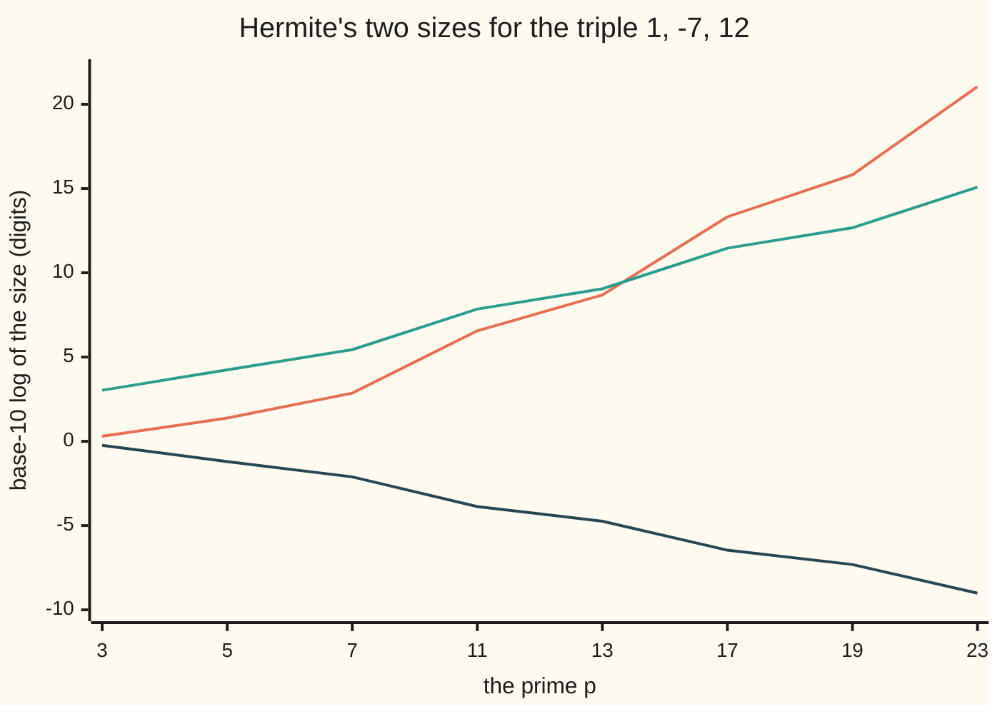

# Transcendence of e and pi: Hermite's integral trick, and Lindemann's step from e to pi

[Syllabus](../../../SYLLABUS.md) → [Algebraic and analytic number theory](../README.md) → [Diophantine and Modular](../README.md#s07) → Transcendence of e and pi

---

## General Overview

Take three small whole numbers and try to make e, 2.718281828459, satisfy a quadratic equation. The triple 1, −7, 12 comes close:

```math
e^2 - 7e + 12 = 0.361083
```

Search harder and you get closer. With every coefficient between −12 and 12, the best triple is −3, 10, −5, which leaves 0.015650. No search ever reaches 0, but a search proves nothing.

In 1873 Charles Hermite proved that no triple, and no longer list of whole numbers, ever works. The number e is **transcendental**: it is a root of no nonzero polynomial with whole-number coefficients ([Minimal polynomials](../05-Fields%20and%20Galois%20Theory/02-minimal-polynomials-and-conjugates.md)).

His trick turns a supposed equation into a whole number that must be two things at once. It is a nonzero multiple of 12! = 479,001,600, so it is at least that big. It is also an integral that the code measures at $`1.833 \times 10^{-5}`$. No whole number is both.

In 1882 Ferdinand Lindemann ran the same trick on π. Since $`e^{i\pi} = -1`$, an equation for π would give an equation for e with algebraic exponents, and the trick breaks that too. So $`\sqrt{\pi}`$ = 1.772454 cannot be drawn with straightedge and compass, and the circle cannot be squared ([Straightedge and compass](../05-Fields%20and%20Galois%20Theory/10-constructibility-and-the-classical-problems.md)).

**If whole numbers made $`a e^2 + b e + c`$ zero, Hermite's integral of $`e^{-x}`$ against $`x^{p-1}(x-1)^p(x-2)^p`$ would be a nonzero whole number divisible by $`(p-1)!`$ yet smaller than $`C^p`$, which is impossible once the prime p is large; Lindemann adds symmetric functions of conjugates and gets the same contradiction for $`i\pi`$, so e and π are transcendental.**

**What kind of fact this is:** theorems. The transcendence of e is proved on this card in Why it works, for any degree. The transcendence of π is proved in a folded Detailed proof. The Lindemann-Weierstrass theorem (1885) is stated with its source, not proved. The code's searches are evidence only. Whether e + π is transcendental is open as of 2026-11-24.

### The picture: a factorial outruns a power



The first line (orange) is $`\log_{10}(p-1)!`$: the least size the whole number can have. The second (green) is the proof's crude bound on the integral, a constant times $`4^p`$: straight against p, but the axis lists only the primes, evenly spaced, so it bends here. The third (dark) is the integral's true size, measured by the code. The factorial passes the crude bound at p = 17. It is above the true size at every prime.

---

## The formula

Notation first, in words. As on the rest of this wing, p is always a prime. The **factorial** $`m!`$ is $`1 \times 2 \times \dots \times m`$. Hermite's **auxiliary polynomial**, a polynomial built only to make the proof work, is

```math
f(x) = x^{p-1}(x-1)^{p}(x-2)^{p}
```

**Read it aloud:** f is x to the p minus 1, times x minus 1 to the p, times x minus 2 to the p.

It has a **deep zero** at each of 0, 1 and 2: a root repeated many times, so f and its first p − 2 or p − 1 derivatives are all 0 there. The points 0, 1, 2 are the powers of e that appear in the test relation $`a e^2 + b e + c`$. Add up f and all its derivatives to get $`F = f + f' + f'' + \dots`$, and take **Hermite's integral**

```math
I(k) = \int_0^k e^{k-u} f(u)\,du = e^k F(0) - F(k)
```

**Read it aloud:** the integral from 0 to k of e to the k minus u times f of u equals e to the k times F of 0, minus F of k.

Weigh the three integrals by the triple and the e-powers collect into the test relation:

```math
J = c\,I(0) + b\,I(1) + a\,I(2) = F(0)\,(a e^2 + b e + c) - N, \qquad N = c\,F(0) + b\,F(1) + a\,F(2)
```

**Read it aloud:** J, the weighted sum of integrals, is F of 0 times the test relation, minus a whole number N.

If the relation were 0, then J would equal −N. The proof shows N is a nonzero whole number divisible by $`(p-1)!`$, while J is below $`C^p`$ in size.

**The Lindemann-Weierstrass theorem** (Lindemann 1882, Weierstrass 1885). Call a number **algebraic** when it is a root of some nonzero whole-number polynomial. If $`\alpha_1, \dots, \alpha_n`$ ("alpha") are distinct algebraic numbers, and $`\beta_1, \dots, \beta_n`$ ("beta") are algebraic numbers, not all 0, then

```math
\beta_1 e^{\alpha_1} + \beta_2 e^{\alpha_2} + \dots + \beta_n e^{\alpha_n} \neq 0
```

**Read it aloud:** no algebraic combination of e raised to distinct algebraic powers adds up to zero.

Hermite's theorem is the case where the exponents are 0, 1, 2, …, n and the β are whole numbers. Lindemann's π is the case $`1 \cdot e^{i\pi} + 1 \cdot e^{0} = 0`$, which the theorem forbids unless $`i\pi`$ is not algebraic.

| Symbol | Plain meaning | In our example | Push it up and the answer… |
| --- | --- | --- | --- |
| $`e`$, $`i`$ | Euler's number; the square root of −1 | 2.718281828459 | — |
| $`a, b, c`$ | whole numbers in the test relation $`a e^2 + b e + c = 0`$ | 1, −7, 12 | a bigger c needs a bigger prime p |
| $`a_k`$, $`n`$, $`k`$ | the general relation $`a_0 + a_1 e + \dots + a_n e^n = 0`$; its degree; the power of e, from 0 to n | $`a_0 = 12`$, n = 2 | f gets one factor per power of e |
| $`p`$ | a prime chosen larger than n and than the size of the constant term | 13 and 17 | the contradiction gets sharper |
| $`f`$, $`F`$ | Hermite's auxiliary polynomial; f plus all its derivatives | at p = 3, F(0), F(1), F(2) = 12544, 34098, 92688 | deeper zeros at 0, 1, 2 |
| $`I(k)`$, $`u`$, $`j`$ | Hermite's integral from 0 to k; the variable of integration; the order of a derivative $`f^{(j)}`$ | $`I(1)`$ = 0.127256190 at p = 3 | shrinks fast as p grows |
| $`J`$, $`N`$ | the integrals weighed by the triple; the whole number $`c\,F(0) + b\,F(1) + a\,F(2)`$ | $`J = -1.833 \times 10^{-5}`$; N has 44 digits at p = 13 | $`\lvert N\rvert`$ is at least $`(p-1)!`$ |
| $`C`$, $`A`$ | constants fixed by the relation; the integral is below $`A\,C^p`$ | 16.90 times $`4^p`$ | none of it beats a factorial |
| $`\alpha_j`$, $`\beta_j`$ | Lindemann-Weierstrass: distinct algebraic exponents ("alpha") and algebraic weights ("beta") | $`i\pi`$ and 0, weights 1 and 1 | — |
| $`\theta_j`$, $`d`$, $`m`$ | the conjugates of $`i\pi`$ ("theta"), their count, and how many subset sums are 0 | stand-in: the roots of $`x^3 - 2`$, d = 3, m = 2 | — |
| $`\gamma_k`$, $`r`$, $`\ell`$ | the nonzero subset sums ("gamma"), their count, and a whole number clearing their denominators ("ell") | six sums, roots of $`x^6 - 4`$; ℓ = 1 | — |
| $`S`$, $`P`$, $`t`$ | in the π fold: a subset of the θs, the polynomial of all subset sums, and the position along a straight path from 0 | 8 subsets for the stand-in | — |

### When it holds

- **Whole-number coefficients.** With real coefficients there is nothing to prove: $`e^2 - e \cdot e = 0`$. The proof needs N to be a whole number, so that "nonzero" means "at least 1".
- **A nonzero constant term.** Divide the relation by a power of e until $`a_0 \ne 0`$. With c = 0, every part of N is divisible by $`p!`$, and the code prints $`(N/12!) \bmod 13 = 0`$: no guarantee that N is not 0.
- **A prime larger than the constant term.** At p = 3, which divides c = 12, the code prints $`(N/2!) \bmod 3 = 0`$. The proof uses p = 13 or any larger prime.
- **A large enough prime for the crude bound.** At p = 13 the crude bound, 10 to the 9.05, is still above 12!, 10 to the 8.68. The proof waits for p = 17.
- **For π: algebraic exponents.** The Lindemann-Weierstrass theorem says nothing when an exponent is transcendental. Whether $`e^{\pi}`$ is transcendental is a different question, answered on the Gelfond-Schneider card.

---

## Why it works

### Step 0: the idea

A whole number that is not 0 is at least 1 in size. Build one from the supposed equation, and show it is also tiny. Hermite's choice of f does both jobs at once. Its deep zeros at 0, 1, 2 make its derivatives there divisible by huge factorials. Its small values between 0 and 2 make the integral small.

The same "nonzero whole number" idea drove Liouville's bound ([Chasing an algebraic number with fractions](10-diophantine-approximation-liouville-to-roth.md)). That card warns that Liouville's method says nothing about e, since e has irrationality exponent 2. Hermite needs a new tool: approximating e, e², …, eⁿ all at once, with one denominator.

### Step 1: the integral is a whole-number expression

Integration by parts trades an integral for a boundary term and a new integral ([Integration by parts](../../06-Calculus%20and%20analysis/04-Integrals/04-integration-by-parts.md)). Here every trade has the same shape, so they telescope: the middle terms cancel and one line is left.

Since $`F - F' = f`$ (the derivatives cancel in pairs), the product rule gives

```math
\frac{d}{du}\left(-e^{-u} F(u)\right) = e^{-u}\big(F(u) - F'(u)\big) = e^{-u} f(u)
```

Integrate from 0 to k and multiply by $`e^k`$: $`I(k) = e^k F(0) - F(k)`$.

The code checks this at p = 3, where $`f = x^2(x-1)^3(x-2)^3`$ and F(0) = 12544, F(1) = 34098. Simpson's rule (a numerical integral that fits parabolas to 4,000 strips) gives 0.127256190, and $`e \cdot 12544 - 34098`$ gives 0.127256190.

So $`F(1)/F(0)`$ is a fraction very close to e, and $`F(2)/F(0)`$ one very close to e², with the same denominator. At p = 13 the errors are $`-2.190 \times 10^{-50}`$ and $`-5.462 \times 10^{-50}`$.

### Step 2: weigh the integrals by the supposed relation

Multiply $`I(0)`$, $`I(1)`$, $`I(2)`$ by c, b, a and add. The $`e^k F(0)`$ parts collect into $`F(0)(a e^2 + b e + c)`$. If that relation were 0, we would have

```math
J = -N, \qquad N = c\,F(0) + b\,F(1) + a\,F(2)
```

The left side is an integral. The right side is built from values of polynomials with whole-number coefficients, so it is a whole number.

### Step 3: N is a nonzero multiple of (p − 1)!

Every derivative of f at a whole number is a whole number. The deep zeros make most of them very divisible.

1. **At 1 and 2.** The factor $`(x-1)^p`$ makes $`f^{(j)}(1) = 0`$ for $`j < p`$. For $`j \ge p`$, the j-th derivative of a whole-number polynomial is j! times a whole number at every whole point, so it is divisible by $`p!`$. The same holds at 2.
2. **At 0, almost the same.** The zero has depth $`p - 1`$, one less. All derivatives below $`p - 1`$ vanish, all above are divisible by $`p!`$, and the one in between is
   ```math
   f^{(p-1)}(0) = (p-1)!\,(-1)^p(-2)^p = (p-1)!\,2^p
   ```
3. **Add up.** So $`N = c \cdot (p-1)! \cdot 2^p + p! \times (\text{a whole number})`$. Divide by $`(p-1)!`$: what is left is $`c \cdot 2^p`$ plus a multiple of p.
4. **Not divisible by p.** If p is a prime above 12, it divides neither c = 12 nor $`2^p`$. So $`N/(p-1)!`$ is not divisible by p, so it is not 0, and $`|N| \ge (p-1)!`$.

At p = 13 the code computes N exactly, by two roads that share only the polynomial product:

```
N = 67073474332490453793195606059293473636326400
N / 12! = 140027662397141165693800617908778329, remainder 0
```

The remainder of $`N/12!`$ after dividing by 13 is 11. Step 3 predicts $`12 \cdot 2^{13}`$, and since $`2^{12}`$ leaves 1 on division by 13, that is $`12 \cdot 2 = 24`$, which leaves 11.

### Step 4: J is smaller than C to the power p

On the interval from 0 to 2, $`|x| \le 2`$, $`|x-1| \le 1`$ and $`|x-2| \le 2`$, so $`|f| \le 2^{2p-1}`$. The integrand also carries $`e^{k-u} \le e^k`$, over a length k. So

```math
|J| \le \left(|b|\,e + 2|a|\,e^2\right) 2^{2p-1} = 33.81 \times 2^{2p-1} = 16.90 \times 4^p
```

That is a constant to the power p. A factorial grows faster than any such power. Raising p by 1 multiplies the bound by C = 4 but multiplies $`(p-1)!`$ by p; once p passes 2C, each step at least doubles the factorial's lead, so it overtakes $`A\,C^p`$. The chart shows the crossing: at p = 17 the bound is 10 to the 11.46 and 16! is 10 to the 13.32.

The bound is generous. The true size of J at p = 13 is $`1.833 \times 10^{-5}`$, because $`|x(x-1)(x-2)|`$ never passes 0.385 between 0 and 2.

### Step 5: the contradiction, for any degree

At p = 17, Step 3 says $`|J| = |N| \ge 16!`$. Step 4 says $`|J| < 16!`$. Both cannot hold, so $`e^2 - 7e + 12 \ne 0`$, which the decimals already showed. The point is that nothing in Steps 1 to 4 used the values 1, −7, 12. Any whole-number triple with $`c \ne 0`$ falls the same way, once p passes both |c| and the crossing.

<details>
<summary>Detailed proof: e is transcendental, any degree n</summary>

Suppose $`a_0 + a_1 e + \dots + a_n e^n = 0`$ with whole numbers $`a_k`$, not all 0. Dividing by a power of e makes $`a_0 \ne 0`$. Take a prime p larger than n and than $`|a_0|`$, and put

$`\displaystyle f(x) = x^{p-1}(x-1)^p(x-2)^p \cdots (x-n)^p`$

with degree $`(n+1)p - 1`$, and F the sum of f and all its derivatives. Step 1 gives $`I(k) = e^k F(0) - F(k)`$ for each k, so

$`\displaystyle J = \sum_{k=0}^{n} a_k I(k) = F(0)\sum_{k=0}^{n} a_k e^k - \sum_{k=0}^{n} a_k F(k) = -\sum_{k=0}^{n} a_k F(k)`$

At each k from 1 to n, every derivative of f is 0 or divisible by p!. At 0, every derivative is 0 or divisible by p!, except

$`\displaystyle f^{(p-1)}(0) = (p-1)!\,\big((-1)^n n!\big)^p`$

So $`\sum a_k F(k)`$ divided by $`(p-1)!`$ is $`a_0\big((-1)^n n!\big)^p`$ plus a multiple of p. The prime p divides neither $`a_0`$ nor $`n!`$, since it is larger than both $`|a_0|`$ and n. So J is a nonzero whole number, at least $`(p-1)!`$ in size.

On the other side, $`|x - j| \le n`$ for x and j between 0 and n, so $`|f| \le n^{(n+1)p}`$ there, and

$`\displaystyle |J| \le \sum_{k=0}^{n} |a_k|\,k\,e^k\,n^{(n+1)p} \le A\,C^p`$

with A and $`C = n^{n+1}`$ fixed by the relation. Since $`(p-1)!/(A\,C^p) \to \infty`$, a large prime p contradicts this. So no relation exists.

</details>

### Step 6: from e to π, by conjugates

Lindemann's step needs three facts. Two come from [Minimal polynomials](../05-Fields%20and%20Galois%20Theory/02-minimal-polynomials-and-conjugates.md). First, sums and products of algebraic numbers are algebraic, so if π were algebraic, so would be $`i\pi`$. Second, an algebraic number has **conjugates**: the other roots of its minimal polynomial. The third is the classical theorem on symmetric polynomials, used here without proof: a formula with fraction coefficients that treats all conjugates alike, such as their sum or product, is a **symmetric function**, and its value is a fraction.

Suppose $`\theta_1 = i\pi`$ had conjugates $`\theta_1, \dots, \theta_d`$. Since $`1 + e^{i\pi} = 0`$, the product of the d brackets $`1 + e^{\theta_j}`$ is 0:

```math
(1 + e^{\theta_1})(1 + e^{\theta_2}) \cdots (1 + e^{\theta_d}) = 0
```

Multiply out. Each of the $`2^d`$ terms is e raised to the sum of some subset of the θs. Some of the sums are 0, say m of them (at least the empty one). Call the nonzero sums $`\gamma_1, \gamma_2, \dots`$. Then

```math
m + e^{\gamma_1} + e^{\gamma_2} + \dots + e^{\gamma_r} = 0
```

This looks like Hermite's relation, with whole-number weights 1 and exponents $`\gamma_k`$ in place of 1, 2, …, n. The $`\gamma_k`$ are not whole numbers. But every symmetric function of them is a fraction, so they are the roots of one polynomial with whole-number coefficients. That is exactly what Hermite's Step 3 needs.

The code watches this bookkeeping on a stand-in, the three roots of $`x^3 - 2`$ in place of the conjugates of $`i\pi`$. Of the 8 subset sums, 2 are 0 (the empty set and all three, since the roots add to 0). The other 6 are roots of $`x^6 - 4`$, with whole-number coefficients, as the symmetric-function argument promises.

<details>
<summary>Detailed proof: π is transcendental</summary>

Keep the notation of Step 6. The $`2^d`$ subset sums are the roots of

$`\displaystyle P(x) = \prod_{S} \Big(x - \sum_{j \in S} \theta_j\Big)`$

over all subsets S. Its coefficients are symmetric functions of the θs, so they are fractions. Dividing P by $`x^m`$ leaves a polynomial with fraction coefficients whose roots are $`\gamma_1, \dots, \gamma_r`$. Clear the denominators: there is a whole number $`\ell \ge 1`$ such that $`\ell\gamma_1, \dots, \ell\gamma_r`$ are the roots of a monic polynomial (leading coefficient 1) with whole-number coefficients (each $`\ell\gamma_k`$ is an algebraic integer).

Take a large prime p and

$`\displaystyle f(x) = \ell^{rp}\,x^{p-1}\,(x - \gamma_1)^p \cdots (x - \gamma_r)^p`$

with F the sum of f and its derivatives as before. Define $`I(\gamma) = \int_0^1 \gamma\,e^{\gamma(1-t)} f(\gamma t)\,dt`$, the integral along the straight segment from 0 to γ in the complex plane. The same product-rule step gives $`I(\gamma) = e^{\gamma}F(0) - F(\gamma)`$. Adding over k and using $`\sum e^{\gamma_k} = -m`$:

$`\displaystyle J = \sum_{k=1}^{r} I(\gamma_k) = -m\,F(0) - \sum_{k=1}^{r} F(\gamma_k)`$

Each derivative of f at the $`\gamma_k`$ is 0 below order p. Summed over k, the higher ones are symmetric in the $`\ell\gamma_k`$, so the sum is a whole number divisible by p!. At 0, the only term not divisible by p! is $`f^{(p-1)}(0) = (p-1)!\,\ell^{rp}\,(\gamma_1 \cdots \gamma_r)^p (-1)^{rp}`$, and $`\ell^r \gamma_1 \cdots \gamma_r`$ is a nonzero whole number. For p above m, ℓ and that number, p does not divide $`m\,f^{(p-1)}(0)/(p-1)!`$. So J is a nonzero whole number divisible by $`(p-1)!`$.

As before, $`|J| \le A\,C^p`$ with A and C fixed by the γs. A large p gives the contradiction. So $`i\pi`$ is not algebraic, and since i is algebraic, π is not algebraic.

</details>

### Step 7: what this settles, and what it does not

- **π is transcendental, so the circle cannot be squared.** A length drawn with straightedge and compass has degree a power of 2, so it is algebraic. If $`\sqrt{\pi}`$ = 1.772454 were algebraic, so would be its square, π.
- **The stand-in shows why closeness is not enough.** Put $`\sqrt{10}`$ = 3.162278 in place of π, an old approximation. The product $`(1 + e^{i\sqrt{10}})(1 + e^{-i\sqrt{10}}) = 2 + 2\cos\sqrt{10}`$ = 0.000428. Close to 0, as for π, but not 0. Only the proof decides.
- **Lindemann-Weierstrass gives many more.** $`e^{\alpha}`$ is transcendental for every algebraic $`\alpha \ne 0`$. So $`\log 2`$ is transcendental (else $`e^{\log 2} = 2`$ would be transcendental), and so are $`\sin 1`$ and $`\cos 1`$. The proof extends the one above to many exponents (Baker, chapter 1).
- **Open as of 2026-11-24.** Whether e + π or eπ is transcendental. At least one of them is: e and π are the two roots of $`x^2 - (e + \pi)x + e\pi`$, and if both coefficients were algebraic, so would be e and π.

---

## Worked numbers, by hand

| Step | Arithmetic | Value |
| --- | --- | --- |
| the test relation | $`e^2 - 7e + 12`$ | 0.361083 |
| the constant term | c = 12, so take a prime above 12 | p = 13 |
| f's deep zero at 0 | $`f^{(12)}(0) = 12! \cdot 2^{13}`$ | 12! × 8,192 |
| N divided by 12! | exact division, two roads | remainder 0 |
| what is left, on division by 13 | $`12 \cdot 2^{13}`$, and $`2^{12}`$ leaves 1 | 24, which leaves **11**, not 0 |
| so N is at least | $`12!`$ | 479,001,600 |
| the true integral sum | $`J = -7\,I(1) + I(2)`$, by Simpson | $`-1.833 \times 10^{-5}`$ |
| the crude bound at p = 13 | $`33.81 \times 2^{25}`$ | 10 to the 9.05, above 12! |
| the crude bound at p = 17 | $`33.81 \times 2^{33}`$ against 16! | 10 to the 11.46 against 10 to the **13.32** |

**At p = 17 the proof's own bound says the integral is smaller than 16!, yet the relation would make it a nonzero multiple of 16!: no whole-number triple with c = 12 can make $`a e^2 + b e + c`$ vanish.** The actual numbers are far apart already at p = 13: $`1.833 \times 10^{-5}`$ against 479,001,600.

### What breaks if you drop a piece

| Mistake | Comes out at | What went wrong |
| --- | --- | --- |
| A prime that divides c: p = 3 with c = 12 | $`(N/2!) \bmod 3 = 0`$ | N may be divisible by p!, and then the size argument has nothing to bite on |
| A relation with c = 0: $`e^2 - 7e`$ | $`(N/12!) \bmod 13 = 0`$ | The one term not divisible by p! vanishes; divide by e first |
| The crude bound with too small a prime: p = 13 | bound 10 to the 9.05 against 12!, 10 to the 8.68 | A power beats a factorial only for small p; the proof needs p = 17 here |

The code prints all three.

---

## Code, from first principles, and it actually runs

The code builds Hermite's polynomial as an exact list of whole-number coefficients and computes N for each prime. It takes three roads. Road 1 adds up F(k) from the coefficients of f by a recurrence. Road 2 shifts f to k and reads F(k) off the Taylor coefficients, each times j!; it shares only the polynomial product with road 1, and the two must agree exactly. Road 3 integrates by Simpson's rule and checks the integration-by-parts identity, then measures J. At p = 13, $`e\,F(0)`$ and F(1) agree to about 50 digits, so ordinary decimals cannot check the identity there; the code sums the series for $`e^k`$ exactly to 70 terms and checks $`I(1)`$, $`I(2)`$ and J against it. It also runs the coefficient search, the subset sums for the stand-in $`x^3 - 2`$, and the π decimals. Python's whole numbers have no size limit; Rust carries a small big-integer type, written out in the file.

### Python

```python
# Transcendence of e and pi -- the check behind the card.  Standard library only;
# math gives exp, log10, cos, sin, sqrt and pi as tools.  Every number on the card
# is printed here.  Test relation: a e^2 + b e + c = 0 with (a, b, c) = (1, -7, 12).
# Hermite's polynomial: f(x) = x^(p-1) (x - 1)^p (x - 2)^p, p a prime.
# Roads: (1) the sum of all derivatives F(k) by a recurrence on f's coefficients,
# (2) the same F(k) by shifting f to k (Taylor coefficients times j!),
# (3) Hermite's integral by Simpson's rule against the integration-by-parts identity.
import math, fractions
A, B, C = 1, -7, 12
E = math.exp(1)

def mul(f, g):                      # product of two coefficient lists, lowest power first
    out = [0] * (len(f) + len(g) - 1)
    for i, x in enumerate(f):
        for j, y in enumerate(g):
            out[i + j] += x * y
    return out

def power(f, n):
    out = [1]
    for _ in range(n):
        out = mul(out, f)
    return out

def hermite(p, shift=0):            # coefficients of f(x + shift)
    f = power([shift, 1], p - 1)
    for k in (1, 2):
        f = mul(f, power([shift - k, 1], p))
    return f

def big_f_road1(p, k):              # F(k) = sum_i c_i S_i, S_i = k^i + i S_(i-1)
    s, total = 0, 0
    for i, c in enumerate(hermite(p)):
        s = k ** i + i * s
        total += c * s
    return total

def big_f_road2(p, k):              # F(k) = sum_j j! t_j, t_j the coefficients of f(k + y)
    total, fact = 0, 1
    for j, t in enumerate(hermite(p, k)):
        total += fact * t
        fact *= j + 1
    return total

def fact(n):
    out = 1
    for m in range(2, n + 1):
        out *= m
    return out

def f_value(u, p):
    out = 1.0
    for _ in range(p - 1):
        out *= u
    for _ in range(p):
        out *= (u - 1) * (u - 2)
    return out

def hermite_integral(k, p, n=4000):  # I(k) = integral from 0 to k of e^(k - u) f(u) du
    h, s = k / n, 0.0
    for i in range(n + 1):
        w = 1 if i in (0, n) else (4 if i % 2 else 2)
        s += w * math.exp(k - i * h) * f_value(i * h, p)
    return s * h / 3

def sci(x):                          # 4 significant digits, the same in both languages
    if x == 0:
        return "0"
    ex = math.floor(math.log10(abs(x)))
    m = x / 10 ** ex
    if abs(m) >= 9.9995:
        m, ex = m / 10, ex + 1
    return f"{m:.3f}e{ex}"

def big_n(p, a, b, c):               # N = c F(0) + b F(1) + a F(2), by both roads
    n1 = c * big_f_road1(p, 0) + b * big_f_road1(p, 1) + a * big_f_road1(p, 2)
    n2 = c * big_f_road2(p, 0) + b * big_f_road2(p, 1) + a * big_f_road2(p, 2)
    assert n1 == n2                  # road 1 against road 2, exact integers
    return n1

print(f"e = {E:.12f}; e^2 - 7e + 12 = {E * E - 7 * E + 12:.6f}")
for h in (2, 12):
    best = min((abs(a * E * E + b * E + c), a, b, c) for a in range(-h, h + 1)
               for b in range(-h, h + 1) for c in range(-h, h + 1) if (a, b, c) != (0, 0, 0))
    print(f"closest triple with every |coefficient| <= {h}: ({best[1]}, {best[2]}, {best[3]}) gives {best[0]:.6f}")
f3 = hermite(3)
print(f"p = 3: f = {f3} (lowest power first); F(0), F(1), F(2) = "
      f"{big_f_road1(3, 0)}, {big_f_road1(3, 1)}, {big_f_road1(3, 2)}")
for k in (1, 2):
    lhs, rhs = hermite_integral(k, 3), E ** k * big_f_road1(3, 0) - big_f_road1(3, k)
    print(f"p = 3, k = {k}: Simpson integral {lhs:.9f}; e^k F(0) - F(k) = {rhs:.9f}")
    assert abs(lhs - rhs) < 1e-9     # integration by parts against numerical integration
n13 = big_n(13, A, B, C)
print(f"p = 13: N = {n13} ({len(str(n13))} digits); 2^13 = {2 ** 13}")
print(f"N / 12! = {n13 // fact(12)}, remainder {n13 % fact(12)}; (N / 12!) mod 13 = {n13 // fact(12) % 13}")
assert n13 % fact(12) == 0 and n13 // fact(12) % 13 != 0      # divisible by 12!, not by 13!
j13 = B * hermite_integral(1, 13) + A * hermite_integral(2, 13)
print(f"p = 13: J = c I(0) + b I(1) + a I(2) = {sci(j13)}; 12! = {fact(12):,}")
assert 0 < abs(j13) < 1                                        # far below 12!
def exact_i(k): return float(sum(fractions.Fraction(k ** j, fact(j)) for j in range(71)) * big_f_road1(13, 0) - big_f_road1(13, k))
for v, x in ((hermite_integral(1, 13), exact_i(1)), (hermite_integral(2, 13), exact_i(2)), (j13, C * exact_i(0) + B * exact_i(1) + A * exact_i(2))):
    assert abs(v - x) < 1e-9 * abs(x)   # Simpson at p = 13 against e^k F(0) - F(k), e^k summed exactly to 70 terms
print(f"F(1)/F(0) - e = {sci(-hermite_integral(1, 13) / big_f_road1(13, 0))}; "
      f"F(2)/F(0) - e^2 = {sci(-hermite_integral(2, 13) / big_f_road1(13, 0))}")
print(f"crude constant |b| e + 2|a| e^2 = {abs(B) * E + 2 * abs(A) * E * E:.2f}, half of it {(abs(B) * E + 2 * abs(A) * E * E) / 2:.2f}; "
      f"largest |x(x-1)(x-2)| on [0, 2] = 2/(3 sqrt 3) = {2 / (3 * math.sqrt(3)):.3f}")
print("p, N divisible by (p-1)!, (N/(p-1)!) mod p, log10 (p-1)!, log10 crude bound, log10 |J|")
chart = []
for p in (3, 5, 7, 11, 13, 17, 19, 23):
    n = big_n(p, A, B, C)
    crude = (abs(B) * E + 2 * abs(A) * E * E) * 2 ** (2 * p - 1)
    j = B * hermite_integral(1, p) + A * hermite_integral(2, p)
    row = (math.log10(fact(p - 1)), math.log10(crude), math.log10(abs(j)))
    chart.append(row)
    print(f"{p}, {'yes' if n % fact(p - 1) == 0 else 'no'}, {n // fact(p - 1) % p}, "
          f"{row[0]:.2f}, {row[1]:.2f}, {row[2]:.2f}")
print(f"first prime past 12 where the crude bound is below (p-1)!: "
      f"{[p for p, r in zip((3, 5, 7, 11, 13, 17, 19, 23), chart) if p > 12 and r[1] < r[0]][0]}")
assert chart[4][1] > chart[4][0] and chart[5][1] < chart[5][0]  # crude bound crosses at 17
n0 = big_n(13, 1, -7, 0)
print(f"mistake, c = 0: (N/12!) mod 13 = {n0 // fact(12) % 13}; p = 3 dividing c = 12: "
      f"(N/2!) mod 3 = {big_n(3, A, B, C) // 2 % 3}")
print(f"sqrt(pi) = {math.sqrt(math.pi):.6f}; |1 + e^(i pi)| below 1e-15: "
      f"{'yes' if abs(1 + complex(math.cos(math.pi), math.sin(math.pi))) < 1e-15 else 'no'}")
print(f"stand-in i sqrt10 for i pi, sqrt 10 = {math.sqrt(10):.6f}: (1 + e^(i r))(1 + e^(-i r)) = 2 + 2 cos(sqrt 10) = {2 + 2 * math.cos(math.sqrt(10)):.6f}")
r, w = 2 ** (1 / 3), complex(math.cos(2 * math.pi / 3), math.sin(2 * math.pi / 3))
roots = [r, r * w, r * w * w]
sums = [sum(t for i, t in enumerate(roots) if m >> i & 1) for m in range(8)]
nonzero = [s for s in sums if abs(s) > 1e-9]
poly = [complex(1)]
for s in nonzero:
    poly = mul(poly, [-s, 1])
rounded = [round(z.real) for z in poly]
print(f"roots of x^3 - 2: 8 subset sums, {8 - len(nonzero)} of them 0; the other {len(nonzero)} "
      f"solve {rounded} (lowest power first)")
assert rounded == mul([-2, 0, 0, 1], [2, 0, 0, 1])             # equals (x^3 - 2)(x^3 + 2)
assert max(abs(z - k) for z, k in zip(poly, rounded)) < 1e-9
print("ALL CHECKS PASS")
```

**Ran 2026-11-24 on macOS, Python 3.14.10, standard library only. All checks passed. Output, pasted from the run:**

```
e = 2.718281828459; e^2 - 7e + 12 = 0.361083
closest triple with every |coefficient| <= 2: (-1, 2, 2) gives 0.047508
closest triple with every |coefficient| <= 12: (-3, 10, -5) gives 0.015650
p = 3: f = [0, 0, 8, -36, 66, -63, 33, -9, 1] (lowest power first); F(0), F(1), F(2) = 12544, 34098, 92688
p = 3, k = 1: Simpson integral 0.127256190; e^k F(0) - F(k) = 0.127256190
p = 3, k = 2: Simpson integral 0.319704986; e^k F(0) - F(k) = 0.319704986
p = 13: N = 67073474332490453793195606059293473636326400 (44 digits); 2^13 = 8192
N / 12! = 140027662397141165693800617908778329, remainder 0; (N / 12!) mod 13 = 11
p = 13: J = c I(0) + b I(1) + a I(2) = -1.833e-5; 12! = 479,001,600
F(1)/F(0) - e = -2.190e-50; F(2)/F(0) - e^2 = -5.462e-50
crude constant |b| e + 2|a| e^2 = 33.81, half of it 16.90; largest |x(x-1)(x-2)| on [0, 2] = 2/(3 sqrt 3) = 0.385
p, N divisible by (p-1)!, (N/(p-1)!) mod p, log10 (p-1)!, log10 crude bound, log10 |J|
3, yes, 0, 0.30, 3.03, -0.24
5, yes, 4, 1.38, 4.24, -1.20
7, yes, 3, 2.86, 5.44, -2.11
11, yes, 2, 6.56, 7.85, -3.87
13, yes, 11, 8.68, 9.05, -4.74
17, yes, 7, 13.32, 11.46, -6.46
19, yes, 5, 15.81, 12.67, -7.31
23, yes, 1, 21.05, 15.08, -9.01
first prime past 12 where the crude bound is below (p-1)!: 17
mistake, c = 0: (N/12!) mod 13 = 0; p = 3 dividing c = 12: (N/2!) mod 3 = 0
sqrt(pi) = 1.772454; |1 + e^(i pi)| below 1e-15: yes
stand-in i sqrt10 for i pi, sqrt 10 = 3.162278: (1 + e^(i r))(1 + e^(-i r)) = 2 + 2 cos(sqrt 10) = 0.000428
roots of x^3 - 2: 8 subset sums, 2 of them 0; the other 6 solve [-4, 0, 0, 0, 0, 0, 1] (lowest power first)
ALL CHECKS PASS
```

### Rust

Same numbers, same labels, built with `rustc --edition 2021 -O`.

```rust
// Transcendence of e and pi -- the same check as the Python, in Rust.  No crates.
// Test relation: a e^2 + b e + c = 0 with (a, b, c) = (1, -7, 12).  Hermite's
// polynomial: f(x) = x^(p-1) (x - 1)^p (x - 2)^p, p a prime.  Roads: (1) F(k), the sum
// of all derivatives, by a recurrence on f's coefficients; (2) the same F(k) by shifting
// f to k; (3) Hermite's integral by Simpson's rule against integration by parts.
// Whole numbers past u128 use a small signed big-integer type, base 10^9.
const BASE: i128 = 1_000_000_000;
#[derive(Clone, PartialEq, Debug)]
struct Z { neg: bool, d: Vec<i128> } // sign and base-10^9 digits, lowest first

fn norm(v: Vec<i128>) -> Z { // carry signed digit sums into a sign and true digits
    let (mut d, mut carry) = (vec![], 0i128);
    for x in v { let s = x + carry; d.push(s.rem_euclid(BASE)); carry = s.div_euclid(BASE); }
    while carry > 0 { d.push(carry % BASE); carry /= BASE; }
    if carry < 0 { d.push(carry); return Z { neg: true, d: norm(d.iter().map(|x| -x).collect()).d }; }
    while d.len() > 1 && *d.last().unwrap() == 0 { d.pop(); }
    Z { neg: false, d }
}
impl Z {
    fn from(x: i128) -> Z { norm(vec![x]) }
    fn signed(&self) -> Vec<i128> { self.d.iter().map(|x| if self.neg { -x } else { *x }).collect() }
    fn add(&self, o: &Z) -> Z {
        let (a, b) = (self.signed(), o.signed());
        norm((0..a.len().max(b.len())).map(|i| a.get(i).unwrap_or(&0) + b.get(i).unwrap_or(&0)).collect())
    }
    fn mul(&self, m: i128) -> Z { norm(self.signed().iter().map(|x| x * m).collect()) } // |m| below 10^18
    fn divrem(&self, m: u128) -> (Z, u128) { // magnitude divided by m, remainder of the magnitude
        let (mut q, mut r) = (vec![0u128; self.d.len()], 0u128);
        for i in (0..self.d.len()).rev() { let cur = r * 1_000_000_000 + self.d[i] as u128; q[i] = cur / m; r = cur % m; }
        let mut z = norm(q.iter().map(|&x| x as i128).collect()); z.neg = self.neg; (z, r)
    }
    fn modp(&self, p: u128) -> u128 { let r = self.divrem(p).1; if self.neg && r > 0 { p - r } else { r } }
    fn f64(&self) -> f64 { let m = self.d.iter().rev().fold(0.0, |a, &x| a * 1e9 + x as f64); if self.neg { -m } else { m } }
    fn show(&self) -> String {
        let head = format!("{}{}", if self.neg { "-" } else { "" }, self.d.last().unwrap());
        self.d.iter().rev().skip(1).fold(head, |s, x| s + &format!("{:09}", x))
    }
}
fn mulp(f: &[i128], g: &[i128]) -> Vec<i128> {
    let mut out = vec![0; f.len() + g.len() - 1];
    for (i, x) in f.iter().enumerate() { for (j, y) in g.iter().enumerate() { out[i + j] += x * y; } } out
}
fn hermite(p: usize, s: i128) -> Vec<i128> { // coefficients of f(x + s)
    let mut f = vec![1];
    for _ in 0..p - 1 { f = mulp(&f, &[s, 1]); }
    for k in 1..=2 { for _ in 0..p { f = mulp(&f, &[s - k, 1]); } } f
}
fn big_f1(p: usize, k: i128) -> Z { // F(k) = sum_i c_i S_i, S_i = k^i + i S_(i-1)
    let (mut s, mut total) = (Z::from(0), Z::from(0));
    for (i, c) in hermite(p, 0).iter().enumerate() {
        s = Z::from(k.pow(i as u32)).add(&s.mul(i as i128));
        total = total.add(&s.mul(*c));
    } total
}
fn big_f2(p: usize, k: i128) -> Z { // F(k) = sum_j j! t_j, t_j the coefficients of f(k + y)
    let (mut total, mut fact) = (Z::from(0), Z::from(1));
    for (j, t) in hermite(p, k).iter().enumerate() {
        total = total.add(&fact.mul(*t));
        fact = fact.mul(j as i128 + 1);
    } total
}
fn big_n(p: usize, a: i128, b: i128, c: i128) -> Z {
    let n1 = big_f1(p, 0).mul(c).add(&big_f1(p, 1).mul(b)).add(&big_f1(p, 2).mul(a));
    let n2 = big_f2(p, 0).mul(c).add(&big_f2(p, 1).mul(b)).add(&big_f2(p, 2).mul(a));
    assert!(n1 == n2); n1 // road 1 against road 2, exact integers
}
fn fact(n: u128) -> u128 { (2..=n).product::<u128>().max(1) }
fn f_value(u: f64, p: usize) -> f64 {
    let mut out = 1.0;
    for _ in 0..p - 1 { out *= u; }
    for _ in 0..p { out *= (u - 1.0) * (u - 2.0); } out
}
fn hermite_integral(k: f64, p: usize) -> f64 { // integral from 0 to k of e^(k - u) f(u) du
    let n = 4000;
    let (h, mut s) = (k / n as f64, 0.0);
    for i in 0..=n {
        let w = if i == 0 || i == n { 1.0 } else if i % 2 == 1 { 4.0 } else { 2.0 };
        s += w * (k - i as f64 * h).exp() * f_value(i as f64 * h, p);
    } s * h / 3.0
}
fn sci(x: f64) -> String { // 4 significant digits, the same in both languages
    if x == 0.0 { return "0".into(); }
    let mut ex = x.abs().log10().floor() as i32;
    let mut m = x / 10f64.powi(ex);
    if m.abs() >= 9.9995 { m /= 10.0; ex += 1; }
    format!("{:.3}e{}", m, ex)
}
#[derive(Clone, Copy)]
struct Cx { re: f64, im: f64 } // a small complex-number type
fn cmul(a: Cx, b: Cx) -> Cx { Cx { re: a.re * b.re - a.im * b.im, im: a.re * b.im + a.im * b.re } }
fn cadd(a: Cx, b: Cx) -> Cx { Cx { re: a.re + b.re, im: a.im + b.im } }
fn main() {
    let (a0, b0, c0) = (1i128, -7i128, 12i128);
    let e = 1f64.exp();
    println!("e = {:.12}; e^2 - 7e + 12 = {:.6}", e, e * e - 7.0 * e + 12.0);
    for h in [2i32, 12] {
        let mut best = (f64::INFINITY, 0, 0, 0);
        for a in -h..=h { for b in -h..=h { for c in -h..=h {
            let v = (a as f64 * e * e + b as f64 * e + c as f64).abs();
            if (a, b, c) != (0, 0, 0) && v < best.0 { best = (v, a, b, c); } } } }
        println!("closest triple with every |coefficient| <= {}: ({}, {}, {}) gives {:.6}", h, best.1, best.2, best.3, best.0);
    }
    println!("p = 3: f = {:?} (lowest power first); F(0), F(1), F(2) = {}, {}, {}",
             hermite(3, 0), big_f1(3, 0).show(), big_f1(3, 1).show(), big_f1(3, 2).show());
    for k in [1i128, 2] {
        let lhs = hermite_integral(k as f64, 3);
        let rhs = e.powi(k as i32) * big_f1(3, 0).f64() - big_f1(3, k).f64();
        println!("p = 3, k = {}: Simpson integral {:.9}; e^k F(0) - F(k) = {:.9}", k, lhs, rhs);
        assert!((lhs - rhs).abs() < 1e-9); // integration by parts against numerical integration
    }
    let n13 = big_n(13, a0, b0, c0);
    let (q13, r13) = n13.divrem(fact(12));
    println!("p = 13: N = {} ({} digits); 2^13 = {}", n13.show(), n13.show().len(), 1u32 << 13);
    println!("N / 12! = {}, remainder {}; (N / 12!) mod 13 = {}", q13.show(), r13, q13.modp(13));
    assert!(r13 == 0 && q13.modp(13) != 0); // divisible by 12!, not by 13!
    let j13 = b0 as f64 * hermite_integral(1.0, 13) + a0 as f64 * hermite_integral(2.0, 13);
    println!("p = 13: J = c I(0) + b I(1) + a I(2) = {}; 12! = 479,001,600", sci(j13));
    assert!(fact(12) == 479_001_600 && j13.abs() > 0.0 && j13.abs() < 1.0); // far below 12!
    let exact_i = |k: i128| { let sc = |z: Z| (0..8).fold(z, |a, _| a.mul(BASE)); // times S = 10^72
        let (mut t, mut sum) = (sc(big_f1(13, 0)), Z::from(0)); // e^k F(0) S, e^k summed exactly to 70 terms
        for j in 0..=70u128 { sum = sum.add(&t); t = t.mul(k).divrem(j + 1).0; }
        sum.add(&sc(big_f1(13, k)).mul(-1)).f64() / 1e72 };
    for (v, x) in [(hermite_integral(1.0, 13), exact_i(1)), (hermite_integral(2.0, 13), exact_i(2)),
                   (j13, c0 as f64 * exact_i(0) + b0 as f64 * exact_i(1) + a0 as f64 * exact_i(2))] { assert!((v - x).abs() < 1e-9 * x.abs()); }
    let f0 = big_f1(13, 0).f64();
    println!("F(1)/F(0) - e = {}; F(2)/F(0) - e^2 = {}", sci(-hermite_integral(1.0, 13) / f0), sci(-hermite_integral(2.0, 13) / f0));
    let cc = b0.abs() as f64 * e + 2.0 * a0.abs() as f64 * e * e;
    println!("crude constant |b| e + 2|a| e^2 = {:.2}, half of it {:.2}; largest |x(x-1)(x-2)| on [0, 2] = 2/(3 sqrt 3) = {:.3}", cc, cc / 2.0, 2.0 / (3.0 * 3f64.sqrt()));
    println!("p, N divisible by (p-1)!, (N/(p-1)!) mod p, log10 (p-1)!, log10 crude bound, log10 |J|");
    let primes = [3usize, 5, 7, 11, 13, 17, 19, 23];
    let mut chart = vec![];
    for &p in &primes {
        let (q, r) = big_n(p, a0, b0, c0).divrem(fact(p as u128 - 1));
        let crude = (b0.abs() as f64 * e + 2.0 * a0.abs() as f64 * e * e) * 2f64.powi(2 * p as i32 - 1);
        let j = b0 as f64 * hermite_integral(1.0, p) + a0 as f64 * hermite_integral(2.0, p);
        let row = ((fact(p as u128 - 1) as f64).log10(), crude.log10(), j.abs().log10());
        chart.push(row);
        println!("{}, {}, {}, {:.2}, {:.2}, {:.2}", p, if r == 0 { "yes" } else { "no" }, q.modp(p as u128), row.0, row.1, row.2);
    }
    let first = primes.iter().zip(&chart).find(|(p, r)| **p > 12 && r.1 < r.0).unwrap().0;
    println!("first prime past 12 where the crude bound is below (p-1)!: {}", first);
    assert!(chart[4].1 > chart[4].0 && chart[5].1 < chart[5].0); // crude bound crosses at 17
    let n0 = big_n(13, 1, -7, 0);
    println!("mistake, c = 0: (N/12!) mod 13 = {}; p = 3 dividing c = 12: (N/2!) mod 3 = {}",
             n0.divrem(fact(12)).0.modp(13), big_n(3, a0, b0, c0).divrem(2).0.modp(3));
    let pi = std::f64::consts::PI;
    let one_plus = ((1.0 + pi.cos()).powi(2) + pi.sin().powi(2)).sqrt();
    println!("sqrt(pi) = {:.6}; |1 + e^(i pi)| below 1e-15: {}", pi.sqrt(), if one_plus < 1e-15 { "yes" } else { "no" });
    println!("stand-in i sqrt10 for i pi, sqrt 10 = {:.6}: (1 + e^(i r))(1 + e^(-i r)) = 2 + 2 cos(sqrt 10) = {:.6}", 10f64.sqrt(), 2.0 + 2.0 * 10f64.sqrt().cos());
    let (r, w) = (2f64.powf(1.0 / 3.0), Cx { re: (2.0 * pi / 3.0).cos(), im: (2.0 * pi / 3.0).sin() });
    let rw = Cx { re: r * w.re, im: r * w.im };
    let roots = [Cx { re: r, im: 0.0 }, rw, cmul(rw, w)];
    let mut poly = vec![Cx { re: 1.0, im: 0.0 }];
    for m in 1..8usize {
        let s = (0..3).filter(|i| m >> i & 1 == 1).fold(Cx { re: 0.0, im: 0.0 }, |t, i| cadd(t, roots[i]));
        if s.re.hypot(s.im) <= 1e-9 { continue; }
        let mut next = vec![Cx { re: 0.0, im: 0.0 }; poly.len() + 1];
        for (i, z) in poly.iter().enumerate() {
            next[i] = cadd(next[i], cmul(*z, Cx { re: -s.re, im: -s.im }));
            next[i + 1] = cadd(next[i + 1], *z);
        }
        poly = next;
    }
    let rounded: Vec<i128> = poly.iter().map(|z| z.re.round() as i128).collect();
    println!("roots of x^3 - 2: 8 subset sums, {} of them 0; the other {} solve {:?} (lowest power first)",
             9 - poly.len(), poly.len() - 1, rounded);
    assert!(rounded == mulp(&[-2, 0, 0, 1], &[2, 0, 0, 1])); // equals (x^3 - 2)(x^3 + 2)
    assert!(poly.iter().zip(&rounded).all(|(z, &k)| (z.re - k as f64).hypot(z.im) < 1e-9));
    println!("ALL CHECKS PASS");
}
```

**Ran 2026-11-24 on macOS, rustc 1.98.1, no crates. All checks passed. Output, pasted from the run:**

```
e = 2.718281828459; e^2 - 7e + 12 = 0.361083
closest triple with every |coefficient| <= 2: (-1, 2, 2) gives 0.047508
closest triple with every |coefficient| <= 12: (-3, 10, -5) gives 0.015650
p = 3: f = [0, 0, 8, -36, 66, -63, 33, -9, 1] (lowest power first); F(0), F(1), F(2) = 12544, 34098, 92688
p = 3, k = 1: Simpson integral 0.127256190; e^k F(0) - F(k) = 0.127256190
p = 3, k = 2: Simpson integral 0.319704986; e^k F(0) - F(k) = 0.319704986
p = 13: N = 67073474332490453793195606059293473636326400 (44 digits); 2^13 = 8192
N / 12! = 140027662397141165693800617908778329, remainder 0; (N / 12!) mod 13 = 11
p = 13: J = c I(0) + b I(1) + a I(2) = -1.833e-5; 12! = 479,001,600
F(1)/F(0) - e = -2.190e-50; F(2)/F(0) - e^2 = -5.462e-50
crude constant |b| e + 2|a| e^2 = 33.81, half of it 16.90; largest |x(x-1)(x-2)| on [0, 2] = 2/(3 sqrt 3) = 0.385
p, N divisible by (p-1)!, (N/(p-1)!) mod p, log10 (p-1)!, log10 crude bound, log10 |J|
3, yes, 0, 0.30, 3.03, -0.24
5, yes, 4, 1.38, 4.24, -1.20
7, yes, 3, 2.86, 5.44, -2.11
11, yes, 2, 6.56, 7.85, -3.87
13, yes, 11, 8.68, 9.05, -4.74
17, yes, 7, 13.32, 11.46, -6.46
19, yes, 5, 15.81, 12.67, -7.31
23, yes, 1, 21.05, 15.08, -9.01
first prime past 12 where the crude bound is below (p-1)!: 17
mistake, c = 0: (N/12!) mod 13 = 0; p = 3 dividing c = 12: (N/2!) mod 3 = 0
sqrt(pi) = 1.772454; |1 + e^(i pi)| below 1e-15: yes
stand-in i sqrt10 for i pi, sqrt 10 = 3.162278: (1 + e^(i r))(1 + e^(-i r)) = 2 + 2 cos(sqrt 10) = 0.000428
roots of x^3 - 2: 8 subset sums, 2 of them 0; the other 6 solve [-4, 0, 0, 0, 0, 0, 1] (lowest power first)
ALL CHECKS PASS
```

The two outputs match line for line.

### Lean

Lean proves that e and π are transcendental, Steps 1 and 3 for any polynomial and degree, and the card's whole-number checks.

- The number e is transcendental, and so is π.
- Take any polynomial f with real coefficients, F the sum of f and its derivatives, and any real k. Then $`I(k) = e^k F(0) - F(k)`$.
- Take a prime p above n, and whole numbers $`a_0, \dots, a_n`$ with $`a_0 \ne 0`$ and $`|a_0| < p`$. Then the detailed proof's sum $`\sum a_k F(k)`$ is divisible by $`(p-1)!`$, but not by $`p!`$.
- So that sum is not 0.
- At p = 3, f has coefficients 8, −36, 66, −63, 33, −9, 1 on the powers $`x^2`$ to $`x^8`$, and F(0) = 12544.
- 12! = 479,001,600 and $`2^{13}`$ = 8,192. The printed N at p = 13 is exactly 12! times the printed quotient.
- That quotient leaves 11 on division by 13, as Step 3 predicts.
- The predicted remainders of $`12 \cdot 2^p`$ on division by p are 4, 3, 2, 11, 7, 5, 1 at p = 5, 7, 11, 13, 17, 19, 23.
- The crude bound is above 12! at p = 13 and below 16! at p = 17.
- $`(x^3 - 2)(x^3 + 2) = x^6 - 4`$, the polynomial of the stand-in's six nonzero subset sums.

Every decimal, the Simpson integrals, the search, and computing N and the subset sums themselves are left to the Python and Rust checks.

```lean
-- Transcendence of e and pi: e and π are each a root of no nonzero polynomial with whole-number coefficients, by Hermite's integral identity and his factorial-divisibility step.
import Mathlib.Algebra.Polynomial.SumIteratedDerivative
import Mathlib.Analysis.SpecialFunctions.Trigonometric.Basic
import Mathlib.MeasureTheory.Integral.IntervalIntegral.FundThmCalculus
import Mathlib.NumberTheory.Transcendental.Lindemann.AnalyticalPart
import Mathlib.RingTheory.Algebraic.Defs
import Mathlib.Tactic.NormNum
import Mathlib.Topology.Algebra.Order.Floor
import Mathlib.RingTheory.Polynomial.Tower
import Mathlib.FieldTheory.Galois.Basic
import Mathlib.FieldTheory.SplittingField.Construction
import Mathlib.FieldTheory.IsAlgClosed.Basic
import Mathlib.Analysis.Complex.Polynomial.Basic
import Mathlib.RingTheory.Polynomial.RationalRoot
import Mathlib.RingTheory.Polynomial.ScaleRoots
import Mathlib.RingTheory.Algebraic.Integral
import Mathlib.Analysis.SpecialFunctions.ExpDeriv
import Mathlib.Analysis.Calculus.Deriv.Polynomial

open Polynomial
open scoped Nat

/-- Hermite's auxiliary polynomial for a relation of degree n:
f(x) = x^(p-1) (x - 1)^p (x - 2)^p ... (x - n)^p, with whole-number coefficients. -/
noncomputable def hermitePoly (n p : ℕ) : ℤ[X] :=
  X ^ (p - 1) * ∏ k ∈ Finset.Icc 1 n, (X - C (k : ℤ)) ^ p

/-- The whole number N = a_0 F(0) + a_1 F(1) + ... + a_n F(n) for the supposed relation
a_0 + a_1 e + ... + a_n e^n = 0, where F = f + f' + f'' + ... is the sum of Hermite's
polynomial and all its derivatives (Mathlib's `sumIDeriv`). -/
noncomputable def hermiteN (n p : ℕ) (a : ℕ → ℤ) : ℤ :=
  ∑ k ∈ Finset.range (n + 1), a k * (sumIDeriv (hermitePoly n p)).eval (k : ℤ)

/-! Helper lemmas for the proofs below. -/

theorem lw_core (f : ℤ[X]) (hf0 : f.eval 0 ≠ 0) (m : Multiset (ℂ × ℤ))
    (hm : ∀ x ∈ m, x.1 ∈ f.aroots ℂ) (a0 : ℤ) (ha0 : a0 ≠ 0) (L : ℤ) (hL : L ≠ 0)
    (hint : ∀ g : ℤ[X], ∃ z : ℤ,
      (L : ℂ) ^ g.natDegree * (m.map (fun x => (x.2 : ℂ) * aeval x.1 g)).sum = z)
    (hrel : (a0 : ℂ) + (m.map (fun x => (x.2 : ℂ) * Complex.exp x.1)).sum = 0) : False := by
  obtain ⟨c, hc⟩ := LindemannWeierstrass.exp_polynomial_approx f hf0
  set M := f.natDegree
  set W : ℝ := (m.map (fun x => ‖(x.2 : ℂ)‖)).sum with hW
  set K : ℝ := |(L : ℝ)| ^ M * |c| with hK
  have ht := (FloorSemiring.tendsto_pow_div_factorial_atTop K).const_mul (W * K)
  rw [mul_zero] at ht
  obtain ⟨N0, hN0⟩ := Filter.eventually_atTop.mp (ht.eventually (gt_mem_nhds one_pos))
  obtain ⟨p, hpge, hp⟩ :=
    Nat.exists_infinite_primes (N0 + 1 + (f.eval 0).natAbs + a0.natAbs + L.natAbs)
  have hsmall := hN0 (p - 1) (by omega)
  obtain ⟨np, hnp, g, hgdeg, happ⟩ := hc p (by omega) hp
  obtain ⟨z, hz⟩ := hint g
  set E := M * p with hE
  have hgE : g.natDegree ≤ E := by
    have : p * M - 1 ≤ M * p := by rw [mul_comm]; omega
    omega
  set Nint : ℤ := L ^ E * np * a0 + p * (L ^ (E - g.natDegree) * z) with hNint
  set S' : ℂ := (m.map (fun x => (x.2 : ℂ) * ((np : ℂ) * Complex.exp x.1 -
    (p : ℂ) * aeval x.1 g))).sum with hS'
  have e1 : S' = (np : ℂ) * (m.map (fun x => (x.2 : ℂ) * Complex.exp x.1)).sum -
      (p : ℂ) * (m.map (fun x => (x.2 : ℂ) * aeval x.1 g)).sum := by
    rw [hS', ← Multiset.sum_map_mul_left, ← Multiset.sum_map_mul_left, ← Multiset.sum_map_sub]
    congr 1
    apply Multiset.map_congr rfl
    intros
    ring
  have key : (Nint : ℂ) = -((L : ℂ) ^ E * S') := by
    have hsum : (m.map (fun x => (x.2 : ℂ) * Complex.exp x.1)).sum = -(a0 : ℂ) := by
      linear_combination hrel
    rw [e1, hsum, hNint]
    have : (L : ℂ) ^ E = (L : ℂ) ^ (E - g.natDegree) * (L : ℂ) ^ g.natDegree := by
      rw [← pow_add, Nat.sub_add_cancel hgE]
    push_cast
    rw [← hz, this]
    ring
  -- lower bound
  have hNint0 : Nint ≠ 0 := by
    intro h0
    have hpZ : Prime (p : ℤ) := Nat.prime_iff_prime_int.mp hp
    have hdvd : (p : ℤ) ∣ L ^ E * np * a0 := by
      have : (p : ℤ) ∣ Nint := by rw [h0]; exact dvd_zero _
      rwa [hNint, dvd_add_left (dvd_mul_right _ _)] at this
    rcases hpZ.dvd_or_dvd hdvd with h1 | h1
    · rcases hpZ.dvd_or_dvd h1 with h2 | h2
      · have h3 := hpZ.dvd_of_dvd_pow h2
        have := Nat.le_of_dvd (Int.natAbs_pos.mpr hL)
          (by simpa using Int.natAbs_dvd_natAbs.mpr h3)
        omega
      · exact hnp h2
    · have := Nat.le_of_dvd (Int.natAbs_pos.mpr ha0) (by simpa using Int.natAbs_dvd_natAbs.mpr h1)
      omega
  have hlow : (1 : ℝ) ≤ ‖(Nint : ℂ)‖ := by
    rw [Complex.norm_intCast]
    exact_mod_cast Int.one_le_abs hNint0
  -- upper bound
  have hfac : (0 : ℝ) < ((p - 1)! : ℝ) := by exact_mod_cast Nat.factorial_pos _
  have hup : ‖S'‖ ≤ W * (|c| ^ p / (p - 1)!) := by
    rw [hS']
    refine (norm_multiset_sum_le (E := ℂ) _).trans ?_
    rw [Multiset.map_map, hW, ← Multiset.sum_map_mul_right]
    refine Multiset.sum_map_le_sum_map _ _ (fun x hx => ?_)
    simp only [Function.comp_apply, norm_mul]
    apply mul_le_mul_of_nonneg_left _ (norm_nonneg _)
    have := happ (hm x hx)
    simp only [zsmul_eq_mul, nsmul_eq_mul] at this
    exact this.trans (div_le_div_of_nonneg_right ((le_abs_self (c ^ p)).trans (abs_pow c p).le)
      hfac.le)
  have hfinal : ‖(Nint : ℂ)‖ ≤ W * K * (K ^ (p - 1) / (p - 1)!) := by
    rw [key, norm_neg, norm_mul, norm_pow, Complex.norm_intCast]
    have hKp : K * K ^ (p - 1) = |(L : ℝ)| ^ E * |c| ^ p := by
      rw [← pow_succ', Nat.sub_add_cancel hp.one_le, hK, mul_pow, ← pow_mul]
    calc |(L : ℝ)| ^ E * ‖S'‖ ≤ |(L : ℝ)| ^ E * (W * (|c| ^ p / (p - 1)!)) := by
          gcongr
      _ = W * K * (K ^ (p - 1) / (p - 1)!) := by
          rw [show W * K * (K ^ (p - 1) / ((p - 1)! : ℝ)) = W * (K * K ^ (p - 1)) / (p - 1)! by
            ring, hKp]
          ring
  have : W * K * (K ^ (p - 1) / ((p - 1)! : ℝ)) < 1 := hsmall
  linarith

theorem multiset_powerset_map {α β : Type*} (f : α → β) (s : Multiset α) :
    (s.map f).powerset = s.powerset.map (Multiset.map f) := by
  induction s using Multiset.induction_on with
  | empty => simp
  | cons a s ih => simp [Multiset.powerset_cons, ih, Multiset.map_map]

theorem ringHom_aeval_int {A B : Type*} [CommRing A] [CommRing B] [Algebra ℤ A] [Algebra ℤ B]
    (ψ : A →+* B) (x : A)
    (g : ℤ[X]) : ψ (aeval x g) = aeval (ψ x) g := by
  rw [aeval_def, aeval_def, hom_eval₂, RingHom.ext_int (ψ.comp (algebraMap ℤ A)) (algebraMap ℤ B)]

theorem aroots_map_of_card {K L : Type*} [Field K] [CharZero K] [CommRing L] [IsDomain L]
    (P : ℤ[X]) (hcard : Multiset.card (P.aroots K) = P.natDegree)
    (ψ : K →+* L) (hψ : Function.Injective ψ) :
    (P.aroots K).map ψ = P.aroots L := by
  have hinj : Function.Injective (algebraMap ℤ K) := (algebraMap ℤ K).injective_int
  rw [aroots_def, roots_map_of_injective_of_card_eq_natDegree hψ, Polynomial.map_map, aroots_def]
  · congr 2; exact RingHom.ext_int _ _
  · rw [natDegree_map_eq_of_injective hinj]; rw [aroots_def] at hcard; exact hcard

theorem powerset_sum_rat (P : ℤ[X]) (g : ℤ[X]) :
    ∃ r : ℚ, ((P.aroots ℂ).powerset.map (fun t => aeval t.sum g)).sum = (r : ℂ) := by
  set Pq : ℚ[X] := P.map (Int.castRingHom ℚ) with hPq
  let K := SplittingField Pq
  have : IsGalois ℚ K := IsGalois.mk
  have hcard : Multiset.card (P.aroots K) = P.natDegree := by
    have hs := SplittingField.splits Pq
    rw [splits_iff_card_roots, hPq, Polynomial.map_map] at hs
    rw [aroots_def, show algebraMap ℤ K = (algebraMap ℚ K).comp (Int.castRingHom ℚ) from
      RingHom.ext_int _ _, hs]
    exact natDegree_map_eq_of_injective (RingHom.injective_int _) P
  have key : ∀ {L : Type} [Field L] [CharZero L] (ψ : K →+* L),
      ψ (((P.aroots K).powerset.map (fun t => aeval t.sum g)).sum) =
        ((P.aroots L).powerset.map (fun t => aeval t.sum g)).sum := by
    intro L _ _ ψ
    rw [← aroots_map_of_card P hcard ψ ψ.injective, multiset_powerset_map, Multiset.map_map,
      map_multiset_sum, Multiset.map_map]
    congr 1
    apply Multiset.map_congr rfl
    intro t _
    simp only [Function.comp_apply]
    rw [ringHom_aeval_int, map_multiset_sum]
  set SK : K := ((P.aroots K).powerset.map (fun t => aeval t.sum g)).sum with hSK
  have hfix : ∀ σ : K ≃ₐ[ℚ] K, σ SK = SK := by
    intro σ
    have := key (σ : K →+* K)
    exact this
  have hbot : SK ∈ (⊥ : IntermediateField ℚ K) := (IsGalois.mem_bot_iff_fixed SK).mpr hfix
  obtain ⟨r, hr⟩ := IntermediateField.mem_bot.mp hbot
  let phi : K →ₐ[ℚ] ℂ := IsAlgClosed.lift
  refine ⟨r, ?_⟩
  rw [← key (phi : K →+* ℂ), ← hr]
  change phi (algebraMap ℚ K r) = _
  rw [AlgHom.commutes]
  simp

theorem exists_nonzero_const_root {A : Type*} [CommRing A] [IsDomain A] [Algebra ℤ A]
    (x : A) (hx : x ≠ 0) (P : ℤ[X]) (hP : P ≠ 0) (hPx : aeval x P = 0) :
    ∃ q : ℤ[X], q.eval 0 ≠ 0 ∧ aeval x q = 0 := by
  obtain ⟨q, hPq, hq⟩ := P.exists_eq_pow_rootMultiplicity_mul_and_not_dvd hP 0
  refine ⟨q, ?_, ?_⟩
  · rw [C_0, sub_zero, X_dvd_iff, coeff_zero_eq_eval_zero] at hq
    exact hq
  · rw [hPq, map_mul, map_pow, C_0, sub_zero, aeval_X] at hPx
    exact (mul_eq_zero.mp hPx).resolve_left (pow_ne_zero _ hx)

theorem exists_poly_with_roots (S : Multiset ℂ) (hS : ∀ b ∈ S, b ≠ 0 ∧ IsAlgebraic ℤ b) :
    ∃ f : ℤ[X], f.eval 0 ≠ 0 ∧ ∀ b ∈ S, b ∈ f.aroots ℂ := by
  induction S using Multiset.induction_on with
  | empty => exact ⟨1, by simp, by simp⟩
  | cons a S ih =>
    obtain ⟨f, hf0, hf⟩ := ih (fun b hb => hS b (Multiset.mem_cons_of_mem hb))
    obtain ⟨ha0, P, hP0, hPa⟩ := hS a (Multiset.mem_cons_self a S)
    obtain ⟨q, hq0, hqa⟩ := exists_nonzero_const_root a ha0 P hP0 hPa
    have hqf0 : (q * f).eval 0 ≠ 0 := by rw [eval_mul]; exact mul_ne_zero hq0 hf0
    refine ⟨q * f, hqf0, fun b hb => ?_⟩
    have hne : q * f ≠ 0 := fun h => hqf0 (by rw [h, eval_zero])
    rw [mem_aroots]
    refine ⟨hne, ?_⟩
    rcases Multiset.mem_cons.mp hb with rfl | hb
    · rw [map_mul, hqa, zero_mul]
    · rw [map_mul, (mem_aroots.mp (hf b hb)).2, mul_zero]

theorem isAlgebraic_multiset_sum (t : Multiset ℂ) (ht : ∀ x ∈ t, IsAlgebraic ℤ x) :
    IsAlgebraic ℤ t.sum := by
  induction t using Multiset.induction_on with
  | empty => simpa using isAlgebraic_zero
  | cons a t ih =>
    rw [Multiset.sum_cons]
    exact (ht a (Multiset.mem_cons_self a t)).add
      (ih (fun x hx => ht x (Multiset.mem_cons_of_mem hx)))

theorem isIntegral_scaled_aeval (L : ℤ) (b : ℂ) (hb : IsIntegral ℤ ((L : ℂ) * b)) (g : ℤ[X]) :
    IsIntegral ℤ ((L : ℂ) ^ g.natDegree * aeval b g) := by
  have h1 := scaleRoots_eval₂_mul (p := g) (algebraMap ℤ ℂ) b L
  rw [← aeval_def, ← aeval_def, algebraMap_int_eq, eq_intCast] at h1
  rw [← h1]
  let y : integralClosure ℤ ℂ := ⟨(L : ℂ) * b, hb⟩
  have := (aeval y (scaleRoots g L)).2
  rw [aeval_subalgebra_coe] at this
  exact this

theorem int_of_rat_integral (r : ℚ) (h : IsIntegral ℤ (r : ℂ)) : ∃ z : ℤ, (r : ℂ) = z := by
  have h' : IsIntegral ℤ r := by
    rw [← isIntegral_algebraMap_iff (A := ℚ) (B := ℂ)]
    simpa using h
  obtain ⟨z, hz⟩ := IsIntegrallyClosed.isIntegral_iff.mp h'
  refine ⟨z, ?_⟩
  rw [← hz]
  simp

theorem e_transcendental : Transcendental ℤ (Real.exp 1) := by
  rintro ⟨P, hP0, hPe⟩
  obtain ⟨q, hq0, hqe⟩ := exists_nonzero_const_root _ (Real.exp_pos 1).ne' P hP0 hPe
  set N := q.natDegree
  have hqc : aeval (Complex.exp 1) q = 0 := by
    have := congrArg (algebraMap ℝ ℂ) hqe
    rw [← aeval_algebraMap_apply, map_zero] at this
    have h1 : (algebraMap ℝ ℂ) (Real.exp 1) = Complex.exp 1 := by simp [Complex.ofReal_exp]
    rwa [h1] at this
  rw [aeval_eq_sum_range, Finset.sum_range_succ'] at hqc
  set f : ℤ[X] := ∏ j ∈ Finset.range N, (X - C (((j + 1 : ℕ) : ℤ))) with hf
  have hf0 : f.eval 0 ≠ 0 := by
    rw [hf, eval_prod, Finset.prod_ne_zero_iff]
    intro j _
    simp only [eval_sub, eval_X, eval_C, zero_sub, neg_ne_zero]
    omega
  set m : Multiset (ℂ × ℤ) := (Finset.range N).val.map
    (fun j => ((((j + 1 : ℕ) : ℤ) : ℂ), q.coeff (j + 1))) with hm
  refine lw_core f hf0 m ?_ (q.coeff 0) ?_ 1 one_ne_zero ?_ ?_
  · intro x hx
    rw [hm, Multiset.mem_map] at hx
    obtain ⟨j, hj, rfl⟩ := hx
    rw [mem_aroots]
    refine ⟨fun h => hf0 (by rw [h, eval_zero]), ?_⟩
    · rw [hf, map_prod]
      exact Finset.prod_eq_zero hj (by simp)
  · rwa [coeff_zero_eq_eval_zero]
  · intro g
    refine ⟨∑ j ∈ Finset.range N, q.coeff (j + 1) * g.eval (((j + 1 : ℕ) : ℤ)), ?_⟩
    rw [hm, Multiset.map_map]
    simp only [one_pow, Int.cast_one, one_mul, Int.cast_sum, Int.cast_mul]
    rw [Finset.sum_eq_multiset_sum]
    congr 1
    apply Multiset.map_congr rfl
    intro j _
    simp only [Function.comp_apply]
    congr 1
    rw [show ((((j + 1 : ℕ) : ℤ)) : ℂ) = algebraMap ℤ ℂ ((j + 1 : ℕ) : ℤ) by simp,
      aeval_algebraMap_apply_eq_algebraMap_eval]
    simp
  · have h2 : (m.map (fun x => (x.2 : ℂ) * Complex.exp x.1)).sum =
        ∑ k ∈ Finset.range N, q.coeff (k + 1) • Complex.exp 1 ^ (k + 1) := by
      rw [hm, Multiset.map_map, Finset.sum_eq_multiset_sum]
      congr 1
      apply Multiset.map_congr rfl
      intro j _
      rw [Function.comp_apply, zsmul_eq_mul, ← Complex.exp_nat_mul, mul_one]
      push_cast
      rfl
    rw [h2, ← hqc]
    simp [add_comm]
    rfl

theorem pi_transcendental : Transcendental ℤ Real.pi := by
  intro hpi
  have hI : IsAlgebraic ℤ Complex.I := by
    refine ⟨X ^ 2 + 1, fun h => ?_, by simp⟩
    have := congrArg (eval 0) h
    simp at this
  have hpiC : IsAlgebraic ℤ ((Real.pi : ℂ)) := hpi.algebraMap
  obtain ⟨P, hP0, hPz⟩ := hpiC.mul hI
  set α := P.aroots ℂ with hα
  have hzα : (Real.pi : ℂ) * Complex.I ∈ α := mem_aroots.mpr ⟨hP0, hPz⟩
  have hprod : (α.map (fun x => Complex.exp x + 1)).prod = 0 :=
    Multiset.prod_eq_zero (Multiset.mem_map.mpr ⟨_, hzα, by rw [Complex.exp_pi_mul_I]; ring⟩)
  rw [Multiset.prod_map_add] at hprod
  simp only [Multiset.map_const', Multiset.prod_replicate, one_pow, mul_one] at hprod
  have hB : ((α.powerset.map Multiset.sum).map Complex.exp).sum = 0 := by
    rw [← hprod, ← Multiset.antidiagonal_map_fst, Multiset.map_map, Multiset.map_map]
    congr 1
    apply Multiset.map_congr rfl
    intro x _
    simp [Complex.exp_multiset_sum]
  set B := α.powerset.map Multiset.sum with hBdef
  set B0 := B.filter (fun a => a = 0) with hB0
  set B' := B.filter (fun a => ¬ a = 0) with hB'
  have hsplit : B0 + B' = B := Multiset.filter_add_not _ B
  have h0B : (0 : ℂ) ∈ B0 := Multiset.mem_filter.mpr
    ⟨Multiset.mem_map.mpr ⟨0, Multiset.zero_mem_powerset α, Multiset.sum_zero⟩, rfl⟩
  set k := Multiset.card B0 with hkdef
  have hk : (k : ℤ) ≠ 0 := by
    have := Multiset.card_pos_iff_exists_mem.mpr ⟨0, h0B⟩
    omega
  have hB0const : ∀ h : ℂ → ℂ, B0.map h = Multiset.replicate k (h 0) := by
    intro h
    rw [Multiset.eq_replicate]
    refine ⟨by simp [hkdef], fun y hy => ?_⟩
    obtain ⟨b, hb, rfl⟩ := Multiset.mem_map.mp hy
    rw [(Multiset.mem_filter.mp hb).2]
  have hsumsplit : ∀ h : ℂ → ℂ, (B.map h).sum = k * h 0 + (B'.map h).sum := by
    intro h
    conv_lhs => rw [← hsplit]
    rw [Multiset.map_add, Multiset.sum_add, hB0const, Multiset.sum_replicate, nsmul_eq_mul]
  have hαalg : ∀ x ∈ α, IsAlgebraic ℤ x := fun x hx => ⟨P, hP0, (mem_aroots.mp hx).2⟩
  set L := P.leadingCoeff with hLdef
  have hL : L ≠ 0 := leadingCoeff_ne_zero.mpr hP0
  have hαint : ∀ x ∈ α, IsIntegral ℤ ((L : ℂ) * x) := fun x hx => by
    have := isIntegral_leadingCoeff_smul P x (mem_aroots.mp hx).2
    rwa [zsmul_eq_mul] at this
  have hBmem : ∀ b ∈ B, ∃ t ≤ α, t.sum = b := fun b hb => by
    obtain ⟨t, ht, rfl⟩ := Multiset.mem_map.mp hb
    exact ⟨t, Multiset.mem_powerset.mp ht, rfl⟩
  have hBalg : ∀ b ∈ B, IsAlgebraic ℤ b := fun b hb => by
    obtain ⟨t, ht, rfl⟩ := hBmem b hb
    exact isAlgebraic_multiset_sum t (fun x hx => hαalg x (Multiset.mem_of_le ht hx))
  have hBint : ∀ b ∈ B, IsIntegral ℤ ((L : ℂ) * b) := fun b hb => by
    obtain ⟨t, ht, rfl⟩ := hBmem b hb
    rw [show t.sum = (t.map id).sum by rw [Multiset.map_id], ← Multiset.sum_map_mul_left]
    exact IsIntegral.multiset_sum (fun y hy => by
      obtain ⟨x, hx, rfl⟩ := Multiset.mem_map.mp hy
      exact hαint x (Multiset.mem_of_le ht hx))
  have hB'B : ∀ b ∈ B', b ∈ B := fun b hb => (Multiset.mem_filter.mp hb).1
  obtain ⟨f, hf0, hfr⟩ := exists_poly_with_roots B'
    (fun b hb => ⟨(Multiset.mem_filter.mp hb).2, hBalg b (hB'B b hb)⟩)
  refine lw_core f hf0 (B'.map (fun b => (b, (1 : ℤ)))) ?_ (k : ℤ) hk L hL ?_ ?_
  · intro x hx
    obtain ⟨b, hb, rfl⟩ := Multiset.mem_map.mp hx
    exact hfr b hb
  · intro g
    obtain ⟨r, hr⟩ := powerset_sum_rat P g
    have h2 : (B.map (fun b => aeval b g)).sum = r := by
      rw [hBdef, Multiset.map_map]
      exact hr
    have h1 := hsumsplit (fun b => aeval b g)
    have hT : (B'.map (fun b => aeval b g)).sum = ((r - k * g.coeff 0 : ℚ) : ℂ) := by
      rw [← coeff_zero_eq_aeval_zero'] at h1
      push_cast
      rw [← h2, h1]
      simp
    have hInt : IsIntegral ℤ ((L : ℂ) ^ g.natDegree * (B'.map (fun b => aeval b g)).sum) := by
      rw [← Multiset.sum_map_mul_left]
      exact IsIntegral.multiset_sum (fun y hy => by
        obtain ⟨b, hb, rfl⟩ := Multiset.mem_map.mp hy
        exact isIntegral_scaled_aeval L b (hBint b (hB'B b hb)) g)
    rw [hT] at hInt
    obtain ⟨z, hz⟩ := int_of_rat_integral ((L : ℚ) ^ g.natDegree * (r - k * g.coeff 0))
      (by push_cast at hInt ⊢; exact hInt)
    refine ⟨z, ?_⟩
    rw [Multiset.map_map]
    simp only [Function.comp_apply, Int.cast_one, one_mul]
    rw [hT, ← hz]
    push_cast
    ring
  · rw [Multiset.map_map]
    simp only [Function.comp_apply, Int.cast_one, one_mul]
    have := hsumsplit Complex.exp
    rw [hB, Complex.exp_zero, mul_one] at this
    push_cast
    linear_combination -this

#print axioms lw_core
#print axioms multiset_powerset_map
#print axioms ringHom_aeval_int
#print axioms aroots_map_of_card
#print axioms powerset_sum_rat
#print axioms exists_nonzero_const_root
#print axioms exists_poly_with_roots
#print axioms isAlgebraic_multiset_sum
#print axioms isIntegral_scaled_aeval
#print axioms int_of_rat_integral
#print axioms e_transcendental
#print axioms pi_transcendental

/-- Hermite (1873) and Lindemann (1882): e and π are transcendental. Neither is a root of a
nonzero polynomial with whole-number coefficients: no whole numbers a_0, ..., a_n, not all 0,
make a_0 + a_1 e + ... + a_n e^n = 0, and the same holds with π in place of e. -/
theorem e_and_pi_are_transcendental :
    Transcendental ℤ (Real.exp 1) ∧ Transcendental ℤ Real.pi := by
  exact ⟨e_transcendental, pi_transcendental⟩

/-- Step 1, Hermite's integral identity: for a polynomial f with F = f + f' + f'' + ... the sum
of f and all its derivatives, the integral from 0 to k of e^(k - u) f(u) du equals
e^k F(0) - F(k). -/
theorem hermite_integral_eq (f : ℝ[X]) (k : ℝ) :
    ∫ u in (0 : ℝ)..k, Real.exp (k - u) * f.eval u =
      Real.exp k * (sumIDeriv f).eval 0 - (sumIDeriv f).eval k := by
  have hd : ∀ u : ℝ, HasDerivAt (fun u => -(Real.exp (k - u) * (sumIDeriv f).eval u))
      (Real.exp (k - u) * f.eval u) u := by
    intro u
    have h1 : HasDerivAt (fun u => Real.exp (k - u)) (Real.exp (k - u) * (-1)) u := by
      have := ((hasDerivAt_id u).const_sub k).exp
      simpa using this
    have h2 := (sumIDeriv f).hasDerivAt u
    convert (h1.mul h2).neg using 1
    rw [← sumIDeriv_derivative]
    conv_lhs => rw [eq_sub_of_add_eq (sumIDeriv_eq_self_add f).symm]
    rw [sumIDeriv_derivative, eval_sub]
    ring
  rw [intervalIntegral.integral_eq_sub_of_hasDerivAt (fun u _ => hd u)
    (Continuous.intervalIntegrable (by fun_prop) _ _)]
  simp
  ring

/-- Step 3, the factorial step: take whole numbers a_0, ..., a_n with a nonzero constant term
a_0, and a prime p larger than n and than |a_0|. With Hermite's polynomial
f(x) = x^(p-1) (x - 1)^p ... (x - n)^p and F the sum of f and its derivatives, the whole number
N = a_0 F(0) + a_1 F(1) + ... + a_n F(n) is divisible by (p - 1)! but not by p!, so it is
nonzero and at least (p - 1)! in size. -/
theorem hermite_N_divisible_by_factorial_not_by_p (n p : ℕ) (a : ℕ → ℤ)
    (hp : p.Prime) (hpn : n < p) (ha0 : a 0 ≠ 0) (hpa : (a 0).natAbs < p) :
    ((p - 1)! : ℤ) ∣ hermiteN n p a ∧ ¬ ((p ! : ℤ) ∣ hermiteN n p a) := by
  set h := hermitePoly n p with hh
  set Q : ℤ[X] := ∏ k ∈ Finset.Icc 1 n, (X - C (k : ℤ)) ^ p with hQ
  obtain ⟨gp, -, hgp⟩ := aeval_sumIDeriv (A := ℤ) h p
  obtain ⟨gp', -, hgp'⟩ := eval_sumIDeriv_of_pos h hp.pos
  have hF0 : (sumIDeriv h).eval 0 = (p - 1)! * Q.eval 0 + p ! * gp'.eval 0 := by
    rw [hgp' 0 (p' := Q) (by rw [hh, hermitePoly, C_0, sub_zero])]
    simp
  have hFk : ∀ k ∈ Finset.range n, (sumIDeriv h).eval ((k + 1 : ℕ) : ℤ) =
      p ! * gp.eval ((k + 1 : ℕ) : ℤ) := by
    intro k hk
    have := hgp ((k + 1 : ℕ) : ℤ) (by
      rw [algebraMap_int_eq, show Int.castRingHom ℤ = RingHom.id ℤ from RingHom.ext_int _ _,
        Polynomial.map_id, hh, hermitePoly]
      apply dvd_mul_of_dvd_right
      exact Finset.dvd_prod_of_mem (fun k : ℕ => (X - C (k : ℤ)) ^ p)
        (Finset.mem_Icc.mpr ⟨by omega, by simp at hk; omega⟩))
    simpa using this
  have hN : hermiteN n p a = (p - 1)! * (a 0 * Q.eval 0 + p * (a 0 * gp'.eval 0 +
      ∑ k ∈ Finset.range n, a (k + 1) * gp.eval ((k + 1 : ℕ) : ℤ))) := by
    rw [hermiteN, Finset.sum_range_succ', Finset.sum_congr rfl (fun k hk => by rw [hFk k hk])]
    simp only [Nat.cast_zero]
    rw [show (sumIDeriv (hermitePoly n p)) = sumIDeriv h from rfl, hF0,
      ← Nat.mul_factorial_pred hp.ne_zero]
    push_cast
    have : ∀ x ∈ Finset.range n, a (x + 1) * (↑p * ↑(p - 1)! * eval ((x : ℤ) + 1) gp) =
        (↑p * ↑(p - 1)!) * (a (x + 1) * eval ((x : ℤ) + 1) gp) := fun _ _ => by ring
    rw [Finset.sum_congr rfl this, ← Finset.mul_sum]
    ring
  refine ⟨hN ▸ Dvd.intro _ rfl, ?_⟩
  rw [hN, ← Nat.mul_factorial_pred hp.ne_zero, Nat.cast_mul, mul_comm (p : ℤ)]
  intro hdvd
  have hfac : ((p - 1)! : ℤ) ≠ 0 := by exact_mod_cast (Nat.factorial_pos _).ne'
  have h2 := (mul_dvd_mul_iff_left hfac).mp hdvd
  rw [dvd_add_left (dvd_mul_right _ _)] at h2
  have hpZ : Prime (p : ℤ) := Nat.prime_iff_prime_int.mp hp
  rcases hpZ.dvd_or_dvd h2 with h3 | h3
  · have := Int.natAbs_dvd_natAbs.mpr h3
    simp only [Int.natAbs_natCast] at this
    have := Nat.le_of_dvd (Int.natAbs_pos.mpr ha0) this
    omega
  · rw [hQ, eval_prod] at h3
    obtain ⟨k, hk, hk2⟩ := (hpZ.dvd_finsetProd_iff _).mp h3
    rw [eval_pow] at hk2
    have h4 := hpZ.dvd_of_dvd_pow hk2
    simp only [eval_sub, eval_X, eval_C, zero_sub, dvd_neg] at h4
    have := Nat.le_of_dvd (by simp at hk; omega) (Int.natCast_dvd_natCast.mp h4)
    simp at hk
    omega

-- The card's whole-number worked examples, for the test relation e^2 - 7e + 12 = 0.
-- At p = 3, Hermite's polynomial x^2 (x - 1)^3 (x - 2)^3 has coefficients 0, 0, 8, -36, 66, -63, 33, -9, 1.
example : (X ^ 2 * (X - 1) ^ 3 * (X - 2) ^ 3 : ℤ[X]) =
    8 * X ^ 2 - 36 * X ^ 3 + 66 * X ^ 4 - 63 * X ^ 5 + 33 * X ^ 6 - 9 * X ^ 7 + X ^ 8 := by
  ring
-- F(0) is the sum of each coefficient times i!, which gives 12,544.
example : (8 * Nat.factorial 2 - 36 * Nat.factorial 3 + 66 * Nat.factorial 4 - 63 * Nat.factorial 5 +
    33 * Nat.factorial 6 - 9 * Nat.factorial 7 + Nat.factorial 8 : ℤ) = 12544 := by
  norm_num [Nat.factorial]
-- At p = 13: 12! = 479,001,600, 2^13 = 8,192, and N divided by 12! leaves remainder 0.
example : Nat.factorial 12 = 479001600 ∧ 2 ^ 13 = 8192 := by norm_num [Nat.factorial]
example : 67073474332490453793195606059293473636326400 =
    Nat.factorial 12 * 140027662397141165693800617908778329 := by
  norm_num [Nat.factorial]
-- N / 12! leaves 11 on division by 13, as Step 3 predicts: 12 * 2^13 = 24 mod 13, and 2^12 leaves 1.
example : 140027662397141165693800617908778329 % 13 = 11 ∧ (12 * 2 ^ 13) % 13 = 11 ∧
    2 ^ 12 % 13 = 1 := by norm_num
-- The predicted remainders 12 * 2^p mod p match the code's table at p = 5, 7, 11, 13, 17, 19, 23.
example : (12 * 2 ^ 5) % 5 = 4 ∧ (12 * 2 ^ 7) % 7 = 3 ∧ (12 * 2 ^ 11) % 11 = 2 ∧
    (12 * 2 ^ 13) % 13 = 11 ∧ (12 * 2 ^ 17) % 17 = 7 ∧ (12 * 2 ^ 19) % 19 = 5 ∧
    (12 * 2 ^ 23) % 23 = 1 := by norm_num
-- The crude bound 33.81 * 2^(2p - 1): still above 12! at p = 13, below 16! at p = 17.
example : Nat.factorial 12 < 33 * 2 ^ 25 ∧ 34 * 2 ^ 33 < Nat.factorial 16 := by norm_num [Nat.factorial]
-- The stand-in for π's conjugates: the six nonzero subset sums of the roots of x^3 - 2
-- solve (x^3 - 2)(x^3 + 2) = x^6 - 4.
example : ((X ^ 3 - 2) * (X ^ 3 + 2) : ℤ[X]) = X ^ 6 - 4 := by ring

#print axioms e_and_pi_are_transcendental
#print axioms hermite_integral_eq
#print axioms hermite_N_divisible_by_factorial_not_by_p
```

**Checked 2026-11-24 on macOS, Lean 4.36.0-rc2, Mathlib v4.36.0-rc2. Every proof is complete and uses only Lean's standard axioms. Output, pasted from the run:**

```
'lw_core' depends on axioms: [propext, Classical.choice, Quot.sound]
'multiset_powerset_map' depends on axioms: [propext, Classical.choice, Quot.sound]
'ringHom_aeval_int' depends on axioms: [propext, Classical.choice, Quot.sound]
'aroots_map_of_card' depends on axioms: [propext, Classical.choice, Quot.sound]
'powerset_sum_rat' depends on axioms: [propext, Classical.choice, Quot.sound]
'exists_nonzero_const_root' depends on axioms: [propext, Classical.choice, Quot.sound]
'exists_poly_with_roots' depends on axioms: [propext, Classical.choice, Quot.sound]
'isAlgebraic_multiset_sum' depends on axioms: [propext, Classical.choice, Quot.sound]
'isIntegral_scaled_aeval' depends on axioms: [propext, Classical.choice, Quot.sound]
'int_of_rat_integral' depends on axioms: [propext, Classical.choice, Quot.sound]
'e_transcendental' depends on axioms: [propext, Classical.choice, Quot.sound]
'pi_transcendental' depends on axioms: [propext, Classical.choice, Quot.sound]
'e_and_pi_are_transcendental' depends on axioms: [propext, Classical.choice, Quot.sound]
'hermite_integral_eq' depends on axioms: [propext, Classical.choice, Quot.sound]
'hermite_N_divisible_by_factorial_not_by_p' depends on axioms: [propext, Classical.choice, Quot.sound]
```

> [!TIP]
> **Try changing**
> - Guess first: what happens if the constant term is 13? Set `A, B, C = 1, -7, 13`. Now p = 13 divides c, so $`(N/12!) \bmod 13`$ prints 0 and the divisibility assert stops the run.
> - Guess first: is the closest triple any harder to rule out? Set `A, B, C = -3, 10, -5`. The run passes: $`(N/12!) \bmod 13`$ = 3, $`J = 1.024 \times 10^{-5}`$, and the crude bound still crosses at p = 17. The row for p = 5 prints 0, because 5 divides c = −5.
> - Guess first: how many Simpson strips does the identity need? Set `n=4000` to `n=40` in `hermite_integral`. The p = 3 integral reads 0.127257727 against 0.127256190, and the identity assert stops the run.

---

## The usual mistake

> [!warning]
> **Thinking e transcendental makes every power of e transcendental.** $`e^{\log 2} = 2`$ and $`e^{i\pi} = -1`$. Hermite's theorem covers whole-number powers of e only. Lindemann-Weierstrass covers algebraic exponents, and the exponent $`i\pi`$ is exactly where π's proof comes from: an algebraic $`i\pi`$ would make $`e^{i\pi}`$ transcendental, but it is −1.
>
> - **Taking a search for a proof.** The best triple up to 12 leaves 0.015650. A bigger search finds smaller values, and none reaches 0, but only the proof rules out every triple.
> - **Taking a near miss for the answer.** $`2 + 2\cos\sqrt{10}`$ = 0.000428 is close to 0, yet $`\sqrt{10}`$ is algebraic. Closeness decides nothing either way.
> - **Choosing a prime that divides the constant term.** p = 3 with c = 12 gives $`(N/2!) \bmod 3 = 0`$, and the proof stalls.
> - **Reading "transcendental" as "irrational".** $`\sqrt{2}`$ is irrational and algebraic: it solves $`x^2 - 2 = 0`$. Transcendental is the stronger claim.

---

## Where you meet it in real life

- **Squaring the circle.** In 1775 the Paris Academy of Sciences resolved to stop examining claimed solutions. Lindemann's 1882 proof showed it can never be done, since $`\sqrt{\pi}`$ = 1.772454 is not constructible.
- **Exact computer algebra.** A system that simplifies formulas must decide whether an expression is exactly 0. For expressions in $`e^{\alpha}`$ with algebraic α, Lindemann-Weierstrass says no hidden cancellation exists: a sum of such powers, with distinct exponents and algebraic weights, is 0 only when every weight is 0.
- **Fast approximation of e.** Step 1's fractions $`F(1)/F(0)`$ match e to 50 digits at p = 13. Hermite's integrals are the start of Padé approximation: fractions of polynomials that match a function to high order. Numerical software uses Padé fractions to compute the exponential of a matrix.
- **The method lives on.** Every later transcendence and irrationality proof on this shelf builds an auxiliary function and plays "nonzero whole number" against "tiny": Gelfond-Schneider and Apery's theorem (see Where this goes next).

> **Say it back**
> A supposed equation $`a e^2 + b e + c = 0`$ with whole numbers turns Hermite's integrals into a whole number N. The deep zeros of $`x^{p-1}(x-1)^p(x-2)^p`$ make N a multiple of $`(p-1)!`$, and a prime p that misses c makes it nonzero. The same integrals are smaller than a constant to the power p, and a factorial outruns every such power. So no equation exists, and e is transcendental. Lindemann multiplies $`1 + e^{\theta}`$ over the conjugates of $`i\pi`$, uses symmetric functions to keep the numbers whole, and gets the same contradiction, so π is transcendental and the circle cannot be squared.

---

## What this builds on

- [Minimal polynomials](../05-Fields%20and%20Galois%20Theory/02-minimal-polynomials-and-conjugates.md): algebraic and transcendental numbers, conjugates, and why sums and products of algebraic numbers stay algebraic (the symmetric-function fact is new here); that card states Hermite's and Lindemann's results, and this card proves them.
- [Straightedge and compass](../05-Fields%20and%20Galois%20Theory/10-constructibility-and-the-classical-problems.md): constructible lengths have degree a power of 2, so π's transcendence settles squaring the circle, which that card states without proof.
- [Chasing an algebraic number with fractions](10-diophantine-approximation-liouville-to-roth.md): the "nonzero whole number is at least 1" argument, and why Liouville's method cannot reach e.
- [Integration by parts](../../06-Calculus%20and%20analysis/04-Integrals/04-integration-by-parts.md): the trade of an integral for a boundary term, repeated here until it telescopes into $`e^k F(0) - F(k)`$.

## Where this goes next

- [Gelfond-Schneider](14-gelfond-schneider-theorem.md): the next card; $`\alpha^{\beta}`$ is transcendental for algebraic α and irrational algebraic β, so $`e^{\pi} = (-1)^{-i}`$ and $`2^{\sqrt{2}}`$ are transcendental, cases Lindemann-Weierstrass cannot touch.
- [Apery's theorem](15-irrationality-of-zeta-three.md): the same auxiliary-construction idea, aimed at ζ(3).

The question this card leaves open: is e + π transcendental, or even irrational? As of 2026-11-24 no one knows.

---

## Sources

Verified 2026-11-24: every link below resolves to the publisher's page.

- Hermite, Charles. "Sur la fonction exponentielle." *Comptes rendus de l'Académie des sciences* 77 (1873); reprinted in *Œuvres de Charles Hermite*, vol. 3, Cambridge University Press, 2009, pp. 150–181. [doi:10.1017/CBO9780511702778.012](https://doi.org/10.1017/CBO9780511702778.012). The first proof that e is transcendental, by the integrals of Step 1.
- Lindemann, F. "Ueber die Zahl π." *Mathematische Annalen* 20 (1882): 213–225. [doi:10.1007/BF01446522](https://doi.org/10.1007/BF01446522). The proof that π is transcendental, and the statement Weierstrass later completed.
- Gordan, P. "Transcendenz von e und π." *Mathematische Annalen* 43 (1893): 222–224. [doi:10.1007/BF01443647](https://doi.org/10.1007/BF01443647). A three-page simplified proof of both results.
- Baker, Alan. *Transcendental Number Theory*. Cambridge University Press, 1975. [doi:10.1017/CBO9780511565977](https://doi.org/10.1017/CBO9780511565977). Chapter 1, "The origins": Hermite's and Lindemann's proofs and the Lindemann-Weierstrass theorem.
