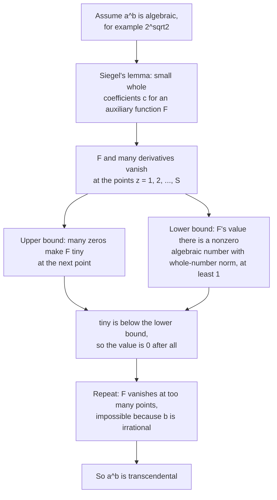

# Gelfond-Schneider: 2 to the power root 2 is transcendental, Hilbert's seventh problem

[Syllabus](../../../SYLLABUS.md) → [Algebraic and analytic number theory](../README.md) → [Diophantine and Modular](../README.md#s07) → Gelfond-Schneider

---

## General Overview

Raise 2 to the power $`\sqrt{2}`$ and you get 2.665144143. Is that number the root of some polynomial with whole-number coefficients, like $`\sqrt{2}`$ is a root of $`x^2 - 2`$? Or is it **transcendental**: a root of no such polynomial at all?

In 1900 David Hilbert put this question seventh on his list of 23 problems for the new century. He named two test cases: $`2^{\sqrt{2}}`$ and $`e^{\pi}`$ = 23.140692633. The second one is a power of the same kind, because $`e^{\pi} = (-1)^{-i}`$.

Both are transcendental. Aleksandr Gelfond settled $`e^{\pi}`$ in 1929, and Rodion Kuzmin settled $`2^{\sqrt{2}}`$ in 1930. The full answer, for every algebraic base other than 0 and 1 and every algebraic exponent that is not a fraction, came in 1934 and 1935, from Gelfond and Theodor Schneider independently. So $`\sqrt{2}^{\sqrt{2}}`$ = 1.632526919 is transcendental too, even though raising it once more to the power $`\sqrt{2}`$ gives exactly 2.

The proof is a squeeze. Assume the answer is algebraic. Then build a function with whole-number coefficients that vanishes at many points. Many zeros force the function to be tiny nearby. But its values there are algebraic numbers of a controlled kind, and those cannot be tiny without being 0. The two bounds collide.

The tool that builds the function is **Siegel's lemma**: a system with more unknowns than equations always has a solution in small whole numbers. Its proof is a pigeonhole count, and this card gives it in full. Two equations in four unknowns, with coefficients at most 10, always have a nonzero whole solution with every entry at most 40.

**If a is algebraic and not 0 or 1, and b is algebraic but not a fraction, then every value of a to the power b is transcendental: the proof assumes the opposite, uses Siegel's lemma to build a function with small whole coefficients and many zeros, and shows one of its values would have to be both tiny and at least a fixed size.**

**What kind of fact this is:** the Gelfond-Schneider theorem is a theorem (Gelfond 1934, Schneider 1935), stated here with a guided outline of its proof; Baker's book, chapter 2, gives the full estimates for his more general theorem, which contains this one. Siegel's lemma is a theorem, proved on this card in full. The decimals the code prints are values, not evidence of transcendence: no amount of digits can show that a number solves no polynomial.

### The picture: the shape of the proof



---

## The formula

Notation first, in words. An **algebraic number** is a root of a nonzero polynomial with whole-number coefficients ([Algebraic integers](../06-Algebraic%20Numbers/01-algebraic-integers-and-number-fields.md)). For complex a and b, the power $`a^b`$ means $`e^{b \log a}`$, where $`\log a`$ is any number whose exponential is a. For a positive real a, take the ordinary natural log.

**The Gelfond-Schneider theorem (1934).** Let a and b be algebraic numbers, with a not 0 or 1, and b not a fraction. Then

```math
a^{b} = e^{\,b \log a} \text{ is transcendental, for every choice of } \log a
```

**Read it aloud:** an algebraic number other than 0 and 1, raised to an algebraic power that is not a fraction, lands outside the algebraic numbers.

An equivalent form says the same thing about logarithms. If the logs of two algebraic numbers have a ratio that is not a fraction, then the ratio is not algebraic either. For example $`\log 3 / \log 2`$ = 1.584962501 is transcendental: if it were algebraic, $`2^{\log 3/\log 2} = 3`$ would contradict the theorem.

**Siegel's lemma (stated by Carl Ludwig Siegel, 1929).** Take M linear equations in N unknowns, with N > M, and whole-number coefficients $`a_{ij}`$ of size at most A, where A ≥ 1:

```math
\sum_{j=1}^{N} a_{ij}\,x_j = 0 \quad (i = 1, \dots, M), \qquad |a_{ij}| \le A
```

Then there is a nonzero whole-number solution $`x = (x_1, \dots, x_N)`$ with

```math
\max_j |x_j| \le (NA)^{M/(N-M)}
```

**Read it aloud:** if there are more unknowns than equations, some nonzero whole solution has every entry at most N times A, raised to the power M over N minus M.

The largest entry size, $`\max_j |x_j|`$, is the **height** of the solution. For M = 2, N = 4 and A = 10 the bound is $`(4 \times 10)^{2/2}`$ = 40.

| Symbol | Plain meaning | In our example | Push it up and the answer… |
| --- | --- | --- | --- |
| $`a`$ | the base: algebraic, not 0 or 1 | 2 | — |
| $`b`$ | the exponent: algebraic, not a fraction | $`\sqrt{2}`$ = 1.414213562 | — |
| $`a^b`$, $`\gamma`$ | the power $`e^{b \log a}`$; γ ("gamma") names it in the proof, and is not Euler's constant here | 2.665144143 | — |
| $`\log a`$ | a number whose exponential is a | ln 2 = 0.69314718056 | another choice adds $`2\pi i`$ |
| $`K`$, $`d`$ | the number field made from a, b and γ, and its degree (how many coordinates a member needs) | exists only under the false assumption | more coordinates, so more equations |
| $`M`$, $`N`$ | how many equations, how many unknowns | 2, 4 | more spare unknowns, smaller bound |
| $`A`$, $`a_{ij}`$ | the largest coefficient size, at least 1; the coefficients themselves | 10 | the bound grows |
| $`H`$ | Siegel's height bound $`(NA)^{M/(N-M)}`$ | 40 | — |
| $`x`$ | a whole-number solution vector | $`(-10, 8, 9, 5)`$, height 10 | — |
| $`F(z)`$, $`c_{kl}`$, $`k`$, $`l`$ | the auxiliary function of a complex variable z, its whole-number coefficients, and the two counters k, l that run from 0 to L − 1 | built by Siegel's lemma | — |
| $`L`$, $`T`$, $`S`$; $`h`$, $`r`$, $`R`$ | how many values k and l each take; how many derivatives vanish (orders t below T); at how many points $`z = s = 1, \dots, S`$; in the fold, h sets all three sizes, and R = rS is a disc radius with ratio r | — | more L: more unknowns; more T or S: more equations |
| $`\xi`$, $`D`$; $`c`$, $`c'`$, $`c''`$, $`c_2`$ | ξ ("xi"): one value $`(\log a)^{-t} F^{(t)}(s)`$, a member of K; D: a whole number whose powers clear its denominators; the c's: fixed positive numbers set by a, b and d, not the coefficients $`c_{kl}`$ | — | — |

### When it holds

- **a is not 0 or 1.** $`1^{\sqrt{2}}`$ = 1.000000000, which is algebraic.
- **b is algebraic.** Drop this and $`2^{\log 3/\log 2}`$ = 3.000000000, a whole number.
- **b is not a fraction.** $`2^{1/2}`$ = 1.414213562 is algebraic: its square is 2.000000000.
- **Every value counts.** The theorem covers every choice of log a. For $`(-1)^{-i}`$, the choice $`\log(-1) = i\pi`$ gives $`e^{\pi}`$, and $`3i\pi`$ gives $`e^{3\pi}`$; both are transcendental.
- **Siegel's lemma needs N > M.** The square system made of the first two unknowns below has determinant 11, so its only solution is 0.

---

## Why it works

### Step 0: the idea

A nonzero whole number is at least 1 in size. The [Norm, trace and discriminant](../06-Algebraic%20Numbers/02-norms-traces-and-discriminants.md) card carries this over to algebraic integers: the norm (the product of a number with all its mirror images, or conjugates) of a nonzero algebraic integer is a nonzero whole number. So such a number cannot be tiny unless one of its conjugates is huge.

The proof plays this against analysis. A function with many zeros is tiny near them. If $`a^b`$ were algebraic, one function's values would be algebraic numbers that are both tiny and not tiny. The [Transcendence of e and pi](13-transcendence-of-e-and-pi.md) card runs the same squeeze with an auxiliary polynomial. What is new here is a two-variable family of exponentials, and a coefficient search done by Siegel's lemma.

### Step 1: Siegel's lemma, by pigeonholes

Restrict each unknown to the whole numbers 0, 1, …, H. There are $`(H+1)^N`$ such vectors. Feed each into the M equations. Each output lies in a range of at most NAH + 1 whole numbers, because each of its N terms moves by at most A times H. So there are at most $`(NAH + 1)^M`$ possible outputs.

If there are more vectors than outputs, two vectors give the same output. Their difference is a nonzero solution, and each entry lies between −H and H. That is the whole proof; the fold checks that the stated H is large enough.

<details>
<summary>Detailed proof: the bound (NA)^(M/(N-M)) is large enough</summary>

Let H be the largest whole number with $`H \le (NA)^{M/(N-M)}`$. Then $`H + 1`$ is above that power, so

$`\displaystyle (H+1)^{N-M} > (NA)^{M}`$

Multiply both sides by $`(H+1)^M`$:

$`\displaystyle (H+1)^{N} > (NA)^M (H+1)^M = (NAH + NA)^M \ge (NAH + 1)^M`$

The last step uses NA ≥ 1. So the vectors outnumber the possible outputs.

Pick two vectors u and v with the same output. Their difference x = u − v has the output 0 in every equation, because the equations are linear. It is not 0, because u and v differ. Each entry of u and of v lies in 0 to H, so each entry of x lies in −H to H.

</details>

### Step 2: the lemma on a real system

The code takes two equations in four unknowns:

```math
\begin{aligned} 10x_1 + 7x_2 + x_3 + 7x_4 &= 0 \\ 7x_1 + 6x_2 + 8x_3 - 10x_4 &= 0 \end{aligned}
```

**Read it aloud:** two balance conditions on four whole numbers, with every coefficient at most 10 in size.

Here N = 4, M = 2 and A = 10, so H = 40. The vectors with entries 0 to 40 number 2,825,761. The outputs number at most 2,563,201. The pigeonholes are fewer than the pigeons.

The code then runs the count for real. Walking through the vectors in order, the first repeat comes after 146,247 vectors: (0, 0, 13, 6) and (2, 5, 0, 0) both give the output (55, 44). Their difference (2, 5, −13, −6) solves both equations, with height 13.

A brute-force search over every vector of height at most 40 finds 44 nonzero solutions. The smallest is (−10, 8, 9, 5), height 10. The bound is honest but not sharp: it promises 40, and the truth is 10.

### Step 3: equations with algebraic coefficients

The proof's equations have coefficients in a number field K of degree d, not in the whole numbers. Write each coefficient in a basis of K with d coordinates and clear denominators. One equation over K becomes d equations over the whole numbers, in the same unknowns.

So M equations over K need N > dM whole unknowns. With N at least 2dM, Siegel's exponent dM/(N − dM) is at most 1. Then the coefficients found are no larger than N times the largest whole-number coefficient after this conversion.

### Step 4: the auxiliary function

Suppose, for contradiction, that γ = $`a^b`$ is algebraic. Let K be the number field made from a, b and γ, of degree d. Build

```math
F(z) = \sum_{k=0}^{L-1} \sum_{l=0}^{L-1} c_{kl}\, a^{kz}\, \gamma^{lz} = \sum_{k,l} c_{kl}\, e^{(k + lb)\, z \log a}
```

**Read it aloud:** F is a sum of $`L^2`$ exponentials, with growth rates $`(k + lb)\log a`$ and whole-number coefficients $`c_{kl}`$ still to be chosen.

At a whole number z = s, every term is $`a^{ks}\gamma^{ls}`$, a member of K. Each derivative brings down a factor $`(k + lb)\log a`$:

```math
F^{(t)}(s) = (\log a)^{t} \sum_{k,l} c_{kl}\,(k + lb)^{t}\, a^{ks}\,\gamma^{ls}
```

The sum after $`(\log a)^t`$ is again a member of K. Asking it to be 0 for every t below T and every s from 1 to S gives TS linear equations over K, in $`L^2`$ unknowns. Step 3 turns them into dTS whole-number equations. Choose $`L^2 \ge 2dTS`$, and Siegel's lemma gives nonzero whole coefficients of controlled size.

### Step 5: the squeeze

Take a point where the next value $`\xi = (\log a)^{-t} F^{(t)}(s)`$ is not known to vanish. It is a member of K, and a fixed whole number D to a power clears its denominators. There are two bounds on it.

- **From above, by analysis.** F vanishes to order T at S points. A function with many zeros in a disc is small there: by the maximum modulus principle (the size of an analytic function on a disc peaks on its edge), each zero cuts the bound by a fixed factor. So $`|\xi|`$ is at most about a fixed fraction raised to the power TS, the number of zeros. TS is the largest size in play, so this is tiny.
- **From below, by arithmetic.** If ξ is not 0, the norm of D to a power times ξ is a nonzero whole number, so at least 1. Its other conjugates are at most of size $`e^{c_2(T \log T + LS)}`$, where $`c_2`$ is a fixed positive number set by a, b and d. So |ξ| is at least the inverse of that, apart from the factors of D.

The sizes L, T and S are chosen so the upper bound falls below the lower bound. Then ξ cannot be nonzero, so ξ = 0. The fold gives the shape of that choice.

**The squeeze in miniature.** The same two bounds act on $`x - y\sqrt{2}`$ for whole x and y, with y up to H = 1000.

- Pigeonholes (Dirichlet's version of Step 1) give a pair with $`|x - y\sqrt{2}|`$ below 1/H = 0.001000000.
- The norm $`x^2 - 2y^2`$ is a nonzero whole number. Dividing it by $`x + y\sqrt{2}`$ shows $`|x - y\sqrt{2}|`$ is at least $`1/(2\sqrt{2}H + 1/2)`$ = 0.000353491.
- The truth sits between: 0.000358937, at x = 1393, y = 985, the [Pell's equation](01-pell-and-continued-fractions-revisited.md) solution of $`x^2 - 2y^2 = -1`$.

Here the bounds do not collide, since $`\sqrt{2}`$ really is algebraic. In the proof they are forced to collide.

<details>
<summary>Guided outline: how the sizes are chosen</summary>

Baker's book, chapter 2, proves his more general theorem, which contains Gelfond-Schneider, by the same method: Siegel's lemma, an auxiliary function, extrapolation. The sizes below are a simplified one-variable version, not the full estimates.

Pick a large whole number h, and a fixed ratio r > 1. Take T about $`h^2`$ derivatives, S about h points, L about $`\sqrt{2d}\,h^{3/2}`$, so Step 3's condition $`L^2 \ge 2dTS`$ holds, and a disc radius R = rS. Then:

1. Siegel's lemma gives coefficients $`c_{kl}`$ of size at most about $`e^{c\,(T \log T + LS)}`$, where c is a fixed positive number.
2. On the disc of radius R, F is at most about $`e^{c\,LR}`$ times that.
3. F vanishes to order T at S points inside a disc of radius S. Dividing F by the polynomial with those zeros, and using the maximum modulus principle on the big disc, gives about

$`\displaystyle |F(z)| \le e^{c\,(T \log T + LS + LR)}\,\Big(\frac{c'}{r}\Big)^{TS} \quad \text{for } |z| \le S + 1`$

4. The exponent TS is about $`h^3`$. The others are smaller: LS and LR are about $`h^{5/2}`$, and $`T \log T`$ about $`h^2 \log h`$. Once r is above c′ and h is large, this upper bound falls below the arithmetic lower bound of Step 5, which has the size $`e^{-c''(T \log T + LS)}`$.

So every value at the next point is 0 too. Repeating the step pushes the vanishing to more and more points, until Step 6 gives the contradiction.

</details>

### Step 6: why b must be irrational

The extrapolation makes F vanish to order T at more and more points, until it has more zeros than a nonzero function of its size can have. Jensen's formula (which caps how many zeros an analytic function has in a disc, given its size on a larger disc and at the centre) turns this into a count, with Step 5's arithmetic bounding the centre value from below. So F is 0 everywhere, and every derivative of F vanishes at z = 0. Then all its coefficients must be 0, because the growth rates $`(k + lb)\log a`$ are $`L^2`$ different numbers.

They differ only because b is not a fraction. If b were a fraction, such as the 1/2 of What breaks, then k + lb would repeat (k = 1, l = 0 and k = 0, l = 2 both give 1), and terms could cancel for every z. With $`L^2`$ different growth rates, a sum of exponentials that vanishes to order $`L^2`$ at one point has all coefficients 0. The derivatives at that point form a Vandermonde system (a square system whose rows are the powers 0, 1, 2, … of the different rates), and its determinant is not 0.

But Siegel's lemma made the coefficients nonzero. That is the contradiction. So γ = $`a^b`$ is not algebraic.

### Step 7: what follows

- **$`2^{\sqrt{2}}`$**: a = 2, b = $`\sqrt{2}`$.
- **$`e^{\pi}`$**: a = −1, b = −i, since $`(-1)^{-i} = e^{-i \cdot i\pi} = e^{\pi}`$. The code also gets it as $`i^{-2i}`$, Hilbert's form.
- **$`\sqrt{2}^{\sqrt{2}}`$**: a = $`\sqrt{2}`$, b = $`\sqrt{2}`$. It shows an irrational power of an irrational number can be rational, because $`(\sqrt{2}^{\sqrt{2}})^{\sqrt{2}} = 2`$, while the middle number is itself transcendental.
- **$`\log 3/\log 2`$**, and every ratio of logs of whole numbers that is not a fraction.

What is still open, as of 2026-11-24: whether $`\pi^{e}`$ or $`2^{e}`$ is transcendental. The theorem needs an algebraic base and exponent, and e and π are not algebraic. Whether $`e + \pi`$ is transcendental is open too, for another reason: it is not a power at all, and it is not even known to be irrational.

---

## Worked numbers, by hand

| Step | Arithmetic | Value |
| --- | --- | --- |
| Siegel's bound | $`(NA)^{M/(N-M)} = (4 \times 10)^{2/2}`$ | 40 |
| vectors with entries 0 to 40 | $`41^4`$ | 2,825,761 |
| possible outputs | $`(4 \times 10 \times 40 + 1)^2 = 1601^2`$ | 2,563,201 |
| pigeonhole repeat | (0, 0, 13, 6) and (2, 5, 0, 0) both give (55, 44) | after 146,247 vectors |
| their difference | (2, 5, −13, −6); first equation 20 + 35 − 13 − 42 = 0 | height 13 |
| brute force, smallest | (−10, 8, 9, 5); first equation −100 + 56 + 9 + 35 = 0 | height 10 |
| $`2^{\sqrt{2}}`$ | $`e^{\sqrt{2}\,\ln 2}`$ = $`e^{1.414213562 \times 0.69314718056}`$ | **2.665144143** |

**Siegel's lemma promised a whole solution of height at most 40, the pigeonholes delivered one of height 13, and the best is height 10; the theorem built on it says 2.665144143 solves no polynomial with whole coefficients.**

### What breaks if you drop a piece

| Mistake | Comes out at | What went wrong |
| --- | --- | --- |
| Siegel with N = M: keep only $`x_1, x_2`$ | determinant 11, no nonzero solution | No spare unknowns, so no pigeonhole surplus |
| Siegel without the exponent, bound NA = 30 for N = 3 | smallest solution (50, −73, 11), height 73 | With one spare unknown the exponent is 2/(3 − 2) = 2, so the bound is 900 |
| A transcendental exponent, $`b = \log 3/\log 2`$ | $`2^b`$ = 3.000000000 | The theorem needs b algebraic |
| A fraction as exponent, b = 1/2 | $`2^b`$ = 1.414213562, square 2.000000000 | The rates k + lb repeat, and Step 6 fails |

The code prints all four.

---

## Code, from first principles, and it actually runs

The code takes two roads to each power. Road 1 computes $`e^{b \ln a}`$ with a log series and an exponential series written out in the code, and π by Machin's formula. Road 2 never uses a log: it reads the binary digits of b and multiplies by $`a^{1/2}`$, $`a^{1/4}`$, … for each digit 1, using square roots by Newton's method. For Siegel's lemma, road 1 is the pigeonhole count itself: it walks the 2,825,761 vectors until two outputs repeat. Road 2 is a brute-force search over every candidate of height at most 40, which solves for the last two unknowns by Cramer's rule. The code also prints the squeeze in miniature for $`x - y\sqrt{2}`$. There are no imports.

### Python

```python
# Gelfond-Schneider -- the check behind the card.  Standard library only, no imports.
# Road 1: a^b = exp(b ln a), from series written here.  Road 2: a^b from the binary
# digits of b, one square root per digit.  Siegel's lemma: a pigeonhole collision,
# checked against a brute-force search for the smallest whole solution.

def sqrt(x):                          # Newton's method from above, stops when it stops falling
    r = x if x > 1 else 1.0
    while True:
        n = 0.5 * (r + x / r)
        if n >= r: return r
        r = n

def series(t, sign):                 # t + sign t^3/3 + t^5/5 + ...: atanh (sign 1), atan (sign -1)
    s, p = 0.0, t
    for k in range(1, 120, 2):
        s += (p if k % 4 == 1 or sign == 1 else -p) / k; p *= t * t
    return s

LN2 = 2 * series(1 / 3, 1)
PI = 16 * series(1 / 5, -1) - 4 * series(1 / 239, -1)    # Machin's formula
E, term = 1.0, 1.0                   # e = 1 + 1/1! + 1/2! + ...
for n in range(1, 25):
    term /= n; E += term

def ln(x):                            # x = m 2^e with 1 <= m < 2; ln m = 2 atanh((m-1)/(m+1))
    e = 0
    while x >= 2: x /= 2; e += 1
    while x < 1: x *= 2; e -= 1
    return e * LN2 + 2 * series((x - 1) / (x + 1), 1)

def exp(x):                           # halve until small, Taylor series, square back
    k = 0
    while abs(x) > 1 / 1024: x /= 2; k += 1
    s, term = 1.0, 1.0
    for n in range(1, 20):
        term *= x / n; s += term
    for _ in range(k): s *= s
    return s

def pow_bits(a, b):                   # road 2: a^floor(b), times a^(1/2^k) for each 1 bit of b
    n = int(b); f = b - n
    out = 1.0
    for _ in range(n): out *= a
    r = a
    for _ in range(60):
        r = sqrt(r); f *= 2
        if f >= 1: f -= 1; out *= r
    return out

R2 = sqrt(2.0)
print(f"sqrt 2 = {R2:.11f}, ln 2 = {LN2:.11f}, pi = {PI:.11f}, e = {E:.11f}")
print("a^b | road 1: exp(b ln a) | road 2: binary digits of b")
rows = [("2^sqrt2", 2.0, R2), ("sqrt2^sqrt2", R2, R2), ("e^pi", E, PI)]
vals = {}
for name, a, b in rows:
    v1, v2 = exp(b * ln(a)), pow_bits(a, b)
    assert abs(v1 - v2) < 1e-11 * v1           # two roads agree
    vals[name] = v1
    print(f"{name} | {v1:.9f} | {v2:.9f}")
# (-1)^(-i) and i^(-2i): b times the principal log, as complex pairs (re, im)
def cmul(u, v): return (u[0] * v[0] - u[1] * v[1], u[0] * v[1] + u[1] * v[0])
w1, w2 = cmul((0.0, -1.0), (0.0, PI)), cmul((0.0, -2.0), (0.0, PI / 2))
assert w1 == (PI, 0.0) and w2 == (PI, 0.0)
print(f"(-1)^(-i) = exp(-i * i pi) = exp({w1[0]:.9f}) = {exp(w1[0]):.9f}; i^(-2i) = {exp(w2[0]):.9f}")
back = pow_bits(vals["sqrt2^sqrt2"], R2)
assert abs(back - 2) < 1e-11                   # (sqrt2^sqrt2)^sqrt2 = sqrt2^2 = 2
print(f"(sqrt2^sqrt2)^sqrt2 = {back:.9f}")
L23 = ln(3.0) / LN2
print(f"b = log2 3 = {L23:.9f} (b not algebraic): 2^b = {pow_bits(2.0, L23):.9f}")
print(f"b = 1/2 (rational b): 2^b = {pow_bits(2.0, 0.5):.9f}, squared {pow_bits(2.0, 0.5) ** 2:.9f}")
print(f"a = 1: 1^sqrt2 = {pow_bits(1.0, R2):.9f}")
assert abs(pow_bits(2.0, L23) - 3) < 1e-11 and abs(exp(PI) - vals["e^pi"]) < 1e-11 * 24

# Siegel's lemma: M equations, N unknowns, coefficients at most A in size
A = [[10, 7, 1, 7], [7, 6, 8, -10]]
M, N, AMAX = 2, 4, 10
H = 0
while (H + 1) ** (N - M) <= (N * AMAX) ** M: H += 1    # largest H with H^(N-M) <= (NA)^M
assert H == int((N * AMAX) ** (M / (N - M)) + 1e-9)     # the power, taken a second way
print(f"Siegel bound (N A)^(M/(N-M)) = ({N} x {AMAX})^({M}/{N - M}) = {H}")
def image(x): return tuple(sum(a * v for a, v in zip(row, x)) for row in A)
boxes, images = (H + 1) ** N, (N * AMAX * H + 1) ** M
print(f"vectors with entries 0..{H}: {boxes:,}; possible images at most {images:,}")
assert boxes > images
seen, hit = {}, None
for i in range((H + 1) ** N):
    x = (i // (H + 1) ** 3, i // (H + 1) ** 2 % (H + 1), i // (H + 1) % (H + 1), i % (H + 1))
    y = image(x)
    if y in seen: hit = (seen[y], x); break
    seen[y] = x
d = tuple(b - a for a, b in zip(*hit))
assert image(d) == (0, 0) and any(d) and max(map(abs, d)) <= H
print(f"first collision: {hit[0]} and {hit[1]}, image {image(hit[0])}, after {len(seen):,} vectors")
print(f"difference {d}: solves both equations, height {max(map(abs, d))}")

def solve_last_two(cols, rhs):        # Cramer's rule on a 2 x 2 block; None if not whole
    (a, b), (c, e) = cols
    det = a * e - b * c
    n1, n2 = rhs[0] * e - b * rhs[1], a * rhs[1] - c * rhs[0]
    return None if n1 % det or n2 % det else (n1 // det, n2 // det)
sols = []
for x1 in range(-H, H + 1):           # road 2: every (x1, x2), then x3, x4 forced
    for x2 in range(-H, H + 1):
        if x1 == 0 and x2 == 0: continue
        r = solve_last_two(((A[0][2], A[0][3]), (A[1][2], A[1][3])),
                           (-(A[0][0] * x1 + A[0][1] * x2), -(A[1][0] * x1 + A[1][1] * x2)))
        if r and max(abs(r[0]), abs(r[1])) <= H: sols.append((x1, x2) + r)
small = min(sols, key=lambda s: (max(map(abs, s)), s))
assert all(image(s) == (0, 0) for s in sols) and d in sols
print(f"brute force: {len(sols)} nonzero solutions of height <= {H}; smallest {small}, "
      f"height {max(map(abs, small))}")
sq = [(x1, x2) for x1 in range(-H, H + 1) for x2 in range(-H, H + 1)
      if (x1 or x2) and A[0][0] * x1 + A[0][1] * x2 == 0 and A[1][0] * x1 + A[1][1] * x2 == 0]
print(f"square system (first 2 unknowns): det {A[0][0] * A[1][1] - A[0][1] * A[1][0]}, "
      f"nonzero solutions {len(sq)}")
assert sq == []
H3 = (3 * AMAX) ** 2                  # N = 3, M = 2: exponent 2/(3-2) = 2
t3 = next((x3, r) for x3 in range(1, H3 + 1)
          for r in [solve_last_two(((A[0][0], A[0][1]), (A[1][0], A[1][1])),
                                   (-A[0][2] * x3, -A[1][2] * x3))] if r)
v3 = (t3[1][0], t3[1][1], t3[0])
cross = (7 * 8 - 1 * 6, 1 * 7 - 10 * 8, 10 * 6 - 7 * 7)
assert v3 == cross or v3 == tuple(-c for c in cross)
print(f"three unknowns: bound 30^2 = {H3}; smallest solution {v3}, height {max(map(abs, v3))}")

# The squeeze in miniature: x - y sqrt2 is small (pigeonhole) but not too small (norm >= 1)
HQ, best = 1000, (9.0, 0, 0)
for y in range(1, HQ + 1):
    x = int(y * R2 + 0.5)
    v = abs(x * x - 2 * y * y) / (x + y * R2)     # |x - y sqrt2| through the norm x^2 - 2y^2
    assert v >= 1 / (2 * R2 * y + 0.5)            # lower bound from |norm| >= 1
    best = min(best, (v, y, x))
print(f"y <= {HQ}: smallest |x - y sqrt2| = {best[0]:.9f} at x = {best[2]}, y = {best[1]}")
print(f"lower bound 1/(2 sqrt2 H + 1/2) = {1 / (2 * R2 * HQ + 0.5):.9f}; "
      f"upper bound 1/H = {1 / HQ:.9f}")
assert 1 / (2 * R2 * HQ + 0.5) <= best[0] < 1 / HQ
print("ALL CHECKS PASS")
```

**Ran 2026-11-24 on macOS, Python 3.14.10, standard library only. All checks passed. Output, pasted from the run:**

```
sqrt 2 = 1.41421356237, ln 2 = 0.69314718056, pi = 3.14159265359, e = 2.71828182846
a^b | road 1: exp(b ln a) | road 2: binary digits of b
2^sqrt2 | 2.665144143 | 2.665144143
sqrt2^sqrt2 | 1.632526919 | 1.632526919
e^pi | 23.140692633 | 23.140692633
(-1)^(-i) = exp(-i * i pi) = exp(3.141592654) = 23.140692633; i^(-2i) = 23.140692633
(sqrt2^sqrt2)^sqrt2 = 2.000000000
b = log2 3 = 1.584962501 (b not algebraic): 2^b = 3.000000000
b = 1/2 (rational b): 2^b = 1.414213562, squared 2.000000000
a = 1: 1^sqrt2 = 1.000000000
Siegel bound (N A)^(M/(N-M)) = (4 x 10)^(2/2) = 40
vectors with entries 0..40: 2,825,761; possible images at most 2,563,201
first collision: (0, 0, 13, 6) and (2, 5, 0, 0), image (55, 44), after 146,247 vectors
difference (2, 5, -13, -6): solves both equations, height 13
brute force: 44 nonzero solutions of height <= 40; smallest (-10, 8, 9, 5), height 10
square system (first 2 unknowns): det 11, nonzero solutions 0
three unknowns: bound 30^2 = 900; smallest solution (50, -73, 11), height 73
y <= 1000: smallest |x - y sqrt2| = 0.000358937 at x = 1393, y = 985
lower bound 1/(2 sqrt2 H + 1/2) = 0.000353491; upper bound 1/H = 0.001000000
ALL CHECKS PASS
```

### Rust

```rust
// Gelfond-Schneider -- the check behind the card.  std only, no crates.
// Road 1: a^b = exp(b ln a), from series written here.  Road 2: a^b from the binary
// digits of b, one square root per digit.  Siegel's lemma: a pigeonhole collision,
// checked against a brute-force search for the smallest whole solution.
use std::collections::HashMap;

fn sqrt(x: f64) -> f64 {            // Newton's method from above, stops when it stops falling
    let mut r = if x > 1.0 { x } else { 1.0 };
    loop { let n = 0.5 * (r + x / r); if n >= r { return r; } r = n; }
}

fn series(t: f64, sign: i32) -> f64 { // atanh (sign 1), atan (sign -1)
    let (mut s, mut p) = (0.0f64, t);
    for k in (1..120).step_by(2) {
        s += (if k % 4 == 1 || sign == 1 { p } else { -p }) / k as f64;
        p *= t * t;
    }
    s
}

fn ln(mut x: f64, ln2: f64) -> f64 { // x = m 2^e with 1 <= m < 2; ln m = 2 atanh((m-1)/(m+1))
    let mut e = 0i32;
    while x >= 2.0 { x /= 2.0; e += 1; }
    while x < 1.0 { x *= 2.0; e -= 1; }
    e as f64 * ln2 + 2.0 * series((x - 1.0) / (x + 1.0), 1)
}

fn exp(mut x: f64) -> f64 {         // halve until small, Taylor series, square back
    let mut k = 0;
    while x.abs() > 1.0 / 1024.0 { x /= 2.0; k += 1; }
    let (mut s, mut term) = (1.0f64, 1.0f64);
    for n in 1..20 { term *= x / n as f64; s += term; }
    for _ in 0..k { s *= s; }
    s
}

fn pow_bits(a: f64, b: f64) -> f64 { // road 2: a^floor(b), times a^(1/2^k) for each 1 bit of b
    let n = b as i64;
    let (mut f, mut out) = (b - n as f64, 1.0f64);
    for _ in 0..n { out *= a; }
    let mut r = a;
    for _ in 0..60 {
        r = sqrt(r); f *= 2.0;
        if f >= 1.0 { f -= 1.0; out *= r; }
    }
    out
}

fn tup(v: &[i64]) -> String { format!("({})", v.iter().map(|x| x.to_string()).collect::<Vec<_>>().join(", ")) }

fn commas(n: i64) -> String {
    let s = n.to_string();
    let mut out = String::new();
    for (i, c) in s.chars().enumerate() {
        if i > 0 && (s.len() - i) % 3 == 0 { out.push(','); }
        out.push(c);
    }
    out
}

fn solve_last_two(cols: [[i64; 2]; 2], rhs: [i64; 2]) -> Option<(i64, i64)> { // Cramer's rule
    let ([a, b], [c, e]) = (cols[0], cols[1]);
    let det = a * e - b * c;
    let (n1, n2) = (rhs[0] * e - b * rhs[1], a * rhs[1] - c * rhs[0]);
    if n1 % det != 0 || n2 % det != 0 { None } else { Some((n1 / det, n2 / det)) }
}

fn main() {
    let ln2 = 2.0 * series(1.0 / 3.0, 1);
    let pi = 16.0 * series(1.0 / 5.0, -1) - 4.0 * series(1.0 / 239.0, -1); // Machin's formula
    let (mut e, mut term) = (1.0f64, 1.0f64);
    for n in 1..25 { term /= n as f64; e += term; }
    let r2 = sqrt(2.0);
    println!("sqrt 2 = {:.11}, ln 2 = {:.11}, pi = {:.11}, e = {:.11}", r2, ln2, pi, e);
    println!("a^b | road 1: exp(b ln a) | road 2: binary digits of b");
    let mut vals = Vec::new();
    for (name, a, b) in [("2^sqrt2", 2.0, r2), ("sqrt2^sqrt2", r2, r2), ("e^pi", e, pi)] {
        let (v1, v2) = (exp(b * ln(a, ln2)), pow_bits(a, b));
        assert!((v1 - v2).abs() < 1e-11 * v1);    // two roads agree
        vals.push(v1);
        println!("{} | {:.9} | {:.9}", name, v1, v2);
    }
    // (-1)^(-i) and i^(-2i): b times the principal log, as complex pairs (re, im)
    let cmul = |u: (f64, f64), v: (f64, f64)| (u.0 * v.0 - u.1 * v.1, u.0 * v.1 + u.1 * v.0);
    let (w1, w2) = (cmul((0.0, -1.0), (0.0, pi)), cmul((0.0, -2.0), (0.0, pi / 2.0)));
    assert!(w1 == (pi, 0.0) && w2 == (pi, 0.0));
    println!("(-1)^(-i) = exp(-i * i pi) = exp({:.9}) = {:.9}; i^(-2i) = {:.9}", w1.0, exp(w1.0), exp(w2.0));
    let back = pow_bits(vals[1], r2);
    assert!((back - 2.0).abs() < 1e-11);       // (sqrt2^sqrt2)^sqrt2 = sqrt2^2 = 2
    println!("(sqrt2^sqrt2)^sqrt2 = {:.9}", back);
    let l23 = ln(3.0, ln2) / ln2;
    println!("b = log2 3 = {:.9} (b not algebraic): 2^b = {:.9}", l23, pow_bits(2.0, l23));
    let h = pow_bits(2.0, 0.5);
    println!("b = 1/2 (rational b): 2^b = {:.9}, squared {:.9}", h, h * h);
    println!("a = 1: 1^sqrt2 = {:.9}", pow_bits(1.0, r2));
    assert!((pow_bits(2.0, l23) - 3.0).abs() < 1e-11 && (exp(pi) - vals[2]).abs() < 1e-11 * 24.0);

    // Siegel's lemma: M equations, N unknowns, coefficients at most A in size
    let a: [[i64; 4]; 2] = [[10, 7, 1, 7], [7, 6, 8, -10]];
    let (m, n, amax) = (2u32, 4u32, 10i64);
    let mut hb = 0i64;
    while (hb + 1).pow(n - m) <= (n as i64 * amax).pow(m) { hb += 1; } // largest H with H^(N-M) <= (NA)^M
    assert!(hb == ((n as f64 * amax as f64).powf(m as f64 / (n - m) as f64) + 1e-9) as i64); // second way
    println!("Siegel bound (N A)^(M/(N-M)) = ({} x {})^({}/{}) = {}", n, amax, m, n - m, hb);
    let image = |x: [i64; 4]| -> (i64, i64) {
        let f = |r: &[i64; 4]| r.iter().zip(x.iter()).map(|(p, q)| p * q).sum::<i64>();
        (f(&a[0]), f(&a[1]))
    };
    let (boxes, images) = ((hb + 1).pow(n), (n as i64 * amax * hb + 1).pow(m));
    println!("vectors with entries 0..{}: {}; possible images at most {}", hb, commas(boxes), commas(images));
    assert!(boxes > images);
    let (mut seen, mut hit): (HashMap<(i64, i64), [i64; 4]>, Option<([i64; 4], [i64; 4])>) = (HashMap::new(), None);
    let s = hb + 1;
    for i in 0..boxes {
        let x = [i / (s * s * s), i / (s * s) % s, i / s % s, i % s];
        let y = image(x);
        if let Some(&p) = seen.get(&y) { hit = Some((p, x)); break; }
        seen.insert(y, x);
    }
    let (p0, p1) = hit.unwrap();
    let d = [p1[0] - p0[0], p1[1] - p0[1], p1[2] - p0[2], p1[3] - p0[3]];
    let height = |v: &[i64]| v.iter().map(|x| x.abs()).max().unwrap();
    assert!(image(d) == (0, 0) && d.iter().any(|&x| x != 0) && height(&d) <= hb);
    let im = image(p0);
    println!("first collision: {} and {}, image ({}, {}), after {} vectors", tup(&p0), tup(&p1), im.0, im.1,
             commas(seen.len() as i64));
    println!("difference {}: solves both equations, height {}", tup(&d), height(&d));
    let mut sols: Vec<[i64; 4]> = Vec::new();
    for x1 in -hb..=hb {                 // road 2: every (x1, x2), then x3, x4 forced
        for x2 in -hb..=hb {
            if x1 == 0 && x2 == 0 { continue; }
            if let Some((x3, x4)) = solve_last_two([[a[0][2], a[0][3]], [a[1][2], a[1][3]]],
                    [-(a[0][0] * x1 + a[0][1] * x2), -(a[1][0] * x1 + a[1][1] * x2)]) {
                if x3.abs().max(x4.abs()) <= hb { sols.push([x1, x2, x3, x4]); }
            }
        }
    }
    let small = *sols.iter().min_by_key(|s| (height(&s[..]), **s)).unwrap();
    assert!(sols.iter().all(|s| image(*s) == (0, 0)) && sols.contains(&d));
    println!("brute force: {} nonzero solutions of height <= {}; smallest {}, height {}", sols.len(), hb,
             tup(&small), height(&small));
    let sq = (-hb..=hb).flat_map(|x1| (-hb..=hb).map(move |x2| (x1, x2))).filter(|&(x1, x2)|
        (x1 != 0 || x2 != 0) && a[0][0] * x1 + a[0][1] * x2 == 0 && a[1][0] * x1 + a[1][1] * x2 == 0).count();
    println!("square system (first 2 unknowns): det {}, nonzero solutions {}", a[0][0] * a[1][1] - a[0][1] * a[1][0], sq);
    assert!(sq == 0);
    let h3 = (3 * amax).pow(2);         // N = 3, M = 2: exponent 2/(3-2) = 2
    let (x3, (x1, x2)) = (1..=h3).find_map(|x3| solve_last_two([[a[0][0], a[0][1]], [a[1][0], a[1][1]]],
        [-a[0][2] * x3, -a[1][2] * x3]).map(|r| (x3, r))).unwrap();
    let v3 = [x1, x2, x3];
    let cross = [7 * 8 - 1 * 6, 1 * 7 - 10 * 8, 10 * 6 - 7 * 7];
    assert!(v3 == cross || v3 == [-cross[0], -cross[1], -cross[2]]);
    println!("three unknowns: bound 30^2 = {}; smallest solution {}, height {}", h3, tup(&v3), height(&v3));

    // The squeeze in miniature: x - y sqrt2 is small (pigeonhole) but not too small (norm >= 1)
    let hq = 1000i64;
    let mut best = (9.0f64, 0i64, 0i64);
    for y in 1..=hq {
        let x = (y as f64 * r2 + 0.5) as i64;
        let v = (x * x - 2 * y * y).abs() as f64 / (x as f64 + y as f64 * r2); // |x - y sqrt2| via the norm
        assert!(v >= 1.0 / (2.0 * r2 * y as f64 + 0.5));                   // lower bound from |norm| >= 1
        if v < best.0 { best = (v, y, x); }
    }
    println!("y <= {}: smallest |x - y sqrt2| = {:.9} at x = {}, y = {}", hq, best.0, best.2, best.1);
    let lo = 1.0 / (2.0 * r2 * hq as f64 + 0.5);
    println!("lower bound 1/(2 sqrt2 H + 1/2) = {:.9}; upper bound 1/H = {:.9}", lo, 1.0 / hq as f64);
    assert!(lo <= best.0 && best.0 < 1.0 / hq as f64);
    println!("ALL CHECKS PASS");
}
```

**Ran 2026-11-24 on macOS, rustc 1.98.1, no crates. All checks passed. Output, pasted from the run:**

```
sqrt 2 = 1.41421356237, ln 2 = 0.69314718056, pi = 3.14159265359, e = 2.71828182846
a^b | road 1: exp(b ln a) | road 2: binary digits of b
2^sqrt2 | 2.665144143 | 2.665144143
sqrt2^sqrt2 | 1.632526919 | 1.632526919
e^pi | 23.140692633 | 23.140692633
(-1)^(-i) = exp(-i * i pi) = exp(3.141592654) = 23.140692633; i^(-2i) = 23.140692633
(sqrt2^sqrt2)^sqrt2 = 2.000000000
b = log2 3 = 1.584962501 (b not algebraic): 2^b = 3.000000000
b = 1/2 (rational b): 2^b = 1.414213562, squared 2.000000000
a = 1: 1^sqrt2 = 1.000000000
Siegel bound (N A)^(M/(N-M)) = (4 x 10)^(2/2) = 40
vectors with entries 0..40: 2,825,761; possible images at most 2,563,201
first collision: (0, 0, 13, 6) and (2, 5, 0, 0), image (55, 44), after 146,247 vectors
difference (2, 5, -13, -6): solves both equations, height 13
brute force: 44 nonzero solutions of height <= 40; smallest (-10, 8, 9, 5), height 10
square system (first 2 unknowns): det 11, nonzero solutions 0
three unknowns: bound 30^2 = 900; smallest solution (50, -73, 11), height 73
y <= 1000: smallest |x - y sqrt2| = 0.000358937 at x = 1393, y = 985
lower bound 1/(2 sqrt2 H + 1/2) = 0.000353491; upper bound 1/H = 0.001000000
ALL CHECKS PASS
```

### Lean

Lean proves the Gelfond-Schneider theorem and Siegel's lemma in full, for every case, and checks the card's whole-number examples.

- Take algebraic numbers a and b, with a not 0 or 1, and b not a fraction. Then every value $`a^b = e^{b \log a}`$ is transcendental, whatever $`\log a`$ is chosen.
- Hilbert's test case $`2^{\sqrt{2}}`$ is transcendental.
- Take M equations in N unknowns, with N > M and whole-number coefficients of size at most A, where A ≥ 1. Then some nonzero whole solution has height at most $`(NA)^{M/(N-M)}`$.
- The pigeonhole difference (2, 5, −13, −6) solves the card's two equations, and so does (−10, 8, 9, 5).
- The vectors (0, 0, 13, 6) and (2, 5, 0, 0) both give the output (55, 44).
- Siegel's bound is $`(4 \times 10)^{2/2}`$ = 40, and $`41^4`$ = 2,825,761 vectors outnumber $`1601^2`$ = 2,563,201 outputs.
- The square system in the first two unknowns has determinant 11.
- Keep only the first three unknowns. Then (50, −73, 11) solves both equations.
- Take x = 1393 and y = 985. Then $`x^2 - 2y^2 = -1`$.

Every decimal, the first repeat after 146,247 vectors, and the search showing height 10 is smallest are left to the Python and Rust checks.

```lean
-- Gelfond-Schneider: an algebraic number other than 0 and 1, raised to an algebraic power that is not a fraction, is transcendental, for every choice of logarithm; Siegel's lemma gives a small nonzero whole solution to any system with more unknowns than equations.
import Mathlib.Analysis.SpecialFunctions.Pow.Real
import Mathlib.NumberTheory.SiegelsLemma
import Mathlib.RingTheory.Algebraic.Defs
import Mathlib.Analysis.Complex.AbsMax
import Mathlib.Analysis.Analytic.Order
import Mathlib.Analysis.Calculus.IteratedDeriv.Analytic
import Mathlib.Analysis.Calculus.IteratedDeriv.Lemmas
import Mathlib.Analysis.SpecialFunctions.ExpDeriv
import Mathlib.NumberTheory.NumberField.House
import Mathlib.NumberTheory.Real.Irrational
import Mathlib.RingTheory.Algebraic.Denominator
import Mathlib.LinearAlgebra.Vandermonde
import Mathlib.LinearAlgebra.Complex.Module
import Mathlib.FieldTheory.IntermediateField.Adjoin.Basic

open Matrix

section GelfondSchneiderHelpers

open Complex Metric Set Filter Topology NumberField Matrix

lemma gs_exists_entire_div (F : ℂ → ℂ) (hF : ∀ z, AnalyticAt ℂ F z) (c : ℂ) (r : ℕ)
    (h : (r : ℕ∞) ≤ analyticOrderAt F c) :
    ∃ G : ℂ → ℂ, (∀ z, AnalyticAt ℂ G z) ∧ ∀ z, F z = (z - c) ^ r * G z := by
  classical
  obtain ⟨g, hg, hFg⟩ := (natCast_le_analyticOrderAt (hF c)).1 h
  refine ⟨fun z => if z = c then g c else F z / (z - c) ^ r, ?_, ?_⟩
  · intro z
    by_cases hz : z = c
    · subst hz
      refine hg.congr ?_
      filter_upwards [hFg] with w hw
      by_cases hw' : w = z
      · simp [hw']
      · have : (w - z) ^ r ≠ 0 := pow_ne_zero _ (sub_ne_zero.2 hw')
        simp only [hw', ite_false, hw, smul_eq_mul]
        field_simp
    · have hev : (fun w => F w / (w - c) ^ r) =ᶠ[𝓝 z]
          (fun w => if w = c then g c else F w / (w - c) ^ r) := by
        filter_upwards [isOpen_compl_singleton.mem_nhds (show z ∈ ({c}ᶜ : Set ℂ) from hz)]
          with w hw
        simp only [mem_compl_iff, mem_singleton_iff] at hw
        simp [hw]
      refine AnalyticAt.congr ?_ hev
      exact (hF z).div (by fun_prop) (pow_ne_zero _ (sub_ne_zero.2 hz))
  · intro z
    by_cases hz : z = c
    · subst hz
      have := hFg.self_of_nhds
      simpa using this
    · have : (z - c) ^ r ≠ 0 := pow_ne_zero _ (sub_ne_zero.2 hz)
      simp only [hz, ite_false]
      field_simp

#print axioms gs_exists_entire_div

lemma gs_exists_entire_div_prod (F : ℂ → ℂ) (hF : ∀ z, AnalyticAt ℂ F z) (s : Finset ℂ)
    (r : ℕ) (h : ∀ c ∈ s, (r : ℕ∞) ≤ analyticOrderAt F c) :
    ∃ G : ℂ → ℂ, (∀ z, AnalyticAt ℂ G z) ∧ ∀ z, F z = (∏ c ∈ s, (z - c) ^ r) * G z := by
  classical
  induction s using Finset.induction_on generalizing F with
  | empty => exact ⟨F, hF, fun z => by simp⟩
  | insert a s ha IH =>
    obtain ⟨G, hG, hFG⟩ := IH F hF (fun c hc => h c (Finset.mem_insert_of_mem hc))
    have hP : AnalyticAt ℂ (fun z => ∏ c ∈ s, (z - c) ^ r) a := by fun_prop
    have hPa : (fun z => ∏ c ∈ s, (z - c) ^ r) a ≠ 0 := by
      simp only
      rw [Finset.prod_ne_zero_iff]
      intro c hc
      exact pow_ne_zero _ (sub_ne_zero.2 (fun h' => ha (h' ▸ hc)))
    have hfun : F = (fun z => ∏ c ∈ s, (z - c) ^ r) * G := funext hFG
    have hord : (r : ℕ∞) ≤ analyticOrderAt G a := by
      have h1 := h a (Finset.mem_insert_self a s)
      rw [hfun, analyticOrderAt_mul hP (hG a), hP.analyticOrderAt_eq_zero.2 hPa, zero_add] at h1
      exact h1
    obtain ⟨G', hG', hGG'⟩ := gs_exists_entire_div G hG a r hord
    refine ⟨G', hG', fun z => ?_⟩
    rw [hFG z, hGG' z, Finset.prod_insert ha]
    ring

#print axioms gs_exists_entire_div_prod

/-- Schwarz-type bound for a derivative at a point where all lower derivatives vanish at all points
of `s`. -/

lemma gs_schwarz (F : ℂ → ℂ) (hF : ∀ z, AnalyticAt ℂ F z) (s : Finset ℂ) (r : ℕ) (c₀ : ℂ)
    (hc₀ : c₀ ∈ s) (h : ∀ c ∈ s, ∀ k < r, iteratedDeriv k F c = 0) (R : ℝ)
    (hR : ∀ c ∈ s, ‖c‖ < R) (M δ : ℝ) (hM : ∀ z, ‖z‖ = R → ‖F z‖ ≤ M) (hδ : 0 < δ)
    (hδ' : ∀ z, ‖z‖ = R → ∀ c ∈ s, δ ≤ ‖z - c‖) :
    ‖iteratedDeriv r F c₀‖ ≤
      r.factorial * (∏ c ∈ s.erase c₀, ‖c₀ - c‖ ^ r) * (M / δ ^ (r * s.card)) := by
  classical
  obtain ⟨G, hG, hFG⟩ := gs_exists_entire_div_prod F hF s r
    (fun c hc => (natCast_le_analyticOrderAt_iff_iteratedDeriv_eq_zero (hF c)).2 (h c hc))
  set Q : ℂ → ℂ := fun z => ∏ c ∈ s.erase c₀, (z - c) ^ r with hQ
  have hH : ∀ z, AnalyticAt ℂ (fun z => Q z * G z) z := fun z => by
    simp only [hQ]; exact (by fun_prop : AnalyticAt ℂ (fun z => ∏ c ∈ s.erase c₀, (z - c) ^ r) z).mul (hG z)
  have hFeq : ∀ z, F z = (z - c₀) ^ (r + 0) * (Q z * G z) := fun z => by
    rw [hFG z, ← Finset.mul_prod_erase s _ hc₀]
    simp only [hQ, add_zero]
    ring
  obtain ⟨R₂, -, hR₂⟩ := iteratedDeriv_mul_pow_sub_of_analytic hH hFeq
  have hval : iteratedDeriv r F c₀ = r.factorial * (Q c₀ * G c₀) := by
    rw [hR₂ c₀]; simp
  have hR0 : 0 < R := lt_of_le_of_lt (norm_nonneg _) (hR c₀ hc₀)
  -- maximum modulus for G
  have hGbound : ‖G c₀‖ ≤ M / δ ^ (r * s.card) := by
    have hdiff : Differentiable ℂ G := fun z => (hG z).differentiableAt
    refine Complex.norm_le_of_forall_mem_frontier_norm_le (U := ball (0 : ℂ) R)
      isBounded_ball hdiff.diffContOnCl ?_ ?_
    · intro z hz
      rw [frontier_ball (0 : ℂ) hR0.ne'] at hz
      have hzR : ‖z‖ = R := by simpa using hz
      have hP : δ ^ (r * s.card) ≤ ‖∏ c ∈ s, (z - c) ^ r‖ := by
        rw [norm_prod]
        calc δ ^ (r * s.card) = ∏ c ∈ s, δ ^ r := by
                rw [Finset.prod_const, ← pow_mul]
          _ ≤ ∏ c ∈ s, ‖(z - c) ^ r‖ := by
                gcongr with c hc
                rw [norm_pow]
                exact pow_le_pow_left₀ hδ.le (hδ' z hzR c hc) r
      have hPpos : 0 < ‖∏ c ∈ s, (z - c) ^ r‖ := lt_of_lt_of_le (by positivity) hP
      have hFz := hM z hzR
      rw [hFG z, norm_mul] at hFz
      rw [le_div_iff₀ (by positivity)]
      calc ‖G z‖ * δ ^ (r * s.card) ≤ ‖G z‖ * ‖∏ c ∈ s, (z - c) ^ r‖ := by gcongr
        _ = ‖∏ c ∈ s, (z - c) ^ r‖ * ‖G z‖ := by ring
        _ ≤ M := hFz
    · apply subset_closure
      simpa using hR c₀ hc₀
  rw [hval, norm_mul, norm_mul, Complex.norm_natCast, mul_assoc]
  gcongr
  · simp only [hQ, norm_prod, norm_pow]; exact le_rfl

#print axioms gs_schwarz

lemma gs_expsum_analytic {ι : Type*} [Fintype ι] (w μ : ι → ℂ) (z : ℂ) :
    AnalyticAt ℂ (fun z => ∑ j, w j * exp (μ j * z)) z := by
  fun_prop

#print axioms gs_expsum_analytic

lemma gs_iteratedDeriv_expsum {ι : Type*} [Fintype ι] (w μ : ι → ℂ) (k : ℕ) :
    iteratedDeriv k (fun z => ∑ j, w j * exp (μ j * z)) =
      fun z => ∑ j, w j * μ j ^ k * exp (μ j * z) := by
  induction k with
  | zero => simp
  | succ k IH =>
    rw [iteratedDeriv_succ, IH]
    funext z
    have hd : HasDerivAt (fun z => ∑ j, w j * μ j ^ k * exp (μ j * z))
        (∑ j, w j * μ j ^ k * (exp (μ j * z) * μ j)) z := by
      apply HasDerivAt.fun_sum
      intro j _
      apply HasDerivAt.const_mul
      have := ((hasDerivAt_id z).const_mul (μ j)).cexp
      simpa using this
    rw [hd.deriv]
    apply Finset.sum_congr rfl
    intro j _
    ring

#print axioms gs_iteratedDeriv_expsum

lemma gs_expsum_norm_le {ι : Type*} [Fintype ι] (w μ : ι → ℂ) (W B : ℝ)
    (hw : ∀ j, ‖w j‖ ≤ W) (hμ : ∀ j, ‖μ j‖ ≤ B) (z : ℂ) :
    ‖∑ j, w j * exp (μ j * z)‖ ≤ Fintype.card ι * (W * Real.exp (B * ‖z‖)) := by
  calc ‖∑ j, w j * exp (μ j * z)‖ ≤ ∑ j, ‖w j * exp (μ j * z)‖ := norm_sum_le _ _
    _ ≤ ∑ _j : ι, W * Real.exp (B * ‖z‖) := by
        apply Finset.sum_le_sum
        intro j _
        rw [norm_mul, Complex.norm_exp]
        have hW : 0 ≤ W := (norm_nonneg _).trans (hw j)
        gcongr
        · exact hw j
        · calc (μ j * z).re ≤ ‖μ j * z‖ := Complex.re_le_norm _
            _ = ‖μ j‖ * ‖z‖ := norm_mul _ _
            _ ≤ B * ‖z‖ := by gcongr; exact hμ j
    _ = Fintype.card ι * (W * Real.exp (B * ‖z‖)) := by
        rw [Finset.sum_const, Finset.card_univ, nsmul_eq_mul]

#print axioms gs_expsum_norm_le

lemma gs_expsum_deriv_ne_zero {ι : Type*} [Fintype ι] (w μ : ι → ℂ)
    (hμ : Function.Injective μ) (hw : w ≠ 0) (z₀ : ℂ) :
    ∃ k < Fintype.card ι, ∑ j, w j * μ j ^ k * exp (μ j * z₀) ≠ 0 := by
  classical
  by_contra hcon
  push Not at hcon
  set N := Fintype.card ι
  let e : ι ≃ Fin N := Fintype.equivFin ι
  let μ' : Fin N → ℂ := μ ∘ e.symm
  let v : Fin N → ℂ := fun i => w (e.symm i) * exp (μ' i * z₀)
  have hμ' : Function.Injective μ' := hμ.comp e.symm.injective
  have hdet : (Matrix.vandermonde μ').transpose.det ≠ 0 := by
    rw [Matrix.det_transpose]; exact Matrix.det_vandermonde_ne_zero_iff.2 hμ'
  have hmul : (Matrix.vandermonde μ').transpose.mulVec v = 0 := by
    funext k
    simp only [Matrix.mulVec, dotProduct, Matrix.transpose_apply, Matrix.vandermonde_apply,
      Pi.zero_apply]
    have := hcon k k.2
    rw [← e.symm.sum_comp] at this
    rw [← this]
    apply Finset.sum_congr rfl
    intro i _
    simp only [v, μ', Function.comp]
    ring
  have hv := Matrix.eq_zero_of_mulVec_eq_zero hdet hmul
  apply hw
  funext j
  have := congrFun hv (e j)
  simp only [v, μ', Function.comp, Equiv.symm_apply_apply, Pi.zero_apply] at this
  simpa [Complex.exp_ne_zero] using this

#print axioms gs_expsum_deriv_ne_zero

lemma gs_liouville {K : Type*} [Field K] [NumberField K] (σ : K →+* ℂ) (x : K)
    (hx : IsIntegral ℤ x) (hx0 : x ≠ 0) :
    1 ≤ ‖σ x‖ * house x ^ (Module.finrank ℚ K - 1) := by
  refine le_trans ?_ (norm_norm_le_norm_mul_house_pow x σ)
  let y : 𝓞 K := ⟨x, hx⟩
  have hy0 : y ≠ 0 := by
    intro h; apply hx0
    calc x = (y : K) := rfl
      _ = 0 := by rw [h]; simp
  have hN : Algebra.norm ℤ y ≠ 0 := Algebra.norm_ne_zero_iff.2 hy0
  have hcoe := Algebra.coe_norm_int y
  have : (y : K) = x := rfl
  rw [this] at hcoe
  rw [← hcoe]
  have h1 : (1 : ℝ) ≤ |((Algebra.norm ℤ y : ℤ) : ℝ)| := by
    have : (1 : ℤ) ≤ |Algebra.norm ℤ y| := Int.one_le_abs hN
    exact_mod_cast this
  simpa [Int.norm_eq_abs] using h1

#print axioms gs_liouville

lemma gs_siegel_const (K : Type*) [Field K] [NumberField K] :
    ∃ c₁ : ℝ, ∀ (α β : Type) [Fintype α] [Fintype β] (a : Matrix α β (𝓞 K)), a ≠ 0 →
      ∀ A : ℝ, (∀ k l, house (algebraMap (𝓞 K) K (a k l)) ≤ A) →
      0 < Fintype.card α → Fintype.card α < Fintype.card β →
      ∃ ξ : β → 𝓞 K, ξ ≠ 0 ∧ a *ᵥ ξ = 0 ∧ ∀ l, house (algebraMap (𝓞 K) K (ξ l)) ≤
        c₁ * (c₁ * Fintype.card β * A) ^
          ((Fintype.card α : ℝ) / ((Fintype.card β : ℝ) - Fintype.card α)) := by
  classical
  exact ⟨_, fun α β _ _ a ha A habs h0 hpq =>
    house.exists_ne_zero_int_vec_house_le K a ha h0 hpq rfl habs rfl⟩

#print axioms gs_siegel_const

lemma gs_house_natCast {K : Type*} [Field K] [NumberField K] (c : ℕ) :
    house (c : K) = c := by
  have := house_intCast (K := K) (c : ℤ)
  simpa using this

#print axioms gs_house_natCast

lemma gs_E_eq {K : Type*} [Field K] (α β γ : K) (c : ℕ) (L k m j1 j2 : ℕ) (hj1 : j1 < L)
    (hj2 : j2 < L) :
    ∃ a b : ℕ, (c : K) ^ (k + 2 * (L - 1) * m) * (((j1 : K) + (j2 : K) * β) ^ k *
      α ^ (j1 * m) * γ ^ (j2 * m)) =
      ((c : K) * ((j1 : K) + j2 * β)) ^ k * ((c * α) ^ j1 * (c : K) ^ a) ^ m *
        ((c * γ) ^ j2 * (c : K) ^ b) ^ m := by
  refine ⟨L - 1 - j1, L - 1 - j2, ?_⟩
  have ha' : L - 1 = j1 + (L - 1 - j1) := by omega
  have hb' : L - 1 = j2 + (L - 1 - j2) := by omega
  have hk : k + 2 * (L - 1) * m = k + (j1 + (L - 1 - j1)) * m + (j2 + (L - 1 - j2)) * m := by
    rw [← ha', ← hb']; ring
  rw [hk, mul_pow]
  ring

#print axioms gs_E_eq

lemma gs_E_integral {K : Type*} [Field K] (α β γ : K) (c : ℕ)
    (hα : IsIntegral ℤ ((c : K) * α)) (hβ : IsIntegral ℤ ((c : K) * β))
    (hγ : IsIntegral ℤ ((c : K) * γ)) (L k m j1 j2 : ℕ) (hj1 : j1 < L) (hj2 : j2 < L) :
    IsIntegral ℤ ((c : K) ^ (k + 2 * (L - 1) * m) * (((j1 : K) + (j2 : K) * β) ^ k *
      α ^ (j1 * m) * γ ^ (j2 * m))) := by
  obtain ⟨a, b, he⟩ := gs_E_eq α β γ c L k m j1 j2 hj1 hj2
  rw [he]
  have hcast : ∀ t : ℕ, IsIntegral ℤ (t : K) := fun t => by
    simpa using (isIntegral_algebraMap (R := ℤ) (A := K) (x := (t : ℤ)))
  have hc := hcast c
  have hX : IsIntegral ℤ ((c : K) * ((j1 : K) + j2 * β)) := by
    rw [show (c : K) * ((j1 : K) + j2 * β) = j1 * c + j2 * (c * β) by ring]
    exact ((hcast j1).mul hc).add ((hcast j2).mul hβ)
  refine (((hX).pow k).mul
    (((hα.pow j1).mul (hc.pow a)).pow m)).mul (((hγ.pow j2).mul (hc.pow b)).pow m)

#print axioms gs_E_integral

lemma gs_E_house {K : Type*} [Field K] [NumberField K] (α β γ : K) (c : ℕ) (C : ℝ)
    (hC1 : 1 ≤ C) (hc : (c : ℝ) ≤ C) (hα : house α ≤ C) (hβ : house β ≤ C) (hγ : house γ ≤ C)
    (L k m j1 j2 : ℕ) (hj1 : j1 < L) (hj2 : j2 < L) :
    house ((c : K) ^ (k + 2 * (L - 1) * m) * (((j1 : K) + (j2 : K) * β) ^ k *
      α ^ (j1 * m) * γ ^ (j2 * m))) ≤ (2 * L * C ^ 2) ^ k * C ^ (4 * L * m) := by
  have hC0 : 0 ≤ C := by linarith
  have hX : house ((j1 : K) + (j2 : K) * β) ≤ 2 * L * C := by
    calc house ((j1 : K) + (j2 : K) * β) ≤ house (j1 : K) + house ((j2 : K) * β) :=
          house_add_le _ _
      _ = j1 + j2 * house β := by rw [gs_house_natCast, house_nat_mul]
      _ ≤ L * C + L * C := by
          have h1 : (j1 : ℝ) ≤ L := by exact_mod_cast hj1.le
          have h2 : (j2 : ℝ) ≤ L := by exact_mod_cast hj2.le
          have hL0 : (0 : ℝ) ≤ L := by positivity
          have : (j1 : ℝ) ≤ L * C := by nlinarith
          have : (j2 : ℝ) * house β ≤ L * C := by
            have := house_nonneg β
            have : (0 : ℝ) ≤ j2 := by positivity
            nlinarith
          linarith
      _ = 2 * L * C := by ring
  have hpowC : ∀ a b : ℕ, a ≤ b → C ^ a ≤ C ^ b := fun a b hab => pow_le_pow_right₀ hC1 hab
  set N := k + 2 * (L - 1) * m
  have e1 : house ((c : K) ^ N) ≤ C ^ (k + 2 * L * m) := by
    rw [house_pow, gs_house_natCast]
    refine (pow_le_pow_left₀ (Nat.cast_nonneg _) hc N).trans (hpowC _ _ ?_)
    exact Nat.add_le_add_left (Nat.mul_le_mul_right m (Nat.mul_le_mul_left 2 (Nat.sub_le L 1))) k
  have e2 : house (((j1 : K) + (j2 : K) * β) ^ k) ≤ (2 * L * C) ^ k :=
    (house_pow _ _).le.trans (pow_le_pow_left₀ (house_nonneg _) hX k)
  have e3 : house (α ^ (j1 * m)) ≤ C ^ (L * m) :=
    (house_pow _ _).le.trans ((pow_le_pow_left₀ (house_nonneg _) hα _).trans
      (hpowC _ _ (Nat.mul_le_mul_right _ hj1.le)))
  have e4 : house (γ ^ (j2 * m)) ≤ C ^ (L * m) :=
    (house_pow _ _).le.trans ((pow_le_pow_left₀ (house_nonneg _) hγ _).trans
      (hpowC _ _ (Nat.mul_le_mul_right _ hj2.le)))
  have r3 := mul_le_mul (mul_le_mul e2 e3 (house_nonneg _) (by positivity)) e4 (house_nonneg _)
    (by positivity)
  have r4 := mul_le_mul e1 r3
    (mul_nonneg (mul_nonneg (house_nonneg _) (house_nonneg _)) (house_nonneg _)) (by positivity)
  calc house ((c : K) ^ N * (((j1 : K) + (j2 : K) * β) ^ k * α ^ (j1 * m) * γ ^ (j2 * m)))
      ≤ house ((c : K) ^ N) * (house (((j1 : K) + (j2 : K) * β) ^ k) *
          house (α ^ (j1 * m)) * house (γ ^ (j2 * m))) := by
        refine (house_mul_le _ _).trans ?_
        apply mul_le_mul_of_nonneg_left _ (house_nonneg _)
        refine (house_mul_le _ _).trans ?_
        apply mul_le_mul_of_nonneg_right _ (house_nonneg _)
        exact house_mul_le _ _
    _ ≤ C ^ (k + 2 * L * m) * ((2 * L * C) ^ k * C ^ (L * m) * C ^ (L * m)) := r4
    _ = (2 * L * C ^ 2) ^ k * C ^ (4 * L * m) := by ring

#print axioms gs_E_house

lemma gs_exponent_ineq (d h s L n r : ℕ) (hd : 1 ≤ d) (hh : h = 8 * d + 8) (hL : L = 2 * h * s)
    (hn : n = 2 * h * s ^ 2) (hs1 : 16 * d * h ≤ s) (hr1 : n ≤ r) :
    (r + 2 * L * h) + r + 4 * r + (4 + (6 + 4 * n + 4 * L * h) + h * s ^ 2) +
      (4 + 4 * r + 4 * L * h + (6 + 4 * n + 4 * L * h)) * (d - 1) < r * h := by
  obtain ⟨e, rfl⟩ : ∃ e, d = e + 1 := ⟨d - 1, by omega⟩
  simp only [Nat.add_sub_cancel]
  subst hh hL hn
  -- r * (8e+16) vs the rest; isolate r
  have h1 : (2 * (8 * (e + 1) + 8) * s ^ 2) * (4 * e + 10) ≤ r * (4 * e + 10) :=
    Nat.mul_le_mul_right _ hr1
  have h2 : 16 * (e + 1) * (8 * (e + 1) + 8) * s ≤ s * s := Nat.mul_le_mul_right _ hs1
  have hs0 : 1 ≤ s := by nlinarith
  nlinarith [h1, h2, hs0, Nat.zero_le e, Nat.zero_le r, Nat.zero_le s]

#print axioms gs_exponent_ineq

lemma gs_final_ineq (d h s L n r : ℕ) (T : ℝ) (hd : 1 ≤ d) (hh : h = 8 * d + 8)
    (hL : L = 2 * h * s) (hn : n = 2 * h * s ^ 2) (hs1 : 16 * d * h ≤ s) (hT1 : 1 ≤ T)
    (hTs : T ≤ s) (hexp : Real.exp (4 * h * T) ≤ s) (hr1 : n ≤ r) (hr2 : r ≤ L ^ 2) :
    T ^ (r + 2 * L * h) * T ^ r * (r.factorial : ℝ) *
      ((L : ℝ) ^ 2 * (T ^ 2 * (L : ℝ) ^ 2 * ((2 * L * T ^ 2) ^ n * T ^ (4 * L * h))) *
        Real.exp (L * T * (h * (s + 1)))) / (s : ℝ) ^ (r * h) *
      ((L : ℝ) ^ 2 * (2 * L * T ^ 2) ^ r * T ^ (4 * L * h) *
        (T ^ 2 * (L : ℝ) ^ 2 * ((2 * L * T ^ 2) ^ n * T ^ (4 * L * h)))) ^ (d - 1) < 1 := by
  set S : ℝ := (s : ℝ) with hSdef
  have hh1 : 16 ≤ h := by omega
  have hs256 : 256 ≤ s := by nlinarith
  have hS1 : (1 : ℝ) < S := by simp only [hSdef]; exact_mod_cast (by omega : 1 < s)
  have hS0 : (0 : ℝ) ≤ S := by positivity
  have hT0 : (0 : ℝ) ≤ T := by linarith
  -- basic size facts
  have hLs : (L : ℝ) ≤ S ^ 2 := by
    have : L ≤ s ^ 2 := by
      rw [hL, sq]; exact Nat.mul_le_mul_right _ (by nlinarith)
    rw [hSdef]; exact_mod_cast this
  have h2L : (2 * L : ℝ) ≤ S ^ 2 := by
    have : 2 * L ≤ s ^ 2 := by
      rw [hL, sq]; nlinarith
    rw [hSdef]; exact_mod_cast this
  have hL2 : (L : ℝ) ^ 2 ≤ S ^ 4 := by
    calc (L : ℝ) ^ 2 ≤ (S ^ 2) ^ 2 := by gcongr
      _ = S ^ 4 := by ring
  have h2LT : (2 * L * T ^ 2 : ℝ) ≤ S ^ 4 := by
    calc (2 * L * T ^ 2 : ℝ) ≤ S ^ 2 * S ^ 2 := by gcongr
      _ = S ^ 4 := by ring
  have hfact : (r.factorial : ℝ) ≤ S ^ (4 * r) := by
    have h1 : r.factorial ≤ r ^ r := Nat.factorial_le_pow r
    have h2 : r ^ r ≤ (s ^ 4) ^ r := by
      apply Nat.pow_le_pow_left
      calc r ≤ L ^ 2 := hr2
        _ ≤ (s ^ 2) ^ 2 := by
          apply Nat.pow_le_pow_left
          rw [hL, sq]; exact Nat.mul_le_mul_right _ (by nlinarith)
        _ = s ^ 4 := by ring
    have : r.factorial ≤ s ^ (4 * r) := by
      calc r.factorial ≤ (s ^ 4) ^ r := h1.trans h2
        _ = s ^ (4 * r) := by rw [← pow_mul]
    rw [hSdef]; exact_mod_cast this
  have hTpow : ∀ k : ℕ, T ^ k ≤ S ^ k := fun k => pow_le_pow_left₀ hT0 hTs k
  have hHη : T ^ 2 * (L : ℝ) ^ 2 * ((2 * L * T ^ 2) ^ n * T ^ (4 * L * h)) ≤
      S ^ (6 + 4 * n + 4 * L * h) := by
    calc T ^ 2 * (L : ℝ) ^ 2 * ((2 * L * T ^ 2) ^ n * T ^ (4 * L * h))
        ≤ S ^ 2 * S ^ 4 * ((S ^ 4) ^ n * S ^ (4 * L * h)) := by
          gcongr
      _ = S ^ (6 + 4 * n + 4 * L * h) := by
          rw [← pow_mul]; ring
  have hexpb : Real.exp (L * T * (h * (s + 1))) ≤ S ^ (h * s ^ 2) := by
    have hlog : 4 * h * T ≤ Real.log S := by
      have := Real.log_le_log (Real.exp_pos _) hexp
      rwa [Real.log_exp] at this
    have hkey : (L : ℝ) * T * (h * (s + 1)) ≤ ((h * s ^ 2 : ℕ) : ℝ) * Real.log S := by
      have hLr : (L : ℝ) = 2 * h * s := by rw [hL]; push_cast; ring
      rw [hLr]
      push_cast
      have hs1' : (s : ℝ) + 1 ≤ 2 * s := by
        have : (1 : ℝ) ≤ s := by exact_mod_cast (by omega : 1 ≤ s)
        linarith
      have hh0 : (0 : ℝ) ≤ h := by positivity
      have hs0' : (0 : ℝ) ≤ s := by positivity
      calc 2 * (h : ℝ) * s * T * (h * (s + 1)) ≤ 2 * (h : ℝ) * s * T * (h * (2 * s)) := by
            gcongr
        _ = (h : ℝ) * s ^ 2 * (4 * h * T) := by ring
        _ ≤ (h : ℝ) * s ^ 2 * Real.log S := by gcongr
    calc Real.exp (L * T * (h * (s + 1))) ≤ Real.exp (((h * s ^ 2 : ℕ) : ℝ) * Real.log S) :=
          Real.exp_le_exp.2 hkey
      _ = S ^ (h * s ^ 2) := by
          rw [Real.exp_nat_mul, Real.exp_log (by linarith)]
  have hhouse : (L : ℝ) ^ 2 * (2 * L * T ^ 2) ^ r * T ^ (4 * L * h) *
      (T ^ 2 * (L : ℝ) ^ 2 * ((2 * L * T ^ 2) ^ n * T ^ (4 * L * h))) ≤
      S ^ (4 + 4 * r + 4 * L * h + (6 + 4 * n + 4 * L * h)) := by
    calc (L : ℝ) ^ 2 * (2 * L * T ^ 2) ^ r * T ^ (4 * L * h) *
          (T ^ 2 * (L : ℝ) ^ 2 * ((2 * L * T ^ 2) ^ n * T ^ (4 * L * h)))
        ≤ S ^ 4 * (S ^ 4) ^ r * S ^ (4 * L * h) * S ^ (6 + 4 * n + 4 * L * h) := by
          gcongr
      _ = S ^ (4 + 4 * r + 4 * L * h + (6 + 4 * n + 4 * L * h)) := by
          rw [← pow_mul]; ring
  have hE := gs_exponent_ineq d h s L n r hd hh hL hn hs1 hr1
  have hSpos : (0 : ℝ) < S ^ (r * h) := by positivity
  calc T ^ (r + 2 * L * h) * T ^ r * (r.factorial : ℝ) *
      ((L : ℝ) ^ 2 * (T ^ 2 * (L : ℝ) ^ 2 * ((2 * L * T ^ 2) ^ n * T ^ (4 * L * h))) *
        Real.exp (L * T * (h * (s + 1)))) / (s : ℝ) ^ (r * h) *
      ((L : ℝ) ^ 2 * (2 * L * T ^ 2) ^ r * T ^ (4 * L * h) *
        (T ^ 2 * (L : ℝ) ^ 2 * ((2 * L * T ^ 2) ^ n * T ^ (4 * L * h)))) ^ (d - 1)
      ≤ S ^ (r + 2 * L * h) * S ^ r * S ^ (4 * r) *
      (S ^ 4 * S ^ (6 + 4 * n + 4 * L * h) * S ^ (h * s ^ 2)) / S ^ (r * h) *
      (S ^ (4 + 4 * r + 4 * L * h + (6 + 4 * n + 4 * L * h))) ^ (d - 1) := by
        gcongr
    _ = S ^ ((r + 2 * L * h) + r + 4 * r + (4 + (6 + 4 * n + 4 * L * h) + h * s ^ 2) +
      (4 + 4 * r + 4 * L * h + (6 + 4 * n + 4 * L * h)) * (d - 1)) / S ^ (r * h) := by
        rw [div_mul_eq_mul_div, ← pow_mul]; ring
    _ < 1 := by
        rw [div_lt_one hSpos]
        exact pow_lt_pow_right₀ hS1 hE

#print axioms gs_final_ineq

set_option maxHeartbeats 1000000 in
theorem gs_main {K : Type*} [Field K] [NumberField K] (σ : K →+* ℂ) (α β γ : K) (l : ℂ)
    (hl0 : l ≠ 0) (hα : σ α = exp l) (hγ : σ γ = exp (σ β * l)) (hβ : ∀ q : ℚ, σ β ≠ q) :
    False := by
  classical
  set d := Module.finrank ℚ K with hd_def
  have hd : 1 ≤ d := Module.finrank_pos
  set b := σ β with hb_def
  -- denominators
  have halg : ∀ x : K, IsAlgebraic ℤ x := fun x =>
    (IsFractionRing.isAlgebraic_iff ℤ ℚ K).mpr (.of_finite ℚ x)
  set c : ℕ := Algebra.natDenominator α * Algebra.natDenominator β * Algebra.natDenominator γ
    with hc_def
  have hc0 : c ≠ 0 := by
    simp only [hc_def]
    exact mul_ne_zero (mul_ne_zero ((halg α).natDenominator_ne_zero)
      ((halg β).natDenominator_ne_zero)) ((halg γ).natDenominator_ne_zero)
  have hcast : ∀ t : ℕ, IsIntegral ℤ (t : K) := fun t => by
    simpa using (isIntegral_algebraMap (R := ℤ) (A := K) (x := (t : ℤ)))
  have hden : ∀ x : K, IsIntegral ℤ ((Algebra.natDenominator x : K) * x) := fun x => by
    have := Algebra.isIntegral_natDenominator_smul x
    rwa [nsmul_eq_mul] at this
  have hcα : IsIntegral ℤ ((c : K) * α) := by
    have : (c : K) * α = ((Algebra.natDenominator β * Algebra.natDenominator γ : ℕ) : K) *
        ((Algebra.natDenominator α : K) * α) := by simp only [hc_def]; push_cast; ring
    rw [this]; exact (hcast _).mul (hden α)
  have hcβ : IsIntegral ℤ ((c : K) * β) := by
    have : (c : K) * β = ((Algebra.natDenominator α * Algebra.natDenominator γ : ℕ) : K) *
        ((Algebra.natDenominator β : K) * β) := by simp only [hc_def]; push_cast; ring
    rw [this]; exact (hcast _).mul (hden β)
  have hcγ : IsIntegral ℤ ((c : K) * γ) := by
    have : (c : K) * γ = ((Algebra.natDenominator α * Algebra.natDenominator β : ℕ) : K) *
        ((Algebra.natDenominator γ : K) * γ) := by simp only [hc_def]; push_cast; ring
    rw [this]; exact (hcast _).mul (hden γ)
  -- the constant
  obtain ⟨c1, hc1⟩ := gs_siegel_const K
  set T : ℝ := max (max (max 1 (c : ℝ)) (max (house α) (max (house β) (house γ))))
    (max |c1| (max ‖l‖⁻¹ ((1 + ‖b‖) * ‖l‖))) with hT_def
  have hT1 : 1 ≤ T := by simp [T]
  have hTc : (c : ℝ) ≤ T := by simp [T]
  have hTα : house α ≤ T := by simp [T]
  have hTβ : house β ≤ T := by simp [T]
  have hTγ : house γ ≤ T := by simp [T]
  have hTc1 : |c1| ≤ T := by simp [T]
  have hTl : ‖l‖⁻¹ ≤ T := by simp [T]
  have hTb : (1 + ‖b‖) * ‖l‖ ≤ T := by simp [T]
  have hT0 : 0 ≤ T := by linarith
  -- parameters
  set h : ℕ := 8 * d + 8 with hh_def
  set s : ℕ := ⌈Real.exp (4 * h * T)⌉₊ + 16 * d * h with hs_def
  set L : ℕ := 2 * h * s with hL_def
  set n : ℕ := 2 * h * s ^ 2 with hn_def
  have hh0 : 0 < h := by omega
  have hs16 : 16 * d * h ≤ s := by omega
  have hexps : Real.exp (4 * h * T) ≤ s := by
    have := Nat.le_ceil (Real.exp (4 * h * T))
    have h2 : ((⌈Real.exp (4 * h * T)⌉₊ : ℕ) : ℝ) ≤ s := by
      simp only [hs_def]; push_cast; linarith [(by positivity : (0:ℝ) ≤ 16 * d * h)]
    linarith
  have hTs : T ≤ s := by
    have h1 : T ≤ Real.exp T := by linarith [Real.add_one_le_exp T]
    have h2 : Real.exp T ≤ Real.exp (4 * h * T) := by
      apply Real.exp_le_exp.2
      have : (1 : ℝ) ≤ h := by exact_mod_cast hh0
      nlinarith
    linarith
  have hs0 : 0 < s := by nlinarith
  have hL0 : 0 < L := by positivity
  have hn0 : 0 < n := by positivity
  have hLn : L * L = 2 * (n * h) := by simp only [hL_def, hn_def]; ring
  -- the matrix of the linear system
  let E : ℕ → ℕ → Fin L × Fin L → K := fun k m j =>
    (c : K) ^ (k + 2 * (L - 1) * m) * ((((j.1 : ℕ) : K) + ((j.2 : ℕ) : K) * β) ^ k *
      α ^ ((j.1 : ℕ) * m) * γ ^ ((j.2 : ℕ) * m))
  have hEint : ∀ k m j, IsIntegral ℤ (E k m j) := fun k m j =>
    gs_E_integral α β γ c hcα hcβ hcγ L k m j.1 j.2 j.1.2 j.2.2
  have hEhouse : ∀ k m j, house (E k m j) ≤ (2 * L * T ^ 2) ^ k * T ^ (4 * L * m) :=
    fun k m j => gs_E_house α β γ c T hT1 hTc hTα hTβ hTγ L k m j.1 j.2 j.1.2 j.2.2
  let a : Matrix (Fin n × Fin h) (Fin L × Fin L) (𝓞 K) := fun i j =>
    ⟨E i.1 ((i.2 : ℕ) + 1) j, hEint _ _ _⟩
  have ha0 : a ≠ 0 := by
    intro h0
    have h1 := congrFun (congrFun h0 (⟨0, hn0⟩, ⟨0, hh0⟩)) (⟨0, hL0⟩, ⟨0, hL0⟩)
    have h2 : E 0 1 (⟨0, hL0⟩, ⟨0, hL0⟩) = 0 := by
      have := congrArg (fun t : 𝓞 K => (t : K)) h1
      exact this
    simp [E, hc0] at h2
  have hcardι : Fintype.card (Fin n × Fin h) = n * h := by simp
  have hcardκ : Fintype.card (Fin L × Fin L) = L * L := by simp
  set A : ℝ := (2 * L * T ^ 2) ^ n * T ^ (4 * L * h) with hA_def
  have h2LT : 1 ≤ (2 * L * T ^ 2 : ℝ) := by
    have : (1 : ℝ) ≤ L := by exact_mod_cast hL0
    have : (1 : ℝ) ≤ T ^ 2 := one_le_pow₀ hT1
    nlinarith
  have habs : ∀ i j, house (algebraMap (𝓞 K) K (a i j)) ≤ A := by
    intro i j
    refine (hEhouse i.1 ((i.2 : ℕ) + 1) j).trans ?_
    have hi1 : (i.1 : ℕ) ≤ n := i.1.2.le
    have hi2 : (i.2 : ℕ) + 1 ≤ h := i.2.2
    rw [hA_def]
    exact mul_le_mul (pow_le_pow_right₀ h2LT hi1)
      (pow_le_pow_right₀ hT1 (Nat.mul_le_mul_left _ hi2)) (by positivity) (by positivity)
  obtain ⟨ξ, hξ0, hξa, hξh⟩ := hc1 _ _ a ha0 A habs (by rw [hcardι]; positivity)
    (by rw [hcardι, hcardκ]; nlinarith)
  rw [hcardι, hcardκ] at hξh
  have hexp1 : ((n * h : ℕ) : ℝ) / (((L * L : ℕ) : ℝ) - ((n * h : ℕ) : ℝ)) = 1 := by
    rw [hLn]; push_cast
    have : (0 : ℝ) < n * h := by positivity
    field_simp
    ring
  rw [hexp1, Real.rpow_one] at hξh
  set Hη : ℝ := T ^ 2 * (L : ℝ) ^ 2 * ((2 * L * T ^ 2) ^ n * T ^ (4 * L * h)) with hHη_def
  have hA0 : 0 ≤ A := by positivity
  have hηb : ∀ j, house (ξ j : K) ≤ Hη := by
    intro j
    refine (hξh j).trans ?_
    have hc1sq : c1 * c1 ≤ T ^ 2 := by
      have : c1 * c1 = |c1| ^ 2 := by rw [sq_abs]; ring
      rw [this]; exact pow_le_pow_left₀ (abs_nonneg _) hTc1 2
    calc c1 * (c1 * ((L * L : ℕ) : ℝ) * A) = (c1 * c1) * (((L * L : ℕ) : ℝ) * A) := by ring
      _ ≤ T ^ 2 * (((L * L : ℕ) : ℝ) * A) := by gcongr
      _ = Hη := by simp only [hHη_def, hA_def]; push_cast; ring
  -- the auxiliary function
  let η : Fin L × Fin L → K := fun j => (ξ j : K)
  let w : Fin L × Fin L → ℂ := fun j => σ (η j)
  let μ : Fin L × Fin L → ℂ := fun j => (((j.1 : ℕ) : ℂ) + ((j.2 : ℕ) : ℂ) * b) * l
  let F : ℂ → ℂ := fun z => ∑ j, w j * exp (μ j * z)
  let Sv : ℕ → ℕ → K := fun k m => ∑ j, η j * ((((j.1 : ℕ) : K) + ((j.2 : ℕ) : K) * β) ^ k *
      α ^ ((j.1 : ℕ) * m) * γ ^ ((j.2 : ℕ) * m))
  have hFan : ∀ z, AnalyticAt ℂ F z := gs_expsum_analytic w μ
  have hderiv : ∀ k m : ℕ, iteratedDeriv k F (m : ℂ) = l ^ k * σ (Sv k m) := by
    intro k m
    rw [gs_iteratedDeriv_expsum w μ k]
    simp only [Sv, map_sum, Finset.mul_sum]
    apply Finset.sum_congr rfl
    intro j _
    have hμk : μ j ^ k = l ^ k * (((j.1 : ℕ) : ℂ) + ((j.2 : ℕ) : ℂ) * b) ^ k := by
      simp only [μ]; rw [mul_pow]; ring
    have hexp : μ j * (m : ℂ) =
        (((j.1 : ℕ) * m : ℕ) : ℂ) * l + (((j.2 : ℕ) * m : ℕ) : ℂ) * (b * l) := by
      simp only [μ]; push_cast; ring
    rw [hμk, hexp, Complex.exp_add, Complex.exp_nat_mul, Complex.exp_nat_mul]
    simp only [w, map_mul, map_pow, map_add, map_natCast, hα, hγ, hb_def]
    ring
  have hrow : ∀ k m, (c : K) ^ (k + 2 * (L - 1) * m) * Sv k m = ∑ j, E k m j * η j := by
    intro k m
    simp only [Sv, E, Finset.mul_sum]
    apply Finset.sum_congr rfl
    intro j _
    ring
  have hvanish : ∀ k < n, ∀ m < h, Sv k (m + 1) = 0 := by
    intro k hk m hm
    have h1 := congrArg (algebraMap (𝓞 K) K) (congrFun hξa (⟨k, hk⟩, ⟨m, hm⟩))
    have h2 : ∑ j, E k (m + 1) j * η j = 0 := by
      simp only [Matrix.mulVec, dotProduct, map_sum, map_mul, map_zero, Pi.zero_apply] at h1
      exact h1
    rw [← hrow] at h2
    exact (mul_eq_zero.1 h2).resolve_left (pow_ne_zero _ (Nat.cast_ne_zero.2 hc0))
  let pts : Finset ℂ := (Finset.range h).image (fun m : ℕ => (((m + 1 : ℕ)) : ℂ))
  have hpts : ∀ p ∈ pts, ∃ m < h, p = (((m + 1 : ℕ)) : ℂ) := by
    intro p hp
    obtain ⟨m, hm, rfl⟩ := Finset.mem_image.1 hp
    exact ⟨m, Finset.mem_range.1 hm, rfl⟩
  have hvanF : ∀ k < n, ∀ p ∈ pts, iteratedDeriv k F p = 0 := by
    intro k hk p hp
    obtain ⟨m, hm, rfl⟩ := hpts p hp
    rw [hderiv, hvanish k hk m hm, map_zero, mul_zero]
  -- the exponents are distinct
  have hμ : Function.Injective μ := by
    intro j j' hjj
    simp only [μ] at hjj
    have h1 := mul_right_cancel₀ hl0 hjj
    by_cases h2 : (j.2 : ℕ) = (j'.2 : ℕ)
    · rw [h2] at h1
      have h3 : ((j.1 : ℕ) : ℂ) = ((j'.1 : ℕ) : ℂ) := by linear_combination h1
      have h4 : (j.1 : ℕ) = (j'.1 : ℕ) := by exact_mod_cast h3
      exact Prod.ext (Fin.ext h4) (Fin.ext h2)
    · exfalso
      apply hβ (((j'.1 : ℕ) - (j.1 : ℕ) : ℚ) / ((j.2 : ℕ) - (j'.2 : ℕ) : ℚ))
      have h5 : ((j.2 : ℕ) : ℂ) - ((j'.2 : ℕ) : ℂ) ≠ 0 := by
        rw [sub_ne_zero]; exact_mod_cast h2
      push_cast
      rw [eq_div_iff h5]
      linear_combination h1
  have hw : w ≠ 0 := by
    intro hw0
    apply hξ0
    funext j
    have h1 : σ (η j) = 0 := congrFun hw0 j
    have h2 : η j = 0 := by simpa using h1
    exact RingOfIntegers.ext (by simpa [η] using h2)
  obtain ⟨k₀, hk₀, hk₀ne⟩ := gs_expsum_deriv_ne_zero w μ hμ hw 1
  have h1pts : (1 : ℂ) ∈ pts := Finset.mem_image.2 ⟨0, Finset.mem_range.2 hh0, by simp⟩
  have hex : ∃ k, ∃ p ∈ pts, iteratedDeriv k F p ≠ 0 := by
    refine ⟨k₀, 1, h1pts, ?_⟩
    rw [gs_iteratedDeriv_expsum w μ k₀]
    exact hk₀ne
  set r := Nat.find hex with hr_def
  have hrk₀ : r ≤ k₀ := Nat.find_min' hex ⟨1, h1pts, by rw [gs_iteratedDeriv_expsum w μ k₀]; exact hk₀ne⟩
  have hrL : r ≤ L ^ 2 := by rw [hcardκ] at hk₀; rw [sq]; omega
  have hrmin : ∀ p ∈ pts, ∀ k < r, iteratedDeriv k F p = 0 := by
    intro p hp k hk
    have := Nat.find_min hex hk
    push Not at this
    exact this p hp
  obtain ⟨p₀, hp₀, hp₀ne⟩ := Nat.find_spec hex
  have hrn : n ≤ r := by
    by_contra hcon
    exact hp₀ne (hvanF r (by omega) p₀ hp₀)
  obtain ⟨m₀, hm₀, rfl⟩ := hpts p₀ hp₀
  set M₀ : ℕ := m₀ + 1 with hM₀_def
  have hM₀h : M₀ ≤ h := by omega
  -- upper bound from the Schwarz lemma
  have hcardpts : pts.card = h := by
    rw [Finset.card_image_of_injective _ (fun x y hxy => by
      have : ((x + 1 : ℕ) : ℂ) = ((y + 1 : ℕ) : ℂ) := hxy
      have := Nat.cast_injective this
      omega)]
    simp
  have hptsnorm : ∀ p ∈ pts, ‖p‖ ≤ h := by
    intro p hp
    obtain ⟨m, hm, rfl⟩ := hpts p hp
    rw [Complex.norm_natCast]
    exact_mod_cast (by omega : m + 1 ≤ h)
  set R : ℝ := h * (s + 1) with hR_def
  set δ : ℝ := h * s with hδ_def
  have hhR : (1 : ℝ) ≤ h := by exact_mod_cast hh0
  have hsR : (1 : ℝ) ≤ s := by exact_mod_cast hs0
  have hR : ∀ p ∈ pts, ‖p‖ < R := by
    intro p hp
    refine lt_of_le_of_lt (hptsnorm p hp) ?_
    simp only [hR_def]; nlinarith
  have hδpos : 0 < δ := by positivity
  have hδ' : ∀ z : ℂ, ‖z‖ = R → ∀ p ∈ pts, δ ≤ ‖z - p‖ := by
    intro z hz p hp
    have h1 := norm_sub_norm_le z p
    have h2 := hptsnorm p hp
    simp only [hδ_def]
    rw [hz, hR_def] at h1
    nlinarith
  have hwle : ∀ j, ‖w j‖ ≤ Hη := fun j =>
    (norm_embedding_le_house (η j) σ).trans (hηb j)
  have hμle : ∀ j, ‖μ j‖ ≤ L * T := by
    intro j
    simp only [μ]
    rw [norm_mul]
    have h1 : ‖((j.1 : ℕ) : ℂ) + ((j.2 : ℕ) : ℂ) * b‖ ≤ L * (1 + ‖b‖) := by
      refine (norm_add_le _ _).trans ?_
      rw [norm_mul, Complex.norm_natCast, Complex.norm_natCast]
      have hj1 : ((j.1 : ℕ) : ℝ) ≤ L := by exact_mod_cast j.1.2.le
      have hj2 : ((j.2 : ℕ) : ℝ) ≤ L := by exact_mod_cast j.2.2.le
      have := norm_nonneg b
      nlinarith
    calc ‖((j.1 : ℕ) : ℂ) + ((j.2 : ℕ) : ℂ) * b‖ * ‖l‖ ≤ (L * (1 + ‖b‖)) * ‖l‖ := by
          gcongr
      _ = L * ((1 + ‖b‖) * ‖l‖) := by ring
      _ ≤ L * T := by gcongr
  set Mb : ℝ := (L : ℝ) ^ 2 * Hη * Real.exp (L * T * (h * (s + 1))) with hMb_def
  have hM : ∀ z : ℂ, ‖z‖ = R → ‖F z‖ ≤ Mb := by
    intro z hz
    have := gs_expsum_norm_le w μ Hη (L * T) hwle hμle z
    rw [hcardκ, hz] at this
    refine this.trans (le_of_eq ?_)
    simp only [hMb_def, hR_def]; push_cast; ring
  have hS := gs_schwarz F hFan pts r _ hp₀ hrmin R hR Mb δ hM hδpos hδ'
  rw [hcardpts] at hS
  have hprod : ∏ p ∈ pts.erase ((M₀ : ℕ) : ℂ), ‖((M₀ : ℕ) : ℂ) - p‖ ^ r ≤ (h : ℝ) ^ (r * h) := by
    calc ∏ p ∈ pts.erase ((M₀ : ℕ) : ℂ), ‖((M₀ : ℕ) : ℂ) - p‖ ^ r
        ≤ ∏ p ∈ pts.erase ((M₀ : ℕ) : ℂ), (h : ℝ) ^ r := by
          gcongr with p hp
          obtain ⟨m, hm, rfl⟩ := hpts p (Finset.mem_of_mem_erase hp)
          have he : ((M₀ : ℕ) : ℂ) - ((m + 1 : ℕ) : ℂ) =
              (((M₀ : ℝ) - ((m + 1 : ℕ) : ℝ) : ℝ) : ℂ) := by push_cast; ring
          rw [he, Complex.norm_real, Real.norm_eq_abs, abs_le]
          have h1 : (M₀ : ℝ) ≤ h := by exact_mod_cast hM₀h
          have h2 : ((m + 1 : ℕ) : ℝ) ≤ h := by exact_mod_cast (by omega : m + 1 ≤ h)
          have h3 : (0 : ℝ) ≤ M₀ := by positivity
          have h4 : (0 : ℝ) ≤ ((m + 1 : ℕ) : ℝ) := by positivity
          constructor <;> linarith
      _ = ((h : ℝ) ^ r) ^ (h - 1) := by
          rw [Finset.prod_const, Finset.card_erase_of_mem hp₀, hcardpts]
      _ ≤ ((h : ℝ) ^ r) ^ h := pow_le_pow_right₀ (one_le_pow₀ hhR) (Nat.sub_le h 1)
      _ = (h : ℝ) ^ (r * h) := by rw [← pow_mul]
  have hupper : ‖iteratedDeriv r F ((M₀ : ℕ) : ℂ)‖ ≤ r.factorial * Mb / (s : ℝ) ^ (r * h) := by
    refine hS.trans ?_
    have hMb0 : 0 ≤ Mb := by positivity
    calc (r.factorial : ℝ) * (∏ p ∈ pts.erase ((M₀ : ℕ) : ℂ), ‖((M₀ : ℕ) : ℂ) - p‖ ^ r) *
          (Mb / δ ^ (r * h))
        ≤ (r.factorial : ℝ) * (h : ℝ) ^ (r * h) * (Mb / δ ^ (r * h)) := by gcongr
      _ = r.factorial * Mb / (s : ℝ) ^ (r * h) := by
          simp only [hδ_def]
          rw [mul_pow]
          field_simp
  -- lower bound from the norm (Liouville)
  set ρ : K := (c : K) ^ (r + 2 * (L - 1) * M₀) * Sv r M₀ with hρ_def
  have hρint : IsIntegral ℤ ρ := by
    rw [hρ_def, hrow]
    exact IsIntegral.sum _ (fun j _ => (hEint r M₀ j).mul (ξ j).isIntegral_coe)
  have hderivM := hderiv r M₀
  have hSv0 : Sv r M₀ ≠ 0 := by
    intro h0
    apply hp₀ne
    rw [hderivM, h0, map_zero, mul_zero]
  have hρ0 : ρ ≠ 0 := mul_ne_zero (pow_ne_zero _ (Nat.cast_ne_zero.2 hc0)) hSv0
  have hli := gs_liouville σ ρ hρint hρ0
  have hl0' : 0 < ‖l‖ := norm_pos_iff.2 hl0
  have hσρ : ‖σ ρ‖ ≤ T ^ (r + 2 * L * h) * T ^ r * (r.factorial : ℝ) * Mb / (s : ℝ) ^ (r * h) := by
    have hσS : ‖σ (Sv r M₀)‖ = ‖iteratedDeriv r F ((M₀ : ℕ) : ℂ)‖ * (‖l‖⁻¹) ^ r := by
      rw [hderivM, norm_mul, norm_pow, inv_pow]
      field_simp
    have hcT : (c : ℝ) ^ (r + 2 * (L - 1) * M₀) ≤ T ^ (r + 2 * L * h) := by
      refine (pow_le_pow_left₀ (Nat.cast_nonneg _) hTc _).trans (pow_le_pow_right₀ hT1 ?_)
      have h1 : (L - 1) * M₀ ≤ L * h := Nat.mul_le_mul (Nat.sub_le L 1) hM₀h
      have h2 : 2 * (L - 1) * M₀ ≤ 2 * L * h := by
        rw [mul_assoc, mul_assoc]; exact Nat.mul_le_mul_left 2 h1
      omega
    have hlT : (‖l‖⁻¹) ^ r ≤ T ^ r := pow_le_pow_left₀ (by positivity) hTl r
    rw [hρ_def, map_mul, map_pow, map_natCast, norm_mul, norm_pow, Complex.norm_natCast, hσS]
    calc (c : ℝ) ^ (r + 2 * (L - 1) * M₀) * (‖iteratedDeriv r F ((M₀ : ℕ) : ℂ)‖ * (‖l‖⁻¹) ^ r)
        ≤ T ^ (r + 2 * L * h) * ((r.factorial * Mb / (s : ℝ) ^ (r * h)) * T ^ r) := by
          gcongr
      _ = T ^ (r + 2 * L * h) * T ^ r * (r.factorial : ℝ) * Mb / (s : ℝ) ^ (r * h) := by ring
  have hhouseρ : house ρ ≤ (L : ℝ) ^ 2 * (2 * L * T ^ 2) ^ r * T ^ (4 * L * h) * Hη := by
    rw [hρ_def, hrow]
    refine (house_sum_le_sum_house _ _).trans ?_
    calc ∑ j, house (E r M₀ j * η j) ≤ ∑ _j : Fin L × Fin L,
          (2 * L * T ^ 2) ^ r * T ^ (4 * L * h) * Hη := by
          apply Finset.sum_le_sum
          intro j _
          refine (house_mul_le _ _).trans ?_
          apply mul_le_mul _ (hηb j) (house_nonneg _) (by positivity)
          refine (hEhouse r M₀ j).trans ?_
          gcongr
      _ = (L : ℝ) ^ 2 * (2 * L * T ^ 2) ^ r * T ^ (4 * L * h) * Hη := by
          rw [Finset.sum_const, Finset.card_univ, hcardκ, nsmul_eq_mul]; push_cast; ring
  have hfin := gs_final_ineq d h s L n r T hd hh_def hL_def hn_def hs16 hT1 hTs hexps hrn hrL
  have hX1 : 0 ≤ T ^ (r + 2 * L * h) * T ^ r * (r.factorial : ℝ) * Mb / (s : ℝ) ^ (r * h) := by
    positivity
  have := calc (1 : ℝ) ≤ ‖σ ρ‖ * house ρ ^ (d - 1) := hli
    _ ≤ (T ^ (r + 2 * L * h) * T ^ r * (r.factorial : ℝ) * Mb / (s : ℝ) ^ (r * h)) *
        ((L : ℝ) ^ 2 * (2 * L * T ^ 2) ^ r * T ^ (4 * L * h) * Hη) ^ (d - 1) := by
        apply mul_le_mul hσρ (pow_le_pow_left₀ (house_nonneg _) hhouseρ _)
          (pow_nonneg (house_nonneg _) _) hX1
  linarith

#print axioms gs_main

end GelfondSchneiderHelpers

/-- The Gelfond-Schneider theorem (1934): let `a` and `b` be algebraic numbers, with `a` not 0
or 1 and `b` not a fraction. Then every value of `a ^ b = exp (b * log a)` is transcendental:
for every complex number `l` whose exponential is `a`, the number `exp (b * l)` is a root of no
nonzero polynomial with rational (equivalently, whole-number) coefficients. -/
theorem gelfond_schneider_transcendental (a b : ℂ)
    (ha : IsAlgebraic ℚ a) (ha0 : a ≠ 0) (ha1 : a ≠ 1)
    (hb : IsAlgebraic ℚ b) (hbq : ∀ q : ℚ, b ≠ (q : ℂ))
    (l : ℂ) (hl : Complex.exp l = a) :
    Transcendental ℚ (Complex.exp (b * l)) := by
  intro hγ
  set γ := Complex.exp (b * l) with hγ_def
  let K := IntermediateField.adjoin ℚ ({a, b, γ} : Set ℂ)
  have hfin : FiniteDimensional ℚ K := by
    apply IntermediateField.finiteDimensional_adjoin
    intro x hx
    simp only [Set.mem_insert_iff, Set.mem_singleton_iff] at hx
    rcases hx with rfl | rfl | rfl
    · exact ha.isIntegral
    · exact hb.isIntegral
    · exact hγ.isIntegral
  have : NumberField K := { to_charZero := inferInstance, to_finiteDimensional := hfin }
  let σ : K →+* ℂ := (IntermediateField.val K : K →ₐ[ℚ] ℂ)
  let α' : K := ⟨a, IntermediateField.subset_adjoin ℚ _ (by simp)⟩
  let β' : K := ⟨b, IntermediateField.subset_adjoin ℚ _ (by simp)⟩
  let γ' : K := ⟨γ, IntermediateField.subset_adjoin ℚ _ (by simp)⟩
  have hl0 : l ≠ 0 := by
    rintro rfl
    apply ha1
    rw [← hl, Complex.exp_zero]
  exact gs_main σ α' β' γ' l hl0 hl.symm rfl hbq

/-- Siegel's lemma: take `M` linear equations in `N` unknowns, with `N > M`, whose whole-number
coefficients `a i j` all have size at most `A`, where `A ≥ 1`. Then the system has a nonzero
whole-number solution `x` whose every entry has size at most `(N * A) ^ (M / (N - M))`. -/
theorem siegel_lemma_small_whole_solution (M N : ℕ) (hNM : M < N)
    (a : Matrix (Fin M) (Fin N) ℤ) (A : ℝ) (hA : 1 ≤ A)
    (haA : ∀ i j, (|a i j| : ℝ) ≤ A) :
    ∃ x : Fin N → ℤ, x ≠ 0 ∧ a *ᵥ x = 0 ∧
      ∀ j, (|x j| : ℝ) ≤ ((N : ℝ) * A) ^ ((M : ℝ) / ((N : ℝ) - M)) := by
  rcases Nat.eq_zero_or_pos M with rfl | hM
  · refine ⟨fun _ => 1, ?_, ?_, ?_⟩
    · intro h
      have := congrFun h ⟨0, hNM⟩
      simp at this
    · ext i; exact i.elim0
    · intro j; simp
  · let _ := Matrix.seminormedAddCommGroup (m := Fin M) (n := Fin N) (α := ℤ)
    have hn : Fintype.card (Fin M) < Fintype.card (Fin N) := by simpa using hNM
    have hm : 0 < Fintype.card (Fin M) := by simpa using hM
    obtain ⟨x, hx0, hax, hxn⟩ := Int.Matrix.exists_ne_zero_int_vec_norm_le a hn hm
    simp only [Fintype.card_fin] at hxn
    have hnorm : ‖a‖ ≤ A := by
      rw [Matrix.norm_le_iff (by linarith)]
      intro i j
      simpa [Int.norm_eq_abs] using haA i j
    have hexp : 0 ≤ (M : ℝ) / ((N : ℝ) - M) := by
      apply div_nonneg (by positivity)
      have : (M : ℝ) < N := by exact_mod_cast hNM
      linarith
    refine ⟨x, hx0, hax, fun j => ?_⟩
    calc (|x j| : ℝ) = ‖x j‖ := by simp [Int.norm_eq_abs]
      _ ≤ ‖x‖ := norm_le_pi_norm x j
      _ ≤ _ := hxn
      _ ≤ _ := by
        apply Real.rpow_le_rpow (by positivity) _ hexp
        gcongr
        exact max_le hA hnorm

/-- Hilbert's first test case: `2 ^ √2` (the real number 2.665144143...) is transcendental. -/
theorem two_rpow_sqrt_two_transcendental :
    Transcendental ℚ ((2 : ℝ) ^ Real.sqrt 2) := by
  intro hx
  have h2 : IsAlgebraic ℚ (2 : ℂ) := by
    simpa using (isAlgebraic_algebraMap (R := ℚ) (A := ℂ) (2 : ℚ))
  have hs : IsAlgebraic ℚ ((Real.sqrt 2 : ℝ) : ℂ) := by
    have hsq : ((Real.sqrt 2 : ℝ) : ℂ) ^ 2 = 2 := by
      rw [← Complex.ofReal_pow, Real.sq_sqrt (by norm_num)]; simp
    have : IsIntegral ℚ (((Real.sqrt 2 : ℝ) : ℂ) ^ 2) := by rw [hsq]; exact h2.isIntegral
    exact (IsIntegral.of_pow two_pos this).isAlgebraic
  have hq : ∀ q : ℚ, ((Real.sqrt 2 : ℝ) : ℂ) ≠ (q : ℂ) := by
    intro q hq
    rw [← Complex.ofReal_ratCast, Complex.ofReal_inj] at hq
    exact irrational_sqrt_two ⟨q, hq.symm⟩
  have hl : Complex.exp ((Real.log 2 : ℝ) : ℂ) = 2 := by
    rw [← Complex.ofReal_exp, Real.exp_log (by norm_num)]; simp
  have hGS := gelfond_schneider_transcendental 2 _ h2 two_ne_zero
    (by norm_num) hs hq _ hl
  apply hGS
  have heq : Complex.exp (((Real.sqrt 2 : ℝ) : ℂ) * ((Real.log 2 : ℝ) : ℂ)) =
      Complex.ofRealAm (((2 : ℝ) ^ Real.sqrt 2 : ℝ)) := by
    rw [Complex.ofRealAm_coe, Real.rpow_def_of_pos (by norm_num), Complex.ofReal_exp]
    push_cast; ring_nf
  rw [heq]
  exact hx.algHom (Complex.ofRealAm.restrictScalars ℚ)

-- The card's system: 10x₁ + 7x₂ + x₃ + 7x₄ = 0 and 7x₁ + 6x₂ + 8x₃ − 10x₄ = 0.
-- The pigeonhole difference (2, 5, −13, −6) solves it, with height 13.
example : !![(10 : ℤ), 7, 1, 7; 7, 6, 8, -10] *ᵥ ![2, 5, -13, -6] = 0 := by decide
-- The smallest solution (−10, 8, 9, 5), height 10.
example : !![(10 : ℤ), 7, 1, 7; 7, 6, 8, -10] *ᵥ ![-10, 8, 9, 5] = 0 := by decide
-- The two colliding vectors (0, 0, 13, 6) and (2, 5, 0, 0) both give the output (55, 44).
example : !![(10 : ℤ), 7, 1, 7; 7, 6, 8, -10] *ᵥ ![0, 0, 13, 6] = ![55, 44] ∧
    !![(10 : ℤ), 7, 1, 7; 7, 6, 8, -10] *ᵥ ![2, 5, 0, 0] = ![55, 44] := by decide
-- Siegel's bound (4 × 10)^(2/2) = 40; 41^4 = 2,825,761 vectors outnumber 1601^2 = 2,563,201 outputs.
example : (4 * 10 : ℕ) ^ (2 / (4 - 2)) = 40 := by norm_num
example : (41 : ℕ) ^ 4 = 2825761 ∧ (4 * 10 * 40 + 1 : ℕ) ^ 2 = 2563201 ∧
    (2563201 : ℕ) < 2825761 := by norm_num
-- The square system in the first two unknowns has determinant 11.
example : !![(10 : ℤ), 7; 7, 6].det = 11 := by decide
-- Three unknowns: (50, −73, 11) solves the first three columns, height 73 above the naive bound 30.
example : !![(10 : ℤ), 7, 1; 7, 6, 8] *ᵥ ![50, -73, 11] = 0 := by decide
-- The squeeze in miniature: x = 1393, y = 985 solve x² − 2y² = −1.
example : (1393 : ℤ) ^ 2 - 2 * 985 ^ 2 = -1 := by norm_num

#print axioms gelfond_schneider_transcendental
#print axioms siegel_lemma_small_whole_solution
#print axioms two_rpow_sqrt_two_transcendental
```

**Checked 2026-11-24 on macOS, Lean 4.36.0-rc2, Mathlib v4.36.0-rc2. Every proof is complete and uses only Lean's standard axioms. Output, pasted from the run:**

```
'gs_exists_entire_div' depends on axioms: [propext, Classical.choice, Quot.sound]
'gs_exists_entire_div_prod' depends on axioms: [propext, Classical.choice, Quot.sound]
'gs_schwarz' depends on axioms: [propext, Classical.choice, Quot.sound]
'gs_expsum_analytic' depends on axioms: [propext, Classical.choice, Quot.sound]
'gs_iteratedDeriv_expsum' depends on axioms: [propext, Classical.choice, Quot.sound]
'gs_expsum_norm_le' depends on axioms: [propext, Classical.choice, Quot.sound]
'gs_expsum_deriv_ne_zero' depends on axioms: [propext, Classical.choice, Quot.sound]
'gs_liouville' depends on axioms: [propext, Classical.choice, Quot.sound]
'gs_siegel_const' depends on axioms: [propext, Classical.choice, Quot.sound]
'gs_house_natCast' depends on axioms: [propext, Classical.choice, Quot.sound]
'gs_E_eq' depends on axioms: [propext, Quot.sound]
'gs_E_integral' depends on axioms: [propext, Classical.choice, Quot.sound]
'gs_E_house' depends on axioms: [propext, Classical.choice, Quot.sound]
'gs_exponent_ineq' depends on axioms: [propext, Classical.choice, Quot.sound]
'gs_final_ineq' depends on axioms: [propext, Classical.choice, Quot.sound]
'gs_main' depends on axioms: [propext, Classical.choice, Quot.sound]
'gelfond_schneider_transcendental' depends on axioms: [propext, Classical.choice, Quot.sound]
'siegel_lemma_small_whole_solution' depends on axioms: [propext, Classical.choice, Quot.sound]
'two_rpow_sqrt_two_transcendental' depends on axioms: [propext, Classical.choice, Quot.sound]
```

> [!TIP]
> **Try changing**
> - Guess first: how close does $`y\sqrt{2}`$ get to a whole number for y up to 100? In `HQ, best = 1000, (9.0, 0, 0)`, change 1000 to 100. Answer: 0.005050634, at x = 99, y = 70, between the bounds 0.003529295 and 0.010000000.
> - Guess first: does changing one coefficient move the smallest solution? In `A`, change −10 to −9. Answer: yes. The smallest solution becomes (−5, 6, 1, 1), height 6; the pigeonholes now find (0, 13, −21, −10), height 21, after 21,853 vectors.
> - Guess first: is $`2^{1/3}`$ algebraic? In the line that prints `b = 1/2`, replace `0.5` by `1/3` and `** 2` by `** 3`. Answer: yes. It prints 1.259921050, and its cube is 2.000000000: a root of $`x^3 - 2`$.
> - Guess first: what if every coefficient is 10 or −10? Set `A = [[10, 10, 10, 10], [10, 10, 10, -10]]`. Answer: the first repeat comes after 1,681 vectors, with the height-1 solution (0, 1, −1, 0). The square-system assert then stops the run, because those two columns are equal and their determinant is 0.

---

## The usual mistake

> [!warning]
> **Reading many digits as evidence of transcendence.** The code prints $`2^{\sqrt{2}}`$ to nine places, but no finite number of digits can show a number solves no polynomial: every finite string of digits is also the start of many algebraic numbers. Only the proof decides. A computer search for a polynomial can rule out only those up to a stated degree and coefficient size.
>
> Smaller traps:
> - **Forgetting that b must be algebraic.** $`2^{\log 3/\log 2}`$ = 3.000000000. An irrational exponent alone is not enough.
> - **Treating every irrational exponent as covered.** The status of $`2^{e}`$ and $`\pi^{e}`$ is open as of 2026-11-24, because e and π are not algebraic.
> - **Reading Siegel's bound as the size of the answer.** It is a ceiling. For the card's system it is 40 and the smallest solution has height 10.
> - **Dropping the exponent M/(N − M).** With three unknowns the bound is 900, not 30, and the smallest solution has height 73.

---

## Where you meet it in real life

- **Logarithm tables.** The common log of a whole number n is a fraction only when n is a power of 10. By the theorem, every other entry, such as $`\log_{10} 2`$, is transcendental, not merely irrational.
- **Musical tuning.** A perfect fifth is the ratio 3/2, an octave is 2. The number of octaves in a fifth, $`\log_2(3/2)`$, is transcendental. Irrationality already says stacked fifths never land exactly on a stack of octaves. Transcendence says more: the number is not a root of any polynomial with whole coefficients.
- **Computer algebra.** Software that must decide whether two exact constants are equal can use the theorem: an expression such as $`2^{\sqrt{2}}`$ can never cancel against algebraic numbers.
- **Solving equations in whole numbers.** Baker's theorem (1966) extends this method to many logarithms at once. Its 1968 application turns equations such as $`x^3 - 2y^3 = 1`$ into a finite search, as on [Chasing an algebraic number with fractions](10-diophantine-approximation-liouville-to-roth.md).

> **Say it back**
> An algebraic number other than 0 and 1, raised to an algebraic power that is not a fraction, is transcendental, so 2 to the power root 2 and e to the power π are transcendental. Siegel's lemma says that more unknowns than equations give a small whole solution, because the vectors outnumber the possible outputs. The proof assumes the power is algebraic and uses Siegel's lemma to build a sum of exponentials with small whole coefficients and many zeros. Many zeros make its next value tiny, while the norm makes a nonzero value at least a fixed size, so the value is 0. Repeating this forces too many zeros, which is impossible because the exponent is not a fraction.

---

## What this builds on

- [Transcendence of e and pi](13-transcendence-of-e-and-pi.md): the first squeeze between an auxiliary function's smallness and integrality; this card runs it with a two-variable family of exponentials.
- [Algebraic integers](../06-Algebraic%20Numbers/01-algebraic-integers-and-number-fields.md): algebraic numbers, number fields and their degree, which hold every value of F under the false assumption.
- [Norm, trace and discriminant](../06-Algebraic%20Numbers/02-norms-traces-and-discriminants.md): the norm of a nonzero algebraic integer is a nonzero whole number, the source of Step 5's lower bound.

## Where this goes next
- [Schanuel's conjecture](../../25-Frontier/03-Primes%20and%20Numbers/08-schanuels-conjecture.md): one statement that would settle almost every open question about transcendental numbers.


Baker's theorem on linear forms in logarithms (1966) generalises Gelfond-Schneider from two logs to any number. It bounds $`b_1 \log a_1 + \dots + b_n \log a_n`$ away from 0, with a constant that can be computed, and is mentioned on [Chasing an algebraic number with fractions](10-diophantine-approximation-liouville-to-roth.md).

Other cards on this shelf: [Pell's equation](01-pell-and-continued-fractions-revisited.md), [Two squares](02-sums-of-squares-and-gaussian-integers.md), [Four squares and beyond](03-four-squares-and-warings-problem.md), [Fermat's last theorem](04-fermats-last-theorem-history-and-descent.md), [Rational points on a cubic](05-elliptic-curves-over-q-and-mordell-weil.md), [Birch-Swinnerton-Dyer](06-birch-swinnerton-dyer-and-the-congruent-number-problem.md), [Modular forms](07-modular-forms-in-outline.md), [Modularity](08-modularity-and-the-proof-of-fermat.md), [The abc conjecture](09-abc-conjecture-and-szpiro.md), [Hecke operators](11-hecke-operators-and-eigenforms.md), [The L-function of a modular form](12-l-functions-of-modular-forms.md), [Apery's theorem](15-irrationality-of-zeta-three.md).

The question this card leaves open: whether $`2^{e}`$ and $`\pi^{e}`$, which the theorem misses because e is not algebraic, are transcendental; and whether $`e + \pi`$, which is not a power at all, is even irrational.

---

## Sources

Verified 2026-11-24: every link below resolves to the publisher's page.

- Hilbert, David. "Mathematical problems." *Bulletin of the American Mathematical Society* 8 (1902): 437–479. [doi:10.1090/S0002-9904-1902-00923-3](https://doi.org/10.1090/S0002-9904-1902-00923-3). The seventh problem, with $`2^{\sqrt{2}}`$ and $`e^{\pi}`$ as its test cases.
- Schneider, Theodor. "Transzendenzuntersuchungen periodischer Funktionen I. Transzendenz von Potenzen." *Journal für die reine und angewandte Mathematik* 172 (1935): 65–69. [doi:10.1515/crll.1935.172.65](https://doi.org/10.1515/crll.1935.172.65). The second, independent proof of the theorem.
- Baker, Alan. *Transcendental Number Theory*. Cambridge University Press, 1975. [doi:10.1017/CBO9780511565977](https://doi.org/10.1017/CBO9780511565977). Chapter 2 proves Baker's theorem on linear forms in logarithms, which contains Gelfond-Schneider, by the method outlined in Steps 4 to 6, with Siegel's lemma.
- Baker, Alan. "Linear forms in the logarithms of algebraic numbers." *Mathematika* 13 (1966): 204–216. [doi:10.1112/S0025579300003971](https://doi.org/10.1112/S0025579300003971). The extension to many logarithms named in Where this goes next.
