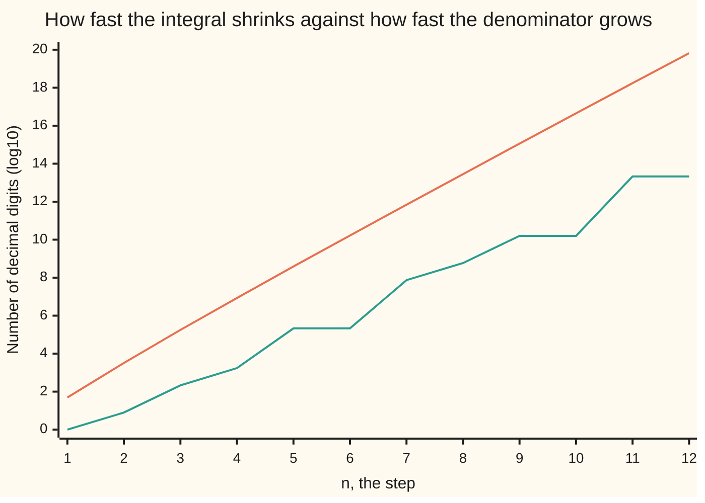

# Apery's theorem: zeta of 3 is irrational, by Beukers' triple integral

[Syllabus](../../../SYLLABUS.md) → [Algebraic and analytic number theory](../README.md) → [Diophantine and Modular](../README.md#s07) → Apery's theorem

---

## General Overview

Add one over each whole number cubed: 1 + 1/8 + 1/27 + 1/64 + …. The total is ζ(3), "zeta of 3", and it equals 1.20205690316. In 1734 Euler found that the squares give π²/6 and the fourth powers give π⁴/90. For the cubes he found no formula. For more than two centuries nobody could even say whether ζ(3) is a fraction.

In 1978 Roger Apéry proved that it is not: ζ(3) is **irrational**, meaning no fraction p/q equals it. In 1979 Frits Beukers found a short proof built on one integral. This card gives that proof in full.

The proof makes a number that is a whole number if ζ(3) is a fraction. That number is positive, and it is tiny. A positive whole number is at least 1, so it cannot be tiny. Here is the first case:

- Beukers' first integral equals 10ζ(3) − 12 = 0.020569031596.
- If ζ(3) = p/q, then q times it is 10p − 12q, a whole number. It is positive, so it is at least 1.
- So q × 0.020569 ≥ 1, which forces q ≥ 49.

The next integrals push q higher: at least 407, then 815, and at least 3,132,154 by the twelfth. The proof shows that the push never stops, so no q works.

Two growth rates decide it. Apéry's numbers 1, 5, 73, 1,445, 33,001 (half the multiple of ζ(3) in each integral: the first, 10ζ(3) − 12, gives 5) grow by about $`(1+\sqrt{2})^4`$ = 33.97 per step, and the integrals shrink at that rate. The common denominator of the fractions that appear grows by about $`e^3`$ = 20.09 per step. The shrinking wins, because $`(\sqrt{2}-1)^4 \times e^3`$ = 0.591 is below 1.

**Beukers' integral of a Legendre-type polynomial equals a whole-number combination of 1 and ζ(3), divided by the cube of lcm(1, …, n), the least common multiple of 1 to n; it is positive and shrinks like 0.0294 to the power n, while the cube of the lcm grows more slowly, so ζ(3) = p/q would give a positive whole number below 1.**

**What kind of fact this is:** a theorem (Apéry 1978, published 1979), proved on this card in Why it works. One input about primes is quoted, not proved here: lcm(1, …, n) < 3 to the power n for every n (Hanson 1972). [The prime number theorem](../02-The%20Zeta%20Function%20and%20the%20Prime%20Number%20Theorem/05-prime-number-theorem-proved.md) gives the same bound for all large n, which is all the proof needs. The code's numbers are evidence beside the proof. No count of digits can show a number is irrational.

### The picture: the race between the integral and the denominator



Orange: log10 of 1/I_n, roughly the number of zeros after the decimal point in Beukers' nth integral, I_n. It climbs steadily. Green: log10 of the cube of the denominator $`d_n`$ = lcm(1, …, n). It climbs in jumps, at primes and prime powers, and more slowly. The gap between the lines is how many digits the would-be whole number $`d_n^3 I_n`$ lies below 1. At n = 12, 19.82 against 13.33 matches $`d_{12}^3 I_{12}`$ = 0.000000319269.

---

## The formula

Notation first, in words.

- $`d_n`$ is the least common multiple of 1, 2, …, n: the smallest whole number that every one of them divides. So $`d_4`$ = 12 and $`d_{12}`$ = 27,720.
- $`P_n(x)`$ is the **Legendre-type polynomial** of degree n: take $`x^n(1-x)^n`$, differentiate it n times, and divide by n!. Its coefficients are whole numbers:

```math
P_n(x) = \frac{1}{n!}\,\frac{d^n}{dx^n}\Big[x^n (1-x)^n\Big] = \sum_{k=0}^{n} (-1)^k \binom{n}{k}\binom{n+k}{k}\, x^k
```

For n = 1 this is $`P_1(x) = 1 - 2x`$.

**Beukers' integral** is a double integral over the unit square, and Step 3 rewrites it as a triple integral over the unit cube:

```math
I_n = \int_0^1\!\!\int_0^1 \frac{-\log(xy)}{1-xy}\,P_n(x)\,P_n(y)\,dx\,dy = \int_0^1\!\!\int_0^1\!\!\int_0^1 \frac{\big(x(1-x)\,y(1-y)\,w(1-w)\big)^n}{\big(1-(1-xy)w\big)^{n+1}}\,dx\,dy\,dw
```

**Read it aloud:** weigh the product of two Legendre-type polynomials by minus log of xy over one minus xy, and add it up over the square; the same number is the triple integral of an nth power over the cube.

Here log is the natural logarithm. The theorem rests on three facts about $`I_n`$ and one about $`d_n`$:

```math
I_n = \frac{A_n + B_n\,\zeta(3)}{d_n^{3}}, \qquad 0 < I_n \le 2\,\zeta(3)\,(\sqrt{2}-1)^{4n}, \qquad d_n < 3^{n}
```

**Read it aloud:** the integral is a whole-number combination of 1 and zeta of 3 over the cube of the lcm; it is positive and at most twice zeta of 3 times root 2 minus 1 to the power 4n; and the lcm is below 3 to the power n.

Put together, they trap the whole-number combination:

```math
0 \;<\; A_n + B_n\,\zeta(3) \;\le\; 2\,\zeta(3)\,d_n^{3}\,(\sqrt{2}-1)^{4n} \;<\; 2\,\zeta(3)\,\big(27\,(\sqrt{2}-1)^{4}\big)^{n} = 2\,\zeta(3) \times 0.794806^{\,n}
```

**Read it aloud:** a positive combination of whole numbers is squeezed below a number that falls by a factor 0.794806 at every step.

| Symbol | Plain meaning | In our example | Push it up and the answer… |
| --- | --- | --- | --- |
| $`\zeta(3)`$ | zeta of 3: the sum of 1/k³ over whole k ≥ 1 | 1.20205690316 | — |
| $`n`$; $`j`$, $`k`$, $`m`$ | the step, which is the polynomial's degree; counters in sums and powers | n = 1 to 12 | the squeeze tightens |
| $`P_n(x)`$; $`D`$ | the Legendre-type polynomial: n derivatives of $`x^n(1-x)^n`$, over n!; D is d/dx | $`P_1 = 1 - 2x`$ | more terms, larger coefficients |
| $`I_n`$; $`I'_n`$ | Beukers' integral; I′ is the same with $`x^n(1-x)^n`$ in place of $`P_n`$ | $`I_1`$ = 0.020569031596 | shrinks about 33.97 times per step |
| $`J(r,s)`$ | the integral of $`-\log(xy)\,x^r y^s/(1-xy)`$ over the square; r, s are whole numbers ≥ 0 | J(0, 0) = 2ζ(3) | — |
| $`d_n`$ | lcm(1, 2, …, n) | $`d_{12}`$ = 27,720 | grows about e times per step, in jumps |
| $`A_n`$, $`B_n`$ | the whole numbers with $`d_n^3 I_n = A_n + B_n\zeta(3)`$ | −12 and 10 at n = 1 | grow fast, in opposite signs |
| $`a_n`$ | Apéry's number: $`\sum_k \binom{n}{k}^2\binom{n+k}{k}^2`$; $`B_n = 2a_n d_n^3`$ | 1, 5, 73, 1,445, 33,001 | about 33.97 times per step |
| $`x`$, $`y`$, $`z`$, $`w`$; $`t`$, $`c`$ | points of the unit square or cube; t = xy and c = 1 − xy in the folds | the fraction inside the nth power peaks at x = y = 0.414214, w = 0.707107 | — |
| $`(\sqrt{2}-1)^4`$ | the largest value of $`x(1-x)y(1-y)w(1-w)/(1-(1-xy)w)`$ | 0.029437 | — |
| $`p/q`$ | the fraction ζ(3) would equal if it were rational; here p is any whole number, not a prime | q at least 3,132,154 at n = 12 | — |
| $`\psi(n)`$ | Chebyshev's function: log of $`d_n`$ | ψ(n)/n at most 1.038821 up to 100,000 | — |

### When it holds

- **The polynomial must carry the n derivatives.** Use $`x^n(1-x)^n`$ itself and the integral shrinks only about 16 times per step in the long run. Even $`d_n^3`$, growing 20.09 times per step, outpaces that: $`e^3/16`$ = 1.255346, and from n = 10 to 11 the product already grows by 1.146477. This polynomial has degree 2n, so its true denominator, $`d_{2n}^3`$, is larger still.
- **The denominator must grow more slowly than the integral shrinks.** Chebyshev's easy bound, about 4 to the power n, is not enough: $`4^3 \times 0.029437`$ = 1.883984, above 1. The bound $`3^n`$ gives 0.794806 and closes the squeeze.
- **The integral must not be 0.** A whole number that is 0 has no lower bound of 1. The triple form has a positive integrand, so $`I_n > 0`$.
- **The common denominator must be cleared.** Without $`d_n^3`$ the combination is not whole: $`I_2`$ = 146ζ(3) − 175.5.
- **The method is tuned to ζ(3).** No one has made the same race close for ζ(5); its irrationality is open as of 2026-11-24.

---

## Why it works

### Step 0: the idea

A positive whole number is at least 1. The [Transcendence of e and pi](13-transcendence-of-e-and-pi.md) card plays this fact against an integral that is tiny. This card does the same with a family of integrals, one for each n.

The plan has four parts:

1. Show that $`d_n^3 I_n`$ is a whole-number combination $`A_n + B_n\zeta(3)`$ (Steps 1 and 2).
2. Rewrite $`I_n`$ as a triple integral with a positive integrand (Step 3).
3. Bound that integrand by $`(\sqrt{2}-1)^{4n}`$ (Step 4).
4. Bound $`d_n`$ by $`3^n`$, and close the squeeze (Steps 5 and 6).

### Step 1: each power of x and y gives ζ(3) or a fraction

Expand $`1/(1-xy)`$ as the geometric series $`1 + xy + (xy)^2 + \cdots`$ and integrate term by term. For whole numbers r ≥ s ≥ 0 this gives

```math
J(r,s) = \int_0^1\!\!\int_0^1 \frac{-\log(xy)}{1-xy}\,x^r y^s\,dx\,dy = \begin{cases} 2\Big(\zeta(3) - \sum_{m=1}^{r} \frac{1}{m^3}\Big) & r = s \\[4pt] \frac{1}{r-s}\sum_{m=s+1}^{r} \frac{1}{m^2} & r > s \end{cases}
```

**Read it aloud:** on the diagonal you get twice the tail of zeta of 3; off it you get a short sum of reciprocal squares over the gap r minus s.

So ζ(3) enters only on the diagonal. Every other part is a fraction whose denominator involves only the numbers 1 to n. For example J(0, 0) = 2ζ(3), J(1, 1) = 2ζ(3) − 2 and J(1, 0) = 1.

<details>
<summary>Detailed proof: the formula for J(r, s)</summary>

Two facts do the work. First, $`-\log(xy) = -\log x - \log y`$. Second, for a whole number j ≥ 0,

$`\displaystyle \int_0^1 x^{j}\,(-\log x)\,dx = \frac{1}{(j+1)^2}, \qquad \int_0^1 x^{j}\,dx = \frac{1}{j+1}`$

The first follows from [Integration by parts](../../06-Calculus%20and%20analysis/04-Integrals/04-integration-by-parts.md): differentiate −log x to −1/x and integrate $`x^j`$ to $`x^{j+1}/(j+1)`$.

The series $`\sum_k (xy)^k`$ has positive terms, so it may be integrated term by term. The k-th term contributes

$`\displaystyle \frac{1}{(r+k+1)^2(s+k+1)} + \frac{1}{(r+k+1)(s+k+1)^2}`$

When r = s this is $`2/(r+k+1)^3`$. Adding over k ≥ 0 gives twice the sum of $`1/m^3`$ over m > r, which is the first case.

When r > s, the contribution equals

$`\displaystyle \frac{1}{r-s}\Big(\frac{1}{(s+k+1)^2} - \frac{1}{(r+k+1)^2}\Big)`$

To check, put both sides over the common denominator $`(r+k+1)^2(s+k+1)^2`$. Both numerators become $`(r+k+1) + (s+k+1)`$. Adding over k, every square from $`(r+1)^2`$ onwards cancels. What is left is the sum of $`1/m^2`$ for m from s + 1 to r, divided by r − s.

</details>

### Step 2: clearing the denominator makes whole numbers

Write $`P_n(x) = \sum_r c_r x^r`$ with whole coefficients $`c_r = (-1)^r \binom{n}{r}\binom{n+r}{r}`$. Multiplying out,

```math
I_n = \sum_{r=0}^{n}\sum_{s=0}^{n} c_r\,c_s\,J(r,s)
```

Every denominator in J(r, s) is $`m^3`$, or $`(r-s)\,m^2`$, with m and r − s at most n. Each of these divides $`d_n^3`$. So $`d_n^3 I_n = A_n + B_n\zeta(3)`$ with whole numbers $`A_n`$ and $`B_n`$.

The ζ(3) part comes only from the diagonal, so $`B_n = 2 d_n^3 \sum_r c_r^2 = 2a_n d_n^3`$, where $`a_n`$ is Apéry's number. The code computes $`a_n`$ two ways: from the binomial sum, and from Apéry's recurrence

```math
n^3 a_n = (34n^3 - 51n^2 + 27n - 5)\,a_{n-1} - (n-1)^3\,a_{n-2}
```

For large n the recurrence is close to $`a_n = 34a_{n-1} - a_{n-2}`$. The roots of $`x^2 - 34x + 1`$ are $`17 \pm 12\sqrt{2} = (1 \pm \sqrt{2})^4`$, so $`a_n`$ grows like 33.970563 per step. The ratio $`a_{12}/a_{11}`$ = 29.908547 is still climbing towards it.

By hand for n = 1: $`P_1 = 1 - 2x`$, so $`c_0 = 1`$ and $`c_1 = -2`$.

```math
I_1 = J(0,0) - 2J(1,0) - 2J(0,1) + 4J(1,1) = 2\zeta(3) - 2 - 2 + 4\big(2\zeta(3) - 2\big) = 10\,\zeta(3) - 12
```

The code finds the next three exactly:

| n | $`d_n`$ | $`A_n`$ | $`B_n`$ |
| ---: | ---: | ---: | ---: |
| 1 | 1 | −12 | 10 |
| 2 | 2 | −1,404 | 1,168 |
| 3 | 6 | −750,372 | 624,240 |
| 4 | 12 | −137,096,340 | 114,051,456 |

### Step 3: integration by parts turns it into a positive triple integral

The double integral's integrand changes sign, so it is hard to bound. Three moves make it a triple integral with a positive integrand.

1. **Add a variable.** $`-\log(xy)/(1-xy)`$ equals the integral over z from 0 to 1 of $`1/(1-(1-xy)z)`$.
2. **Move the n derivatives off $`P_n(x)`$.** Integrate by parts n times in x. The boundary terms vanish, because $`x^n(1-x)^n`$ and its first n − 1 derivatives are 0 at both ends. Each derivative of the fraction brings down a factor yz.
3. **Change variable and repeat.** Substitute $`z = (1-w)/(1-(1-xy)w)`$, then integrate by parts n times in y.

The fold carries the algebra. The result is the triple integral in The formula. Its integrand is positive inside the cube, so $`I_n > 0`$.

<details>
<summary>Detailed proof: from the double integral to the triple integral</summary>

Move 1. For 0 < c < 1,

$`\displaystyle \int_0^1 \frac{dz}{1-cz} = \frac{-\log(1-c)}{c}`$

Put c = 1 − xy, so 1 − c = xy:

$`\displaystyle I_n = \int_0^1\!\!\int_0^1\!\!\int_0^1 \frac{P_n(x)\,P_n(y)}{1-(1-xy)z}\,dx\,dy\,dz`$

Move 2. Write $`P_n(x) = \frac{1}{n!}D^n\big[x^n(1-x)^n\big]`$, where D means d/dx. Integration by parts moves one D from $`x^n(1-x)^n`$ to the fraction and flips the sign. The boundary term holds $`D^{j}[x^n(1-x)^n]`$ with j < n, which is 0 at x = 0 and x = 1. After n moves the sign is $`(-1)^n`$. Each D of the fraction gives

$`\displaystyle D^n \frac{1}{1-z+xyz} = \frac{(-1)^n\,n!\,(yz)^n}{(1-(1-xy)z)^{n+1}}`$

The two signs cancel and n! cancels, so

$`\displaystyle I_n = \int\!\!\int\!\!\int \frac{x^n(1-x)^n\,(yz)^n\,P_n(y)}{(1-(1-xy)z)^{n+1}}\,dx\,dy\,dz`$

Move 3. With c = 1 − xy, substitute $`z = (1-w)/(1-cw)`$. Then

$`\displaystyle 1 - cz = \frac{xy}{1-cw}, \qquad dz = \frac{-xy}{(1-cw)^2}\,dw, \qquad z^n = \frac{(1-w)^n}{(1-cw)^n}`$

The map sends w = 0 to z = 1 and w = 1 to z = 0; the minus sign in dz swaps the limits back. Collect the powers of xy and of 1 − cw:

$`\displaystyle I_n = \int\!\!\int\!\!\int \frac{(1-x)^n\,(1-w)^n\,P_n(y)}{1-(1-xy)w}\,dx\,dy\,dw`$

Now integrate by parts n times in y, as in Move 2. Each derivative of $`1/(1 - w + xyw)`$ in y brings down xw:

$`\displaystyle I_n = \int\!\!\int\!\!\int \frac{(1-x)^n(1-w)^n\,y^n(1-y)^n\,(xw)^n}{(1-(1-xy)w)^{n+1}}\,dx\,dy\,dw`$

Gathering the factors gives the triple integral in The formula.

</details>

### Step 4: the integrand is at most (√2 − 1)⁴ to the power n

Split the triple integrand into an nth power times one extra factor:

```math
\frac{\big(x(1-x)y(1-y)w(1-w)\big)^n}{\big(1-(1-xy)w\big)^{n+1}} = \left(\frac{x(1-x)\,y(1-y)\,w(1-w)}{1-(1-xy)w}\right)^{n} \cdot \frac{1}{1-(1-xy)w}
```

The fraction inside the power is at most $`(\sqrt{2}-1)^4`$ = 0.0294372515, reached at x = y = √2 − 1 = 0.414214 and w = 1/√2 = 0.707107. The fold proves it. The code checks it with a grid search: on a grid of step 0.01 the largest value is 0.0294328439, at x = y = 0.41 and w = 0.71.

The leftover factor integrates to $`I_0 = J(0,0) = 2\zeta(3)`$. So

```math
0 < I_n \le (\sqrt{2}-1)^{4n} \cdot 2\,\zeta(3)
```

For n = 1 the bound is 0.070770502806. The true value is 0.020569031596.

<details>
<summary>Detailed proof: the largest value is (√2 − 1)⁴</summary>

Fix x and y, and let t = xy, between 0 and 1. First maximise over w. For every w,

$`\displaystyle 1 - (1-t)w - (1+\sqrt{t})^2\,w(1-w) = \big(1 - (1+\sqrt{t})\,w\big)^2 \ge 0`$

Expand both sides to check. So $`w(1-w)/(1-(1-t)w)`$ is at most $`1/(1+\sqrt{t})^2`$, with equality at $`w = 1/(1+\sqrt{t})`$.

Next, $`x(1-x)\,y(1-y) = t\,(1 - x - y + t)`$. Since $`x + y \ge 2\sqrt{t}`$ (the arithmetic mean is at least the geometric mean), this is at most $`t\,(1-\sqrt{t})^2`$. Together,

$`\displaystyle \frac{x(1-x)y(1-y)w(1-w)}{1-(1-xy)w} \le \left(\frac{\sqrt{t}\,(1-\sqrt{t})}{1+\sqrt{t}}\right)^2`$

Write $`v = \sqrt{t}`$. The quantity inside the square is $`v(1-v)/(1+v)`$, and its derivative in v is $`(1 - 2v - v^2)/(1+v)^2`$. That is 0 at $`v = \sqrt{2} - 1`$, where the quantity is largest. There the quantity is $`(\sqrt{2}-1)(2-\sqrt{2})/\sqrt{2} = (\sqrt{2}-1)^2`$. Squaring gives $`(\sqrt{2}-1)^4`$, reached at x = y = √2 − 1 and $`w = 1/\sqrt{2}`$.

</details>

### Step 5: the denominator grows like e to the power n

The lcm $`d_n`$ is the product, over primes p up to n, of the largest power of p that is at most n. Its log is Chebyshev's function ψ(n): the sum of log p over all prime powers $`p^k \le n`$. So $`d_n = e^{\psi(n)}`$.

- [Chebyshev's bounds](../01-Arithmetic%20Functions%20Again/08-chebyshev-bounds.md) caps ψ(n) at a fixed multiple of n, about log 4 times n. That is not enough here, as What breaks shows.
- [The prime number theorem](../02-The%20Zeta%20Function%20and%20the%20Prime%20Number%20Theorem/05-prime-number-theorem-proved.md) gives ψ(n)/n → 1. So for all large n, ψ(n) < n log 3, which means $`d_n < 3^n`$.
- Hanson (1972) proved $`d_n < 3^n`$ for every n ≥ 1.

The code checks ψ(n) < n log 3 for every n up to 100,000. The largest ratio ψ(n)/n is 1.038821, at n = 113, against log 3 = 1.098612. At n = 100,000 the ratio is 1.000516. That is evidence. The proof uses the theorem.

### Step 6: the squeeze

Suppose ζ(3) = p/q with whole p and q ≥ 1. Here p is the numerator, not a prime as in Step 5. Then for every n,

```math
q\,(A_n + B_n\,\zeta(3)) = q\,A_n + B_n\,p
```

is a whole number. It equals $`q\,d_n^3 I_n`$, which is positive, so it is at least 1. Steps 4 and 5 bound it from above:

```math
1 \le q\,d_n^3 I_n < q \cdot 2\,\zeta(3) \cdot \big(27\,(\sqrt{2}-1)^4\big)^n = 2\,\zeta(3)\,q \cdot 0.794806^{\,n}
```

The right side tends to 0 as n grows, so for some n it is below 1. That is a contradiction, so ζ(3) is irrational.

Each n also gives a concrete floor: q must be at least $`1/(d_n^3 I_n)`$. The code prints it. The floor zigzags, because $`d_n`$ jumps at primes and prime powers. It goes from 2,795,437 at n = 10 down to 81,552 at n = 11, then up to 3,132,154 at n = 12. Only the limit matters.

### Step 7: what the proof gives, and what it does not

- **A measure of irrationality.** With the prime number theorem's rate $`e^n`$ for $`d_n`$, the same numbers show how closely fractions can approach ζ(3). The irrationality exponent of ζ(3), from [Chasing an algebraic number with fractions](10-diophantine-approximation-liouville-to-roth.md), is the largest power for which endless good fractions exist. It is at most $`1 + (4\log(1+\sqrt{2}) + 3)/(4\log(1+\sqrt{2}) - 3)`$ = 13.4178. Rhin and Viola (2001) lowered the bound to 5.513891 with a wider family of triple integrals; the exact exponent is open as of 2026-11-24.
- **ζ(2) by the same road.** Beukers' paper also proves ζ(2) = π²/6 irrational, with a simpler double integral.
- **Not transcendence.** Whether ζ(3) is transcendental is open as of 2026-11-24.
- **Not ζ(5).** Whether ζ(5), ζ(7) or any other single odd value is irrational is open as of 2026-11-24. Ball and Rivoal (2001) proved that infinitely many of ζ(3), ζ(5), ζ(7), … are irrational, without identifying any single one. Zudilin (2001) proved that at least one of ζ(5), ζ(7), ζ(9), ζ(11) is irrational.

---

## Worked numbers, by hand

| Step | Arithmetic | Value |
| --- | --- | --- |
| ζ(3) | 1 + 1/8 + 1/27 + … | 1.20205690316 |
| $`I_1`$ | 10 × 1.20205690316 − 12 | 0.020569031596 |
| bound for $`I_1`$ | 2 × 1.20205690316 × 0.029437 | 0.070770502806 |
| floor on q from n = 1 | 1 / 0.020569031596, rounded up | 49 |
| $`d_2^3 I_2`$ | 1,168 × 1.20205690316 − 1,404 | 0.002462890406 |
| floor on q from n = 2 | 1 / 0.002462890406, rounded up | 407 |
| $`d_{12}^3 I_{12}`$ | exact whole numbers and 54 digits of ζ(3) | 0.000000319269 |
| floor on q from n = 12 | 1 / 0.000000319269, rounded up | 3,132,154 |
| shrink per step, proved | 27 × 0.029437 | **0.794806** |

**Every step multiplies the bound on the would-be whole number by at most 0.794806, so after enough steps it is below 1, and ζ(3) is not a fraction.** In the long run the true factor is $`e^3 \times 0.029437`$ = 0.591263.

### What breaks if you drop a piece

| Mistake | Comes out at | What went wrong |
| --- | --- | --- |
| Bound $`d_n`$ by Chebyshev's easy $`4^n`$ | 64 × 0.029437 = 1.883984 per step | The bound grows, so the squeeze never closes |
| Use $`x^n(1-x)^n`$ without the n derivatives | $`I'_{11}/I'_{10}`$ = 0.057080; times $`e^3`$, 1.146477, and $`e^3/16`$ = 1.255346 in the long run | The polynomial is never negative, so nothing cancels; the integral shrinks only about 16 times per step in the long run, and the degree 2n needs the even larger $`d_{2n}^3`$ |
| Drop the common denominator $`d_n^3`$ | $`I_2`$ = 146ζ(3) − 175.5 | 175.5 is not whole, so "at least 1" does not apply |

The code prints all three.

---

## Code, from first principles, and it actually runs

The code checks every number on the card by two independent roads. Road 1 is exact: it builds the whole numbers $`A_n`$ and $`B_n`$ from the coefficients of $`P_n`$ and Step 1's formula, and gets ζ(3) to 54 digits from Apéry's fast series, $`\frac{5}{2}\sum_k (-1)^{k+1}/(k^3\binom{2k}{k})`$, in whole-number arithmetic. Road 2 is floating point: it computes the triple integral by Gauss-Legendre quadrature, with nodes found by Newton's method, and ζ(3) from 1,000 terms of its series plus a tail correction. Apéry's numbers come from the binomial sum and from the recurrence. The bound $`(\sqrt{2}-1)^4`$ is checked against a grid search. A sieve computes ψ(n) up to 100,000. Rust has no big integers, so its check carries a small base-$`10^9`$ big-number type.

### Python

```python
# Apery's theorem by Beukers' integral -- the check behind the card.  Standard library only.
# Road 1: exact whole numbers A_n, B_n with d_n^3 I_n = A_n + B_n zeta(3), zeta(3) to 54 digits.
# Road 2: the triple integral I_n by Gauss-Legendre quadrature, in floating point.
# Also: Apery numbers by a sum and by a recurrence; the bound (sqrt2 - 1)^4 by a grid search.
from math import comb, gcd, cos, pi, log, log10, exp
from functools import reduce

S = 10 ** 54                                  # fixed point: an integer v stands for v / 10^54

# zeta(3), road 1: Apery's series 5/2 * sum (-1)^(k+1) / (k^3 C(2k, k)), in whole numbers
pos, neg, t, k = 0, 0, S // 2, 1
while t:
    pos, neg = (pos + t, neg) if k % 2 else (pos, neg + t)
    k += 1
    t = t * (k - 1) ** 3 // (2 * k * k * (2 * k - 1))
Z = (pos - neg) * 5 // 2
# zeta(3), road 2: 1 + 1/8 + ... + 1/1000^3, plus the tail 1/(2N^2) - 1/(2N^3) + 1/(4N^4)
N, z3 = 1000, 0.0
for k in range(1, N + 1): z3 += 1 / k ** 3
z3 += 1 / (2 * N * N) - 1 / (2 * N ** 3) + 1 / (4 * N ** 4)
zr = (Z + 5 * 10 ** 42) // 10 ** 43           # zeta(3) rounded to 11 decimals, as an integer
print(f"zeta(3): Apery series {zr // 10 ** 11}.{zr % 10 ** 11:011d} | sum to 1000 plus tail {z3:.11f}")
assert abs(Z / S - z3) < 1e-14

def lcm_to(n):                                 # d_n = lcm(1, 2, ..., n)
    d = 1
    for k in range(1, n + 1): d = d * k // gcd(d, k)
    return d
# Apery numbers a_n: road 1 the binomial sum, road 2 the recurrence
apery = [sum(comb(n, k) ** 2 * comb(n + k, k) ** 2 for k in range(n + 1)) for n in range(13)]
u = [1, 5]
for n in range(2, 13):
    u.append(((34 * n ** 3 - 51 * n * n + 27 * n - 5) * u[-1] - (n - 1) ** 3 * u[-2]) // n ** 3)
assert u == apery
print("Apery numbers a_0..a_8:", ", ".join(f"{a:,}" for a in apery[:9]))
r2 = 2 ** 0.5
print(f"a_12 / a_11 = {apery[12] / apery[11]:.6f}; (1 + sqrt2)^4 = 17 + 12 sqrt2 = {17 + 12 * r2:.6f}")

def coeffs(n):                                 # P_n(x) = (1/n!) (d/dx)^n [x^n (1-x)^n]
    return [(-1) ** k * comb(n, k) * comb(n + k, k) for k in range(n + 1)]
def J(r, s, d):                                # d^3 J(r, s) = A + B zeta(3), by Step 1's formula
    lo, hi = min(r, s), max(r, s)
    if r == s: return -2 * sum((d // m) ** 3 for m in range(1, r + 1)), 2 * d ** 3
    return (d // (hi - lo)) * sum((d // m) ** 2 for m in range(lo + 1, hi + 1)), 0
def whole_AB(c, d):                            # d^3 * sum c_r c_s J(r, s) = A + B zeta(3)
    terms = [(c[r] * c[s], J(r, s, d)) for r in range(len(c)) for s in range(len(c))]
    return sum(k * j[0] for k, j in terms), sum(k * j[1] for k, j in terms)

def gauss(m):                                  # Gauss-Legendre nodes and weights on [0, 1]
    xs, ws = [], []
    for i in range(1, m + 1):
        x = cos(pi * (i - 0.25) / (m + 0.5))
        for _ in range(100):
            p0, p1 = 1.0, x
            for j in range(2, m + 1): p0, p1 = p1, ((2 * j - 1) * x * p1 - (j - 1) * p0) / j
            dp = m * (x * p1 - p0) / (x * x - 1)
            dx = p1 / dp; x -= dx
            if abs(dx) < 1e-16: break
        xs.append((1 - x) / 2); ws.append(1 / ((1 - x * x) * dp * dp))
    return xs, ws
def power(b, n): return reduce(lambda p, _: p * b, range(n), 1.0)   # b^n by n multiplications

X, W = gauss(24)
def triple(n, legendre):                       # x = u^2, y = t^2, w = 1 - v^2 smooth the corner
    s = 0.0
    for u_, wu in zip(X, W):
        for t_, wt in zip(X, W):
            x, y = u_ * u_, t_ * t_
            for v_, wv in zip(X, W):
                w = 1 - v_ * v_
                den = 1 - (1 - x * y) * w
                top = x * (1 - x) * y * (1 - y) * w * (1 - w) if legendre else x * (1 - x) * y * (1 - y)
                f = power(top, n) / power(den, n + 1) if legendre else power(top, n) / den
                s += 8 * u_ * t_ * v_ * wu * wt * wv * f
    return s

M = power(r2 - 1, 4)                           # the proved maximum (sqrt2 - 1)^4
print(f"J(0, 0) = {J(0, 0, 1)[1]} zeta(3); J(1, 1) = {J(1, 1, 1)[1]} zeta(3) - {-J(1, 1, 1)[0]}; J(1, 0) = {J(1, 0, 1)[0]}")
print("n | d_n | A_n | B_n")
for n in range(1, 5):
    A, B = whole_AB(coeffs(n), lcm_to(n))
    print(f"{n} | {lcm_to(n)} | {A:,} | {B:,}")
assert whole_AB(coeffs(1), 1) == (-12, 10)     # by hand: I_1 = 10 zeta(3) - 12
print("n | d_n | d_n^3 I_n exact | by quadrature | bound d_n^3 2 zeta(3) (sqrt2-1)^(4n) | q at least")
chart = []
for n in range(1, 13):
    d = lcm_to(n)
    A, B = whole_AB(coeffs(n), d)
    assert B == 2 * u[n] * d ** 3              # the zeta(3) part is twice the Apery number, by the recurrence
    V = B * Z + A * S                          # d^3 I_n in units of 10^-54
    quad, bound = d ** 3 * triple(n, True), d ** 3 * 2 * z3 * power(M, n)
    assert V > 0 and abs(quad / (V / S) - 1) < 1e-6 and V / S < bound
    print(f"{n} | {d:,} | 0.{(V + 5 * 10 ** 41) // 10 ** 42:012d} | {quad:.12f} | {bound:.12f} | {int(S / V) + 1:,}")
    chart.append((log10(S / V) + 3 * log10(d), 3 * log10(d)))
print("chart log10(1/I_n):", ", ".join(f"{a:.2f}" for a, b in chart))
print("chart log10(d_n^3):", ", ".join(f"{b:.2f}" for a, b in chart))
A2, B2 = whole_AB(coeffs(2), 2)
print(f"without d_2^3: I_2 = {B2 // 8} zeta(3) - {-A2 / 8}")

# the bound: grid search for the largest x(1-x) y(1-y) w(1-w) / (1 - (1-xy) w)
best = (0.0, 0, 0, 0)
for i in range(1, 100):
    for j in range(1, 100):
        x, y = i / 100, j / 100
        for l in range(1, 100):
            w = l / 100; f = x * (1 - x) * y * (1 - y) * w * (1 - w) / (1 - (1 - x * y) * w)
            if f > best[0]: best = (f, i, j, l)
print(f"grid max {best[0]:.10f} at x = {best[1] / 100}, y = {best[2] / 100}, w = {best[3] / 100}")
print(f"proved max (sqrt2 - 1)^4 = {M:.10f} at x = y = sqrt2 - 1 = {r2 - 1:.6f}, w = 1/sqrt2 = {1 / r2:.6f}")
assert M - 1e-5 < best[0] <= M

# d_n against 3^n: psi(n) = log d_n, a sum of log p over prime powers p^k <= n
NP = 100000
lp, sieve = [0.0] * (NP + 1), [True] * (NP + 1)
for p in range(2, NP + 1):
    if sieve[p]:
        for m in range(p * p, NP + 1, p): sieve[m] = False
        pk = p
        while pk <= NP: lp[pk] = log(p); pk *= p
psi, worst = 0.0, (0.0, 0)
for n in range(1, NP + 1):
    psi += lp[n]
    worst = max(worst, (psi / n, n))
    assert psi < n * log(3)                    # d_n < 3^n, checked to NP
print(f"psi(n)/n up to {NP:,}: largest {worst[0]:.6f} at n = {worst[1]}; at n = {NP:,}: {psi / NP:.6f}; log 3 = {log(3):.6f}")

# the race, per step of n
e3 = exp(3)
print(f"(sqrt2-1)^4 = {M:.6f}; times e^3 = {e3:.6f}: {e3 * M:.6f}; times 27: {27 * M:.6f}; times 64: {64 * M:.6f}")
p10, p11 = triple(10, False), triple(11, False)
print(f"plain x^n(1-x)^n: at most 1/16 per step, e^3/16 = {e3 / 16:.6f}; I'_11 / I'_10 = {p11 / p10:.6f}, "
      f"times e^3: {e3 * p11 / p10:.6f}")
assert e3 * p11 / p10 > 1                      # the plain integral loses the race already at n = 10 to 11
L = 4 * log(1 + r2)
print(f"irrationality exponent of zeta(3) at most 1 + (4 log(1+sqrt2) + 3)/(4 log(1+sqrt2) - 3) = {1 + (L + 3) / (L - 3):.4f}")
print("quoted, not computed: Rhin and Viola (2001) lowered the exponent bound to 5.513891")
print(f"1/zeta(3) = {1 / z3:.6f}")
print("ALL CHECKS PASS")
```

**Ran 2026-11-24 on macOS, Python 3.14.10, standard library only. All checks passed. Output, pasted from the run:**

```
zeta(3): Apery series 1.20205690316 | sum to 1000 plus tail 1.20205690316
Apery numbers a_0..a_8: 1, 5, 73, 1,445, 33,001, 819,005, 21,460,825, 584,307,365, 16,367,912,425
a_12 / a_11 = 29.908547; (1 + sqrt2)^4 = 17 + 12 sqrt2 = 33.970563
J(0, 0) = 2 zeta(3); J(1, 1) = 2 zeta(3) - 2; J(1, 0) = 1
n | d_n | A_n | B_n
1 | 1 | -12 | 10
2 | 2 | -1,404 | 1,168
3 | 6 | -750,372 | 624,240
4 | 12 | -137,096,340 | 114,051,456
n | d_n | d_n^3 I_n exact | by quadrature | bound d_n^3 2 zeta(3) (sqrt2-1)^(4n) | q at least
1 | 1 | 0.020569031596 | 0.020569031761 | 0.070770502806 | 49
2 | 2 | 0.002462890406 | 0.002462890406 | 0.016666312732 | 407
3 | 6 | 0.001228345137 | 0.001228345137 | 0.013246481876 | 815
4 | 12 | 0.000202728619 | 0.000202728619 | 0.003119520150 | 4,933
5 | 60 | 0.000559652367 | 0.000559652367 | 0.011478762412 | 1,787
6 | 60 | 0.000012944377 | 0.000012944377 | 0.000337903216 | 77,254
7 | 420 | 0.000106180873 | 0.000106180873 | 0.003411801095 | 9,418
8 | 840 | 0.000020834578 | 0.000020834578 | 0.000803472376 | 47,998
9 | 2,520 | 0.000014073194 | 0.000014073194 | 0.000638604497 | 71,058
10 | 2,520 | 0.000000357726 | 0.000000357726 | 0.000018798761 | 2,795,437
11 | 27,720 | 0.000012262163 | 0.000012262163 | 0.000736553920 | 81,552
12 | 27,720 | 0.000000319269 | 0.000000319269 | 0.000021682123 | 3,132,154
chart log10(1/I_n): 1.69, 3.51, 5.25, 6.93, 8.59, 10.22, 11.84, 13.45, 15.06, 16.65, 18.24, 19.82
chart log10(d_n^3): 0.00, 0.90, 2.33, 3.24, 5.33, 5.33, 7.87, 8.77, 10.20, 10.20, 13.33, 13.33
without d_2^3: I_2 = 146 zeta(3) - 175.5
grid max 0.0294328439 at x = 0.41, y = 0.41, w = 0.71
proved max (sqrt2 - 1)^4 = 0.0294372515 at x = y = sqrt2 - 1 = 0.414214, w = 1/sqrt2 = 0.707107
psi(n)/n up to 100,000: largest 1.038821 at n = 113; at n = 100,000: 1.000516; log 3 = 1.098612
(sqrt2-1)^4 = 0.029437; times e^3 = 20.085537: 0.591263; times 27: 0.794806; times 64: 1.883984
plain x^n(1-x)^n: at most 1/16 per step, e^3/16 = 1.255346; I'_11 / I'_10 = 0.057080, times e^3: 1.146477
irrationality exponent of zeta(3) at most 1 + (4 log(1+sqrt2) + 3)/(4 log(1+sqrt2) - 3) = 13.4178
quoted, not computed: Rhin and Viola (2001) lowered the exponent bound to 5.513891
1/zeta(3) = 0.831907
ALL CHECKS PASS
```

### Rust

```rust
// Apery's theorem by Beukers' integral -- the check behind the card.  std only, no crates.
// Road 1: exact whole numbers A_n, B_n with d_n^3 I_n = A_n + B_n zeta(3), zeta(3) to 54 digits.
// Road 2: the triple integral I_n by Gauss-Legendre quadrature, in floating point.
// Also: Apery numbers by a sum and by a recurrence; the bound (sqrt2 - 1)^4 by a grid search.
use std::f64::consts::PI;
const B9: u64 = 1_000_000_000;               // big numbers: base 10^9 limbs, lowest first

fn trim(mut v: Vec<u64>) -> Vec<u64> { while v.len() > 1 && *v.last().unwrap() == 0 { v.pop(); } v }
fn big(mut x: u128) -> Vec<u64> { let mut v = vec![]; while x > 0 { v.push((x % B9 as u128) as u64); x /= B9 as u128; } v }
fn mul(v: &mut Vec<u64>, m: u64) {
    let mut c = 0u128;
    for d in v.iter_mut() { let t = *d as u128 * m as u128 + c; *d = (t % B9 as u128) as u64; c = t / B9 as u128; }
    while c > 0 { v.push((c % B9 as u128) as u64); c /= B9 as u128; }
}
fn div(v: &mut Vec<u64>, m: u64) {
    let mut r = 0u128;
    for d in v.iter_mut().rev() { let t = r * B9 as u128 + *d as u128; *d = (t / m as u128) as u64; r = t % m as u128; }
    *v = trim(v.clone());
}
fn addsub(a: &[u64], b: &[u64], sign: i64) -> Vec<u64> { // a + b, or a - b when a >= b
    let (mut out, mut c) = (vec![], 0i64);
    for i in 0..a.len().max(b.len()) {
        let t = *a.get(i).unwrap_or(&0) as i64 + sign * *b.get(i).unwrap_or(&0) as i64 + c;
        c = if t < 0 { -1 } else { t / B9 as i64 }; out.push(t.rem_euclid(B9 as i64) as u64);
    }
    if c > 0 { out.push(c as u64); }
    assert!(c >= 0); trim(out)
}
fn shift(v: &[u64], k: usize) -> Vec<u64> { let mut o = vec![0; k]; o.extend_from_slice(v); o }
fn tof(v: &[u64]) -> f64 { v.iter().rev().fold(0.0, |s, &d| s * B9 as f64 + d as f64) }
fn zero(v: &[u64]) -> bool { v.iter().all(|&d| d == 0) }
fn commas(x: i128) -> String {
    let s = x.unsigned_abs().to_string();
    let mut o = String::new();
    for (i, ch) in s.chars().enumerate() { if i > 0 && (s.len() - i) % 3 == 0 { o.push(','); } o.push(ch); }
    if x < 0 { format!("-{}", o) } else { o }
}
fn gcd(a: u128, b: u128) -> u128 { if b == 0 { a } else { gcd(b, a % b) } }
fn lcm_to(n: u128) -> u128 { (1..=n).fold(1, |d, k| d * k / gcd(d, k)) } // d_n = lcm(1, ..., n)
fn comb(n: i128, k: i128) -> i128 { (0..k).fold(1, |c, i| c * (n - i) / (i + 1)) }
fn coeffs(n: i128) -> Vec<i128> { (0..=n).map(|k| (1 - 2 * (k % 2)) * comb(n, k) * comb(n + k, k)).collect() }
fn jrs(r: usize, s: usize, d: i128) -> (i128, i128) { // d^3 J(r, s) = A + B zeta(3), by Step 1's formula
    let (lo, hi) = (r.min(s) as i128, r.max(s) as i128);
    if r == s { return (-2 * (1..=hi).map(|m| (d / m).pow(3)).sum::<i128>(), 2 * d * d * d); }
    ((d / (hi - lo)) * (lo + 1..=hi).map(|m| (d / m).pow(2)).sum::<i128>(), 0)
}
fn whole_ab(c: &[i128], d: i128) -> (i128, i128) { // d^3 * sum c_r c_s J(r, s) = A + B zeta(3)
    let (mut a, mut b) = (0i128, 0i128);
    for r in 0..c.len() { for s in 0..c.len() {
        let ((ja, jb), k) = (jrs(r, s, d), c[r] * c[s]);
        a = a.checked_add(k.checked_mul(ja).unwrap()).unwrap(); b = b.checked_add(k.checked_mul(jb).unwrap()).unwrap();
    } }
    (a, b)
}
fn gauss(m: usize) -> (Vec<f64>, Vec<f64>) {  // Gauss-Legendre nodes and weights on [0, 1]
    let (mut xs, mut ws) = (vec![], vec![]);
    for i in 1..=m {
        let (mut x, mut dp) = ((PI * (i as f64 - 0.25) / (m as f64 + 0.5)).cos(), 0.0);
        for _ in 0..100 {
            let (mut p0, mut p1) = (1.0, x);
            for j in 2..=m { let p2 = ((2 * j - 1) as f64 * x * p1 - (j - 1) as f64 * p0) / j as f64; p0 = p1; p1 = p2; }
            dp = m as f64 * (x * p1 - p0) / (x * x - 1.0);
            let dx = p1 / dp; x -= dx;
            if dx.abs() < 1e-16 { break; }
        }
        xs.push((1.0 - x) / 2.0); ws.push(1.0 / ((1.0 - x * x) * dp * dp));
    }
    (xs, ws)
}
fn power(b: f64, n: usize) -> f64 { (0..n).fold(1.0, |p, _| p * b) } // b^n by n multiplications
fn triple(g: &(Vec<f64>, Vec<f64>), n: usize, legendre: bool) -> f64 { // x = u^2, y = t^2, w = 1 - v^2
    let (xs, ws) = g;
    let mut s = 0.0;
    for (u, wu) in xs.iter().zip(ws) { for (t, wt) in xs.iter().zip(ws) {
        let (x, y) = (u * u, t * t);
        for (v, wv) in xs.iter().zip(ws) {
            let w = 1.0 - v * v; let den = 1.0 - (1.0 - x * y) * w;
            let f = if legendre { power(x * (1.0 - x) * y * (1.0 - y) * w * (1.0 - w), n) / power(den, n + 1) }
                    else { power(x * (1.0 - x) * y * (1.0 - y), n) / den };
            s += 8.0 * u * t * v * wu * wt * wv * f;
        }
    } }
    s
}
fn main() {
    // zeta(3), road 1: Apery's series 5/2 * sum (-1)^(k+1) / (k^3 C(2k, k)), in whole numbers
    let s54 = shift(&[1], 6);                 // 10^54
    let (mut pos, mut neg, mut t, mut k) = (vec![0u64], vec![0u64], s54.clone(), 1u64);
    div(&mut t, 2);
    while !zero(&t) {
        if k % 2 == 1 { pos = addsub(&pos, &t, 1); } else { neg = addsub(&neg, &t, 1); }
        k += 1; mul(&mut t, (k - 1).pow(3)); div(&mut t, 2 * k * k * (2 * k - 1));
    }
    let mut z = addsub(&pos, &neg, -1); mul(&mut z, 5); div(&mut z, 2);
    // zeta(3), road 2: 1 + 1/8 + ... + 1/1000^3, plus the tail 1/(2N^2) - 1/(2N^3) + 1/(4N^4)
    let (nn, mut z3) = (1000.0f64, 0.0);
    for k in 1..=1000u64 { z3 += 1.0 / (k * k * k) as f64; }
    z3 += 1.0 / (2.0 * nn * nn) - 1.0 / (2.0 * nn * nn * nn) + 1.0 / (4.0 * nn * nn * nn * nn);
    let mut zr = addsub(&z, &shift(&big(5_000_000), 4), 1); // zeta(3) rounded to 11 decimals
    for _ in 0..4 { div(&mut zr, B9); } div(&mut zr, 10_000_000); let zr = tof(&zr) as u64;
    println!("zeta(3): Apery series {}.{:011} | sum to 1000 plus tail {:.11}", zr / 100_000_000_000, zr % 100_000_000_000, z3);
    assert!((tof(&z) / 1e54 - z3).abs() < 1e-14);
    // Apery numbers a_n: road 1 the binomial sum, road 2 the recurrence
    let apery: Vec<i128> = (0..13).map(|n| (0..=n).map(|k| (comb(n, k) * comb(n + k, k)).pow(2)).sum()).collect();
    let mut u: Vec<i128> = vec![1, 5]; for n in 2..13i128 { let l = u.len(); u.push(((34 * n.pow(3) - 51 * n * n + 27 * n - 5) * u[l - 1] - (n - 1).pow(3) * u[l - 2]) / n.pow(3)); }
    assert!(u == apery);
    println!("Apery numbers a_0..a_8: {}", apery[..9].iter().map(|&a| commas(a)).collect::<Vec<_>>().join(", "));
    let r2 = 2f64.powf(0.5);
    println!("a_12 / a_11 = {:.6}; (1 + sqrt2)^4 = 17 + 12 sqrt2 = {:.6}", apery[12] as f64 / apery[11] as f64, 17.0 + 12.0 * r2);
    let (g, m4) = (gauss(24), power(r2 - 1.0, 4)); // m4: the proved maximum (sqrt2 - 1)^4
    println!("J(0, 0) = {} zeta(3); J(1, 1) = {} zeta(3) - {}; J(1, 0) = {}", jrs(0, 0, 1).1, jrs(1, 1, 1).1, -jrs(1, 1, 1).0, jrs(1, 0, 1).0);
    println!("n | d_n | A_n | B_n");
    for n in 1..5 { let d = lcm_to(n) as i128; let (a, b) = whole_ab(&coeffs(n as i128), d); println!("{} | {} | {} | {}", n, d, commas(a), commas(b)); }
    assert!(whole_ab(&coeffs(1), 1) == (-12, 10)); // by hand: I_1 = 10 zeta(3) - 12
    let mut chart = vec![]; println!("n | d_n | d_n^3 I_n exact | by quadrature | bound d_n^3 2 zeta(3) (sqrt2-1)^(4n) | q at least");
    for n in 1..13usize {
        let d = lcm_to(n as u128) as i128;
        let (a, b) = whole_ab(&coeffs(n as i128), d);
        assert!(b == 2 * u[n] * d * d * d);     // the zeta(3) part is twice the Apery number, by the recurrence
        let mut p = z.clone();                 // V = B Z + A 10^54 = d^3 I_n in units of 10^-54
        for f in [2, apery[n] as u64, d as u64, d as u64, d as u64] { mul(&mut p, f); }
        let v = addsub(&p, &shift(&big((-a) as u128), 6), -1);
        let (quad, bound) = ((d * d * d) as f64 * triple(&g, n, true), (2 * d * d * d) as f64 * z3 * power(m4, n));
        let (vf, mut rv) = (tof(&v), addsub(&v, &shift(&big(500_000), 4), 1)[4..].to_vec());
        assert!(!zero(&v) && (quad / (vf / 1e54) - 1.0).abs() < 1e-6 && vf / 1e54 < bound);
        div(&mut rv, 1_000_000);
        println!("{} | {} | 0.{:012} | {:.12} | {:.12} | {}", n, commas(d), tof(&rv) as u64, quad, bound, commas((1e54 / vf) as i128 + 1));
        chart.push(((1e54 / vf).log10() + 3.0 * (d as f64).log10(), 3.0 * (d as f64).log10()));
    }
    println!("chart log10(1/I_n): {}", chart.iter().map(|c| format!("{:.2}", c.0)).collect::<Vec<_>>().join(", "));
    println!("chart log10(d_n^3): {}", chart.iter().map(|c| format!("{:.2}", c.1)).collect::<Vec<_>>().join(", "));
    let (a2, b2) = whole_ab(&coeffs(2), 2); println!("without d_2^3: I_2 = {} zeta(3) - {}", b2 / 8, -a2 as f64 / 8.0);
    // the bound: grid search for the largest x(1-x) y(1-y) w(1-w) / (1 - (1-xy) w)
    let mut best = (0.0f64, 0, 0, 0);
    for i in 1..100 { for j in 1..100 {
        let (x, y) = (i as f64 / 100.0, j as f64 / 100.0);
        for l in 1..100 {
            let w = l as f64 / 100.0; let f = x * (1.0 - x) * y * (1.0 - y) * w * (1.0 - w) / (1.0 - (1.0 - x * y) * w);
            if f > best.0 { best = (f, i, j, l); }
        }
    } }
    println!("grid max {:.10} at x = {}, y = {}, w = {}", best.0, best.1 as f64 / 100.0, best.2 as f64 / 100.0, best.3 as f64 / 100.0);
    println!("proved max (sqrt2 - 1)^4 = {:.10} at x = y = sqrt2 - 1 = {:.6}, w = 1/sqrt2 = {:.6}", m4, r2 - 1.0, 1.0 / r2);
    assert!(m4 - 1e-5 < best.0 && best.0 <= m4);
    // d_n against 3^n: psi(n) = log d_n, a sum of log p over prime powers p^k <= n
    let np = 100000usize;
    let (mut lp, mut sieve) = (vec![0.0f64; np + 1], vec![true; np + 1]);
    for p in 2..=np { if sieve[p] {
        for m in (p * p..=np).step_by(p) { sieve[m] = false; }
        let mut pk = p; while pk <= np { lp[pk] = (p as f64).ln(); pk *= p; }
    } }
    let (mut psi, mut worst) = (0.0f64, (0.0f64, 0usize));
    for n in 1..=np {
        psi += lp[n];
        if psi / n as f64 > worst.0 { worst = (psi / n as f64, n); }
        assert!(psi < n as f64 * 3f64.ln()); // d_n < 3^n, checked to NP
    }
    println!("psi(n)/n up to {}: largest {:.6} at n = {}; at n = {}: {:.6}; log 3 = {:.6}", commas(np as i128), worst.0, worst.1, commas(np as i128), psi / np as f64, 3f64.ln());
    // the race, per step of n
    let e3 = 3f64.exp();
    println!("(sqrt2-1)^4 = {:.6}; times e^3 = {:.6}: {:.6}; times 27: {:.6}; times 64: {:.6}", m4, e3, e3 * m4, 27.0 * m4, 64.0 * m4);
    let (p10, p11) = (triple(&g, 10, false), triple(&g, 11, false));
    println!("plain x^n(1-x)^n: at most 1/16 per step, e^3/16 = {:.6}; I'_11 / I'_10 = {:.6}, times e^3: {:.6}", e3 / 16.0, p11 / p10, e3 * p11 / p10);
    assert!(e3 * p11 / p10 > 1.0);             // the plain integral loses the race already at n = 10 to 11
    let l = 4.0 * (1.0 + r2).ln(); println!("irrationality exponent of zeta(3) at most 1 + (4 log(1+sqrt2) + 3)/(4 log(1+sqrt2) - 3) = {:.4}", 1.0 + (l + 3.0) / (l - 3.0));
    println!("quoted, not computed: Rhin and Viola (2001) lowered the exponent bound to 5.513891");
    println!("1/zeta(3) = {:.6}", 1.0 / z3);
    println!("ALL CHECKS PASS");
}
```

**Ran 2026-11-24 on macOS, rustc 1.98.1, no crates. All checks passed. Output, pasted from the run:**

```
zeta(3): Apery series 1.20205690316 | sum to 1000 plus tail 1.20205690316
Apery numbers a_0..a_8: 1, 5, 73, 1,445, 33,001, 819,005, 21,460,825, 584,307,365, 16,367,912,425
a_12 / a_11 = 29.908547; (1 + sqrt2)^4 = 17 + 12 sqrt2 = 33.970563
J(0, 0) = 2 zeta(3); J(1, 1) = 2 zeta(3) - 2; J(1, 0) = 1
n | d_n | A_n | B_n
1 | 1 | -12 | 10
2 | 2 | -1,404 | 1,168
3 | 6 | -750,372 | 624,240
4 | 12 | -137,096,340 | 114,051,456
n | d_n | d_n^3 I_n exact | by quadrature | bound d_n^3 2 zeta(3) (sqrt2-1)^(4n) | q at least
1 | 1 | 0.020569031596 | 0.020569031761 | 0.070770502806 | 49
2 | 2 | 0.002462890406 | 0.002462890406 | 0.016666312732 | 407
3 | 6 | 0.001228345137 | 0.001228345137 | 0.013246481876 | 815
4 | 12 | 0.000202728619 | 0.000202728619 | 0.003119520150 | 4,933
5 | 60 | 0.000559652367 | 0.000559652367 | 0.011478762412 | 1,787
6 | 60 | 0.000012944377 | 0.000012944377 | 0.000337903216 | 77,254
7 | 420 | 0.000106180873 | 0.000106180873 | 0.003411801095 | 9,418
8 | 840 | 0.000020834578 | 0.000020834578 | 0.000803472376 | 47,998
9 | 2,520 | 0.000014073194 | 0.000014073194 | 0.000638604497 | 71,058
10 | 2,520 | 0.000000357726 | 0.000000357726 | 0.000018798761 | 2,795,437
11 | 27,720 | 0.000012262163 | 0.000012262163 | 0.000736553920 | 81,552
12 | 27,720 | 0.000000319269 | 0.000000319269 | 0.000021682123 | 3,132,154
chart log10(1/I_n): 1.69, 3.51, 5.25, 6.93, 8.59, 10.22, 11.84, 13.45, 15.06, 16.65, 18.24, 19.82
chart log10(d_n^3): 0.00, 0.90, 2.33, 3.24, 5.33, 5.33, 7.87, 8.77, 10.20, 10.20, 13.33, 13.33
without d_2^3: I_2 = 146 zeta(3) - 175.5
grid max 0.0294328439 at x = 0.41, y = 0.41, w = 0.71
proved max (sqrt2 - 1)^4 = 0.0294372515 at x = y = sqrt2 - 1 = 0.414214, w = 1/sqrt2 = 0.707107
psi(n)/n up to 100,000: largest 1.038821 at n = 113; at n = 100,000: 1.000516; log 3 = 1.098612
(sqrt2-1)^4 = 0.029437; times e^3 = 20.085537: 0.591263; times 27: 0.794806; times 64: 1.883984
plain x^n(1-x)^n: at most 1/16 per step, e^3/16 = 1.255346; I'_11 / I'_10 = 0.057080, times e^3: 1.146477
irrationality exponent of zeta(3) at most 1 + (4 log(1+sqrt2) + 3)/(4 log(1+sqrt2) - 3) = 13.4178
quoted, not computed: Rhin and Viola (2001) lowered the exponent bound to 5.513891
1/zeta(3) = 0.831907
ALL CHECKS PASS
```

### Lean

Lean proves the whole theorem: ζ(3) is irrational, and Beukers' integral has the card's form, sign and bound for every n.

- No fraction p/q equals ζ(3), so ζ(3) is irrational.
- Take any n. Then $`d_n^3 I_n = A_n + B_n\zeta(3)`$ for some whole numbers $`A_n`$ and $`B_n`$. Here $`B_n = 2a_n d_n^3`$.
- Take any n. Then $`I_n`$ is positive and at most $`2\zeta(3)(\sqrt{2}-1)^{4n}`$.
- Take any n. Then Beukers' double integral equals the triple integral in The formula.
- Lean does not quote Hanson's bound. It proves its own: $`d_n`$ is at most a fixed multiple of 3.2 to the power n, which still closes the squeeze.
- Apéry's numbers start 1, 5, 73, 1,445, 33,001, and Apéry's recurrence holds at n = 2, 3 and 4.
- Take n from 1 to 12. Then $`d_n < 3^n`$, with $`d_4`$ = 12 and $`d_{12}`$ = 27,720.
- The table's $`B_n`$ are 10, 1,168, 624,240 and 114,051,456.

Left to the Python and Rust checks: the decimals, the $`A_n`$ beyond n = 1, the floors on q, and ψ(n) up to 100,000.

```lean
-- Apery's theorem: zeta of 3 is not a fraction, and Beukers' integral is a whole-number combination of 1 and zeta of 3 over the cube of lcm(1, ..., n), positive and at most 2 zeta(3) (sqrt 2 - 1)^(4n).
import Mathlib.NumberTheory.LSeries.RiemannZeta
import Mathlib.RingTheory.Polynomial.ShiftedLegendre
import Mathlib.MeasureTheory.Integral.IntervalIntegral.Basic
import Mathlib.Analysis.SpecialFunctions.Log.Basic
import Mathlib.Analysis.SpecialFunctions.Pow.Real
import Mathlib.Algebra.GCDMonoid.Finset
import Mathlib.Algebra.GCDMonoid.Nat
import Mathlib

open Polynomial

/-- `lcmUpTo n` is d_n = lcm(1, 2, ..., n), the smallest whole number that 1, ..., n all divide. -/
def lcmUpTo (n : ℕ) : ℕ := (Finset.Icc 1 n).lcm id

/-- Apery's number a_n = sum over k of C(n, k)^2 C(n + k, k)^2: 1, 5, 73, 1445, 33001, ... -/
def aperyNumber (n : ℕ) : ℕ :=
  ∑ k ∈ Finset.range (n + 1), n.choose k ^ 2 * (n + k).choose k ^ 2

/-- Beukers' integral I_n: the integral over the unit square of
-log(xy) / (1 - xy) times P_n(x) P_n(y), where P_n is the Legendre-type polynomial
(1/n!) (d/dx)^n [x^n (1 - x)^n] (Mathlib's `shiftedLegendre n`). -/
noncomputable def beukersIntegral (n : ℕ) : ℝ :=
  ∫ x in (0 : ℝ)..1, ∫ y in (0 : ℝ)..1,
    -Real.log (x * y) / (1 - x * y) * aeval x (shiftedLegendre n) * aeval y (shiftedLegendre n)

section Z3Helpers

open Nat in
theorem cheb_g_ineq (m : ℕ) :
    m / 2 + m / 3 + m / 5 + (if 1 ≤ m ∧ m < 6 then 1 else 0) ≤ m + m / 30 := by
  split_ifs <;> omega

theorem cheb_div_eq (N P c : ℕ) (hc : 0 < c) : c * N / P / c = N / P := by
  rw [Nat.div_div_eq_div_mul, mul_comm P c, Nat.mul_div_mul_left _ _ hc]

theorem cheb_term (n P : ℕ) (hP : 0 < P) :
    15 * n / P + 10 * n / P + 6 * n / P + (if 5 * n < P ∧ P ≤ 30 * n then 1 else 0)
      ≤ 30 * n / P + n / P := by
  have e2 : 30 * n / P / 2 = 15 * n / P := by
    rw [show 30 * n = 2 * (15 * n) by ring]; exact cheb_div_eq _ _ _ (by norm_num)
  have e3 : 30 * n / P / 3 = 10 * n / P := by
    rw [show 30 * n = 3 * (10 * n) by ring]; exact cheb_div_eq _ _ _ (by norm_num)
  have e5 : 30 * n / P / 5 = 6 * n / P := by
    rw [show 30 * n = 5 * (6 * n) by ring]; exact cheb_div_eq _ _ _ (by norm_num)
  have e30 : 30 * n / P / 30 = n / P := by
    rw [show 30 * n = 30 * n by ring]; exact cheb_div_eq _ _ _ (by norm_num)
  have key := cheb_g_ineq (30 * n / P)
  rw [e2, e3, e5, e30] at key
  have hiff : (5 * n < P ∧ P ≤ 30 * n) ↔ (1 ≤ 30 * n / P ∧ 30 * n / P < 6) := by
    rw [Nat.one_le_div_iff hP, Nat.div_lt_iff_lt_mul hP]
    omega
  simp only [hiff]
  exact key

open Nat Finset in
theorem cheb_count (n p : ℕ) (hp : p.Prime) (hn : 0 < n) :
    p.log (30 * n) ≤ p.log (5 * n) +
      ∑ i ∈ Ico 1 (p.log (30 * n) + 1), (if 5 * n < p ^ i ∧ p ^ i ≤ 30 * n then 1 else 0) := by
  rw [Finset.sum_boole]
  have hsub : Ioc (p.log (5 * n)) (p.log (30 * n)) ⊆
      {i ∈ Ico 1 (p.log (30 * n) + 1) | 5 * n < p ^ i ∧ p ^ i ≤ 30 * n} := by
    intro i hi
    simp only [mem_Ioc] at hi
    simp only [mem_filter, mem_Ico]
    refine ⟨⟨by omega, by omega⟩, ?_, ?_⟩
    · exact Nat.lt_pow_of_log_lt hp.one_lt hi.1
    · exact Nat.pow_le_of_le_log (by omega) hi.2
  have := Finset.card_le_card hsub
  simp only [Nat.card_Ioc] at this
  push_cast
  omega

open Nat Finset in
theorem cheb_dvd (n : ℕ) (hn : 0 < n) :
    Nat.lcmUpto (30 * n) * ((15 * n)! * (10 * n)! * (6 * n)!) ∣
      Nat.lcmUpto (5 * n) * ((30 * n)! * n !) := by
  have h1 : Nat.lcmUpto (30 * n) * ((15 * n)! * (10 * n)! * (6 * n)!) ≠ 0 := by
    have := Nat.lcmUpto_ne_zero (30 * n); positivity
  have h2 : Nat.lcmUpto (5 * n) * ((30 * n)! * n !) ≠ 0 := by
    have := Nat.lcmUpto_ne_zero (5 * n); positivity
  rw [← Nat.factorization_le_iff_dvd h1 h2, Finsupp.le_def]
  intro p
  by_cases hp : p.Prime
  swap
  · simp [Nat.factorization_eq_zero_of_not_prime _ hp]
  have hl0 := Nat.lcmUpto_ne_zero (30 * n)
  have hl1 := Nat.lcmUpto_ne_zero (5 * n)
  simp only [Nat.factorization_mul hl0 (by positivity : (15 * n)! * (10 * n)! * (6 * n)! ≠ 0),
    Nat.factorization_mul hl1 (by positivity : (30 * n)! * n ! ≠ 0),
    Nat.factorization_mul (by positivity : (15 * n)! * (10 * n)! ≠ 0) (factorial_ne_zero _),
    Nat.factorization_mul (factorial_ne_zero (15 * n)) (factorial_ne_zero (10 * n)),
    Nat.factorization_mul (factorial_ne_zero (30 * n)) (factorial_ne_zero n),
    Finsupp.add_apply, Nat.factorization_lcmUpto _ hp]
  have hc := cheb_count n p hp hn
  set b := p.log (30 * n) + 1
  have hb : ∀ m ≤ 30 * n, p.log m < b := fun m hm =>
    Nat.lt_succ_of_le (Nat.log_mono_right hm)
  rw [Nat.factorization_factorial hp (hb _ (by omega)),
    Nat.factorization_factorial hp (hb _ (by omega)),
    Nat.factorization_factorial hp (hb _ (by omega)),
    Nat.factorization_factorial hp (hb _ (by omega)),
    Nat.factorization_factorial hp (hb _ (by omega))]
  have hterm : ∑ i ∈ Ico 1 b, (15 * n / p ^ i + 10 * n / p ^ i + 6 * n / p ^ i +
      (if 5 * n < p ^ i ∧ p ^ i ≤ 30 * n then 1 else 0)) ≤
      ∑ i ∈ Ico 1 b, (30 * n / p ^ i + n / p ^ i) :=
    Finset.sum_le_sum fun i _ => cheb_term n (p ^ i) (pow_pos hp.pos i)
  simp only [Finset.sum_add_distrib] at hterm
  omega

theorem cheb_up (n k : ℕ) (hk : k < n) :
    (6 * n).choose k * 5 ^ (6 * n - k) ≤ (6 * n).choose (k + 1) * 5 ^ (6 * n - (k + 1)) := by
  have e := Nat.choose_succ_right_eq (6 * n) k
  have h5 : 5 ^ (6 * n - k) = 5 * 5 ^ (6 * n - (k + 1)) := by
    rw [← pow_succ']; congr 1; omega
  rw [h5]
  refine Nat.le_of_mul_le_mul_right ?_ (by omega : 0 < k + 1)
  calc (6 * n).choose k * (5 * 5 ^ (6 * n - (k + 1))) * (k + 1)
      = (6 * n).choose k * 5 ^ (6 * n - (k + 1)) * (5 * (k + 1)) := by ring
    _ ≤ (6 * n).choose k * 5 ^ (6 * n - (k + 1)) * (6 * n - k) := by
        gcongr; omega
    _ = (6 * n).choose (k + 1) * 5 ^ (6 * n - (k + 1)) * (k + 1) := by rw [mul_right_comm, ← e]; ring

theorem cheb_down (n k : ℕ) (hk : n ≤ k) :
    (6 * n).choose (k + 1) * 5 ^ (6 * n - (k + 1)) ≤ (6 * n).choose k * 5 ^ (6 * n - k) := by
  rcases Nat.lt_or_ge k (6 * n) with hk' | hk'
  · have e := Nat.choose_succ_right_eq (6 * n) k
    have h5 : 5 ^ (6 * n - k) = 5 * 5 ^ (6 * n - (k + 1)) := by
      rw [← pow_succ']; congr 1; omega
    rw [h5]
    refine Nat.le_of_mul_le_mul_right ?_ (by omega : 0 < k + 1)
    calc (6 * n).choose (k + 1) * 5 ^ (6 * n - (k + 1)) * (k + 1)
        = (6 * n).choose k * 5 ^ (6 * n - (k + 1)) * (6 * n - k) := by
          rw [mul_right_comm, e]; ring
      _ ≤ (6 * n).choose k * 5 ^ (6 * n - (k + 1)) * (5 * (k + 1)) := by
          gcongr; omega
      _ = _ := by ring
  · rw [Nat.choose_eq_zero_of_lt (by omega)]; simp

theorem cheb_max (n k : ℕ) :
    (6 * n).choose k * 5 ^ (6 * n - k) ≤ (6 * n).choose n * 5 ^ (6 * n - n) := by
  rcases Nat.le_total k n with hk | hk
  · have : ∀ d k, k + d = n →
        (6 * n).choose k * 5 ^ (6 * n - k) ≤ (6 * n).choose n * 5 ^ (6 * n - n) := by
      intro d
      induction d with
      | zero => intro k h; subst h; simp
      | succ d ih => intro k h; exact (cheb_up n k (by omega)).trans (ih (k + 1) (by omega))
    exact this (n - k) k (by omega)
  · have : ∀ d, (6 * n).choose (n + d) * 5 ^ (6 * n - (n + d)) ≤
        (6 * n).choose n * 5 ^ (6 * n - n) := by
      intro d
      induction d with
      | zero => simp
      | succ d ih => exact (cheb_down n (n + d) (by omega)).trans ih
    have h := this (k - n)
    rwa [show n + (k - n) = k by omega] at h

theorem cheb_choose_lower (n : ℕ) : 6 ^ (6 * n) ≤ (6 * n + 1) * ((6 * n).choose n * 5 ^ (5 * n)) := by
  have hsum : (6 : ℕ) ^ (6 * n) = ∑ k ∈ Finset.range (6 * n + 1), (6 * n).choose k * 5 ^ (6 * n - k) := by
    rw [show (6 : ℕ) = 1 + 5 by norm_num, add_pow]
    refine Finset.sum_congr rfl fun k _ => by simp only [Nat.cast_id]; ring
  rw [hsum]
  have h55 : 6 * n - n = 5 * n := by omega
  calc ∑ k ∈ Finset.range (6 * n + 1), (6 * n).choose k * 5 ^ (6 * n - k)
      ≤ ∑ k ∈ Finset.range (6 * n + 1), (6 * n).choose n * 5 ^ (5 * n) :=
        Finset.sum_le_sum fun k _ => h55 ▸ cheb_max n k
    _ = _ := by simp

theorem cheb_choose_15 (n : ℕ) : (15 * n).choose (10 * n) * 2 ^ (10 * n) ≤ 3 ^ (15 * n) := by
  have hsum : (3 : ℕ) ^ (15 * n) = ∑ k ∈ Finset.range (15 * n + 1), 2 ^ k * 1 ^ (15 * n - k) * (15 * n).choose k := by
    rw [show (3 : ℕ) = 2 + 1 by norm_num, add_pow]
    simp only [Nat.cast_id]
  rw [hsum]
  have := Finset.single_le_sum (f := fun k => 2 ^ k * 1 ^ (15 * n - k) * (15 * n).choose k)
    (fun _ _ => Nat.zero_le _) (Finset.mem_range.2 (by omega : 10 * n < 15 * n + 1))
  simp only [one_pow, mul_one] at this ⊢
  linarith

open Nat in
theorem cheb_step (n : ℕ) (hn : 0 < n) :
    Nat.lcmUpto (30 * n) * 6 ^ (6 * n) * 2 ^ (10 * n) ≤
      (6 * n + 1) * Nat.lcmUpto (5 * n) * (5 ^ 5 * 2 ^ 30 * 3 ^ 15) ^ n := by
  have hd := Nat.le_of_dvd (Nat.pos_of_ne_zero (mul_ne_zero (Nat.lcmUpto_ne_zero _)
    (by positivity))) (cheb_dvd n hn)
  have f30 := Nat.choose_mul_factorial_mul_factorial (show 15 * n ≤ 30 * n by omega)
  have f15 := Nat.choose_mul_factorial_mul_factorial (show 10 * n ≤ 15 * n by omega)
  have f6 := Nat.choose_mul_factorial_mul_factorial (show n ≤ 6 * n by omega)
  rw [show 30 * n - 15 * n = 15 * n by omega] at f30
  rw [show 15 * n - 10 * n = 5 * n by omega] at f15
  rw [show 6 * n - n = 5 * n by omega] at f6
  -- d30 * C(6n,n) ≤ d5 * C(30n,15n) * C(15n,10n)
  have key : Nat.lcmUpto (30 * n) * (6 * n).choose n ≤
      Nat.lcmUpto (5 * n) * ((30 * n).choose (15 * n) * (15 * n).choose (10 * n)) := by
    rw [← f30, ← f6] at hd
    have hpos : 0 < (15 * n)! * (10 * n)! * n ! * (5 * n)! := by positivity
    refine Nat.le_of_mul_le_mul_right ?_ hpos
    calc Nat.lcmUpto (30 * n) * (6 * n).choose n * ((15 * n)! * (10 * n)! * n ! * (5 * n)!)
        = Nat.lcmUpto (30 * n) * ((15 * n)! * (10 * n)! * ((6 * n).choose n * n ! * (5 * n)!)) := by
          ring
      _ ≤ Nat.lcmUpto (5 * n) * ((30 * n).choose (15 * n) * (15 * n)! * (15 * n)! * n !) := hd
      _ = Nat.lcmUpto (5 * n) * ((30 * n).choose (15 * n) * (15 * n)! *
            ((15 * n).choose (10 * n) * (10 * n)! * (5 * n)!) * n !) := by rw [f15]
      _ = _ := by ring
  have c30 := Nat.choose_le_two_pow (30 * n) (15 * n)
  have c15 := cheb_choose_15 n
  have c6 := cheb_choose_lower n
  have e : (5 ^ 5 * 2 ^ 30 * 3 ^ 15 : ℕ) ^ n = 5 ^ (5 * n) * 2 ^ (30 * n) * 3 ^ (15 * n) := by
    rw [mul_pow, mul_pow, ← pow_mul, ← pow_mul, ← pow_mul]
  rw [e]
  set d30 := Nat.lcmUpto (30 * n)
  set d5 := Nat.lcmUpto (5 * n)
  calc d30 * 6 ^ (6 * n) * 2 ^ (10 * n)
      ≤ d30 * ((6 * n + 1) * ((6 * n).choose n * 5 ^ (5 * n))) * 2 ^ (10 * n) := by gcongr
    _ = (6 * n + 1) * 5 ^ (5 * n) * (d30 * (6 * n).choose n) * 2 ^ (10 * n) := by ring
    _ ≤ (6 * n + 1) * 5 ^ (5 * n) *
          (d5 * ((30 * n).choose (15 * n) * (15 * n).choose (10 * n))) * 2 ^ (10 * n) := by
        gcongr
    _ = (6 * n + 1) * 5 ^ (5 * n) * d5 * (30 * n).choose (15 * n) *
          ((15 * n).choose (10 * n) * 2 ^ (10 * n)) := by ring
    _ ≤ (6 * n + 1) * 5 ^ (5 * n) * d5 * 2 ^ (30 * n) * 3 ^ (15 * n) := by gcongr
    _ = _ := by ring

theorem cheb_lcm_mono {a b : ℕ} (h : a ≤ b) : (Nat.lcmUpto a : ℝ) ≤ Nat.lcmUpto b := by
  exact_mod_cast Nat.le_of_dvd (Nat.lcmUpto_pos b) (Nat.lcmUpto_dvd_lcmUpto h)

theorem cheb_step_real (n : ℕ) (hn : 0 < n) :
    (Nat.lcmUpto (30 * n) : ℝ) ≤
      (6 * n + 1) * Nat.lcmUpto (5 * n) * ((2 : ℝ) ^ 14 * 3 ^ 9 * 5 ^ 5) ^ n := by
  have h := cheb_step n hn
  have h' : (Nat.lcmUpto (30 * n) : ℝ) * ((6 : ℝ) ^ 6 * 2 ^ 10) ^ n ≤
      ((6 * n + 1) * Nat.lcmUpto (5 * n) * ((2 : ℝ) ^ 14 * 3 ^ 9 * 5 ^ 5) ^ n) *
        ((6 : ℝ) ^ 6 * 2 ^ 10) ^ n := by
    have hc : ((Nat.lcmUpto (30 * n) * 6 ^ (6 * n) * 2 ^ (10 * n) : ℕ) : ℝ) ≤
        (((6 * n + 1) * Nat.lcmUpto (5 * n) * (5 ^ 5 * 2 ^ 30 * 3 ^ 15) ^ n : ℕ) : ℝ) := by
      exact_mod_cast h
    push_cast at hc
    calc (Nat.lcmUpto (30 * n) : ℝ) * ((6 : ℝ) ^ 6 * 2 ^ 10) ^ n
        = (Nat.lcmUpto (30 * n) : ℝ) * 6 ^ (6 * n) * 2 ^ (10 * n) := by
          rw [mul_pow, ← pow_mul, ← pow_mul]; ring
      _ ≤ _ := hc
      _ = _ := by
          rw [mul_assoc _ _ (((6 : ℝ) ^ 6 * 2 ^ 10) ^ n), ← mul_pow]; norm_num
  exact le_of_mul_le_mul_right h' (by positivity)

theorem cheb_pow (n : ℕ) (hn : 30 ≤ n) : (6 * n + 1 : ℝ) * (16 / 5) ^ 30 ≤ 4 ^ n := by
  induction n, hn using Nat.le_induction with
  | base => norm_num
  | succ k hk ih =>
    have hk' : (30 : ℝ) ≤ k := by exact_mod_cast hk
    have hg := pow_pos (show (0 : ℝ) < 16 / 5 by norm_num) 30
    calc (6 * ((k + 1 : ℕ) : ℝ) + 1) * (16 / 5) ^ 30 ≤ 4 * ((6 * k + 1) * (16 / 5) ^ 30) := by
          push_cast; nlinarith
      _ ≤ 4 * 4 ^ k := by gcongr
      _ = 4 ^ (k + 1) := by ring

theorem cheb_growth : ∃ A : ℝ, 0 < A ∧ ∀ m : ℕ, (Nat.lcmUpto m : ℝ) ≤ A * (16 / 5) ^ m := by
  refine ⟨Nat.lcmUpto 900, by exact_mod_cast Nat.lcmUpto_pos 900, ?_⟩
  intro m
  induction m using Nat.strong_induction_on with
  | _ m ih =>
  rcases le_or_gt m 900 with hm | hm
  · calc (Nat.lcmUpto m : ℝ) ≤ Nat.lcmUpto 900 := cheb_lcm_mono hm
      _ = Nat.lcmUpto 900 * 1 := (mul_one _).symm
      _ ≤ _ := by
        gcongr
        exact one_le_pow₀ (by norm_num)
  · set n := m / 30 + 1 with hn
    have hn30 : 30 ≤ n := by omega
    have h1 : m ≤ 30 * n := by omega
    have h2 : 5 * n < m := by omega
    have h3 : 30 * n ≤ m + 30 := by omega
    have IH := ih (5 * n) h2
    set A : ℝ := (Nat.lcmUpto 900 : ℝ)
    have hA : 0 < A := Nat.cast_pos.mpr (Nat.lcmUpto_pos 900)
    set γ : ℝ := 16 / 5
    have hγ : 0 < γ := by norm_num
    have hρ : (4 : ℝ) * (2 ^ 14 * 3 ^ 9 * 5 ^ 5) ≤ γ ^ 25 := by norm_num [γ]
    have hp := cheb_pow n hn30
    have hstep := cheb_step_real n (by omega)
    -- (6n+1) ρ^n γ^(5n) ≤ γ^m
    have key : (6 * n + 1 : ℝ) * (2 ^ 14 * 3 ^ 9 * 5 ^ 5) ^ n * γ ^ (5 * n) ≤ γ ^ m := by
      have e1 : γ ^ 30 * ((6 * n + 1 : ℝ) * (2 ^ 14 * 3 ^ 9 * 5 ^ 5) ^ n * γ ^ (5 * n)) ≤
          γ ^ (30 * n) := by
        calc γ ^ 30 * ((6 * n + 1 : ℝ) * (2 ^ 14 * 3 ^ 9 * 5 ^ 5) ^ n * γ ^ (5 * n))
            = ((6 * n + 1 : ℝ) * γ ^ 30) * (2 ^ 14 * 3 ^ 9 * 5 ^ 5) ^ n * γ ^ (5 * n) := by ring
          _ ≤ 4 ^ n * (2 ^ 14 * 3 ^ 9 * 5 ^ 5) ^ n * γ ^ (5 * n) := by gcongr
          _ = (4 * (2 ^ 14 * 3 ^ 9 * 5 ^ 5)) ^ n * γ ^ (5 * n) := by rw [← mul_pow]
          _ ≤ (γ ^ 25) ^ n * γ ^ (5 * n) := by gcongr
          _ = γ ^ (30 * n) := by rw [← pow_mul, ← pow_add]; ring_nf
      have e2 : γ ^ (30 * n) ≤ γ ^ 30 * γ ^ m := by
        rw [← pow_add]; exact pow_le_pow_right₀ (by norm_num [γ]) (by omega)
      have := e1.trans e2
      exact le_of_mul_le_mul_left this (by positivity)
    calc (Nat.lcmUpto m : ℝ) ≤ Nat.lcmUpto (30 * n) := cheb_lcm_mono h1
      _ ≤ (6 * n + 1) * Nat.lcmUpto (5 * n) * ((2 : ℝ) ^ 14 * 3 ^ 9 * 5 ^ 5) ^ n := hstep
      _ ≤ (6 * n + 1) * (A * γ ^ (5 * n)) * ((2 : ℝ) ^ 14 * 3 ^ 9 * 5 ^ 5) ^ n := by gcongr
      _ = A * ((6 * n + 1 : ℝ) * (2 ^ 14 * 3 ^ 9 * 5 ^ 5) ^ n * γ ^ (5 * n)) := by ring
      _ ≤ A * γ ^ m := by gcongr

open MeasureTheory Set
open scoped Nat


theorem z3_series_integral {g : ℝ → ℝ} {f : ℕ → ℝ → ℝ} {S : ℝ}
    (hf : ∀ k, IntervalIntegrable (f k) volume 0 1)
    (hnn : ∀ k, ∀ x ∈ Ioo (0 : ℝ) 1, 0 ≤ f k x)
    (hsum : ∀ x ∈ Ioo (0 : ℝ) 1, HasSum (fun k => f k x) (g x))
    (hS : HasSum (fun k => ∫ x in (0 : ℝ)..1, f k x) S) :
    IntervalIntegrable g volume 0 1 ∧ ∫ x in (0 : ℝ)..1, g x = S := by
  set μ := volume.restrict (Ioo (0 : ℝ) 1)
  have hae : ∀ᵐ x ∂μ, x ∈ Ioo (0 : ℝ) 1 := ae_restrict_mem measurableSet_Ioo
  have hfi : ∀ k, Integrable (f k) μ := fun k =>
    (intervalIntegrable_iff_integrableOn_Ioo_of_le zero_le_one).1 (hf k)
  have hint : ∀ k, ∫ x in (0 : ℝ)..1, f k x = ∫ x, f k x ∂μ := fun k => by
    rw [intervalIntegral.integral_of_le zero_le_one, integral_Ioc_eq_integral_Ioo]
  simp only [hint] at hS
  have hnorm : ∀ k, ∫ x, ‖f k x‖ ∂μ = ∫ x, f k x ∂μ := fun k =>
    integral_congr_ae (hae.mono fun x hx => Real.norm_of_nonneg (hnn k x hx))
  have h1 := hasSum_integral_of_summable_integral_norm hfi (by simp only [hnorm]; exact hS.summable)
  have h2 : ∫ x, (∑' k, f k x) ∂μ = ∫ x, g x ∂μ :=
    integral_congr_ae (hae.mono fun x hx => (hsum x hx).tsum_eq)
  rw [h2] at h1
  have hval : ∫ x, g x ∂μ = S := h1.unique hS
  have hmeas : AEStronglyMeasurable g μ := by
    refine aestronglyMeasurable_of_tendsto_ae (u := Filter.atTop)
      (f := fun (s : Finset ℕ) x => ∑ k ∈ s, f k x) ?_ ?_
    · intro s
      exact (Finset.aestronglyMeasurable_fun_sum s fun k _ => (hfi k).1)
    · exact hae.mono fun x hx => hsum x hx
  have hgnn : ∀ᵐ x ∂μ, 0 ≤ g x :=
    hae.mono fun x hx => (hsum x hx).nonneg fun k => hnn k x hx
  have hfin : HasFiniteIntegral g μ := by
    rw [hasFiniteIntegral_iff_ofReal hgnn]
    have e1 : ∫⁻ x, ENNReal.ofReal (g x) ∂μ = ∫⁻ x, ∑' k, ENNReal.ofReal (f k x) ∂μ := by
      refine lintegral_congr_ae (hae.mono fun x hx => ?_)
      show ENNReal.ofReal (g x) = ∑' k, ENNReal.ofReal (f k x)
      rw [← (hsum x hx).tsum_eq, ENNReal.ofReal_tsum_of_nonneg (fun k => hnn k x hx)
        (hsum x hx).summable]
    rw [e1, lintegral_tsum (fun k => (hfi k).1.aemeasurable.ennreal_ofReal)]
    have e2 : ∀ k, ∫⁻ x, ENNReal.ofReal (f k x) ∂μ = ENNReal.ofReal (∫ x, f k x ∂μ) := fun k =>
      (ofReal_integral_eq_lintegral_ofReal (hfi k)
        (hae.mono fun x hx => hnn k x hx)).symm
    simp only [e2]
    rw [← ENNReal.ofReal_tsum_of_nonneg (fun k => integral_nonneg_of_ae
      (hae.mono fun x hx => hnn k x hx)) hS.summable]
    exact ENNReal.ofReal_lt_top
  refine ⟨(intervalIntegrable_iff_integrableOn_Ioo_of_le zero_le_one).2 ⟨hmeas, hfin⟩, ?_⟩
  rw [intervalIntegral.integral_of_le zero_le_one, integral_Ioc_eq_integral_Ioo]
  exact hval

theorem z3_mom_pow (m : ℕ) : ∫ y in (0 : ℝ)..1, y ^ m = 1 / (m + 1) := by
  rw [integral_pow]; simp

theorem z3_mom_log (m : ℕ) : ∫ y in (0 : ℝ)..1, y ^ m * (-Real.log y) = 1 / ((m : ℝ) + 1) ^ 2 := by
  have hF : ∀ y ∈ Ioo (0 : ℝ) 1, HasDerivAt
      (fun y : ℝ => y ^ (m + 1) / ((m : ℝ) + 1) ^ 2 - y ^ (m + 1) * Real.log y / ((m : ℝ) + 1))
      (y ^ m * (-Real.log y)) y := by
    intro y hy
    have hy0 : y ≠ 0 := hy.1.ne'
    have h1 := (hasDerivAt_pow (m + 1) y).div_const (((m : ℝ) + 1) ^ 2)
    have h2 := (((hasDerivAt_pow (m + 1) y).mul (Real.hasDerivAt_log hy0))).div_const ((m : ℝ) + 1)
    convert h1.sub h2 using 1
    push_cast
    field_simp
    ring
  have hcont : ContinuousOn
      (fun y : ℝ => y ^ (m + 1) / ((m : ℝ) + 1) ^ 2 - y ^ (m + 1) * Real.log y / ((m : ℝ) + 1))
      (Icc 0 1) := by
    have : (fun y : ℝ => y ^ (m + 1) * Real.log y) = fun y => y ^ m * (y * Real.log y) := by
      ext y; ring
    refine Continuous.continuousOn ?_
    refine ((continuous_pow _).div_const _).sub ?_
    have hc : Continuous (fun y : ℝ => y ^ (m + 1) * Real.log y) := by
      rw [this]; exact (continuous_pow m).mul Real.continuous_mul_log
    exact hc.div_const _
  have hint : IntervalIntegrable (fun y : ℝ => y ^ m * (-Real.log y)) volume 0 1 := by
    have := (intervalIntegral.intervalIntegrable_log' (a := 0) (b := 1)).neg
    exact this.continuousOn_mul (continuous_pow m).continuousOn
  rw [intervalIntegral.integral_eq_sub_of_hasDerivAt_of_le zero_le_one hcont hF hint]
  simp

theorem z3_int_powlog (m : ℕ) :
    IntervalIntegrable (fun y : ℝ => y ^ m * (-Real.log y)) volume 0 1 :=
  (intervalIntegral.intervalIntegrable_log' (a := 0) (b := 1)).neg.continuousOn_mul
    (continuous_pow m).continuousOn

theorem z3_summable_inner (j : ℕ) {x : ℝ} (hx : x ∈ Ioo (0 : ℝ) 1) :
    Summable (fun k : ℕ => x ^ k * (-Real.log x / ((j : ℝ) + k + 1) + 1 / ((j : ℝ) + k + 1) ^ 2)) := by
  have hl : 0 ≤ -Real.log x := neg_nonneg.2 (Real.log_nonpos hx.1.le hx.2.le)
  refine Summable.of_nonneg_of_le (fun k => ?_) (fun k => ?_)
    ((summable_geometric_of_lt_one hx.1.le hx.2).mul_right (-Real.log x + 1))
  · have : (0 : ℝ) < (j : ℝ) + k + 1 := by positivity
    have := pow_pos hx.1 k
    positivity
  · have h1 : (1 : ℝ) ≤ (j : ℝ) + k + 1 := le_add_of_nonneg_left (by positivity)
    have hk := pow_pos hx.1 k
    gcongr
    · exact div_le_self hl h1
    · rw [div_le_one (by positivity)]; nlinarith

theorem z3_inner (j : ℕ) {x : ℝ} (hx : x ∈ Ioo (0 : ℝ) 1) :
    IntervalIntegrable (fun y => -Real.log (x * y) / (1 - x * y) * y ^ j) volume 0 1 ∧
      ∫ y in (0 : ℝ)..1, -Real.log (x * y) / (1 - x * y) * y ^ j =
        ∑' k : ℕ, x ^ k * (-Real.log x / ((j : ℝ) + k + 1) + 1 / ((j : ℝ) + k + 1) ^ 2) := by
  have hl : 0 ≤ -Real.log x := neg_nonneg.2 (Real.log_nonpos hx.1.le hx.2.le)
  refine z3_series_integral
    (f := fun k y => x ^ k * (-Real.log x) * y ^ (j + k) + x ^ k * (y ^ (j + k) * (-Real.log y)))
    (fun k => ?_) (fun k y hy => ?_) (fun y hy => ?_) ?_
  · exact ((intervalIntegrable_const.mul_continuousOn (continuous_pow _).continuousOn)).add
      ((z3_int_powlog (j + k)).const_mul _)
  · have := pow_pos hx.1 k
    have := pow_pos hy.1 (j + k)
    have : 0 ≤ -Real.log y := neg_nonneg.2 (Real.log_nonpos hy.1.le hy.2.le)
    positivity
  · have hxy0 : 0 ≤ x * y := mul_nonneg hx.1.le hy.1.le
    have hxy1 : x * y < 1 := by nlinarith [hx.1, hx.2, hy.1, hy.2]
    have hg := (hasSum_geometric_of_lt_one hxy0 hxy1).mul_left (y ^ j * (-Real.log x - Real.log y))
    convert hg using 1
    · ext k; rw [mul_pow, pow_add]; ring
    · rw [Real.log_mul hx.1.ne' hy.1.ne']; field_simp; ring
  · have hint : ∀ k : ℕ, ∫ y in (0 : ℝ)..1,
        x ^ k * (-Real.log x) * y ^ (j + k) + x ^ k * (y ^ (j + k) * (-Real.log y)) =
        x ^ k * (-Real.log x / ((j : ℝ) + k + 1) + 1 / ((j : ℝ) + k + 1) ^ 2) := by
      intro k
      rw [intervalIntegral.integral_add
        (intervalIntegrable_const.mul_continuousOn (continuous_pow _).continuousOn)
        ((z3_int_powlog (j + k)).const_mul _),
        intervalIntegral.integral_const_mul, intervalIntegral.integral_const_mul,
        z3_mom_pow, z3_mom_log]
      push_cast
      ring
    simp only [hint]
    exact (z3_summable_inner j hx).hasSum

theorem z3_summable_outer (i j : ℕ) :
    Summable (fun k : ℕ => 1 / (((i : ℝ) + k + 1) ^ 2 * ((j : ℝ) + k + 1)) +
      1 / (((i : ℝ) + k + 1) * ((j : ℝ) + k + 1) ^ 2)) := by
  have hs : Summable (fun k : ℕ => 2 * (1 / ((k : ℝ) + 1) ^ 2)) := by
    refine Summable.mul_left 2 ?_
    have := (summable_nat_add_iff 1).2 (Real.summable_one_div_nat_pow.2 (by norm_num : 1 < 2))
    simpa using this
  refine Summable.of_nonneg_of_le (fun k => by positivity) (fun k => ?_) hs
  have hk : (1 : ℝ) ≤ (k : ℝ) + 1 := le_add_of_nonneg_left (by positivity)
  have hi : (k : ℝ) + 1 ≤ (i : ℝ) + k + 1 := by linarith [Nat.cast_nonneg (α := ℝ) i]
  have hj : (k : ℝ) + 1 ≤ (j : ℝ) + k + 1 := by linarith [Nat.cast_nonneg (α := ℝ) j]
  have a1 : 1 / (((i : ℝ) + k + 1) ^ 2 * ((j : ℝ) + k + 1)) ≤ 1 / ((k : ℝ) + 1) ^ 2 := by
    apply one_div_le_one_div_of_le (by positivity)
    calc ((k : ℝ) + 1) ^ 2 = ((k : ℝ) + 1) ^ 2 * 1 := by ring
      _ ≤ ((i : ℝ) + k + 1) ^ 2 * ((j : ℝ) + k + 1) := by gcongr; linarith
  have a2 : 1 / (((i : ℝ) + k + 1) * ((j : ℝ) + k + 1) ^ 2) ≤ 1 / ((k : ℝ) + 1) ^ 2 := by
    apply one_div_le_one_div_of_le (by positivity)
    calc ((k : ℝ) + 1) ^ 2 = 1 * ((k : ℝ) + 1) ^ 2 := by ring
      _ ≤ ((i : ℝ) + k + 1) * ((j : ℝ) + k + 1) ^ 2 := by gcongr; linarith
  linarith

theorem z3_outer (i j : ℕ) :
    IntervalIntegrable (fun x : ℝ => x ^ i *
        ∑' k : ℕ, x ^ k * (-Real.log x / ((j : ℝ) + k + 1) + 1 / ((j : ℝ) + k + 1) ^ 2))
        volume 0 1 ∧
      ∫ x in (0 : ℝ)..1, x ^ i *
        ∑' k : ℕ, x ^ k * (-Real.log x / ((j : ℝ) + k + 1) + 1 / ((j : ℝ) + k + 1) ^ 2) =
      ∑' k : ℕ, (1 / (((i : ℝ) + k + 1) ^ 2 * ((j : ℝ) + k + 1)) +
        1 / (((i : ℝ) + k + 1) * ((j : ℝ) + k + 1) ^ 2)) := by
  refine z3_series_integral
    (f := fun k x => (x ^ (i + k) * (-Real.log x)) * (1 / ((j : ℝ) + k + 1)) +
      x ^ (i + k) * (1 / ((j : ℝ) + k + 1) ^ 2))
    (fun k => ?_) (fun k x hx => ?_) (fun x hx => ?_) ?_
  · exact ((z3_int_powlog (i + k)).mul_const _).add
      ((continuous_pow _).intervalIntegrable 0 1 |>.mul_const _)
  · have := pow_pos hx.1 (i + k)
    have : 0 ≤ -Real.log x := neg_nonneg.2 (Real.log_nonpos hx.1.le hx.2.le)
    positivity
  · have h := ((z3_summable_inner j hx).hasSum).mul_left (x ^ i)
    convert h using 1
    ext k; rw [pow_add]; ring
  · have hint : ∀ k : ℕ, ∫ x in (0 : ℝ)..1, (x ^ (i + k) * (-Real.log x)) * (1 / ((j : ℝ) + k + 1)) +
        x ^ (i + k) * (1 / ((j : ℝ) + k + 1) ^ 2) =
        1 / (((i : ℝ) + k + 1) ^ 2 * ((j : ℝ) + k + 1)) +
          1 / (((i : ℝ) + k + 1) * ((j : ℝ) + k + 1) ^ 2) := by
      intro k
      rw [intervalIntegral.integral_add ((z3_int_powlog (i + k)).mul_const _)
        ((continuous_pow _).intervalIntegrable 0 1 |>.mul_const _),
        intervalIntegral.integral_mul_const, intervalIntegral.integral_mul_const,
        z3_mom_pow, z3_mom_log]
      push_cast
      field_simp
    simp only [hint]
    exact (z3_summable_outer i j).hasSum

theorem z3_congr01 {f g : ℝ → ℝ} (h : ∀ x ∈ Ioo (0 : ℝ) 1, f x = g x) :
    ∫ x in (0 : ℝ)..1, f x = ∫ x in (0 : ℝ)..1, g x := by
  rw [intervalIntegral.integral_of_le zero_le_one, intervalIntegral.integral_of_le zero_le_one,
    integral_Ioc_eq_integral_Ioo, integral_Ioc_eq_integral_Ioo]
  exact setIntegral_congr_fun measurableSet_Ioo h

theorem z3_P_eq (n : ℕ) (x : ℝ) :
    aeval x (shiftedLegendre n) = ∑ k ∈ Finset.range (n + 1),
      (((-1 : ℤ) ^ k * n.choose k * (n + k).choose n : ℤ) : ℝ) * x ^ k := by
  simp [shiftedLegendre, map_sum]

theorem z3_expand (n : ℕ) :
    (∫ x in (0 : ℝ)..1, ∫ y in (0 : ℝ)..1,
      -Real.log (x * y) / (1 - x * y) * aeval x (shiftedLegendre n) * aeval y (shiftedLegendre n)) =
    ∑ i ∈ Finset.range (n + 1), ∑ j ∈ Finset.range (n + 1),
      (((-1 : ℤ) ^ i * n.choose i * (n + i).choose n : ℤ) : ℝ) *
      (((-1 : ℤ) ^ j * n.choose j * (n + j).choose n : ℤ) : ℝ) *
      ∑' k : ℕ, (1 / (((i : ℝ) + k + 1) ^ 2 * ((j : ℝ) + k + 1)) +
        1 / (((i : ℝ) + k + 1) * ((j : ℝ) + k + 1) ^ 2)) := by
  set c : ℕ → ℝ := fun k => (((-1 : ℤ) ^ k * n.choose k * (n + k).choose n : ℤ) : ℝ) with hc
  set S : ℕ → ℝ → ℝ := fun j x =>
    ∑' k : ℕ, x ^ k * (-Real.log x / ((j : ℝ) + k + 1) + 1 / ((j : ℝ) + k + 1) ^ 2) with hS
  have hP : ∀ x : ℝ, aeval x (shiftedLegendre n) = ∑ k ∈ Finset.range (n + 1), c k * x ^ k :=
    z3_P_eq n
  have step1 : ∀ x ∈ Ioo (0 : ℝ) 1, (∫ y in (0 : ℝ)..1,
      -Real.log (x * y) / (1 - x * y) * aeval x (shiftedLegendre n) * aeval y (shiftedLegendre n)) =
      ∑ i ∈ Finset.range (n + 1), ∑ j ∈ Finset.range (n + 1), c i * c j * (x ^ i * S j x) := by
    intro x hx
    have e : (fun y => -Real.log (x * y) / (1 - x * y) * aeval x (shiftedLegendre n) *
        aeval y (shiftedLegendre n)) = fun y => ∑ j ∈ Finset.range (n + 1),
          (aeval x (shiftedLegendre n) * c j) * (-Real.log (x * y) / (1 - x * y) * y ^ j) := by
      ext y; rw [hP y, Finset.mul_sum]; refine Finset.sum_congr rfl fun j _ => by ring
    rw [e, intervalIntegral.integral_finsetSum (fun j _ => (z3_inner j hx).1.const_mul _)]
    simp only [intervalIntegral.integral_const_mul, (z3_inner _ hx).2]
    rw [hP x]
    simp only [Finset.sum_mul]
    rw [Finset.sum_comm]
    refine Finset.sum_congr rfl fun i _ => Finset.sum_congr rfl fun j _ => ?_
    simp only [hS]; ring
  have hii : ∀ i, IntervalIntegrable
      (fun x => ∑ j ∈ Finset.range (n + 1), c i * c j * (x ^ i * S j x)) volume 0 1 := by
    intro i
    have := IntervalIntegrable.sum (Finset.range (n + 1)) (f := fun j x => c i * c j * (x ^ i * S j x))
      (fun j _ => (z3_outer i j).1.const_mul _)
    convert this using 1
    ext x; simp [Finset.sum_apply]
  rw [z3_congr01 step1, intervalIntegral.integral_finsetSum (fun i _ => hii i)]
  refine Finset.sum_congr rfl fun i _ => ?_
  rw [intervalIntegral.integral_finsetSum (fun j _ => (z3_outer i j).1.const_mul _)]
  refine Finset.sum_congr rfl fun j _ => ?_
  rw [intervalIntegral.integral_const_mul, (z3_outer i j).2]

theorem z3_sigma_diag (i : ℕ) :
    ∑' k : ℕ, (1 / (((i : ℝ) + k + 1) ^ 2 * ((i : ℝ) + k + 1)) +
        1 / (((i : ℝ) + k + 1) * ((i : ℝ) + k + 1) ^ 2)) =
      2 * ((∑' m : ℕ, 1 / (m : ℝ) ^ 3) - ∑ m ∈ Finset.range (i + 1), 1 / (m : ℝ) ^ 3) := by
  have hs : Summable (fun m : ℕ => 1 / (m : ℝ) ^ 3) := Real.summable_one_div_nat_pow.2 (by norm_num)
  have h := hs.sum_add_tsum_nat_add (i + 1)
  have e : ∀ k : ℕ, (1 / (((i : ℝ) + k + 1) ^ 2 * ((i : ℝ) + k + 1)) +
        1 / (((i : ℝ) + k + 1) * ((i : ℝ) + k + 1) ^ 2)) = 2 * (1 / (((k + (i + 1) : ℕ) : ℝ)) ^ 3) := by
    intro k; push_cast; field_simp; ring
  simp only [e]
  rw [tsum_mul_left, ← h]
  ring

theorem z3_sigma_off (j e : ℕ) :
    ∑' k : ℕ, (1 / ((((j + e : ℕ) : ℝ) + k + 1) ^ 2 * ((j : ℝ) + k + 1)) +
        1 / ((((j + e : ℕ) : ℝ) + k + 1) * ((j : ℝ) + k + 1) ^ 2)) * e =
      ∑ m ∈ Finset.range e, 1 / ((j : ℝ) + m + 1) ^ 2 := by
  set f : ℕ → ℝ := fun k => 1 / ((j : ℝ) + k + 1) ^ 2 with hf
  have hs : Summable f := by
    have := (summable_nat_add_iff (j + 1)).2 (Real.summable_one_div_nat_pow.2 (by norm_num : 1 < 2))
    refine this.congr fun k => ?_
    simp only [hf]; push_cast; ring_nf
  have h := hs.sum_add_tsum_nat_add e
  have hs' : Summable (fun k => f (k + e)) := (summable_nat_add_iff e).2 hs
  have term : ∀ k : ℕ, (1 / ((((j + e : ℕ) : ℝ) + k + 1) ^ 2 * ((j : ℝ) + k + 1)) +
        1 / ((((j + e : ℕ) : ℝ) + k + 1) * ((j : ℝ) + k + 1) ^ 2)) * e = f k - f (k + e) := by
    intro k; simp only [hf]; push_cast; field_simp; ring
  simp only [term]
  rw [hs.tsum_sub hs', ← h]
  ring

theorem z3_sigma_symm (i j : ℕ) :
    ∑' k : ℕ, (1 / (((i : ℝ) + k + 1) ^ 2 * ((j : ℝ) + k + 1)) +
        1 / (((i : ℝ) + k + 1) * ((j : ℝ) + k + 1) ^ 2)) =
    ∑' k : ℕ, (1 / (((j : ℝ) + k + 1) ^ 2 * ((i : ℝ) + k + 1)) +
        1 / (((j : ℝ) + k + 1) * ((i : ℝ) + k + 1) ^ 2)) := by
  congr 1; ext k; rw [add_comm]; ring

theorem z3_cast_div {d m : ℕ} (h : m ∣ d) : ((d / m : ℕ) : ℝ) = (d : ℝ) * (1 / (m : ℝ)) := by
  rcases Nat.eq_zero_or_pos m with rfl | hm
  · simp
  · rw [Nat.cast_div h (by exact_mod_cast hm.ne')]; ring

theorem z3_dvd_lcm {n m : ℕ} (h1 : 1 ≤ m) (h2 : m ≤ n) : m ∣ (Finset.Icc 1 n).lcm id :=
  Finset.dvd_lcm (s := Finset.Icc 1 n) (f := id) (Finset.mem_Icc.2 ⟨h1, h2⟩)

theorem z3_sigma_int (n i j : ℕ) (hi : i ≤ n) (hj : j ≤ n) :
    ∃ a : ℤ, (((Finset.Icc 1 n).lcm id : ℕ) : ℝ) ^ 3 *
      ∑' k : ℕ, (1 / (((i : ℝ) + k + 1) ^ 2 * ((j : ℝ) + k + 1)) +
        1 / (((i : ℝ) + k + 1) * ((j : ℝ) + k + 1) ^ 2)) =
      a + (if i = j then 2 * (((Finset.Icc 1 n).lcm id : ℕ) : ℝ) ^ 3 else 0) *
        ∑' m : ℕ, 1 / (m : ℝ) ^ 3 := by
  set d := (Finset.Icc 1 n).lcm id
  -- the off-diagonal case with i = j + e
  have off : ∀ j e : ℕ, 1 ≤ e → j + e ≤ n → ∃ a : ℤ, (d : ℝ) ^ 3 *
      ∑' k : ℕ, (1 / ((((j + e : ℕ) : ℝ) + k + 1) ^ 2 * ((j : ℝ) + k + 1)) +
        1 / ((((j + e : ℕ) : ℝ) + k + 1) * ((j : ℝ) + k + 1) ^ 2)) = a := by
    intro j e he hje
    refine ⟨((d / e : ℕ) : ℤ) * ∑ m ∈ Finset.range e, ((d / (j + m + 1) : ℕ) : ℤ) ^ 2, ?_⟩
    have hsig := z3_sigma_off j e
    have hepos : (0 : ℝ) < e := by exact_mod_cast he
    have hσ : ∑' k : ℕ, (1 / ((((j + e : ℕ) : ℝ) + k + 1) ^ 2 * ((j : ℝ) + k + 1)) +
        1 / ((((j + e : ℕ) : ℝ) + k + 1) * ((j : ℝ) + k + 1) ^ 2)) =
        (1 / (e : ℝ)) * ∑ m ∈ Finset.range e, 1 / ((j : ℝ) + m + 1) ^ 2 := by
      rw [← hsig, tsum_mul_right]; field_simp
    rw [hσ]
    simp only [Int.cast_mul, Int.cast_sum, Int.cast_pow, Int.cast_natCast]
    rw [z3_cast_div (z3_dvd_lcm (n := n) he (by omega)), Finset.mul_sum, Finset.mul_sum,
      Finset.mul_sum]
    refine Finset.sum_congr rfl fun m hm => ?_
    have hm' := Finset.mem_range.1 hm
    have hdv : (j + m + 1) ∣ d := z3_dvd_lcm (n := n) (by omega) (by omega)
    rw [z3_cast_div hdv]
    simp only [d]
    push_cast
    field_simp
  rcases lt_trichotomy i j with h | rfl | h
  · obtain ⟨a, ha⟩ := off i (j - i) (by omega) (by omega)
    refine ⟨a, ?_⟩
    rw [if_neg h.ne, zero_mul, add_zero, z3_sigma_symm, ← ha]
    congr 3 <;> push_cast [show i + (j - i) = j by omega] <;> rfl
  · refine ⟨-2 * ∑ m ∈ Finset.range (i + 1), ((d / m : ℕ) : ℤ) ^ 3, ?_⟩
    rw [if_pos rfl, z3_sigma_diag]
    simp only [Int.cast_mul, Int.cast_sum, Int.cast_pow, Int.cast_natCast, Int.cast_neg,
      Int.cast_ofNat]
    have : ∀ m ∈ Finset.range (i + 1), ((d / m : ℕ) : ℝ) ^ 3 = (d : ℝ) ^ 3 * (1 / (m : ℝ) ^ 3) := by
      intro m hm
      have hm' := Finset.mem_range.1 hm
      rcases Nat.eq_zero_or_pos m with rfl | hmpos
      · simp
      rw [z3_cast_div (z3_dvd_lcm (n := n) hmpos (by omega))]; ring
    rw [Finset.sum_congr rfl this, ← Finset.mul_sum]
    ring
  · obtain ⟨a, ha⟩ := off j (i - j) (by omega) (by omega)
    refine ⟨a, ?_⟩
    rw [if_neg h.ne', zero_mul, add_zero, ← ha]
    congr 3 <;> push_cast [show j + (i - j) = i by omega] <;> rfl


theorem z3_zeta_re : (riemannZeta 3).re = ∑' m : ℕ, 1 / (m : ℝ) ^ 3 := by
  have h := zeta_nat_eq_tsum_of_gt_one (k := 3) (by norm_num)
  push_cast at h
  rw [h, show (∑' m : ℕ, 1 / (m : ℂ) ^ 3) = ((∑' m : ℕ, 1 / (m : ℝ) ^ 3 : ℝ) : ℂ) by
    rw [Complex.ofReal_tsum]; push_cast; rfl]
  exact Complex.ofReal_re _

theorem z3_thm2 (n : ℕ) :
    ∃ A B : ℤ, B = 2 * (aperyNumber n : ℤ) * (lcmUpTo n : ℤ) ^ 3 ∧
      (lcmUpTo n : ℝ) ^ 3 * beukersIntegral n = A + B * (riemannZeta 3).re := by
  have hI := z3_expand n
  have hint : ∀ i j : ℕ, ∃ a : ℤ, i ≤ n → j ≤ n → (((Finset.Icc 1 n).lcm id : ℕ) : ℝ) ^ 3 *
      ∑' k : ℕ, (1 / (((i : ℝ) + k + 1) ^ 2 * ((j : ℝ) + k + 1)) +
        1 / (((i : ℝ) + k + 1) * ((j : ℝ) + k + 1) ^ 2)) =
      a + (if i = j then 2 * (((Finset.Icc 1 n).lcm id : ℕ) : ℝ) ^ 3 else 0) *
        ∑' m : ℕ, 1 / (m : ℝ) ^ 3 := by
    intro i j
    by_cases h : i ≤ n ∧ j ≤ n
    · obtain ⟨a, ha⟩ := z3_sigma_int n i j h.1 h.2
      exact ⟨a, fun _ _ => ha⟩
    · exact ⟨0, fun h1 h2 => absurd ⟨h1, h2⟩ h⟩
  choose a ha using hint
  set cZ : ℕ → ℤ := fun k => (-1 : ℤ) ^ k * n.choose k * (n + k).choose n with hcZ
  refine ⟨∑ i ∈ Finset.range (n + 1), ∑ j ∈ Finset.range (n + 1), cZ i * cZ j * a i j,
    2 * (aperyNumber n : ℤ) * (lcmUpTo n : ℤ) ^ 3, rfl, ?_⟩
  rw [z3_zeta_re]
  unfold beukersIntegral
  rw [hI, Finset.mul_sum]
  simp only [Finset.mul_sum]
  have e1 : ∀ i ∈ Finset.range (n + 1), ∀ j ∈ Finset.range (n + 1),
      (lcmUpTo n : ℝ) ^ 3 * ((cZ i : ℝ) * (cZ j : ℝ) *
        ∑' k : ℕ, (1 / (((i : ℝ) + k + 1) ^ 2 * ((j : ℝ) + k + 1)) +
          1 / (((i : ℝ) + k + 1) * ((j : ℝ) + k + 1) ^ 2))) =
      (cZ i : ℝ) * cZ j * a i j + (if i = j then (cZ i : ℝ) * cZ i * (2 * (lcmUpTo n : ℝ) ^ 3) else 0) *
        ∑' m : ℕ, 1 / (m : ℝ) ^ 3 := by
    intro i hi j hj
    have := ha i j (by simpa [Nat.lt_succ_iff] using hi) (by simpa [Nat.lt_succ_iff] using hj)
    unfold lcmUpTo
    rw [show (((Finset.Icc 1 n).lcm id : ℕ) : ℝ) ^ 3 * ((cZ i : ℝ) * (cZ j : ℝ) *
        ∑' k : ℕ, (1 / (((i : ℝ) + k + 1) ^ 2 * ((j : ℝ) + k + 1)) +
          1 / (((i : ℝ) + k + 1) * ((j : ℝ) + k + 1) ^ 2))) =
        (cZ i : ℝ) * cZ j * ((((Finset.Icc 1 n).lcm id : ℕ) : ℝ) ^ 3 *
        ∑' k : ℕ, (1 / (((i : ℝ) + k + 1) ^ 2 * ((j : ℝ) + k + 1)) +
          1 / (((i : ℝ) + k + 1) * ((j : ℝ) + k + 1) ^ 2))) by ring, this]
    split_ifs with hij
    · subst hij; ring
    · ring
  have e1' : ∀ i ∈ Finset.range (n + 1),
      ∑ j ∈ Finset.range (n + 1), (lcmUpTo n : ℝ) ^ 3 * ((cZ i : ℝ) * (cZ j : ℝ) *
        ∑' k : ℕ, (1 / (((i : ℝ) + k + 1) ^ 2 * ((j : ℝ) + k + 1)) +
          1 / (((i : ℝ) + k + 1) * ((j : ℝ) + k + 1) ^ 2))) =
      ∑ j ∈ Finset.range (n + 1), (cZ i : ℝ) * cZ j * a i j +
        (cZ i : ℝ) * cZ i * (2 * (lcmUpTo n : ℝ) ^ 3) * ∑' m : ℕ, 1 / (m : ℝ) ^ 3 := by
    intro i hi
    rw [Finset.sum_congr rfl (e1 i hi), Finset.sum_add_distrib]
    congr 1
    simp only [ite_mul, zero_mul]
    rw [Finset.sum_ite_eq (Finset.range (n + 1)) i, if_pos hi]
  rw [Finset.sum_congr rfl e1', Finset.sum_add_distrib]
  push_cast
  congr 1
  rw [← Finset.sum_mul, ← Finset.sum_mul]
  congr 1
  unfold aperyNumber
  push_cast
  rw [Finset.mul_sum, Finset.sum_mul, Finset.sum_mul]
  refine Finset.sum_congr rfl fun k _ => ?_
  simp only [hcZ]
  push_cast
  rw [Nat.choose_symm_add]
  have h1 : ((-1 : ℝ) ^ k) * ((-1 : ℝ) ^ k) = 1 := by rw [← mul_pow]; norm_num
  linear_combination (2 * (n.choose k : ℝ) ^ 2 * ((n + k).choose k : ℝ) ^ 2 *
    (lcmUpTo n : ℝ) ^ 3) * h1


theorem z3_step1 {x y : ℝ} (hx : x ∈ Ioo (0 : ℝ) 1) (hy : y ∈ Ioo (0 : ℝ) 1) :
    ∫ z in (0 : ℝ)..1, 1 / (1 - (1 - x * y) * z) = -Real.log (x * y) / (1 - x * y) := by
  set a := 1 - x * y with ha
  have hxy0 : 0 < x * y := mul_pos hx.1 hy.1
  have hxy1 : x * y < 1 := by nlinarith [hx.1, hx.2, hy.1, hy.2]
  have ha0 : 0 < a := by linarith
  have hpos : ∀ z ∈ uIcc (0 : ℝ) 1, 0 < 1 - a * z := by
    intro z hz
    rw [uIcc_of_le zero_le_one] at hz
    nlinarith [hz.1, hz.2]
  have hderiv : ∀ z ∈ uIcc (0 : ℝ) 1,
      HasDerivAt (fun z => -Real.log (1 - a * z) / a) (1 / (1 - a * z)) z := by
    intro z hz
    have h1 : HasDerivAt (fun z => 1 - a * z) (-a) z := by
      simpa using ((hasDerivAt_id z).const_mul a).const_sub 1
    have h2 := ((h1.log (hpos z hz).ne').neg).div_const a
    convert h2 using 1
    field_simp
  have hcont : ContinuousOn (fun z => 1 / (1 - a * z)) (uIcc (0 : ℝ) 1) :=
    continuousOn_const.div (by fun_prop) fun z hz => (hpos z hz).ne'
  rw [intervalIntegral.integral_eq_sub_of_hasDerivAt hderiv hcont.intervalIntegrable]
  simp only [mul_one, mul_zero, sub_zero, Real.log_one, neg_zero, zero_div]
  rw [ha, show 1 - (1 - x * y) = x * y by ring]

theorem z3_subst (n : ℕ) {b : ℝ} (hb0 : 0 < b) (hb1 : b < 1) :
    ∫ z in (0 : ℝ)..1, (b * z) ^ n / (1 - (1 - b) * z) ^ (n + 1) =
      ∫ w in (0 : ℝ)..1, (1 - w) ^ n / (1 - (1 - b) * w) := by
  set a := 1 - b with ha
  have hpos : ∀ w ∈ Icc (0 : ℝ) 1, 0 < 1 - a * w := by
    intro w hw; nlinarith [hw.1, hw.2]
  have hpos' : ∀ w ∈ uIcc (0 : ℝ) 1, 0 < 1 - a * w := by
    rw [uIcc_of_le zero_le_one]; exact hpos
  set f : ℝ → ℝ := fun w => (1 - w) / (1 - a * w) with hf
  set f' : ℝ → ℝ := fun w => -b / (1 - a * w) ^ 2 with hf'
  set g : ℝ → ℝ := fun z => (b * z) ^ n / (1 - a * z) ^ (n + 1) with hg
  have hder : ∀ w ∈ uIcc (0 : ℝ) 1, HasDerivAt f (f' w) w := by
    intro w hw
    have hw0 := (hpos' w hw).ne'
    have h1 : HasDerivAt (fun w => 1 - w) (-1) w := by
      simpa using (hasDerivAt_id w).const_sub 1
    have h2 : HasDerivAt (fun w => 1 - a * w) (-a) w := by
      simpa using ((hasDerivAt_id w).const_mul a).const_sub 1
    convert h1.div h2 hw0 using 1
    simp only [hf', ha]
    field_simp
    ring
  have hf'c : ContinuousOn f' (uIcc (0 : ℝ) 1) :=
    continuousOn_const.div (by fun_prop) fun w hw => pow_ne_zero _ (hpos' w hw).ne'
  have himg : f '' uIcc (0 : ℝ) 1 ⊆ Icc 0 1 := by
    rintro _ ⟨w, hw, rfl⟩
    rw [uIcc_of_le zero_le_one] at hw
    have hp := hpos w hw
    simp only [hf, mem_Icc]
    constructor
    · exact div_nonneg (by linarith [hw.2]) hp.le
    · rw [div_le_one hp]; nlinarith [hw.1, hw.2]
  have hgc : ContinuousOn g (f '' uIcc (0 : ℝ) 1) := by
    refine ContinuousOn.mono ?_ himg
    exact (by fun_prop : Continuous fun z : ℝ => (b * z) ^ n).continuousOn.div (by fun_prop)
      fun z hz => pow_ne_zero _ (hpos z hz).ne'
  have hcov := intervalIntegral.integral_comp_mul_deriv' hder hf'c hgc
  have hf0 : f 0 = 1 := by simp [hf]
  have hf1 : f 1 = 0 := by simp [hf]
  rw [hf0, hf1, intervalIntegral.integral_symm (f := g) 0 1] at hcov
  have hcongr : ∫ w in (0 : ℝ)..1, (g ∘ f) w * f' w =
      ∫ w in (0 : ℝ)..1, -((1 - w) ^ n / (1 - a * w)) := by
    refine intervalIntegral.integral_congr fun w hw => ?_
    have hp := hpos' w hw
    have hp0 := hp.ne'
    have hb' : b = 1 - a := by rw [ha]; ring
    simp only [Function.comp, hf, hg, hf']
    have e1 : 1 - a * ((1 - w) / (1 - a * w)) = b / (1 - a * w) := by
      field_simp; rw [hb']; ring
    rw [e1]
    have hbne : b ≠ 0 := hb0.ne'
    generalize 1 - a * w = D at hp0 ⊢
    have hDn : D ^ n ≠ 0 := pow_ne_zero _ hp0
    have hbn : b ^ n ≠ 0 := pow_ne_zero _ hbne
    simp only [div_pow, mul_pow, pow_succ]
    field_simp
  rw [hcongr, intervalIntegral.integral_neg] at hcov
  linarith

theorem z3_vanish (n m : ℕ) (hm : m < n) :
    aeval (0 : ℝ) (derivative^[m] ((X : ℤ[X]) ^ n * (1 - X) ^ n)) = 0 ∧
    aeval (1 : ℝ) (derivative^[m] ((X : ℤ[X]) ^ n * (1 - X) ^ n)) = 0 := by
  constructor
  · obtain ⟨r, hr⟩ := pow_sub_dvd_iterate_derivative_of_pow_dvd (p := (X : ℤ[X]) ^ n * (1 - X) ^ n)
      (q := X) (n := n) m (dvd_mul_right _ _)
    rw [hr, map_mul, map_pow, aeval_X, zero_pow (by omega), zero_mul]
  · have hd : ((X : ℤ[X]) - 1) ^ n ∣ (X : ℤ[X]) ^ n * (1 - X) ^ n :=
      Dvd.dvd.mul_left (pow_dvd_pow_of_dvd ⟨-1, by ring⟩ n) _
    obtain ⟨r, hr⟩ := pow_sub_dvd_iterate_derivative_of_pow_dvd m hd
    rw [hr, map_mul, map_pow, map_sub, aeval_X, map_one, sub_self, zero_pow (by omega), zero_mul]

theorem z3_gderiv (k : ℕ) {α β t : ℝ} (h : α + β * t ≠ 0) :
    HasDerivAt (fun t => (k ! : ℝ) * β ^ k / (α + β * t) ^ (k + 1))
      (-((((k + 1) ! : ℕ) : ℝ) * β ^ (k + 1) / (α + β * t) ^ (k + 1 + 1))) t := by
  have h1 : HasDerivAt (fun t => α + β * t) β t := by
    simpa using ((hasDerivAt_id t).const_mul β).const_add α
  have h2 := (h1.pow (k + 1)).inv (pow_ne_zero _ h)
  have h3 := h2.const_mul ((k ! : ℝ) * β ^ k)
  convert h3 using 1
  · ext s; simp [div_eq_mul_inv]
  · simp only [Pi.pow_apply, Nat.add_sub_cancel]
    push_cast [Nat.factorial_succ]
    field_simp
    ring

theorem z3_ibp (n : ℕ) {α β : ℝ} (hα : 0 < α) (hβ : 0 ≤ β) :
    ∫ t in (0 : ℝ)..1, aeval t (shiftedLegendre n) * (1 / (α + β * t)) =
      ∫ t in (0 : ℝ)..1, β ^ n * (t ^ n * (1 - t) ^ n) / (α + β * t) ^ (n + 1) := by
  set U : ℤ[X] := (X : ℤ[X]) ^ n * (1 - X) ^ n with hU
  set g : ℕ → ℝ → ℝ := fun k t => (k ! : ℝ) * β ^ k / (α + β * t) ^ (k + 1) with hg
  have hpos : ∀ t ∈ uIcc (0 : ℝ) 1, 0 < α + β * t := by
    intro t ht; rw [uIcc_of_le zero_le_one] at ht
    have := mul_nonneg hβ ht.1; linarith
  have hgc : ∀ k, ContinuousOn (g k) (uIcc (0 : ℝ) 1) := fun k =>
    continuousOn_const.div (by fun_prop) fun t ht => pow_ne_zero _ (hpos t ht).ne'
  have claim : ∀ k ≤ n, ∫ t in (0 : ℝ)..1, aeval t (derivative^[n] U) * g 0 t =
      ∫ t in (0 : ℝ)..1, aeval t (derivative^[n - k] U) * g k t := by
    intro k
    induction k with
    | zero => intro _; rfl
    | succ k ih =>
      intro hk
      rw [ih (by omega)]
      obtain ⟨m, hm⟩ : ∃ m, n - k = m + 1 := ⟨n - k - 1, by omega⟩
      have hm' : n - (k + 1) = m := by omega
      rw [hm, hm', Function.iterate_succ_apply']
      have hv := z3_vanish n m (by omega)
      rw [← hU] at hv
      have ibp := intervalIntegral.integral_mul_deriv_eq_deriv_mul
        (u := fun t => aeval t (derivative^[m] U))
        (u' := fun t => aeval t (derivative (derivative^[m] U)))
        (v := g k) (v' := fun t => -g (k + 1) t)
        (fun t _ => Polynomial.hasDerivAt_aeval _ t)
        (fun t ht => by simpa [hg] using z3_gderiv k (hpos t ht).ne')
        ((Polynomial.continuous_aeval _).intervalIntegrable 0 1)
        ((hgc (k + 1)).neg.intervalIntegrable)
      simp only [hv.1, hv.2, zero_mul, sub_zero, mul_neg, intervalIntegral.integral_neg] at ibp
      linarith
  have hfin := claim n le_rfl
  rw [Nat.sub_self, Function.iterate_zero, id] at hfin
  have hrod : ∀ t : ℝ, aeval t (derivative^[n] U) = (n ! : ℝ) * aeval t (shiftedLegendre n) := by
    intro t
    rw [hU, ← factorial_mul_shiftedLegendre_eq, map_mul]
    simp
  simp only [hrod, hg] at hfin
  have hn : (n ! : ℝ) ≠ 0 := by positivity
  have e1 : ∫ t in (0 : ℝ)..1, aeval t (shiftedLegendre n) * (1 / (α + β * t)) =
      (1 / (n ! : ℝ)) * ∫ t in (0 : ℝ)..1, (n ! : ℝ) * aeval t (shiftedLegendre n) *
        ((0 ! : ℝ) * β ^ 0 / (α + β * t) ^ (0 + 1)) := by
    rw [← intervalIntegral.integral_const_mul]
    refine intervalIntegral.integral_congr fun t _ => ?_
    simp only [Nat.factorial_zero, Nat.cast_one, pow_zero, zero_add, pow_one]
    field_simp
  rw [e1, hfin, ← intervalIntegral.integral_const_mul]
  refine intervalIntegral.integral_congr fun t _ => ?_
  simp only [hU, map_mul, map_pow, map_sub, aeval_X, map_one]
  field_simp

theorem z3_bound {x y w : ℝ} (hx : x ∈ Ioo (0 : ℝ) 1) (hy : y ∈ Ioo (0 : ℝ) 1)
    (hw : w ∈ Ioo (0 : ℝ) 1) :
    x * (1 - x) * (y * (1 - y)) * (w * (1 - w)) ≤ (Real.sqrt 2 - 1) ^ 4 * (1 - (1 - x * y) * w) := by
  obtain ⟨hx0, hx1⟩ := hx
  obtain ⟨hy0, hy1⟩ := hy
  obtain ⟨hw0, hw1⟩ := hw
  set s := Real.sqrt x
  set u := Real.sqrt y
  set r := Real.sqrt 2
  have hs : s ^ 2 = x := Real.sq_sqrt hx0.le
  have hu : u ^ 2 = y := Real.sq_sqrt hy0.le
  have hr : r ^ 2 = 2 := Real.sq_sqrt (by norm_num)
  have hs0 : 0 ≤ s := Real.sqrt_nonneg _
  have hu0 : 0 ≤ u := Real.sqrt_nonneg _
  set t := s * u
  have ht0 : 0 ≤ t := mul_nonneg hs0 hu0
  have ht2 : t ^ 2 = x * y := by rw [mul_pow, hs, hu]
  have ht1 : t ≤ 1 := by nlinarith [mul_pos hx0 hy0]
  have h1 : (1 - x) * (1 - y) ≤ (1 - t) ^ 2 := by
    rw [← hs, ← hu]; nlinarith [sq_nonneg (s - u)]
  have h2 : (1 + t) ^ 2 * (w * (1 - w)) ≤ 1 - w + t ^ 2 * w := by
    nlinarith [sq_nonneg (1 - (1 + t) * w)]
  have h3 : t * (1 - t) ≤ (3 - 2 * r) * (1 + t) := by
    nlinarith [sq_nonneg (t - (r - 1))]
  have hq : (r - 1) ^ 4 = (3 - 2 * r) ^ 2 := by
    have : (r - 1) ^ 2 = 3 - 2 * r := by nlinarith
    rw [show (r - 1) ^ 4 = ((r - 1) ^ 2) ^ 2 by ring, this]
  have hD : 1 - (1 - x * y) * w = 1 - w + t ^ 2 * w := by rw [ht2]; ring
  have hww : 0 ≤ w * (1 - w) := mul_nonneg hw0.le (by linarith)
  have htt : 0 ≤ t * (1 - t) := mul_nonneg ht0 (by linarith)
  have h3' : (t * (1 - t)) ^ 2 ≤ ((3 - 2 * r) * (1 + t)) ^ 2 := pow_le_pow_left₀ htt h3 2
  have step1 : x * (1 - x) * (y * (1 - y)) * (w * (1 - w)) ≤ t ^ 2 * (1 - t) ^ 2 * (w * (1 - w)) := by
    have : x * (1 - x) * (y * (1 - y)) * (w * (1 - w)) =
        t ^ 2 * ((1 - x) * (1 - y)) * (w * (1 - w)) := by rw [ht2]; ring
    rw [this]
    gcongr
  have step2 : (1 + t) ^ 2 * (t ^ 2 * (1 - t) ^ 2 * (w * (1 - w))) ≤
      (1 + t) ^ 2 * ((3 - 2 * r) ^ 2 * (1 - w + t ^ 2 * w)) := by
    calc (1 + t) ^ 2 * (t ^ 2 * (1 - t) ^ 2 * (w * (1 - w)))
        = (t * (1 - t)) ^ 2 * ((1 + t) ^ 2 * (w * (1 - w))) := by ring
      _ ≤ (t * (1 - t)) ^ 2 * (1 - w + t ^ 2 * w) := by gcongr
      _ ≤ ((3 - 2 * r) * (1 + t)) ^ 2 * (1 - w + t ^ 2 * w) := by
          gcongr
      _ = (1 + t) ^ 2 * ((3 - 2 * r) ^ 2 * (1 - w + t ^ 2 * w)) := by ring
  have step3 := le_of_mul_le_mul_left step2 (by positivity)
  rw [hq, hD]
  linarith


theorem z3_ae_cube :
    ∀ᵐ p ∂((volume.restrict (Ioo (0 : ℝ) 1)).prod
      ((volume.restrict (Ioo (0 : ℝ) 1)).prod (volume.restrict (Ioo (0 : ℝ) 1)))),
      p.1 ∈ Ioo (0 : ℝ) 1 ∧ p.2.1 ∈ Ioo (0 : ℝ) 1 ∧ p.2.2 ∈ Ioo (0 : ℝ) 1 := by
  rw [Measure.prod_restrict, Measure.prod_restrict]
  filter_upwards [ae_restrict_mem (measurableSet_Ioo.prod (measurableSet_Ioo.prod measurableSet_Ioo))]
    with p hp
  exact ⟨hp.1, hp.2.1, hp.2.2⟩

theorem z3_K3_le {x y z : ℝ} (hx : x ∈ Ioo (0 : ℝ) 1) (hy : y ∈ Ioo (0 : ℝ) 1)
    (hz : z ∈ Ioo (0 : ℝ) 1) :
    1 / (1 - (1 - x * y) * z) ≤ 2 + (Real.sqrt x)⁻¹ * ((Real.sqrt y)⁻¹ * (Real.sqrt (1 - z))⁻¹) := by
  obtain ⟨hx0, hx1⟩ := hx
  obtain ⟨hy0, hy1⟩ := hy
  obtain ⟨hz0, hz1⟩ := hz
  have hxy : 0 < x * y := mul_pos hx0 hy0
  have hxy1 : x * y < 1 := by nlinarith
  have hD : 0 < 1 - (1 - x * y) * z := by nlinarith
  have hprod : 0 ≤ (Real.sqrt x)⁻¹ * ((Real.sqrt y)⁻¹ * (Real.sqrt (1 - z))⁻¹) := by positivity
  rcases le_or_gt z (1 / 2) with hz2 | hz2
  · have : 1 / (1 - (1 - x * y) * z) ≤ 2 := by
      rw [div_le_iff₀ hD]; nlinarith
    linarith
  · set a := Real.sqrt x * Real.sqrt y
    set b := Real.sqrt (1 - z)
    have ha : a ^ 2 = x * y := by
      rw [mul_pow, Real.sq_sqrt hx0.le, Real.sq_sqrt hy0.le]
    have hb : b ^ 2 = 1 - z := Real.sq_sqrt (by linarith)
    have ha0 : 0 < a := mul_pos (Real.sqrt_pos.2 hx0) (Real.sqrt_pos.2 hy0)
    have hb0 : 0 < b := Real.sqrt_pos.2 (by linarith)
    have hab : a * b ≤ 1 - (1 - x * y) * z := by
      nlinarith [sq_nonneg (b - a / 2), sq_nonneg a]
    have e : (Real.sqrt x)⁻¹ * ((Real.sqrt y)⁻¹ * (Real.sqrt (1 - z))⁻¹) = 1 / (a * b) := by
      simp only [a, b]; field_simp
    rw [e]
    have : 1 / (1 - (1 - x * y) * z) ≤ 1 / (a * b) :=
      one_div_le_one_div_of_le (by positivity) hab
    linarith

theorem z3_int_isqrt :
    Integrable (fun x : ℝ => (Real.sqrt x)⁻¹) (volume.restrict (Ioo (0 : ℝ) 1)) := by
  have h := (intervalIntegral.integrableOn_Ioo_rpow_iff (s := -(1 / 2 : ℝ)) zero_lt_one).2 (by norm_num)
  refine h.congr_fun (fun x hx => ?_) measurableSet_Ioo
  simp only
  rw [Real.sqrt_eq_rpow, Real.rpow_neg hx.1.le]

theorem z3_int_isqrt' :
    Integrable (fun x : ℝ => (Real.sqrt (1 - x))⁻¹) (volume.restrict (Ioo (0 : ℝ) 1)) := by
  have h : IntervalIntegrable (fun x : ℝ => (Real.sqrt x)⁻¹) volume 0 1 :=
    (intervalIntegrable_iff_integrableOn_Ioo_of_le zero_le_one).2 z3_int_isqrt
  have h2 := h.comp_sub_left 1
  simp only [sub_zero, sub_self] at h2
  exact (intervalIntegrable_iff_integrableOn_Ioo_of_le zero_le_one).1 h2.symm

theorem z3_K3_int :
    Integrable (fun p : ℝ × ℝ × ℝ => 1 / (1 - (1 - p.1 * p.2.1) * p.2.2))
      ((volume.restrict (Ioo (0 : ℝ) 1)).prod
        ((volume.restrict (Ioo (0 : ℝ) 1)).prod (volume.restrict (Ioo (0 : ℝ) 1)))) := by
  have hg : Integrable (fun p : ℝ × ℝ × ℝ =>
      2 + (Real.sqrt p.1)⁻¹ * ((Real.sqrt p.2.1)⁻¹ * (Real.sqrt (1 - p.2.2))⁻¹))
      ((volume.restrict (Ioo (0 : ℝ) 1)).prod
        ((volume.restrict (Ioo (0 : ℝ) 1)).prod (volume.restrict (Ioo (0 : ℝ) 1)))) :=
    (integrable_const _).add (z3_int_isqrt.mul_prod (z3_int_isqrt.mul_prod z3_int_isqrt'))
  refine hg.mono' (Measurable.aestronglyMeasurable (by fun_prop)) ?_
  filter_upwards [z3_ae_cube] with p hp
  have hD : 0 < 1 - (1 - p.1 * p.2.1) * p.2.2 := by
    obtain ⟨⟨a0, a1⟩, ⟨b0, b1⟩, ⟨c0, c1⟩⟩ := hp
    have : p.1 * p.2.1 < 1 := by nlinarith
    nlinarith [mul_pos a0 b0]
  rw [Real.norm_of_nonneg (by positivity)]
  exact z3_K3_le hp.1 hp.2.1 hp.2.2

theorem z3_int01 (g : ℝ → ℝ) :
    ∫ x in (0 : ℝ)..1, g x = ∫ x, g x ∂(volume.restrict (Ioo (0 : ℝ) 1)) := by
  rw [intervalIntegral.integral_of_le zero_le_one, integral_Ioc_eq_integral_Ioo]

theorem z3_fub (f : ℝ → ℝ → ℝ → ℝ)
    (hf : Integrable (fun p : ℝ × ℝ × ℝ => f p.1 p.2.1 p.2.2)
      ((volume.restrict (Ioo (0 : ℝ) 1)).prod
        ((volume.restrict (Ioo (0 : ℝ) 1)).prod (volume.restrict (Ioo (0 : ℝ) 1))))) :
    ∫ x in (0 : ℝ)..1, ∫ y in (0 : ℝ)..1, ∫ z in (0 : ℝ)..1, f x y z =
      ∫ p, f p.1 p.2.1 p.2.2 ∂((volume.restrict (Ioo (0 : ℝ) 1)).prod
        ((volume.restrict (Ioo (0 : ℝ) 1)).prod (volume.restrict (Ioo (0 : ℝ) 1)))) := by
  simp only [z3_int01]
  rw [integral_prod _ hf]
  refine integral_congr_ae ?_
  filter_upwards [hf.prod_right_ae] with x hx
  exact (integral_prod _ hx).symm

theorem z3_mp_swap :
    MeasurePreserving (MeasurableEquiv.prodCongr (MeasurableEquiv.refl ℝ) MeasurableEquiv.prodComm)
      ((volume.restrict (Ioo (0 : ℝ) 1)).prod
        ((volume.restrict (Ioo (0 : ℝ) 1)).prod (volume.restrict (Ioo (0 : ℝ) 1))))
      ((volume.restrict (Ioo (0 : ℝ) 1)).prod
        ((volume.restrict (Ioo (0 : ℝ) 1)).prod (volume.restrict (Ioo (0 : ℝ) 1)))) :=
  (MeasurePreserving.id _).prod Measure.measurePreserving_swap

theorem z3_mp_rot :
    MeasurePreserving
      ((MeasurableEquiv.prodAssoc (α := ℝ) (β := ℝ) (γ := ℝ)).symm.trans MeasurableEquiv.prodComm)
      ((volume.restrict (Ioo (0 : ℝ) 1)).prod
        ((volume.restrict (Ioo (0 : ℝ) 1)).prod (volume.restrict (Ioo (0 : ℝ) 1))))
      ((volume.restrict (Ioo (0 : ℝ) 1)).prod
        ((volume.restrict (Ioo (0 : ℝ) 1)).prod (volume.restrict (Ioo (0 : ℝ) 1)))) :=
  Measure.measurePreserving_swap.comp (measurePreserving_prodAssoc _ _ _).symm

/-- swapping the last two variables of an iterated integral -/
theorem z3_swap (f : ℝ → ℝ → ℝ → ℝ)
    (hf : Integrable (fun p : ℝ × ℝ × ℝ => f p.1 p.2.1 p.2.2)
      ((volume.restrict (Ioo (0 : ℝ) 1)).prod
        ((volume.restrict (Ioo (0 : ℝ) 1)).prod (volume.restrict (Ioo (0 : ℝ) 1))))) :
    ∫ x in (0 : ℝ)..1, ∫ y in (0 : ℝ)..1, ∫ z in (0 : ℝ)..1, f x y z =
      ∫ x in (0 : ℝ)..1, ∫ z in (0 : ℝ)..1, ∫ y in (0 : ℝ)..1, f x y z := by
  have hf' := z3_mp_swap.integrable_comp_of_integrable hf
  rw [z3_fub f hf, z3_fub (fun x z y => f x y z) hf', ← z3_mp_swap.integral_comp']
  rfl

/-- moving the first variable of an iterated integral innermost -/
theorem z3_rot (f : ℝ → ℝ → ℝ → ℝ)
    (hf : Integrable (fun p : ℝ × ℝ × ℝ => f p.1 p.2.1 p.2.2)
      ((volume.restrict (Ioo (0 : ℝ) 1)).prod
        ((volume.restrict (Ioo (0 : ℝ) 1)).prod (volume.restrict (Ioo (0 : ℝ) 1))))) :
    ∫ x in (0 : ℝ)..1, ∫ y in (0 : ℝ)..1, ∫ z in (0 : ℝ)..1, f x y z =
      ∫ y in (0 : ℝ)..1, ∫ z in (0 : ℝ)..1, ∫ x in (0 : ℝ)..1, f x y z := by
  have hf' := z3_mp_rot.integrable_comp_of_integrable hf
  rw [z3_fub f hf, z3_fub (fun y z x => f x y z) hf', ← z3_mp_rot.integral_comp']
  rfl

theorem z3_dom {f : ℝ × ℝ × ℝ → ℝ}
    (hf : AEStronglyMeasurable f ((volume.restrict (Ioo (0 : ℝ) 1)).prod
        ((volume.restrict (Ioo (0 : ℝ) 1)).prod (volume.restrict (Ioo (0 : ℝ) 1)))))
    (C : ℝ) (h : ∀ x y z : ℝ, x ∈ Ioo (0 : ℝ) 1 → y ∈ Ioo (0 : ℝ) 1 → z ∈ Ioo (0 : ℝ) 1 →
      |f (x, (y, z))| ≤ C * (1 / (1 - (1 - x * y) * z))) :
    Integrable f ((volume.restrict (Ioo (0 : ℝ) 1)).prod
        ((volume.restrict (Ioo (0 : ℝ) 1)).prod (volume.restrict (Ioo (0 : ℝ) 1)))) := by
  refine (z3_K3_int.const_mul C).mono' hf ?_
  filter_upwards [z3_ae_cube] with p hp
  rw [Real.norm_eq_abs]
  exact h p.1 p.2.1 p.2.2 hp.1 hp.2.1 hp.2.2

theorem z3_D_pos {x y z : ℝ} (hx : x ∈ Ioo (0 : ℝ) 1) (hy : y ∈ Ioo (0 : ℝ) 1)
    (hz : z ∈ Ioo (0 : ℝ) 1) : x * y * z < 1 - (1 - x * y) * z := by
  nlinarith [hz.2]

theorem z3_pow_ratio_le (n : ℕ) {x y z : ℝ} (hx : x ∈ Ioo (0 : ℝ) 1) (hy : y ∈ Ioo (0 : ℝ) 1)
    (hz : z ∈ Ioo (0 : ℝ) 1) :
    (x * y * z) ^ n / (1 - (1 - x * y) * z) ^ (n + 1) ≤ 1 / (1 - (1 - x * y) * z) := by
  have h0 : 0 < x * y * z := mul_pos (mul_pos hx.1 hy.1) hz.1
  have hD := z3_D_pos hx hy hz
  have hD0 : 0 < 1 - (1 - x * y) * z := h0.trans hD
  rw [pow_succ, ← div_div]
  apply div_le_div_of_nonneg_right _ hD0.le
  rw [div_le_one (pow_pos hD0 n)]
  exact pow_le_pow_left₀ h0.le hD.le n

theorem z3_one_sub_pow {y : ℝ} (n : ℕ) (hy : y ∈ Ioo (0 : ℝ) 1) : 0 ≤ (1 - y) ^ n ∧ (1 - y) ^ n ≤ 1 :=
  ⟨pow_nonneg (by linarith [hy.2]) n, pow_le_one₀ (by linarith [hy.2]) (by linarith [hy.1])⟩

theorem z3_F_int (n : ℕ) : Integrable (fun p : ℝ × ℝ × ℝ => (p.1 * p.2.1 * p.2.2) ^ n * (1 - p.1) ^ n *
      (1 - p.2.1) ^ n * (1 - p.2.2) ^ n / (1 - (1 - p.1 * p.2.1) * p.2.2) ^ (n + 1))
      ((volume.restrict (Ioo (0 : ℝ) 1)).prod
        ((volume.restrict (Ioo (0 : ℝ) 1)).prod (volume.restrict (Ioo (0 : ℝ) 1)))) := by
  have hKpos : ∀ x y z : ℝ, x ∈ Ioo (0 : ℝ) 1 → y ∈ Ioo (0 : ℝ) 1 → z ∈ Ioo (0 : ℝ) 1 →
      0 < 1 - (1 - x * y) * z := fun x y z hx hy hz =>
    (mul_pos (mul_pos hx.1 hy.1) hz.1).trans (z3_D_pos hx hy hz)
  refine z3_dom (Measurable.aestronglyMeasurable (by fun_prop)) 1 fun x y z hx hy hz => ?_
  have hK := hKpos x y z hx hy hz
  have hR := z3_pow_ratio_le n hx hy hz
  obtain ⟨hx0, hx1⟩ := z3_one_sub_pow n hx
  obtain ⟨hy0, hy1⟩ := z3_one_sub_pow n hy
  obtain ⟨hz0, hz1⟩ := z3_one_sub_pow n hz
  have e : (x * y * z) ^ n * (1 - x) ^ n * (1 - y) ^ n * (1 - z) ^ n /
      (1 - (1 - x * y) * z) ^ (n + 1) = ((x * y * z) ^ n / (1 - (1 - x * y) * z) ^ (n + 1)) *
        ((1 - x) ^ n * (1 - y) ^ n * (1 - z) ^ n) := by ring
  have hR0 : 0 ≤ (x * y * z) ^ n / (1 - (1 - x * y) * z) ^ (n + 1) :=
    div_nonneg (pow_nonneg (mul_pos (mul_pos hx.1 hy.1) hz.1).le n) (pow_pos hK _).le
  rw [e, abs_of_nonneg (by positivity), one_mul]
  calc (x * y * z) ^ n / (1 - (1 - x * y) * z) ^ (n + 1) * ((1 - x) ^ n * (1 - y) ^ n * (1 - z) ^ n)
      ≤ (1 / (1 - (1 - x * y) * z)) * (1 * 1 * 1) := by gcongr
    _ = _ := by ring

open Polynomial in
theorem z3_chain (n : ℕ) :
    (∫ x in (0 : ℝ)..1, ∫ y in (0 : ℝ)..1,
      -Real.log (x * y) / (1 - x * y) * aeval x (shiftedLegendre n) * aeval y (shiftedLegendre n)) =
    ∫ p, (p.1 * p.2.1 * p.2.2) ^ n * (1 - p.1) ^ n * (1 - p.2.1) ^ n * (1 - p.2.2) ^ n /
        (1 - (1 - p.1 * p.2.1) * p.2.2) ^ (n + 1)
      ∂((volume.restrict (Ioo (0 : ℝ) 1)).prod
        ((volume.restrict (Ioo (0 : ℝ) 1)).prod (volume.restrict (Ioo (0 : ℝ) 1)))) := by
  set P : ℝ → ℝ := fun t => aeval t (shiftedLegendre n) with hP
  have hPc : Continuous P := Polynomial.continuous_aeval _
  have hPm : Measurable P := hPc.measurable
  obtain ⟨M, hM⟩ := (isCompact_Icc (a := (0 : ℝ)) (b := 1)).exists_bound_of_continuousOn
    hPc.continuousOn
  have hM' : ∀ x ∈ Ioo (0 : ℝ) 1, |P x| ≤ M := fun x hx => by
    simpa [Real.norm_eq_abs] using hM x (Ioo_subset_Icc_self hx)
  have hM0 : 0 ≤ M := (abs_nonneg _).trans (hM' (1 / 2) ⟨by norm_num, by norm_num⟩)
  -- step 0: replace the log kernel by an integral over z
  have S0 : (∫ x in (0 : ℝ)..1, ∫ y in (0 : ℝ)..1,
      -Real.log (x * y) / (1 - x * y) * aeval x (shiftedLegendre n) * aeval y (shiftedLegendre n)) =
      ∫ x in (0 : ℝ)..1, ∫ y in (0 : ℝ)..1, ∫ z in (0 : ℝ)..1,
        P x * P y * (1 / (1 - (1 - x * y) * z)) := by
    refine z3_congr01 fun x hx => z3_congr01 fun y hy => ?_
    rw [intervalIntegral.integral_const_mul, z3_step1 hx hy]
    ring
  have hKpos : ∀ x y z : ℝ, x ∈ Ioo (0 : ℝ) 1 → y ∈ Ioo (0 : ℝ) 1 → z ∈ Ioo (0 : ℝ) 1 →
      0 < 1 - (1 - x * y) * z := fun x y z hx hy hz =>
    (mul_pos (mul_pos hx.1 hy.1) hz.1).trans (z3_D_pos hx hy hz)
  -- integrability of the four integrands
  have hΦ0 : Integrable (fun p : ℝ × ℝ × ℝ => P p.1 * P p.2.1 * (1 / (1 - (1 - p.1 * p.2.1) * p.2.2)))
      ((volume.restrict (Ioo (0 : ℝ) 1)).prod
        ((volume.restrict (Ioo (0 : ℝ) 1)).prod (volume.restrict (Ioo (0 : ℝ) 1)))) := by
    refine z3_dom (Measurable.aestronglyMeasurable (by fun_prop)) (M * M) fun x y z hx hy hz => ?_
    have hK := hKpos x y z hx hy hz
    rw [abs_mul, abs_mul, abs_of_pos (one_div_pos.2 hK)]
    gcongr
    · exact hM' x hx
    · exact hM' y hy
  have hΦ1 : Integrable (fun p : ℝ × ℝ × ℝ => P p.1 * (1 - p.2.1) ^ n *
      ((p.1 * p.2.1 * p.2.2) ^ n / (1 - (1 - p.1 * p.2.1) * p.2.2) ^ (n + 1)))
      ((volume.restrict (Ioo (0 : ℝ) 1)).prod
        ((volume.restrict (Ioo (0 : ℝ) 1)).prod (volume.restrict (Ioo (0 : ℝ) 1)))) := by
    refine z3_dom (Measurable.aestronglyMeasurable (by fun_prop)) M fun x y z hx hy hz => ?_
    have hK := hKpos x y z hx hy hz
    have hR := z3_pow_ratio_le n hx hy hz
    have hR0 : 0 ≤ (x * y * z) ^ n / (1 - (1 - x * y) * z) ^ (n + 1) :=
      div_nonneg (pow_nonneg (mul_pos (mul_pos hx.1 hy.1) hz.1).le n) (pow_pos hK _).le
    obtain ⟨hy0, hy1⟩ := z3_one_sub_pow n hy
    rw [abs_mul, abs_mul, abs_of_nonneg hy0, abs_of_nonneg hR0]
    calc |P x| * (1 - y) ^ n * ((x * y * z) ^ n / (1 - (1 - x * y) * z) ^ (n + 1))
        ≤ M * 1 * (1 / (1 - (1 - x * y) * z)) := by
          gcongr
          exact hM' x hx
      _ = M * (1 / (1 - (1 - x * y) * z)) := by ring
  have hΦ2 : Integrable (fun p : ℝ × ℝ × ℝ => P p.1 * (1 - p.2.1) ^ n *
      ((1 - p.2.2) ^ n / (1 - (1 - p.1 * p.2.1) * p.2.2)))
      ((volume.restrict (Ioo (0 : ℝ) 1)).prod
        ((volume.restrict (Ioo (0 : ℝ) 1)).prod (volume.restrict (Ioo (0 : ℝ) 1)))) := by
    refine z3_dom (Measurable.aestronglyMeasurable (by fun_prop)) M fun x y z hx hy hz => ?_
    have hK := hKpos x y z hx hy hz
    obtain ⟨hy0, hy1⟩ := z3_one_sub_pow n hy
    obtain ⟨hz0, hz1⟩ := z3_one_sub_pow n hz
    rw [abs_mul, abs_mul, abs_of_nonneg hy0, abs_of_nonneg (div_nonneg hz0 hK.le)]
    calc |P x| * (1 - y) ^ n * ((1 - z) ^ n / (1 - (1 - x * y) * z))
        ≤ M * 1 * (1 / (1 - (1 - x * y) * z)) := by
          gcongr
          · exact hM' x hx
      _ = M * (1 / (1 - (1 - x * y) * z)) := by ring
  have hF := z3_F_int n
  -- step 1: swap y and z
  rw [S0, z3_swap (fun x y z => P x * P y * (1 / (1 - (1 - x * y) * z))) hΦ0]
  -- step 2: integrate by parts in y
  have S2 : ∀ x ∈ Ioo (0 : ℝ) 1, ∀ z ∈ Ioo (0 : ℝ) 1,
      ∫ y in (0 : ℝ)..1, P x * P y * (1 / (1 - (1 - x * y) * z)) =
      ∫ y in (0 : ℝ)..1, P x * (1 - y) ^ n * ((x * y * z) ^ n / (1 - (1 - x * y) * z) ^ (n + 1)) := by
    intro x hx z hz
    have e1 : ∀ y : ℝ, P x * P y * (1 / (1 - (1 - x * y) * z)) =
        P x * (P y * (1 / ((1 - z) + (x * z) * y))) := by
      intro y; rw [show (1 : ℝ) - (1 - x * y) * z = (1 - z) + (x * z) * y by ring]; ring
    have e2 : ∀ y : ℝ, P x * (1 - y) ^ n * ((x * y * z) ^ n / (1 - (1 - x * y) * z) ^ (n + 1)) =
        P x * ((x * z) ^ n * (y ^ n * (1 - y) ^ n) / ((1 - z) + (x * z) * y) ^ (n + 1)) := by
      intro y; rw [show (1 : ℝ) - (1 - x * y) * z = (1 - z) + (x * z) * y by ring, mul_pow, mul_pow,
        mul_pow]; ring
    simp only [e1, e2, intervalIntegral.integral_const_mul]
    rw [z3_ibp n (α := 1 - z) (β := x * z) (by linarith [hz.2])
      (mul_pos hx.1 hz.1).le]
  rw [z3_congr01 fun x hx => z3_congr01 fun z hz => S2 x hx z hz]
  -- step 3: swap back
  rw [← z3_swap (fun x y z => P x * (1 - y) ^ n *
    ((x * y * z) ^ n / (1 - (1 - x * y) * z) ^ (n + 1))) hΦ1]
  -- step 4: substitute in z
  have S4 : ∀ x ∈ Ioo (0 : ℝ) 1, ∀ y ∈ Ioo (0 : ℝ) 1,
      ∫ z in (0 : ℝ)..1, P x * (1 - y) ^ n * ((x * y * z) ^ n / (1 - (1 - x * y) * z) ^ (n + 1)) =
      ∫ w in (0 : ℝ)..1, P x * (1 - y) ^ n * ((1 - w) ^ n / (1 - (1 - x * y) * w)) := by
    intro x hx y hy
    rw [intervalIntegral.integral_const_mul, intervalIntegral.integral_const_mul,
      z3_subst n (b := x * y) (mul_pos hx.1 hy.1) (by nlinarith [hx.1, hx.2, hy.1, hy.2])]
  rw [z3_congr01 fun x hx => z3_congr01 fun y hy => S4 x hx y hy]
  -- step 5: move x innermost
  rw [z3_rot (fun x y w => P x * (1 - y) ^ n * ((1 - w) ^ n / (1 - (1 - x * y) * w))) hΦ2]
  -- step 6: integrate by parts in x
  have S6 : ∀ y ∈ Ioo (0 : ℝ) 1, ∀ w ∈ Ioo (0 : ℝ) 1,
      ∫ x in (0 : ℝ)..1, P x * (1 - y) ^ n * ((1 - w) ^ n / (1 - (1 - x * y) * w)) =
      ∫ x in (0 : ℝ)..1, (x * y * w) ^ n * (1 - x) ^ n * (1 - y) ^ n * (1 - w) ^ n /
        (1 - (1 - x * y) * w) ^ (n + 1) := by
    intro y hy w hw
    have e1 : ∀ x : ℝ, P x * (1 - y) ^ n * ((1 - w) ^ n / (1 - (1 - x * y) * w)) =
        ((1 - y) ^ n * (1 - w) ^ n) * (P x * (1 / ((1 - w) + (y * w) * x))) := by
      intro x; rw [show (1 : ℝ) - (1 - x * y) * w = (1 - w) + (y * w) * x by ring]; ring
    have e2 : ∀ x : ℝ, (x * y * w) ^ n * (1 - x) ^ n * (1 - y) ^ n * (1 - w) ^ n /
        (1 - (1 - x * y) * w) ^ (n + 1) = ((1 - y) ^ n * (1 - w) ^ n) *
        ((y * w) ^ n * (x ^ n * (1 - x) ^ n) / ((1 - w) + (y * w) * x) ^ (n + 1)) := by
      intro x; rw [show (1 : ℝ) - (1 - x * y) * w = (1 - w) + (y * w) * x by ring, mul_pow, mul_pow,
        mul_pow]; ring
    simp only [e1, e2, intervalIntegral.integral_const_mul]
    rw [z3_ibp n (α := 1 - w) (β := y * w) (by linarith [hw.2]) (mul_pos hy.1 hw.1).le]
  rw [z3_congr01 fun y hy => z3_congr01 fun w hw => S6 y hy w hw]
  -- step 7: back to a single integral over the cube
  rw [← z3_rot (fun x y w => (x * y * w) ^ n * (1 - x) ^ n * (1 - y) ^ n * (1 - w) ^ n /
    (1 - (1 - x * y) * w) ^ (n + 1)) hF]
  exact z3_fub _ hF

theorem z3_beukers_zero : beukersIntegral 0 = 2 * (riemannZeta 3).re := by
  unfold beukersIntegral
  rw [z3_expand 0, z3_zeta_re]
  simp only [zero_add, Finset.range_one, Finset.sum_singleton, pow_zero, Nat.choose_self,
    Nat.cast_one, mul_one, Int.cast_one, one_mul]
  rw [z3_sigma_diag 0]
  simp

theorem z3_thm3 (n : ℕ) :
    0 < beukersIntegral n ∧
      beukersIntegral n ≤ 2 * (riemannZeta 3).re * (Real.sqrt 2 - 1) ^ (4 * n) := by
  have hc := z3_chain n
  have hc0 := z3_chain 0
  have hz := z3_beukers_zero
  unfold beukersIntegral at hz
  rw [hc0] at hz
  simp only [pow_zero, one_mul, zero_add, pow_one] at hz
  -- hz : ∫ K = 2 ζ(3)
  unfold beukersIntegral
  rw [hc]
  set ν := ((volume.restrict (Ioo (0 : ℝ) 1)).prod
        ((volume.restrict (Ioo (0 : ℝ) 1)).prod (volume.restrict (Ioo (0 : ℝ) 1))))
  have hF := z3_F_int n
  have hpos : ∀ p : ℝ × ℝ × ℝ, (p.1 ∈ Ioo (0 : ℝ) 1 ∧ p.2.1 ∈ Ioo (0 : ℝ) 1 ∧ p.2.2 ∈ Ioo (0 : ℝ) 1) →
      0 < (p.1 * p.2.1 * p.2.2) ^ n * (1 - p.1) ^ n * (1 - p.2.1) ^ n * (1 - p.2.2) ^ n /
        (1 - (1 - p.1 * p.2.1) * p.2.2) ^ (n + 1) := by
    rintro ⟨x, y, w⟩ ⟨hx, hy, hw⟩
    have hD := (mul_pos (mul_pos hx.1 hy.1) hw.1).trans (z3_D_pos hx hy hw)
    have := hx.2; have := hy.2; have := hw.2
    have : 0 < 1 - x := by linarith
    have : 0 < 1 - y := by linarith
    have : 0 < 1 - w := by linarith
    have := hx.1; have := hy.1; have := hw.1
    positivity
  constructor
  · rw [integral_pos_iff_support_of_nonneg_ae _ hF]
    · have hae : ∀ᵐ p ∂ν, p ∈ Function.support (fun p : ℝ × ℝ × ℝ =>
          (p.1 * p.2.1 * p.2.2) ^ n * (1 - p.1) ^ n * (1 - p.2.1) ^ n * (1 - p.2.2) ^ n /
            (1 - (1 - p.1 * p.2.1) * p.2.2) ^ (n + 1)) := by
        filter_upwards [z3_ae_cube] with p hp
        exact (hpos p hp).ne'
      have h0 : ν (Function.support (fun p : ℝ × ℝ × ℝ =>
          (p.1 * p.2.1 * p.2.2) ^ n * (1 - p.1) ^ n * (1 - p.2.1) ^ n * (1 - p.2.2) ^ n /
            (1 - (1 - p.1 * p.2.1) * p.2.2) ^ (n + 1)))ᶜ = 0 := by
        exact ae_iff.1 hae
      have huniv : ν univ = 1 := by
        simp only [ν]
        rw [← Set.univ_prod_univ, Measure.prod_prod, ← Set.univ_prod_univ, Measure.prod_prod]
        simp [Real.volume_Ioo]
      have := measure_univ_le_add_compl (μ := ν) (Function.support (fun p : ℝ × ℝ × ℝ =>
          (p.1 * p.2.1 * p.2.2) ^ n * (1 - p.1) ^ n * (1 - p.2.1) ^ n * (1 - p.2.2) ^ n /
            (1 - (1 - p.1 * p.2.1) * p.2.2) ^ (n + 1)))
      rw [h0, add_zero, huniv] at this
      exact lt_of_lt_of_le zero_lt_one this
    · filter_upwards [z3_ae_cube] with p hp
      exact (hpos p hp).le
  · have hbd : ∀ᵐ p ∂ν, (p.1 * p.2.1 * p.2.2) ^ n * (1 - p.1) ^ n * (1 - p.2.1) ^ n *
        (1 - p.2.2) ^ n / (1 - (1 - p.1 * p.2.1) * p.2.2) ^ (n + 1) ≤
        ((Real.sqrt 2 - 1) ^ 4) ^ n * (1 / (1 - (1 - p.1 * p.2.1) * p.2.2)) := by
      filter_upwards [z3_ae_cube] with p hp
      obtain ⟨x, y, w⟩ := p
      obtain ⟨hx, hy, hw⟩ := hp
      simp only at hx hy hw ⊢
      have hD := (mul_pos (mul_pos hx.1 hy.1) hw.1).trans (z3_D_pos hx hy hw)
      have hb := z3_bound hx hy hw
      set D := 1 - (1 - x * y) * w
      set num := x * (1 - x) * (y * (1 - y)) * (w * (1 - w))
      have hnum0 : 0 ≤ num := by
        have := hx.2; have := hy.2; have := hw.2
        have : 0 ≤ 1 - x := by linarith
        have : 0 ≤ 1 - y := by linarith
        have : 0 ≤ 1 - w := by linarith
        have := hx.1; have := hy.1; have := hw.1
        positivity
      have hr : num / D ≤ (Real.sqrt 2 - 1) ^ 4 := by rw [div_le_iff₀ hD]; linarith
      have e : (x * y * w) ^ n * (1 - x) ^ n * (1 - y) ^ n * (1 - w) ^ n / D ^ (n + 1) =
          (num / D) ^ n * (1 / D) := by
        have hDn : D ^ n ≠ 0 := pow_ne_zero _ hD.ne'
        simp only [num, div_pow, mul_pow, pow_succ]
        field_simp
      rw [e]
      gcongr
    calc ∫ p, (p.1 * p.2.1 * p.2.2) ^ n * (1 - p.1) ^ n * (1 - p.2.1) ^ n * (1 - p.2.2) ^ n /
          (1 - (1 - p.1 * p.2.1) * p.2.2) ^ (n + 1) ∂ν
        ≤ ∫ p, ((Real.sqrt 2 - 1) ^ 4) ^ n * (1 / (1 - (1 - p.1 * p.2.1) * p.2.2)) ∂ν :=
          integral_mono_ae hF (z3_K3_int.const_mul _) hbd
      _ = ((Real.sqrt 2 - 1) ^ 4) ^ n * (2 * (riemannZeta 3).re) := by
          rw [integral_const_mul, hz]
      _ = 2 * (riemannZeta 3).re * (Real.sqrt 2 - 1) ^ (4 * n) := by
          rw [pow_mul]; ring

theorem z3_rho_lt_one : (16 / 5 : ℝ) ^ 3 * (Real.sqrt 2 - 1) ^ 4 < 1 := by
  have hs2 : (1.41413 : ℝ) < Real.sqrt 2 := by
    rw [Real.lt_sqrt (by norm_num)]; norm_num
  have hsq : Real.sqrt 2 ^ 2 = 2 := Real.sq_sqrt (by norm_num)
  have e : (Real.sqrt 2 - 1) ^ 4 = 17 - 12 * Real.sqrt 2 := by
    have : (Real.sqrt 2 - 1) ^ 2 = 3 - 2 * Real.sqrt 2 := by nlinarith
    rw [show (Real.sqrt 2 - 1) ^ 4 = ((Real.sqrt 2 - 1) ^ 2) ^ 2 by ring, this]
    nlinarith
  rw [e]
  nlinarith

theorem z3_thm1 : ∀ q : ℚ, riemannZeta 3 ≠ (q : ℂ) := by
  intro q hq
  have hre : (riemannZeta 3).re = (q : ℝ) := by rw [hq]; simp
  obtain ⟨A, hA, hlcm⟩ := cheb_growth
  have hs1 : 1 < Real.sqrt 2 := by rw [Real.lt_sqrt (by norm_num)]; norm_num
  set ρ : ℝ := (16 / 5 : ℝ) ^ 3 * (Real.sqrt 2 - 1) ^ 4 with hρ
  have hρ0 : 0 < ρ := mul_pos (by norm_num) (pow_pos (by linarith) 4)
  have hρ1 : ρ < 1 := z3_rho_lt_one
  set N : ℝ := (q.den : ℝ) with hN
  have hN0 : 0 < N := by positivity
  set C : ℝ := N * A ^ 3 * (2 * (riemannZeta 3).re) with hC
  have key : ∀ n : ℕ, 1 ≤ C * ρ ^ n := by
    intro n
    obtain ⟨a, b, -, hab⟩ := z3_thm2 n
    obtain ⟨hI0, hI1⟩ := z3_thm3 n
    set d : ℝ := (lcmUpTo n : ℝ)
    set I := beukersIntegral n
    have hd0 : 0 ≤ d := Nat.cast_nonneg _
    have hdA : d ≤ A * (16 / 5) ^ n := hlcm n
    have hz : ((q.den * a + b * q.num : ℤ) : ℝ) = N * (d ^ 3 * I) := by
      rw [hab, hre]
      push_cast
      have hq' : (q : ℝ) = q.num / q.den := by exact_mod_cast (Rat.num_div_den q).symm
      rw [hq', hN]
      field_simp
    have hzpos : (0 : ℝ) < ((q.den * a + b * q.num : ℤ) : ℝ) := by
      rw [hz]
      have : 0 < d := Nat.cast_pos.mpr (show 0 < lcmUpTo n from Nat.lcmUpto_pos n)
      positivity
    have hz1 : (1 : ℝ) ≤ ((q.den * a + b * q.num : ℤ) : ℝ) := by
      have : (0 : ℤ) < q.den * a + b * q.num := by exact_mod_cast hzpos
      exact_mod_cast this
    have hB : 0 < 2 * (riemannZeta 3).re * (Real.sqrt 2 - 1) ^ (4 * n) := hI0.trans_le hI1
    calc (1 : ℝ) ≤ N * (d ^ 3 * I) := hz ▸ hz1
      _ ≤ N * (d ^ 3 * (2 * (riemannZeta 3).re * (Real.sqrt 2 - 1) ^ (4 * n))) := by gcongr
      _ ≤ N * ((A * (16 / 5) ^ n) ^ 3 * (2 * (riemannZeta 3).re * (Real.sqrt 2 - 1) ^ (4 * n))) := by
          gcongr
      _ = C * ρ ^ n := by
          rw [hC, hρ, pow_mul]
          generalize (Real.sqrt 2 - 1) ^ 4 = s
          generalize (16 / 5 : ℝ) = g
          ring
  have hC0 : 0 < C := by
    have := key 0
    simp at this
    linarith
  obtain ⟨n, hn⟩ := exists_pow_lt_of_lt_one (one_div_pos.2 hC0) hρ1
  have := key n
  rw [lt_div_iff₀ hC0] at hn
  linarith


#print axioms cheb_g_ineq
#print axioms cheb_div_eq
#print axioms cheb_term
#print axioms cheb_count
#print axioms cheb_dvd
#print axioms cheb_up
#print axioms cheb_down
#print axioms cheb_max
#print axioms cheb_choose_lower
#print axioms cheb_choose_15
#print axioms cheb_step
#print axioms cheb_lcm_mono
#print axioms cheb_step_real
#print axioms cheb_pow
#print axioms cheb_growth
#print axioms z3_series_integral
#print axioms z3_mom_pow
#print axioms z3_mom_log
#print axioms z3_int_powlog
#print axioms z3_summable_inner
#print axioms z3_inner
#print axioms z3_summable_outer
#print axioms z3_outer
#print axioms z3_congr01
#print axioms z3_P_eq
#print axioms z3_expand
#print axioms z3_sigma_diag
#print axioms z3_sigma_off
#print axioms z3_sigma_symm
#print axioms z3_cast_div
#print axioms z3_dvd_lcm
#print axioms z3_sigma_int
#print axioms z3_zeta_re
#print axioms z3_thm2
#print axioms z3_step1
#print axioms z3_subst
#print axioms z3_vanish
#print axioms z3_gderiv
#print axioms z3_ibp
#print axioms z3_bound
#print axioms z3_ae_cube
#print axioms z3_K3_le
#print axioms z3_int_isqrt
#print axioms z3_int_isqrt'
#print axioms z3_K3_int
#print axioms z3_int01
#print axioms z3_fub
#print axioms z3_mp_swap
#print axioms z3_mp_rot
#print axioms z3_swap
#print axioms z3_rot
#print axioms z3_dom
#print axioms z3_D_pos
#print axioms z3_pow_ratio_le
#print axioms z3_one_sub_pow
#print axioms z3_F_int
#print axioms z3_chain
#print axioms z3_beukers_zero
#print axioms z3_thm3
#print axioms z3_rho_lt_one
#print axioms z3_thm1

end Z3Helpers

/-- Apery's theorem: zeta of 3, the sum 1 + 1/8 + 1/27 + ... of one over each whole number
cubed, is irrational: no fraction p/q equals it. -/
theorem zeta_three_irrational : ∀ q : ℚ, riemannZeta 3 ≠ (q : ℂ) := by
  exact z3_thm1

/-- Steps 1 and 2: d_n^3 times Beukers' integral is a whole-number combination A_n + B_n zeta(3),
and the zeta(3) part is B_n = 2 a_n d_n^3, twice Apery's number times the cube of the lcm. -/
theorem lcm_cube_mul_beukers_integral_eq (n : ℕ) :
    ∃ A B : ℤ, B = 2 * (aperyNumber n : ℤ) * (lcmUpTo n : ℤ) ^ 3 ∧
      (lcmUpTo n : ℝ) ^ 3 * beukersIntegral n = A + B * (riemannZeta 3).re := by
  exact z3_thm2 n

/-- Steps 3 and 4: Beukers' integral is positive and at most 2 zeta(3) (sqrt 2 - 1)^(4n). -/
theorem beukers_integral_pos_and_le (n : ℕ) :
    0 < beukersIntegral n ∧
      beukersIntegral n ≤ 2 * (riemannZeta 3).re * (Real.sqrt 2 - 1) ^ (4 * n) := by
  exact z3_thm3 n

-- Apery's numbers 1, 5, 73, 1,445, 33,001.
example : (List.range 5).map aperyNumber = [1, 5, 73, 1445, 33001] := by decide

-- Apery's recurrence n^3 a_n = (34n^3 - 51n^2 + 27n - 5) a_(n-1) - (n-1)^3 a_(n-2) at n = 2, 3, 4.
example : (2 : ℤ) ^ 3 * 73 = (34 * 2 ^ 3 - 51 * 2 ^ 2 + 27 * 2 - 5) * 5 - 1 ^ 3 * 1 := by norm_num
example : (3 : ℤ) ^ 3 * 1445 = (34 * 3 ^ 3 - 51 * 3 ^ 2 + 27 * 3 - 5) * 73 - 2 ^ 3 * 5 := by norm_num
example : (4 : ℤ) ^ 3 * 33001 = (34 * 4 ^ 3 - 51 * 4 ^ 2 + 27 * 4 - 5) * 1445 - 3 ^ 3 * 73 := by
  norm_num

-- d_4 = 12 and d_12 = 27,720; and d_1, ..., d_4 = 1, 2, 6, 12 as in the table.
example : lcmUpTo 4 = 12 := by decide
example : lcmUpTo 12 = 27720 := by decide
example : (List.range' 1 4).map lcmUpTo = [1, 2, 6, 12] := by decide

-- B_n = 2 a_n d_n^3 gives the table's 10, 1,168, 624,240, 114,051,456.
example : (List.range' 1 4).map (fun n => 2 * aperyNumber n * lcmUpTo n ^ 3)
    = [10, 1168, 624240, 114051456] := by decide

-- By hand for n = 1: J(0,0) - 2J(1,0) - 2J(0,1) + 4J(1,1) = 2z - 2 - 2 + 4(2z - 2) = 10z - 12.
example : ∀ z : ℚ, 2 * z - 2 - 2 + 4 * (2 * z - 2) = 10 * z - 12 := by
  intro z; ring

-- Without d_2^3: I_2 = 1,168/8 zeta(3) - 1,404/8 = 146 zeta(3) - 351/2, and 351/2 is not whole.
example : (1168 : ℚ) / 8 = 146 ∧ (1404 : ℚ) / 8 = 351 / 2 ∧ ¬ (8 ∣ 1404) := by norm_num

-- The squeeze: (sqrt 2 - 1)^4 = 17 - 12 sqrt 2, and 27 (17 - 12 sqrt 2) < 1 because 458^2 < 2 * 324^2,
-- while Chebyshev's 4^3 = 64 fails: 64 (17 - 12 sqrt 2) > 1 because 1087^2 > 2 * 768^2.
example : 458 ^ 2 < 2 * 324 ^ 2 ∧ 1087 ^ 2 > 2 * 768 ^ 2 := by norm_num

-- d_n < 3^n for n = 1 to 12.
example : ∀ n ∈ Finset.Icc 1 12, lcmUpTo n < 3 ^ n := by decide

#print axioms zeta_three_irrational
#print axioms lcm_cube_mul_beukers_integral_eq
#print axioms beukers_integral_pos_and_le
```

**Checked 2026-11-24 on macOS, Lean 4.36.0-rc2, Mathlib v4.36.0-rc2. Every proof is complete and uses only Lean's standard axioms. Output, pasted from the run:**

```
'cheb_g_ineq' depends on axioms: [propext, Quot.sound]
'cheb_div_eq' depends on axioms: [propext]
'cheb_term' depends on axioms: [propext, Classical.choice, Quot.sound]
'cheb_count' depends on axioms: [propext, Classical.choice, Quot.sound]
'cheb_dvd' depends on axioms: [propext, Classical.choice, Quot.sound]
'cheb_up' depends on axioms: [propext, Classical.choice, Quot.sound]
'cheb_down' depends on axioms: [propext, Classical.choice, Quot.sound]
'cheb_max' depends on axioms: [propext, Classical.choice, Quot.sound]
'cheb_choose_lower' depends on axioms: [propext, Classical.choice, Quot.sound]
'cheb_choose_15' depends on axioms: [propext, Classical.choice, Quot.sound]
'cheb_step' depends on axioms: [propext, Classical.choice, Quot.sound]
'cheb_lcm_mono' depends on axioms: [propext, Classical.choice, Quot.sound]
'cheb_step_real' depends on axioms: [propext, Classical.choice, Quot.sound]
'cheb_pow' depends on axioms: [propext, Classical.choice, Quot.sound]
'cheb_growth' depends on axioms: [propext, Classical.choice, Quot.sound]
'z3_series_integral' depends on axioms: [propext, Classical.choice, Quot.sound]
'z3_mom_pow' depends on axioms: [propext, Classical.choice, Quot.sound]
'z3_mom_log' depends on axioms: [propext, Classical.choice, Quot.sound]
'z3_int_powlog' depends on axioms: [propext, Classical.choice, Quot.sound]
'z3_summable_inner' depends on axioms: [propext, Classical.choice, Quot.sound]
'z3_inner' depends on axioms: [propext, Classical.choice, Quot.sound]
'z3_summable_outer' depends on axioms: [propext, Classical.choice, Quot.sound]
'z3_outer' depends on axioms: [propext, Classical.choice, Quot.sound]
'z3_congr01' depends on axioms: [propext, Classical.choice, Quot.sound]
'z3_P_eq' depends on axioms: [propext, Classical.choice, Quot.sound]
'z3_expand' depends on axioms: [propext, Classical.choice, Quot.sound]
'z3_sigma_diag' depends on axioms: [propext, Classical.choice, Quot.sound]
'z3_sigma_off' depends on axioms: [propext, Classical.choice, Quot.sound]
'z3_sigma_symm' depends on axioms: [propext, Classical.choice, Quot.sound]
'z3_cast_div' depends on axioms: [propext, Classical.choice, Quot.sound]
'z3_dvd_lcm' depends on axioms: [propext, Classical.choice, Quot.sound]
'z3_sigma_int' depends on axioms: [propext, Classical.choice, Quot.sound]
'z3_zeta_re' depends on axioms: [propext, Classical.choice, Quot.sound]
'z3_thm2' depends on axioms: [propext, Classical.choice, Quot.sound]
'z3_step1' depends on axioms: [propext, Classical.choice, Quot.sound]
'z3_subst' depends on axioms: [propext, Classical.choice, Quot.sound]
'z3_vanish' depends on axioms: [propext, Classical.choice, Quot.sound]
'z3_gderiv' depends on axioms: [propext, Classical.choice, Quot.sound]
'z3_ibp' depends on axioms: [propext, Classical.choice, Quot.sound]
'z3_bound' depends on axioms: [propext, Classical.choice, Quot.sound]
'z3_ae_cube' depends on axioms: [propext, Classical.choice, Quot.sound]
'z3_K3_le' depends on axioms: [propext, Classical.choice, Quot.sound]
'z3_int_isqrt' depends on axioms: [propext, Classical.choice, Quot.sound]
'z3_int_isqrt'' depends on axioms: [propext, Classical.choice, Quot.sound]
'z3_K3_int' depends on axioms: [propext, Classical.choice, Quot.sound]
'z3_int01' depends on axioms: [propext, Classical.choice, Quot.sound]
'z3_fub' depends on axioms: [propext, Classical.choice, Quot.sound]
'z3_mp_swap' depends on axioms: [propext, Classical.choice, Quot.sound]
'z3_mp_rot' depends on axioms: [propext, Classical.choice, Quot.sound]
'z3_swap' depends on axioms: [propext, Classical.choice, Quot.sound]
'z3_rot' depends on axioms: [propext, Classical.choice, Quot.sound]
'z3_dom' depends on axioms: [propext, Classical.choice, Quot.sound]
'z3_D_pos' depends on axioms: [propext, Classical.choice, Quot.sound]
'z3_pow_ratio_le' depends on axioms: [propext, Classical.choice, Quot.sound]
'z3_one_sub_pow' depends on axioms: [propext, Classical.choice, Quot.sound]
'z3_F_int' depends on axioms: [propext, Classical.choice, Quot.sound]
'z3_chain' depends on axioms: [propext, Classical.choice, Quot.sound]
'z3_beukers_zero' depends on axioms: [propext, Classical.choice, Quot.sound]
'z3_thm3' depends on axioms: [propext, Classical.choice, Quot.sound]
'z3_rho_lt_one' depends on axioms: [propext, Classical.choice, Quot.sound]
'z3_thm1' depends on axioms: [propext, Classical.choice, Quot.sound]
'zeta_three_irrational' depends on axioms: [propext, Classical.choice, Quot.sound]
'lcm_cube_mul_beukers_integral_eq' depends on axioms: [propext, Classical.choice, Quot.sound]
'beukers_integral_pos_and_le' depends on axioms: [propext, Classical.choice, Quot.sound]
```

> [!TIP]
> **Try changing**
> - Guess first: does the floor on q keep rising after n = 12? In the Python, change the three `13`s in `range(13)`, `range(2, 13)` and `range(1, 13)` to `16`. Answer: no. It drops to 54,249 at n = 13, because $`d_{13}`$ is 13 times $`d_{12}`$. Then it climbs to 2,047,876 at n = 14 and 76,772,615 at n = 15. With the same change, the Rust check stops at n = 15: $`a_{15}`$ no longer fits in 64 bits. So n = 15 is Python only.
> - Guess first: how many quadrature points does the corner of the cube need? Change `gauss(24)` to `gauss(12)`. Answer: the n = 1 integral is off by 1.07 parts in a million, and the 1-in-a-million assert stops the run.
> - Guess first: does a 100-term sum still agree with the 54-digit value to 14 decimal places? Change `N, z3 = 1000, 0.0` to `N, z3 = 100, 0.0`. Answer: no. The two roads differ by 8.4 × 10⁻¹⁴ and the assert stops the run.
> - Guess first: is the worst ratio ψ(n)/n a large-n effect? Change `NP = 100000` to `NP = 1000`. Answer: no. The largest is still 1.038821 at n = 113; the ratio at n = 1,000 is 0.996681.

---

## The usual mistake

> [!warning]
> **Reading the numbers as the proof.** The table says q is at least 3,132,154. That rules out small fractions, not all fractions: many fractions with larger denominators match every printed digit. Only Step 6's limit, which holds for every n, rules out every q.
>
> Smaller traps:
> - **Using the easy bound $`d_n \le 4^n`$.** The factor per step is 1.883984, above 1, and the squeeze fails.
> - **Expecting the floor on q to rise every step.** It falls from 2,795,437 at n = 10 to 81,552 at n = 11, because $`d_{11}`$ is 11 times $`d_{10}`$.
> - **Forgetting the common denominator.** $`I_2`$ = 146ζ(3) − 175.5, and 175.5 is not a whole number.
> - **Reading "irrational" as "transcendental".** Apéry's theorem says no fraction equals ζ(3). Whether any polynomial with whole coefficients has ζ(3) as a root is open as of 2026-11-24.

---

## Where you meet it in real life

- **Three random whole numbers.** The chance that three whole numbers picked at random share no common factor is 1/ζ(3) = 0.831907.
- **Radiation from a hot body.** The number of photons per unit volume in thermal radiation, such as the cosmic microwave background, carries the factor 2ζ(3)/π².
- **The electron's magnetism.** The second-order correction in quantum electrodynamics to the electron's magnetic moment contains the term (3/4)ζ(3).
- **Cheapest networks.** Connect n points by every possible link, each with a random cost between 0 and 1. As n grows, the cheapest network that joins all points costs about ζ(3) in total (Frieze, 1985).

> **Say it back**
> Apéry's theorem says ζ(3) = 1.20205690316 is not a fraction. Beukers' integral of a Legendre-type polynomial is a whole-number combination of 1 and ζ(3), divided by the cube of lcm(1, …, n). Integration by parts turns it into a triple integral with a positive integrand that is at most 0.029437 to the power n. The lcm is below 3 to the power n, and 27 × 0.029437 = 0.794806 is below 1. So if ζ(3) were p/q, q times the combination would be a positive whole number that tends to 0, which is impossible.

---

## What this builds on

- [Transcendence of e and pi](13-transcendence-of-e-and-pi.md): the squeeze between a nonzero whole number and a tiny integral; this card runs it with a new integral for each n.
- [Chebyshev's bounds](../01-Arithmetic%20Functions%20Again/08-chebyshev-bounds.md): ψ(n), the log of lcm(1, …, n), stays within a fixed multiple of n; this card needs the sharper multiple log 3.
- [The prime number theorem](../02-The%20Zeta%20Function%20and%20the%20Prime%20Number%20Theorem/05-prime-number-theorem-proved.md): ψ(n)/n → 1, which gives $`d_n < 3^n`$ for all large n and the long-run rate $`e^3`$.
- [Zeta of a complex variable](../02-The%20Zeta%20Function%20and%20the%20Prime%20Number%20Theorem/01-zeta-and-the-euler-product-revisited.md): ζ(s) as a sum over whole numbers, here at s = 3.
- [Integration by parts](../../06-Calculus%20and%20analysis/04-Integrals/04-integration-by-parts.md): the tool that moves the n derivatives off $`P_n`$ and makes the integrand positive.
- [Chasing an algebraic number with fractions](10-diophantine-approximation-liouville-to-roth.md): defines the irrationality exponent; Step 7 bounds it by 13.4178 for ζ(3).

## Where this goes next

- Ball and Rivoal's theorem (2001) extends the method to infinitely many odd zeta values at once, without naming which.
- Transcendence of ζ(3): the step past irrationality, open as of 2026-11-24.

The rest of the shelf: [Pell's equation](01-pell-and-continued-fractions-revisited.md), [Two squares](02-sums-of-squares-and-gaussian-integers.md), [Four squares and beyond](03-four-squares-and-warings-problem.md), [Fermat's last theorem](04-fermats-last-theorem-history-and-descent.md), [Rational points on a cubic](05-elliptic-curves-over-q-and-mordell-weil.md), [Birch-Swinnerton-Dyer](06-birch-swinnerton-dyer-and-the-congruent-number-problem.md), [Modular forms](07-modular-forms-in-outline.md), [Modularity](08-modularity-and-the-proof-of-fermat.md), [The abc conjecture](09-abc-conjecture-and-szpiro.md), [Hecke operators](11-hecke-operators-and-eigenforms.md), [The L-function of a modular form](12-l-functions-of-modular-forms.md), [Gelfond-Schneider](14-gelfond-schneider-theorem.md).

The question this card leaves open: is ζ(5), the sum of 1/k⁵, a fraction? No one knows as of 2026-11-24.

---

## Sources

Verified 2026-11-24: every link below resolves to the publisher's page.

- Apéry, Roger. "Irrationalité de ζ2 et ζ3." *Astérisque* 61 (1979): 11–13. [numdam.org/item/AST_1979__61__11_0](https://www.numdam.org/item/AST_1979__61__11_0/). The original announcement of the theorem.
- Beukers, Frits. "A note on the irrationality of ζ(2) and ζ(3)." *Bulletin of the London Mathematical Society* 11 (1979): 268–272. [doi:10.1112/blms/11.3.268](https://doi.org/10.1112/blms/11.3.268). The integral proof given in Why it works.
- van der Poorten, Alfred. "A proof that Euler missed: Apéry's proof of the irrationality of ζ(3)." *The Mathematical Intelligencer* 1 (1979): 195–203. [doi:10.1007/BF03028234](https://doi.org/10.1007/BF03028234). Apéry's numbers, their recurrence and the history of the proof.
- Hanson, Denis. "On the product of the primes." *Canadian Mathematical Bulletin* 15 (1972): 33–37. [doi:10.4153/CMB-1972-007-7](https://doi.org/10.4153/CMB-1972-007-7). The bound lcm(1, …, n) < 3 to the power n for every n.
- Ball, Keith, and Tanguy Rivoal. "Irrationalité d'une infinité de valeurs de la fonction zêta aux entiers impairs." *Inventiones Mathematicae* 146 (2001): 193–207. [doi:10.1007/s002220100168](https://doi.org/10.1007/s002220100168). Infinitely many odd zeta values are irrational.
