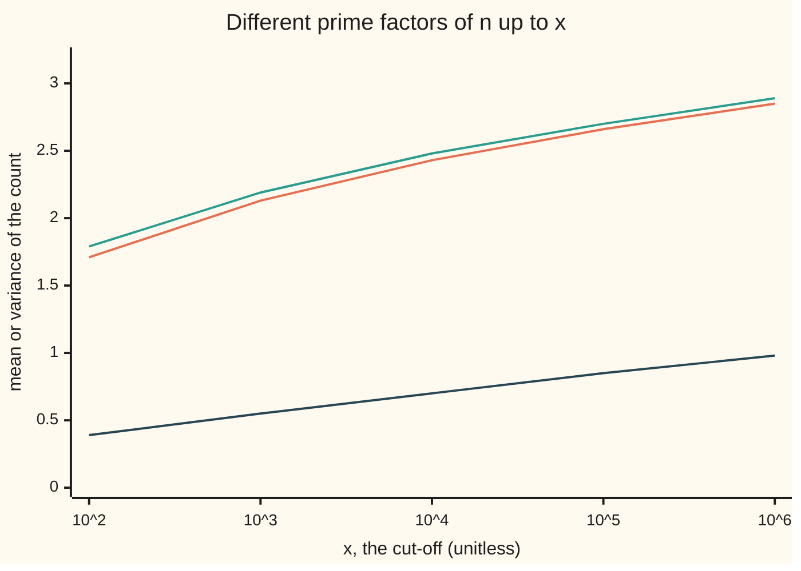

# Typical numbers have about log log n distinct prime factors

[Syllabus](../../../SYLLABUS.md) → [Algebraic and analytic number theory](../README.md) → [Additive Combinatorics and Probabilistic Number Theory](../README.md#s08) → Typical numbers have about log log n distinct prime factors

---

## General Overview

Take three neighbours of a million and split each into primes.

| Number | Primes | Different primes | Primes with repeats |
| --- | --- | ---: | ---: |
| 999,999 | 3 × 3 × 3 × 7 × 11 × 13 × 37 | 5 | 7 |
| 1,000,000 | 2 × 2 × 2 × 2 × 2 × 2 × 5 × 5 × 5 × 5 × 5 × 5 | 2 | 12 |
| 1,000,001 | 101 × 9901 | 2 | 2 |

Each number gets two counts. One counts the **different** primes that divide it. The other counts every prime factor, repeats included. The counts jump around from one number to the next.

Now take all 100,001 whole numbers from 950,000 to 1,050,000 and average the first count. The answer is **2.93**. Most of these numbers have 2, 3 or 4 different primes: 87% of them. Only 2 numbers in the whole window have as many as 7.

So a number near a million typically has about three different prime factors. That "three" is not an accident of a million. It is log log n, the natural logarithm taken twice, plus a small constant. Hardy and Ramanujan proved in 1917 that almost every number n has close to log log n different prime factors. In 1934 Turán found a short proof: compute the average, compute the spread, and show the spread is small beside the average.

Log log n grows so slowly that it hardly moves. At a million it is 2.63. At $`10^{80}`$, a number with 81 digits, it is only 5.22.

**For almost every whole number n, the count of different primes dividing n is close to log log n, because that count is a sum of nearly independent yes-or-no questions "does p divide n?", whose average is log log n and whose spread is much smaller.**

**What kind of fact this is:** a theorem, proved on this card in Why it works by Turán's second-moment argument. The counts near a million are evidence of size and spread, not proof.

### The picture: how many different primes, near a million

```
different primes   numbers in 950,000 to 1,050,000    share
       1  7,237 #######                                0.0724
       2 27,142 ###########################            0.2714
       3 37,282 #####################################  0.3728
       4 22,595 #######################                0.2259
       5  5,353 #####                                  0.0535
       6    390                                        0.0039
       7      2                                        0.0000
```

Each `#` is 1,000 numbers. The pile sits on 3, and it is narrow. The rows with 1 are the primes and prime powers in the window.

---

## The formula

Notation first, in words. This card introduces two counts.

- $`\omega(n)`$, said "little omega of n", is the number of **different** primes that divide n. So $`\omega(1{,}000{,}000) = 2`$.
- $`\Omega(n)`$, said "big omega of n", counts the prime factors **with repeats**. So $`\Omega(1{,}000{,}000) = 12`$.

These are not the big-Omega bound of the algorithms wing, and not the number $`\omega`$ of the rings-of-integers card. The letters p and q always mean primes, and $`\log`$ is the natural logarithm, the ln of earlier wings. $`\sum_{p \le x}`$ means "add over every prime p up to x". The bracket $`[p \mid n]`$ is 1 if p divides n and 0 if not. $`S(x)`$ is the sum of 1/p over the primes up to x, and $`M = 0.261497`$ is Mertens' constant, the amount by which $`S(x)`$ exceeds $`\log\log x`$ in the limit.

The card also introduces **normal order**. A count $`f(n)`$ has normal order $`g(n)`$ when, for every small $`\varepsilon > 0`$, the share of $`n \le x`$ with $`f(n)`$ outside $`(1-\varepsilon)g(n)`$ to $`(1+\varepsilon)g(n)`$ tends to 0 as x grows. "Almost all n" means the same thing: all n except a share that tends to 0.

The counting identity behind everything:

```math
\omega(n) = \sum_{p \le x} [p \mid n] \quad (n \le x), \qquad \frac{1}{x}\sum_{n \le x} \omega(n) = \frac{1}{x}\sum_{p \le x} \left\lfloor \frac{x}{p} \right\rfloor = S(x) + O\!\left(\frac{\pi(x)}{x}\right), \qquad S(x) = \sum_{p \le x}\frac{1}{p} = \log\log x + M + O\!\left(\frac{1}{\log x}\right)
```

**Read it aloud:** the count of different primes is a sum of yes-or-no answers, one per prime; its average up to x is the sum of one over p, which is log log x plus Mertens' constant.

Turán's variance bound, with $`L = \log\log x`$:

```math
\frac{1}{x}\sum_{n \le x} \big(\omega(n) - L\big)^2 \;\le\; S(x) + \big(S(x) - L\big)^2 + \frac{2L\,\pi(x)}{x}
```

**Read it aloud:** the average squared distance of the count from log log x is at most log log x plus a bounded amount.

The theorem it gives, Hardy and Ramanujan's:

```math
\text{for every } \varepsilon > 0: \quad \frac{1}{x}\,\#\big\{\, n \le x : \lvert \omega(n) - \log\log n \rvert > \varepsilon \log\log n \,\big\} \longrightarrow 0
```

**Read it aloud:** the share of numbers up to x whose count of different primes misses log log n by more than a fixed percentage shrinks to nothing. Both $`\omega(n)`$ and $`\Omega(n)`$ have normal order log log n.

| Symbol | Plain meaning | In our example | Push it up and the answer… |
| --- | --- | --- | --- |
| $`n`$ | a whole number being counted | 950,000 to 1,050,000 | typical count grows, very slowly |
| $`p`$, $`q`$, $`[p \mid n]`$ | primes; 1 if p divides n, else 0 | 2 divides 0.500005 of the window | — |
| $`\omega(n)`$ | number of different primes dividing n | window mean 2.928631 | — |
| $`\Omega(n)`$ | number of prime factors, repeats counted | window mean 3.701853 | — |
| $`x`$ | the cut-off: count the numbers up to x | 10^6 | mean and spread grow |
| $`L`$ | $`\log\log x`$, the natural log taken twice | 2.625792 | — |
| $`S(x)`$ | the sum of 1/p over primes up to x | 2.887328 | grows like L |
| $`M`$ | Mertens' constant, the offset in $`S(x) - L`$ | 0.261497 | — |
| $`\pi(x)`$ | the number of primes up to x | 78,498 | the correction $`2L\pi(x)/x`$ shrinks |
| $`t`$ | how many multiples of $`\sqrt{L}`$ count as "far" | 1, 2, 3 | Chebyshev's bound falls like $`1/t^2`$ |
| $`\varepsilon`$ | the allowed percentage miss in the theorem | any fixed size, say 0.5 | fewer exceptions |
| $`\tau(n)`$ | the number of divisors of n | 49 for 1,000,000 | — |

### When it holds

- **"Almost all", not "all".** The theorem says nothing about one given number. A prime has $`\omega = 1`$; 510,510 has 7. Both are allowed exceptions, as long as exceptions become rare.
- **Different primes and repeats behave alike on average.** $`\Omega(n) - \omega(n)`$ averages only about 0.773, so both counts have normal order log log n. Their means still differ: 3.70 against 2.93 in the window.
- **The spread is about $`\sqrt{\log\log n}`$ only in the limit.** At a million the true variance is 1.03, far below 2.63. Large primes cannot divide the same number together, and that pulls the variance down by about 1.6.
- **The log is natural.** With base-10 logs the formula gives 0.78 at a million, not 2.63.
- **The bound needs Mertens and Chebyshev.** The mean uses $`S(x) = \log\log x + M + O(1/\log x)`$; the variance bound needs $`\pi(x)/x \to 0`$, from Chebyshev's $`\pi(x) \ll x/\log x`$.

---

## Why it works

### Step 0: a count of yes-or-no questions

Ask each prime p one question: does p divide n? Then $`\omega(n)`$ is the number of yes answers.

Pick n at random up to x. Prime p says yes for about one number in p, so with chance about 1/p. The average count is then about $`\sum 1/p`$, which is log log x by Mertens.

If the answers were fully independent, the variance would be about $`\sum 1/p`$ too, so the spread would be about $`\sqrt{\log\log x}`$. That is small beside the mean log log x. A narrow pile around a growing centre: that is the whole theorem.

The answers are not exactly independent, so the proof must control them. [First and second moments](../../09-Probability%20and%20statistics/14-Random%20Graphs%20and%20the%20Probabilistic%20Method/04-first-and-second-moment-methods.md) already does this for any count built from indicators: the variance is a sum of covariances, and Chebyshev turns a small variance into concentration. This card does it for the prime indicators.

### Step 1: the mean, by counting the other way

Count the pairs (p, n) with p dividing n and n up to x. Count them n by n and you get $`\sum_{n \le x} \omega(n)`$. Count them p by p: prime p divides $`\lfloor x/p \rfloor`$ numbers up to x, the brackets meaning "round down". So

```math
\sum_{n \le x} \omega(n) = \sum_{p \le x} \left\lfloor \frac{x}{p} \right\rfloor.
```

Each rounding loses less than 1, so the total sits between $`x S(x) - \pi(x)`$ and $`x S(x)`$. At $`x = 10^6`$ the mean is 2.853708 both ways, between 2.808830 and 2.887328.

[Mertens' theorems](../01-Arithmetic%20Functions%20Again/09-mertens-theorems.md) gives $`S(x) = \log\log x + M + O(1/\log x)`$ with M = 0.261497. So the mean of $`\omega`$ is log log x plus a constant. The constant in that O is explicit, and that card gives it. At $`10^6`$ the actual error $`S(x) - \log\log x - M`$ is only 0.000039.

In the window near a million the mean is 2.928631, against $`\log\log 10^6 + M = 2.887289`$. The gap, 0.041342, is not Mertens' error. It comes from looking near x instead of at all n up to x. The total up to x is about x times (log log x plus a constant), and its slope at x, which is the mean near x, is the average up to x plus $`1/\log x`$. Indeed $`2.853708 + 1/\log 10^6 = 2.853708 + 0.072382 = 2.926090`$, against the window's 2.928631. That match is evidence, not proof.

### Step 2: two primes divide together almost independently

For two different primes p and q, both divide n exactly when pq divides n. So the chance of both is about $`1/(pq)`$, the product of the separate chances. In the window, 2 divides a share 0.500005 and 3 a share 0.333337. Their product is 0.166670, and 6 divides a share 0.166668.

The approximation fails for large primes. The primes 1031 and 1033 each divide 97 numbers in the window, but never the same one: their product 1,065,023 is past 1,050,000. Two primes whose product exceeds x can never both divide a number up to x. This is the one failure of independence that lasts as x grows; at real sizes, rounding adds smaller ones, measured in the variance table below. It only lowers the variance, so the proof can ignore it.

Square the count. $`\omega(n)^2`$ is $`\omega(n)`$ plus the number of ordered pairs (p, q) of different primes that both divide n. Count those pairs prime pair by prime pair:

```math
\sum_{n \le x} \omega(n)^2 = \sum_{p \le x}\left\lfloor \frac{x}{p} \right\rfloor + \sum_{p \ne q,\; pq \le x} \left\lfloor \frac{x}{pq} \right\rfloor \;\le\; x S(x) + x S(x)^2.
```

The inequality drops the rounding and adds back the pairs with $`pq > x`$. In the window, the sum of $`\omega^2`$ is 960,826 counted number by number, and 960,826 counted through the 219,870 prime pairs. Up to $`10^6`$, the left side divided by x is 9.124614, below $`S^2 + S = 11.223992`$.

### Step 3: the variance is at most about log log x

Expand the square and use the two counts:

```math
\sum_{n \le x}\big(\omega(n) - L\big)^2 = \sum \omega(n)^2 - 2L\sum \omega(n) + xL^2 \;\le\; x\big(S^2 + S\big) - 2L\big(xS - \pi(x)\big) + xL^2.
```

The right side tidies to $`x\big(S + (S - L)^2\big) + 2L\pi(x)`$. Every constant is explicit. $`S - L`$ is close to M, and $`\pi(x)/x`$ tends to 0 by [Chebyshev's bounds](../01-Arithmetic%20Functions%20Again/08-chebyshev-bounds.md). So the average squared distance from L is at most $`L + M + M^2`$ plus terms that fade.

At $`10^6`$: the true average squared distance is 1.032910. The bound is 3.367968, which is L + 0.742176. The bound is honest but loose, because it threw away the negative covariance of large prime pairs.

<details>
<summary>Detailed proof: the algebra of Turán's bound</summary>

Write $`S = S(x)`$ and take x a whole number. From Step 2, $`\sum_{n \le x} \omega(n)^2 \le x S^2 + x S`$. From Step 1, $`\sum_{n \le x}\omega(n) \ge xS - \pi(x)`$. Since $`L > 0`$, multiplying the second by $`-2L`$ flips it. Add $`xL^2`$:

$`\displaystyle \sum_{n\le x}\big(\omega(n)-L\big)^2 \le xS^2 + xS - 2LxS + 2L\pi(x) + xL^2 = x\Big(S + (S-L)^2\Big) + 2L\,\pi(x).`$

Mertens gives $`S - L = M + O(1/\log x)`$, so $`(S - L)^2`$ is bounded. Chebyshev gives $`\pi(x) \le C x/\log x`$ for a fixed C, so $`2L\pi(x)/x \le 2CL/\log x`$, which tends to 0. Dividing by x: the mean squared distance is at most $`L + O(1)`$.

</details>

### Step 4: Chebyshev turns a small variance into a rare miss

This is Chebyshev's inequality from probability, not Chebyshev's bounds on $`\pi(x)`$ used in Step 3. It says few numbers can sit far from L when the average squared distance from L is small.

A number with $`\lvert \omega(n) - L \rvert \ge t\sqrt{L}`$ adds at least $`t^2 L`$ to the sum of squares. The sum is at most about $`xL`$. So at most about $`x/t^2`$ numbers can do it:

```math
\frac{1}{x}\,\#\big\{ n \le x : \lvert \omega(n) - L\rvert \ge t\sqrt{L} \big\} \;\le\; \frac{S + (S-L)^2 + 2L\pi(x)/x}{t^2 L}.
```

| Distance from L | True share up to $`10^6`$ | Chebyshev's bound |
| --- | ---: | ---: |
| at least $`1\sqrt{L}`$ | 0.123520 | 1.282649 |
| at least $`2\sqrt{L}`$ | 0.002293 | 0.320662 |
| at least $`3\sqrt{L}`$ | 0.000000 | 0.142517 |

The bound is crude at these sizes but it is a proof. Its job is the limit, which Step 5 takes.

### Step 5: from log log x to log log n

The theorem compares $`\omega(n)`$ with $`\log\log n`$, not $`\log\log x`$. Two facts close the gap.

1. At most $`\sqrt{x}`$ numbers lie below $`\sqrt{x}`$. That is a vanishing share of x.
2. For $`\sqrt{x} < n \le x`$, $`\log\log n`$ lies within $`\log 2`$ of $`\log\log x`$, because $`\log n`$ is at least half of $`\log x`$.

Fix $`\varepsilon > 0`$. A number above $`\sqrt{x}`$ that misses $`\log\log n`$ by more than $`\varepsilon\log\log n`$ misses L by more than about $`\varepsilon L`$. That is $`t = \varepsilon\sqrt{L}`$ in Step 4. The share is then at most about $`1/(\varepsilon^2 L)`$, which tends to 0 as x grows. That is the theorem.

The same argument proves more. Misses bigger than $`\sqrt{\log\log n}`$ times any slowly growing factor are also rare.

### Step 6: repeats change nothing

$`\Omega(n) - \omega(n)`$ counts the repeated prime factors. Its mean over the numbers 1 to x is at most $`\sum_p 1/(p(p-1)) = 0.773157`$, because $`p^k`$ divides one number in $`p^k`$. Up to $`10^6`$ the mean is 0.772911. The bound is for 1 to x, not for a window: near a million the mean is 0.773222. A count with so small an average rarely exceeds $`\varepsilon\log\log x`$ (Markov's inequality: the share is at most $`0.773157/(\varepsilon\log\log x)`$). So $`\Omega(n)`$ has normal order log log n too.

---

## Worked numbers, by hand

The window: all whole numbers from 950,000 to 1,050,000.

| Step | Arithmetic | Value |
| --- | --- | --- |
| numbers in the window | 1,050,000 − 950,000 + 1 | 100,001 |
| total of $`\omega`$, prime by prime | add $`\lfloor 1{,}050{,}000/p\rfloor - \lfloor 949{,}999/p\rfloor`$ over primes | 292,866 |
| total of $`\omega`$, number by number | factor all 100,001 numbers | 292,866 |
| mean of $`\omega`$ | 292,866 / 100,001 | 2.928631 |
| prediction | $`\log\log 10^6 + M = 2.625792 + 0.261497`$ | 2.887289 |
| gap | 2.928631 − 2.887289 | 0.041342 |
| total of $`\omega^2`$, both ways | number by number; primes plus 219,870 pairs | 960,826 |
| variance | $`(100{,}001 \times 960{,}826 - 292{,}866^2) / 100{,}001^2`$ | 1.031286 |
| standard deviation | $`\sqrt{1.031286}`$ | 1.015523 |
| **share with 2, 3 or 4 different primes** | (27,142 + 37,282 + 22,595) / 100,001 | **0.8702** |

So a number near a million has 2.93 different prime factors on average, give or take about 1, and 87% of them have 2, 3 or 4.

### Where the variance of 1.03 comes from

The variance of a sum of indicators is the sum of each indicator's own variance plus the covariance of every pair. The code splits the window's variance exactly that way.

| Piece | Value |
| --- | ---: |
| each prime on its own: its share times one minus its share, added over primes | 2.476370 |
| pairs with pq up to 100,001 (the window's length) | +0.001073 |
| pairs with pq from there up to 949,999, below the window | −0.130513 |
| pairs with pq inside the window: 20,116 of them | +0.314370 |
| pairs with pq above 1,050,000: they never divide together | −1.630014 |
| **total** | **1.031286** |

Small prime pairs are almost exactly independent: their covariance adds 0.001. The two middle rows are rounding effects of a finite window. A product pq inside the window is itself a window number, so it divides exactly one of them, where a share of 1/(pq) predicts about 0.1. Those 20,116 products add +0.314370. Products below the window land in it a whole number of times, never a fraction, and on balance take off 0.130513.

Only the pairs with pq above x stay dependent as x grows. Their covariance tends to $`-\pi^2/6 = -1.644934`$ in the limit. That is a fixed amount, so it never stops the variance growing like log log x. It only shifts it down. At real sizes the limit is far off: the sum of 1/(pq) behind it is only 1.434608 at $`x = 10^6`$, and over all n up to $`10^6`$ these pairs give −1.278325. So the window's −1.630014 sits near $`-\pi^2/6`$ partly because the window is narrow. Read it as a size check, not a confirmation.

<details>
<summary>Why the large pairs give about minus pi squared over six</summary>

For a pair with $`pq > x`$ the covariance is $`0 - \tfrac{1}{p}\cdot\tfrac{1}{q}`$, so the pairs contribute about $`-\sum_{pq > x} 1/(pq)`$. Write $`p = x^u`$ and $`q = x^v`$. By Mertens, the primes near $`x^u`$ carry weight $`du/u`$ in the sum of 1/p. The sum becomes an area:

$`\displaystyle \sum_{p, q \le x,\; pq > x} \frac{1}{pq} \;\approx\; \int_0^1\!\!\int_{1-u}^{1} \frac{dv\,du}{uv} = \int_0^1 \frac{-\log(1-u)}{u}\,du = \frac{\pi^2}{6}.`$

The last integral is the series $`\sum 1/k^2`$, integrated term by term. This is a heuristic size for the limit, not part of the proof of the theorem. The code computes the finite sum over primes: 1.434608 at $`x = 10^6`$, so the approach to 1.644934 is slow.

</details>

### What breaks if you drop a piece

| Mistake | Comes out at | What went wrong |
| --- | --- | --- |
| Read the variance as log log n | 2.6258, true 1.0313 | The limit shape used at a finite size. Large primes repel, so the true spread is much smaller. |
| Treat all prime indicators as independent | variance 2.4764, true 1.0313 | Independence fails, mostly for pairs with pq above 1,050,000, which never divide together. |
| Count primes with repeats | mean 3.7019, not 2.9286 | That is $`\Omega`$, not $`\omega`$. Same normal order, different mean. |
| Take logs in base 10 | 0.7782, not 2.6258 | log log uses the natural logarithm. |

---

## How slowly log log n grows

The mean and the variance both grow like log log x, but log log x barely moves. The code counts every n up to x.



Orange: the mean of $`\omega(n)`$ for $`n \le x`$. Green: Mertens' prediction $`\log\log x + M`$. Dark: the variance of $`\omega(n)`$. Each step multiplies x by 10, yet the mean gains less than half a prime each time.

| Size of n | log log n | log log n + M |
| --- | ---: | ---: |
| a million | 2.6258 | 2.8873 |
| a billion, $`10^9`$ | 3.0313 | 3.2928 |
| $`10^{80}`$, 81 digits | 5.2161 | 5.4776 |
| a 1024-bit number, $`2^{1024}`$ | 6.5650 | 6.8265 |

For the expected count to reach 10, n needs about 7,365 digits.

---

## Code, from first principles, and it actually runs

The code sieves the smallest prime factor of every n up to 1,050,000, which gives $`\omega(n)`$, $`\Omega(n)`$ and the divisor count for each n. It then reaches the same totals a second, independent way: prime by prime with $`\lfloor x/p\rfloor`$, and pair by pair with $`\lfloor x/(pq)\rfloor`$. The two roads must agree exactly. A third road checks the mean against Mertens' prediction, with M built from Euler's constant (itself from harmonic numbers) and a sum over the primes. Finally it checks Turán's bound and Chebyshev's bound against the true counts.

### Python

```python
# Hardy-Ramanujan -- the check behind the card.  Standard library only.
# A smallest-prime-factor sieve gives omega(n) (distinct primes) and Omega(n)
# (primes with repeats) for every n up to 1,050,000.  Road one counts n by n.
# Road two counts prime by prime and pair by pair (Turan's switch of the order
# of summation).  The two roads must agree exactly; then the prime sums give
# Turan's variance bound, which the direct count must respect.
import math
N, A, B, X = 1_050_000, 950_000, 1_050_000, 10**6
spf = list(range(N + 1))                         # smallest prime factor
for i in range(2, int(N**0.5) + 1):
    if spf[i] == i:
        for j in range(i * i, N + 1, i):
            if spf[j] == j:
                spf[j] = i
w, W, e, tau = [0] * (N + 1), [0] * (N + 1), [0] * (N + 1), [1] * (N + 1)
for n in range(2, N + 1):
    p = spf[n]; m = n // p
    W[n] = W[m] + 1
    e[n] = e[m] + 1 if spf[m] == p else 1        # exponent of p in n
    w[n] = w[m] + (e[n] == 1)
    tau[n] = tau[m] // e[n] * (e[n] + 1)         # divisor count
primes = [p for p in range(2, N + 1) if spf[p] == p]
def fac(n):                                      # factorisation as text
    out = []
    while n > 1:
        p, k = spf[n], 0
        while n % p == 0:
            n //= p; k += 1
        out.append(f"{p}^{k}" if k > 1 else f"{p}")
    return " x ".join(out)
for n in (999_999, X, 1_000_001, 720_720):
    print(f"n = {n:,} = {fac(n)}: omega = {w[n]}, Omega = {W[n]}, divisors = {tau[n]}")
def sum_left(vals):                              # plain left-to-right sum, as in Rust
    t = 0.0
    for v in vals:
        t += v
    return t
cnt = lambda d: B // d - (A - 1) // d             # multiples of d in the window
c = B - A + 1
s1 = sum(w[A:B + 1]); s2 = sum(v * v for v in w[A:B + 1]); sW = sum(W[A:B + 1])
by_p = sum(cnt(p) for p in primes)
pairs = []                                       # p < q with pq <= B
for i, p in enumerate(primes):
    if p * p > B:
        break
    for q in primes[i + 1:]:
        if p * q > B:
            break
        pairs.append((p, q))
by_pq = by_p + 2 * sum(cnt(p * q) for p, q in pairs)
print(f"window {A:,} to {B:,}: {c:,} numbers; sum of omega n by n {s1:,}, prime by prime {by_p:,}")
print(f"sum of omega^2 n by n {s2:,}, by primes and {len(pairs):,} prime pairs {by_pq:,}")
gamma = sum_left(1.0 / k for k in range(X, 0, -1)) - math.log(X) - 1 / (2 * X) + 1 / (12 * X * X)
M = gamma + sum_left(math.log(1 - 1 / p) + 1 / p for p in primes)
L = math.log(math.log(X))
print(f"Mertens' constant M = {M:.6f}; log log 10^6 = {L:.6f}; log log 10^6 + M = {L + M:.6f}")
mean, var = s1 / c, (c * s2 - s1 * s1) / (c * c)
print(f"window mean omega = {mean:.6f} (gap {mean - L - M:+.6f}, 1/log 10^6 = {1 / math.log(X):.6f});"
      f" mean Omega = {sW / c:.6f}")
print(f"window variance of omega = {var:.6f}; standard deviation {math.sqrt(var):.6f}")
hist = [w[A:B + 1].count(k) for k in range(8)]
for k in range(1, 8):
    print(f"omega = {k}: {hist[k]:>6,} {'#' * round(hist[k] / 1000):<38} {hist[k] / c:.4f}")
print(f"within L/2 of L (omega 2 or 3): {(hist[2] + hist[3]) / c:.4f}; omega 2, 3 or 4: "
      f"{(hist[2] + hist[3] + hist[4]) / c:.4f}")
T = by_p; sq = sum(cnt(p) ** 2 for p in primes)
diag = sum(c * cnt(p) - cnt(p) ** 2 for p in primes)
near_pq = sum(cnt(p) * cnt(q) for p, q in pairs)
small = [(p, q) for p, q in pairs if p * q <= c]          # pq fits in the window's length
inside = [(p, q) for p, q in pairs if p * q >= A]         # pq is itself a window number
cov = lambda ps: 2 * sum(c * cnt(p * q) - cnt(p) * cnt(q) for p, q in ps)
close_s, close_in = cov(small), cov(inside); close_m = cov(pairs) - close_s - close_in
far = -((T * T - sq) - 2 * near_pq)
print(f"variance split: each prime alone {diag / c**2:.6f}; pairs with pq <= {c:,} {close_s / c**2:+.6f};"
      f" pq up to {A - 1:,} {close_m / c**2:+.6f}")
print(f"variance split: pq inside the window ({len(inside):,} pairs) {close_in / c**2:+.6f}; pq > {B:,}"
      f" {far / c**2:+.6f}; total {(diag + close_s + close_m + close_in + far) / c**2:.6f}")
print(f"shares: 2 | n {cnt(2) / c:.6f}, 3 | n {cnt(3) / c:.6f}, product {cnt(2) * cnt(3) / c**2:.6f},"
      f" 6 | n {cnt(6) / c:.6f}; 1031 | n {cnt(1031)}, 1033 | n {cnt(1033)}, {1031 * 1033:,} | n {cnt(1031 * 1033)}")
gap = sum_left((W[n] - w[n]) for n in range(A, B + 1)) / c
pp1 = sum_left(1 / (p * (p - 1)) for p in primes)
gX = (sum(W[1:X + 1]) - sum(w[1:X + 1])) / X
print(f"Omega - omega: window mean {gap:.6f}; mean up to 10^6 {gX:.6f}; sum of 1/(p(p-1)) = {pp1:.6f}")
pX = [p for p in primes if p <= X]
S = sum_left(1 / p for p in pX)
sx1 = sum(w[1:X + 1]); sx2 = sum(v * v for v in w[1:X + 1])
D = sum_left((w[n] - L) ** 2 for n in range(1, X + 1))
U = X * (S * S + S) - 2 * L * (X * S - len(pX)) + X * L * L
print(f"n <= 10^6: sum 1/p = {S:.6f}; mean omega {sx1 / X:.6f}, by floor(x/p) "
      f"{sum(X // p for p in pX) / X:.6f}")
print(f"window mean against n <= 10^6: S - L - M = {S - L - M:+.6f}; mean up to 10^6 + 1/log 10^6 = "
      f"{sx1 / X + 1 / math.log(X):.6f}, window {mean:.6f}")
nX = [(p, q) for p, q in pairs if p * q <= X]
farX = -((sx1 * sx1 - sum((X // p) ** 2 for p in pX)) - 2 * sum((X // p) * (X // q) for p, q in nX))
heur = S * S - sum_left(1 / (p * p) for p in pX) - 2 * sum_left(1 / (p * q) for p, q in nX)
print(f"pairs with pq > 10^6, n <= 10^6: {farX / X**2:+.6f}; sum of 1/(pq) over them {heur:.6f};"
      f" limit pi^2/6 = {math.pi**2 / 6:.6f}")
print(f"turan: sum omega^2 / x = {sx2 / X:.6f} <= S^2 + S = {S * S + S:.6f}; "
      f"sum omega / x = {sx1 / X:.6f} >= S - pi(x)/x = {S - len(pX) / X:.6f}")
print(f"turan: sum (omega - L)^2 / x = {D / X:.6f} <= bound {U / X:.6f} = L + {U / X - L:.6f}")
for t in (1.0, 2.0, 3.0):
    out = sum(1 for n in range(1, X + 1) if abs(w[n] - L) >= t * math.sqrt(L))
    print(f"|omega - L| >= {t} sqrt(L): share {out / X:.6f}; Chebyshev bound {U / X / (t * t * L):.6f}")
for a, b in ((9_500, 10_500), (99_500, 100_500)):  # try changing: smaller windows
    s, q, k = sum(w[a:b + 1]), sum(v * v for v in w[a:b + 1]), b - a + 1
    print(f"try: window {a:,} to {b:,}: mean omega {s / k:.6f}, variance {(k * q - s * s) / (k * k):.6f}")
print(f"try: 997 x 1009 = {997 * 1009:,} divides {cnt(997 * 1009)} window number")
print("x | mean omega | variance | log log x | log log x + M")
chart = []
for k in range(2, 7):
    x = 10**k; a1 = sum(w[1:x + 1]); a2 = sum(v * v for v in w[1:x + 1])
    mx, vx = a1 / x, (x * a2 - a1 * a1) / (x * x); ll = math.log(math.log(x))
    chart.append((mx, vx, ll + M))
    print(f"10^{k} | {mx:.6f} | {vx:.6f} | {ll:.6f} | {ll + M:.6f}")
print("chart, mean:", ", ".join(f"{r[0]:.2f}" for r in chart))
print("chart, variance:", ", ".join(f"{r[1]:.2f}" for r in chart))
print("chart, log log x + M:", ", ".join(f"{r[2]:.2f}" for r in chart))
first7 = next(n for n in range(1, X + 1) if w[n] == 7)
print(f"largest omega up to 10^6: {max(w[1:X + 1])}, first at {first7:,} = {fac(first7)}")
for name, lg in (("10^9", 9 * math.log(10)), ("10^80", 80 * math.log(10)), ("2^1024", 1024 * math.log(2))):
    print(f"log log {name} = {math.log(lg):.4f}; plus M = {math.log(lg) + M:.4f}")
print(f"mean omega 10 needs about {math.exp(10 - M) / math.log(10):,.0f} digits")
tw = sorted(tau[A:B + 1])
print(f"divisors in window: mean {sum(tw) / c:.4f}; median {tw[c // 2]}; 2^L = {2**L:.4f}")
indep = sum_left(cnt(p) / c * (1 - cnt(p) / c) for p in primes)
print(f"mistake 1, variance read as log log n: {L:.4f} against {var:.4f}")
print(f"mistake 2, primes independent: variance {indep:.4f} against {var:.4f}")
print(f"mistake 3, count with repeats: mean Omega {sW / c:.4f} against omega {mean:.4f}")
print(f"mistake 4, base-10 logs: log10 log10 10^6 = {math.log10(6):.4f} against {L:.4f}")
assert s1 == by_p and s2 == by_pq                                   # two roads, exact
assert diag + close_s + close_m + close_in + far == c * s2 - s1 * s1  # variance split, exact
assert abs(close_s) < 0.01 * c * c                                 # this window's small pairs
assert len(inside) == sum(1 for n in range(A, B + 1) if w[n] == W[n] == 2)  # pq in window = semiprimes
assert -heur <= farX / X**2 < 0                                     # floor(x/p)/x <= 1/p
assert sx1 == sum(X // p for p in pX) and len(pX) == 78498          # pi(10^6), known table
assert sx2 <= X * (S * S + S) and sx1 >= X * S - len(pX)            # Turan's two steps
assert D <= U and U / X - L < 1                                     # variance <= L + O(1)
assert abs(mean - sx1 / X - 1 / math.log(X)) < 0.01 and gX <= pp1 and abs(gap - pp1) < 0.05  # means
assert abs(M - 0.261497) < 1e-5 and abs(S - L - M) < 0.001          # Mertens' constant and sum
print("ALL CHECKS PASS")
```

**Ran 2026-11-15 on macOS, Python 3.14.10, standard library only. All checks passed. Output, pasted from the run:**

```
n = 999,999 = 3^3 x 7 x 11 x 13 x 37: omega = 5, Omega = 7, divisors = 64
n = 1,000,000 = 2^6 x 5^6: omega = 2, Omega = 12, divisors = 49
n = 1,000,001 = 101 x 9901: omega = 2, Omega = 2, divisors = 4
n = 720,720 = 2^4 x 3^2 x 5 x 7 x 11 x 13: omega = 6, Omega = 10, divisors = 240
window 950,000 to 1,050,000: 100,001 numbers; sum of omega n by n 292,866, prime by prime 292,866
sum of omega^2 n by n 960,826, by primes and 219,870 prime pairs 960,826
Mertens' constant M = 0.261497; log log 10^6 = 2.625792; log log 10^6 + M = 2.887289
window mean omega = 2.928631 (gap +0.041342, 1/log 10^6 = 0.072382); mean Omega = 3.701853
window variance of omega = 1.031286; standard deviation 1.015523
omega = 1:  7,237 #######                                0.0724
omega = 2: 27,142 ###########################            0.2714
omega = 3: 37,282 #####################################  0.3728
omega = 4: 22,595 #######################                0.2259
omega = 5:  5,353 #####                                  0.0535
omega = 6:    390                                        0.0039
omega = 7:      2                                        0.0000
within L/2 of L (omega 2 or 3): 0.6442; omega 2, 3 or 4: 0.8702
variance split: each prime alone 2.476370; pairs with pq <= 100,001 +0.001073; pq up to 949,999 -0.130513
variance split: pq inside the window (20,116 pairs) +0.314370; pq > 1,050,000 -1.630014; total 1.031286
shares: 2 | n 0.500005, 3 | n 0.333337, product 0.166670, 6 | n 0.166668; 1031 | n 97, 1033 | n 97, 1,065,023 | n 0
Omega - omega: window mean 0.773222; mean up to 10^6 0.772911; sum of 1/(p(p-1)) = 0.773157
n <= 10^6: sum 1/p = 2.887328; mean omega 2.853708, by floor(x/p) 2.853708
window mean against n <= 10^6: S - L - M = +0.000039; mean up to 10^6 + 1/log 10^6 = 2.926090, window 2.928631
pairs with pq > 10^6, n <= 10^6: -1.278325; sum of 1/(pq) over them 1.434608; limit pi^2/6 = 1.644934
turan: sum omega^2 / x = 9.124614 <= S^2 + S = 11.223992; sum omega / x = 2.853708 >= S - pi(x)/x = 2.808830
turan: sum (omega - L)^2 / x = 1.032910 <= bound 3.367968 = L + 0.742176
|omega - L| >= 1.0 sqrt(L): share 0.123520; Chebyshev bound 1.282649
|omega - L| >= 2.0 sqrt(L): share 0.002293; Chebyshev bound 0.320662
|omega - L| >= 3.0 sqrt(L): share 0.000000; Chebyshev bound 0.142517
try: window 9,500 to 10,500: mean omega 2.544456, variance 0.749522
try: window 99,500 to 100,500: mean omega 2.761239, variance 0.907029
try: 997 x 1009 = 1,005,973 divides 1 window number
x | mean omega | variance | log log x | log log x + M
10^2 | 1.710000 | 0.385900 | 1.527180 | 1.788677
10^3 | 2.126000 | 0.548124 | 1.932645 | 2.194142
10^4 | 2.430000 | 0.700300 | 2.220327 | 2.481824
10^5 | 2.664000 | 0.846224 | 2.443470 | 2.704968
10^6 | 2.853708 | 0.980965 | 2.625792 | 2.887289
chart, mean: 1.71, 2.13, 2.43, 2.66, 2.85
chart, variance: 0.39, 0.55, 0.70, 0.85, 0.98
chart, log log x + M: 1.79, 2.19, 2.48, 2.70, 2.89
largest omega up to 10^6: 7, first at 510,510 = 2 x 3 x 5 x 7 x 11 x 13 x 17
log log 10^9 = 3.0313; plus M = 3.2928
log log 10^80 = 5.2161; plus M = 5.4776
log log 2^1024 = 6.5650; plus M = 6.8265
mean omega 10 needs about 7,365 digits
divisors in window: mean 14.9705; median 8; 2^L = 6.1722
mistake 1, variance read as log log n: 2.6258 against 1.0313
mistake 2, primes independent: variance 2.4764 against 1.0313
mistake 3, count with repeats: mean Omega 3.7019 against omega 2.9286
mistake 4, base-10 logs: log10 log10 10^6 = 0.7782 against 2.6258
ALL CHECKS PASS
```

### Rust

The same checks, the same output. Integer counts are exact in `i64`; the floating-point sums run in the same order as the Python, so every printed digit matches.

```rust
// Hardy-Ramanujan -- the same check as the Python, in Rust.  No crates.
// A smallest-prime-factor sieve gives omega(n) (distinct primes) and Omega(n)
// (primes with repeats) for every n up to 1,050,000.  Road one counts n by n.
// Road two counts prime by prime and pair by pair (Turan's switch of the order
// of summation).  The two roads must agree exactly; then the prime sums give
// Turan's variance bound, which the direct count must respect.
const N: usize = 1_050_000;
const A: i64 = 950_000;
const B: i64 = 1_050_000;
const X: usize = 1_000_000;

fn com(v: f64, d: usize) -> String {               // thousands commas, d decimals
    let s = format!("{:.*}", d, v);
    let (int, frac) = match s.find('.') { Some(i) => (&s[..i], &s[i..]), None => (&s[..], "") };
    let mut out = String::new();
    for (i, ch) in int.chars().enumerate() {
        if i > 0 && (int.len() - i) % 3 == 0 { out.push(',') }
        out.push(ch);
    }
    format!("{}{}", out, frac)
}
fn cnt(d: i64) -> i64 { B / d - (A - 1) / d }     // multiples of d in the window

fn main() {
    let mut spf: Vec<usize> = (0..=N).collect();  // smallest prime factor
    let mut i = 2;
    while i * i <= N {
        if spf[i] == i { let mut j = i * i; while j <= N { if spf[j] == j { spf[j] = i } j += i } }
        i += 1;
    }
    let (mut w, mut ww, mut e, mut tau) = (vec![0i64; N + 1], vec![0i64; N + 1], vec![0i64; N + 1], vec![1i64; N + 1]);
    for n in 2..=N {
        let p = spf[n]; let m = n / p;
        ww[n] = ww[m] + 1;
        e[n] = if spf[m] == p { e[m] + 1 } else { 1 };   // exponent of p in n
        w[n] = w[m] + if e[n] == 1 { 1 } else { 0 };
        tau[n] = tau[m] / e[n] * (e[n] + 1);            // divisor count
    }
    let primes: Vec<i64> = (2..=N).filter(|&p| spf[p] == p).map(|p| p as i64).collect();
    let fac = |mut n: usize| -> String {           // factorisation as text
        let mut out: Vec<String> = Vec::new();
        while n > 1 {
            let (p, mut k) = (spf[n], 0);
            while n % p == 0 { n /= p; k += 1 }
            out.push(if k > 1 { format!("{}^{}", p, k) } else { format!("{}", p) });
        }
        out.join(" x ")
    };
    for n in [999_999usize, X, 1_000_001, 720_720] {
        println!("n = {} = {}: omega = {}, Omega = {}, divisors = {}", com(n as f64, 0), fac(n), w[n], ww[n], tau[n]);
    }
    let c = B - A + 1; let cf = c as f64;
    let win = |v: &Vec<i64>| v[A as usize..=B as usize].to_vec();
    let (wv, wwv) = (win(&w), win(&ww));
    let s1: i64 = wv.iter().sum(); let s2: i64 = wv.iter().map(|v| v * v).sum(); let sw: i64 = wwv.iter().sum();
    let by_p: i64 = primes.iter().map(|&p| cnt(p)).sum();
    let mut pairs: Vec<(i64, i64)> = Vec::new();  // p < q with pq <= B
    for (i, &p) in primes.iter().enumerate() {
        if p * p > B { break }
        for &q in &primes[i + 1..] { if p * q > B { break } pairs.push((p, q)) }
    }
    let by_pq = by_p + 2 * pairs.iter().map(|&(p, q)| cnt(p * q)).sum::<i64>();
    println!("window {} to {}: {} numbers; sum of omega n by n {}, prime by prime {}", com(A as f64, 0), com(B as f64, 0), com(cf, 0), com(s1 as f64, 0), com(by_p as f64, 0));
    println!("sum of omega^2 n by n {}, by primes and {} prime pairs {}", com(s2 as f64, 0), com(pairs.len() as f64, 0), com(by_pq as f64, 0));
    let xf = X as f64;
    let mut h = 0.0;
    for k in (1..=X).rev() { h += 1.0 / k as f64 }
    let gamma = h - xf.ln() - 1.0 / (2.0 * xf) + 1.0 / (12.0 * xf * xf);
    let mut msum = 0.0;
    for &p in &primes { let q = p as f64; msum += (1.0 - 1.0 / q).ln() + 1.0 / q }
    let mm = gamma + msum;
    let l = xf.ln().ln();
    println!("Mertens' constant M = {:.6}; log log 10^6 = {:.6}; log log 10^6 + M = {:.6}", mm, l, l + mm);
    let mean = s1 as f64 / cf; let var = (c * s2 - s1 * s1) as f64 / (c * c) as f64;
    println!("window mean omega = {:.6} (gap {:+.6}, 1/log 10^6 = {:.6}); mean Omega = {:.6}", mean, mean - l - mm, 1.0 / xf.ln(), sw as f64 / cf);
    println!("window variance of omega = {:.6}; standard deviation {:.6}", var, var.sqrt());
    let hist: Vec<i64> = (0..8).map(|k| wv.iter().filter(|&&v| v == k).count() as i64).collect();
    for k in 1..8 {
        let bar = "#".repeat((hist[k] as f64 / 1000.0).round() as usize);
        println!("omega = {}: {:>6} {:<38} {:.4}", k, com(hist[k] as f64, 0), bar, hist[k] as f64 / cf);
    }
    println!("within L/2 of L (omega 2 or 3): {:.4}; omega 2, 3 or 4: {:.4}", (hist[2] + hist[3]) as f64 / cf, (hist[2] + hist[3] + hist[4]) as f64 / cf);
    let t = by_p; let sq: i64 = primes.iter().map(|&p| cnt(p) * cnt(p)).sum();
    let diag: i64 = primes.iter().map(|&p| c * cnt(p) - cnt(p) * cnt(p)).sum();
    let near_pq: i64 = pairs.iter().map(|&(p, q)| cnt(p) * cnt(q)).sum();
    let cov = |keep: &dyn Fn(i64) -> bool| -> i64 { // pairs whose product pq passes the filter
        2 * pairs.iter().filter(|&&(p, q)| keep(p * q)).map(|&(p, q)| c * cnt(p * q) - cnt(p) * cnt(q)).sum::<i64>()
    };
    let (close_s, close_in) = (cov(&|m| m <= c), cov(&|m| m >= A)); let close_m = cov(&|_| true) - close_s - close_in;
    let n_in = pairs.iter().filter(|&&(p, q)| p * q >= A).count();   // pq is itself a window number
    let far = -((t * t - sq) - 2 * near_pq);
    let c2 = (c * c) as f64;
    println!("variance split: each prime alone {:.6}; pairs with pq <= {} {:+.6}; pq up to {} {:+.6}", diag as f64 / c2, com(cf, 0), close_s as f64 / c2, com((A - 1) as f64, 0), close_m as f64 / c2);
    let pi2 = std::f64::consts::PI.powi(2) / 6.0;
    println!("variance split: pq inside the window ({} pairs) {:+.6}; pq > {} {:+.6}; total {:.6}", com(n_in as f64, 0), close_in as f64 / c2, com(B as f64, 0), far as f64 / c2, (diag + close_s + close_m + close_in + far) as f64 / c2);
    println!("shares: 2 | n {:.6}, 3 | n {:.6}, product {:.6}, 6 | n {:.6}; 1031 | n {}, 1033 | n {}, {} | n {}",
             cnt(2) as f64 / cf, cnt(3) as f64 / cf, (cnt(2) * cnt(3)) as f64 / c2, cnt(6) as f64 / cf, cnt(1031), cnt(1033), com((1031 * 1033) as f64, 0), cnt(1031 * 1033));
    let mut gs = 0.0;
    for n in A as usize..=B as usize { gs += (ww[n] - w[n]) as f64 }
    let gap = gs / cf;
    let mut pp1 = 0.0;
    for &p in &primes { pp1 += 1.0 / (p * (p - 1)) as f64 }
    let gx = (ww[1..=X].iter().sum::<i64>() - w[1..=X].iter().sum::<i64>()) as f64 / xf;
    println!("Omega - omega: window mean {:.6}; mean up to 10^6 {:.6}; sum of 1/(p(p-1)) = {:.6}", gap, gx, pp1);
    let px: Vec<i64> = primes.iter().cloned().filter(|&p| p <= X as i64).collect();
    let pin = px.len() as f64;
    let mut s = 0.0;
    for &p in &px { s += 1.0 / p as f64 }
    let sx1: i64 = w[1..=X].iter().sum(); let sx2: i64 = w[1..=X].iter().map(|v| v * v).sum();
    let floor_sum: i64 = px.iter().map(|&p| X as i64 / p).sum();
    let mut d = 0.0;
    for n in 1..=X { let r = w[n] as f64 - l; d += r * r }
    let u = xf * (s * s + s) - 2.0 * l * (xf * s - pin) + xf * l * l;
    println!("n <= 10^6: sum 1/p = {:.6}; mean omega {:.6}, by floor(x/p) {:.6}", s, sx1 as f64 / xf, floor_sum as f64 / xf);
    println!("window mean against n <= 10^6: S - L - M = {:+.6}; mean up to 10^6 + 1/log 10^6 = {:.6}, window {:.6}", s - l - mm, sx1 as f64 / xf + 1.0 / xf.ln(), mean);
    let (nx, xx): (Vec<(i64, i64)>, i64) = (pairs.iter().cloned().filter(|&(p, q)| p * q <= X as i64).collect(), X as i64);
    let far_x = -((sx1 * sx1 - px.iter().map(|&p| (xx / p) * (xx / p)).sum::<i64>()) - 2 * nx.iter().map(|&(p, q)| (xx / p) * (xx / q)).sum::<i64>());
    let h2 = px.iter().fold(0.0, |a, &p| a + 1.0 / (p * p) as f64); let hpq = nx.iter().fold(0.0, |a, &(p, q)| a + 1.0 / (p * q) as f64);
    let heur = s * s - h2 - 2.0 * hpq;
    println!("pairs with pq > 10^6, n <= 10^6: {:+.6}; sum of 1/(pq) over them {:.6}; limit pi^2/6 = {:.6}", far_x as f64 / (xx * xx) as f64, heur, pi2);
    println!("turan: sum omega^2 / x = {:.6} <= S^2 + S = {:.6}; sum omega / x = {:.6} >= S - pi(x)/x = {:.6}", sx2 as f64 / xf, s * s + s, sx1 as f64 / xf, s - pin / xf);
    println!("turan: sum (omega - L)^2 / x = {:.6} <= bound {:.6} = L + {:.6}", d / xf, u / xf, u / xf - l);
    for tt in [1.0f64, 2.0, 3.0] {
        let out = (1..=X).filter(|&n| (w[n] as f64 - l).abs() >= tt * l.sqrt()).count();
        println!("|omega - L| >= {:.1} sqrt(L): share {:.6}; Chebyshev bound {:.6}", tt, out as f64 / xf, u / xf / (tt * tt * l));
    }
    for (a, b) in [(9_500usize, 10_500usize), (99_500, 100_500)] {   // try changing: smaller windows
        let (s, q, k) = (w[a..=b].iter().sum::<i64>(), w[a..=b].iter().map(|v| v * v).sum::<i64>(), (b - a + 1) as i64);
        println!("try: window {} to {}: mean omega {:.6}, variance {:.6}", com(a as f64, 0), com(b as f64, 0), s as f64 / k as f64, (k * q - s * s) as f64 / (k * k) as f64);
    }
    println!("try: 997 x 1009 = {} divides {} window number", com((997 * 1009) as f64, 0), cnt(997 * 1009));
    println!("x | mean omega | variance | log log x | log log x + M");
    let mut chart: Vec<(f64, f64, f64)> = Vec::new();
    for k in 2..7u32 {
        let x = 10usize.pow(k); let xi = x as i64;
        let a1: i64 = w[1..=x].iter().sum(); let a2: i64 = w[1..=x].iter().map(|v| v * v).sum();
        let (mx, vx, ll) = (a1 as f64 / x as f64, (xi * a2 - a1 * a1) as f64 / (xi * xi) as f64, (x as f64).ln().ln());
        chart.push((mx, vx, ll + mm));
        println!("10^{} | {:.6} | {:.6} | {:.6} | {:.6}", k, mx, vx, ll, ll + mm);
    }
    let j = |f: &dyn Fn(&(f64, f64, f64)) -> f64| chart.iter().map(|r| format!("{:.2}", f(r))).collect::<Vec<_>>().join(", ");
    println!("chart, mean: {}", j(&|r| r.0));
    println!("chart, variance: {}", j(&|r| r.1));
    println!("chart, log log x + M: {}", j(&|r| r.2));
    let first7 = (1..=X).find(|&n| w[n] == 7).unwrap();
    println!("largest omega up to 10^6: {}, first at {} = {}", w[1..=X].iter().max().unwrap(), com(first7 as f64, 0), fac(first7));
    for (name, lg) in [("10^9", 9.0 * 10f64.ln()), ("10^80", 80.0 * 10f64.ln()), ("2^1024", 1024.0 * 2f64.ln())] {
        println!("log log {} = {:.4}; plus M = {:.4}", name, lg.ln(), lg.ln() + mm);
    }
    println!("mean omega 10 needs about {} digits", com((10.0 - mm).exp() / 10f64.ln(), 0));
    let mut tw = win(&tau); tw.sort();
    println!("divisors in window: mean {:.4}; median {}; 2^L = {:.4}", tw.iter().sum::<i64>() as f64 / cf, tw[(c / 2) as usize], 2f64.powf(l));
    let mut indep = 0.0;
    for &p in &primes { let f = cnt(p) as f64 / cf; indep += f * (1.0 - f) }
    println!("mistake 1, variance read as log log n: {:.4} against {:.4}", l, var);
    println!("mistake 2, primes independent: variance {:.4} against {:.4}", indep, var);
    println!("mistake 3, count with repeats: mean Omega {:.4} against omega {:.4}", sw as f64 / cf, mean);
    println!("mistake 4, base-10 logs: log10 log10 10^6 = {:.4} against {:.4}", 6f64.log10(), l);
    assert!(s1 == by_p && s2 == by_pq);                                  // two roads, exact
    assert!(diag + close_s + close_m + close_in + far == c * s2 - s1 * s1); // variance split, exact
    assert!((close_s as f64).abs() < 0.01 * c2);                         // this window's small pairs
    assert!(n_in == wv.iter().zip(wwv.iter()).filter(|&(&a, &b)| a == 2 && b == 2).count()); // pq in window = semiprimes
    assert!(-heur <= far_x as f64 / (xx * xx) as f64 && far_x < 0);      // floor(x/p)/x <= 1/p
    assert!(sx1 == floor_sum && px.len() == 78498);                      // pi(10^6), known table
    assert!(sx2 as f64 <= xf * (s * s + s) && sx1 as f64 >= xf * s - pin); // Turan's two steps
    assert!(d <= u && u / xf - l < 1.0);                                 // variance <= L + O(1)
    assert!((mean - sx1 as f64 / xf - 1.0 / xf.ln()).abs() < 0.01 && gx <= pp1 && (gap - pp1).abs() < 0.05); // means
    assert!((mm - 0.261497).abs() < 1e-5 && (s - l - mm).abs() < 0.001); // Mertens' constant and sum
    println!("ALL CHECKS PASS");
}
```

**Ran 2026-11-15 on macOS, rustc 1.98.1, no crates. All checks passed. Output, pasted from the run:**

```
n = 999,999 = 3^3 x 7 x 11 x 13 x 37: omega = 5, Omega = 7, divisors = 64
n = 1,000,000 = 2^6 x 5^6: omega = 2, Omega = 12, divisors = 49
n = 1,000,001 = 101 x 9901: omega = 2, Omega = 2, divisors = 4
n = 720,720 = 2^4 x 3^2 x 5 x 7 x 11 x 13: omega = 6, Omega = 10, divisors = 240
window 950,000 to 1,050,000: 100,001 numbers; sum of omega n by n 292,866, prime by prime 292,866
sum of omega^2 n by n 960,826, by primes and 219,870 prime pairs 960,826
Mertens' constant M = 0.261497; log log 10^6 = 2.625792; log log 10^6 + M = 2.887289
window mean omega = 2.928631 (gap +0.041342, 1/log 10^6 = 0.072382); mean Omega = 3.701853
window variance of omega = 1.031286; standard deviation 1.015523
omega = 1:  7,237 #######                                0.0724
omega = 2: 27,142 ###########################            0.2714
omega = 3: 37,282 #####################################  0.3728
omega = 4: 22,595 #######################                0.2259
omega = 5:  5,353 #####                                  0.0535
omega = 6:    390                                        0.0039
omega = 7:      2                                        0.0000
within L/2 of L (omega 2 or 3): 0.6442; omega 2, 3 or 4: 0.8702
variance split: each prime alone 2.476370; pairs with pq <= 100,001 +0.001073; pq up to 949,999 -0.130513
variance split: pq inside the window (20,116 pairs) +0.314370; pq > 1,050,000 -1.630014; total 1.031286
shares: 2 | n 0.500005, 3 | n 0.333337, product 0.166670, 6 | n 0.166668; 1031 | n 97, 1033 | n 97, 1,065,023 | n 0
Omega - omega: window mean 0.773222; mean up to 10^6 0.772911; sum of 1/(p(p-1)) = 0.773157
n <= 10^6: sum 1/p = 2.887328; mean omega 2.853708, by floor(x/p) 2.853708
window mean against n <= 10^6: S - L - M = +0.000039; mean up to 10^6 + 1/log 10^6 = 2.926090, window 2.928631
pairs with pq > 10^6, n <= 10^6: -1.278325; sum of 1/(pq) over them 1.434608; limit pi^2/6 = 1.644934
turan: sum omega^2 / x = 9.124614 <= S^2 + S = 11.223992; sum omega / x = 2.853708 >= S - pi(x)/x = 2.808830
turan: sum (omega - L)^2 / x = 1.032910 <= bound 3.367968 = L + 0.742176
|omega - L| >= 1.0 sqrt(L): share 0.123520; Chebyshev bound 1.282649
|omega - L| >= 2.0 sqrt(L): share 0.002293; Chebyshev bound 0.320662
|omega - L| >= 3.0 sqrt(L): share 0.000000; Chebyshev bound 0.142517
try: window 9,500 to 10,500: mean omega 2.544456, variance 0.749522
try: window 99,500 to 100,500: mean omega 2.761239, variance 0.907029
try: 997 x 1009 = 1,005,973 divides 1 window number
x | mean omega | variance | log log x | log log x + M
10^2 | 1.710000 | 0.385900 | 1.527180 | 1.788677
10^3 | 2.126000 | 0.548124 | 1.932645 | 2.194142
10^4 | 2.430000 | 0.700300 | 2.220327 | 2.481824
10^5 | 2.664000 | 0.846224 | 2.443470 | 2.704968
10^6 | 2.853708 | 0.980965 | 2.625792 | 2.887289
chart, mean: 1.71, 2.13, 2.43, 2.66, 2.85
chart, variance: 0.39, 0.55, 0.70, 0.85, 0.98
chart, log log x + M: 1.79, 2.19, 2.48, 2.70, 2.89
largest omega up to 10^6: 7, first at 510,510 = 2 x 3 x 5 x 7 x 11 x 13 x 17
log log 10^9 = 3.0313; plus M = 3.2928
log log 10^80 = 5.2161; plus M = 5.4776
log log 2^1024 = 6.5650; plus M = 6.8265
mean omega 10 needs about 7,365 digits
divisors in window: mean 14.9705; median 8; 2^L = 6.1722
mistake 1, variance read as log log n: 2.6258 against 1.0313
mistake 2, primes independent: variance 2.4764 against 1.0313
mistake 3, count with repeats: mean Omega 3.7019 against omega 2.9286
mistake 4, base-10 logs: log10 log10 10^6 = 0.7782 against 2.6258
ALL CHECKS PASS
```

### Lean

Lean proves Hardy and Ramanujan's theorem for both counts and every $`\varepsilon > 0`$, and Turán's variance bound whenever $`L > 0`$.

- Take $`\varepsilon > 0`$, and count the n whose $`\omega(n)`$ misses log log n by more than ε log log n. Then their share of the n up to x tends to 0.
- The same holds for $`\Omega(n)`$, the count with repeats.
- Take a whole number x with $`L > 0`$. Then the average of $`(\omega(n) - L)^2`$ over n up to x obeys Turán's variance bound.
- 999,999 is $`3^3 \times 7 \times 11 \times 13 \times 37`$, with 5 different primes and 7 with repeats.
- 1,000,000 has 2 different primes and 12 with repeats.
- 1,000,001 is 101 × 9901, both prime, so both counts are 2.
- 510,510 has 7 different primes.
- 1031 and 1033 are prime, and their product 1,065,023 is past 1,050,000.
- The window has 100,001 numbers, and the histogram rows add up to it.
- The rows for 2, 3 and 4 different primes add to 87,019.

The window's mean and variance, the histogram counts themselves, Mertens' constant and the other decimals are left to the Python and Rust checks.

```lean
-- Typical numbers have about log log n distinct prime factors: almost every n has close to log log n different prime factors, and the same holds when repeats are counted.
import Mathlib.NumberTheory.ArithmeticFunction.Misc
import Mathlib.NumberTheory.PrimeCounting
import Mathlib.NumberTheory.Chebyshev
import Mathlib.NumberTheory.Harmonic.Bounds
import Mathlib.Algebra.Order.Field.GeomSum
import Mathlib.Analysis.SpecialFunctions.Sqrt
import Mathlib.Analysis.SpecialFunctions.Log.Basic
import Mathlib.Order.Filter.AtTopBot.Basic
import Mathlib.Topology.Instances.Real.Lemmas
import Mathlib.Tactic.NormNum.Prime
import Mathlib.Tactic.Simproc.Factors

open Filter Topology ArithmeticFunction
open scoped ArithmeticFunction.omega ArithmeticFunction.Omega

theorem hr_primeFactors_eq_filter (x n : ℕ) (hn : n ∈ Finset.Icc 1 x) :
    n.primeFactors = ((Finset.Iic x).filter Nat.Prime).filter (· ∣ n) := by
  ext p
  simp only [Finset.mem_Icc] at hn
  simp only [Nat.mem_primeFactors, Finset.mem_filter, Finset.mem_Iic]
  constructor
  · rintro ⟨hp, hpn, hn0⟩
    exact ⟨⟨(Nat.le_of_dvd (by omega) hpn).trans hn.2, hp⟩, hpn⟩
  · rintro ⟨⟨_, hp⟩, hpn⟩
    exact ⟨hp, hpn, by omega⟩
#print axioms hr_primeFactors_eq_filter

theorem hr_omega_eq_sum (x n : ℕ) (hn : n ∈ Finset.Icc 1 x) :
    (ω n : ℝ) = ∑ p ∈ (Finset.Iic x).filter Nat.Prime, if p ∣ n then (1 : ℝ) else 0 := by
  rw [Finset.sum_boole, cardDistinctFactors_apply, ← List.card_toFinset,
    ← hr_primeFactors_eq_filter x n hn]
  rfl
#print axioms hr_omega_eq_sum

theorem hr_card_dvd (x p : ℕ) : ((Finset.Icc 1 x).filter (p ∣ ·)).card = x / p := by
  rw [← Nat.Ioc_filter_dvd_card_eq_div]
  rfl
#print axioms hr_card_dvd

theorem hr_primeCounting_eq (x : ℕ) :
    ((Finset.Iic x).filter Nat.Prime).card = Nat.primeCounting x := by
  rw [Nat.primeCounting, ← Nat.primesBelow_card_eq_primeCounting']
  congr 1
  ext p; simp [Nat.primesBelow]
#print axioms hr_primeCounting_eq

theorem hr_div_ge (x p : ℕ) (hp : 0 < p) : (x : ℝ) / p - 1 ≤ ((x / p : ℕ) : ℝ) := by
  have h1 := Nat.div_add_mod x p
  have h2 := Nat.mod_lt x hp
  have hp' : (0 : ℝ) < p := by exact_mod_cast hp
  rw [div_sub_one hp'.ne', div_le_iff₀ hp']
  have : (x : ℝ) = p * ((x / p : ℕ) : ℝ) + ((x % p : ℕ) : ℝ) := by exact_mod_cast h1.symm
  have h3 : ((x % p : ℕ) : ℝ) < p := by exact_mod_cast h2
  nlinarith
#print axioms hr_div_ge

theorem hr_sum_omega_ge (x : ℕ) :
    (x : ℝ) * (∑ p ∈ (Finset.Iic x).filter Nat.Prime, (1 : ℝ) / p) - Nat.primeCounting x ≤
      ∑ n ∈ Finset.Icc 1 x, (ω n : ℝ) := by
  rw [Finset.sum_congr rfl (fun n hn => hr_omega_eq_sum x n hn), Finset.sum_comm,
    ← hr_primeCounting_eq, Finset.mul_sum]
  have : (((Finset.Iic x).filter Nat.Prime).card : ℝ) =
      ∑ p ∈ (Finset.Iic x).filter Nat.Prime, (1 : ℝ) := by simp
  rw [this, ← Finset.sum_sub_distrib]
  apply Finset.sum_le_sum
  intro p hp
  have hp' : p.Prime := (Finset.mem_filter.mp hp).2
  rw [Finset.sum_boole, hr_card_dvd]
  have := hr_div_ge x p hp'.pos
  rw [mul_one_div]
  exact this
#print axioms hr_sum_omega_ge

theorem hr_sum_omega_sq_le (x : ℕ) :
    ∑ n ∈ Finset.Icc 1 x, (ω n : ℝ) ^ 2 ≤
      (x : ℝ) * (∑ p ∈ (Finset.Iic x).filter Nat.Prime, (1 : ℝ) / p) +
      (x : ℝ) * (∑ p ∈ (Finset.Iic x).filter Nat.Prime, (1 : ℝ) / p) ^ 2 := by
  set P := (Finset.Iic x).filter Nat.Prime with hP
  rw [Finset.sum_congr rfl (fun n hn => by rw [hr_omega_eq_sum x n hn])]
  simp_rw [sq, Finset.sum_mul_sum]
  rw [Finset.sum_comm]
  simp_rw [Finset.sum_comm (s := Finset.Icc 1 x)]
  have key : ∀ p ∈ P, ∀ q ∈ P,
      ∑ n ∈ Finset.Icc 1 x, ((if p ∣ n then (1 : ℝ) else 0) * if q ∣ n then (1 : ℝ) else 0) ≤
        (if p = q then (x : ℝ) * (1 / p) else 0) + (x : ℝ) * ((1 / p) * (1 / q)) := by
    intro p hp q hq
    have hp' : p.Prime := (Finset.mem_filter.mp hp).2
    have hq' : q.Prime := (Finset.mem_filter.mp hq).2
    simp_rw [ite_zero_mul_ite_zero, mul_one]
    rw [Finset.sum_boole]
    by_cases hpq : p = q
    · subst hpq
      simp only [and_self, ite_true]
      rw [hr_card_dvd]
      have h1 : ((x / p : ℕ) : ℝ) ≤ (x : ℝ) / p := Nat.cast_div_le
      have h2 : 0 ≤ (x : ℝ) * ((1 / p) * (1 / p)) := by positivity
      rw [mul_one_div]; linarith
    · rw [if_neg hpq, zero_add]
      have hfilt : (Finset.Icc 1 x).filter (fun n => p ∣ n ∧ q ∣ n) =
          (Finset.Icc 1 x).filter (fun n => p * q ∣ n) := by
        apply Finset.filter_congr
        intro n _
        constructor
        · rintro ⟨h1, h2⟩
          exact Nat.Coprime.mul_dvd_of_dvd_of_dvd ((Nat.coprime_primes hp' hq').mpr hpq) h1 h2
        · intro h
          exact ⟨dvd_trans (dvd_mul_right p q) h, dvd_trans (dvd_mul_left q p) h⟩
      rw [hfilt, hr_card_dvd]
      have h1 : ((x / (p * q) : ℕ) : ℝ) ≤ (x : ℝ) / ((p * q : ℕ) : ℝ) := Nat.cast_div_le
      rw [Nat.cast_mul] at h1
      calc ((x / (p * q) : ℕ) : ℝ) ≤ (x : ℝ) / ((p : ℝ) * q) := h1
        _ = (x : ℝ) * ((1 / p) * (1 / q)) := by field_simp
  calc ∑ p ∈ P, ∑ q ∈ P, ∑ n ∈ Finset.Icc 1 x,
        ((if p ∣ n then (1 : ℝ) else 0) * if q ∣ n then (1 : ℝ) else 0)
      ≤ ∑ p ∈ P, ∑ q ∈ P,
        ((if p = q then (x : ℝ) * (1 / p) else 0) + (x : ℝ) * ((1 / p) * (1 / q))) :=
        Finset.sum_le_sum fun p hp => Finset.sum_le_sum fun q hq => key p hp q hq
    _ = _ := by
        rw [Finset.mul_sum, Finset.mul_sum, ← Finset.sum_add_distrib]
        refine Finset.sum_congr rfl fun p hp => ?_
        rw [Finset.sum_add_distrib, Finset.sum_ite_eq, if_pos hp, Finset.mul_sum]
#print axioms hr_sum_omega_sq_le

theorem hr_turan (x : ℕ) (hL : 0 < Real.log (Real.log x)) :
    (1 / (x : ℝ)) * ∑ n ∈ Finset.Icc 1 x, ((ω n : ℝ) - Real.log (Real.log x)) ^ 2 ≤
      (∑ p ∈ (Finset.Iic x).filter Nat.Prime, (1 : ℝ) / p)
        + ((∑ p ∈ (Finset.Iic x).filter Nat.Prime, (1 : ℝ) / p) - Real.log (Real.log x)) ^ 2
        + 2 * Real.log (Real.log x) * (Nat.primeCounting x : ℝ) / x := by
  set L := Real.log (Real.log x) with hLdef
  set S := ∑ p ∈ (Finset.Iic x).filter Nat.Prime, (1 : ℝ) / p with hS
  have hx : (0 : ℝ) < x := by
    rcases Nat.eq_zero_or_pos x with h | h
    · subst h; simp [hLdef] at hL
    · exact_mod_cast h
  have h1 := hr_sum_omega_ge x
  have h2 := hr_sum_omega_sq_le x
  rw [← hS] at h1 h2
  have hexp : ∑ n ∈ Finset.Icc 1 x, ((ω n : ℝ) - L) ^ 2 =
      ∑ n ∈ Finset.Icc 1 x, (ω n : ℝ) ^ 2 - 2 * L * ∑ n ∈ Finset.Icc 1 x, (ω n : ℝ)
        + x * L ^ 2 := by
    simp only [sub_sq, Finset.sum_add_distrib, Finset.sum_sub_distrib, Finset.sum_const,
      Nat.card_Icc, nsmul_eq_mul]
    rw [Finset.mul_sum, Nat.add_sub_cancel]
    congr 2
    exact Finset.sum_congr rfl fun n _ => by ring
  have h3 : 2 * L * ((x : ℝ) * S - Nat.primeCounting x) ≤
      2 * L * ∑ n ∈ Finset.Icc 1 x, (ω n : ℝ) :=
    mul_le_mul_of_nonneg_left h1 (by positivity)
  rw [hexp, one_div_mul_eq_div, div_le_iff₀ hx]
  have : (S + (S - L) ^ 2 + 2 * L * (Nat.primeCounting x : ℝ) / x) * x =
      x * S + x * S ^ 2 - 2 * L * (x * S - Nat.primeCounting x) + x * L ^ 2 := by
    field_simp
    ring
  rw [this]
  linarith
#print axioms hr_turan

theorem hr_sum_primes_succ (f : ℕ → ℝ) (N : ℕ) :
    ∑ p ∈ (Finset.Iic (N + 1)).filter Nat.Prime, f p =
      ∑ p ∈ (Finset.Iic N).filter Nat.Prime, f p + if (N + 1).Prime then f (N + 1) else 0 := by
  rw [← Nat.range_succ_eq_Iic, ← Nat.range_succ_eq_Iic, Finset.range_add_one, Finset.filter_insert]
  split_ifs with h
  · rw [Finset.sum_insert (by simp), add_comm]
  · simp
#print axioms hr_sum_primes_succ

theorem hr_log_ge (N n : ℕ) (hn : n ∈ Finset.Icc 1 N) :
    ∑ p ∈ (Finset.Iic N).filter Nat.Prime, (if p ∣ n then Real.log p else 0) ≤ Real.log n := by
  rw [← Finset.sum_filter, ← hr_primeFactors_eq_filter N n hn]
  have hn0 : n ≠ 0 := by simp at hn; omega
  rw [← Real.log_prod (fun p hp => by
    have := (Nat.prime_of_mem_primeFactors hp).pos
    positivity)]
  apply Real.log_le_log
  · apply Finset.prod_pos
    intro p hp
    exact_mod_cast (Nat.prime_of_mem_primeFactors hp).pos
  · rw [← Nat.cast_prod]
    exact_mod_cast Nat.le_of_dvd (Nat.pos_of_ne_zero hn0) (Nat.prod_primeFactors_dvd n)
#print axioms hr_log_ge

theorem hr_theta_le (N : ℕ) :
    ∑ p ∈ (Finset.Iic N).filter Nat.Prime, Real.log p ≤ N * Real.log 4 := by
  have := Chebyshev.theta_le_log4_mul_x (x := (N : ℝ)) (Nat.cast_nonneg N)
  rw [Chebyshev.theta, Nat.floor_natCast] at this
  have hs : (Finset.Ioc 0 N).filter Nat.Prime = (Finset.Iic N).filter Nat.Prime := by
    ext p
    simp only [Finset.mem_filter, Finset.mem_Ioc, Finset.mem_Iic]
    constructor
    · rintro ⟨⟨_, h⟩, hp⟩; exact ⟨h, hp⟩
    · rintro ⟨h, hp⟩; exact ⟨⟨hp.pos, h⟩, hp⟩
  rw [hs] at this
  linarith
#print axioms hr_theta_le

/-- Mertens' first theorem, upper half. -/
theorem hr_mertens_one (N : ℕ) (hN : 1 ≤ N) :
    ∑ p ∈ (Finset.Iic N).filter Nat.Prime, Real.log p / p ≤ Real.log N + Real.log 4 := by
  set P := (Finset.Iic N).filter Nat.Prime with hP
  have hNpos : (0 : ℝ) < N := by exact_mod_cast hN
  -- sum of log n over n ≤ N is at most N log N
  have hup : ∑ n ∈ Finset.Icc 1 N, Real.log n ≤ N * Real.log N := by
    calc ∑ n ∈ Finset.Icc 1 N, Real.log n ≤ ∑ n ∈ Finset.Icc 1 N, Real.log N := by
          apply Finset.sum_le_sum
          intro n hn
          simp only [Finset.mem_Icc] at hn
          apply Real.log_le_log (by exact_mod_cast hn.1) (by exact_mod_cast hn.2)
      _ = N * Real.log N := by simp
  have hlow : ∑ p ∈ P, Real.log p * ((N / p : ℕ) : ℝ) ≤ ∑ n ∈ Finset.Icc 1 N, Real.log n := by
    calc ∑ p ∈ P, Real.log p * ((N / p : ℕ) : ℝ)
        = ∑ n ∈ Finset.Icc 1 N, ∑ p ∈ P, (if p ∣ n then Real.log p else 0) := by
          rw [Finset.sum_comm]
          refine Finset.sum_congr rfl fun p _ => ?_
          rw [← Finset.sum_filter, Finset.sum_const, hr_card_dvd, nsmul_eq_mul, mul_comm]
      _ ≤ _ := Finset.sum_le_sum fun n hn => hr_log_ge N n hn
  have hmid : (N : ℝ) * ∑ p ∈ P, Real.log p / p - ∑ p ∈ P, Real.log p ≤
      ∑ p ∈ P, Real.log p * ((N / p : ℕ) : ℝ) := by
    rw [Finset.mul_sum, ← Finset.sum_sub_distrib]
    apply Finset.sum_le_sum
    intro p hp
    have hp' : p.Prime := (Finset.mem_filter.mp hp).2
    have h1 := hr_div_ge N p hp'.pos
    have h2 : 0 ≤ Real.log p := Real.log_natCast_nonneg p
    calc (N : ℝ) * (Real.log p / p) - Real.log p = Real.log p * ((N : ℝ) / p - 1) := by ring
      _ ≤ _ := mul_le_mul_of_nonneg_left h1 h2
  have hth := hr_theta_le N
  rw [← hP] at hth
  have : (N : ℝ) * ∑ p ∈ P, Real.log p / p ≤ N * (Real.log N + Real.log 4) := by
    nlinarith
  exact le_of_mul_le_mul_left this hNpos
#print axioms hr_mertens_one

/-- Mertens' second theorem, upper half: the sum of `1/p` over primes `p ≤ N` is at most
`log log N` plus a constant. -/
theorem hr_mertens_two_upper : ∃ K : ℝ, ∀ N : ℕ, 2 ≤ N →
    ∑ p ∈ (Finset.Iic N).filter Nat.Prime, (1 : ℝ) / p ≤ Real.log (Real.log N) + K := by
  set C := Real.log 4
  let S : ℕ → ℝ := fun N => ∑ p ∈ (Finset.Iic N).filter Nat.Prime, (1 : ℝ) / p
  let M : ℕ → ℝ := fun N => ∑ p ∈ (Finset.Iic N).filter Nat.Prime, Real.log p / p
  let F : ℕ → ℝ := fun N => S N - (M N - C) / Real.log N
  have hF : ∀ N : ℕ, 2 ≤ N → F N ≤ Real.log (Real.log N) + (F 2 - Real.log (Real.log 2)) := by
    intro N hN
    induction N, hN using Nat.le_induction with
    | base => simp
    | succ N hN ih =>
      have hu : 0 < Real.log N := Real.log_pos (by exact_mod_cast (by omega : 1 < N))
      have huv : Real.log N < Real.log (N + 1 : ℕ) :=
        Real.log_lt_log (by positivity) (by push_cast; linarith)
      have hv : 0 < Real.log (N + 1 : ℕ) := hu.trans huv
      have hstep : F (N + 1) - F N =
          (M N - C) * (1 / Real.log N - 1 / Real.log (N + 1 : ℕ)) := by
        simp only [F, S, M]
        rw [hr_sum_primes_succ, hr_sum_primes_succ]
        split_ifs
        · field_simp
          ring
        · field_simp
          ring
      have hMC : M N - C ≤ Real.log N := by
        have := hr_mertens_one N (by omega)
        simp only [M, C]
        linarith
      have hd : 0 ≤ 1 / Real.log N - 1 / Real.log (N + 1 : ℕ) := by
        rw [sub_nonneg]
        exact one_div_le_one_div_of_le hu huv.le
      have h1 : (M N - C) * (1 / Real.log N - 1 / Real.log (N + 1 : ℕ)) ≤
          Real.log N * (1 / Real.log N - 1 / Real.log (N + 1 : ℕ)) :=
        mul_le_mul_of_nonneg_right hMC hd
      have h2 : Real.log N * (1 / Real.log N - 1 / Real.log (N + 1 : ℕ)) ≤
          Real.log (Real.log (N + 1 : ℕ)) - Real.log (Real.log N) := by
        have := Real.one_sub_inv_le_log_of_pos (div_pos hv hu)
        rw [Real.log_div hv.ne' hu.ne', inv_div] at this
        calc Real.log N * (1 / Real.log N - 1 / Real.log (N + 1 : ℕ))
            = 1 - Real.log N / Real.log (N + 1 : ℕ) := by field_simp
          _ ≤ _ := this
      linarith
  refine ⟨F 2 - Real.log (Real.log 2) + 1, fun N hN => ?_⟩
  have h := hF N hN
  have hu : 0 < Real.log N := Real.log_pos (by exact_mod_cast (by omega : 1 < N))
  have hMC : (M N - C) / Real.log N ≤ 1 := by
    rw [div_le_one hu]
    have := hr_mertens_one N (by omega)
    simp only [M, C]
    linarith
  have : S N = F N + (M N - C) / Real.log N := by simp only [F]; ring
  show S N ≤ _
  linarith
#print axioms hr_mertens_two_upper

theorem hr_telescope (N : ℕ) :
    ∑ m ∈ Finset.Ioc 1 N, (1 / ((m : ℝ) - 1) - 1 / m) ≤ 1 := by
  have key : ∀ N : ℕ, 1 ≤ N → ∑ m ∈ Finset.Ioc 1 N, (1 / ((m : ℝ) - 1) - 1 / m) = 1 - 1 / N := by
    intro N hN
    induction N, hN using Nat.le_induction with
    | base => simp
    | succ N hN ih =>
      rw [Finset.sum_Ioc_succ_top hN, ih]
      have : (N : ℝ) ≠ 0 := by positivity
      push_cast
      rw [add_sub_cancel_right]
      ring
  rcases Nat.eq_zero_or_pos N with h | h
  · subst h; simp
  · rw [key N h]
    have : (0 : ℝ) ≤ 1 / N := by positivity
    linarith
#print axioms hr_telescope

theorem hr_sum_inv_sub_one_le (N : ℕ) :
    ∑ p ∈ (Finset.Iic N).filter Nat.Prime, (1 : ℝ) / ((p : ℝ) - 1) ≤
      ∑ p ∈ (Finset.Iic N).filter Nat.Prime, (1 : ℝ) / p + 1 := by
  have hsub : (Finset.Iic N).filter Nat.Prime ⊆ Finset.Ioc 1 N := by
    intro p hp
    simp only [Finset.mem_filter, Finset.mem_Iic] at hp
    simp only [Finset.mem_Ioc]
    exact ⟨hp.2.one_lt, hp.1⟩
  have h1 : ∑ p ∈ (Finset.Iic N).filter Nat.Prime, (1 / ((p : ℝ) - 1) - 1 / p) ≤
      ∑ m ∈ Finset.Ioc 1 N, (1 / ((m : ℝ) - 1) - 1 / m) := by
    apply Finset.sum_le_sum_of_subset_of_nonneg hsub
    intro m hm _
    simp only [Finset.mem_Ioc] at hm
    have h2 : (2 : ℝ) ≤ m := by exact_mod_cast hm.1
    rw [sub_nonneg]
    apply one_div_le_one_div_of_le (by linarith) (by linarith)
  rw [Finset.sum_sub_distrib] at h1
  linarith [hr_telescope N]
#print axioms hr_sum_inv_sub_one_le

theorem hr_harmonic_le_prod (N : ℕ) :
    ∑ n ∈ Finset.Icc 1 N, (1 : ℝ) / n ≤
      ∏ p ∈ (Finset.Iic N).filter Nat.Prime, ∑ k ∈ Finset.range (N + 1), ((1 : ℝ) / p) ^ k := by
  classical
  set P := (Finset.Iic N).filter Nat.Prime with hP
  rw [Finset.prod_sum]
  set φ : ℕ → ((a : ℕ) → a ∈ P → ℕ) := fun n a _ => n.factorization a with hφ
  set g : ((a : ℕ) → a ∈ P → ℕ) → ℝ :=
    fun e => ∏ x ∈ P.attach, ((1 : ℝ) / x.1) ^ (e x.1 x.2) with hg
  have hval : ∀ n ∈ Finset.Icc 1 N, g (φ n) = 1 / n := by
    intro n hn
    have hn0 : n ≠ 0 := by simp at hn; omega
    simp only [hg, hφ]
    rw [Finset.prod_attach P (fun a => ((1 : ℝ) / a) ^ (n.factorization a))]
    simp_rw [div_pow, one_pow]
    rw [Finset.prod_div_distrib, Finset.prod_const_one]
    congr 1
    have h1 : ∏ a ∈ P, ((a : ℝ) ^ (n.factorization a)) =
        ((∏ a ∈ P, a ^ (n.factorization a) : ℕ) : ℝ) := by push_cast; rfl
    rw [h1]
    congr 1
    have h2 : n.primeFactors ⊆ P := by
      rw [hr_primeFactors_eq_filter N n hn]; exact Finset.filter_subset _ _
    rw [← Finset.prod_subset h2 (fun p _ hp => by
      rw [Nat.factorization_eq_zero_of_not_dvd (fun h => hp (by
        rw [Nat.mem_primeFactors]; exact ⟨(Finset.mem_filter.mp ‹p ∈ P›).2, h, hn0⟩)), pow_zero])]
    exact Nat.prod_factorization_pow_eq_self hn0
  have hinj : Set.InjOn φ (Finset.Icc 1 N : Set ℕ) := by
    intro n hn m hm hnm
    have hn0 : n ≠ 0 := by simp at hn; omega
    have hm0 : m ≠ 0 := by simp at hm; omega
    apply Nat.eq_of_factorization_eq hn0 hm0
    intro p
    by_cases hpP : p ∈ P
    · exact congr_fun (congr_fun hnm p) hpP
    · by_cases hp : p.Prime
      · have hpN : N < p := by
          by_contra h
          exact hpP (Finset.mem_filter.mpr ⟨Finset.mem_Iic.mpr (by omega), hp⟩)
        simp only [Finset.coe_Icc, Set.mem_Icc] at hn hm
        rw [Nat.factorization_eq_zero_of_not_dvd (fun h => by
              have := Nat.le_of_dvd (by omega) h; omega),
            Nat.factorization_eq_zero_of_not_dvd (fun h => by
              have := Nat.le_of_dvd (by omega) h; omega)]
      · simp [Nat.factorization_eq_zero_of_not_prime _ hp]
  have hmaps : ∀ n ∈ Finset.Icc 1 N, φ n ∈ P.pi (fun _ => Finset.range (N + 1)) := by
    intro n hn
    have hn0 : n ≠ 0 := by simp at hn; omega
    rw [Finset.mem_pi]
    intro a _
    simp only [Finset.mem_range, hφ]
    have := Nat.factorization_lt a hn0
    simp at hn
    omega
  calc ∑ n ∈ Finset.Icc 1 N, (1 : ℝ) / n = ∑ n ∈ Finset.Icc 1 N, g (φ n) :=
        Finset.sum_congr rfl fun n hn => (hval n hn).symm
    _ = ∑ e ∈ (Finset.Icc 1 N).image φ, g e := (Finset.sum_image hinj).symm
    _ ≤ ∑ e ∈ P.pi (fun _ => Finset.range (N + 1)), g e := by
        apply Finset.sum_le_sum_of_subset_of_nonneg
        · intro e he
          obtain ⟨n, hn, rfl⟩ := Finset.mem_image.mp he
          exact hmaps n hn
        · intro e _ _
          apply Finset.prod_nonneg
          intro x _
          positivity
#print axioms hr_harmonic_le_prod

/-- Mertens' second theorem, lower half: `log log N ≤ (sum of 1/p over p ≤ N) + 1`. -/
theorem hr_mertens_two_lower (N : ℕ) (hN : 2 ≤ N) :
    Real.log (Real.log N) ≤ ∑ p ∈ (Finset.Iic N).filter Nat.Prime, (1 : ℝ) / p + 1 := by
  set P := (Finset.Iic N).filter Nat.Prime with hP
  have hlogN : 0 < Real.log N := Real.log_pos (by exact_mod_cast (by omega : 1 < N))
  have h1 : Real.log (N + 1 : ℕ) ≤ ∑ n ∈ Finset.Icc 1 N, (1 : ℝ) / n := by
    have := log_add_one_le_harmonic N
    rw [harmonic_eq_sum_Icc] at this
    push_cast at this
    simpa [one_div] using this
  have hr : ∀ p ∈ P, ∑ k ∈ Finset.range (N + 1), ((1 : ℝ) / p) ^ k ≤ 1 / (1 - 1 / (p : ℝ)) := by
    intro p hp
    have hp2 : (2 : ℝ) ≤ p := by exact_mod_cast (Finset.mem_filter.mp hp).2.two_le
    have := geom_sum_Ico_le_of_lt_one (x := (1 : ℝ) / p) (m := 0) (n := N + 1) (by positivity)
      (by rw [div_lt_one (by linarith)]; linarith)
    rw [Finset.range_eq_Ico]
    simpa using this
  have hrpos : ∀ p ∈ P, 0 < 1 / (1 - 1 / (p : ℝ)) := by
    intro p hp
    have hp2 : (2 : ℝ) ≤ p := by exact_mod_cast (Finset.mem_filter.mp hp).2.two_le
    have : 1 / (p : ℝ) < 1 := by rw [div_lt_one (by linarith)]; linarith
    apply div_pos one_pos; linarith
  have h2 := hr_harmonic_le_prod N
  rw [← hP] at h2
  have h3 : ∏ p ∈ P, ∑ k ∈ Finset.range (N + 1), ((1 : ℝ) / p) ^ k ≤
      ∏ p ∈ P, 1 / (1 - 1 / (p : ℝ)) :=
    Finset.prod_le_prod₀ (fun p _ => Finset.sum_nonneg fun k _ => by positivity) hr
  have hNpos : (0 : ℝ) < Real.log (N + 1 : ℕ) :=
    Real.log_pos (by exact_mod_cast (by omega : 1 < N + 1))
  have h4 : Real.log (∏ p ∈ P, 1 / (1 - 1 / (p : ℝ))) ≤ ∑ p ∈ P, (1 : ℝ) / ((p : ℝ) - 1) := by
    rw [Real.log_prod (fun p hp => (hrpos p hp).ne')]
    apply Finset.sum_le_sum
    intro p hp
    have hp2 : (2 : ℝ) ≤ p := by exact_mod_cast (Finset.mem_filter.mp hp).2.two_le
    calc Real.log (1 / (1 - 1 / (p : ℝ))) ≤ 1 / (1 - 1 / (p : ℝ)) - 1 :=
          Real.log_le_sub_one_of_pos (hrpos p hp)
      _ = 1 / ((p : ℝ) - 1) := by
          have : (p : ℝ) - 1 ≠ 0 := by linarith
          have : (p : ℝ) ≠ 0 := by linarith
          field_simp
          ring
  have h5 := hr_sum_inv_sub_one_le N
  rw [← hP] at h5
  calc Real.log (Real.log N) ≤ Real.log (Real.log (N + 1 : ℕ)) := by
        apply Real.log_le_log hlogN
        apply Real.log_le_log (by positivity)
        push_cast; linarith
    _ ≤ Real.log (∏ p ∈ P, 1 / (1 - 1 / (p : ℝ))) := by
        apply Real.log_le_log hNpos
        linarith
    _ ≤ _ := by linarith
#print axioms hr_mertens_two_lower

theorem hr_primeCounting_le (x : ℕ) : (Nat.primeCounting x : ℝ) ≤ x := by
  rw [← hr_primeCounting_eq]
  have : (Finset.Iic x).filter Nat.Prime ⊆ Finset.Ioc 0 x := by
    intro p hp
    simp only [Finset.mem_filter, Finset.mem_Iic] at hp
    simp only [Finset.mem_Ioc]
    exact ⟨hp.2.pos, hp.1⟩
  have := Finset.card_le_card this
  rw [Nat.card_Ioc, Nat.sub_zero] at this
  exact_mod_cast this
#print axioms hr_primeCounting_le

/-- For `√x < n ≤ x`, `log log n` lies within `log 2` below `log log x`. -/
theorem hr_loglog_close (x n : ℕ) (hx : 2 ≤ x) (hn : n ≤ x) (hnn : x < n * n) :
    Real.log (Real.log x) - Real.log 2 < Real.log (Real.log n) ∧
      Real.log (Real.log n) ≤ Real.log (Real.log x) := by
  have hn2 : 2 ≤ n := by nlinarith
  have hlx : 0 < Real.log x := Real.log_pos (by exact_mod_cast (by omega : 1 < x))
  have hln : 0 < Real.log n := Real.log_pos (by exact_mod_cast (by omega : 1 < n))
  have h1 : Real.log x < 2 * Real.log n := by
    rw [← Real.log_rpow (by positivity)]
    apply Real.log_lt_log (by positivity)
    have : ((x : ℕ) : ℝ) < ((n * n : ℕ) : ℝ) := by exact_mod_cast hnn
    push_cast at this
    rw [show (n : ℝ) ^ (2 : ℝ) = n * n by norm_num [sq]]
    exact this
  constructor
  · rw [← Real.log_div hlx.ne' (by norm_num)]
    apply Real.log_lt_log (by positivity)
    linarith
  · apply Real.log_le_log hln
    apply Real.log_le_log (by positivity)
    exact_mod_cast hn
#print axioms hr_loglog_close

theorem hr_tendsto_loglog :
    Tendsto (fun x : ℕ => Real.log (Real.log x)) atTop atTop :=
  Real.tendsto_log_atTop.comp (Real.tendsto_log_atTop.comp tendsto_natCast_atTop_atTop)
#print axioms hr_tendsto_loglog

theorem hr_tendsto_inv_sqrt :
    Tendsto (fun x : ℕ => 1 / Real.sqrt x) atTop (𝓝 0) := by
  simp_rw [one_div]
  exact tendsto_inv_atTop_zero.comp (Real.tendsto_sqrt_atTop.comp tendsto_natCast_atTop_atTop)
#print axioms hr_tendsto_inv_sqrt

theorem hr_sqrt_div_le (x : ℕ) (hx : 1 ≤ x) : (Nat.sqrt x : ℝ) / x ≤ 1 / Real.sqrt x := by
  have hxpos : (0 : ℝ) < x := by exact_mod_cast hx
  have hs : 0 < Real.sqrt x := Real.sqrt_pos.mpr hxpos
  calc (Nat.sqrt x : ℝ) / x ≤ Real.sqrt x / x := by
        gcongr; exact Real.nat_sqrt_le_real_sqrt
    _ = 1 / Real.sqrt x := by
        rw [div_eq_div_iff hxpos.ne' hs.ne', one_mul, Real.mul_self_sqrt hxpos.le]
#print axioms hr_sqrt_div_le

theorem hr_card_small (x : ℕ) :
    ((Finset.Icc 1 x).filter (fun n => n * n ≤ x)).card ≤ Nat.sqrt x := by
  have : (Finset.Icc 1 x).filter (fun n => n * n ≤ x) ⊆ Finset.Icc 1 (Nat.sqrt x) := by
    intro n hn
    simp only [Finset.mem_filter, Finset.mem_Icc] at hn
    simp only [Finset.mem_Icc]
    exact ⟨hn.1.1, Nat.le_sqrt.mpr hn.2⟩
  calc _ ≤ (Finset.Icc 1 (Nat.sqrt x)).card := Finset.card_le_card this
    _ = Nat.sqrt x := by simp
#print axioms hr_card_small

/-- Markov's inequality on a finite set: the number of points where `f ≥ c > 0` is at most
the sum of `f` divided by `c`. -/
theorem hr_markov (s : Finset ℕ) (f : ℕ → ℝ) (hf : ∀ n ∈ s, 0 ≤ f n) (c : ℝ) (hc : 0 < c) :
    ((s.filter (fun n => c ≤ f n)).card : ℝ) ≤ (∑ n ∈ s, f n) / c := by
  rw [le_div_iff₀ hc]
  calc ((s.filter (fun n => c ≤ f n)).card : ℝ) * c = ∑ n ∈ s.filter (fun n => c ≤ f n), c := by
        simp
    _ ≤ ∑ n ∈ s.filter (fun n => c ≤ f n), f n :=
        Finset.sum_le_sum fun n hn => (Finset.mem_filter.mp hn).2
    _ ≤ ∑ n ∈ s, f n :=
        Finset.sum_le_sum_of_subset_of_nonneg (Finset.filter_subset _ _)
          fun n hn _ => hf n hn
#print axioms hr_markov

theorem hr_omega_le_Omega (n : ℕ) : ω n ≤ Ω n := by
  rw [cardDistinctFactors_apply, cardFactors_apply]
  exact (List.dedup_sublist _).length_le
#print axioms hr_omega_le_Omega

theorem hr_Omega_le (x n : ℕ) (hn : n ∈ Finset.Icc 1 x) :
    Ω n ≤ ω n + ∑ p ∈ (Finset.Iic x).filter Nat.Prime,
      ((Finset.Icc 2 x).filter (fun k => p ^ k ∣ n)).card := by
  have hn0 : n ≠ 0 := by simp at hn; omega
  have hnx : n ≤ x := (Finset.mem_Icc.mp hn).2
  have hΩ : Ω n = ∑ p ∈ n.primeFactors, n.factorization p := by
    rw [cardFactors_eq_sum_factorization, Finsupp.sum]; rfl
  have hω : ω n = ∑ p ∈ n.primeFactors, 1 := by
    rw [cardDistinctFactors_apply, ← List.card_toFinset, Finset.card_eq_sum_ones]; rfl
  have hsub : n.primeFactors ⊆ (Finset.Iic x).filter Nat.Prime := by
    rw [hr_primeFactors_eq_filter x n hn]; exact Finset.filter_subset _ _
  rw [hΩ, hω]
  calc ∑ p ∈ n.primeFactors, n.factorization p
      ≤ ∑ p ∈ n.primeFactors, (1 + ((Finset.Icc 2 x).filter (fun k => p ^ k ∣ n)).card) := by
        apply Finset.sum_le_sum
        intro p hp
        have h1 : Finset.Icc 2 (n.factorization p) ⊆
            (Finset.Icc 2 x).filter (fun k => p ^ k ∣ n) := by
          intro k hk
          rw [Finset.mem_Icc] at hk
          have := Nat.factorization_lt p hn0
          rw [Finset.mem_filter, Finset.mem_Icc]
          exact ⟨⟨hk.1, by omega⟩,
            (Nat.pow_dvd_pow p hk.2).trans (Nat.ordProj_dvd n p)⟩
        have h2 := Finset.card_le_card h1
        rw [Nat.card_Icc] at h2
        omega
    _ = ∑ p ∈ n.primeFactors, 1 +
          ∑ p ∈ n.primeFactors, ((Finset.Icc 2 x).filter (fun k => p ^ k ∣ n)).card :=
        Finset.sum_add_distrib
    _ ≤ _ := by
        gcongr
#print axioms hr_Omega_le

theorem hr_sum_Omega_sub (x : ℕ) :
    ∑ n ∈ Finset.Icc 1 x, ((Ω n : ℝ) - ω n) ≤ x := by
  set P := (Finset.Iic x).filter Nat.Prime with hP
  have step1 : ∀ n ∈ Finset.Icc 1 x, (Ω n : ℝ) - ω n ≤
      ∑ p ∈ P, ∑ k ∈ Finset.Icc 2 x, (if p ^ k ∣ n then (1 : ℝ) else 0) := by
    intro n hn
    have := hr_Omega_le x n hn
    have h : (Ω n : ℝ) ≤ ω n + ∑ p ∈ P,
        (((Finset.Icc 2 x).filter (fun k => p ^ k ∣ n)).card : ℝ) := by exact_mod_cast this
    simp_rw [Finset.sum_boole]
    linarith
  have step2 : ∀ p ∈ P, ∑ k ∈ Finset.Icc 2 x, ((1 : ℝ) / p) ^ k ≤ 1 / ((p : ℝ) - 1) - 1 / p := by
    intro p hp
    have hp2 : (2 : ℝ) ≤ p := by exact_mod_cast (Finset.mem_filter.mp hp).2.two_le
    have := geom_sum_Ico_le_of_lt_one (x := (1 : ℝ) / p) (m := 2) (n := x + 1) (by positivity)
      (by rw [div_lt_one (by linarith)]; linarith)
    rw [Finset.Ico_add_one_right_eq_Icc] at this
    refine this.trans (le_of_eq ?_)
    have : (p : ℝ) - 1 ≠ 0 := by linarith
    have : (p : ℝ) ≠ 0 := by linarith
    field_simp
    ring
  calc ∑ n ∈ Finset.Icc 1 x, ((Ω n : ℝ) - ω n)
      ≤ ∑ n ∈ Finset.Icc 1 x, ∑ p ∈ P, ∑ k ∈ Finset.Icc 2 x, (if p ^ k ∣ n then (1 : ℝ) else 0) :=
        Finset.sum_le_sum step1
    _ = ∑ p ∈ P, ∑ k ∈ Finset.Icc 2 x, ∑ n ∈ Finset.Icc 1 x, (if p ^ k ∣ n then (1 : ℝ) else 0) := by
        rw [Finset.sum_comm]
        refine Finset.sum_congr rfl fun p _ => ?_
        rw [Finset.sum_comm]
    _ ≤ ∑ p ∈ P, ∑ k ∈ Finset.Icc 2 x, (x : ℝ) * ((1 : ℝ) / p) ^ k := by
        apply Finset.sum_le_sum; intro p hp
        apply Finset.sum_le_sum; intro k _
        rw [Finset.sum_boole, hr_card_dvd]
        have : ((x / p ^ k : ℕ) : ℝ) ≤ (x : ℝ) / ((p ^ k : ℕ) : ℝ) := Nat.cast_div_le
        rw [div_pow, one_pow, mul_one_div]
        push_cast at this
        exact this
    _ = (x : ℝ) * ∑ p ∈ P, ∑ k ∈ Finset.Icc 2 x, ((1 : ℝ) / p) ^ k := by
        rw [Finset.mul_sum]
        refine Finset.sum_congr rfl fun p _ => ?_
        rw [Finset.mul_sum]
    _ ≤ (x : ℝ) * ∑ p ∈ P, (1 / ((p : ℝ) - 1) - 1 / p) := by
        gcongr with p hp
        exact step2 p hp
    _ ≤ (x : ℝ) * 1 := by
        gcongr
        have := hr_sum_inv_sub_one_le x
        rw [← hP] at this
        rw [Finset.sum_sub_distrib]
        linarith
    _ = x := mul_one _
#print axioms hr_sum_Omega_sub

/-- Hardy and Ramanujan (1917): the count `ω n` of different primes dividing `n` has normal
order `log log n`. For every `ε > 0`, the share of the numbers `n` from 1 to `x` whose count
misses `log log n` by more than `ε log log n` tends to 0 as `x` grows. -/
theorem hardy_ramanujan_omega_normal_order (ε : ℝ) (hε : 0 < ε) :
    Tendsto (fun x : ℕ =>
      (((Finset.Icc 1 x).filter (fun n : ℕ =>
          ε * Real.log (Real.log n) < |(ω n : ℝ) - Real.log (Real.log n)|)).card : ℝ) / x)
      atTop (𝓝 0) := by
  obtain ⟨K, hK⟩ := hr_mertens_two_upper
  set B := |K| + 1 with hB
  have hB1 : 1 ≤ B := by have := abs_nonneg K; linarith
  have hKB : K ≤ B - 1 := by have := le_abs_self K; linarith
  set g : ℕ → ℝ := fun x => 1 / Real.sqrt x + (12 / ε ^ 2) * (Real.log (Real.log x))⁻¹ +
    (4 * (B + B ^ 2) / ε ^ 2) * ((Real.log (Real.log x))⁻¹) ^ 2 with hgdef
  have hg : Tendsto g atTop (𝓝 0) := by
    have hi := tendsto_inv_atTop_zero.comp hr_tendsto_loglog
    have := (hr_tendsto_inv_sqrt.add (hi.const_mul (12 / ε ^ 2))).add
      ((hi.pow 2).const_mul (4 * (B + B ^ 2) / ε ^ 2))
    simpa [hgdef] using this
  apply tendsto_of_tendsto_of_tendsto_of_le_of_le' tendsto_const_nhds hg
  · exact Eventually.of_forall fun x => by positivity
  have h1 := hr_tendsto_loglog.eventually_ge_atTop (max 1 (2 * (1 + ε) / ε))
  filter_upwards [h1, eventually_ge_atTop 2] with x hL hx
  set L := Real.log (Real.log x) with hLdef
  have hL1 : 1 ≤ L := le_of_max_le_left hL
  have hL2 : 2 * (1 + ε) / ε ≤ L := le_of_max_le_right hL
  have hLe : 2 * (1 + ε) ≤ ε * L := by
    rw [div_le_iff₀ hε] at hL2; linarith
  have hxpos : (0 : ℝ) < x := by exact_mod_cast (by omega : 0 < x)
  set S := ∑ p ∈ (Finset.Iic x).filter Nat.Prime, (1 : ℝ) / p with hS
  have hSu : S ≤ L + K := hK x hx
  have hSl : L ≤ S + 1 := hr_mertens_two_lower x hx
  have hT := hr_turan x (by linarith)
  rw [← hLdef, ← hS] at hT
  set V := 3 * L + B + B ^ 2 with hV
  have hR : S + (S - L) ^ 2 + 2 * L * (Nat.primeCounting x : ℝ) / x ≤ V := by
    have e1 : (S - L) ^ 2 ≤ B ^ 2 := sq_le_sq' (by linarith) (by linarith)
    have e2 : 2 * L * (Nat.primeCounting x : ℝ) / x ≤ 2 * L := by
      rw [div_le_iff₀ hxpos]
      have := hr_primeCounting_le x
      have : 0 ≤ 2 * L := by linarith
      nlinarith
    linarith
  have hsum : ∑ n ∈ Finset.Icc 1 x, ((ω n : ℝ) - L) ^ 2 ≤ x * V := by
    have := hT.trans hR
    rw [one_div_mul_eq_div, div_le_iff₀ hxpos] at this
    linarith
  set δ := ε * L / 2 with hδ
  have hδpos : 0 < δ := by positivity
  have hsub : (Finset.Icc 1 x).filter (fun n : ℕ =>
        ε * Real.log (Real.log n) < |(ω n : ℝ) - Real.log (Real.log n)|) ⊆
      (Finset.Icc 1 x).filter (fun n => n * n ≤ x) ∪
      (Finset.Icc 1 x).filter (fun n => δ ^ 2 ≤ ((ω n : ℝ) - L) ^ 2) := by
    intro n hn
    rw [Finset.mem_filter] at hn
    rw [Finset.mem_union, Finset.mem_filter, Finset.mem_filter]
    by_cases hnn : n * n ≤ x
    · exact Or.inl ⟨hn.1, hnn⟩
    · right
      refine ⟨hn.1, ?_⟩
      have hnx : n ≤ x := (Finset.mem_Icc.mp hn.1).2
      obtain ⟨c1, c2⟩ := hr_loglog_close x n hx hnx (by omega)
      rw [← hLdef] at c1 c2
      have hl2 : Real.log 2 < 2 - 1 := Real.log_lt_sub_one_of_pos (by norm_num) (by norm_num)
      have tri : |(ω n : ℝ) - Real.log (Real.log n)| ≤
          |(ω n : ℝ) - L| + |L - Real.log (Real.log n)| := abs_sub_le _ _ _
      have habs : |L - Real.log (Real.log n)| = L - Real.log (Real.log n) :=
        abs_of_nonneg (by linarith)
      have hεl : ε * (L - 1) ≤ ε * Real.log (Real.log n) :=
        mul_le_mul_of_nonneg_left (by linarith) hε.le
      have key : δ ≤ |(ω n : ℝ) - L| := by
        rw [hδ]; nlinarith [hn.2]
      rw [sq_le_sq, abs_of_pos hδpos]
      exact key
  have hcard := Finset.card_le_card hsub
  have hcard2 := hcard.trans (Finset.card_union_le _ _)
  have hA1 := hr_card_small x
  have hA2 := hr_markov (Finset.Icc 1 x) (fun n => ((ω n : ℝ) - L) ^ 2)
    (fun n _ => sq_nonneg _) (δ ^ 2) (by positivity)
  have hfin : ((((Finset.Icc 1 x).filter (fun n : ℕ =>
        ε * Real.log (Real.log n) < |(ω n : ℝ) - Real.log (Real.log n)|)).card : ℕ) : ℝ) ≤
      Nat.sqrt x + x * V / δ ^ 2 := by
    have : ((((Finset.Icc 1 x).filter (fun n : ℕ =>
        ε * Real.log (Real.log n) < |(ω n : ℝ) - Real.log (Real.log n)|)).card : ℕ) : ℝ) ≤
        (((Finset.Icc 1 x).filter (fun n => n * n ≤ x)).card : ℝ) +
        (((Finset.Icc 1 x).filter (fun n => δ ^ 2 ≤ ((ω n : ℝ) - L) ^ 2)).card : ℝ) := by
      exact_mod_cast hcard2
    have h3 : (∑ n ∈ Finset.Icc 1 x, ((ω n : ℝ) - L) ^ 2) / δ ^ 2 ≤ x * V / δ ^ 2 :=
      div_le_div_of_nonneg_right hsum (by positivity)
    have h4 : (((Finset.Icc 1 x).filter (fun n => n * n ≤ x)).card : ℝ) ≤ Nat.sqrt x := by
      exact_mod_cast hA1
    linarith
  calc _ ≤ ((Nat.sqrt x : ℝ) + x * V / δ ^ 2) / x := div_le_div_of_nonneg_right hfin hxpos.le
    _ = (Nat.sqrt x : ℝ) / x + V / δ ^ 2 := by field_simp
    _ ≤ 1 / Real.sqrt x + V / δ ^ 2 := by
        have := hr_sqrt_div_le x (by omega)
        linarith
    _ = g x := by
        simp only [hgdef, hV, hδ]
        rw [← hLdef]
        have : L ≠ 0 := by linarith
        field_simp
        ring

/-- Repeats change nothing: the count `Ω n` of prime factors of `n` with repeats also has
normal order `log log n`. For every `ε > 0`, the share of `n` from 1 to `x` with
`|Ω n - log log n| > ε log log n` tends to 0. -/
theorem hardy_ramanujan_bigOmega_normal_order (ε : ℝ) (hε : 0 < ε) :
    Tendsto (fun x : ℕ =>
      (((Finset.Icc 1 x).filter (fun n : ℕ =>
          ε * Real.log (Real.log n) < |(Ω n : ℝ) - Real.log (Real.log n)|)).card : ℝ) / x)
      atTop (𝓝 0) := by
  have hω := hardy_ramanujan_omega_normal_order (ε / 2) (by positivity)
  set fω : ℕ → ℝ := fun x : ℕ =>
      (((Finset.Icc 1 x).filter (fun n : ℕ =>
          ε / 2 * Real.log (Real.log n) < |(ω n : ℝ) - Real.log (Real.log n)|)).card : ℝ) / x
    with hfω
  set g : ℕ → ℝ := fun x => 1 / Real.sqrt x + fω x + (4 / ε) * (Real.log (Real.log x))⁻¹
    with hgdef
  have hg : Tendsto g atTop (𝓝 0) := by
    have hi := tendsto_inv_atTop_zero.comp hr_tendsto_loglog
    have := (hr_tendsto_inv_sqrt.add hω).add (hi.const_mul (4 / ε))
    simpa [hgdef] using this
  apply tendsto_of_tendsto_of_tendsto_of_le_of_le' tendsto_const_nhds hg
  · exact Eventually.of_forall fun x => by positivity
  have h1 := hr_tendsto_loglog.eventually_ge_atTop 2
  filter_upwards [h1, eventually_ge_atTop 2] with x hL hx
  set L := Real.log (Real.log x) with hLdef
  have hxpos : (0 : ℝ) < x := by exact_mod_cast (by omega : 0 < x)
  set δ := ε * L / 4 with hδ
  have hδpos : 0 < δ := by positivity
  have hsub : (Finset.Icc 1 x).filter (fun n : ℕ =>
        ε * Real.log (Real.log n) < |(Ω n : ℝ) - Real.log (Real.log n)|) ⊆
      ((Finset.Icc 1 x).filter (fun n => n * n ≤ x) ∪
      (Finset.Icc 1 x).filter (fun n : ℕ =>
          ε / 2 * Real.log (Real.log n) < |(ω n : ℝ) - Real.log (Real.log n)|)) ∪
      (Finset.Icc 1 x).filter (fun n => δ ≤ (Ω n : ℝ) - ω n) := by
    intro n hn
    rw [Finset.mem_filter] at hn
    simp only [Finset.mem_union, Finset.mem_filter]
    by_cases hnn : n * n ≤ x
    · exact Or.inl (Or.inl ⟨hn.1, hnn⟩)
    by_cases hb : ε / 2 * Real.log (Real.log n) < |(ω n : ℝ) - Real.log (Real.log n)|
    · exact Or.inl (Or.inr ⟨hn.1, hb⟩)
    right
    refine ⟨hn.1, ?_⟩
    replace hb := not_lt.mp hb
    have hnx : n ≤ x := (Finset.mem_Icc.mp hn.1).2
    obtain ⟨c1, c2⟩ := hr_loglog_close x n hx hnx (by omega)
    rw [← hLdef] at c1 c2
    have hl2 : Real.log 2 < 2 - 1 := Real.log_lt_sub_one_of_pos (by norm_num) (by norm_num)
    have hle : (ω n : ℝ) ≤ Ω n := by exact_mod_cast hr_omega_le_Omega n
    have tri : |(Ω n : ℝ) - Real.log (Real.log n)| ≤
        |(Ω n : ℝ) - ω n| + |(ω n : ℝ) - Real.log (Real.log n)| := abs_sub_le _ _ _
    rw [abs_of_nonneg (by linarith : (0 : ℝ) ≤ (Ω n : ℝ) - ω n)] at tri
    have hεl : ε * (L / 2) ≤ ε * Real.log (Real.log n) :=
      mul_le_mul_of_nonneg_left (by linarith) hε.le
    rw [hδ]
    nlinarith [hn.2]
  have hcard := (Finset.card_le_card hsub).trans
    ((Finset.card_union_le _ _).trans (Nat.add_le_add_right (Finset.card_union_le _ _) _))
  have hA1 := hr_card_small x
  have hA3 := hr_markov (Finset.Icc 1 x) (fun n => (Ω n : ℝ) - ω n)
    (fun n _ => by
      have : (ω n : ℝ) ≤ Ω n := by exact_mod_cast hr_omega_le_Omega n
      linarith) δ hδpos
  have hS := hr_sum_Omega_sub x
  have hfin : ((((Finset.Icc 1 x).filter (fun n : ℕ =>
        ε * Real.log (Real.log n) < |(Ω n : ℝ) - Real.log (Real.log n)|)).card : ℕ) : ℝ) ≤
      Nat.sqrt x + (((Finset.Icc 1 x).filter (fun n : ℕ =>
          ε / 2 * Real.log (Real.log n) < |(ω n : ℝ) - Real.log (Real.log n)|)).card : ℝ)
        + x / δ := by
    have h0 : ((((Finset.Icc 1 x).filter (fun n : ℕ =>
        ε * Real.log (Real.log n) < |(Ω n : ℝ) - Real.log (Real.log n)|)).card : ℕ) : ℝ) ≤
        (((Finset.Icc 1 x).filter (fun n => n * n ≤ x)).card : ℝ) +
        (((Finset.Icc 1 x).filter (fun n : ℕ =>
          ε / 2 * Real.log (Real.log n) < |(ω n : ℝ) - Real.log (Real.log n)|)).card : ℝ) +
        (((Finset.Icc 1 x).filter (fun n => δ ≤ (Ω n : ℝ) - ω n)).card : ℝ) := by
      exact_mod_cast hcard
    have h3 : (∑ n ∈ Finset.Icc 1 x, ((Ω n : ℝ) - ω n)) / δ ≤ x / δ :=
      div_le_div_of_nonneg_right hS hδpos.le
    have h4 : (((Finset.Icc 1 x).filter (fun n => n * n ≤ x)).card : ℝ) ≤ Nat.sqrt x := by
      exact_mod_cast hA1
    linarith
  calc _ ≤ ((Nat.sqrt x : ℝ) + (((Finset.Icc 1 x).filter (fun n : ℕ =>
          ε / 2 * Real.log (Real.log n) < |(ω n : ℝ) - Real.log (Real.log n)|)).card : ℝ)
        + x / δ) / x := div_le_div_of_nonneg_right hfin hxpos.le
    _ = (Nat.sqrt x : ℝ) / x + fω x + 1 / δ := by
        simp only [hfω]
        field_simp
    _ ≤ 1 / Real.sqrt x + fω x + 1 / δ := by
        have := hr_sqrt_div_le x (by omega)
        linarith
    _ = g x := by
        simp only [hgdef, hδ]
        rw [← hLdef]
        have : L ≠ 0 := by linarith
        field_simp

/-- Turán's variance bound: for a whole number `x` with `L = log log x > 0`, and `S` the sum
of `1/p` over the primes `p ≤ x`, the average of `(ω n - L)^2` over `n` from 1 to `x` is at
most `S + (S - L)^2 + 2 L π(x) / x`. -/
theorem turan_variance_bound (x : ℕ) (hL : 0 < Real.log (Real.log x)) :
    (1 / (x : ℝ)) * ∑ n ∈ Finset.Icc 1 x, ((ω n : ℝ) - Real.log (Real.log x)) ^ 2 ≤
      (∑ p ∈ (Finset.Iic x).filter Nat.Prime, (1 : ℝ) / p)
        + ((∑ p ∈ (Finset.Iic x).filter Nat.Prime, (1 : ℝ) / p) - Real.log (Real.log x)) ^ 2
        + 2 * Real.log (Real.log x) * (Nat.primeCounting x : ℝ) / x := by
  exact hr_turan x hL

-- The card's three neighbours of a million.
example : 999999 = 3 ^ 3 * 7 * 11 * 13 * 37 := by norm_num
example : ω 999999 = 5 := by simp [cardDistinctFactors_apply]
example : Ω 999999 = 7 := by simp [cardFactors_apply]
example : ω 1000000 = 2 := by simp [cardDistinctFactors_apply]
example : Ω 1000000 = 12 := by simp [cardFactors_apply]
example : 1000001 = 101 * 9901 ∧ Nat.Prime 101 ∧ Nat.Prime 9901 := by norm_num
example : ω 1000001 = 2 := by simp [cardDistinctFactors_apply]
example : Ω 1000001 = 2 := by simp [cardFactors_apply]
-- 510,510 has 7 different primes.
example : ω 510510 = 7 := by simp [cardDistinctFactors_apply]
-- 1031 and 1033 never divide the same window number: their product is past 1,050,000.
example : Nat.Prime 1031 ∧ Nat.Prime 1033 ∧ 1031 * 1033 = 1065023 ∧ 1050000 < 1031 * 1033 := by
  norm_num
-- The window has 100,001 numbers, and the histogram rows add up to it.
example : 1050000 - 950000 + 1 = 100001 := by norm_num
example : 7237 + 27142 + 37282 + 22595 + 5353 + 390 + 2 = 100001 := by norm_num
example : 27142 + 37282 + 22595 = 87019 := by norm_num

#print axioms hardy_ramanujan_omega_normal_order
#print axioms hardy_ramanujan_bigOmega_normal_order
#print axioms turan_variance_bound
```

**Checked 2026-11-15 on macOS, Lean 4.36.0-rc2, Mathlib v4.36.0-rc2. Every proof is complete and uses only Lean's standard axioms. Output, pasted from the run:**

```
'hr_primeFactors_eq_filter' depends on axioms: [propext, Classical.choice, Quot.sound]
'hr_omega_eq_sum' depends on axioms: [propext, Classical.choice, Quot.sound]
'hr_card_dvd' depends on axioms: [propext, Classical.choice, Quot.sound]
'hr_primeCounting_eq' depends on axioms: [propext, Classical.choice, Quot.sound]
'hr_div_ge' depends on axioms: [propext, Classical.choice, Quot.sound]
'hr_sum_omega_ge' depends on axioms: [propext, Classical.choice, Quot.sound]
'hr_sum_omega_sq_le' depends on axioms: [propext, Classical.choice, Quot.sound]
'hr_turan' depends on axioms: [propext, Classical.choice, Quot.sound]
'hr_sum_primes_succ' depends on axioms: [propext, Classical.choice, Quot.sound]
'hr_log_ge' depends on axioms: [propext, Classical.choice, Quot.sound]
'hr_theta_le' depends on axioms: [propext, Classical.choice, Quot.sound]
'hr_mertens_one' depends on axioms: [propext, Classical.choice, Quot.sound]
'hr_mertens_two_upper' depends on axioms: [propext, Classical.choice, Quot.sound]
'hr_telescope' depends on axioms: [propext, Classical.choice, Quot.sound]
'hr_sum_inv_sub_one_le' depends on axioms: [propext, Classical.choice, Quot.sound]
'hr_harmonic_le_prod' depends on axioms: [propext, Classical.choice, Quot.sound]
'hr_mertens_two_lower' depends on axioms: [propext, Classical.choice, Quot.sound]
'hr_primeCounting_le' depends on axioms: [propext, Classical.choice, Quot.sound]
'hr_loglog_close' depends on axioms: [propext, Classical.choice, Quot.sound]
'hr_tendsto_loglog' depends on axioms: [propext, Classical.choice, Quot.sound]
'hr_tendsto_inv_sqrt' depends on axioms: [propext, Classical.choice, Quot.sound]
'hr_sqrt_div_le' depends on axioms: [propext, Classical.choice, Quot.sound]
'hr_card_small' depends on axioms: [propext, Classical.choice, Quot.sound]
'hr_markov' depends on axioms: [propext, Classical.choice, Quot.sound]
'hr_omega_le_Omega' depends on axioms: [propext, Classical.choice, Quot.sound]
'hr_Omega_le' depends on axioms: [propext, Classical.choice, Quot.sound]
'hr_sum_Omega_sub' depends on axioms: [propext, Classical.choice, Quot.sound]
'hardy_ramanujan_omega_normal_order' depends on axioms: [propext, Classical.choice, Quot.sound]
'hardy_ramanujan_bigOmega_normal_order' depends on axioms: [propext, Classical.choice, Quot.sound]
'turan_variance_bound' depends on axioms: [propext, Classical.choice, Quot.sound]
```

> [!TIP]
> **Try changing**
> - **Move the window down.** Guess first: near 10,000, is the mean above or below 2.93? The `try:` loop runs two smaller windows; edit its pairs for others. Its output: 2.544456 from 9,500 to 10,500, with variance 0.749522. Near 100,000 it is 2.761239, variance 0.907029. Two powers of ten of growth bought less than 0.4 of a prime.
> - **Pick two primes whose product fits.** Guess first: 997 and 1009 multiply to 1,005,973, inside the window. How many window numbers do both divide? The output says 1, against 0 for 1031 and 1033.
> - **Push the distance.** Guess first: how many numbers up to a million miss L by $`3\sqrt{L}`$ or more? None: the share is 0.000000, while Chebyshev only promises at most 0.142517.

---

## The usual mistake

> [!warning]
> **"Typical" is not "average" for every count.** For $`\omega`$ the two agree, which is what the theorem says. For the divisor count $`\tau(n)`$ they do not. In the window the mean of $`\tau`$ is 14.9705, but the median is 8. A typical n has about $`2^{\omega(n)}`$ divisors, near $`2^L = 6.1722`$. The mean is pulled up by rare numbers with many divisors, such as 720,720 with 240.
>
> Smaller traps:
> - **Reading log log n as the variance at real sizes.** The limit says spread about $`\sqrt{\log\log n}`$. At a million the variance is 1.0313, not 2.6258.
> - **Mixing up the two counts.** 1,000,000 has $`\omega = 2`$ but $`\Omega = 12`$. In the window the means are 2.9286 and 3.7019.
> - **Base-10 logs.** $`\log_{10}\log_{10} 10^6 = 0.7782`$. The theorem needs the natural log: 2.6258.
> - **"Almost all" read as "all".** 1,000,001 has 2 different primes and 510,510 has 7. Neither contradicts the theorem; they are part of the shrinking share of exceptions.

---

## Where you meet it in real life

- **Factoring and cryptography.** A random 1024-bit number has about 6.8 different prime factors, so factoring it usually means finding one or two large ones. An RSA key is built with exactly 2 on purpose, which makes it far from typical.
- **The multiplication table.** How many different numbers appear in an N by N multiplication table? A product ab of two typical numbers has about $`2\log\log N`$ prime factors, but a typical number up to $`N^2`$ has only about $`\log\log N`$. So the products crowd onto a thin set of unusual numbers, and their share of all numbers up to $`N^2`$ tends to 0. Ford found the order of magnitude of that decline in 2008.
- **Costing algorithms that loop over divisors.** The average divisor count up to n is about log n, but a typical input has far fewer, near $`2^{\log\log n}`$. Near a million the average is 14.97 and the median only 8: nearly a factor of two.

> **Say it back**
> The count $`\omega(n)`$ of different primes dividing n is a sum of yes-or-no answers, one per prime. Counting prime by prime shows its mean up to x is the sum of 1/p, which Mertens sizes as log log x plus 0.2615. Counting pairs of primes shows the variance is at most log log x plus a fixed amount. Chebyshev then makes large misses rare, so almost every n has close to log log n different primes. Near a million that is about 2.93, with a spread of about 1.

---

## What this builds on

- [Prime factorisation](../../02-Number%20theory/01-Divisibility%20and%20Primes/07-prime-factorisation.md): every number splits into primes in one way only, so both counts are well defined.
- [Multiplicative functions](../01-Arithmetic%20Functions%20Again/02-multiplicative-functions-and-dirichlet-convolution.md): $`\omega`$ adds over coprime parts, $`\omega(ab) = \omega(a) + \omega(b)`$, and $`2^{\omega}`$ is multiplicative.
- [Mertens' theorems](../01-Arithmetic%20Functions%20Again/09-mertens-theorems.md): the sum of 1/p is log log x + M with M = 0.261497. It is the mean of $`\omega`$.
- [First and second moments](../../09-Probability%20and%20statistics/14-Random%20Graphs%20and%20the%20Probabilistic%20Method/04-first-and-second-moment-methods.md): the variance of an indicator count as a sum of covariances, and Chebyshev's step from small variance to concentration.

The proof also uses $`\pi(x)/x \to 0`$ from [Chebyshev's bounds](../01-Arithmetic%20Functions%20Again/08-chebyshev-bounds.md).

## Where this goes next

- [Erdos-Kac](02-erdos-kac-theorem.md): the shape of the pile. $`(\omega(n) - \log\log n)/\sqrt{\log\log n}`$ follows the bell curve.

This card shows the count is close to log log n; it leaves open what shape the misses take.

---

## Sources

Verified 2026-11-15: every link below resolves to the publisher's page.

- Turán, Paul. "On a Theorem of Hardy and Ramanujan." *Journal of the London Mathematical Society* s1-9, no. 4 (1934): 274–276. [DOI 10.1112/jlms/s1-9.4.274](https://doi.org/10.1112/jlms/s1-9.4.274). The second-moment proof on this card.
- Hardy, G. H., and E. M. Wright. *An Introduction to the Theory of Numbers*, 6th ed. Oxford University Press, 2008. [DOI 10.1093/oso/9780199219858.001.0001](https://doi.org/10.1093/oso/9780199219858.001.0001). The normal order of both counts, sections 22.10 and 22.11.
- Tenenbaum, Gérald. *Introduction to Analytic and Probabilistic Number Theory*, 3rd ed. American Mathematical Society, 2015. [DOI 10.1090/gsm/163](https://doi.org/10.1090/gsm/163). The probabilistic view of prime factors, and the Turán–Kubilius inequality that generalises Step 3.
- Ford, Kevin. "The distribution of integers with a divisor in a given interval." *Annals of Mathematics* 168, no. 2 (2008): 367–433. [DOI 10.4007/annals.2008.168.367](https://doi.org/10.4007/annals.2008.168.367). The order of magnitude of the multiplication-table count.
