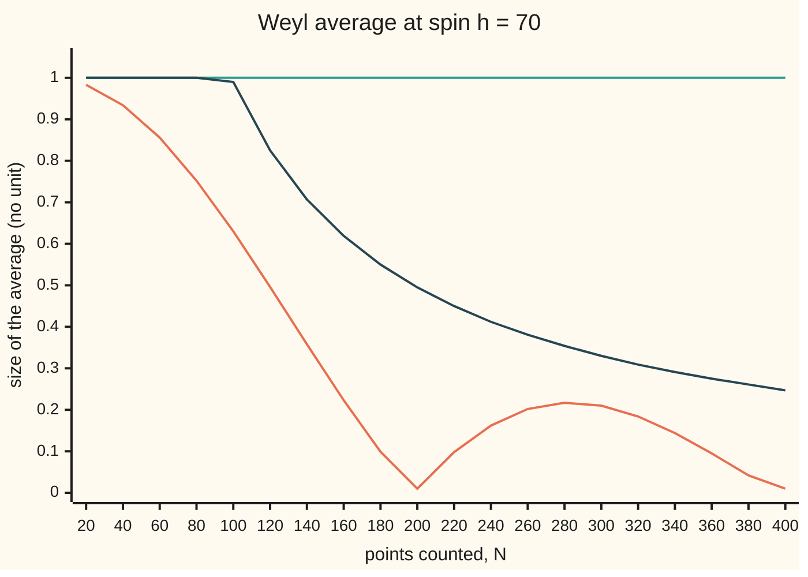

# Equidistribution: when fractional parts spread evenly, tested by exponential sums

[Syllabus](../../../SYLLABUS.md) → [Algebraic and analytic number theory](../README.md) → [Additive Combinatorics and Probabilistic Number Theory](../README.md#s08) → Equidistribution

---

## General Overview

Take $`\sqrt 2 = 1.414214`$ and multiply it by 1, 2, 3 and so on. Keep only the part after the decimal point. The first five results are 0.414214, 0.828427, 0.242641, 0.656854 and 0.071068.

Cut the stretch from 0 to 1 into ten bins, each 0.1 wide. Of the first 1,000 results, exactly 100 land in the bin from 0 to 0.1. Every other bin holds 99, 100 or 101. A fair share is 100 per bin, and the multiples of $`\sqrt 2`$ hit it almost exactly.

A sequence whose points give every interval its fair share in the long run is **equidistributed**. Testing every interval one by one is impossible: there are infinitely many.

In 1916 Hermann Weyl replaced that test with one average for each whole number h. Put each point on a circle, spin it h times, and average the arrows. The sequence is equidistributed exactly when each of those averages, for h = 1, 2, 3, …, shrinks to 0.

The test also catches impostors. The fraction 99/70 = 1.414286 is within 0.000072 of $`\sqrt 2`$, and its multiples fill the ten bins with the same counts, 99 to 101 each. Yet they sit on only 70 points. The narrow interval from 0.001 to 0.014 should get 13 of the first 1,000 and gets 0. Weyl's average at h = 70 is exactly 1, not near 0.

The first two cards of this shelf ask how a count spreads over the integers ([Typical numbers have about log log n distinct prime factors](01-hardy-ramanujan-and-typical-prime-factor-counts.md), [Erdos-Kac](02-erdos-kac-theorem.md)). This card asks how points spread over an interval.

**A sequence spreads evenly over the stretch from 0 to 1 exactly when every spun-arrow average shrinks to 0; for multiples of an irrational number each sum of arrows is a geometric series with a cap that does not depend on N, so the average shrinks like 1/N.**

**What kind of fact this is:** two theorems, Weyl's criterion and its application to multiples of an irrational number, both proved on this card in Why it works. The counts in the code are evidence for the pictures, never proof.

### The picture: the first 1,000 multiples of root 2, in ten bins

```
root2 [0.0, 0.1)  #########################    100
root2 [0.1, 0.2)  ########################     99
root2 [0.2, 0.3)  #########################    101
root2 [0.3, 0.4)  #########################    100
root2 [0.4, 0.5)  #########################    101
root2 [0.5, 0.6)  ########################     99
root2 [0.6, 0.7)  #########################    100
root2 [0.7, 0.8)  #########################    100
root2 [0.8, 0.9)  #########################    101
root2 [0.9, 1.0)  ########################     99
```

One mark stands for 4 points. The multiples of 99/70 give the counts 100, 99, 101, 100, 101, 99, 100, 99, 101, 100: from this picture alone the two cannot be told apart.

---

## The formula

Notation first, in words.

- The braces $`\{x\}`$ give the **fractional part** of x: x minus the largest whole number not above it. So $`\{2.828427\} = 0.828427`$. This card introduces the notation.
- The arrow $`e(x) = \cos 2\pi x + i \sin 2\pi x`$ is the point of the unit circle a fraction x of a full turn round from 1, as on [The large sieve](../04-Sieves%20and%20Prime%20Gaps/03-the-large-sieve.md) ([Fourier series](../../07-Complex%20analysis/08-Transforms%20in%20Outline/01-fourier-series-in-complex-form.md) writes it $`e^{2\pi i x}`$). Because a full turn changes nothing, $`e(x) = e(\{x\})`$.
- The double bars $`\lVert x\rVert`$ give the distance from x to the nearest whole number, as on [The large sieve](../04-Sieves%20and%20Prime%20Gaps/03-the-large-sieve.md). So $`\lVert 70\sqrt 2\rVert = 0.005051`$: $`70\sqrt 2`$ lands just below 99.

A sequence $`x_1, x_2, x_3, \dots`$ is **equidistributed modulo 1** when, for every interval from a to b inside the stretch from 0 to 1,

```math
\lim_{N\to\infty} \frac{\#\{\,n \le N : a \le \{x_n\} < b\,\}}{N} = b - a
```

**Read it aloud:** the share of the first N points whose fractional part lands between a and b tends to the length of that interval.

**Weyl's criterion** turns that into averages of arrows. The sequence is equidistributed modulo 1 if and only if

```math
\lim_{N\to\infty} \frac{1}{N}\sum_{n=1}^{N} e(h\,x_n) = 0 \quad \text{for every whole number } h \ne 0
```

**Read it aloud:** spin every point h times round the circle, average the arrows, and the average must shrink to nothing, for every nonzero h.

For multiples of one number, $`x_n = n\alpha`$, the sum $`S_N(h) = \sum_{n=1}^{N} e(hn\alpha)`$ is a geometric series, and it is never large:

```math
\lvert S_N(h)\rvert = \frac{\lvert \sin(\pi N h\alpha)\rvert}{\lvert \sin(\pi h\alpha)\rvert} \le \frac{1}{\lvert \sin(\pi h\alpha)\rvert} \le \frac{1}{2\lVert h\alpha\rVert}
```

**Read it aloud:** the sum of N arrows for the multiples of alpha never exceeds one over twice the distance from h alpha to the nearest whole number, however many arrows are added.

For $`\alpha = \sqrt 2`$ and h = 1 that cap is 1/(2 × 0.414214) = 1.207107. Over the first 10,000 values of N the sum's size never passes 1.037449, the middle cap. The average is the sum divided by N, so at N = 1,000 it is at most 0.001207; the code finds 0.000645.

| Symbol | Plain meaning | In our example | Push it up and the answer… |
| --- | --- | --- | --- |
| $`x_n`$ | the n-th point of the sequence | $`n\sqrt 2`$ | only its fractional part matters |
| $`\{x\}`$ | fractional part: x minus the whole part below it | $`\{3\sqrt 2\} = 0.242641`$ | stays between 0 and 1 |
| $`N`$ | how many points are counted | 1,000 | the averages shrink, as $`1/N`$ here |
| $`a, b`$ | ends of a test interval | 0 and 0.1 | widen the gap and the fair share $`b - a`$ grows |
| $`\#\{\dots\}`$ | how many n satisfy the condition | 100 in the first bin | — |
| $`h`$ | the spin: how many times each point goes round | 1, 2, 70 | larger h can expose finer patterns |
| $`e(x)`$ | the point a fraction x of a turn round the unit circle | $`e(0.414214)`$ for n = 1, h = 1 | turns further round |
| $`S_N(h)`$ | the sum of the N spun arrows | $`\lvert S_N(1)\rvert \le 1.037449`$ | stays bounded for multiples of an irrational |
| $`\alpha`$ | the step whose multiples are taken | $`\sqrt 2`$, or 99/70 as the impostor | — |
| $`\lVert x\rVert`$ | distance from x to the nearest whole number | $`\lVert\sqrt 2\rVert = 0.414214`$ | the cap on $`\lvert S_N(h)\rvert`$ falls |
| $`r`$ | one spun step, $`e(h\alpha)`$, whose powers are the arrows | $`e(0.414214)`$ at h = 1 | — |
| $`m`$ | a whole number: the numerator of a fraction, or the one nearest $`h\sqrt 2`$ | 99 when h = 70 | — |

### When it holds

- **Every nonzero h, not a finite list.** For 99/70 the averages at h = 1 to 69 are all at most 0.017426 when N = 1,000, and still the sequence fails. Drop any h and the test misses a pattern of that frequency.
- **The limit as N grows, not one N.** At N = 100 the average for $`\sqrt 2`$ at h = 70 is 0.630184, which looks like failure. It falls to 0.006301 by N = 10,000. A finite run is evidence either way, never proof.
- **The step is irrational.** If $`\alpha = m/q`$ in lowest terms, with q the denominator, then at h = q every term is $`e(\text{whole number}) = 1`$, so the average is 1 and the multiples sit on q points.
- **Intervals, not arbitrary sets.** Equidistribution speaks about intervals (and, through the proof, about any function whose integral is a limit of rectangle sums). The multiples of $`\sqrt 2`$ form a countable set, so a set made of exactly those points has length 0 and holds them all.

---

## Why it works

### Step 0: a count is an average, and averages split into arrows

The share of points in an interval is the average of a function: 1 when the point is inside, 0 outside. Averages add: the average of a sum of functions is the sum of their averages.

[Fourier series](../../07-Complex%20analysis/08-Transforms%20in%20Outline/01-fourier-series-in-complex-form.md) build any reasonable function on the circle from the arrows e(hx). So if the average of every arrow behaves, the average of every function built from them behaves too. Interval counts are among those functions.

### Step 1: each arrow has the right target, 0

Over a whole turn the arrow e(hx), with h not 0, spins round h times and averages to nothing:

```math
\int_0^1 e(hx)\,dx = \frac{e(h) - 1}{2\pi i h} = 0
```

**Read it aloud:** the area under one arrow over a full turn is zero, because e of a whole number is 1.

So for an equidistributed sequence each arrow's average must tend to 0: Weyl's averages are equidistribution asked about one frequency at a time.

### Step 2: equidistributed implies every arrow average tends to 0

Equidistribution gives the right average for an interval's on-off function. By adding, it gives the right average for any staircase, a sum of such functions. The real and imaginary parts of e(hx) are continuous, so each can be trapped between two staircases whose areas differ by less than any chosen margin, as in [The integral](../../06-Calculus%20and%20analysis/04-Integrals/01-riemann-integral.md). The average of e(hx) is then trapped too, and its limit is the integral, 0.

### Step 3: every arrow average tends to 0 implies equidistributed

Now run Step 2 backwards. Adding finitely many arrows gives a **trigonometric polynomial**: a finite sum $`\sum c_h\,e(hx)`$. By the hypothesis its averages tend to the constant term $`c_0`$, which is its integral.

Any continuous function on the circle is within a chosen margin of some trigonometric polynomial at every point at once. The Fejér averages of its Fourier series do this ([Dirichlet and Fejer kernels](../../20-Harmonic%20analysis/01-Fourier%20Series%20in%20Depth/03-dirichlet-and-fejer-kernels.md); the polynomial version is [Weierstrass and the minimax fit](../../16-Numerical%20analysis/04-Interpolation%20and%20Approximation/08-weierstrass-and-best-approximation.md)). Closeness at every point at once is [Uniform convergence](../../06-Calculus%20and%20analysis/06-Series/07-uniform-convergence.md), and it carries over to averages. So continuous functions get the right averages too.

Last, trap the interval's on-off function between two continuous functions: one just inside it, one just outside, with areas within the margin of b − a. The share of points in the interval is then squeezed to b − a.

<details>
<summary>Detailed proof: the squeeze in Step 3, with margins</summary>

Fix an interval from a to b and a margin $`\varepsilon > 0`$, and write $`A_N(f) = \frac{1}{N}\sum_{n \le N} f(\{x_n\})`$ for the average of a function f over the first N points.

Choose continuous functions $`g \le \mathbf 1_{[a,b)} \le G`$ on the circle, where $`\mathbf 1_{[a,b)}`$ is 1 on the interval and 0 off it. Make g a trapezoid inside the interval and G one outside it, so that

$`\displaystyle \int_0^1 G - \varepsilon \le b - a \le \int_0^1 g + \varepsilon.`$

By Fejér's theorem pick trigonometric polynomials $`P`$ and $`Q`$ with $`\lvert G - P\rvert < \varepsilon`$ and $`\lvert g - Q\rvert < \varepsilon`$ at every point. Every arrow in P other than the constant has average tending to 0, so $`A_N(P) \to \int_0^1 P`$, and likewise for Q.

Averages keep order, and a function within $`\varepsilon`$ at every point has average within $`\varepsilon`$. So

$`\displaystyle A_N(\mathbf 1_{[a,b)}) \le A_N(G) \le A_N(P) + \varepsilon \to \int_0^1 P + \varepsilon \le \int_0^1 G + 2\varepsilon \le b - a + 3\varepsilon,`$

and in the same way the lower limit is at least $`b - a - 3\varepsilon`$. The margin was arbitrary, so the share tends to $`b - a`$. The step from equidistributed to arrow averages is the same squeeze with staircases in place of trigonometric polynomials.

</details>

### Step 4: multiples of an irrational number pass the test

For $`x_n = n\alpha`$ the arrows are powers of one arrow, $`r = e(h\alpha)`$, so their sum is a geometric series:

```math
S_N(h) = r + r^2 + \dots + r^N = r\,\frac{r^N - 1}{r - 1}
```

**Read it aloud:** N arrows, each one turn-fraction $`h\alpha`$ further on, add up to a closed form with $`r - 1`$ underneath.

The top has size at most 2, since it is the gap between two points of the unit circle. The bottom has size $`2\lvert\sin(\pi h\alpha)\rvert`$. That bottom is 0 only when $`h\alpha`$ is a whole number, which for an irrational α and nonzero h never happens. So $`\lvert S_N(h)\rvert`$ stays below a cap that does not depend on N, and $`S_N(h)/N \to 0`$. By Step 3 the multiples are equidistributed.

The last cap in the formula uses $`\lvert\sin \pi x\rvert \ge 2\lVert x\rVert`$: on its rise from 0 to its peak at one half, the curve $`\lvert\sin \pi x\rvert`$ lies above the straight line from 0 to that peak. For $`\sqrt 2`$ at h = 1: $`\sin(\pi \times 0.414214) = 0.963903`$, so the sum never exceeds 1/0.963903 = 1.037449. The code finds that value reached to six decimals, at N = 6,930.

### Step 5: how fast depends on how well α is chased by fractions

The cap $`1/(2\lVert h\alpha\rVert)`$ is large when $`h\alpha`$ is near a whole number, that is when $`\alpha`$ is near a fraction with denominator h. That is the subject of [Chasing an algebraic number with fractions](../07-Diophantine%20and%20Modular/10-diophantine-approximation-liouville-to-roth.md).

For $`\sqrt 2`$ the fractions cannot get too close. If m is the whole number nearest $`h\sqrt 2`$, then $`2h^2 - m^2`$ is a nonzero whole number, so at least 1 in size. Factoring it as $`(h\sqrt 2 - m)(h\sqrt 2 + m)`$ gives

```math
\lVert h\sqrt 2\rVert \ge \frac{1}{h\sqrt 2 + m} > \frac{1}{2\sqrt 2\,h + 1}
```

**Read it aloud:** the multiple $`h\sqrt 2`$ stays at least about one over 2.83 h away from every whole number.

The code checks this for every h up to 1,000: the product $`\lVert h\sqrt 2\rVert(2\sqrt 2\,h + 1)`$ never drops below 1.000359. Equality $`\lvert 2h^2 - m^2\rvert = 1`$ happens at h = 1, 2, 5, 12, 29, 70, 169, 408, 985: the denominators of the fractions from [Pell's equation](../07-Diophantine%20and%20Modular/01-pell-and-continued-fractions-revisited.md), 99/70 among them. Those h are the spins where $`\sqrt 2`$'s averages fall slowest.



Orange: multiples of $`\sqrt 2`$. Teal: multiples of 99/70, flat at 1. Dark blue: the cap, the smaller of 1 and $`1/(2N\lVert 70\sqrt 2\rVert)`$. For the first few dozen points $`\sqrt 2`$ looks like 99/70 at this spin, above 0.85; after that it falls away under the cap.

### Step 6: catching a sequence that fails

Two failures, caught by one spin each.

- **A rational step.** For 99/70, spin h = 70 turns each point $`n \times 99/70`$ into 99n turns, a whole number, so every arrow is 1 and the average is 1.000000. The fair bin counts in the overview come from 70 points spaced 1/70 apart; any interval shorter than 1/70 between two of them gets nothing.
- **The digits sequence $`\{\log_{10} n\}`$.** It decides leading digits: n starts with 1 exactly when $`\{\log_{10} n\} < \log_{10} 2 = 0.301030`$. Among 1 to 999 the share starting with 1 is 0.111111; among 1 to 1,999 it is 0.555778. It never settles, so the sequence is not equidistributed. Weyl's average at h = 1 keeps turning, and its size settles at 0.344090, not 0.

<details>
<summary>Where 0.344090 comes from</summary>

The points $`\log_{10} n`$ crowd together as n grows, so the average of $`e(\log_{10} n)`$ behaves like an integral. Put $`n = Nt`$ with t between 0 and 1. Then

$`\displaystyle \frac{1}{N}\sum_{n \le N} e(\log_{10} n) \approx \int_0^1 e(\log_{10} N + \log_{10} t)\,dt = e(\log_{10} N)\int_0^1 t^{\,i\theta}\,dt = \frac{e(\log_{10} N)}{1 + i\theta},`$

with $`\theta = 2\pi/\ln 10`$, because $`e(\log_{10} t) = t^{\,2\pi i/\ln 10}`$. The first factor has size 1 and keeps turning as N grows, so the average circles round without shrinking. Its size tends to $`1/\sqrt{1 + \theta^2} = 0.344090`$. The code finds 0.344324, 0.344113 and 0.344092 at N = 1,000, 10,000 and 100,000.

</details>

---

## Worked numbers, by hand

The example: multiples of $`\sqrt 2`$ and of 99/70, first 1,000 of each, tested at spins h = 1 and h = 70.

| Step | Arithmetic | Value |
| --- | --- | --- |
| distance from $`\sqrt 2`$ to a whole number | 1.414214 − 1 | $`\lVert\sqrt 2\rVert = 0.414214`$ |
| the sine in the closed form | $`\sin(\pi \times 0.414214)`$ | 0.963903 |
| cap on every $`\lvert S_N(1)\rvert`$ | 1 / 0.963903 | 1.037449 |
| average at N = 1,000, h = 1 | closed form, divided by 1,000 | 0.000645 |
| distance from $`70\sqrt 2`$ to a whole number | 70 × 1.414214 lands just below 99 | $`\lVert 70\sqrt 2\rVert = 0.005051`$ |
| cap on the average at N = 1,000, h = 70 | 1 / (2 × 1,000 × 0.005051) | 0.098997 |
| true average at N = 1,000, h = 70 | closed form | 0.009983 |
| 99/70 at h = 70 | 70 × 99n/70 = 99n, so each arrow is 1 | **1.000000** |

The averages for $`\sqrt 2`$ shrink at every spin; the impostor's average at h = 70 stays at 1.

### What breaks if you drop a piece

| Mistake | Comes out at | What went wrong |
| --- | --- | --- |
| Trusting ten bins of width 0.1 | 99/70 bins 99 to 101, like $`\sqrt 2`$; but [0.001, 0.014) holds 0 of 1,000, fair share 13 | Coarse bins miss gaps narrower than the bins |
| Testing only spins 1 to 69 | 99/70's largest average 0.017426 at N = 1,000; spin 70 gives 1.000000 | Weyl's criterion needs every nonzero h |
| Judging $`\sqrt 2`$ at one small N | average 0.630184 at N = 100, h = 70 | the average falls to 0.006301 by N = 10,000; a limit needs N to grow |
| Assuming $`\{\log_{10} n\}`$ spreads evenly | leading-1 share 0.111111 at N = 999, 0.555778 at N = 1,999; average 0.344090 at h = 1 | the points slow down as n grows, so the share swings forever |

The code prints every entry.

---

## Code, from first principles, and it actually runs

The code counts and tests the multiples of $`\sqrt 2`$ and of 99/70, and it takes several independent roads. Bin counts come exactly from integer square roots, since $`\lfloor 10\{n\sqrt 2\}\rfloor = \lfloor\sqrt{200n^2}\rfloor - 10\lfloor\sqrt{2n^2}\rfloor`$, and are matched against floating-point fractional parts. The worst miscount over all intervals from 0 to t is found twice: from the sorted floating-point points, and from the exact integer points $`\lfloor 10^{12}\{n\sqrt 2\}\rfloor`$ ranked by bisection. Each Weyl average is added arrow by arrow and matched against the geometric-series closed form, then against the cap. Leading digits are read off the integers themselves, including 2 to the power 1,000 built digit by digit in Rust, and matched against fractional parts of logarithms.

### Python

```python
# Equidistribution and Weyl's criterion -- the check behind the card.  Standard library only.
# {x} = x - floor(x) is the fractional part; e(x) = cos 2 pi x + i sin 2 pi x.
# Roads: exact bin counts by integer square roots against floating-point {n root2};
# Weyl sums added term by term against the geometric-series closed form and its bound;
# leading digits read off the integers against the fractional parts of logs.
from math import isqrt, sqrt, pi, sin, cos, log, log10, floor
from bisect import bisect_left, bisect_right

R2 = sqrt(2.0)
def frac(x): return x - floor(x)
def dist(x): return min(frac(x), 1 - frac(x))          # ||x||, distance to the nearest integer
def digits(n, k):                                      # floor(10^k {n root2}), exact
    return isqrt(2 * n * n * 10 ** (2 * k)) - 10 ** k * isqrt(2 * n * n)
def weyl(xs, h):                                       # |(1/N) sum of e(h x_n)|, term by term
    re = im = 0.0
    for x in xs:
        t = 2 * pi * frac(h * x)
        re += cos(t); im += sin(t)
    return sqrt(re * re + im * im) / len(xs)
def closed(N, h, a):                                   # |sin(pi N h a)| / (N |sin(pi h a)|)
    return abs(sin(pi * frac(N * h * a))) / (N * abs(sin(pi * frac(h * a))))
def bars(name, counts):
    for b, c in enumerate(counts):
        print(f"{name} [0.{b}, {'1.0' if b == 9 else '0.' + str(b + 1)})  {'#' * (c // 4):<28} {c}")

print("n, n root2, {n root2}:", "; ".join(f"{n}, {n * R2:.6f}, {frac(n * R2):.6f}" for n in range(1, 6)))
print("road 1 = exact integer count, road 2 = floating point; points in [0, 0.1):")
for N in (10, 100, 1000, 10000, 100000):
    c1 = sum(1 for n in range(1, N + 1) if digits(n, 1) == 0)
    c2 = sum(1 for n in range(1, N + 1) if frac(n * R2) < 0.1)
    assert c1 == c2
    print(f"  N = {N:>6}: count {c1:>5}, fair share {N // 10:>5}, difference {c1 - N // 10:>2}, ratio {c1 / (N / 10):.4f}")

N = 1000
b2, b7 = [0] * 10, [0] * 10
for n in range(1, N + 1):
    b2[digits(n, 1)] += 1
    b7[10 * (99 * n % 70) // 70] += 1                    # 99/70: {99n/70} = (99n mod 70)/70
assert max(abs(c - 100) for c in b2) < 10
bars("root2", b2)
print("99/70 bins, N = 1000:", b7)
gap2 = sum(1 for n in range(1, N + 1) if 1 <= digits(n, 3) <= 13)
gap7 = sum(1 for n in range(1, N + 1) if 70 <= 1000 * (99 * n % 70) < 980)
assert gap7 == 0 and abs(gap2 - 13) <= 6
print(f"points in [0.001, 0.014) for N = 1000: root2 {gap2}, 99/70 {gap7}, fair share 13")

def star(xs):                                          # worst miscount over all [0, t)
    xs = sorted(xs); M = len(xs)
    return max(max(i + 1 - M * x, M * x - i) for i, x in enumerate(xs))
for M in (10, 100, 1000, 10000):
    d = star([frac(n * R2) for n in range(1, M + 1)])
    u = [digits(n, 12) for n in range(1, M + 1)]; su = sorted(u)   # exact floor(10^12 {n root2})
    d2 = max(max(bisect_right(su, v) - M * v / 10**12, M * v / 10**12 - bisect_left(su, v)) for v in u)
    assert abs(d - d2) < 1e-6                          # road 2: exact points, ranks by bisection
    print(f"  worst miscount over all [0, t), N = {M:>5}: {d:.4f} points, share of N {d / M:.6f}")

print("Weyl averages for root2: term by term | closed form | bound 1/(2 N ||h root2||)")
for h in (1, 2, 70):
    print(f"  h = {h:>2}, ||h root2|| = {dist(h * R2):.6f}")
    for M in (100, 1000, 10000):
        w = weyl([n * R2 for n in range(1, M + 1)], h)
        c, bd = closed(M, h, R2), 1 / (2 * M * dist(h * R2))
        assert abs(w - c) < 1e-9 and w <= bd
        print(f"    N = {M:>5}: {w:.6f} | {c:.6f} | {bd:.6f}")
re = im = big = 0.0
for n in range(1, 10001):
    t = 2 * pi * frac(n * R2); re += cos(t); im += sin(t)
    if sqrt(re * re + im * im) > big: big, at = sqrt(re * re + im * im), n
assert big <= 1 / (2 * dist(R2))
print(f"largest |S_N(1)| for N up to 10000: {big:.6f} at N = {at}; bound for every N {1 / (2 * dist(R2)):.6f}")
print(f"by hand: sin(pi ||root2||) = {sin(pi * dist(R2)):.6f}, 1/that = {1 / sin(pi * dist(R2)):.6f}")
pell = [h for h in range(1, 1001) if abs(2 * h * h - round(h * R2) ** 2) == 1]
assert all(abs(2 * h * h - round(h * R2) ** 2) >= 1 for h in range(1, 1001))
worst = min(dist(h * R2) * (2 * R2 * h + 1) for h in range(1, 1001))
assert worst > 1
print(f"|2h^2 - m^2| >= 1 for h up to 1000; it equals 1 at h = {pell}; min ||h root2||(2 root2 h + 1) = {worst:.6f}")

rat = [99 * n % 70 / 70 for n in range(1, N + 1)]
w70, top = weyl(rat, 70), max(weyl(rat, h) for h in range(1, 70))
assert abs(w70 - 1) < 1e-9 and top < 0.02
print(f"99/70 = {99 / 70:.6f}, root2 = {R2:.6f}, gap {99 / 70 - R2:.6f}")
print(f"99/70, N = 1000: Weyl average at h = 70 is {w70:.6f}; largest over h = 1..69 is {top:.6f}")
print("chart, h = 70, N = 20..400 step 20 (bound = smaller of 1 and 1/(2 N ||70 root2||)):")
print("  root2 ", ", ".join(f"{closed(M, 70, R2):.3f}" for M in range(20, 401, 20)))
print("  99/70 ", ", ".join(f"{weyl(rat[:M], 70):.3f}" for M in range(20, 401, 20)))
print("  bound ", ", ".join(f"{min(1, 1 / (2 * M * dist(70 * R2))):.3f}" for M in range(20, 401, 20)))

L2, lim = log10(2), 1 / sqrt(1 + (2 * pi / log(10)) ** 2)
for M in (999, 1999):
    ex = sum(1 for n in range(1, M + 1) if str(n)[0] == "1")
    fl = sum(1 for n in range(1, M + 1) if frac(log10(n)) < L2)
    assert ex == fl
    print(f"log10 n, N = {M:>5}: leading digit 1 share {ex / M:.6f} (equidistributed would give {L2:.6f})")
for M in (1000, 10000, 100000):
    w = weyl([log10(n) for n in range(1, M + 1)], 1)
    assert abs(w - lim) < 0.005
    print(f"log10 n, N = {M:>6}: Weyl average at h = 1 is {w:.6f}; limit 1/sqrt(1 + (2 pi/ln 10)^2) = {lim:.6f}")

ex = [str(2 ** n)[0] for n in range(1, N + 1)]                 # exact powers of 2
f1 = sum(1 for n in range(1, N + 1) if frac(n * L2) < L2)       # leading 1: {n log10 2} < log10 2
f9 = sum(1 for n in range(1, N + 1) if frac(n * L2) >= log10(9))
assert ex.count("1") == f1 and ex.count("9") == f9 and abs(f1 - N * L2) < 3
print(f"2^n, n = 1..1000, leading digit 1: {f1}, predicted {N * L2:.2f}; leading 9: {f9}, predicted {N * log10(10 / 9):.2f}")
print("ALL CHECKS PASS")
```

**Ran 2026-11-15 on macOS, Python 3.14.10, standard library only. All checks passed. Output, pasted from the run:**

```
n, n root2, {n root2}: 1, 1.414214, 0.414214; 2, 2.828427, 0.828427; 3, 4.242641, 0.242641; 4, 5.656854, 0.656854; 5, 7.071068, 0.071068
road 1 = exact integer count, road 2 = floating point; points in [0, 0.1):
  N =     10: count     1, fair share     1, difference  0, ratio 1.0000
  N =    100: count    10, fair share    10, difference  0, ratio 1.0000
  N =   1000: count   100, fair share   100, difference  0, ratio 1.0000
  N =  10000: count  1001, fair share  1000, difference  1, ratio 1.0010
  N = 100000: count 10000, fair share 10000, difference  0, ratio 1.0000
root2 [0.0, 0.1)  #########################    100
root2 [0.1, 0.2)  ########################     99
root2 [0.2, 0.3)  #########################    101
root2 [0.3, 0.4)  #########################    100
root2 [0.4, 0.5)  #########################    101
root2 [0.5, 0.6)  ########################     99
root2 [0.6, 0.7)  #########################    100
root2 [0.7, 0.8)  #########################    100
root2 [0.8, 0.9)  #########################    101
root2 [0.9, 1.0)  ########################     99
99/70 bins, N = 1000: [100, 99, 101, 100, 101, 99, 100, 99, 101, 100]
points in [0.001, 0.014) for N = 1000: root2 13, 99/70 0, fair share 13
  worst miscount over all [0, t), N =    10: 1.1472 points, share of N 0.114719
  worst miscount over all [0, t), N =   100: 1.4719 points, share of N 0.014719
  worst miscount over all [0, t), N =  1000: 1.6944 points, share of N 0.001694
  worst miscount over all [0, t), N = 10000: 2.6470 points, share of N 0.000265
Weyl averages for root2: term by term | closed form | bound 1/(2 N ||h root2||)
  h =  1, ||h root2|| = 0.414214
    N =   100: 0.010059 | 0.010059 | 0.012071
    N =  1000: 0.000645 | 0.000645 | 0.001207
    N = 10000: 0.000043 | 0.000043 | 0.000121
  h =  2, ||h root2|| = 0.171573
    N =   100: 0.009240 | 0.009240 | 0.029142
    N =  1000: 0.001897 | 0.001897 | 0.002914
    N = 10000: 0.000147 | 0.000147 | 0.000291
  h = 70, ||h root2|| = 0.005051
    N =   100: 0.630184 | 0.630184 | 0.989975
    N =  1000: 0.009983 | 0.009983 | 0.098997
    N = 10000: 0.006301 | 0.006301 | 0.009900
largest |S_N(1)| for N up to 10000: 1.037449 at N = 6930; bound for every N 1.207107
by hand: sin(pi ||root2||) = 0.963903, 1/that = 1.037449
|2h^2 - m^2| >= 1 for h up to 1000; it equals 1 at h = [1, 2, 5, 12, 29, 70, 169, 408, 985]; min ||h root2||(2 root2 h + 1) = 1.000359
99/70 = 1.414286, root2 = 1.414214, gap 0.000072
99/70, N = 1000: Weyl average at h = 70 is 1.000000; largest over h = 1..69 is 0.017426
chart, h = 70, N = 20..400 step 20 (bound = smaller of 1 and 1/(2 N ||70 root2||)):
  root2  0.983, 0.934, 0.856, 0.752, 0.630, 0.496, 0.358, 0.223, 0.099, 0.010, 0.098, 0.162, 0.202, 0.217, 0.210, 0.184, 0.144, 0.095, 0.042, 0.010
  99/70  1.000, 1.000, 1.000, 1.000, 1.000, 1.000, 1.000, 1.000, 1.000, 1.000, 1.000, 1.000, 1.000, 1.000, 1.000, 1.000, 1.000, 1.000, 1.000, 1.000
  bound  1.000, 1.000, 1.000, 1.000, 0.990, 0.825, 0.707, 0.619, 0.550, 0.495, 0.450, 0.412, 0.381, 0.354, 0.330, 0.309, 0.291, 0.275, 0.261, 0.247
log10 n, N =   999: leading digit 1 share 0.111111 (equidistributed would give 0.301030)
log10 n, N =  1999: leading digit 1 share 0.555778 (equidistributed would give 0.301030)
log10 n, N =   1000: Weyl average at h = 1 is 0.344324; limit 1/sqrt(1 + (2 pi/ln 10)^2) = 0.344090
log10 n, N =  10000: Weyl average at h = 1 is 0.344113; limit 1/sqrt(1 + (2 pi/ln 10)^2) = 0.344090
log10 n, N = 100000: Weyl average at h = 1 is 0.344092; limit 1/sqrt(1 + (2 pi/ln 10)^2) = 0.344090
2^n, n = 1..1000, leading digit 1: 301, predicted 301.03; leading 9: 45, predicted 45.76
ALL CHECKS PASS
```

### Rust

```rust
// Equidistribution and Weyl's criterion -- the same check as the Python, in Rust.  No crates.
// {x} = x - floor(x) is the fractional part; e(x) = cos 2 pi x + i sin 2 pi x.
// Roads: exact bin counts by integer square roots against floating-point {n root2};
// Weyl sums added term by term against the geometric-series closed form and its bound;
// leading digits read off the integers against the fractional parts of logs.
use std::f64::consts::PI;

fn frac(x: f64) -> f64 { x - x.floor() }
fn dist(x: f64) -> f64 { frac(x).min(1.0 - frac(x)) }          // ||x||, distance to the nearest integer
fn isqrt(n: u128) -> u128 {
    let mut x = (n as f64).sqrt() as u128;
    while x.checked_mul(x).unwrap() > n { x -= 1 }
    while (x + 1).checked_mul(x + 1).unwrap() <= n { x += 1 }
    x
}
fn digits(n: u128, k: u32) -> u128 {                           // floor(10^k {n root2}), exact
    let t = 10u128.pow(k);
    isqrt(2 * n * n * t * t) - t * isqrt(2 * n * n)
}
fn weyl(xs: &[f64], h: f64) -> f64 {                           // |(1/N) sum of e(h x_n)|, term by term
    let (mut re, mut im) = (0.0f64, 0.0f64);
    for &x in xs {
        let t = 2.0 * PI * frac(h * x);
        re += t.cos(); im += t.sin();
    }
    (re * re + im * im).sqrt() / xs.len() as f64
}
fn closed(n: f64, h: f64, a: f64) -> f64 {                     // |sin(pi N h a)| / (N |sin(pi h a)|)
    (PI * frac(n * h * a)).sin().abs() / (n * (PI * frac(h * a)).sin().abs())
}
fn r2s(m: usize, r2: f64) -> Vec<f64> { (1..=m).map(|n| n as f64 * r2).collect() }
fn join(v: Vec<String>, sep: &str) -> String { v.join(sep) }
fn leading(n: u64) -> char { n.to_string().chars().next().unwrap() }

fn main() {
    let r2 = 2.0f64.sqrt();
    println!("n, n root2, {{n root2}}: {}", join((1..6).map(|n| { let x = n as f64 * r2;
        format!("{}, {:.6}, {:.6}", n, x, frac(x)) }).collect(), "; "));
    println!("road 1 = exact integer count, road 2 = floating point; points in [0, 0.1):");
    for &nn in &[10u128, 100, 1000, 10000, 100000] {
        let c1 = (1..=nn).filter(|&n| digits(n, 1) == 0).count() as i64;
        let c2 = (1..=nn).filter(|&n| frac(n as f64 * r2) < 0.1).count() as i64;
        assert_eq!(c1, c2);
        let fair = (nn / 10) as i64;
        println!("  N = {:>6}: count {:>5}, fair share {:>5}, difference {:>2}, ratio {:.4}", nn, c1, fair, c1 - fair, c1 as f64 / (nn as f64 / 10.0));
    }

    let nn = 1000usize;
    let (mut b2, mut b7) = (vec![0i64; 10], vec![0i64; 10]);
    for n in 1..=nn as u128 {
        b2[digits(n, 1) as usize] += 1;
        b7[(10 * (99 * n % 70) / 70) as usize] += 1;         // 99/70: {99n/70} = (99n mod 70)/70
    }
    assert!(b2.iter().all(|c| (c - 100).abs() < 10));
    for (b, &c) in b2.iter().enumerate() {
        let hi = if b == 9 { "1.0".to_string() } else { format!("0.{}", b + 1) };
        println!("root2 [0.{}, {})  {:<28} {}", b, hi, "#".repeat((c / 4) as usize), c);
    }
    println!("99/70 bins, N = 1000: [{}]", join(b7.iter().map(|c| c.to_string()).collect(), ", "));
    let gap2 = (1..=1000u128).filter(|&n| { let d = digits(n, 3); 1 <= d && d <= 13 }).count() as i64;
    let gap7 = (1..=1000u128).filter(|&n| { let r = 1000 * (99 * n % 70); 70 <= r && r < 980 }).count();
    assert!(gap7 == 0 && (gap2 - 13).abs() <= 6);
    println!("points in [0.001, 0.014) for N = 1000: root2 {}, 99/70 {}, fair share 13", gap2, gap7);

    for &m in &[10usize, 100, 1000, 10000] {                   // worst miscount over all [0, t)
        let mut xs: Vec<f64> = (1..=m).map(|n| frac(n as f64 * r2)).collect();
        xs.sort_by(|a, b| a.partial_cmp(b).unwrap());
        let mf = m as f64;
        let d = xs.iter().enumerate().map(|(i, &x)| (i as f64 + 1.0 - mf * x).max(mf * x - i as f64)).fold(f64::MIN, f64::max);
        let u: Vec<u128> = (1..=m as u128).map(|n| digits(n, 12)).collect();   // exact floor(10^12 {n root2})
        let mut su = u.clone(); su.sort();
        let d2 = u.iter().map(|&v| { let x = mf * v as f64 / 1e12;
            (su.partition_point(|&s| s <= v) as f64 - x).max(x - su.partition_point(|&s| s < v) as f64) }).fold(f64::MIN, f64::max);
        assert!((d - d2).abs() < 1e-6);                        // road 2: exact points, ranks by bisection
        println!("  worst miscount over all [0, t), N = {:>5}: {:.4} points, share of N {:.6}", m, d, d / mf);
    }

    println!("Weyl averages for root2: term by term | closed form | bound 1/(2 N ||h root2||)");
    for &h in &[1.0f64, 2.0, 70.0] {
        println!("  h = {:>2}, ||h root2|| = {:.6}", h as i64, dist(h * r2));
        for &m in &[100usize, 1000, 10000] {
            let w = weyl(&r2s(m, r2), h);
            let (c, bd) = (closed(m as f64, h, r2), 1.0 / (2.0 * m as f64 * dist(h * r2)));
            assert!((w - c).abs() < 1e-9 && w <= bd);
            println!("    N = {:>5}: {:.6} | {:.6} | {:.6}", m, w, c, bd);
        }
    }
    let (mut re, mut im, mut big, mut at) = (0.0f64, 0.0f64, 0.0f64, 0usize);
    for n in 1..=10000usize {
        let t = 2.0 * PI * frac(n as f64 * r2); re += t.cos(); im += t.sin();
        let s = (re * re + im * im).sqrt();
        if s > big { big = s; at = n; }
    }
    assert!(big <= 1.0 / (2.0 * dist(r2)));
    println!("largest |S_N(1)| for N up to 10000: {:.6} at N = {}; bound for every N {:.6}", big, at, 1.0 / (2.0 * dist(r2)));
    println!("by hand: sin(pi ||root2||) = {:.6}, 1/that = {:.6}", (PI * dist(r2)).sin(), 1.0 / (PI * dist(r2)).sin());
    let near = |h: i128| { let m = (h as f64 * r2).round() as i128; (2 * h * h - m * m).abs() };
    let pell: Vec<String> = (1..=1000i128).filter(|&h| near(h) == 1).map(|h| h.to_string()).collect();
    assert!((1..=1000i128).all(|h| near(h) >= 1));
    let worst = (1..=1000).map(|h| dist(h as f64 * r2) * (2.0 * r2 * h as f64 + 1.0)).fold(f64::MAX, f64::min);
    assert!(worst > 1.0);
    println!("|2h^2 - m^2| >= 1 for h up to 1000; it equals 1 at h = [{}]; min ||h root2||(2 root2 h + 1) = {:.6}", join(pell, ", "), worst);

    let rat: Vec<f64> = (1..=nn as u64).map(|n| (99 * n % 70) as f64 / 70.0).collect();
    let w70 = weyl(&rat, 70.0);
    let top = (1..70).map(|h| weyl(&rat, h as f64)).fold(f64::MIN, f64::max);
    assert!((w70 - 1.0).abs() < 1e-9 && top < 0.02);
    println!("99/70 = {:.6}, root2 = {:.6}, gap {:.6}", 99.0 / 70.0, r2, 99.0 / 70.0 - r2);
    println!("99/70, N = 1000: Weyl average at h = 70 is {:.6}; largest over h = 1..69 is {:.6}", w70, top);
    println!("chart, h = 70, N = 20..400 step 20 (bound = smaller of 1 and 1/(2 N ||70 root2||)):");
    let ms: Vec<usize> = (1..=20).map(|k| 20 * k).collect();
    println!("  root2  {}", join(ms.iter().map(|&m| format!("{:.3}", closed(m as f64, 70.0, r2))).collect(), ", "));
    println!("  99/70  {}", join(ms.iter().map(|&m| format!("{:.3}", weyl(&rat[..m], 70.0))).collect(), ", "));
    println!("  bound  {}", join(ms.iter().map(|&m| format!("{:.3}", 1f64.min(1.0 / (2.0 * m as f64 * dist(70.0 * r2))))).collect(), ", "));

    let (l2, lim) = (2f64.log10(), 1.0 / (1.0 + (2.0 * PI / 10f64.ln()).powi(2)).sqrt());
    for &m in &[999u64, 1999] {
        let ex = (1..=m).filter(|&n| leading(n) == '1').count();
        let fl = (1..=m).filter(|&n| frac((n as f64).log10()) < l2).count();
        assert_eq!(ex, fl);
        println!("log10 n, N = {:>5}: leading digit 1 share {:.6} (equidistributed would give {:.6})", m, ex as f64 / m as f64, l2);
    }
    for &m in &[1000usize, 10000, 100000] {
        let w = weyl(&(1..=m).map(|n| (n as f64).log10()).collect::<Vec<f64>>(), 1.0);
        assert!((w - lim).abs() < 0.005);
        println!("log10 n, N = {:>6}: Weyl average at h = 1 is {:.6}; limit 1/sqrt(1 + (2 pi/ln 10)^2) = {:.6}", m, w, lim);
    }

    let mut big2: Vec<u32> = vec![1];                          // 2^n exactly, base 10^9 limbs, low first
    let (mut e1, mut e9) = (0, 0);
    for _ in 1..=nn {
        let mut carry = 0u64;
        for limb in big2.iter_mut() { let v = *limb as u64 * 2 + carry; *limb = (v % 1_000_000_000) as u32; carry = v / 1_000_000_000; }
        if carry > 0 { big2.push(carry as u32) }
        match leading(*big2.last().unwrap() as u64) { '1' => e1 += 1, '9' => e9 += 1, _ => {} }
    }
    let f1 = (1..=nn).filter(|&n| frac(n as f64 * l2) < l2).count();
    let f9 = (1..=nn).filter(|&n| frac(n as f64 * l2) >= 9f64.log10()).count();
    assert!(e1 == f1 && e9 == f9 && (f1 as f64 - nn as f64 * l2).abs() < 3.0);
    println!("2^n, n = 1..1000, leading digit 1: {}, predicted {:.2}; leading 9: {}, predicted {:.2}", f1, nn as f64 * l2, f9, nn as f64 * (10.0f64 / 9.0).log10());
    println!("ALL CHECKS PASS");
}
```

**Ran 2026-11-15 on macOS, rustc 1.98.1, no crates. All checks passed. Output, pasted from the run:**

```
n, n root2, {n root2}: 1, 1.414214, 0.414214; 2, 2.828427, 0.828427; 3, 4.242641, 0.242641; 4, 5.656854, 0.656854; 5, 7.071068, 0.071068
road 1 = exact integer count, road 2 = floating point; points in [0, 0.1):
  N =     10: count     1, fair share     1, difference  0, ratio 1.0000
  N =    100: count    10, fair share    10, difference  0, ratio 1.0000
  N =   1000: count   100, fair share   100, difference  0, ratio 1.0000
  N =  10000: count  1001, fair share  1000, difference  1, ratio 1.0010
  N = 100000: count 10000, fair share 10000, difference  0, ratio 1.0000
root2 [0.0, 0.1)  #########################    100
root2 [0.1, 0.2)  ########################     99
root2 [0.2, 0.3)  #########################    101
root2 [0.3, 0.4)  #########################    100
root2 [0.4, 0.5)  #########################    101
root2 [0.5, 0.6)  ########################     99
root2 [0.6, 0.7)  #########################    100
root2 [0.7, 0.8)  #########################    100
root2 [0.8, 0.9)  #########################    101
root2 [0.9, 1.0)  ########################     99
99/70 bins, N = 1000: [100, 99, 101, 100, 101, 99, 100, 99, 101, 100]
points in [0.001, 0.014) for N = 1000: root2 13, 99/70 0, fair share 13
  worst miscount over all [0, t), N =    10: 1.1472 points, share of N 0.114719
  worst miscount over all [0, t), N =   100: 1.4719 points, share of N 0.014719
  worst miscount over all [0, t), N =  1000: 1.6944 points, share of N 0.001694
  worst miscount over all [0, t), N = 10000: 2.6470 points, share of N 0.000265
Weyl averages for root2: term by term | closed form | bound 1/(2 N ||h root2||)
  h =  1, ||h root2|| = 0.414214
    N =   100: 0.010059 | 0.010059 | 0.012071
    N =  1000: 0.000645 | 0.000645 | 0.001207
    N = 10000: 0.000043 | 0.000043 | 0.000121
  h =  2, ||h root2|| = 0.171573
    N =   100: 0.009240 | 0.009240 | 0.029142
    N =  1000: 0.001897 | 0.001897 | 0.002914
    N = 10000: 0.000147 | 0.000147 | 0.000291
  h = 70, ||h root2|| = 0.005051
    N =   100: 0.630184 | 0.630184 | 0.989975
    N =  1000: 0.009983 | 0.009983 | 0.098997
    N = 10000: 0.006301 | 0.006301 | 0.009900
largest |S_N(1)| for N up to 10000: 1.037449 at N = 6930; bound for every N 1.207107
by hand: sin(pi ||root2||) = 0.963903, 1/that = 1.037449
|2h^2 - m^2| >= 1 for h up to 1000; it equals 1 at h = [1, 2, 5, 12, 29, 70, 169, 408, 985]; min ||h root2||(2 root2 h + 1) = 1.000359
99/70 = 1.414286, root2 = 1.414214, gap 0.000072
99/70, N = 1000: Weyl average at h = 70 is 1.000000; largest over h = 1..69 is 0.017426
chart, h = 70, N = 20..400 step 20 (bound = smaller of 1 and 1/(2 N ||70 root2||)):
  root2  0.983, 0.934, 0.856, 0.752, 0.630, 0.496, 0.358, 0.223, 0.099, 0.010, 0.098, 0.162, 0.202, 0.217, 0.210, 0.184, 0.144, 0.095, 0.042, 0.010
  99/70  1.000, 1.000, 1.000, 1.000, 1.000, 1.000, 1.000, 1.000, 1.000, 1.000, 1.000, 1.000, 1.000, 1.000, 1.000, 1.000, 1.000, 1.000, 1.000, 1.000
  bound  1.000, 1.000, 1.000, 1.000, 0.990, 0.825, 0.707, 0.619, 0.550, 0.495, 0.450, 0.412, 0.381, 0.354, 0.330, 0.309, 0.291, 0.275, 0.261, 0.247
log10 n, N =   999: leading digit 1 share 0.111111 (equidistributed would give 0.301030)
log10 n, N =  1999: leading digit 1 share 0.555778 (equidistributed would give 0.301030)
log10 n, N =   1000: Weyl average at h = 1 is 0.344324; limit 1/sqrt(1 + (2 pi/ln 10)^2) = 0.344090
log10 n, N =  10000: Weyl average at h = 1 is 0.344113; limit 1/sqrt(1 + (2 pi/ln 10)^2) = 0.344090
log10 n, N = 100000: Weyl average at h = 1 is 0.344092; limit 1/sqrt(1 + (2 pi/ln 10)^2) = 0.344090
2^n, n = 1..1000, leading digit 1: 301, predicted 301.03; leading 9: 45, predicted 45.76
ALL CHECKS PASS
```

### Lean

Lean proves Weyl's criterion for every sequence and the rule and cap for multiples of a step, and checks the worked counts.

- Weyl's criterion: a sequence is equidistributed modulo 1 exactly when every nonzero spin's arrow average tends to 0.
- The multiples of a step are equidistributed modulo 1 exactly when the step is irrational.
- Take an irrational step $`\alpha`$, a spin $`h \ne 0`$ and any N. Then $`\lvert S_N(h)\rvert = \lvert\sin(\pi N h\alpha)\rvert / \lvert\sin(\pi h\alpha)\rvert`$. This is at most $`1/\lvert\sin(\pi h\alpha)\rvert`$, which is at most $`1/(2\lVert h\alpha\rVert)`$.
- Among the first 1,000 multiples, $`\sqrt 2`$ and 99/70 fill the ten bins with the card's counts, 99 to 101 each.
- The interval from 0.001 to 0.014 holds 13 of those multiples of $`\sqrt 2`$ and 0 of those of 99/70.
- Take the step 99/70 and spin h = 70. Then each point $`n \times 99/70`$ becomes $`99n`$ turns, a whole number.
- Take h up to 1,000 and m the whole number nearest $`h\sqrt 2`$. Then $`\lvert 2h^2 - m^2\rvert = 1`$ exactly at h = 1, 2, 5, 12, 29, 70, 169, 408, 985.
- Among 1 to 999, 111 numbers start with 1; among 1 to 1,999, 1,111 do.
- Take the powers $`2^n`$ for n = 1 to 1,000. Then 301 start with 1 and 45 start with 9.

Step 5's lower bound on $`\lVert h\sqrt 2\rVert`$, the limit 0.344090 and every decimal average are left to the Python and Rust checks.

```lean
-- Equidistribution: a sequence's fractional parts spread evenly over the stretch from 0 to 1 exactly when every nonzero spin's arrow average tends to 0, and the multiples of a number spread evenly exactly when it is irrational, with each arrow sum capped by 1/(2‖hα‖).
import Mathlib.Analysis.SpecialFunctions.Trigonometric.Basic
import Mathlib.NumberTheory.Real.Irrational
import Mathlib.Algebra.Order.Round
import Mathlib.Order.Interval.Finset.Nat
import Mathlib.Data.Nat.Sqrt
import Mathlib.Data.Nat.Log
import Mathlib.Analysis.Fourier.AddCircle
import Mathlib.Analysis.SpecialFunctions.Integrals.Basic
import Mathlib.Analysis.SpecialFunctions.Trigonometric.Bounds

open Filter Topology

/-- A sequence `x₁, x₂, …` is equidistributed modulo 1 when, for every interval from `a` to `b`
inside the stretch from 0 to 1, the share of the first `N` points whose fractional part `{x_n}`
lands in `[a, b)` tends to the interval's length `b − a`. -/
def EquidistributedModOne (x : ℕ → ℝ) : Prop :=
  ∀ a b : ℝ, 0 ≤ a → a ≤ b → b ≤ 1 →
    Tendsto (fun N : ℕ =>
      (((Finset.Icc 1 N).filter (fun n => a ≤ Int.fract (x n) ∧ Int.fract (x n) < b)).card : ℝ) / N)
      atTop (𝓝 (b - a))

lemma weyl_geom_Icc (z : ℂ) (N : ℕ) :
    (z - 1) * ∑ n ∈ Finset.Icc 1 N, z ^ n = z ^ (N + 1) - z := by
  induction N with
  | zero => simp
  | succ N ih =>
    rw [Finset.sum_Icc_succ_top (by omega), mul_add, ih]; ring

#print axioms weyl_geom_Icc

lemma weyl_norm_exp_sub_one (t : ℝ) :
    ‖Complex.exp (2 * Real.pi * Complex.I * (t : ℂ)) - 1‖ = 2 * |Real.sin (Real.pi * t)| := by
  have := Complex.norm_exp_I_mul_ofReal_sub_one (2 * Real.pi * t)
  have e1 : Complex.I * ((2 * Real.pi * t : ℝ) : ℂ) = 2 * Real.pi * Complex.I * (t : ℂ) := by
    push_cast; ring
  rw [e1] at this
  rw [this, norm_mul, Real.norm_eq_abs, Real.norm_eq_abs, abs_two]
  congr 2; ring_nf

#print axioms weyl_norm_exp_sub_one

lemma weyl_two_abs_le_abs_sin (θ : ℝ) :
    2 * |θ - round θ| ≤ |Real.sin (Real.pi * θ)| := by
  set y := θ - round θ with hy
  have hy2 : |y| ≤ 1 / 2 := abs_sub_round θ
  have hs : Real.sin (Real.pi * θ) = (-1) ^ (round θ) * Real.sin (Real.pi * y) := by
    rw [← Real.sin_add_int_mul_pi]; congr 1; rw [hy]; ring
  have habs : |Real.sin (Real.pi * θ)| = |Real.sin (Real.pi * y)| := by
    rw [hs, abs_mul, abs_zpow, abs_neg, abs_one, one_zpow, one_mul]
  rw [habs]
  have key : ∀ u : ℝ, 0 ≤ u → u ≤ 1 / 2 → 2 * u ≤ Real.sin (Real.pi * u) := by
    intro u hu0 hu1
    have := Real.mul_le_sin (x := Real.pi * u) (by positivity) (by nlinarith [Real.pi_pos])
    have hp := Real.pi_pos
    calc 2 * u = 2 / Real.pi * (Real.pi * u) := by field_simp
      _ ≤ _ := this
  rcases le_total 0 y with h0 | h0
  · rw [abs_of_nonneg h0]
    have := key y h0 (by rwa [abs_of_nonneg h0] at hy2)
    exact this.trans (le_abs_self _)
  · rw [abs_of_nonpos h0]
    have := key (-y) (by linarith) (by rwa [abs_of_nonpos h0] at hy2)
    simp only [mul_neg, Real.sin_neg] at this
    linarith [neg_le_abs (Real.sin (Real.pi * y))]

#print axioms weyl_two_abs_le_abs_sin

lemma weyl_sum_mul_irrational_le_aux (α : ℝ) (hα : Irrational α) (h : ℤ) (hh : h ≠ 0) (N : ℕ) :
    ‖∑ n ∈ Finset.Icc 1 N,
        Complex.exp (2 * Real.pi * Complex.I * (((h : ℝ) * ((n : ℝ) * α) : ℝ) : ℂ))‖ =
        |Real.sin (Real.pi * N * (h * α))| / |Real.sin (Real.pi * (h * α))| ∧
      |Real.sin (Real.pi * N * (h * α))| / |Real.sin (Real.pi * (h * α))| ≤
        1 / |Real.sin (Real.pi * (h * α))| ∧
      1 / |Real.sin (Real.pi * (h * α))| ≤ 1 / (2 * |h * α - round (h * α)|) := by
  set θ : ℝ := h * α with hθ
  have hirr : Irrational θ := hα.intCast_mul hh
  have hsin : Real.sin (Real.pi * θ) ≠ 0 := by
    intro h0
    rw [Real.sin_eq_zero_iff] at h0
    obtain ⟨n, hn⟩ := h0
    exact hirr.ne_int n (by
      have hp := Real.pi_pos.ne'
      apply mul_left_cancel₀ hp; linarith [hn])
  have hsinpos : 0 < |Real.sin (Real.pi * θ)| := abs_pos.mpr hsin
  set z : ℂ := Complex.exp (2 * Real.pi * Complex.I * (θ : ℂ)) with hz
  have hterm : ∀ n : ℕ, Complex.exp (2 * Real.pi * Complex.I * (((h : ℝ) * ((n : ℝ) * α) : ℝ) : ℂ))
      = z ^ n := by
    intro n
    rw [hz, ← Complex.exp_nat_mul]; congr 1; rw [hθ]; push_cast; ring
  have hz1 : ‖z - 1‖ = 2 * |Real.sin (Real.pi * θ)| := weyl_norm_exp_sub_one θ
  have hzN : ‖z ^ N - 1‖ = 2 * |Real.sin (Real.pi * N * θ)| := by
    rw [hz, ← Complex.exp_nat_mul]
    have := weyl_norm_exp_sub_one (N * θ)
    rw [show (N : ℂ) * (2 * Real.pi * Complex.I * (θ : ℂ)) =
      2 * Real.pi * Complex.I * (((N * θ : ℝ)) : ℂ) by push_cast; ring, this]
    congr 2; ring_nf
  have hznorm : ‖z‖ = 1 := by
    rw [hz, show 2 * Real.pi * Complex.I * (θ : ℂ) = ((2 * Real.pi * θ : ℝ) : ℂ) * Complex.I by
      push_cast; ring]
    exact Complex.norm_exp_ofReal_mul_I _
  have hz1ne : ‖z - 1‖ ≠ 0 := by rw [hz1]; positivity
  refine ⟨?_, ?_, ?_⟩
  · simp_rw [hterm]
    have hg := weyl_geom_Icc z N
    have : ∑ n ∈ Finset.Icc 1 N, z ^ n = (z ^ (N + 1) - z) / (z - 1) := by
      rw [← hg, mul_div_cancel_left₀]
      intro h0; apply hz1ne; rw [h0, norm_zero]
    rw [this, norm_div, show z ^ (N + 1) - z = z * (z ^ N - 1) by ring, norm_mul, hznorm, one_mul,
      hzN, hz1]
    field_simp
  · exact div_le_div_of_nonneg_right (Real.abs_sin_le_one _) (abs_nonneg _)
  · have hpos : 0 < 2 * |θ - round θ| := by
      have : θ - round θ ≠ 0 := sub_ne_zero.mpr (hirr.ne_int _)
      positivity
    exact one_div_le_one_div_of_le hpos (weyl_two_abs_le_abs_sin θ)

#print axioms weyl_sum_mul_irrational_le_aux

lemma weyl_exp_sub_le (a b : ℝ) :
    ‖Complex.exp (2 * Real.pi * Complex.I * (a : ℂ)) -
      Complex.exp (2 * Real.pi * Complex.I * (b : ℂ))‖ ≤ 2 * Real.pi * |a - b| := by
  have e : Complex.exp (2 * Real.pi * Complex.I * (a : ℂ)) -
      Complex.exp (2 * Real.pi * Complex.I * (b : ℂ)) =
      Complex.exp (((2 * Real.pi * b : ℝ) : ℂ) * Complex.I) *
        (Complex.exp (Complex.I * ((2 * Real.pi * (a - b) : ℝ) : ℂ)) - 1) := by
    rw [mul_sub, mul_one, ← Complex.exp_add]; congr 2 <;> push_cast <;> ring
  rw [e, norm_mul, Complex.norm_exp_ofReal_mul_I, one_mul]
  refine (Real.norm_exp_I_mul_ofReal_sub_one_le).trans_eq ?_
  rw [Real.norm_eq_abs, abs_mul, abs_of_pos (by positivity : (0:ℝ) < 2 * Real.pi)]

#print axioms weyl_exp_sub_le

lemma weyl_exp_int_mul_fract (h : ℤ) (x : ℝ) :
    Complex.exp (2 * Real.pi * Complex.I * (((h : ℝ) * x : ℝ) : ℂ)) =
      Complex.exp (2 * Real.pi * Complex.I * (((h : ℝ) * Int.fract x : ℝ) : ℂ)) := by
  have hx : x = Int.fract x + (⌊x⌋ : ℝ) := by rw [Int.fract]; ring
  conv_lhs => rw [hx]
  have : 2 * Real.pi * Complex.I * (((h : ℝ) * (Int.fract x + (⌊x⌋ : ℝ)) : ℝ) : ℂ) =
      2 * Real.pi * Complex.I * (((h : ℝ) * Int.fract x : ℝ) : ℂ) +
        ((h * ⌊x⌋ : ℤ) : ℂ) * (2 * Real.pi * Complex.I) := by push_cast; ring
  rw [this, Complex.exp_add, Complex.exp_int_mul_two_pi_mul_I, mul_one]

#print axioms weyl_exp_int_mul_fract

lemma weyl_root_sum (h : ℤ) (hh : h ≠ 0) (M : ℕ) (hM : (|h| : ℝ) < M) :
    ∑ k ∈ Finset.range M,
      Complex.exp (2 * Real.pi * Complex.I * (((h : ℝ) * ((k : ℝ) / M) : ℝ) : ℂ)) = 0 := by
  have hM0 : (0 : ℝ) < M := lt_of_le_of_lt (abs_nonneg _) hM
  have hM0' : (M : ℂ) ≠ 0 := by exact_mod_cast hM0.ne'
  set ω := Complex.exp (2 * Real.pi * Complex.I * h / M) with hω
  have hterm : ∀ k : ℕ, Complex.exp (2 * Real.pi * Complex.I * (((h : ℝ) * ((k : ℝ) / M) : ℝ) : ℂ))
      = ω ^ k := by
    intro k; rw [hω, ← Complex.exp_nat_mul]; congr 1; push_cast; field_simp
  simp_rw [hterm]
  have hω1 : ω ≠ 1 := by
    intro h1
    rw [hω, Complex.exp_eq_one_iff] at h1
    obtain ⟨n, hn⟩ := h1
    have hne : (2 * Real.pi * Complex.I : ℂ) ≠ 0 := by
      simp [Real.pi_ne_zero, Complex.I_ne_zero]
    have h2 : (h : ℂ) = n * M := by
      field_simp at hn
      linear_combination hn
    have h3 : (h : ℝ) = n * M := by exact_mod_cast h2
    have h4 : n ≠ 0 := by rintro rfl; simp at h3; exact hh (by exact_mod_cast h3)
    have : (M : ℝ) ≤ |(h : ℝ)| := by
      rw [h3, abs_mul, abs_of_pos hM0]
      have : (1 : ℝ) ≤ |(n : ℝ)| := by
        rw [← Int.cast_abs]; exact_mod_cast Int.one_le_abs h4
      nlinarith
    rw [← Int.cast_abs] at this hM
    linarith
  have hωM : ω ^ M = 1 := by
    rw [hω, ← Complex.exp_nat_mul, Complex.exp_eq_one_iff]
    exact ⟨h, by field_simp⟩
  rw [geom_sum_eq hω1, hωM, sub_self, zero_div]

#print axioms weyl_root_sum

lemma weyl_forward (x : ℕ → ℝ) (hx : EquidistributedModOne x) (h : ℤ) (hh : h ≠ 0) :
    Tendsto (fun N : ℕ => (N : ℂ)⁻¹ *
      ∑ n ∈ Finset.Icc 1 N, Complex.exp (2 * Real.pi * Complex.I * (((h : ℝ) * x n : ℝ) : ℂ)))
      atTop (𝓝 0) := by
  rw [Metric.tendsto_atTop]
  intro ε hε
  have hpi := Real.pi_pos
  have hh' : (0 : ℝ) < |(h : ℝ)| := by positivity
  obtain ⟨M, hMgt⟩ := exists_nat_gt (max |(h : ℝ)| (4 * Real.pi * |(h : ℝ)| / ε))
  have hMh : (|h| : ℝ) < M := by exact lt_of_le_of_lt (le_max_left _ _) hMgt
  have hM0 : (0 : ℝ) < M := lt_of_le_of_lt (abs_nonneg _) (lt_of_le_of_lt (le_max_left _ _) hMgt)
  have hMε : 2 * Real.pi * |(h : ℝ)| / M < ε / 2 := by
    have := lt_of_le_of_lt (le_max_right _ _) hMgt
    rw [div_lt_iff₀ hM0]
    rw [div_lt_iff₀ hε] at this
    nlinarith
  set E : ℝ → ℂ := fun t => Complex.exp (2 * Real.pi * Complex.I * (t : ℂ)) with hE
  set bin : ℕ → ℕ := fun n => ⌊(M : ℝ) * Int.fract (x n)⌋₊ with hbin
  have hbin_lt : ∀ n, bin n < M := by
    intro n
    have := Int.fract_lt_one (x n)
    have h0 := Int.fract_nonneg (x n)
    rw [hbin]; dsimp only
    rw [Nat.floor_lt (by positivity)]
    nlinarith
  have hbin_iff : ∀ n k, bin n = k ↔
      ((k : ℝ) / M ≤ Int.fract (x n) ∧ Int.fract (x n) < ((k : ℝ) + 1) / M) := by
    intro n k
    rw [hbin]; dsimp only
    rw [Nat.floor_eq_iff (by have := Int.fract_nonneg (x n); positivity), div_le_iff₀ hM0,
      lt_div_iff₀ hM0]
    constructor <;> rintro ⟨h1, h2⟩ <;> constructor <;> linarith
  -- the step-function sums tend to zero
  have hT : Tendsto (fun N : ℕ => ∑ k ∈ Finset.range M,
      E ((h : ℝ) * ((k : ℝ) / M)) *
        ((((((Finset.Icc 1 N).filter (fun n => (k : ℝ) / M ≤ Int.fract (x n) ∧
          Int.fract (x n) < ((k : ℝ) + 1) / M)).card : ℝ) / N : ℝ)) : ℂ)) atTop
      (𝓝 (∑ k ∈ Finset.range M, E ((h : ℝ) * ((k : ℝ) / M)) * (((1 / M : ℝ)) : ℂ))) := by
    apply tendsto_finsetSum
    intro k hk
    apply Tendsto.const_mul
    apply (Complex.continuous_ofReal.tendsto _).comp
    have hk' : (k : ℝ) + 1 ≤ M := by
      have := Finset.mem_range.mp hk; exact_mod_cast this
    have := hx ((k : ℝ) / M) (((k : ℝ) + 1) / M) (by positivity)
      (div_le_div_of_nonneg_right (by linarith) hM0.le) (by rwa [div_le_one hM0])
    convert this using 2
    field_simp; ring
  rw [← Finset.sum_mul, weyl_root_sum h hh M hMh, zero_mul] at hT
  rw [Metric.tendsto_atTop] at hT
  obtain ⟨N0, hN0⟩ := hT (ε / 2) (by positivity)
  refine ⟨max N0 1, fun N hN => ?_⟩
  have hN1 : 1 ≤ N := le_trans (le_max_right _ _) hN
  have hNpos : (0 : ℝ) < N := by exact_mod_cast hN1
  have hT' := hN0 N (le_trans (le_max_left _ _) hN)
  rw [dist_zero_right] at hT' ⊢
  -- rewrite the step sum as a sum over n
  have hstep : ∑ k ∈ Finset.range M,
      E ((h : ℝ) * ((k : ℝ) / M)) *
        ((((((Finset.Icc 1 N).filter (fun n => (k : ℝ) / M ≤ Int.fract (x n) ∧
          Int.fract (x n) < ((k : ℝ) + 1) / M)).card : ℝ) / N : ℝ)) : ℂ) =
      (N : ℂ)⁻¹ * ∑ n ∈ Finset.Icc 1 N, E ((h : ℝ) * ((bin n : ℝ) / M)) := by
    conv_rhs => rw [← Finset.sum_fiberwise_of_maps_to (g := bin) (t := Finset.range M)
      (fun n _ => Finset.mem_range.mpr (hbin_lt n)), Finset.mul_sum]
    apply Finset.sum_congr rfl
    intro k hk
    have hfil : (Finset.Icc 1 N).filter (fun n => bin n = k) =
        (Finset.Icc 1 N).filter (fun n => (k : ℝ) / M ≤ Int.fract (x n) ∧
          Int.fract (x n) < ((k : ℝ) + 1) / M) := Finset.filter_congr (fun n _ => hbin_iff n k)
    rw [Finset.sum_congr rfl (fun n hn => by rw [(Finset.mem_filter.mp hn).2] :
      ∀ n ∈ (Finset.Icc 1 N).filter (fun n => bin n = k),
        E ((h : ℝ) * ((bin n : ℝ) / M)) = E ((h : ℝ) * ((k : ℝ) / M))), Finset.sum_const, hfil,
      nsmul_eq_mul]
    push_cast; ring
  rw [hstep] at hT'
  have herr : ‖(N : ℂ)⁻¹ * ∑ n ∈ Finset.Icc 1 N, E ((h : ℝ) * x n) -
      (N : ℂ)⁻¹ * ∑ n ∈ Finset.Icc 1 N, E ((h : ℝ) * ((bin n : ℝ) / M))‖ ≤
      2 * Real.pi * |(h : ℝ)| / M := by
    rw [← mul_sub, ← Finset.sum_sub_distrib, norm_mul, norm_inv, Complex.norm_natCast]
    rw [inv_mul_le_iff₀ hNpos]
    refine (norm_sum_le _ _).trans ?_
    have hcard : ((Finset.Icc 1 N).card : ℝ) = N := by simp
    calc ∑ n ∈ Finset.Icc 1 N, ‖E ((h : ℝ) * x n) - E ((h : ℝ) * ((bin n : ℝ) / M))‖
        ≤ ∑ n ∈ Finset.Icc 1 N, 2 * Real.pi * |(h : ℝ)| / M := by
          apply Finset.sum_le_sum
          intro n _
          rw [hE]; dsimp only
          rw [weyl_exp_int_mul_fract h (x n)]
          refine (weyl_exp_sub_le _ _).trans ?_
          have hb := (hbin_iff n (bin n)).mp rfl
          have hd : |Int.fract (x n) - (bin n : ℝ) / M| ≤ 1 / M := by
            rw [abs_le]; constructor
            · have := hb.1; have : (0:ℝ) < 1 / M := by positivity
              linarith
            · have := hb.2; rw [add_div] at this; linarith
          rw [← mul_sub, abs_mul]
          calc 2 * Real.pi * (|(h : ℝ)| * |Int.fract (x n) - (bin n : ℝ) / M|)
              ≤ 2 * Real.pi * (|(h : ℝ)| * (1 / M)) := by gcongr
            _ = 2 * Real.pi * |(h : ℝ)| / M := by ring
      _ = N * (2 * Real.pi * |(h : ℝ)| / M) := by rw [Finset.sum_const, nsmul_eq_mul, hcard]
  calc ‖(N : ℂ)⁻¹ * ∑ n ∈ Finset.Icc 1 N, E ((h : ℝ) * x n)‖
      ≤ ‖(N : ℂ)⁻¹ * ∑ n ∈ Finset.Icc 1 N, E ((h : ℝ) * x n) -
      (N : ℂ)⁻¹ * ∑ n ∈ Finset.Icc 1 N, E ((h : ℝ) * ((bin n : ℝ) / M))‖ +
        ‖(N : ℂ)⁻¹ * ∑ n ∈ Finset.Icc 1 N, E ((h : ℝ) * ((bin n : ℝ) / M))‖ := norm_le_norm_sub_add _ _
    _ < ε / 2 + ε / 2 := by linarith
    _ = ε := by ring

#print axioms weyl_forward

lemma weyl_coe_fract (t : ℝ) :
    ((t : ℝ) : AddCircle (1 : ℝ)) = ((Int.fract t : ℝ) : AddCircle (1 : ℝ)) := by
  have h0 : ((⌊t⌋ : ℝ) : AddCircle (1 : ℝ)) = 0 := (AddCircle.coe_eq_zero_iff 1).2 ⟨⌊t⌋, by simp⟩
  rw [Int.fract, AddCircle.coe_sub, h0, sub_zero]

#print axioms weyl_coe_fract

lemma weyl_span (x : ℕ → ℝ)
    (hW : ∀ h : ℤ, h ≠ 0 →
        Tendsto (fun N : ℕ => (N : ℂ)⁻¹ *
          ∑ n ∈ Finset.Icc 1 N, Complex.exp (2 * Real.pi * Complex.I * (((h : ℝ) * x n : ℝ) : ℂ)))
          atTop (𝓝 0))
    (F : C(AddCircle (1 : ℝ), ℂ)) (hF : F ∈ Submodule.span ℂ (Set.range (@fourier 1))) :
    Tendsto (fun N : ℕ => (N : ℂ)⁻¹ * ∑ n ∈ Finset.Icc 1 N, F ((x n : ℝ) : AddCircle (1 : ℝ)))
      atTop (𝓝 (∫ t in (0 : ℝ)..1, F ((t : ℝ) : AddCircle (1 : ℝ)))) := by
  have hcont : ∀ G : C(AddCircle (1 : ℝ), ℂ),
      Continuous (fun t : ℝ => G ((t : ℝ) : AddCircle (1 : ℝ))) :=
    fun G => G.continuous.comp (AddCircle.continuous_mk' 1)
  induction hF using Submodule.span_induction with
  | mem G hG =>
    obtain ⟨m, rfl⟩ := hG
    by_cases hm : m = 0
    · subst hm
      simp only [fourier_zero, Finset.sum_const, Nat.card_Icc, add_tsub_cancel_right, nsmul_eq_mul,
        mul_one, intervalIntegral.integral_const, sub_zero, one_smul]
      apply tendsto_const_nhds.congr'
      filter_upwards [eventually_ge_atTop 1] with N hN
      have : (N : ℂ) ≠ 0 := by exact_mod_cast (show N ≠ 0 by omega)
      field_simp
    · have hfun : ∀ t : ℝ, fourier m ((t : ℝ) : AddCircle (1 : ℝ)) =
          Complex.exp (2 * Real.pi * Complex.I * (((m : ℝ) * t : ℝ) : ℂ)) := by
        intro t; rw [fourier_coe_apply]; push_cast; ring_nf
      have hint : ∫ t in (0 : ℝ)..1, fourier m ((t : ℝ) : AddCircle (1 : ℝ)) = 0 := by
        simp_rw [hfun]
        have hc : (2 * Real.pi * Complex.I * m : ℂ) ≠ 0 := by
          simp [Real.pi_ne_zero, Complex.I_ne_zero, hm]
        have := integral_exp_mul_complex (a := 0) (b := 1) hc
        have e1 : ∀ t : ℝ, Complex.exp (2 * Real.pi * Complex.I * (((m : ℝ) * t : ℝ) : ℂ)) =
            Complex.exp (2 * Real.pi * Complex.I * m * t) := by intro t; push_cast; ring_nf
        simp_rw [e1, this]
        have e2 : Complex.exp (2 * Real.pi * Complex.I * m * ((1 : ℝ) : ℂ)) = 1 := by
          rw [← Complex.exp_int_mul_two_pi_mul_I m]; push_cast; ring_nf
        rw [e2]; simp
      rw [hint]
      simp_rw [hfun]
      exact hW m hm
  | zero => simp
  | add F G _ _ hF hG =>
    have := hF.add hG
    rw [← intervalIntegral.integral_add ((hcont F).intervalIntegrable _ _)
      ((hcont G).intervalIntegrable _ _)] at this
    convert this using 1
    · ext N; simp [Finset.sum_add_distrib, mul_add]
  | smul c F _ hF =>
    have := hF.const_mul c
    rw [← intervalIntegral.integral_const_mul] at this
    convert this using 1
    · ext N; simp [Finset.mul_sum]; apply Finset.sum_congr rfl; intro n _; ring

#print axioms weyl_span

lemma weyl_all_continuous (x : ℕ → ℝ)
    (hW : ∀ h : ℤ, h ≠ 0 →
        Tendsto (fun N : ℕ => (N : ℂ)⁻¹ *
          ∑ n ∈ Finset.Icc 1 N, Complex.exp (2 * Real.pi * Complex.I * (((h : ℝ) * x n : ℝ) : ℂ)))
          atTop (𝓝 0))
    (F : C(AddCircle (1 : ℝ), ℂ)) :
    Tendsto (fun N : ℕ => (N : ℂ)⁻¹ * ∑ n ∈ Finset.Icc 1 N, F ((x n : ℝ) : AddCircle (1 : ℝ)))
      atTop (𝓝 (∫ t in (0 : ℝ)..1, F ((t : ℝ) : AddCircle (1 : ℝ)))) := by
  have hcont : ∀ G : C(AddCircle (1 : ℝ), ℂ),
      Continuous (fun t : ℝ => G ((t : ℝ) : AddCircle (1 : ℝ))) :=
    fun G => G.continuous.comp (AddCircle.continuous_mk' 1)
  have hmem : F ∈ (Submodule.span ℂ (Set.range (@fourier 1))).topologicalClosure := by
    rw [span_fourier_closure_eq_top]; trivial
  rw [← SetLike.mem_coe, Submodule.topologicalClosure_coe, Metric.mem_closure_iff] at hmem
  rw [Metric.tendsto_atTop]
  intro ε hε
  obtain ⟨P, hP, hFP⟩ := hmem (ε / 3) (by positivity)
  have hpt : ∀ y, ‖F y - P y‖ ≤ dist F P := by
    intro y; rw [← dist_eq_norm]; exact ContinuousMap.dist_apply_le_dist y
  obtain ⟨N0, hN0⟩ := Metric.tendsto_atTop.mp (weyl_span x hW P hP) (ε / 3) (by positivity)
  refine ⟨max N0 1, fun N hN => ?_⟩
  have hN1 : 1 ≤ N := le_trans (le_max_right _ _) hN
  have hNpos : (0 : ℝ) < N := by exact_mod_cast hN1
  have h2 := hN0 N (le_trans (le_max_left _ _) hN)
  rw [dist_eq_norm] at h2 ⊢
  have h1 : ‖(N : ℂ)⁻¹ * ∑ n ∈ Finset.Icc 1 N, F ((x n : ℝ) : AddCircle (1 : ℝ)) -
      (N : ℂ)⁻¹ * ∑ n ∈ Finset.Icc 1 N, P ((x n : ℝ) : AddCircle (1 : ℝ))‖ ≤ dist F P := by
    rw [← mul_sub, ← Finset.sum_sub_distrib, norm_mul, norm_inv, Complex.norm_natCast,
      inv_mul_le_iff₀ hNpos]
    refine (norm_sum_le _ _).trans ?_
    refine (Finset.sum_le_sum (fun n _ => hpt _)).trans ?_
    simp
  have h3 : ‖(∫ t in (0 : ℝ)..1, P ((t : ℝ) : AddCircle (1 : ℝ))) -
      ∫ t in (0 : ℝ)..1, F ((t : ℝ) : AddCircle (1 : ℝ))‖ ≤ dist F P := by
    rw [← intervalIntegral.integral_sub ((hcont P).intervalIntegrable _ _)
      ((hcont F).intervalIntegrable _ _)]
    have := intervalIntegral.norm_integral_le_of_norm_le_const (a := 0) (b := 1)
      (C := dist F P) (f := fun t : ℝ => P ((t : ℝ) : AddCircle (1 : ℝ)) -
        F ((t : ℝ) : AddCircle (1 : ℝ))) (fun t _ => by rw [norm_sub_rev]; exact hpt _)
    simpa using this
  calc _ = ‖((N : ℂ)⁻¹ * ∑ n ∈ Finset.Icc 1 N, F ((x n : ℝ) : AddCircle (1 : ℝ)) -
      (N : ℂ)⁻¹ * ∑ n ∈ Finset.Icc 1 N, P ((x n : ℝ) : AddCircle (1 : ℝ))) +
      ((N : ℂ)⁻¹ * ∑ n ∈ Finset.Icc 1 N, P ((x n : ℝ) : AddCircle (1 : ℝ)) -
        ∫ t in (0 : ℝ)..1, P ((t : ℝ) : AddCircle (1 : ℝ))) +
      ((∫ t in (0 : ℝ)..1, P ((t : ℝ) : AddCircle (1 : ℝ))) -
        ∫ t in (0 : ℝ)..1, F ((t : ℝ) : AddCircle (1 : ℝ)))‖ := by congr 1; ring
    _ ≤ _ := norm_add₃_le
    _ < ε := by linarith

#print axioms weyl_all_continuous

lemma weyl_lower (x : ℕ → ℝ)
    (hW : ∀ h : ℤ, h ≠ 0 →
        Tendsto (fun N : ℕ => (N : ℂ)⁻¹ *
          ∑ n ∈ Finset.Icc 1 N, Complex.exp (2 * Real.pi * Complex.I * (((h : ℝ) * x n : ℝ) : ℂ)))
          atTop (𝓝 0))
    (a b : ℝ) (ha : 0 ≤ a) (hb : b ≤ 1) (ε : ℝ) (hε : 0 < ε) :
    ∀ᶠ N : ℕ in atTop, b - a - ε <
      (((Finset.Icc 1 N).filter (fun n => a ≤ Int.fract (x n) ∧ Int.fract (x n) < b)).card : ℝ) / N := by
  by_cases hsmall : b - a < ε
  · refine Eventually.of_forall (fun N => ?_)
    have : (0 : ℝ) ≤ (((Finset.Icc 1 N).filter
      (fun n => a ≤ Int.fract (x n) ∧ Int.fract (x n) < b)).card : ℝ) / N := by positivity
    linarith
  replace hsmall := not_lt.mp hsmall
  set δ := ε / 4 with hδ
  have hδ0 : 0 < δ := by positivity
  set T : ℝ → ℝ := fun t => max 0 (min 1 (min ((t - a) / δ) ((b - t) / δ))) with hT
  have hTc : Continuous T := by rw [hT]; fun_prop
  have hT0 : T 0 = 0 := by
    rw [hT]; dsimp only
    apply max_eq_left
    have : (0 - a) / δ ≤ 0 := div_nonpos_of_nonpos_of_nonneg (by linarith) hδ0.le
    exact (min_le_right _ _).trans ((min_le_left _ _).trans this)
  have hT1 : T 1 = 0 := by
    rw [hT]; dsimp only
    apply max_eq_left
    have : (b - 1) / δ ≤ 0 := div_nonpos_of_nonpos_of_nonneg (by linarith) hδ0.le
    exact (min_le_right _ _).trans ((min_le_right _ _).trans this)
  have hTle : ∀ t, T t ≤ if a ≤ t ∧ t < b then 1 else 0 := by
    intro t
    split_ifs with hc
    · rw [hT]; dsimp only; exact max_le zero_le_one (min_le_left _ _)
    · rw [hT]; dsimp only
      apply le_of_eq; apply max_eq_left
      rcases not_and_or.mp hc with h1 | h1
      · have : (t - a) / δ ≤ 0 := div_nonpos_of_nonpos_of_nonneg (by linarith) hδ0.le
        exact (min_le_right _ _).trans ((min_le_left _ _).trans this)
      · have : (b - t) / δ ≤ 0 := div_nonpos_of_nonpos_of_nonneg (by linarith) hδ0.le
        exact (min_le_right _ _).trans ((min_le_right _ _).trans this)
  -- the continuous function on the circle
  set F : C(AddCircle (1 : ℝ), ℂ) :=
    ⟨AddCircle.liftIco 1 0 (fun t => (T t : ℂ)),
      AddCircle.liftIco_continuous (by simp [hT0, hT1])
        (Complex.continuous_ofReal.comp hTc).continuousOn⟩ with hF
  have hFapp : ∀ t : ℝ, F ((t : ℝ) : AddCircle (1 : ℝ)) = (T (Int.fract t) : ℂ) := by
    intro t
    rw [hF, ContinuousMap.coe_mk, weyl_coe_fract t, AddCircle.liftIco_coe_apply]
    exact ⟨Int.fract_nonneg t, by rw [zero_add]; exact Int.fract_lt_one t⟩
  have hlim := weyl_all_continuous x hW F
  simp_rw [hFapp] at hlim
  have hint : ∫ t in (0 : ℝ)..1, (T (Int.fract t) : ℂ) = ((∫ t in (0 : ℝ)..1, T t : ℝ) : ℂ) := by
    rw [← intervalIntegral.integral_ofReal]
    apply intervalIntegral.integral_congr
    intro t ht
    rw [Set.uIcc_of_le zero_le_one] at ht
    dsimp only
    rcases eq_or_lt_of_le ht.2 with h1 | h1
    · rw [h1, Int.fract_one, hT0, hT1]
    · rw [Int.fract_eq_self.mpr ⟨ht.1, h1⟩]
  rw [hint] at hlim
  have hlimR : Tendsto (fun N : ℕ => (N : ℝ)⁻¹ * ∑ n ∈ Finset.Icc 1 N, T (Int.fract (x n)))
      atTop (𝓝 (∫ t in (0 : ℝ)..1, T t)) := by
    have := (Complex.continuous_re.tendsto _).comp hlim
    convert this using 2; simp
  have hintge : b - a - 2 * δ ≤ ∫ t in (0 : ℝ)..1, T t := by
    have h1 : ∫ t in (a + δ)..(b - δ), T t = b - a - 2 * δ := by
      rw [intervalIntegral.integral_congr (g := fun _ => (1 : ℝ))]
      · simp; ring
      · intro t ht
        rw [Set.uIcc_of_le (by linarith)] at ht
        rw [hT]; dsimp only
        have e1 : 1 ≤ (t - a) / δ := by rw [le_div_iff₀ hδ0]; linarith [ht.1]
        have e2 : 1 ≤ (b - t) / δ := by rw [le_div_iff₀ hδ0]; linarith [ht.2]
        rw [min_eq_left (le_min e1 e2), max_eq_right zero_le_one]
    rw [← h1]
    apply intervalIntegral.integral_mono_interval (by linarith) (by linarith) (by linarith)
    · exact Eventually.of_forall (fun t => le_max_left _ _)
    · exact hTc.intervalIntegrable _ _
  filter_upwards [(tendsto_order.1 hlimR).1 (b - a - ε) (by linarith)] with N hN
  refine lt_of_lt_of_le hN ?_
  rw [div_eq_inv_mul, Finset.natCast_card_filter]
  apply mul_le_mul_of_nonneg_left _ (by positivity)
  exact Finset.sum_le_sum (fun n _ => hTle _)

#print axioms weyl_lower

lemma weyl_partition (x : ℕ → ℝ) (a b : ℝ) (hab : a ≤ b) (N : ℕ) :
    (((Finset.Icc 1 N).filter (fun n => 0 ≤ Int.fract (x n) ∧ Int.fract (x n) < a)).card : ℝ) +
      (((Finset.Icc 1 N).filter (fun n => a ≤ Int.fract (x n) ∧ Int.fract (x n) < b)).card : ℝ) +
      (((Finset.Icc 1 N).filter (fun n => b ≤ Int.fract (x n) ∧ Int.fract (x n) < 1)).card : ℝ) =
      N := by
  simp only [Finset.natCast_card_filter, ← Finset.sum_add_distrib]
  rw [Finset.sum_congr rfl (g := fun _ => (1 : ℝ))]
  · simp
  intro n _
  have h0 := Int.fract_nonneg (x n)
  have hl := Int.fract_lt_one (x n)
  rcases lt_or_ge (Int.fract (x n)) a with h1 | h1
  · rw [ite_eq_left ⟨h0, h1⟩, ite_eq_right (fun h => by linarith [h.1]), ite_eq_right (fun h => by linarith [h.1])]
    norm_num
  · rcases lt_or_ge (Int.fract (x n)) b with h2 | h2
    · rw [ite_eq_right (fun h => by linarith [h.2]), ite_eq_left ⟨h1, h2⟩, ite_eq_right (fun h => by linarith [h.1])]
      norm_num
    · rw [ite_eq_right (fun h => by linarith [h.2]), ite_eq_right (fun h => by linarith [h.2]), ite_eq_left ⟨h2, hl⟩]
      norm_num

#print axioms weyl_partition

/-- Weyl's criterion: a sequence is equidistributed modulo 1 if and only if, for every whole
number `h ≠ 0`, the average of the spun arrows `e(h x_n) = exp(2πi h x_n)` over the first `N`
points tends to 0 as `N` grows. -/
theorem weyl_criterion (x : ℕ → ℝ) :
    EquidistributedModOne x ↔
      ∀ h : ℤ, h ≠ 0 →
        Tendsto (fun N : ℕ => (N : ℂ)⁻¹ *
          ∑ n ∈ Finset.Icc 1 N, Complex.exp (2 * Real.pi * Complex.I * (((h : ℝ) * x n : ℝ) : ℂ)))
          atTop (𝓝 0) := by
  constructor
  · intro hx h hh
    exact weyl_forward x hx h hh
  · intro hW a b ha hab hb
    rw [tendsto_order]
    constructor
    · intro c hc
      exact (weyl_lower x hW a b ha hb (b - a - c) (by linarith)).mono (fun N hN => by linarith)
    · intro c hc
      have hε : 0 < (c - (b - a)) / 2 := by linarith
      filter_upwards [weyl_lower x hW 0 a le_rfl (by linarith) _ hε,
        weyl_lower x hW b 1 (by linarith) le_rfl _ hε, eventually_ge_atTop 1] with N h1 h2 hN
      have hNpos : (0 : ℝ) < N := by exact_mod_cast hN
      have hpart := weyl_partition x a b hab N
      have hsum : (((Finset.Icc 1 N).filter
            (fun n => 0 ≤ Int.fract (x n) ∧ Int.fract (x n) < a)).card : ℝ) / N +
          (((Finset.Icc 1 N).filter
            (fun n => a ≤ Int.fract (x n) ∧ Int.fract (x n) < b)).card : ℝ) / N +
          (((Finset.Icc 1 N).filter
            (fun n => b ≤ Int.fract (x n) ∧ Int.fract (x n) < 1)).card : ℝ) / N = 1 := by
        rw [← add_div, ← add_div, hpart, div_self hNpos.ne']
      linarith

/-- Multiples of one step: the points `α, 2α, 3α, …` are equidistributed modulo 1 exactly when
`α` is irrational. A rational step `m/q` fails, since at spin `h = q` every arrow is 1. -/
theorem equidistributed_mul_iff_irrational (α : ℝ) :
    EquidistributedModOne (fun n => (n : ℝ) * α) ↔ Irrational α := by
  constructor
  · intro hE
    by_contra hirr
    obtain ⟨r, hr⟩ := not_not.mp hirr
    have hden : ((r.den : ℤ)) ≠ 0 := by exact_mod_cast r.den_nz
    have hlim := (weyl_criterion _).mp hE (r.den : ℤ) hden
    have hterm : ∀ n : ℕ, Complex.exp (2 * Real.pi * Complex.I *
        (((((r.den : ℤ) : ℝ)) * ((n : ℝ) * α) : ℝ) : ℂ)) = 1 := by
      intro n
      rw [← hr]
      have e : (((r.den : ℤ) : ℝ)) * ((n : ℝ) * (r : ℝ)) = (((n : ℤ) * r.num : ℤ) : ℝ) := by
        have hd : (r.den : ℝ) ≠ 0 := by exact_mod_cast r.den_nz
        rw [Rat.cast_def]; push_cast; field_simp
      rw [e, ← Complex.exp_int_mul_two_pi_mul_I ((n : ℤ) * r.num)]
      congr 1; push_cast; ring
    simp only [hterm, Finset.sum_const, Nat.card_Icc, add_tsub_cancel_right, nsmul_eq_mul,
      mul_one] at hlim
    have hone : Tendsto (fun N : ℕ => (N : ℂ)⁻¹ * (N : ℂ)) atTop (𝓝 1) := by
      apply tendsto_const_nhds.congr'
      filter_upwards [eventually_ge_atTop 1] with N hN
      have : (N : ℂ) ≠ 0 := by exact_mod_cast (show N ≠ 0 by omega)
      field_simp
    exact one_ne_zero (tendsto_nhds_unique hone hlim)
  · intro hα
    apply (weyl_criterion _).mpr
    intro h hh
    set C := 1 / |Real.sin (Real.pi * (h * α))| with hC
    have hbound : ∀ N : ℕ, ‖∑ n ∈ Finset.Icc 1 N,
        Complex.exp (2 * Real.pi * Complex.I * (((h : ℝ) * ((n : ℝ) * α) : ℝ) : ℂ))‖ ≤ C := by
      intro N
      obtain ⟨heq, hle, -⟩ := weyl_sum_mul_irrational_le_aux α hα h hh N
      rw [heq]; exact hle
    apply squeeze_zero_norm (a := fun N : ℕ => C / N)
    · intro N
      rw [norm_mul, norm_inv, Complex.norm_natCast, div_eq_inv_mul]
      exact mul_le_mul_of_nonneg_left (hbound N) (by positivity)
    · exact tendsto_const_div_atTop_nhds_zero_nat C

/-- The cap on the arrow sum for multiples of an irrational `α`: for every whole number `h ≠ 0`
and every `N`, the sum `S_N(h) = Σ_{n ≤ N} e(h n α)` has size
`|sin(π N h α)| / |sin(π h α)|`, which is at most `1 / |sin(π h α)|`, which is at most
`1 / (2‖hα‖)`, where `‖hα‖` is the distance from `hα` to the nearest whole number.
The cap does not depend on `N`. -/
theorem weyl_sum_mul_irrational_le (α : ℝ) (hα : Irrational α) (h : ℤ) (hh : h ≠ 0) (N : ℕ) :
    ‖∑ n ∈ Finset.Icc 1 N,
        Complex.exp (2 * Real.pi * Complex.I * (((h : ℝ) * ((n : ℝ) * α) : ℝ) : ℂ))‖ =
        |Real.sin (Real.pi * N * (h * α))| / |Real.sin (Real.pi * (h * α))| ∧
      |Real.sin (Real.pi * N * (h * α))| / |Real.sin (Real.pi * (h * α))| ≤
        1 / |Real.sin (Real.pi * (h * α))| ∧
      1 / |Real.sin (Real.pi * (h * α))| ≤ 1 / (2 * |h * α - round (h * α)|) := by
  exact weyl_sum_mul_irrational_le_aux α hα h hh N

/-! ## The card's whole-number worked examples -/

-- Multiples of 99/70, n = 1..1000: {99n/70} = (99n mod 70)/70, so the ten bins of width 0.1
-- hold 100, 99, 101, 100, 101, 99, 100, 99, 101, 100 points.
example : (List.range 10).map (fun b => ((Finset.Icc 1 1000).filter
    (fun n => 10 * (99 * n % 70) / 70 = b)).card) =
      [100, 99, 101, 100, 101, 99, 100, 99, 101, 100] := by
  decide +kernel

-- The narrow interval [0.001, 0.014) gets 0 of the first 1,000 multiples of 99/70.
example : ((Finset.Icc 1 1000).filter
    (fun n => 70 ≤ 1000 * (99 * n % 70) ∧ 1000 * (99 * n % 70) < 980)).card = 0 := by
  decide +kernel

-- At spin h = 70 each point n × 99/70 becomes 99n turns, a whole number, so every arrow is 1.
example (n : ℕ) : (70 : ℚ) * (n * (99 / 70)) = 99 * n := by ring

-- Multiples of √2, n = 1..1000, counted exactly: ⌊10{n√2}⌋ = ⌊√(200n²)⌋ − 10⌊√(2n²)⌋, and the
-- ten bins hold 100, 99, 101, 100, 101, 99, 100, 100, 101, 99 points.
example : (List.range 10).map (fun b => ((Finset.Icc 1 1000).filter
    (fun n => Nat.sqrt (200 * n ^ 2) - 10 * Nat.sqrt (2 * n ^ 2) = b)).card) =
      [100, 99, 101, 100, 101, 99, 100, 100, 101, 99] := by
  decide +kernel

-- The narrow interval [0.001, 0.014) gets 13 of the first 1,000 multiples of √2, its fair share:
-- {n√2} ∈ [0.001, 0.014) exactly when 1 ≤ ⌊1000{n√2}⌋ ≤ 13.
example : ((Finset.Icc 1 1000).filter (fun n =>
    1 ≤ Nat.sqrt (2000000 * n ^ 2) - 1000 * Nat.sqrt (2 * n ^ 2) ∧
      Nat.sqrt (2000000 * n ^ 2) - 1000 * Nat.sqrt (2 * n ^ 2) ≤ 13)).card = 13 := by
  decide +kernel

-- |2h² − m²| = 1 with m the whole number nearest h√2 happens, for h up to 1,000, exactly at
-- h = 1, 2, 5, 12, 29, 70, 169, 408, 985 (the Pell denominators, 99/70 among them).
example : (Finset.Icc 1 1000).filter (fun h =>
    Nat.sqrt (2 * h ^ 2) ^ 2 + 1 = 2 * h ^ 2 ∨ (Nat.sqrt (2 * h ^ 2) + 1) ^ 2 = 2 * h ^ 2 + 1) =
      {1, 2, 5, 12, 29, 70, 169, 408, 985} := by
  decide +kernel
example : 2 * 70 ^ 2 - 99 ^ 2 = (-1 : ℤ) := by norm_num

-- Leading digit 1: 111 of the numbers 1 to 999, and 1,111 of the numbers 1 to 1,999.
example : ((Finset.Icc 1 999).filter (fun n => n / 10 ^ Nat.log 10 n = 1)).card = 111 := by
  decide +kernel
example : ((Finset.Icc 1 1999).filter (fun n => n / 10 ^ Nat.log 10 n = 1)).card = 1111 := by
  decide +kernel

-- Powers 2ⁿ, n = 1..1000: 301 start with 1 and 45 start with 9.
example : ((Finset.Icc 1 1000).filter (fun n => 2 ^ n / 10 ^ Nat.log 10 (2 ^ n) = 1)).card = 301 := by
  decide +kernel
example : ((Finset.Icc 1 1000).filter (fun n => 2 ^ n / 10 ^ Nat.log 10 (2 ^ n) = 9)).card = 45 := by
  decide +kernel

#print axioms weyl_criterion
#print axioms equidistributed_mul_iff_irrational
#print axioms weyl_sum_mul_irrational_le
```

**Checked 2026-11-15 on macOS, Lean 4.36.0-rc2, Mathlib v4.36.0-rc2. Every proof is complete and uses only Lean's standard axioms. Output, pasted from the run:**

```
'weyl_geom_Icc' depends on axioms: [propext, Classical.choice, Quot.sound]
'weyl_norm_exp_sub_one' depends on axioms: [propext, Classical.choice, Quot.sound]
'weyl_two_abs_le_abs_sin' depends on axioms: [propext, Classical.choice, Quot.sound]
'weyl_sum_mul_irrational_le_aux' depends on axioms: [propext, Classical.choice, Quot.sound]
'weyl_exp_sub_le' depends on axioms: [propext, Classical.choice, Quot.sound]
'weyl_exp_int_mul_fract' depends on axioms: [propext, Classical.choice, Quot.sound]
'weyl_root_sum' depends on axioms: [propext, Classical.choice, Quot.sound]
'weyl_forward' depends on axioms: [propext, Classical.choice, Quot.sound]
'weyl_coe_fract' depends on axioms: [propext, Classical.choice, Quot.sound]
'weyl_span' depends on axioms: [propext, Classical.choice, Quot.sound]
'weyl_all_continuous' depends on axioms: [propext, Classical.choice, Quot.sound]
'weyl_lower' depends on axioms: [propext, Classical.choice, Quot.sound]
'weyl_partition' depends on axioms: [propext, Classical.choice, Quot.sound]
'weyl_criterion' depends on axioms: [propext, Classical.choice, Quot.sound]
'equidistributed_mul_iff_irrational' depends on axioms: [propext, Classical.choice, Quot.sound]
'weyl_sum_mul_irrational_le' depends on axioms: [propext, Classical.choice, Quot.sound]
```

> [!TIP]
> **Try changing**
> - Guess first: at spin h = 169, the Pell denominator after 70, is the average at N = 1,000 above or below the 0.009983 of h = 70? Change `70` to `169` in the line `for h in (1, 2, 70):`. Answer: above, 0.043386. Now $`\lVert 169\sqrt 2\rVert = 0.002092`$, so the cap at N = 1,000 is 0.239001, and even at N = 10,000 the average is still 0.003765.
> - Guess first: at h = 70 the average is 0.006301 at N = 10,000. What is it at N = 100,000? Add `100000` to the list `(100, 1000, 10000)` in the Weyl loop. Answer: 0.000125, under the cap 0.000990.
> - Guess first: does the leading-1 share settle if N goes ten times further? Change `(999, 1999)` to `(9999, 19999)` in the `log10 n` loop. Answer: no. The shares are 0.111111 and 0.555578, the same swing.
> - Guess first: random points miscount by an amount of order $`\sqrt N`$. What do 100,000 multiples of $`\sqrt 2`$ give? Add `100000` to the list in the `star` loop. Answer: 3.1770 points, a share of 0.000032.

---

## The usual mistake

> [!warning]
> **Reading even counts as proof of equidistribution.** Counts at one N, in a few bins, are evidence, never proof. The multiples of 99/70 match $`\sqrt 2`$ bin for bin, 99 to 101 each, and still sit on 70 points. Only a limit over every interval, or Weyl's averages for every nonzero h, settles the question.
>
> Smaller traps:
> - **Dropping the $`2\pi`$.** The arrow is $`e(x) = e^{2\pi i x}`$, one full turn per unit. With $`e^{ix}`$ instead, a whole-number step such as $`x_n = n`$ no longer gives arrows equal to 1, and the rational trap at h = q disappears.
> - **Calling equidistributed "random".** The multiples of $`\sqrt 2`$ are far more even than random points. Their worst miscount over all intervals from 0 to t is 2.6470 points at N = 10,000, while for random points it grows like $`\sqrt N`$.
> - **Expecting the same speed at every spin.** At N = 1,000 the average is 0.000645 at h = 1 and 0.009983 at h = 70. Spins that match a good fraction, such as 70 for 99/70, converge slowest.

---

## Where you meet it in real life

- **Leading digits of powers.** Since $`\log_{10} 2`$ is irrational, $`\{n\log_{10} 2\}`$ is equidistributed, and $`2^n`$ starts with 1 exactly when that point is below 0.301030. Of $`2^1`$ to $`2^{1000}`$, 301 start with 1 against 301.03 predicted, and 45 start with 9 against 45.76. This is the cleanest case of the leading-digit pattern called Benford's law.
- **Sampling for numerical integration.** Quasi-Monte Carlo methods replace random sample points by sequences like $`\{n\sqrt 2\}`$. The average of a function over N such points tends to its integral by Step 3, and the small worst miscount, 2.6470 points at N = 10,000, makes the error small.
- **Exponential sums in number theory.** Sums of e(f(n)) over primes or polynomials are the main tool of the circle method, used on Goldbach-type questions about sums of primes. Weyl's criterion is where such sums first earn their place. [Weyl differencing](08-weyl-differencing-and-van-der-corput.md) bounds them for polynomials.

> **Say it back**
> A sequence is equidistributed when every interval of the stretch from 0 to 1 gets its fair share of fractional parts in the long run. Weyl's criterion swaps the endless interval test for one average per spin h: put each point on the circle, spin it h times, average, and ask that the result shrinks to 0. It works because interval counts are built from those arrows, by Fourier series and a squeeze. For multiples of an irrational number the arrows form a geometric series whose sum is capped, so every average shrinks. A rational step fails at h equal to its denominator, and the digits sequence of 1, 2, 3, … fails at h = 1.

---

## What this builds on

- [Chasing an algebraic number with fractions](../07-Diophantine%20and%20Modular/10-diophantine-approximation-liouville-to-roth.md): how close fractions can come to an irrational number. Here that closeness sets how fast each Weyl average shrinks.
- [Uniform convergence](../../06-Calculus%20and%20analysis/06-Series/07-uniform-convergence.md): closeness at every point at once, which lets an approximation's averages stand in for the function's own.
- [Fourier series](../../07-Complex%20analysis/08-Transforms%20in%20Outline/01-fourier-series-in-complex-form.md): the spinning arrows e(hx) and how functions on the circle are built from them, the heart of Steps 0 and 3.

## Where this goes next

- [Three distances](04-three-distance-theorem.md): the first N multiples of an irrational number cut the circle into gaps of at most three lengths. It explains the even bins above point by point, not just in the limit.
- [Long progressions](05-szemeredi-and-green-tao-in-outline.md): sums of arrows return as the tool that separates structured sets from random-looking ones, inside the search for arithmetic progressions.
- [Weyl differencing](08-weyl-differencing-and-van-der-corput.md): squaring an exponential sum to lower its degree, and van der Corput's bounds.
- [The circle method](09-hardy-littlewood-circle-method.md): count solutions as an integral round the circle, split into major and minor arcs.
- [Roth's theorem](11-roths-theorem-on-three-term-progressions.md): a dense set of whole numbers must hold three in arithmetic progression.

The question this card leaves open: Weyl's criterion says the multiples spread evenly, but how even can N points be, and which sequences come closest?

---

## Sources

Verified 2026-11-15: every link below resolves to the publisher's page.

- Weyl, Hermann. "Über die Gleichverteilung von Zahlen mod. Eins." *Mathematische Annalen* 77 (1916): 313–352. [doi:10.1007/BF01475864](https://doi.org/10.1007/BF01475864). The original: the criterion and the equidistribution of multiples of an irrational number.
- Diaconis, Persi. "The Distribution of Leading Digits and Uniform Distribution Mod 1." *Annals of Probability* 5, no. 1 (1977): 72–81. [doi:10.1214/aop/1176995891](https://doi.org/10.1214/aop/1176995891). Leading digits through equidistribution: why powers of 2 obey the pattern and 1, 2, 3, … do not.
- Stein, Elias M., and Rami Shakarchi. *Fourier Analysis: An Introduction*. Princeton University Press, 2003. [Publisher page](https://press.princeton.edu/books/hardcover/9780691113845/fourier-analysis). Chapter 4 proves Weyl's equidistribution theorem by the Fejér squeeze used in Step 3.
