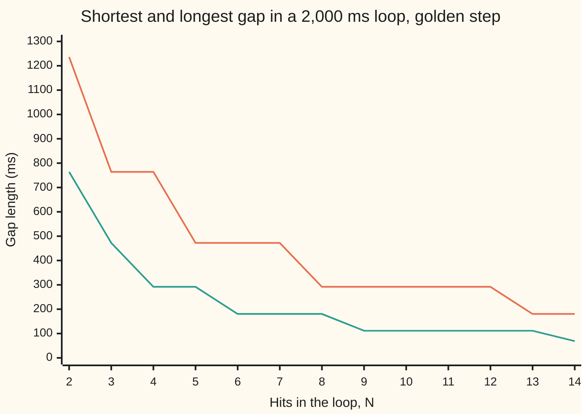

# Three distances: stepping by a fixed irrational leaves gaps of only three lengths

[Syllabus](../../../SYLLABUS.md) → [Algebraic and analytic number theory](../README.md) → [Additive Combinatorics and Probabilistic Number Theory](../README.md#s08) → Three distances

---

## General Overview

A generative sequencer plays a loop one bar long: 2,000 ms, one bar of 4/4 at 120 beats per minute. Each bar it adds one new hit, placed 0.618034 of a loop further on than the last one. That step is the golden ratio, 1.618034 loops, with the whole loop dropped. The first hit sits on the downbeat, the start of the loop.

After 10 bars the loop holds 10 hits. They cut it into 10 gaps. Random places would give 10 different gap lengths. The golden step gives only three: 111.456 ms, 180.340 ms and 291.796 ms. The longest is the sum of the other two.

This is no accident of the golden ratio. For any irrational step (a number that is not a fraction) and any number of hits, the gaps take at most three lengths. The golden ratio adds something more: its three lengths are always within a factor of 2.618 of each other, so the rhythm stays evenly spread at every bar.

**Hits placed by repeating one irrational step round a loop always cut it into gaps of at most three lengths, the longest being the sum of the other two. Those three lengths change only when a hit lands closer to the downbeat than any hit before it, which happens only at bar numbers read off the step's continued fraction; in between, the longest gaps are used up one by one.**

**What kind of fact this is:** a theorem, the three-distance theorem, proved on this card in Why it works for every irrational step. One fact used in Steps 1 and 5, that the closest returns fall at continued-fraction denominators, is stated with its source, Khinchin's *Continued Fractions*. The code checks the gap lengths for four steps and every hit count up to 2,000, which is evidence, not proof.

### The picture: ten bars, ten gaps

The ten gaps in loop order, starting at the downbeat. One block is 20 ms.

```
bar 0 -> bar 5   █████████        180.3 ms
bar 5 -> bar 2   ███████████████  291.8 ms
bar 2 -> bar 7   █████████        180.3 ms
bar 7 -> bar 4   ███████████████  291.8 ms
bar 4 -> bar 9   █████████        180.3 ms
bar 9 -> bar 1   ██████           111.5 ms
bar 1 -> bar 6   █████████        180.3 ms
bar 6 -> bar 3   ███████████████  291.8 ms
bar 3 -> bar 8   █████████        180.3 ms
bar 8 -> bar 0   ██████           111.5 ms
```

Three bar lengths, no others. With 6 to 13 hits, the next hit after bar 0 is always bar 5, five bars on; Step 3 explains why.

---

## The formula

Notation first, in words.

- $`\{x\}`$ is the **fractional part** of x: the part after the point, so $`\{1.618\} = 0.618`$ ([Equidistribution](03-equidistribution-and-weyls-criterion.md) introduced it).
- $`\lVert x \rVert`$ is the distance from x to the nearest whole number, as on [The large sieve](../04-Sieves%20and%20Prime%20Gaps/03-the-large-sieve.md).
- $`\varphi = (1 + \sqrt{5})/2 = 1.618034`$ is the golden ratio. On this card $`\varphi`$ never means the totient.
- Positions are measured in loops: 0 is the downbeat, 1 is the next downbeat.

The step is $`\alpha = \varphi - 1 = 0.618034`$. Bar n puts its hit at $`x_n = \{n\alpha\}`$, for n = 0, 1, …, N − 1. Among bars 1 to N − 1, let **bar a** be the one landing closest *after* the downbeat, at distance $`u = \{a\alpha\}`$. Let **bar b** be the one landing closest *before* it, at distance $`v = 1 - \{b\alpha\}`$. Then the gap after the hit of bar n is

```math
\text{gap after } x_n = \begin{cases} u & \text{if } n < N - a \\ v & \text{if } n \ge b \\ u + v & \text{otherwise} \end{cases} \qquad \text{counts: } N - a,\quad N - b,\quad a + b - N
```

**Read it aloud:** the next hit after bar n is bar n + a, or else bar n − b, or else bar n + a − b; so every gap is u, v or u + v, and counting the bars in each case gives how many of each.

For the golden step, a and b are Fibonacci numbers (1, 1, 2, 3, 5, 8, 13, … with $`F_1 = F_2 = 1`$). If $`F_k < N \le F_{k+1}`$:

```math
\text{lengths } \varphi^{-k},\ \varphi^{-(k-1)},\ \varphi^{-(k-2)} \text{ loops}, \qquad \text{counts } N - F_k,\quad N - F_{k-1},\quad F_{k+1} - N
```

**Read it aloud:** with N hits between two Fibonacci numbers, the gaps are three neighbouring powers of 1/φ, and each count is a distance from N to a Fibonacci number.

For N = 10: $`F_6 = 8 < 10 \le 13 = F_7`$, so the lengths are $`\varphi^{-6}, \varphi^{-5}, \varphi^{-4}`$ of 2,000 ms: 111.456 ms twice, 180.340 ms five times, 291.796 ms three times.

| Symbol | Plain meaning | In our example | Push it up and the answer… |
| --- | --- | --- | --- |
| `LOOP` | the loop's length, named as in the code | 2,000 ms | every gap scales with it |
| $`\alpha`$ | the step per bar, in loops, whole loops dropped | 0.618034 | a different irrational: still three lengths, different spread |
| $`\varphi`$ | the golden ratio, $`(1 + \sqrt{5})/2`$ | 1.618034 | — |
| $`N`$ | how many hits so far, one per bar | 10 | gaps shrink; u and v change only at records |
| $`n`$, $`x_n`$ | a bar number, from 0, and its hit $`\{n\alpha\}`$ | bar 3 at 1,708.2 ms | — |
| $`\{x\}`$, $`\lVert x \rVert`$ | the part after the point; the distance to the nearest whole number | $`\{1.236068\} = 0.236068`$, $`\lVert 4.944272 \rVert = 0.055728`$ | — |
| $`a`$, $`u`$ | the bar landing closest after the downbeat, and how close | bar 5, 180.340 ms | a new record makes u smaller |
| $`b`$, $`v`$ | the bar landing closest before the downbeat, and how close | bar 8, 111.456 ms | a new record makes v smaller |
| $`p`$, $`r`$ | the whole loops just below $`a\alpha`$ and just above $`b\alpha`$ | 3 and 5 | — |
| $`F_k`$ | the k-th Fibonacci number | $`F_6 = 8`$, $`F_7 = 13`$ | lengths drop one power of 1/φ |
| $`p_k/q_k`$ | the k-th convergent of α's continued fraction | 3/5, 5/8 | closer to α |
| $`\psi`$, $`D`$, $`(t, s)`$, $`\lambda`$, $`\mu`$ | helpers in the two folded proofs: $`-1/\varphi`$; the whole number $`a r - b p`$; a whole-number point (bar t, s whole loops); two weights from 0 up to 1 | $`\psi = -0.618034`$, $`D = 1`$ | — |

### When it holds

- **One fixed step, added once per bar.** Put bar n at $`\{n^2\alpha\}`$ instead and 10 hits give 10 different lengths, the longest 33.3 times the shortest.
- **An irrational step.** A rational step repeats. A sequencer that rounds the step to its 16-step grid, 10/16 of a loop, has only 8 places, so bars 8 and 9 land on bars 0 and 1.
- **A loop, not a line.** The gap from the last hit back round to the downbeat counts. Every hit is equal on a loop; that is what Step 0 uses.
- **Three lengths, not equal lengths.** Any irrational gives at most three, but how far apart they are depends on the step. Over 2 to 2,000 hits the worst longest-to-shortest ratio is 2.618 for the golden step and 293.6 for π − 3.

---

## Why it works

### Step 0: on a loop, only differences matter

Turning the whole loop moves every hit and changes no gap. So the gap after the hit of bar n depends only on which other bars sit just ahead of it. Moving from bar n to bar n + a always moves the hit forward by the same amount, u. Moving to bar n − b always moves it forward by v.

So two "closest returns" decide everything: the bar a that comes back closest after the downbeat, and the bar b that comes back closest before it. Every gap is u, v or u + v. The proof shows those moves really reach the *next* hit.

### Step 1: the closest returns are continued-fraction denominators

As bars are added, the closest return on each side keeps improving. These record bars are where α is best approximated by a fraction. The [Continued fractions](../../02-Number%20theory/07-For%20the%20Curious/05-continued-fractions-and-leap-years.md) card shows the convergents are the best fractions of their size. The records on each side are convergents or the in-between fractions two convergents make (Khinchin, chapter II, on best approximations).

The golden step's continued fraction is $`[0; 1, 1, 1, \dots]`$: every partial quotient is 1, so there are no in-between fractions. Its convergents are ratios of Fibonacci numbers: 1/2, 2/3, 3/5, 5/8, 8/13. The records are at Fibonacci bars, alternating sides:

| Bar q | $`q\alpha`$ | Distance to nearest whole | $`\varphi^{-k}`$ | Side |
| ---: | ---: | ---: | ---: | --- |
| 2 | 1.236068 | 0.236068 | $`\varphi^{-3}`$ = 0.236068 | after |
| 3 | 1.854102 | 0.145898 | $`\varphi^{-4}`$ = 0.145898 | before |
| 5 | 3.090170 | 0.090170 | $`\varphi^{-5}`$ = 0.090170 | after |
| 8 | 4.944272 | 0.055728 | $`\varphi^{-6}`$ = 0.055728 | before |
| 13 | 8.034442 | 0.034442 | $`\varphi^{-7}`$ = 0.034442 | after |

Each record is 1/φ times the one before. The exact identity is $`F_k\alpha - F_{k-1} = -(-1)^k\varphi^{-k}`$.

<details>
<summary>Detailed proof: the Fibonacci bar F<sub>k</sub> lands φ<sup>−k</sup> from a whole loop</summary>

Let $`\psi = -1/\varphi = -\alpha`$. It solves $`\psi^2 = \psi + 1`$, the same equation as $`\varphi`$.

Claim: $`\psi^k = F_k\psi + F_{k-1}`$. At k = 1 it reads $`\psi = \psi + 0`$. If it holds at k, multiply by $`\psi`$:

$`\displaystyle \psi^{k+1} = F_k\psi^2 + F_{k-1}\psi = F_k(\psi + 1) + F_{k-1}\psi = F_{k+1}\psi + F_k.`$

Put $`\psi = -\alpha`$: $`(-1)^k\varphi^{-k} = -F_k\alpha + F_{k-1}`$. So $`F_k\alpha`$ sits $`\varphi^{-k}`$ from the whole number $`F_{k-1}`$: after it when k is odd, before it when k is even. At k = 6: $`8\alpha = 4.944272`$, which is $`\varphi^{-6} = 0.055728`$ before 5.

</details>

### Step 2: the two returns together reach past N

Claim: $`a + b \ge N`$. Suppose not, so bar a + b exists. Its hit is the hit of bar a moved back by v, at $`u - v`$ loops.

- If u is bigger than v, that hit lands after the downbeat at distance $`u - v`$, closer than bar a. That breaks a's record.
- If v is bigger, it lands before the downbeat at distance $`v - u`$, closer than bar b. That breaks b's record.

u and v cannot be equal, since then $`(a + b)\alpha`$ would be whole and α a fraction. So $`a + b \ge N`$. At N = 10: 5 + 8 = 13.

### Step 3: the neighbour rule

Send each bar n to a target bar:

1. bar n + a, when $`n < N - a`$: the hit moves forward u;
2. bar n − b, when $`n \ge b`$: forward v;
3. bar n + a − b, in the remaining case: forward u + v.

By Step 2 cases 1 and 2 never overlap. The targets of case 2 are bars 0 to N − b − 1; of case 3, bars N − b to a − 1; of case 1, bars a to N − 1. Those ranges do not overlap and cover every bar, so each bar is hit exactly once.

Now add up how far the hits move. Each one moves at least as far as the next hit ahead of it, and the gaps add up to one whole loop. The total is

```math
(N - a)\,u + (N - b)\,v + (a + b - N)(u + v) = b\,u + a\,v = a\,r - b\,p
```

where $`u = a\alpha - p`$ and $`v = r - b\alpha`$. That is a whole number, and the fold below proves it is 1. Two fractions $`p/a`$ and $`r/b`$ with $`a r - b p = 1`$ are called **Farey neighbours**: no fraction with a bottom number below a + b sits between them. At N = 10 they are 3/5 and 5/8, and $`5 \times 5 - 8 \times 3 = 1`$.

So the total equals the loop exactly. No hit can move further than its gap without another moving less, which is impossible. **Every target is the very next hit.** That is the formula.

<details>
<summary>Detailed proof: a r − b p = 1 for every irrational step</summary>

Write $`D = a r - b p`$. It is positive, since $`b u + a v > 0`$.

Picture the whole-number points (t, s) of the plane. Each stands for "bar t, measured against s whole loops", with signed distance $`t\alpha - s`$. The point (a, p) has distance u; the point (b, r) has distance −v.

The parallelogram with corners (0, 0), (a, p), (b, r) and (a + b, p + r) has area D. A parallelogram with whole-number corners and area D holds exactly D whole-number points of the form $`\lambda(a, p) + \mu(b, r)`$ with $`0 \le \lambda, \mu < 1`$.

Suppose D ≥ 2. Then one such point (t, s) is not the origin. Its distance is

$`\displaystyle t\alpha - s = \lambda u - \mu v,`$

which lies strictly between −v and u, and is not 0 since α is irrational. Its bar number $`t = \lambda a + \mu b`$ is positive.

If t ≤ N − 1, bar t beats a's record (if the distance is positive) or b's (if negative). If t ≥ N, take the mirror point $`(a + b - t,\ p + r - s)`$, made with $`1 - \lambda`$ and $`1 - \mu`$. Its bar number is positive and at most $`a + b - N < N`$, and its distance again lies between −v and u. Either way a record breaks. So D = 1.

For the golden step this is Cassini's identity: $`F_{k+1}F_{k-1} - F_k^2 = (-1)^k`$.

</details>

### Step 4: count the three kinds

Case 1 covers N − a bars, case 2 covers N − b, and case 3 the remaining a + b − N. The longest length, u + v, is the sum of the other two. When N = a + b, case 3 is empty and only two lengths remain.

For the golden step the lengths are $`u, v = \varphi^{-k}, \varphi^{-(k-1)}`$ in some order, and $`u + v = \varphi^{-(k-2)}`$, since $`\varphi^{-k} + \varphi^{-(k-1)} = \varphi^{-k}(1 + \varphi) = \varphi^{-k}\varphi^2`$. Two lengths remain exactly at Fibonacci numbers of hits: 2, 3, 5, 8, 13, 21, 34, 55, 89 up to 100.

### Step 5: why the lengths change only at convergent denominators

Add one more bar. If its hit sets no record, a and b stay the same, and so do u, v and u + v. Only the counts move: u and v each gain one, u + v loses one. **The new hit splits one longest gap into a u and a v.**

The three lengths u, v and u + v change only when the new bar sets a record, and by Step 1 that is a convergent denominator (or an in-between fraction's). Between records only the number of lengths shown can change: at N = a + b every u + v gap has been split, so only two lengths show. For the golden step the record bar is a Fibonacci bar. There the longest gaps have just run out. The new hit splits a gap of $`\varphi^{-(k-1)}`$ into $`\varphi^{-k}`$ and $`\varphi^{-(k+1)}`$, and all three lengths move down one power of 1/φ.

So the golden rhythm is always three neighbouring powers of 1/φ, never more than $`\varphi^2 = 2.618`$ apart. A step with a big partial quotient, such as π − 3, whose continued fraction the code prints as $`[0; 7, 15, 1, 292, \dots]`$, keeps one record for many bars while the other length shrinks. The code measures its worst ratio at 293.6.

---

## Worked numbers, by hand

The golden step, N = 10 bars, loop 2,000 ms.

| Step | Arithmetic | Value |
| --- | --- | --- |
| hits, bars 0 to 9 | $`\{n \times 0.618034\} \times 2000`$ | 0.0, 1,236.1, 472.1, 1,708.2, 944.3, 180.3, 1,416.4, 652.5, 1,888.5, 1,124.6 ms |
| closest after the downbeat | bar 5: $`3.090170 - 3`$ | u = 180.340 ms |
| closest before it | bar 8: $`5 - 4.944272`$ | v = 111.456 ms |
| check Step 2 | 5 + 8 | 13 ≥ 10 |
| gaps of u | N − a = 10 − 5 | 5 |
| gaps of v | N − b = 10 − 8 | 2 |
| gaps of u + v | 180.340 + 111.456, count 5 + 8 − 10 | 291.796 ms, 3 |
| whole loop | $`5 \times 180.340 + 2 \times 111.456 + 3 \times 291.796`$ | 2,000 ms |
| Farey check | $`a r - b p = 5 \times 5 - 8 \times 3`$ | 1 |
| **gap lengths** | | **111.456 ms × 2, 180.340 ms × 5, 291.796 ms × 3** |

Ten hits, three gap lengths, and the longest only 2.618 times the shortest: the rhythm never bunches up.

### What breaks if you drop a piece

| Mistake | Comes out at | What went wrong |
| --- | --- | --- |
| Step rounded to the 16-step grid, 10/16 | 8 places for 10 hits | A rational step repeats after 8 bars |
| Bar n placed at $`n^2\alpha`$ | 10 lengths, longest/shortest 33.270510 | No longer one fixed step, so Step 0 fails |
| 10 random places (SplitMix64, seed 2026) | 10 lengths, longest/shortest 21.407553 | No step at all: nothing ties one gap to another |

The code prints all three.

---

## The rhythm, bar by bar

The puzzle: each new hit makes the loop busier, yet the gap lengths stay at three. Trace the shortest and longest gap as bars are added.

| N | Lengths | a | b | Shortest, ms | Longest, ms |
| ---: | ---: | ---: | ---: | ---: | ---: |
| 2 | 2 | 1 | 1 | 763.932 | 1,236.068 |
| 3 | 2 | 2 | 1 | 472.136 | 763.932 |
| 4 | 3 | 2 | 3 | 291.796 | 763.932 |
| 5 | 2 | 2 | 3 | 291.796 | 472.136 |
| 6 | 3 | 5 | 3 | 180.340 | 472.136 |
| 7 | 3 | 5 | 3 | 180.340 | 472.136 |
| 8 | 2 | 5 | 3 | 180.340 | 291.796 |
| 9 | 3 | 5 | 8 | 111.456 | 291.796 |
| 10 | 3 | 5 | 8 | 111.456 | 291.796 |
| 11 | 3 | 5 | 8 | 111.456 | 291.796 |
| 12 | 3 | 5 | 8 | 111.456 | 291.796 |
| 13 | 2 | 5 | 8 | 111.456 | 180.340 |
| 14 | 3 | 13 | 8 | 68.884 | 180.340 |

At N = 2, a and b are the same bar, since bar 1 is the only one. The shortest gap drops only when a or b changes, at bars 2, 3, 5, 8, 13: Fibonacci numbers. Between those, each new hit splits one longest gap, and the longest drops when the last one is used up.



Orange: the longest gap. Green: the shortest gap. The two staircases step down by a factor of φ, never more than φ² apart.

---

## Code, from first principles, and it actually runs

The code reaches the gap lengths by three independent roads. Road 1 places the hits, sorts them and measures every gap. Road 2 finds the closest returns a and b by search and applies the neighbour rule of Step 3, never sorting. Road 3 uses only Fibonacci numbers and powers of 1/φ. They must agree at N = 10 and at every N from 2 to 2,000, for the golden step and, for roads 1 and 2, three other irrational steps. The code also checks $`a r - b p = 1`$ at every N. The only imports are `sqrt` and `floor`.

### Python

```python
# Three distances -- the check behind the card.  Standard library only; sqrt and
# floor are the only imports.  A sequencer adds one hit per bar, alpha = 0.618...
# of a loop further on each time (a step of the golden ratio, 1.618 loops, lands
# in the same place).  The gaps between hits are found by three roads:
# road 1 sorts the hits and measures every gap; road 2 is the neighbour rule,
# built from the two closest returns a and b; road 3 reads the gaps off the
# Fibonacci numbers, the golden ratio's convergent denominators.
from math import sqrt, floor

LOOP = 2000.0                                   # one 4/4 bar at 120 bpm, in ms
PHI = (1 + sqrt(5)) / 2
ALPHA = PHI - 1
STEPS = [("golden", ALPHA), ("sqrt2-1", sqrt(2) - 1),
         ("e-2", 2.718281828459045 - 2), ("pi-3", 3.141592653589793 - 3)]

def frac(x):                                    # {x}: the part after the point
    return x - floor(x)

def gaps(pts):                                  # road 1: sort, measure round the loop
    s = sorted(pts)
    return [s[i + 1] - s[i] for i in range(len(s) - 1)] + [1 - s[-1] + s[0]]

def tally(gs):                                  # distinct lengths with their counts
    out = []
    for g in sorted(gs):
        if out and g - out[-1][0] < 1e-9:
            out[-1][1] += 1
        else:
            out.append([g, 1])
    return out

def rule(alpha, n):                             # road 2: closest returns either side
    a = min(range(1, n), key=lambda k: frac(k * alpha))
    b = max(range(1, n), key=lambda k: frac(k * alpha))
    u, v = frac(a * alpha), 1 - frac(b * alpha)
    t = sorted([[u, n - a], [v, n - b], [u + v, a + b - n]])
    return a, b, u, v, [x for x in t if x[1] > 0]

def fib_rule(n):                                # road 3: F_k < n <= F_(k+1)
    F = [0, 1]
    while F[-1] < n:
        F.append(F[-1] + F[-2])
    k = len(F) - 2
    t = [[PHI ** -k, n - F[k]], [PHI ** (1 - k), n - F[k - 1]], [PHI ** (2 - k), F[k + 1] - n]]
    return [x for x in t if x[1] > 0]

def same(t1, t2):
    return len(t1) == len(t2) and all(c1 == c2 and abs(g1 - g2) < 1e-9
                                      for (g1, c1), (g2, c2) in zip(t1, t2))

def ms(t):
    return ", ".join(f"{g * LOOP:.3f} ms x {c}" for g, c in t)

def yn(b):
    return "yes" if b else "no"

def cfrac(x, terms):                            # whole part, then flip
    out = []
    for _ in range(terms):
        out.append(floor(x))
        x = 1 / (x - floor(x))
    return out

print(f"step alpha = {ALPHA:.12f} of a {LOOP:.0f} ms loop; continued fraction {cfrac(ALPHA, 10)}")
F = [1, 1]
while len(F) < 12:
    F.append(F[-1] + F[-2])
print(" q   q x alpha  nearest  distance   phi^-k     side of the downbeat")
for k, q in enumerate(F[1:9], start=2):
    d = q * ALPHA - round(q * ALPHA)
    print(f"{q:2d} {q * ALPHA:10.6f} {round(q * ALPHA):5d}  {abs(d):9.6f} {PHI ** -k:9.6f}"
          f"    {'after' if d > 0 else 'before'}")
N = 10
pts = [frac(n * ALPHA) for n in range(N)]
print("hit of bar n, ms:", " ".join(f"{p * LOOP:.1f}" for p in pts))
print("gaps round the loop from the downbeat, ms:", " ".join(f"{g * LOOP:.1f}" for g in gaps(pts)))
brute = tally(gaps(pts))
a, b, u, v, pred = rule(ALPHA, N)
p, r = floor(a * ALPHA), floor(b * ALPHA) + 1
print(f"road 1, sorted gaps: {len(brute)} lengths: {ms(brute)}")
print(f"road 2, a = {a}, u = {u * LOOP:.3f} ms; b = {b}, v = {v * LOOP:.3f} ms; "
      f"counts N-a = {N - a}, N-b = {N - b}, a+b-N = {a + b - N}")
print(f"road 3, F = 8 < N <= 13: {ms(fib_rule(N))}")
print(f"longest = u + v: {u * LOOP:.3f} + {v * LOOP:.3f} = {(u + v) * LOOP:.3f} ms")
print(f"p = {p}, r = {r}: a*r - b*p = {a * r - b * p}; b*u + a*v = {b * u + a * v:.12f}")
print(" N  lengths   a   b  shortest, ms  longest, ms")
for n in range(2, 15):
    t, (a2, b2) = tally(gaps([frac(k * ALPHA) for k in range(n)])), rule(ALPHA, n)[:2]
    print(f"{n:2d}  {len(t):5d}  {a2:3d} {b2:3d}  {t[0][0] * LOOP:11.3f}  {t[-1][0] * LOOP:10.3f}")
TOP, ok, worst, det, fib_ok = 2000, True, {}, True, True
for name, al in STEPS:
    w, three = 1.0, 0
    for n in range(2, TOP + 1):
        t = tally(gaps([frac(k * al) for k in range(n)]))
        a2, b2, u2, v2, pr = rule(al, n)
        ok = ok and len(t) <= 3 and same(t, pr)
        det = det and a2 * (floor(b2 * al) + 1) - b2 * floor(a2 * al) == 1
        if name == "golden":
            fib_ok = fib_ok and same(t, fib_rule(n))
        three += len(t) == 3
        w = max(w, t[-1][0] / t[0][0])
    worst[name] = w
    print(f"{name:8s} N = 2..{TOP}: three lengths at {three} N; worst longest/shortest {w:.6f}")
print(f"continued fraction of pi-3: {cfrac(STEPS[3][1], 5)}")
print(f"road 1 = road 2 at every N, never more than 3 lengths: {yn(ok)}; a*r - b*p = 1 always: {yn(det)}")
print(f"road 1 = road 3 for the golden step, N = 2..{TOP}: {yn(fib_ok)}")
two = [n for n in range(2, 101) if len(tally(gaps([frac(k * ALPHA) for k in range(n)]))) == 2]
print(f"N up to 100 with only two lengths: {two}")
q16 = [frac(n * 10 / 16) for n in range(N)]
sq = tally(gaps([frac(n * n * ALPHA) for n in range(N)]))
M, s, rnd = 2 ** 64 - 1, 2026, []
for _ in range(N):
    s = (s + 0x9E3779B97F4A7C15) & M
    z = ((s ^ (s >> 30)) * 0xBF58476D1CE4E5B9) & M
    z = ((z ^ (z >> 27)) * 0x94D049BB133111EB) & M
    rnd.append(((z ^ (z >> 31)) >> 11) / 2 ** 53)
rt = tally(gaps(rnd))
print(f"mistake 1, step rounded to 10/16 of the loop: {len(set(q16))} places for {N} hits")
print(f"mistake 2, bar n at n*n*alpha: {len(sq)} lengths, longest/shortest {sq[-1][0] / sq[0][0]:.6f}")
print(f"mistake 3, {N} random places (SplitMix64, seed 2026): {len(rt)} lengths, "
      f"longest/shortest {rt[-1][0] / rt[0][0]:.6f}")
assert same(brute, pred) and same(brute, fib_rule(N)) and [a, b] == [5, 8]
assert ok and det and fib_ok and abs(worst["golden"] - PHI ** 2) < 1e-6
assert two == [f for f in F[2:] if f <= 100]
assert len(set(q16)) == 8 and len(sq) > 3 and len(rt) == N
print("ALL CHECKS PASS")
```

**Ran 2026-11-15 on macOS, Python 3.14.10, standard library only. All checks passed. Output, pasted from the run:**

```
step alpha = 0.618033988750 of a 2000 ms loop; continued fraction [0, 1, 1, 1, 1, 1, 1, 1, 1, 1]
 q   q x alpha  nearest  distance   phi^-k     side of the downbeat
 1   0.618034     1   0.381966  0.381966    before
 2   1.236068     1   0.236068  0.236068    after
 3   1.854102     2   0.145898  0.145898    before
 5   3.090170     3   0.090170  0.090170    after
 8   4.944272     5   0.055728  0.055728    before
13   8.034442     8   0.034442  0.034442    after
21  12.978714    13   0.021286  0.021286    before
34  21.013156    21   0.013156  0.013156    after
hit of bar n, ms: 0.0 1236.1 472.1 1708.2 944.3 180.3 1416.4 652.5 1888.5 1124.6
gaps round the loop from the downbeat, ms: 180.3 291.8 180.3 291.8 180.3 111.5 180.3 291.8 180.3 111.5
road 1, sorted gaps: 3 lengths: 111.456 ms x 2, 180.340 ms x 5, 291.796 ms x 3
road 2, a = 5, u = 180.340 ms; b = 8, v = 111.456 ms; counts N-a = 5, N-b = 2, a+b-N = 3
road 3, F = 8 < N <= 13: 111.456 ms x 2, 180.340 ms x 5, 291.796 ms x 3
longest = u + v: 180.340 + 111.456 = 291.796 ms
p = 3, r = 5: a*r - b*p = 1; b*u + a*v = 1.000000000000
 N  lengths   a   b  shortest, ms  longest, ms
 2      2    1   1      763.932    1236.068
 3      2    2   1      472.136     763.932
 4      3    2   3      291.796     763.932
 5      2    2   3      291.796     472.136
 6      3    5   3      180.340     472.136
 7      3    5   3      180.340     472.136
 8      2    5   3      180.340     291.796
 9      3    5   8      111.456     291.796
10      3    5   8      111.456     291.796
11      3    5   8      111.456     291.796
12      3    5   8      111.456     291.796
13      2    5   8      111.456     180.340
14      3   13   8       68.884     180.340
golden   N = 2..2000: three lengths at 1984 N; worst longest/shortest 2.618034
sqrt2-1  N = 2..2000: three lengths at 1983 N; worst longest/shortest 3.414214
e-2      N = 2..2000: three lengths at 1980 N; worst longest/shortest 9.522688
pi-3     N = 2..2000: three lengths at 1961 N; worst longest/shortest 293.634591
continued fraction of pi-3: [0, 7, 15, 1, 292]
road 1 = road 2 at every N, never more than 3 lengths: yes; a*r - b*p = 1 always: yes
road 1 = road 3 for the golden step, N = 2..2000: yes
N up to 100 with only two lengths: [2, 3, 5, 8, 13, 21, 34, 55, 89]
mistake 1, step rounded to 10/16 of the loop: 8 places for 10 hits
mistake 2, bar n at n*n*alpha: 10 lengths, longest/shortest 33.270510
mistake 3, 10 random places (SplitMix64, seed 2026): 10 lengths, longest/shortest 21.407553
ALL CHECKS PASS
```

### Rust

Same numbers, same labels, built with `rustc --edition 2021 -O`.

```rust
// Three distances -- the same check as the Python, in Rust.  No crates.  A
// sequencer adds one hit per bar, alpha = 0.618... of a loop further on each
// time (a step of the golden ratio, 1.618 loops, lands in the same place).  The
// gaps between hits are found by three roads: road 1 sorts the hits and
// measures every gap; road 2 is the neighbour rule, built from the two closest
// returns a and b; road 3 reads the gaps off the Fibonacci numbers, the golden
// ratio's convergent denominators.
const LOOP: f64 = 2000.0; // one 4/4 bar at 120 bpm, in ms

fn frac(x: f64) -> f64 { x - x.floor() } // {x}: the part after the point

fn gaps(pts: &[f64]) -> Vec<f64> { // road 1: sort, measure round the loop
    let mut s = pts.to_vec();
    s.sort_by(|x, y| x.partial_cmp(y).unwrap());
    let mut g: Vec<f64> = (0..s.len() - 1).map(|i| s[i + 1] - s[i]).collect();
    g.push(1.0 - s[s.len() - 1] + s[0]);
    g
}

fn tally(gs: &[f64]) -> Vec<(f64, i64)> { // distinct lengths with their counts
    let mut s = gs.to_vec();
    s.sort_by(|x, y| x.partial_cmp(y).unwrap());
    let mut out: Vec<(f64, i64)> = Vec::new();
    for g in s {
        match out.last_mut() {
            Some(last) if g - last.0 < 1e-9 => last.1 += 1,
            _ => out.push((g, 1)),
        }
    }
    out
}

fn sorted_pos(mut t: Vec<(f64, i64)>) -> Vec<(f64, i64)> {
    t.sort_by(|x, y| x.partial_cmp(y).unwrap());
    t.into_iter().filter(|x| x.1 > 0).collect()
}

fn rule(al: f64, n: i64) -> (i64, i64, f64, f64, Vec<(f64, i64)>) { // road 2
    let a = (1..n).min_by(|&x, &y| frac(x as f64 * al).partial_cmp(&frac(y as f64 * al)).unwrap()).unwrap();
    let b = (1..n).max_by(|&x, &y| frac(x as f64 * al).partial_cmp(&frac(y as f64 * al)).unwrap()).unwrap();
    let (u, v) = (frac(a as f64 * al), 1.0 - frac(b as f64 * al));
    (a, b, u, v, sorted_pos(vec![(u, n - a), (v, n - b), (u + v, a + b - n)]))
}

fn fib_rule(n: i64, phi: f64) -> Vec<(f64, i64)> { // road 3: F_k < n <= F_(k+1)
    let mut f: Vec<i64> = vec![0, 1];
    while *f.last().unwrap() < n { let l = f.len(); f.push(f[l - 1] + f[l - 2]) }
    let k = f.len() - 2;
    let kf = k as f64;
    sorted_pos(vec![(phi.powf(-kf), n - f[k]), (phi.powf(1.0 - kf), n - f[k - 1]), (phi.powf(2.0 - kf), f[k + 1] - n)])
}

fn same(t1: &[(f64, i64)], t2: &[(f64, i64)]) -> bool {
    t1.len() == t2.len() && t1.iter().zip(t2).all(|(x, y)| x.1 == y.1 && (x.0 - y.0).abs() < 1e-9)
}

fn ms(t: &[(f64, i64)]) -> String {
    t.iter().map(|(g, c)| format!("{:.3} ms x {}", g * LOOP, c)).collect::<Vec<_>>().join(", ")
}

fn cfrac(mut x: f64, terms: usize) -> Vec<i64> { // whole part, then flip
    let mut out = Vec::new();
    for _ in 0..terms { out.push(x.floor() as i64); x = 1.0 / (x - x.floor()); }
    out
}

fn yn(b: bool) -> &'static str { if b { "yes" } else { "no" } }

fn hits(al: f64, n: i64) -> Vec<f64> { (0..n).map(|k| frac(k as f64 * al)).collect() }

fn main() {
    let phi = (1.0 + 5f64.sqrt()) / 2.0;
    let alpha = phi - 1.0;
    let steps = [("golden", alpha), ("sqrt2-1", 2f64.sqrt() - 1.0),
                 ("e-2", 2.718281828459045 - 2.0), ("pi-3", 3.141592653589793 - 3.0)];
    println!("step alpha = {:.12} of a {:.0} ms loop; continued fraction {:?}", alpha, LOOP, cfrac(alpha, 10));
    let mut fib: Vec<i64> = vec![1, 1];
    while fib.len() < 12 { let l = fib.len(); fib.push(fib[l - 1] + fib[l - 2]) }
    println!(" q   q x alpha  nearest  distance   phi^-k     side of the downbeat");
    for (i, &q) in fib[1..9].iter().enumerate() {
        let qa = q as f64 * alpha;
        let d = qa - qa.round();
        println!("{:2} {:10.6} {:5}  {:9.6} {:9.6}    {}", q, qa, qa.round() as i64, d.abs(),
                 phi.powf(-((i + 2) as f64)), if d > 0.0 { "after" } else { "before" });
    }
    let n = 10i64;
    let pts = hits(alpha, n);
    println!("hit of bar n, ms: {}", pts.iter().map(|p| format!("{:.1}", p * LOOP)).collect::<Vec<_>>().join(" "));
    println!("gaps round the loop from the downbeat, ms: {}",
             gaps(&pts).iter().map(|g| format!("{:.1}", g * LOOP)).collect::<Vec<_>>().join(" "));
    let brute = tally(&gaps(&pts));
    let (a, b, u, v, pred) = rule(alpha, n);
    let (p, r) = ((a as f64 * alpha).floor() as i64, (b as f64 * alpha).floor() as i64 + 1);
    println!("road 1, sorted gaps: {} lengths: {}", brute.len(), ms(&brute));
    println!("road 2, a = {}, u = {:.3} ms; b = {}, v = {:.3} ms; counts N-a = {}, N-b = {}, a+b-N = {}",
             a, u * LOOP, b, v * LOOP, n - a, n - b, a + b - n);
    println!("road 3, F = 8 < N <= 13: {}", ms(&fib_rule(n, phi)));
    println!("longest = u + v: {:.3} + {:.3} = {:.3} ms", u * LOOP, v * LOOP, (u + v) * LOOP);
    println!("p = {}, r = {}: a*r - b*p = {}; b*u + a*v = {:.12}", p, r, a * r - b * p, b as f64 * u + a as f64 * v);
    println!(" N  lengths   a   b  shortest, ms  longest, ms");
    for m in 2..15 {
        let t = tally(&gaps(&hits(alpha, m)));
        let (a2, b2, _, _, _) = rule(alpha, m);
        println!("{:2}  {:5}  {:3} {:3}  {:11.3}  {:10.3}", m, t.len(), a2, b2, t[0].0 * LOOP, t[t.len() - 1].0 * LOOP);
    }
    let top = 2000i64;
    let (mut ok, mut det, mut fib_ok, mut worst_golden) = (true, true, true, 0.0);
    for &(name, al) in steps.iter() {
        let (mut w, mut three) = (1.0f64, 0);
        for m in 2..=top {
            let t = tally(&gaps(&hits(al, m)));
            let (a2, b2, _, _, pr) = rule(al, m);
            ok = ok && t.len() <= 3 && same(&t, &pr);
            det = det && a2 * ((b2 as f64 * al).floor() as i64 + 1) - b2 * ((a2 as f64 * al).floor() as i64) == 1;
            if name == "golden" { fib_ok = fib_ok && same(&t, &fib_rule(m, phi)); }
            if t.len() == 3 { three += 1; }
            w = w.max(t[t.len() - 1].0 / t[0].0);
        }
        if name == "golden" { worst_golden = w; }
        println!("{:8} N = 2..{}: three lengths at {} N; worst longest/shortest {:.6}", name, top, three, w);
    }
    println!("continued fraction of pi-3: {:?}", cfrac(steps[3].1, 5));
    println!("road 1 = road 2 at every N, never more than 3 lengths: {}; a*r - b*p = 1 always: {}", yn(ok), yn(det));
    println!("road 1 = road 3 for the golden step, N = 2..{}: {}", top, yn(fib_ok));
    let two: Vec<i64> = (2..101).filter(|&m| tally(&gaps(&hits(alpha, m))).len() == 2).collect();
    println!("N up to 100 with only two lengths: {:?}", two);
    let mut q16: Vec<f64> = (0..n).map(|k| frac(k as f64 * 10.0 / 16.0)).collect();
    q16.sort_by(|x, y| x.partial_cmp(y).unwrap());
    q16.dedup();
    let sq = tally(&gaps(&(0..n).map(|k| frac((k * k) as f64 * alpha)).collect::<Vec<f64>>()));
    let (mut s, mut rnd) = (2026u64, Vec::new());
    for _ in 0..n {
        s = s.wrapping_add(0x9E3779B97F4A7C15);
        let mut z = (s ^ (s >> 30)).wrapping_mul(0xBF58476D1CE4E5B9);
        z = (z ^ (z >> 27)).wrapping_mul(0x94D049BB133111EB);
        rnd.push(((z ^ (z >> 31)) >> 11) as f64 / 9007199254740992.0);
    }
    let rt = tally(&gaps(&rnd));
    println!("mistake 1, step rounded to 10/16 of the loop: {} places for {} hits", q16.len(), n);
    println!("mistake 2, bar n at n*n*alpha: {} lengths, longest/shortest {:.6}", sq.len(), sq[sq.len() - 1].0 / sq[0].0);
    println!("mistake 3, {} random places (SplitMix64, seed 2026): {} lengths, longest/shortest {:.6}",
             n, rt.len(), rt[rt.len() - 1].0 / rt[0].0);
    let fib_upto: Vec<i64> = fib[2..].iter().copied().filter(|&f| f <= 100).collect();
    assert!(same(&brute, &pred) && same(&brute, &fib_rule(n, phi)) && a == 5 && b == 8);
    assert!(ok && det && fib_ok && (worst_golden - phi * phi).abs() < 1e-6);
    assert!(two == fib_upto);
    assert!(q16.len() == 8 && sq.len() > 3 && rt.len() as i64 == n);
    println!("ALL CHECKS PASS");
}
```

**Ran 2026-11-15 on macOS, rustc 1.98.1, no crates. All checks passed. Output, pasted from the run:**

```
step alpha = 0.618033988750 of a 2000 ms loop; continued fraction [0, 1, 1, 1, 1, 1, 1, 1, 1, 1]
 q   q x alpha  nearest  distance   phi^-k     side of the downbeat
 1   0.618034     1   0.381966  0.381966    before
 2   1.236068     1   0.236068  0.236068    after
 3   1.854102     2   0.145898  0.145898    before
 5   3.090170     3   0.090170  0.090170    after
 8   4.944272     5   0.055728  0.055728    before
13   8.034442     8   0.034442  0.034442    after
21  12.978714    13   0.021286  0.021286    before
34  21.013156    21   0.013156  0.013156    after
hit of bar n, ms: 0.0 1236.1 472.1 1708.2 944.3 180.3 1416.4 652.5 1888.5 1124.6
gaps round the loop from the downbeat, ms: 180.3 291.8 180.3 291.8 180.3 111.5 180.3 291.8 180.3 111.5
road 1, sorted gaps: 3 lengths: 111.456 ms x 2, 180.340 ms x 5, 291.796 ms x 3
road 2, a = 5, u = 180.340 ms; b = 8, v = 111.456 ms; counts N-a = 5, N-b = 2, a+b-N = 3
road 3, F = 8 < N <= 13: 111.456 ms x 2, 180.340 ms x 5, 291.796 ms x 3
longest = u + v: 180.340 + 111.456 = 291.796 ms
p = 3, r = 5: a*r - b*p = 1; b*u + a*v = 1.000000000000
 N  lengths   a   b  shortest, ms  longest, ms
 2      2    1   1      763.932    1236.068
 3      2    2   1      472.136     763.932
 4      3    2   3      291.796     763.932
 5      2    2   3      291.796     472.136
 6      3    5   3      180.340     472.136
 7      3    5   3      180.340     472.136
 8      2    5   3      180.340     291.796
 9      3    5   8      111.456     291.796
10      3    5   8      111.456     291.796
11      3    5   8      111.456     291.796
12      3    5   8      111.456     291.796
13      2    5   8      111.456     180.340
14      3   13   8       68.884     180.340
golden   N = 2..2000: three lengths at 1984 N; worst longest/shortest 2.618034
sqrt2-1  N = 2..2000: three lengths at 1983 N; worst longest/shortest 3.414214
e-2      N = 2..2000: three lengths at 1980 N; worst longest/shortest 9.522688
pi-3     N = 2..2000: three lengths at 1961 N; worst longest/shortest 293.634591
continued fraction of pi-3: [0, 7, 15, 1, 292]
road 1 = road 2 at every N, never more than 3 lengths: yes; a*r - b*p = 1 always: yes
road 1 = road 3 for the golden step, N = 2..2000: yes
N up to 100 with only two lengths: [2, 3, 5, 8, 13, 21, 34, 55, 89]
mistake 1, step rounded to 10/16 of the loop: 8 places for 10 hits
mistake 2, bar n at n*n*alpha: 10 lengths, longest/shortest 33.270510
mistake 3, 10 random places (SplitMix64, seed 2026): 10 lengths, longest/shortest 21.407553
ALL CHECKS PASS
```

The two outputs match line for line.

### Lean

Lean proves the three-distance theorem and neighbour rule for every irrational step, and the Fibonacci identity for every k ≥ 1.

- Take an irrational step α and N ≥ 2 hits. Then every gap is u, v or u + v, for some positive u and v.
- Take an irrational step, and bars a and b landing closest after and before the downbeat among bars 1 to N − 1. Then the gap after $`x_n`$ is u if $`n < N - a`$, v if $`n \ge b`$, and u + v otherwise.
- Take the golden step $`\alpha = \varphi - 1`$ and a whole number k ≥ 1. Then $`F_k\alpha - F_{k-1} = -(-1)^k\varphi^{-k}`$.
- The 16-step grid, a step of 10/16, puts 10 hits on 8 places.
- The Fibonacci numbers $`F_6 = 8`$ and $`F_7 = 13`$ sit either side of N = 10.
- At N = 10, with a = 5 and b = 8, the counts 5, 2 and 3 add to 10.
- The Farey check gives $`5 \times 5 - 8 \times 3 = 1`$, Cassini's identity at k = 6.
- The Fibonacci numbers $`F_3`$ to $`F_{11}`$ are 2, 3, 5, 8, 13, 21, 34, 55 and 89.

Step 1's records, the Farey-neighbour fact for general steps and the golden lengths at each N are left to the Python and Rust checks.

```lean
-- Three distances: hits placed at {nα} for n = 0, …, N − 1 with α irrational cut the loop into gaps of at most three lengths u, v and u + v, set by the bars a and b that land closest after and before the downbeat, and the golden step's Fibonacci bars land exactly φ^(−k) from a whole loop.
import Mathlib.NumberTheory.Real.GoldenRatio
import Mathlib.NumberTheory.Real.Irrational
import Mathlib.Algebra.Order.Floor.Ring
import Mathlib.Order.ConditionallyCompleteLattice.Basic
import Mathlib.Algebra.Order.Archimedean.Real.Basic
import Mathlib.Tactic.LinearCombination

open Real

/-- The gap after the hit of bar n, when bars 0, 1, …, N − 1 have put their hits at
{0·α}, {1·α}, …, {(N − 1)·α} on a loop of length 1: the distance forward round the loop
to the nearest other hit. Going forward from {nα} to {mα} covers {(m − n)α} of the loop. -/
noncomputable def gapAfter (α : ℝ) (N n : ℕ) : ℝ :=
  sInf ((fun m : ℕ => Int.fract (((m : ℝ) - n) * α)) '' {m : ℕ | m < N ∧ m ≠ n})

/-- Helper: with α irrational, the offsets sα for different whole numbers s have
different fractional parts. -/
theorem fract_int_mul_injective {α : ℝ} (hα : Irrational α) {s t : ℤ}
    (h : Int.fract ((s : ℝ) * α) = Int.fract ((t : ℝ) * α)) : s = t := by
  rcases Int.fract_eq_fract.1 h with ⟨z, hz⟩
  by_contra hst
  have hne : s - t ≠ 0 := sub_ne_zero.2 hst
  have hirr := hα.intCast_mul hne
  apply hirr.ne_int z
  rw [← hz]; push_cast; ring

#print axioms fract_int_mul_injective

/-- Helper: subtracting a smaller fractional part. -/
theorem fract_sub_of_le {x y : ℝ} (h : Int.fract y ≤ Int.fract x) :
    Int.fract (x - y) = Int.fract x - Int.fract y := by
  rw [Int.fract_eq_iff]
  refine ⟨by linarith, by linarith [Int.fract_lt_one x, Int.fract_nonneg y], ⌊x⌋ - ⌊y⌋, ?_⟩
  simp only [Int.fract]; push_cast; ring

#print axioms fract_sub_of_le

/-- Helper: subtracting a larger fractional part. -/
theorem fract_sub_of_lt {x y : ℝ} (h : Int.fract x < Int.fract y) :
    Int.fract (x - y) = Int.fract x - Int.fract y + 1 := by
  rw [Int.fract_eq_iff]
  refine ⟨by linarith [Int.fract_lt_one y, Int.fract_nonneg x], by linarith, ⌊x⌋ - ⌊y⌋ - 1, ?_⟩
  simp only [Int.fract]; push_cast; ring

#print axioms fract_sub_of_lt

/-- Helper: the gap after a hit is c when c is one of the forward distances and no
forward distance is smaller. -/
theorem gapAfter_eq_of {α : ℝ} {N n : ℕ} {c : ℝ}
    (hmem : ∃ m : ℕ, m < N ∧ m ≠ n ∧ Int.fract ((((m : ℤ) - n : ℤ) : ℝ) * α) = c)
    (hlow : ∀ m : ℕ, m < N → m ≠ n → c ≤ Int.fract ((((m : ℤ) - n : ℤ) : ℝ) * α)) :
    gapAfter α N n = c := by
  unfold gapAfter
  apply IsLeast.csInf_eq
  constructor
  · obtain ⟨m, hm, hmn, hc⟩ := hmem
    refine ⟨m, ⟨hm, hmn⟩, ?_⟩
    simpa using hc
  · rintro x ⟨m, ⟨hm, hmn⟩, rfl⟩
    simpa using hlow m hm hmn

#print axioms gapAfter_eq_of

/-- Helper: the neighbour rule, proved here so the three-distance theorem can use it. -/
theorem gapAfter_neighbour_rule_aux {α : ℝ} (hα : Irrational α) {N a b : ℕ} (hN : 2 ≤ N)
    (ha : 1 ≤ a ∧ a < N) (ha_min : ∀ k, 1 ≤ k → k < N → Int.fract ((a : ℝ) * α) ≤ Int.fract ((k : ℝ) * α))
    (hb : 1 ≤ b ∧ b < N) (hb_max : ∀ k, 1 ≤ k → k < N → Int.fract ((k : ℝ) * α) ≤ Int.fract ((b : ℝ) * α))
    {n : ℕ} (hn : n < N) :
    gapAfter α N n =
      if n + a < N then Int.fract ((a : ℝ) * α)
      else if b ≤ n then 1 - Int.fract ((b : ℝ) * α)
      else Int.fract ((a : ℝ) * α) + (1 - Int.fract ((b : ℝ) * α)) := by
  have hinj : ∀ s t : ℤ, Int.fract ((s : ℝ) * α) = Int.fract ((t : ℝ) * α) → s = t :=
    fun s t h => fract_int_mul_injective hα h
  have hcastd : ∀ d : ℤ, 0 ≤ d → ((d.toNat : ℕ) : ℝ) = (d : ℝ) := by
    intro d hd
    rw [← Int.cast_natCast, Int.toNat_of_nonneg hd]
  have hmin : ∀ d : ℤ, 1 ≤ d → d < N →
      Int.fract (((a : ℤ) : ℝ) * α) ≤ Int.fract ((d : ℝ) * α) := by
    intro d h1 h2
    have h := ha_min d.toNat (by omega) (by omega)
    rw [hcastd d (by omega)] at h
    simpa only [Int.cast_natCast] using h
  have hmax : ∀ d : ℤ, 1 ≤ d → d < N →
      Int.fract ((d : ℝ) * α) ≤ Int.fract (((b : ℤ) : ℝ) * α) := by
    intro d h1 h2
    have h := hb_max d.toNat (by omega) (by omega)
    rw [hcastd d (by omega)] at h
    simpa only [Int.cast_natCast] using h
  have hpos : ∀ s : ℤ, s ≠ 0 → 0 < Int.fract ((s : ℝ) * α) := by
    intro s hs
    rcases (Int.fract_nonneg ((s : ℝ) * α)).lt_or_eq with h | h
    · exact h
    · exfalso
      apply hs
      apply hinj s 0
      simp only [Int.cast_zero, zero_mul, Int.fract_zero]
      exact h.symm
  have hneg : ∀ s : ℤ, s ≠ 0 →
      Int.fract (((-s : ℤ) : ℝ) * α) = 1 - Int.fract ((s : ℝ) * α) := by
    intro s hs
    rw [show (((-s : ℤ) : ℝ) * α) = -((s : ℝ) * α) by push_cast; ring]
    exact Int.fract_neg (hpos s hs).ne'
  have hsub_le : ∀ s t : ℤ, Int.fract ((t : ℝ) * α) ≤ Int.fract ((s : ℝ) * α) →
      Int.fract (((s - t : ℤ) : ℝ) * α) = Int.fract ((s : ℝ) * α) - Int.fract ((t : ℝ) * α) := by
    intro s t h
    rw [show (((s - t : ℤ) : ℝ) * α) = (s : ℝ) * α - (t : ℝ) * α by push_cast; ring]
    exact fract_sub_of_le h
  have hsub_lt : ∀ s t : ℤ, Int.fract ((s : ℝ) * α) < Int.fract ((t : ℝ) * α) →
      Int.fract (((s - t : ℤ) : ℝ) * α) = Int.fract ((s : ℝ) * α) - Int.fract ((t : ℝ) * α) + 1 := by
    intro s t h
    rw [show (((s - t : ℤ) : ℝ) * α) = (s : ℝ) * α - (t : ℝ) * α by push_cast; ring]
    exact fract_sub_of_lt h
  rw [← Int.cast_natCast a, ← Int.cast_natCast b]
  split_ifs with h1 h2
  · -- the next hit is bar n + a
    apply gapAfter_eq_of
    · refine ⟨n + a, h1, by omega, ?_⟩
      rw [show (((n + a : ℕ) : ℤ) - (n : ℤ)) = (a : ℤ) by push_cast; ring]
    · intro m hm hmn
      rcases lt_or_gt_of_ne (show (m : ℤ) - n ≠ 0 by omega) with hs | hs
      · by_contra hlt
        rw [not_le] at hlt
        have e := hsub_le (a : ℤ) ((m : ℤ) - n) hlt.le
        have h3 := hmin ((a : ℤ) - ((m : ℤ) - n)) (by omega) (by omega)
        have h4 := hpos ((m : ℤ) - n) (by omega)
        linarith
      · exact hmin _ (by omega) (by omega)
  · -- the next hit is bar n - b
    apply gapAfter_eq_of
    · refine ⟨n - b, by omega, by omega, ?_⟩
      rw [show (((n - b : ℕ) : ℤ) - (n : ℤ)) = -(b : ℤ) by omega]
      exact hneg _ (by omega)
    · intro m hm hmn
      rcases lt_or_gt_of_ne (show (m : ℤ) - n ≠ 0 by omega) with hs | hs
      · have e := hneg (-((m : ℤ) - n)) (by omega)
        rw [neg_neg] at e
        have h3 := hmax (-((m : ℤ) - n)) (by omega) (by omega)
        linarith
      · by_contra hlt
        rw [not_le] at hlt
        have eb := hneg (b : ℤ) (by omega)
        have e := hsub_lt ((m : ℤ) - n) (-(b : ℤ)) (by linarith)
        have h3 := hmax ((m : ℤ) - n - -(b : ℤ)) (by omega) (by omega)
        have h4 := hpos ((m : ℤ) - n) (by omega)
        linarith
  · -- the next hit is bar n + a - b
    have hab : a ≠ b := by
      intro hab
      subst hab
      rcases Nat.lt_or_ge a 2 with ha2 | ha2
      · omega
      · have h3 := hmin 1 le_rfl (by omega)
        have h4 := hmax 1 le_rfl (by omega)
        have := hinj 1 (a : ℤ) (le_antisymm h4 h3)
        omega
    have hablt : Int.fract (((a : ℤ) : ℝ) * α) < Int.fract (((b : ℤ) : ℝ) * α) := by
      refine lt_of_le_of_ne (hmax (a : ℤ) (by omega) (by omega)) ?_
      intro h
      exact hab (by exact_mod_cast hinj _ _ h)
    apply gapAfter_eq_of
    · refine ⟨n + a - b, by omega, by omega, ?_⟩
      rw [show (((n + a - b : ℕ) : ℤ) - (n : ℤ)) = (a : ℤ) - (b : ℤ) by omega,
        hsub_lt _ _ hablt]
      ring
    · intro m hm hmn
      rcases lt_or_gt_of_ne (show (m : ℤ) - n ≠ 0 by omega) with hs | hs
      · have e := hneg (-((m : ℤ) - n)) (by omega)
        rw [neg_neg] at e
        have h3 := hmax (-((m : ℤ) - n)) (by omega) (by omega)
        have eb := hneg (b : ℤ) (by omega)
        have e2 := hsub_le ((m : ℤ) - n) (-(b : ℤ)) (by linarith)
        have h5 := hmin ((m : ℤ) - n - -(b : ℤ)) (by omega) (by omega)
        linarith
      · have e := hsub_le ((m : ℤ) - n) (a : ℤ) (hmin _ (by omega) (by omega))
        have e2 := hneg ((a : ℤ) - ((m : ℤ) - n)) (by omega)
        rw [show -((a : ℤ) - ((m : ℤ) - n)) = (m : ℤ) - n - (a : ℤ) by ring] at e2
        have h3 := hmax ((a : ℤ) - ((m : ℤ) - n)) (by omega) (by omega)
        linarith

#print axioms gapAfter_neighbour_rule_aux

/-- The three-distance theorem. Step round a loop by one fixed irrational amount α, putting
hits at {nα} for n = 0, 1, …, N − 1 (with at least two hits). Then every gap between a hit
and the next one has one of at most three lengths, u, v or u + v, with u and v positive:
the longest length is the sum of the other two. -/
theorem three_distance_theorem {α : ℝ} (hα : Irrational α) {N : ℕ} (hN : 2 ≤ N) :
    ∃ u v : ℝ, 0 < u ∧ 0 < v ∧
      ∀ n < N, gapAfter α N n = u ∨ gapAfter α N n = v ∨ gapAfter α N n = u + v := by
  have hne : (Finset.Ico 1 N).Nonempty := ⟨1, by simp; omega⟩
  obtain ⟨a, haS, ha⟩ :=
    Finset.exists_min_image (Finset.Ico 1 N) (fun k : ℕ => Int.fract ((k : ℝ) * α)) hne
  obtain ⟨b, hbS, hb⟩ :=
    Finset.exists_max_image (Finset.Ico 1 N) (fun k : ℕ => Int.fract ((k : ℝ) * α)) hne
  simp only [Finset.mem_Ico] at haS hbS ha hb
  refine ⟨Int.fract ((a : ℝ) * α), 1 - Int.fract ((b : ℝ) * α), ?_, ?_, ?_⟩
  · rcases (Int.fract_nonneg ((a : ℝ) * α)).lt_or_eq with h | h
    · exact h
    · exfalso
      have := fract_int_mul_injective hα (s := (a : ℤ)) (t := 0)
        (by simp only [Int.cast_natCast, Int.cast_zero, zero_mul, Int.fract_zero]; exact h.symm)
      omega
  · linarith [Int.fract_lt_one ((b : ℝ) * α)]
  · intro n hn
    rw [gapAfter_neighbour_rule_aux hα hN haS (fun k h1 h2 => ha k ⟨h1, h2⟩) hbS
      (fun k h1 h2 => hb k ⟨h1, h2⟩) hn]
    split_ifs
    · exact Or.inl rfl
    · exact Or.inr (Or.inl rfl)
    · exact Or.inr (Or.inr rfl)

/-- The neighbour rule. Among bars 1 to N − 1, let bar a land closest after the downbeat,
at u = {aα}, and bar b land closest before it, at v = 1 − {bα}. Then the gap after the hit
of bar n is u when n < N − a, v when n ≥ b, and u + v otherwise. So there are N − a gaps
of length u, N − b of length v and a + b − N of length u + v. -/
theorem gapAfter_eq_neighbour_rule {α : ℝ} (hα : Irrational α) {N a b : ℕ} (hN : 2 ≤ N)
    (ha : 1 ≤ a ∧ a < N) (ha_min : ∀ k, 1 ≤ k → k < N → Int.fract ((a : ℝ) * α) ≤ Int.fract ((k : ℝ) * α))
    (hb : 1 ≤ b ∧ b < N) (hb_max : ∀ k, 1 ≤ k → k < N → Int.fract ((k : ℝ) * α) ≤ Int.fract ((b : ℝ) * α))
    {n : ℕ} (hn : n < N) :
    gapAfter α N n =
      if n + a < N then Int.fract ((a : ℝ) * α)
      else if b ≤ n then 1 - Int.fract ((b : ℝ) * α)
      else Int.fract ((a : ℝ) * α) + (1 - Int.fract ((b : ℝ) * α)) := by
  exact gapAfter_neighbour_rule_aux hα hN ha ha_min hb hb_max hn

/-- The golden step's closest returns. With the step α = φ − 1 and the Fibonacci numbers
F_1 = F_2 = 1, F_3 = 2, …, the Fibonacci bar F_k lands exactly φ^(−k) from the whole number
F_(k−1): F_k α − F_(k−1) = −(−1)^k φ^(−k), after it when k is odd and before it when k is even. -/
theorem fib_mul_golden_step_sub_fib {k : ℕ} (hk : 1 ≤ k) :
    (Nat.fib k : ℝ) * (goldenRatio - 1) - (Nat.fib (k - 1) : ℝ) = -(-1) ^ k * (goldenRatio⁻¹) ^ k := by
  obtain ⟨n, rfl⟩ : ∃ n, k = n + 1 := ⟨k - 1, by omega⟩
  have h1 := goldenConj_mul_fib_succ_add_fib n
  have h2 : goldenRatio - 1 = -goldenConj := by linarith [goldenRatio_add_goldenConj]
  have h3 : (-goldenConj) ^ (n + 1) = (-1) ^ (n + 1) * goldenConj ^ (n + 1) := neg_pow _ _
  rw [inv_goldenRatio, Nat.add_sub_cancel, h2, h3, ← h1]
  have : ((-1 : ℝ) ^ (n + 1)) * (-1) ^ (n + 1) = 1 := by
    rw [← mul_pow]; norm_num
  linear_combination (goldenConj * (Nat.fib (n+1) : ℝ) + Nat.fib n) * this

-- The sequencer rounded to its 16-step grid, a step of 10/16 of the loop: 10 hits land on
-- only 8 places (positions counted in sixteenths of the loop).
example : ((Finset.range 10).image (fun n => n * 10 % 16)).card = 8 := by decide

-- N = 10 hits, with a = 5 and b = 8: F_6 = 8 < 10 ≤ 13 = F_7, a + b = 13 ≥ 10, and the counts
-- N − a = 5, N − b = 2, a + b − N = 3 cover all 10 gaps.
example : Nat.fib 6 = 8 ∧ Nat.fib 7 = 13 := by decide
example : 10 ≤ 5 + 8 ∧ (10 - 5) + (10 - 8) + (5 + 8 - 10) = 10 := by norm_num

-- The Farey check at N = 10: p = 3, r = 5, and a r − b p = 5 × 5 − 8 × 3 = 1; for the golden
-- step this is Cassini's identity F_7 F_5 − F_6² = (−1)^6.
example : (5 : ℤ) * 5 - 8 * 3 = 1 := by norm_num
example : (Nat.fib 7 : ℤ) * Nat.fib 5 - (Nat.fib 6 : ℤ) ^ 2 = (-1) ^ 6 := by decide

-- Only two lengths show exactly at a Fibonacci number of hits: up to 100 these are
-- 2, 3, 5, 8, 13, 21, 34, 55 and 89.
example : (List.range 9).map (fun i => Nat.fib (i + 3)) = [2, 3, 5, 8, 13, 21, 34, 55, 89] := by decide

#print axioms three_distance_theorem
#print axioms gapAfter_eq_neighbour_rule
#print axioms fib_mul_golden_step_sub_fib
```

**Checked 2026-11-15 on macOS, Lean 4.36.0-rc2, Mathlib v4.36.0-rc2. Every proof is complete and uses only Lean's standard axioms. Output, pasted from the run:**

```
'fract_int_mul_injective' depends on axioms: [propext, Classical.choice, Quot.sound]
'fract_sub_of_le' depends on axioms: [propext, Classical.choice, Quot.sound]
'fract_sub_of_lt' depends on axioms: [propext, Classical.choice, Quot.sound]
'gapAfter_eq_of' depends on axioms: [propext, Classical.choice, Quot.sound]
'gapAfter_neighbour_rule_aux' depends on axioms: [propext, Classical.choice, Quot.sound]
'three_distance_theorem' depends on axioms: [propext, Classical.choice, Quot.sound]
'gapAfter_eq_neighbour_rule' depends on axioms: [propext, Classical.choice, Quot.sound]
'fib_mul_golden_step_sub_fib' depends on axioms: [propext, Classical.choice, Quot.sound]
```

> [!TIP]
> **Try changing**
> Guess first, then run it.
> - **Thirteen bars.** Set `N = 13`. Guess how many lengths. Answer: two, 111.456 ms × 5 and 180.340 ms × 8, since 13 = 5 + 8. Every check still passes.
> - **Fourteen bars.** Set `N = 14`. Bar 13 sets a new record after the downbeat, so a becomes 13 and the shortest gap drops to 68.884 ms. The first assert stops the run, because it expects a = 5.
> - **Another irrational.** Set `ALPHA = sqrt(2) - 1`. Still three lengths at N = 10: 142.136 ms × 5, 201.010 ms × 3, 343.146 ms × 2. Road 3 is built for Fibonacci numbers, so the first assert stops the run.
> - **A faster tempo.** Set `LOOP = 1500.0`, a bar at 160 beats per minute. Every gap scales by 0.75: the longest becomes 218.847 ms. Every check still passes.

---

## The usual mistake

> [!warning]
> **Reading "three lengths" as "evenly spread".** The theorem caps how many lengths appear, not how different they are. π − 3 also gives at most three lengths at every N, but at its worst, among N up to 2,000, its longest gap is 293.6 times its shortest. Evenness comes from small partial quotients, and the golden ratio's are all 1, which keeps its ratio at 2.618 or less.
>
> - **Expecting three lengths every time.** At a Fibonacci number of hits only two remain: 13 hits give 111.456 ms × 5 and 180.340 ms × 8.
> - **Quantizing the step.** Rounding 0.618 to the 16-step grid makes it 10/16, a fraction: 10 hits land on 8 places.
> - **Assuming any irregular pattern works.** Placing bar n at $`n^2\alpha`$ gives 10 lengths for 10 hits, the longest 33.3 times the shortest.
> - **Taking a long run of checks as the proof.** The code agrees to 2,000 hits; the proof is Step 3, and it covers every N.

---

## Where you meet it in real life

- **Generative music.** A sequencer that places hits by a fixed fractional step gets at most three gap lengths, as on this card. The golden step keeps them close, so no stretch of the loop goes quiet.
- **Hash tables.** Fibonacci hashing multiplies a key by $`2^{64}/\varphi`$ and keeps the top bits. Knuth uses the three-distance theorem to explain why consecutive keys spread evenly over the table. The SplitMix64 generator in the code adds the same golden constant, `0x9E3779B97F4A7C15`, at each call.
- **Plants.** A sunflower places each seed one golden angle (0.381966 of a turn) round from the last: the golden step taken backwards, since 1 − 0.618034 = 0.381966. So the seeds' angles round the centre leave gaps of at most three sizes.
- **Marks round a wheel.** A wheel turned by the same irrational fraction of a revolution at each tick, and marked each time, shows at most three gap lengths. Hugo Steinhaus first asked the question in this form, about points marked round a circle.

> **Say it back**
> Add one hit per bar, a fixed irrational step further round a loop, and the gaps take at most three lengths. The bar that comes back closest after the downbeat and the one closest before it set two lengths, u and v; the third is their sum. Each hit's next neighbour is found by jumping forward by a bars, back by b, or both, and the jumps add up to exactly one loop. The three lengths change only when a new bar breaks a closeness record, which happens only at the denominators of convergents or in-between fractions: Fibonacci numbers for the golden step. Because its partial quotients are all 1, the golden step keeps its three lengths within a factor of 2.618.

---

## What this builds on

- [Equidistribution](03-equidistribution-and-weyls-criterion.md): the fractional part, and why the hits $`\{n\alpha\}`$ fill the loop evenly in the long run. This card sharpens that to the exact gap lengths at every N.
- [Pell's equation](../07-Diophantine%20and%20Modular/01-pell-and-continued-fractions-revisited.md): the convergents $`p_k/q_k`$ and the identity $`p_k q_{k-1} - p_{k-1} q_k = \pm 1`$, which becomes the Farey-neighbour fact of Step 3.
- [Continued fractions](../../02-Number%20theory/07-For%20the%20Curious/05-continued-fractions-and-leap-years.md): Euclid's steps build the convergents, and each is the best fraction of its size, so the closest returns of Step 1 fall at convergent denominators.
- [Chasing an algebraic number with fractions](../07-Diophantine%20and%20Modular/10-diophantine-approximation-liouville-to-roth.md): how close fractions can come to an irrational, which decides how uneven the three lengths can get.

## Where this goes next

- [Quasi-Monte Carlo and sparse grids](../../16-Numerical%20analysis/05-Quadrature/07-quasi-monte-carlo-and-sparse-grids.md): points spread evenly on purpose, used to average functions with far fewer samples.
- [Long progressions](05-szemeredi-and-green-tao-in-outline.md): another way structure is forced on sets of numbers, here inside dense sets and the primes.

The question this card leaves open: with two or more steps at once, as in a plane or a drum pattern on two loops, no three-length rule holds in general, so which patterns of gaps can appear?

---

## Sources

Verified 2026-11-15: every link below resolves to the publisher's page.

- Świerczkowski, S. "On successive settings of an arc on the circumference of a circle." *Fundamenta Mathematicae* 46 (1958): 187–189. [doi:10.4064/fm-46-2-187-189](https://doi.org/10.4064/fm-46-2-187-189). One of the first proofs of the theorem, answering Steinhaus's question.
- van Ravenstein, Tony. "The Three Gap Theorem (Steinhaus Conjecture)." *Journal of the Australian Mathematical Society, Series A* 45, no. 3 (1988): 360–370. [doi:10.1017/S1446788700031062](https://doi.org/10.1017/S1446788700031062). A full proof, with the gap lengths and their counts given by the continued fraction.
- Marklof, Jens, and Andreas Strömbergsson. "The Three Gap Theorem and the Space of Lattices." *The American Mathematical Monthly* 124, no. 8 (2017): 741–745. [doi:10.4169/amer.math.monthly.124.8.741](https://doi.org/10.4169/amer.math.monthly.124.8.741). The lattice view behind the folded proof of $`a r - b p = 1`$.
- Khinchin, A. Ya. *Continued Fractions*. Dover, 1997. [Publisher page](https://store.doverpublications.com/products/9780486696300). Chapter II: best approximations are convergents or in-between fractions, the fact used in Step 1.
- Knuth, Donald E. *The Art of Computer Programming, Volume 3: Sorting and Searching*, 2nd ed. Addison-Wesley, 1998. [Publisher page](https://www.informit.com/store/art-of-computer-programming-volume-3-sorting-and-searching-9780201896855). Section 6.4 uses the theorem to explain Fibonacci hashing.
