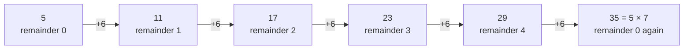
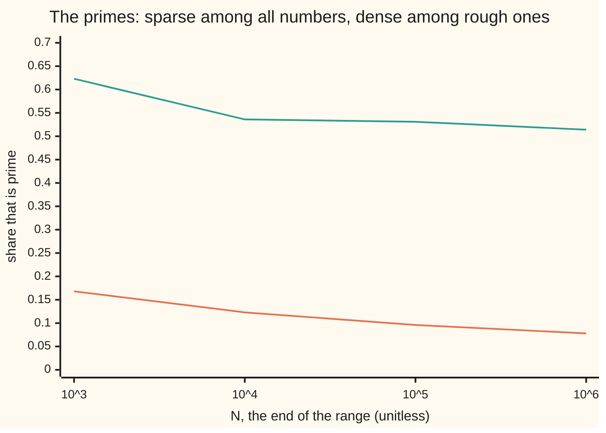

# Long progressions: dense sets must contain them, and so must the primes

[Syllabus](../../../SYLLABUS.md) → [Algebraic and analytic number theory](../README.md) → [Additive Combinatorics and Probabilistic Number Theory](../README.md#s08) → Long progressions

---

## General Overview

Start at 5 and keep adding 6: 5, 11, 17, 23, 29. All five numbers are prime. A list that climbs by the same step each time is an **arithmetic progression**, or **progression** for short. This one has five terms and step 6.

Add 6 once more and the run ends: 35 = 5 × 7. That is no accident. Divide the five terms by 5 and the remainders are 0, 1, 2, 3, 4: every remainder appears once. The next term repeats remainder 0, and the only prime with remainder 0 is 5 itself, which is already used. So no prime progression with step 6 can ever have six terms. The code checks every start up to a million and finds none.

Longer prime progressions do exist, with bigger steps. The smallest with six terms is 7, 37, 67, 97, 127, 157, with step 30. The smallest with ten terms starts at 199 with step 210. Do they go on for ever? In 2004 Ben Green and Terence Tao proved that they do: for every length k, the primes contain a progression of k terms.

Their proof stands on an older theorem. In 1975 Endre Szemerédi proved that any set of whole numbers that keeps a fixed share of 1 to N, for infinitely many N, must hold long progressions. The primes fill a shrinking share, so his theorem does not reach them directly. Green and Tao built a bridge, the **transference principle**. The primes are a dense part of a larger set that behaves like a random set. Inside such a set, Szemerédi's theorem still works.

**A set that keeps a fixed share of the whole numbers must contain progressions of every length, and the primes do too, because they keep a fixed share of a larger random-looking set, where the same theorem transfers.**

**What kind of fact this is:** two theorems, Szemerédi's (1975) and Green and Tao's (proved 2004, published 2008), stated precisely here with their sources. Their proofs run to dozens of pages, so Why it works gives the shape in outline, not a complete proof. The rule that stops 35 is proved on this card in full. The counts in the code are evidence, not proof.

### The picture: why the example stops at five



Remainders on division by 5. A step of 6 moves the remainder up by 1, so after five terms it has visited every remainder and must return to 0.

---

## The formula

Notation first, in words.

- A **k-term progression** is $`a, a+d, \dots, a+(k-1)d`$ with first term $`a`$ and step $`d \ge 1`$.
- $`A`$ is a set of whole numbers, and $`|A \cap [1,N]|`$ counts its members from 1 to N.
- $`A`$ has **positive upper density** if that count rises above a fixed share $`\delta`$ of N for infinitely many N; $`\delta`$ is the Greek letter delta.
- $`r_k(N)`$ is the size of the largest set inside 1 to N with no k-term progression. So $`r_3(9) = 5`$.
- $`\pi(N)`$ is the number of primes up to N, and $`\mathcal{P}`$ is the set of all primes.

Szemerédi's theorem, in its finite form:

```math
\text{for every } k \ge 3: \qquad \frac{r_k(N)}{N} \longrightarrow 0 \quad \text{as } N \to \infty
```

**Read it aloud:** the largest share of 1 to N that can avoid k-term progressions shrinks to nothing as N grows. In the other direction: any set with positive upper density contains a k-term progression for every k.

The Green–Tao theorem:

```math
A \subseteq \mathcal{P} \ \text{ and } \ \limsup_{N \to \infty} \frac{|A \cap [1,N]|}{\pi(N)} > 0 \quad \Longrightarrow \quad A \text{ contains a } k\text{-term progression for every } k
```

**Read it aloud:** any set of primes that keeps a fixed share of the primes, such as all of them, contains progressions of every length. "lim sup" means the share returns above a fixed level infinitely often.

The transference principle, the bridge between the two. Take a weight $`\nu(n) \ge 0`$, said "nu", that averages 1 over 1 to N. It must be **pseudorandom**: it counts every pattern of progressions as a random set of the same size would. Take a function $`f`$ with $`0 \le f \le \nu`$ and average $`\delta`$. Then

```math
\mathbb{E}_{a,\,d \le N}\; f(a)\, f(a+d) \cdots f\big(a+(k-1)d\big) \;\ge\; c(k,\delta) - o(1)
```

**Read it aloud:** multiply f over the terms of each progression and average; the result is at least a fixed positive amount. It is the same amount Szemerédi's theorem gives for a dense set of integers. $`\mathbb{E}`$ means "average over", and $`o(1)`$ is a term that tends to 0 as N grows. For the primes, f is the primes weighted by log N, and $`\nu`$ sits on numbers with no small prime factor.

| Symbol | Plain meaning | In our example | Push it up and the answer… |
| --- | --- | --- | --- |
| $`k`$ | the number of terms in the progression | 5 | harder to find; the step must grow |
| $`a`$, $`d`$ | the first term and the step | 5 and 6 | — |
| $`N`$ | the end of the range searched | 1,000,000 | more progressions found |
| $`A`$, $`\mathcal{P}`$ | a set of whole numbers; the set of all primes | the primes | — |
| $`\delta`$ | the share of 1 to N that A fills | primes: 0.0785 at a million | a progression appears sooner |
| $`r_k(N)`$ | largest set in 1 to N with no k-term progression | $`r_3(60) = 19`$ | its share of N falls, slowly |
| $`\pi(N)`$ | the number of primes up to N | 78,498 at a million | share $`\pi(N)/N`$ falls |
| $`p`$; $`W`$, $`w`$ | a small prime; the product of all primes up to a level w | p = 2, 3, 5 divide 30 | — |
| $`z`$ | the sieve level: z-rough numbers have no prime factor up to z | 31 at a million | primes fill more of the rough numbers |
| $`\nu`$, $`f`$, $`g`$ | the pseudorandom host; the primes under it; the dense model of f | prime share of rough numbers 0.5135 | — |
| $`e(\alpha n)`$ | a wave $`e^{2\pi i \alpha n}`$ with frequency $`\alpha`$ | — | — |
| $`c(k,\delta)`$, $`c_k`$; $`\mathbb{E}`$, $`o(1)`$ | fixed positive constants from the theorems; "average over"; a term that tends to 0 as N grows | — | — |

### When it holds

- **The share must stay fixed.** Szemerédi needs a share $`\delta`$ that does not shrink. The primes fill 0.1680 of 1 to 1,000 but only 0.0785 of 1 to a million, so they fail it, and Green–Tao needs the bridge.
- **Arbitrarily long, never infinite.** A progression of primes cannot run for ever: the term $`a + a \cdot d = a(1+d)`$ is a multiple of a. The theorems promise every finite length, not an endless run.
- **The terms are not consecutive primes.** Between 5 and 29 the example skips the primes 7, 13 and 19. Whether the primes hold long progressions of consecutive primes is open as of 2026-11-15.
- **Small primes set the step.** If a k-term progression of primes starts above k, every prime up to k divides the step. That is why the smallest ten-term one has step 210 = 2 × 3 × 5 × 7.
- **The proofs give no useful size.** Both theorems say a progression exists below some N, but the N their proofs give is enormous, far beyond any search.

---

## Why it works

### Step 0: structure or randomness

Take a set with a fixed share $`\delta`$ of 1 to N. Either it looks random, or it does not.

If it looks random, it contains about as many progressions as a random set of that share. A random set holds each progression with chance $`\delta^k`$, and there are about $`N^2/(2(k-1))`$ progressions in 1 to N. That is a lot of progressions.

If it does not look random, it leans towards some regular pattern. Then the set fills a bigger share of some long sub-progression than of 1 to N. Zoom in there and repeat. The share cannot pass 1, so the zooming stops, and when it stops the set looks random. Either way, progressions appear.

Every proof below has this shape.

### Step 1: random sets are full of progressions

[The probabilistic method](../../09-Probability%20and%20statistics/14-Random%20Graphs%20and%20the%20Probabilistic%20Method/03-probabilistic-method.md) works out such averages: the expected count is the number of progressions times the chance each survives. A random set keeps a share $`\delta^k`$ of all progressions. For a fixed $`\delta`$ that is still a fixed multiple of $`N^2`$, so the count grows without limit.

The primes are not a random set, but they too hold many progressions. With every term at most 10,000 the code counts 59,504 three-term prime progressions, 1,283 with five terms and 8 with eight terms.

### Step 2: Roth's density increment, the case k = 3

Klaus Roth proved the case k = 3 in 1953. Randomness is measured by waves, as in [Equidistribution](03-equidistribution-and-weyls-criterion.md): a set looks random if it does not correlate with any wave $`e(\alpha n) = e^{2\pi i \alpha n}`$.

- If no wave correlates, a count by Fourier analysis (splitting the set into waves) shows about $`\delta^3 N^2/4`$ three-term progressions.
- If one wave correlates, the set is denser by a fixed multiple of $`\delta^2`$ on some long progression inside 1 to N.

Each zoom raises the share by a fixed step, and the share cannot pass 1. So the zooming stops in the random case, and a progression exists. The bound it gives is $`r_3(N) \ll N/\log\log N`$, where $`\ll`$ means "at most a constant times".

<details>
<summary>Detailed outline: why one large wave gives a denser sub-progression</summary>

Work on a clock of N hours, N odd, so progressions may wrap round; the standard fix for the wrap costs only a constant. Write $`1_A`$ for 1 on A and 0 elsewhere, and $`\widehat{1_A}(r) = \sum_n 1_A(n)\, e(-rn/N)`$ for the size of wave r in the set. The number of solutions of $`x + z = 2y`$ in A is

$`\displaystyle \frac{1}{N}\sum_{r=0}^{N-1} \widehat{1_A}(r)^2\, \widehat{1_A}(-2r).`$

The wave r = 0 gives $`(\delta N)^3/N = \delta^3 N^2`$, the random count. It is four times the $`\delta^3 N^2/4`$ of Step 2 because the clock counts all $`N^2`$ solutions: each progression once in each direction, wrapped ones too, where 1 to N holds only about $`N^2/4`$ progressions with $`d \ge 1`$. By Parseval's identity (the squared sizes of all the waves add up to N times the size of the set), $`\sum_r |\widehat{1_A}(r)|^2 = N\,|A| = \delta N^2`$, so the other waves together add at most $`\delta N \cdot \max_{r \ne 0} |\widehat{1_A}(r)|`$. Suppose every wave but r = 0 is below $`\delta^2 N/2`$. Then that is under half the main term, and A holds about $`\delta^3 N^2`$ progressions, far more than the $`\delta N`$ trivial ones with step 0.

Otherwise some wave r has $`|\widehat{1_A}(r)| \ge \delta^2 N/2`$. Split the clock into progressions of length about $`\sqrt{N}`$ on which $`e(rn/N)`$ barely turns. The wave is nearly constant on each piece, and the balanced part $`1_A - \delta`$ correlates with it, so it cannot average 0 on every piece. On one piece A has share at least $`\delta + c\,\delta^2`$ for a fixed $`c > 0`$. Each restart shrinks the length to about its square root, and that is where the $`\log\log N`$ comes from.

</details>

### Step 3: Szemerédi's theorem for every k

For four terms and more, single waves are not enough. A set can avoid wave patterns and still be skewed by quadratic ones like $`e(\alpha n^2)`$. Szemerédi's 1975 proof avoided waves altogether. It was a long counting argument, and it introduced the **regularity lemma**: every large graph splits into a few pieces between which the edges look random.

Two more proofs followed. Furstenberg recast the problem in 1977 as a question about repeated returns in a dynamical system (a space with a rule that moves its points one step at a time). Gowers in 2001 extended Roth's argument with new measures of randomness, now called **Gowers norms**, and got the first reasonable bound: $`r_k(N) \le N (\log\log N)^{-c_k}`$ with $`c_k = 2^{-2^{k+9}}`$.

These bounds fall very slowly. The code finds the exact largest progression-free sets for small N by search:

| N | $`r_3(N)`$ | share of N |
| ---: | ---: | ---: |
| 9 | 5 | 0.556 |
| 20 | 9 | 0.450 |
| 40 | 15 | 0.375 |
| 60 | 19 | 0.317 |

The share falls, as the theorem says it must. No finite table proves that it tends to 0; the theorem does.

### Step 4: why the primes are out of reach

The primes thin out. Their share of 1 to N is about $`1/\log N`$ by the prime number theorem, and $`1/\log N`$ tends to 0.

| N | primes up to N | share |
| ---: | ---: | ---: |
| 1,000 | 168 | 0.1680 |
| 10,000 | 1,229 | 0.1229 |
| 100,000 | 9,592 | 0.0959 |
| 1,000,000 | 78,498 | 0.0785 |

Szemerédi's theorem needs a share that never drops below some fixed $`\delta`$. The prime share eventually drops below every fixed $`\delta`$, so the theorem says nothing about the primes. Gowers' bound would need the primes' share to beat $`(\log\log N)^{-c_k}`$, which falls far more slowly than $`1/\log N`$. For every k ≥ 4 the best bounds known still fall more slowly than $`1/\log N`$, so no known bound reaches the primes there, and they still need transference.

For k = 3 the bounds have caught up. Bloom and Sisask (2020) proved that $`r_3(N)/N`$ falls faster than $`1/\log N`$, and Kelley and Meka (2023) that it falls faster than every power of $`1/\log N`$. So for large enough N the primes up to N outnumber $`r_3(N)`$, and they hold three-term progressions by density alone. Erdős conjectured more: any set whose reciprocals add up to infinity, as the primes' do, holds progressions of every length. The Bloom–Sisask bound proves the case k = 3. For k ≥ 4 the conjecture is open as of 2026-11-15; Green–Tao settles it for the primes only.

### Step 5: the small-prime bias, and the W-trick

The primes are not random with respect to small primes. Every prime above 2 is odd; every prime above 3 leaves remainder 1 or 2 on division by 3. That bias already decides the step of a prime progression.

**The mod-p rule.** Let p be a prime with $`p \le k`$, and suppose p does not divide the step d. Then the first p terms leave different remainders on division by p. If two left the same remainder, p would divide $`(j - i)d`$ with $`0 < j - i < p`$, which is impossible. So the p terms cover every remainder, and one of them is a multiple of p. Being prime, it equals p. So either p divides d, or p is a term.

For the example, k = 5 and p = 5 does not divide 6, so 5 must be a term: it is the first. A sixth term would repeat remainder 0 and be a multiple of 5 above 5. The code confirms: 0 six-term prime progressions with step 6 up to a million, but 55 with step 30.

Green and Tao remove this bias with the **W-trick**. Let W be the product of the primes up to a slowly growing level w. Every prime above w leaves a remainder coprime to W, so look only at primes of the form $`Wn + 1`$ and study the numbers n. The bias by small primes is gone, and a progression in n gives one in the primes.

### Step 6: transference, the new idea

The primes are sparse among all numbers, but dense among the right larger set. Call a number **z-rough** if it has no prime factor up to z. Every prime above z is z-rough, and the rough numbers are much sparser than all numbers. Take z to be the fourth root of N:

| N | z | z-rough numbers in 2 to N | primes above z | prime share of the rough numbers |
| ---: | ---: | ---: | ---: | ---: |
| 1,000 | 5 | 265 | 165 | 0.6226 |
| 10,000 | 10 | 2,284 | 1,225 | 0.5363 |
| 100,000 | 17 | 18,052 | 9,585 | 0.5310 |
| 1,000,000 | 31 | 152,839 | 78,487 | 0.5135 |

The share of all numbers more than halved, from 0.1680 to 0.0785. The share of the rough numbers fell far less, from 0.6226 to 0.5135. Sieve theory proves it stays above a fixed positive amount for every N, with z a fixed power of N. An upper-bound sieve (a count that caps how many numbers survive the crossing-out of small primes) keeps the rough count below a constant times $`N/\log N`$. Chebyshev's bound keeps the prime count above a constant times the same.



Orange: the share of 1 to N that is prime. Green: the share of the z-rough numbers in 2 to N that is prime, with z the fourth root of N.

The proof then runs in three moves.

1. **A pseudorandom host.** Green and Tao replace the rough numbers by a smoother weight $`\nu`$, built from truncated divisor sums of Goldston and Yıldırım: sums over the small divisors of n that come out large on numbers with no small prime factor. They prove $`\nu`$ is pseudorandom: it counts every system of progressions, and their correlations, as a random set of its size would.
2. **The primes are dense in the host.** After the W-trick, the primes sit under $`\nu`$ with a fixed positive share, as in the table.
3. **Relative Szemerédi.** A dense part of a pseudorandom host behaves like a dense set of whole numbers. Green and Tao build a bounded **dense model** g, between 0 and 1, which has the same progression counts as f up to a small error. Szemerédi's theorem applies to g, and the count transfers back to f.

So Szemerédi's theorem is used as a black box. The new mathematics is the transfer: the pseudorandom host, and the proof that a dense part of it holds as many progressions as Szemerédi promises.

---

## Worked numbers, by hand

The example, and the rule that shapes every prime progression.

| Step | Arithmetic | Value |
| --- | --- | --- |
| terms | 5, 5 + 6, 5 + 12, 5 + 18, 5 + 24 | 5, 11, 17, 23, 29 |
| each prime? | trial division by every number up to its square root | yes, all five |
| remainders on division by 5 | 5, 11, 17, 23, 29 divided by 5 | 0, 1, 2, 3, 4 |
| sixth term | 29 + 6 | 35 = 5 × 7 |
| term before the first | 5 − 6 | −1, not prime |
| six terms need step | 2, 3 and 5 must all divide it (none of them can be a term) | a multiple of 30 |
| smallest six-term progression | 7 + 30 × 0 to 7 + 30 × 5 | 7, 37, 67, 97, 127, 157 |
| ten terms need step | 2, 3, 5, 7 must divide it unless the first term is at most 10 | 210, at first term 199 |
| **ten-term progression** | 199 + 210 × 9 | **last term 2,089** |

So the example is as long as a step of 6 allows; every longer prime progression needs a step that is a multiple of 30, and ten terms need 210.

### What breaks if you drop a piece

| Mistake | Comes out at | What went wrong |
| --- | --- | --- |
| Apply Szemerédi to the primes directly | share 0.1680 at 1,000, 0.0785 at a million, still falling | The share is not fixed. Szemerédi needs a fixed $`\delta`$; the primes need transference. |
| Extend the example to six terms with step 6 | 0 such progressions up to a million; 55 with step 30 | The mod-p rule with p = 5: one term in five is a multiple of 5. |
| Expect any infinite set to hold progressions | powers of 2: 20 numbers up to a million, 0 three-term progressions | Their share is 0. Density is the hypothesis, not size. |
| Expect a two-colouring of 1 to 8 to force a one-colour 3-term progression | 6 colourings dodge, such as BBRRBBRR; none of 1 to 9 do | Forcing starts at 9. The theorems promise a threshold, not a small one. |

The last row is van der Waerden's theorem (1927), the colouring form of the question: colour the whole numbers with finitely many colours, and one colour holds long progressions. It follows from Szemerédi, because one colour class fills at least its fair share.

---

## Code, from first principles, and it actually runs

The code tests primes two independent ways, a sieve and trial division, and confirms the example and its stop at 35. It searches for the smallest prime progression of each length from 3 to 10 and asserts the mod-p rule on each, a theorem checked against a search. It counts prime progressions up to 10,000 and six-term ones with steps 6 and 30 up to a million. It finds $`r_3(N)`$ by a pruned search and checks it against trying every subset for N up to 12. It checks the base-3 sets and powers of 2 for progressions, and settles the 1-to-9 colouring question by trying every colouring. Last, it counts rough numbers by a sieve and again by Legendre's inclusion–exclusion formula, and the two must agree exactly.

### Python

```python
# Long progressions -- the check behind the card.  Standard library only.
# A progression is a, a+d, a+2d, ... with step d > 0.  The card's example is
# 5, 11, 17, 23, 29.  Road one tests primes by a sieve, road two by trial
# division.  The smallest prime progressions found by search must obey the
# mod-p rule proved on the card.  Small-set facts (van der Waerden, the largest
# set with no 3-term progression) are found by exhaustive search.  The rough
# number counts are made by a sieve and again by Legendre's formula.
from itertools import combinations
N = 10**6
sv = bytearray([1]) * (N + 1); sv[0] = sv[1] = 0
for i in range(2, 1001):
    if sv[i]:
        sv[i * i::i] = bytearray(len(range(i * i, N + 1, i)))
P = [i for i in range(N + 1) if sv[i]]
def trial(n):                                     # road two: trial division
    return n > 1 and all(n % q for q in range(2, int(n**0.5) + 1))
ex = [5 + 6 * i for i in range(5)]
print("example:", ex, "sieve", all(sv[n] for n in ex), "trial", all(trial(n) for n in ex))
print("residues mod 5:", [n % 5 for n in ex], "; next term 35 =", "5 x 7", "; term before -1")
print("primes between 5 and 29 that it skips:", [p for p in P if 5 < p < 29 and p not in ex])
assert all(sv[n] for n in ex) and all(trial(n) for n in ex) and not trial(35)
D6 = (6, 30)                                      # the two steps tried for six terms
six = [sum(1 for a in P if a + 5 * d <= N and all(sv[a + d * i] for i in range(6))) for d in D6]
print("6-term prime progressions up to 10^6:", " ; ".join(f"step {d}: {c:,}" for d, c in zip(D6, six)))
def smallest(k):                                  # smallest last term L
    for L in P:
        for d in range(1, (L - 2) // (k - 1) + 1):
            if all(sv[L - i * d] for i in range(k)):
                return L - (k - 1) * d, d, L
print("k | first term | step | last term | primes p <= k dividing step")
for k in range(3, 11):
    a, d, L = smallest(k)
    small = [p for p in P if p <= k]
    print(f"{k} | {a} | {d} | {L:,} | {[p for p in small if d % p == 0]}")
    for p in small:                               # mod-p rule: p | d, or p is a term
        assert d % p == 0 or (p - a) % d == 0 and a <= p <= L
    assert all(trial(a + i * d) for i in range(k))
M = 10**4
cnt = [0] * 9
for a in P:
    if a > M: break
    for d in range(1, (M - a) // 2 + 1):
        r = 1
        while r < 8 and a + r * d <= M and sv[a + r * d]: r += 1
        for k in range(3, r + 1): cnt[k] += 1
print(f"prime progressions with every term <= {M:,}: k=3..8:", [f"{c:,}" for c in cnt[3:9]])
def mono3(col, n):                                # one-colour 3-term progression?
    return any(col >> (a - 1) & 1 == col >> (a + d - 1) & 1 == col >> (a + 2 * d - 1) & 1
               for d in range(1, n) for a in range(1, n - 2 * d + 1))
free8 = [c for c in range(2**8) if not mono3(c, 8)]
free9 = [c for c in range(2**9) if not mono3(c, 9)]
print(f"2-colourings of 1..8 with no one-colour 3-term progression: {len(free8)}; of 1..9: {len(free9)}")
print("one that dodges, 1..8:", "".join("RB"[free8[0] >> i & 1] for i in range(8)))
assert len(free8) > 0 and len(free9) == 0
def r3(top):                                      # largest set in 1..n with no 3-term progression
    r = [0] * (top + 1)
    for n in range(1, top + 1):
        want = r[n - 1] + 1; r[n] = want; ch = []; cs = set()
        def dfs(pos, c):
            if c == want: return True
            if pos > n or c + r[n - pos + 1] < want: return False
            if not any(2 * y - pos in cs for y in ch):
                ch.append(pos); cs.add(pos)
                if dfs(pos + 1, c + 1): return True
                ch.pop(); cs.discard(pos)
            return dfs(pos + 1, c)
        if not dfs(1, 0): r[n] = want - 1
    return r
def has3(S):
    T = set(S)
    return any((x + y) % 2 == 0 and (x + y) // 2 in T for x, y in combinations(S, 2))
def base3(n):                                     # 1 + numbers with base-3 digits 0 and 1
    return [m + 1 for m in range(n) if all((m // 3**j) % 3 < 2 for j in range(11))]
R = r3(60)
print("N | r3(N) | r3(N)/N | base-3 set size | its share")
for n in (9, 20, 27, 40, 60, 81, 729, 59049):
    b = base3(n); assert not has3(b) if n <= 729 else True
    rr = f"{R[n]} | {R[n] / n:.3f}" if n <= 60 else "- | -"
    print(f"{n:,} | {rr} | {len(b):,} | {len(b) / n:.3f}")
brute = [max(bin(S).count("1") for S in range(2**n)
             if not has3([i + 1 for i in range(n) if S >> i & 1])) for n in range(1, 13)]
print("r3(1..12) by trying every subset:", brute)
assert brute == R[1:13] and R[20] == 9                          # pruned search vs brute force
pw = [2**j for j in range(20)]
print("powers of 2 up to 10^6:", len(pw), "numbers, 3-term progressions:", int(has3(pw)))
def legendre(n, ps):                              # sum of mu(d) floor(n/d) over d | P(z)
    t = 0
    for m in range(2**len(ps)):
        d, s = 1, 1
        for j, p in enumerate(ps):
            if m >> j & 1: d *= p; s = -s
        t += s * (n // d)
    return t
print("N | z | primes <= N | share of all | z-rough in 2..N | primes among them | share")
chart = []
for e in range(3, 7):
    n = 10**e; z = int(n**0.25 + 1e-9); ps = [p for p in P if p <= z]
    m = bytearray([1]) * (n + 1); m[0] = m[1] = 0
    for p in ps: m[p::p] = bytearray(len(range(p, n + 1, p)))
    rough = sum(m); pin = sum(1 for p in P if z < p <= n); pi = pin + len(ps)
    assert rough == legendre(n, ps) - 1 and pin == sum(m[p] for p in P if p <= n)
    chart.append((pi / n, pin / rough))
    print(f"10^{e} | {z} | {pi:,} | {pi / n:.4f} | {rough:,} | {pin:,} | {pin / rough:.4f}")
print("chart, share of all:", ", ".join(f"{a:.3f}" for a, b in chart))
print("chart, share of rough:", ", ".join(f"{b:.3f}" for a, b in chart))
z = 100; ps = [p for p in P if p <= z]                         # try: z = N^(1/3) = 100
m = bytearray([1]) * (N + 1); m[0] = m[1] = 0
for p in ps: m[p::p] = bytearray(len(range(p, N + 1, p)))
print(f"try: z = {z} at 10^6: rough {sum(m):,}, prime share {(len(P) - len(ps)) / sum(m):.4f}")
assert six[0] == 0 < six[1] and len(P) == 78498 and chart[-1][1] > 0.5 > 6 * chart[-1][0]
print("ALL CHECKS PASS")
```

**Ran 2026-11-15 on macOS, Python 3.14.10, standard library only. All checks passed. Output, pasted from the run:**

```
example: [5, 11, 17, 23, 29] sieve True trial True
residues mod 5: [0, 1, 2, 3, 4] ; next term 35 = 5 x 7 ; term before -1
primes between 5 and 29 that it skips: [7, 13, 19]
6-term prime progressions up to 10^6: step 6: 0 ; step 30: 55
k | first term | step | last term | primes p <= k dividing step
3 | 3 | 2 | 7 | [2]
4 | 5 | 6 | 23 | [2, 3]
5 | 5 | 6 | 29 | [2, 3]
6 | 7 | 30 | 157 | [2, 3, 5]
7 | 7 | 150 | 907 | [2, 3, 5]
8 | 199 | 210 | 1,669 | [2, 3, 5, 7]
9 | 199 | 210 | 1,879 | [2, 3, 5, 7]
10 | 199 | 210 | 2,089 | [2, 3, 5, 7]
prime progressions with every term <= 10,000: k=3..8: ['59,504', '10,257', '1,283', '263', '32', '8']
2-colourings of 1..8 with no one-colour 3-term progression: 6; of 1..9: 0
one that dodges, 1..8: BBRRBBRR
N | r3(N) | r3(N)/N | base-3 set size | its share
9 | 5 | 0.556 | 4 | 0.444
20 | 9 | 0.450 | 8 | 0.400
27 | 11 | 0.407 | 8 | 0.296
40 | 15 | 0.375 | 15 | 0.375
60 | 19 | 0.317 | 16 | 0.267
81 | - | - | 16 | 0.198
729 | - | - | 64 | 0.088
59,049 | - | - | 1,024 | 0.017
r3(1..12) by trying every subset: [1, 2, 2, 3, 4, 4, 4, 4, 5, 5, 6, 6]
powers of 2 up to 10^6: 20 numbers, 3-term progressions: 0
N | z | primes <= N | share of all | z-rough in 2..N | primes among them | share
10^3 | 5 | 168 | 0.1680 | 265 | 165 | 0.6226
10^4 | 10 | 1,229 | 0.1229 | 2,284 | 1,225 | 0.5363
10^5 | 17 | 9,592 | 0.0959 | 18,052 | 9,585 | 0.5310
10^6 | 31 | 78,498 | 0.0785 | 152,839 | 78,487 | 0.5135
chart, share of all: 0.168, 0.123, 0.096, 0.078
chart, share of rough: 0.623, 0.536, 0.531, 0.514
try: z = 100 at 10^6: rough 120,759, prime share 0.6498
ALL CHECKS PASS
```

### Rust

The same checks, the same output. Counts are exact integers; shares print rounded the same way in both languages.

```rust
// Long progressions -- the same check as the Python, in Rust.  No crates.
// A progression is a, a+d, a+2d, ... with step d > 0.  The card's example is
// 5, 11, 17, 23, 29.  Road one tests primes by a sieve, road two by trial
// division.  The smallest prime progressions found by search must obey the
// mod-p rule proved on the card.  Small-set facts (van der Waerden, the largest
// set with no 3-term progression) are found by exhaustive search.  The rough
// number counts are made by a sieve and again by Legendre's formula.
use std::collections::HashSet;
fn commas(n: usize) -> String {
    let s = n.to_string();
    let mut out = String::new();
    for (i, ch) in s.chars().enumerate() {
        if i > 0 && (s.len() - i) % 3 == 0 { out.push(','); }
        out.push(ch);
    }
    out
}
fn list(v: &[usize]) -> String {
    format!("[{}]", v.iter().map(|x| x.to_string()).collect::<Vec<_>>().join(", "))
}
fn py(b: bool) -> &'static str { if b { "True" } else { "False" } }
fn trial(n: usize) -> bool { n > 1 && (2..).take_while(|q| q * q <= n).all(|q| n % q != 0) }
fn sieve(n: usize, upto: usize) -> Vec<bool> {      // crosses out multiples of primes <= upto
    let mut s = vec![true; n + 1]; s[0] = false; s[1] = false;
    for i in 2..=upto.min(n) {
        if upto < n || s[i] { let mut j = if upto < n { i } else { i * i }; while j <= n { s[j] = false; j += i; } }
    }
    s
}
fn has3(s: &[usize]) -> bool {
    let t: HashSet<usize> = s.iter().cloned().collect();
    (0..s.len()).any(|i| (i + 1..s.len()).any(|j| (s[i] + s[j]) % 2 == 0 && t.contains(&((s[i] + s[j]) / 2))))
}
fn mono3(col: usize, n: usize) -> bool {
    (1..n).any(|d| (1..(n + 1).saturating_sub(2 * d)).any(|a| {
        let (x, y, z) = (col >> (a - 1) & 1, col >> (a + d - 1) & 1, col >> (a + 2 * d - 1) & 1);
        x == y && y == z }))
}
fn dfs(pos: usize, c: usize, n: usize, want: usize, r: &[usize], ch: &mut Vec<usize>, cs: &mut HashSet<i64>) -> bool {
    if c == want { return true; }
    if pos > n || c + r[n - pos + 1] < want { return false; }
    if !ch.iter().any(|&y| cs.contains(&(2 * y as i64 - pos as i64))) {
        ch.push(pos); cs.insert(pos as i64);
        if dfs(pos + 1, c + 1, n, want, r, ch, cs) { return true; }
        ch.pop(); cs.remove(&(pos as i64));
    }
    dfs(pos + 1, c, n, want, r, ch, cs)
}
fn r3(top: usize) -> Vec<usize> {                  // largest set in 1..n with no 3-term progression
    let mut r = vec![0usize; top + 1];
    for n in 1..=top {
        let want = r[n - 1] + 1; r[n] = want;
        if !dfs(1, 0, n, want, &r.clone(), &mut Vec::new(), &mut HashSet::new()) { r[n] = want - 1; }
    }
    r
}
fn base3(n: usize) -> Vec<usize> {                 // 1 + numbers with base-3 digits 0 and 1
    (0..n).filter(|&m| (0..11).all(|j| (m / 3usize.pow(j)) % 3 < 2)).map(|m| m + 1).collect()
}
fn legendre(n: i64, ps: &[usize]) -> i64 {         // sum of mu(d) floor(n/d) over d | P(z)
    let mut t = 0i64;
    for m in 0..(1usize << ps.len()) {
        let (mut d, mut s) = (1i64, 1i64);
        for (j, &p) in ps.iter().enumerate() { if m >> j & 1 == 1 { d *= p as i64; s = -s; } }
        t += s * (n / d);
    }
    t
}
fn main() {
    let big = 1_000_000usize;
    let sv = sieve(big, big);
    let pr: Vec<usize> = (0..=big).filter(|&i| sv[i]).collect();
    let ex: Vec<usize> = (0..5).map(|i| 5 + 6 * i).collect();
    println!("example: {} sieve {} trial {}", list(&ex), py(ex.iter().all(|&n| sv[n])), py(ex.iter().all(|&n| trial(n))));
    println!("residues mod 5: {} ; next term 35 = 5 x 7 ; term before -1", list(&ex.iter().map(|n| n % 5).collect::<Vec<_>>()));
    let skip: Vec<usize> = pr.iter().cloned().filter(|&p| 5 < p && p < 29 && !ex.contains(&p)).collect();
    println!("primes between 5 and 29 that it skips: {}", list(&skip));
    assert!(ex.iter().all(|&n| sv[n]) && ex.iter().all(|&n| trial(n)) && !trial(35));
    let d6 = [6usize, 30];                            // the two steps tried for six terms
    let six: Vec<usize> = d6.iter().map(|&d| pr.iter().filter(|&&a| a + 5 * d <= big && (0..6).all(|i| sv[a + d * i])).count()).collect();
    let st: Vec<String> = d6.iter().zip(&six).map(|(d, c)| format!("step {}: {}", d, commas(*c))).collect();
    println!("6-term prime progressions up to 10^6: {}", st.join(" ; "));
    println!("k | first term | step | last term | primes p <= k dividing step");
    for k in 3..=10usize {
        let (mut a, mut d, mut last) = (0, 0, 0);
        'outer: for &l in &pr {
            for dd in 1..=(l - 2) / (k - 1) {
                if (0..k).all(|i| sv[l - i * dd]) { a = l - (k - 1) * dd; d = dd; last = l; break 'outer; }
            }
        }
        let small: Vec<usize> = pr.iter().cloned().filter(|&p| p <= k).collect();
        let div: Vec<usize> = small.iter().cloned().filter(|p| d % p == 0).collect();
        println!("{} | {} | {} | {} | {}", k, a, d, commas(last), list(&div));
        for &p in &small { assert!(d % p == 0 || (p >= a && (p - a) % d == 0 && p <= last)); }
        assert!((0..k).all(|i| trial(a + i * d)));
    }
    let m4 = 10_000usize;
    let mut cnt = [0usize; 9];
    for &a in pr.iter().take_while(|&&a| a <= m4) {
        for d in 1..=(m4 - a) / 2 {
            let mut r = 1;
            while r < 8 && a + r * d <= m4 && sv[a + r * d] { r += 1; }
            for k in 3..=r { cnt[k] += 1; }
        }
    }
    let cs: Vec<String> = cnt[3..9].iter().map(|&c| format!("'{}'", commas(c))).collect();
    println!("prime progressions with every term <= {}: k=3..8: [{}]", commas(m4), cs.join(", "));
    let free8: Vec<usize> = (0..256).filter(|&c| !mono3(c, 8)).collect();
    let free9: Vec<usize> = (0..512).filter(|&c| !mono3(c, 9)).collect();
    println!("2-colourings of 1..8 with no one-colour 3-term progression: {}; of 1..9: {}", free8.len(), free9.len());
    let dodge: String = (0..8).map(|i| if free8[0] >> i & 1 == 1 { 'B' } else { 'R' }).collect();
    println!("one that dodges, 1..8: {}", dodge);
    assert!(free8.len() > 0 && free9.is_empty());
    let r = r3(60);
    println!("N | r3(N) | r3(N)/N | base-3 set size | its share");
    for &n in &[9usize, 20, 27, 40, 60, 81, 729, 59049] {
        let b = base3(n);
        if n <= 729 { assert!(!has3(&b)); }
        let rr = if n <= 60 { format!("{} | {:.3}", r[n], r[n] as f64 / n as f64) } else { "- | -".to_string() };
        println!("{} | {} | {} | {:.3}", commas(n), rr, commas(b.len()), b.len() as f64 / n as f64);
    }
    let brute: Vec<usize> = (1..=12usize).map(|n| (0..1usize << n).filter(|&s| {
        let set: Vec<usize> = (0..n).filter(|i| s >> i & 1 == 1).map(|i| i + 1).collect(); !has3(&set)
    }).map(|s| s.count_ones() as usize).max().unwrap()).collect();
    println!("r3(1..12) by trying every subset: {}", list(&brute));
    assert!(brute[..] == r[1..13] && r[20] == 9);
    let pw: Vec<usize> = (0..20).map(|j| 1usize << j).collect();
    println!("powers of 2 up to 10^6: {} numbers, 3-term progressions: {}", pw.len(), has3(&pw) as u8);
    println!("N | z | primes <= N | share of all | z-rough in 2..N | primes among them | share");
    let mut chart: Vec<(f64, f64)> = Vec::new();
    for e in 3..=6u32 {
        let n = 10usize.pow(e);
        let z = ((n as f64).powf(0.25) + 1e-9) as usize;
        let ps: Vec<usize> = pr.iter().cloned().filter(|&p| p <= z).collect();
        let m = sieve(n, z);
        let rough = m.iter().filter(|&&b| b).count();
        let pin = pr.iter().filter(|&&p| z < p && p <= n).count();
        let pi = pin + ps.len();
        assert!(rough as i64 == legendre(n as i64, &ps) - 1 && pin == pr.iter().filter(|&&p| p <= n && m[p]).count());
        chart.push((pi as f64 / n as f64, pin as f64 / rough as f64));
        println!("10^{} | {} | {} | {:.4} | {} | {} | {:.4}", e, z, commas(pi), pi as f64 / n as f64, commas(rough), commas(pin), pin as f64 / rough as f64);
    }
    println!("chart, share of all: {}", chart.iter().map(|c| format!("{:.3}", c.0)).collect::<Vec<_>>().join(", "));
    println!("chart, share of rough: {}", chart.iter().map(|c| format!("{:.3}", c.1)).collect::<Vec<_>>().join(", "));
    let zt = 100usize;                                // try: z = N^(1/3) = 100
    let m = sieve(big, zt);
    let rough = m.iter().filter(|&&b| b).count();
    let below = pr.iter().filter(|&&p| p <= zt).count();
    println!("try: z = {} at 10^6: rough {}, prime share {:.4}", zt, commas(rough), (pr.len() - below) as f64 / rough as f64);
    assert!(six[0] == 0 && 0 < six[1] && pr.len() == 78498 && chart[3].1 > 0.5 && 0.5 > 6.0 * chart[3].0);
    println!("ALL CHECKS PASS");
}
```

**Ran 2026-11-15 on macOS, rustc 1.98.1, no crates. All checks passed. Output, pasted from the run:**

```
example: [5, 11, 17, 23, 29] sieve True trial True
residues mod 5: [0, 1, 2, 3, 4] ; next term 35 = 5 x 7 ; term before -1
primes between 5 and 29 that it skips: [7, 13, 19]
6-term prime progressions up to 10^6: step 6: 0 ; step 30: 55
k | first term | step | last term | primes p <= k dividing step
3 | 3 | 2 | 7 | [2]
4 | 5 | 6 | 23 | [2, 3]
5 | 5 | 6 | 29 | [2, 3]
6 | 7 | 30 | 157 | [2, 3, 5]
7 | 7 | 150 | 907 | [2, 3, 5]
8 | 199 | 210 | 1,669 | [2, 3, 5, 7]
9 | 199 | 210 | 1,879 | [2, 3, 5, 7]
10 | 199 | 210 | 2,089 | [2, 3, 5, 7]
prime progressions with every term <= 10,000: k=3..8: ['59,504', '10,257', '1,283', '263', '32', '8']
2-colourings of 1..8 with no one-colour 3-term progression: 6; of 1..9: 0
one that dodges, 1..8: BBRRBBRR
N | r3(N) | r3(N)/N | base-3 set size | its share
9 | 5 | 0.556 | 4 | 0.444
20 | 9 | 0.450 | 8 | 0.400
27 | 11 | 0.407 | 8 | 0.296
40 | 15 | 0.375 | 15 | 0.375
60 | 19 | 0.317 | 16 | 0.267
81 | - | - | 16 | 0.198
729 | - | - | 64 | 0.088
59,049 | - | - | 1,024 | 0.017
r3(1..12) by trying every subset: [1, 2, 2, 3, 4, 4, 4, 4, 5, 5, 6, 6]
powers of 2 up to 10^6: 20 numbers, 3-term progressions: 0
N | z | primes <= N | share of all | z-rough in 2..N | primes among them | share
10^3 | 5 | 168 | 0.1680 | 265 | 165 | 0.6226
10^4 | 10 | 1,229 | 0.1229 | 2,284 | 1,225 | 0.5363
10^5 | 17 | 9,592 | 0.0959 | 18,052 | 9,585 | 0.5310
10^6 | 31 | 78,498 | 0.0785 | 152,839 | 78,487 | 0.5135
chart, share of all: 0.168, 0.123, 0.096, 0.078
chart, share of rough: 0.623, 0.536, 0.531, 0.514
try: z = 100 at 10^6: rough 120,759, prime share 0.6498
ALL CHECKS PASS
```

The base-3 sets in the output are the numbers whose base-3 digits are only 0 and 1, plus one. Three of them can never form a progression: x + z = 2y forces x and z to have the same digits, so x = z. They fill 1,024 of 59,049, a share of 0.017, falling to 0. The exact $`r_3(N)`$ shows that larger progression-free sets exist.

> [!TIP]
> **Try changing**
> - **Change the step.** Guess first: step 6 allows no six-term prime progression. Does step 42, larger and still a multiple of 2 and 3, allow any? Change `D6 = (6, 30)` to `D6 = (42, 30)`. The line reads step 42: 0, because 5 does not divide 42: the mod-p rule again. Every assert still passes.
> - **Raise the sieve level.** Guess first: with z = 100 instead of 31 at a million, do the primes fill more or less of the rough numbers? More: the try line prints 0.6498 of 120,759, against 0.5135 of 152,839. Now set `z = 1000` in that line and guess again. The share is 1.0000 of 78,330: a composite number up to a million has a prime factor up to 1,000, so every rough number left is prime.
> - **Double the range.** Guess first: with every term at most 20,000 instead of 10,000, do the three-term prime progressions grow four times over, like $`N^2`$? Set `M = 2 * 10**4`. They grow from 59,504 to 186,647, a little over three times: the primes thin out as the range grows.

---

## The usual mistake

> [!warning]
> **"Green–Tao is Szemerédi's theorem applied to the primes."** It is not. The primes' share of 1 to N falls from 0.1680 at 1,000 to 0.0785 at a million and tends to 0, so Szemerédi's hypothesis fails. The new step is transference: the primes are dense, 0.5135 at a million, inside a pseudorandom host, and Szemerédi's theorem moves across to that host.
>
> Smaller traps:
> - **Reading "arbitrarily long" as "infinite".** No prime progression runs for ever; the example ends at 35 = 5 × 7.
> - **Expecting consecutive primes.** The example skips 7, 13 and 19. Long runs of consecutive primes in progression are a different and open question.
> - **Forgetting the small primes.** Six terms with step 6 give 0 progressions up to a million. The step must be a multiple of 30.
> - **Taking a falling table for a proof.** $`r_3(N)/N`$ falls from 0.556 at 9 to 0.317 at 60. Only the theorem says it reaches 0.

---

## Where you meet it in real life

- **Graph algorithms and property testing.** The regularity lemma from Szemerédi's proof says every large network splits into a few random-looking pieces. It underlies fast tests for whether a huge network is far from triangle-free.
- **Pseudorandomness in computer science.** The dense model idea of Step 6 reappeared in complexity theory as the dense model theorem. It asks when a sparse random-looking source can stand in for a truly random one.
- **Computer searches for prime progressions.** Distributed searches look for record-length prime progressions. They use the mod-p rule directly: they test only steps that are multiples of the product of all primes up to k.

> **Say it back**
> A progression climbs by a fixed step, like 5, 11, 17, 23, 29. Szemerédi proved that a set filling a fixed share of the whole numbers holds progressions of every length. The primes thin out, so his theorem does not apply to them directly. Green and Tao placed the primes, with a fixed share, inside a larger set that looks random, and showed Szemerédi's theorem transfers there. Small primes still shape every prime progression: five terms with step 6 is the most possible.

---

## What this builds on

- [Equidistribution](03-equidistribution-and-weyls-criterion.md): randomness measured by waves, the test Roth's argument uses for three-term progressions.
- [Ramsey numbers](../../04-Combinatorics%20and%20graphs/14-Ramsey%20and%20Extremal%2C%20in%20Outline/02-ramsey-numbers.md): patterns forced by size alone; van der Waerden's colouring theorem is the same kind of fact for progressions.
- [The probabilistic method](../../09-Probability%20and%20statistics/14-Random%20Graphs%20and%20the%20Probabilistic%20Method/03-probabilistic-method.md): the expected count in a random set, the yardstick for "looks random" in Step 1.

## Where this goes next

- [Sum-product](06-sum-product-and-additive-energy.md): the next card. It measures additive structure in a set by counting solutions of a + b = c + d.
- [Erdos problems](07-erdos-problems-and-computer-search.md): running a computer search on an open problem, and what a verified range does and does not prove.

This card shows that the primes hold progressions of every length; whether they hold long progressions of consecutive primes is the question it leaves open.

---

## Sources

Verified 2026-11-15: every link below resolves to the publisher's page.

- Szemerédi, E. "On sets of integers containing k elements in arithmetic progression." *Acta Arithmetica* 27 (1975): 199–245. [DOI 10.4064/aa-27-1-199-245](https://doi.org/10.4064/aa-27-1-199-245). The theorem for every k, and the regularity lemma.
- Roth, K. F. "On Certain Sets of Integers." *Journal of the London Mathematical Society* s1-28, no. 1 (1953): 104–109. [DOI 10.1112/jlms/s1-28.1.104](https://doi.org/10.1112/jlms/s1-28.1.104). The density increment for three-term progressions in Step 2.
- Gowers, W. T. "A new proof of Szemerédi's theorem." *Geometric and Functional Analysis* 11 (2001): 465–588. [DOI 10.1007/s00039-001-0332-9](https://doi.org/10.1007/s00039-001-0332-9). Gowers norms and the bound quoted in Step 3.
- Green, Ben, and Terence Tao. "The primes contain arbitrarily long arithmetic progressions." *Annals of Mathematics* 167, no. 2 (2008): 481–547. [DOI 10.4007/annals.2008.167.481](https://doi.org/10.4007/annals.2008.167.481). The theorem, the transference principle and the W-trick of Steps 5 and 6.
- Kelley, Zander, and Raghu Meka. "Strong Bounds for 3-Progressions." *2023 IEEE 64th Annual Symposium on Foundations of Computer Science (FOCS)* (2023): 933–973. [DOI 10.1109/focs57990.2023.00059](https://doi.org/10.1109/focs57990.2023.00059). The three-term bound in Step 4, which beats every power of 1/log N, and the earlier bound it improves.
