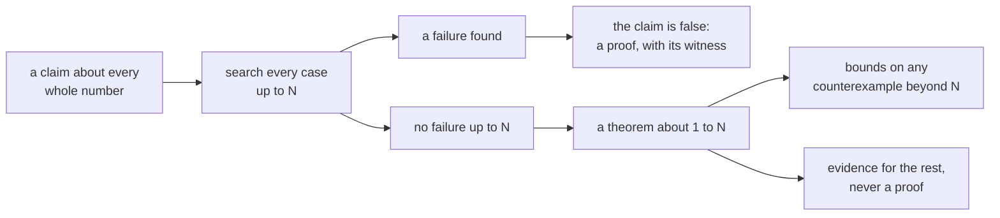

# Erdos problems: cheap to state, hard to settle, and often attacked by computer

[Syllabus](../../../SYLLABUS.md) → [Algebraic and analytic number theory](../README.md) → [Additive Combinatorics and Probabilistic Number Theory](../README.md#s08) → Erdos problems

---

## General Overview

Pick a whole number. If it is even, halve it. If it is odd, triple it and add 1. Repeat. Start at 27 and the walk climbs as high as 9,232, then falls, and reaches 1 after 111 steps.

The Collatz conjecture, credited to Lothar Collatz in the 1930s, says every starting number reaches 1. Computers have checked every start below $`2^{68}`$, about 295 million million million, and found no exception; Barina's 2025 run extended this to $`2^{71}`$, eight times further. Nobody has a proof. The problem is not Erdős's own, but Paul Erdős, who posed hundreds like it, commented on it: "Mathematics is not yet ready for such problems."

Many Erdős problems share its shape: one line long, about whole numbers, and checkable case by case. That makes them natural targets for a computer search: a program that tests cases one after another.

This card runs such a search itself, to a million. Every start reaches 1, and the slowest is 837,799, at 524 steps. The card then records exactly what that clean range proves, what it does not, and how a smart search skips 90% of the work. An Erdős problem shows the other outcome: a finite question that a search settles completely.

**A search over a range proves an exact statement about that range and can force bounds beyond it, but for a claim about every whole number it is evidence, never proof, unless the question has been cut down to finitely many cases.**

**What kind of fact this is:** the Collatz conjecture is open as of 2026-11-15. The range to a million and the cycle bound are theorems, proved on this card by its code and by Why it works. The range to $`2^{68}`$ is a published computation (Barina, published online 2020). The discrepancy-1 case is proved here by exhaustion; the full Erdős discrepancy problem is a theorem (Tao, 2016).

### The picture: what a search can return



Only the top branch settles an infinite claim. The bottom branch still yields real theorems, and this card computes two of them.

---

## The formula

Write C(n) for one Collatz step:

```math
C(n) = \begin{cases} n/2 & n \text{ even} \\ 3n + 1 & n \text{ odd} \end{cases}
```

**Read it aloud:** halve an even number; triple an odd number and add one.

The conjecture says that for every n ≥ 1, some number of steps brings n to 1. A search to N proves the weaker statement V(N): every n from 1 to N reaches 1.

A clean range also says something about cycles: loops that return to their start without passing through 1. Suppose a cycle has k odd steps and L halvings, and every member exceeds N. Then

```math
1 \;<\; \frac{2^L}{3^k} \;<\; \Big(1 + \frac{1}{3N}\Big)^{k}
```

**Read it aloud:** two to the number of halvings beats three to the number of odd steps, but only by a hair that shrinks as the checked range grows.

With N = 1,000,000 the smallest k that allows this is 2,966. So any cycle other than 1, 4, 2, 1 has at least 2,966 odd steps.

| Symbol | Plain meaning | In our example | Push it up and the answer… |
| --- | --- | --- | --- |
| n | a starting number | 27; 837,799 | walks tend to get longer |
| C(n) | one Collatz step | 27 takes 111 of them to reach 1 | — |
| T(n) | the shortcut step: n/2, or (3n + 1)/2 for odd n | 837,799 takes 329 shortcut steps | — |
| N | the top of the checked range | 1,000,000 | more cases settled, bounds grow |
| V(N) | the claim that every n from 1 to N reaches 1 | V(1,000,000) holds | a stronger finite claim |
| k | odd steps in a hypothetical cycle | at least 2,966 | — |
| L | halvings in that cycle | at least 4,701 | — |
| $`n_i`$ | the i-th odd member of that cycle | each above 1,000,000 | its factor $`1 + 1/(3n_i)`$ moves closer to 1 |
| $`2^m`$ | the sieve's modulus: classes of n by remainder | $`2^{16}`$ = 65,536 | a smaller share needs a test |
| log | the natural log, written ln in the code output | log 2 and log 3 in the cycle bound | — |
| $`x_i`$ | the i-th sign in a ±1 sequence | +1 or −1 | — |
| d, j | a step size and a count in the discrepancy sums | d from 1 to 12, with jd at most 12 | more sums to keep within 1 |

### When it holds

- **The search is exhaustive.** V(N) needs every n up to N. Sampling a million random starts proves nothing about the ones skipped.
- **The step really is 3n + 1.** Change it to 5n + 1 and the same search finds a cycle at 13 within 10 steps: a counterexample exists for that rule.
- **The cycle bound needs every cycle member above N.** That holds because each n ≤ N reaches 1, so it cannot sit on a different cycle.
- **Evidence is not proof.** Pólya's conjecture held for every number below 906,150,257 and failed there ([Squarefree numbers](../01-Arithmetic%20Functions%20Again/07-squarefree-numbers-and-their-density.md)).
- **Divergence cannot be searched for.** A walk that climbs forever never finishes, so no finite run can show one or rule one out.

---

## Why it works

### Step 0: a range is a theorem; the claim is not

[Goldbach, twin primes and friends](../../02-Number%20theory/07-For%20the%20Curious/04-goldbach-and-open-problems.md) already shows the core asymmetry, with Goldbach checked to 4,000,000,000,000,000,000: one miss kills a for-all claim, and no pile of hits proves it.

This card adds two things that card does not do. It runs the search, with the tricks real searches use. It also shows that a clean range proves more than "no counterexample below N".

### Step 1: falling below the start is enough

A search need not follow every walk to 1. It is enough that each n ≥ 2 eventually drops below n.

The reason is strong induction ([Strong induction and the least element](../../01-Foundations/06-Proof/05-strong-induction-and-well-ordering.md)). Suppose every number below n reaches 1. If n drops to some smaller m, then n follows m's walk to 1.

Start 1 is the base case: it sits on the cycle 1, 4, 2, 1. The run checks all 999,999 starts from 2 to 1,000,000; each falls below itself. The proof is that the run finishes: each start's loop stops only when its walk drops below the start, so a start that never dropped would keep the program running for ever.

### Step 2: the low bits decide the first steps

Whether n is even depends only on its last binary digit. The first m shortcut steps of n therefore depend only on n's remainder after division by $`2^m`$, its class mod $`2^m`$.

Take a class mod 4, n = 4a + 1 with a ≥ 1. One shortcut step gives 6a + 2, which is even. The next gives 3a + 1, which is below 4a + 1. Every member of this class drops within two shortcut steps, and the search can skip all of them.

A class **survives** mod $`2^m`$ if none of its first m steps is guaranteed to drop. Mod 16 only three classes survive: 7, 11 and 15. Deeper sieves cut further:

```
mod 2^1   ##################################################  50.00%
mod 2^2   #########################                           25.00%
mod 2^3   #########################                           25.00%
mod 2^4   ###################                                 18.75%
mod 2^8   #######                                              7.42%
mod 2^12  ######                                               5.52%
mod 2^16  ###                                                  3.23%
```

Each bar is the share of classes mod $`2^m`$ that still need a test. The code prints all seven.

Below $`2^{16}`$ a class's own offset can matter, so the search tests every small n directly. In all, the sieve mod $`2^{16}`$ leaves 95,676 of the 999,999 starts to test, 9.57%. The code also tests the rest and confirms the algebra both ways: the starts at or above $`2^{16}`$ that needed more than 16 shortcut steps are exactly the 30,142 there in the 2,114 survivor classes.

Published searches use the same idea with deeper sieves and fast hardware. That is how they reached $`2^{68}`$ = 295,147,905,179,352,825,856, which is 295,147,905,179,352 times this card's range.

### Step 3: a clean range forces any other cycle to be long

Follow a cycle once around. Each odd step multiplies the current number by $`3 + 1/n`$, and each halving by 1/2. Back at the start, the product is 1. Writing $`n_1, \dots, n_k`$ for the cycle's odd members:

```math
\frac{2^L}{3^k} = \prod_{i=1}^{k}\Big(1 + \frac{1}{3n_i}\Big)
```

**Read it aloud:** two to the halvings over three to the odd steps equals a product of factors each just above 1.

Every $`n_i`$ exceeds N, so each factor lies strictly between 1 and $`1 + 1/(3N)`$. That gives the inequality of The formula.

Take logs: $`0 < L \log 2 - k \log 3 < k/(3N)`$, since $`\log(1 + y) < y`$. So L/k must approximate log 3 / log 2 from above, very closely. The code tries k = 1, 2, 3, … with L the smallest whole number making $`2^L > 3^k`$.

The first k that fits is 2,966, with L = 4,701. There the gap is 0.000848, under the allowance 0.000989. Any non-trivial cycle has at least 2,966 odd steps and 7,667 steps in all.

<details>
<summary>Detailed proof: the cycle inequality</summary>

Let a cycle have odd members $`n_1, \dots, n_k`$ and L halvings in total, and suppose it is not 1, 4, 2, 1. Every number up to N reaches 1, and a walk that reaches 1 then stays on 1, 4, 2, 1, so no cycle member is at most N.

An odd step sends $`n_i`$ to $`3n_i + 1 = n_i \cdot 3(1 + 1/(3n_i))`$. A halving sends m to m/2. The product of all the ratios around the cycle is 1:

$`\displaystyle 1 = \frac{3^k}{2^L}\prod_{i=1}^{k}\Big(1 + \frac{1}{3n_i}\Big)`$

Each factor in the product is above 1 and below $`1 + 1/(3N)`$, since $`n_i > N`$. Rearranging gives the inequality. Taking natural logs and using $`\log(1 + y) < y`$ for y > 0 gives $`0 < L\log 2 - k\log 3 < k/(3N)`$.

For each k the only candidate is the smallest L with $`2^L > 3^k`$: any larger L adds log 2 to the gap, far above $`k/(3N)`$ for the k involved. The code checks every k up to 2,966 this way. At k = 2,966 the Python check also confirms the inequality in exact whole-number arithmetic, and the Rust check with the sharper $`\log(1 + y)`$.

</details>

This is the shape of every bound "a counterexample must be at least this big". A bigger checked range buys a bigger bound. Raising N to ten million raises the cycle bound to 10,946 odd steps.

### Step 4: what no range can prove

Two things stay out of reach of any search.

- **A walk that grows forever.** It never returns a verdict, so a program cannot tell it from a very long walk.
- **The claim itself.** V(N) for every N is the conjecture, and each search covers one N.

The best proved result goes the other way, by probability. Tao proved in 2022 that almost every start gets below any function that grows to infinity, however slowly. Here "almost every" counts each start n with weight 1/n (logarithmic density). "Almost every" still leaves room for exceptions.

### Step 5: a finite Erdős question a search settles

Erdős asked about sign sequences. Take $`x_1, x_2, x_3, \dots`$, each +1 or −1. For a step d, add the signs at d, 2d, 3d, …, jd. The **discrepancy** is the largest size of such a sum. Erdős asked whether every infinite sequence has unbounded discrepancy.

Fix the bound at 1 and the question becomes finite: how long can a sequence keep every such sum at −1, 0 or +1? The code tries all $`2^n`$ sequences of each length n up to 12, then repeats the count by backtracking (extending a sequence one sign at a time and abandoning it as soon as a sum reaches 2).

Both roads agree. Four sequences of length 11 stay within 1, and none of length 12 does. So every sign sequence of length 12 or more has discrepancy at least 2: a theorem, proved by exhaustion.

For bound 2, Konev and Lisitsa used a SAT solver, a program that decides whether a list of yes-or-no constraints can all hold at once. The longest sequence is 1,160. Tao then proved in 2016 that the discrepancy is always unbounded. The searches settled cases; the proof settled the question.

---

## Worked numbers, by hand

| Step | Arithmetic | Value |
| --- | --- | --- |
| walk from 27 | halve or triple-plus-one, to 1 | 111 steps, peak 9,232 |
| class 1 mod 4 | 4a + 1 → 6a + 2 → 3a + 1 | drops in 2 shortcut steps |
| survivors mod 16 | classes not yet guaranteed to drop | 7, 11, 15: 18.75% |
| survivors mod $`2^{16}`$ | 2,114 of 65,536 | 3.23% |
| starts left to test | all below $`2^{16}`$, plus survivors above | 95,676 of 999,999 |
| slowest start to a million | longest walk found | **837,799, 524 steps** |
| cycle bound | first k with gap under k/(3N): 0.000848 < 0.000989 | **2,966 odd steps** |
| discrepancy within 1 | sequences of length 11, then 12 | 4, then 0 |

Every start up to a million reaches 1, and any other cycle needs at least 2,966 odd steps; neither fact says anything about whether a start above a million behaves.

### What breaks if you drop a piece

| Mistake | Comes out at | What went wrong |
| --- | --- | --- |
| Counting 837,799's walk with the shortcut step | 329, not 524 | Each shortcut odd step folds two ordinary steps into one: 195 of them here |
| Running the descent test on 1 | 1, 4, 2, 1: never below 1 | 1 is the base case of the induction, not a case to test |
| The same search with 5n + 1 | 13, 66, 33, 166, 83, 416, 208, 104, 52, 26, 13 | For this rule a cycle exists, and the search finds it in 10 steps |

The code prints all three.

---

## Code, from first principles, and it actually runs

Nothing imported holds an answer; Python uses only `math.log` and `math.ceil`. The search to a million takes two roads to "every start reaches 1": every walk to 1 with a memory of earlier answers, and a descent test with the shortcut map. No assert can catch a start that fails, because such a start would keep its loop running: the run finishing is the proof. The asserts check the roads' numbers instead. A plain walk of the record holder with no memory must match road 1's 524 steps, and road 2's starts needing more than 16 shortcut steps must match the sieve's prediction exactly. The sieve is built twice, by extending classes bit by bit and by testing one huge member of every class. The discrepancy count is made twice, by brute force and by backtracking. Asserts pin the results to published values: 837,799 at 524 steps, 27 at 111 steps.

### Python

```python
# Erdos problems and computer search -- the check behind the card.  Standard
# library only.  Collatz: halve an even n, send an odd n to 3n + 1.  Searched
# to N = 1,000,000 by two roads, whose loops finishing is the proof, with the
# record walked a third way; then what the clean range proves about cycles,
# and one Erdos question a search settles completely.
import math
N, K = 1_000_000, 16

def plain(n):                                # road 3: no shortcuts, no memory
    steps, peak = 0, n
    while n != 1:
        n = n // 2 if n % 2 == 0 else 3 * n + 1
        steps, peak = steps + 1, max(peak, n)
    return steps, peak

steps = [0] * (N + 1)                        # road 1: every n to 1, with memory
for n in range(2, N + 1):
    m, s = n, 0
    while m >= n:
        m = m // 2 if m % 2 == 0 else 3 * m + 1
        s += 1
    steps[n] = s + steps[m]
best = max(range(1, N + 1), key=lambda n: steps[n])

def T(n):                                    # the shortcut map: an odd step halves at once
    return n // 2 if n % 2 == 0 else (3 * n + 1) // 2

def survivors_tree(k):                       # classes mod 2^k not yet below their start
    alive = [(0, 0, 0)]                      # (residue b, odd steps j, value t of T^i(b))
    for i in range(k):
        nxt = []
        for b, j, t in alive:
            for e in (0, 1):
                s = 3 ** j * e + t
                j2, t2 = (j, s // 2) if s % 2 == 0 else (j + 1, (3 * s + 1) // 2)
                if 3 ** j2 > 2 ** (i + 1):
                    nxt.append((b + e * 2 ** i, j2, t2))
        alive = nxt
    return sorted(b for b, _, _ in alive)

def survivors_brute(k):                      # second road: one huge member per class
    out = []
    for b in range(2 ** k):
        n = m = b + 2 ** k * 2 ** 40
        if all((m := T(m)) >= n for _ in range(k)):
            out.append(b)
    return out

surv = survivors_tree(K)
alive = set(surv)
late, fell = [], 0                           # road 2: falls below itself, shortcut map
for n in range(2, N + 1):
    m, s = n, 0
    while m >= n:
        m, s = T(m), s + 1
    fell += 1
    if s > K and n >= 2 ** K:
        late.append(n)
tested = sum(1 for n in range(2, N + 1) if n < 2 ** K or n % 2 ** K in alive)
pred = sum(1 for n in range(2 ** K, N + 1) if n % 2 ** K in alive)   # the sieve: these need > K steps

x, l2 = 1 / (3 * N), math.log(3) / math.log(2)   # a cycle avoiding 1..N needs k odd steps
k = 1
while (math.ceil(k * l2) - k * l2) * math.log(2) >= k * x:
    k += 1
L = math.ceil(k * l2)

def disc(seq):                               # largest |x_d + x_2d + ... + x_md|
    return max([abs(sum(seq[d - 1:m:d])) for d in range(1, len(seq) + 1)
                for m in range(d, len(seq) + 1, d)] + [0])

def grow(seq, n):                            # backtracking: extend while discrepancy <= 1
    if disc(seq) > 1: return 0
    return 1 if len(seq) == n else grow(seq + [1], n) + grow(seq + [-1], n)

brute = [sum(1 for c in range(2 ** n) if disc([1 - 2 * (c >> i & 1) for i in range(n)]) <= 1)
         for n in range(1, 13)]
tree = [grow([], n) for n in range(1, 13)]
five, one = [13], [1]                        # 5n + 1 from 13, and 3n + 1 from 1
for _ in range(10):
    five.append(five[-1] // 2 if five[-1] % 2 == 0 else 5 * five[-1] + 1)
for _ in range(3):
    one.append(one[-1] // 2 if one[-1] % 2 == 0 else 3 * one[-1] + 1)
s27, p27 = plain(27)
sb, pb = plain(best)
m, oddb = best, 0
while m != 1:
    oddb += m % 2
    m = m // 2 if m % 2 == 0 else 3 * m + 1
print(f"27 reaches 1 in {s27} steps, peak {p27:,}")
print(f"road 1, memory to {N:,}: every walk finished, so every start reaches 1")
print(f"slowest start below {N:,}: {best:,}, {steps[best]} steps")
print(f"road 3, plain walk of {best:,}: {sb} steps, peak {pb:,}")
print(f"road 2, starts from 2 to {N:,} that fall below themselves: {fell:,}")
for kk in (1, 2, 3, 4, 8, 12, 16):
    sv = len(survivors_tree(kk))
    print(f"sieve mod 2^{kk}: {sv:,} of {2 ** kk:,} classes still need a test ({100 * sv / 2 ** kk:.2f}%)")
print(f"survivors mod 16: {survivors_tree(4)}")
print(f"tree and brute force agree on the survivors mod 2^{K}: {'yes' if surv == survivors_brute(K) else 'no'}")
print(f"numbers the sieve mod 2^{K} leaves to test: {tested:,} of {N - 1:,} ({100 * tested / (N - 1):.2f}%)")
print("quoted, not computed here: Goldbach checked to 4,000,000,000,000,000,000; "
      "Polya fails first at 906,150,257; longest discrepancy-2 sequence 1,160")
print(f"published range 2^68 = {2 ** 68:,}, {2 ** 68 // N:,} times this one; 2^71 in 2025, {2 ** 71 // 2 ** 68} times 2^68")
print(f"starts at or above 2^{K} needing more than {K} shortcut steps: {len(late):,}; the sieve predicts {pred:,}; "
      f"outside the survivors: {sum(1 for n in late if n % 2 ** K not in alive)}")
print(f"a cycle avoiding 1 to {N:,} needs at least {k:,} odd steps, {L:,} halvings, {k + L:,} steps")
print(f"  gap k ln 3 to L ln 2: {(L - k * l2) * math.log(2):.6f} under k/(3N) = {k * x:.6f}")
print(f"discrepancy at most 1, sequences of length 1 to 12: {brute}")
print(f"backtracking count agrees: {'yes' if brute == tree else 'no'}; longest length {max(n for n in range(1, 13) if brute[n - 1])}")
print(f"mistake 1, shortcut steps for {best:,}: {sb - oddb}, not {sb} ({oddb} odd steps folded in)")
print(f"mistake 2, descent test on 1: {' -> '.join(map(str, one))}, lowest after the start {min(one[1:])}")
print(f"mistake 3, 5n + 1 from 13: {' -> '.join(map(str, five))}, a cycle of {len(five) - 1} steps")
assert sb == steps[best]                                                   # roads 1 and 3 on the record
assert (best, sb, s27, p27) == (837_799, 524, 111, 9_232)                  # published
assert surv == survivors_brute(K) and survivors_tree(4) == [7, 11, 15]     # two roads to the sieve
assert all(n % 2 ** K in alive for n in late) and len(late) == pred       # road 2 against the sieve
assert brute == tree and brute[10] > 0 and brute[11] == 0                  # longest is 11
assert five[-1] == 13 and 13 not in five[1:-1] and min(one[1:]) == 1      # the cycles
assert 3 ** k < 2 ** L and 2 ** L * (3 * N) ** k < 3 ** k * (3 * N + 1) ** k  # exact integers
print("ALL CHECKS PASS")
```

**Ran 2026-11-15 on macOS, Python 3.14.10, standard library only. All checks passed. Output, pasted from the run:**

```
27 reaches 1 in 111 steps, peak 9,232
road 1, memory to 1,000,000: every walk finished, so every start reaches 1
slowest start below 1,000,000: 837,799, 524 steps
road 3, plain walk of 837,799: 524 steps, peak 2,974,984,576
road 2, starts from 2 to 1,000,000 that fall below themselves: 999,999
sieve mod 2^1: 1 of 2 classes still need a test (50.00%)
sieve mod 2^2: 1 of 4 classes still need a test (25.00%)
sieve mod 2^3: 2 of 8 classes still need a test (25.00%)
sieve mod 2^4: 3 of 16 classes still need a test (18.75%)
sieve mod 2^8: 19 of 256 classes still need a test (7.42%)
sieve mod 2^12: 226 of 4,096 classes still need a test (5.52%)
sieve mod 2^16: 2,114 of 65,536 classes still need a test (3.23%)
survivors mod 16: [7, 11, 15]
tree and brute force agree on the survivors mod 2^16: yes
numbers the sieve mod 2^16 leaves to test: 95,676 of 999,999 (9.57%)
quoted, not computed here: Goldbach checked to 4,000,000,000,000,000,000; Polya fails first at 906,150,257; longest discrepancy-2 sequence 1,160
published range 2^68 = 295,147,905,179,352,825,856, 295,147,905,179,352 times this one; 2^71 in 2025, 8 times 2^68
starts at or above 2^16 needing more than 16 shortcut steps: 30,142; the sieve predicts 30,142; outside the survivors: 0
a cycle avoiding 1 to 1,000,000 needs at least 2,966 odd steps, 4,701 halvings, 7,667 steps
  gap k ln 3 to L ln 2: 0.000848 under k/(3N) = 0.000989
discrepancy at most 1, sequences of length 1 to 12: [2, 2, 4, 2, 4, 2, 4, 2, 4, 2, 4, 0]
backtracking count agrees: yes; longest length 11
mistake 1, shortcut steps for 837,799: 329, not 524 (195 odd steps folded in)
mistake 2, descent test on 1: 1 -> 4 -> 2 -> 1, lowest after the start 1
mistake 3, 5n + 1 from 13: 13 -> 66 -> 33 -> 166 -> 83 -> 416 -> 208 -> 104 -> 52 -> 26 -> 13, a cycle of 10 steps
ALL CHECKS PASS
```

### Rust

Same numbers, same labels, built with `rustc --edition 2021 -O`.

```rust
// Erdos problems and computer search -- the same check as the Python, in Rust.
// No crates.  Collatz: halve an even n, send an odd n to 3n + 1.  Searched to
// N = 1,000,000 by two roads, whose loops finishing is the proof, with the
// record walked a third way; then what the clean range proves about cycles,
// and one Erdos question a search settles completely.
const N: u64 = 1_000_000;
const K: u32 = 16;

fn c(v: u128) -> String {                        // thousands commas
    let s = v.to_string();
    let mut out = String::new();
    for (i, ch) in s.chars().enumerate() {
        if i > 0 && (s.len() - i) % 3 == 0 { out.push(',') }
        out.push(ch);
    }
    out
}

fn step(n: u64) -> u64 { if n % 2 == 0 { n / 2 } else { 3 * n + 1 } }

fn plain(mut n: u64) -> (u64, u64) {             // road 3: no shortcuts, no memory
    let (mut steps, mut peak) = (0, n);
    while n != 1 { n = step(n); steps += 1; peak = peak.max(n) }
    (steps, peak)
}

fn t(n: u128) -> u128 { if n % 2 == 0 { n / 2 } else { (3 * n + 1) / 2 } }  // shortcut map

fn survivors_tree(k: u32) -> Vec<u128> {         // classes mod 2^k not yet below their start
    let mut alive: Vec<(u128, u32, u128)> = vec![(0, 0, 0)];   // (residue b, odd steps j, T^i(b))
    for i in 0..k {
        let mut nxt = Vec::new();
        for &(b, j, tv) in &alive {
            for e in 0..2u128 {
                let s = 3u128.pow(j) * e + tv;
                let (j2, t2) = if s % 2 == 0 { (j, s / 2) } else { (j + 1, (3 * s + 1) / 2) };
                if 3u128.pow(j2) > 2u128.pow(i + 1) { nxt.push((b + e * 2u128.pow(i), j2, t2)) }
            }
        }
        alive = nxt;
    }
    let mut out: Vec<u128> = alive.iter().map(|a| a.0).collect();
    out.sort();
    out
}

fn survivors_brute(k: u32) -> Vec<u128> {        // second road: one huge member per class
    (0..2u128.pow(k)).filter(|&b| {
        let n = b + (1u128 << (k + 40));
        let mut m = n;
        (0..k).all(|_| { m = t(m); m >= n })
    }).collect()
}

fn disc(seq: &[i32]) -> i32 {                    // largest |x_d + x_2d + ... + x_md|
    let mut best = 0;
    for d in 1..=seq.len() {
        let mut sum = 0;
        for m in (d..=seq.len()).step_by(d) { sum += seq[m - 1]; best = best.max(sum.abs()) }
    }
    best
}

fn grow(seq: &mut Vec<i32>, n: usize) -> u32 {   // backtracking: extend while discrepancy <= 1
    if disc(seq) > 1 { return 0 }
    if seq.len() == n { return 1 }
    let mut total = 0;
    for v in [1, -1] { seq.push(v); total += grow(seq, n); seq.pop(); }
    total
}

fn yn(b: bool) -> &'static str { if b { "yes" } else { "no" } }

fn main() {
    let nu = N as usize;
    let mut steps = vec![0u64; nu + 1];          // road 1: every n to 1, with memory
    for n in 2..=N {
        let (mut m, mut s) = (n, 0);
        while m >= n { m = step(m); s += 1 }
        steps[n as usize] = s + steps[m as usize];
    }
    let mut best = 1;
    for n in 1..=nu { if steps[n] > steps[best] { best = n } }
    let surv = survivors_tree(K);
    let modk = 2u128.pow(K);
    let (mut late, mut fell) = (Vec::new(), 0u64);   // road 2: falls below itself, shortcut map
    for n in 2..=N as u128 {
        let (mut m, mut s) = (n, 0);
        while m >= n { m = t(m); s += 1 }
        fell += 1;
        if s > K && n >= modk { late.push(n) }
    }
    let tested = (2..=N as u128).filter(|&n| n < modk || surv.binary_search(&(n % modk)).is_ok()).count();
    let pred = (modk..=N as u128).filter(|&n| surv.binary_search(&(n % modk)).is_ok()).count();  // need > K steps
    let (x, l2) = (1.0 / (3.0 * N as f64), 3f64.ln() / 2f64.ln());   // cycle needs k odd steps
    let mut k = 1u64;
    while ((k as f64 * l2).ceil() - k as f64 * l2) * 2f64.ln() >= k as f64 * x { k += 1 }
    let big_l = (k as f64 * l2).ceil() as u64;
    let gap = (big_l as f64 - k as f64 * l2) * 2f64.ln();
    let brute: Vec<u32> = (1..=12u32).map(|n| (0..1u32 << n).filter(|cc| {
        let seq: Vec<i32> = (0..n).map(|i| 1 - 2 * ((cc >> i & 1) as i32)).collect();
        disc(&seq) <= 1 }).count() as u32).collect();
    let tree: Vec<u32> = (1..=12).map(|n| grow(&mut Vec::new(), n)).collect();
    let (mut five, mut one) = (vec![13u64], vec![1u64]);   // 5n + 1 from 13, and 3n + 1 from 1
    for _ in 0..10 { let l = *five.last().unwrap(); five.push(if l % 2 == 0 { l / 2 } else { 5 * l + 1 }) }
    for _ in 0..3 { let l = *one.last().unwrap(); one.push(step(l)) }
    let (s27, p27) = plain(27);
    let (sb, pb) = plain(best as u64);
    let (mut m, mut oddb) = (best as u64, 0);
    while m != 1 { oddb += m % 2; m = step(m) }
    let join = |v: &Vec<u64>| v.iter().map(|a| a.to_string()).collect::<Vec<_>>().join(" -> ");
    let longest = (1..=12).filter(|&n| brute[n - 1] > 0).max().unwrap();
    let outside = late.iter().filter(|&&n| surv.binary_search(&(n % modk)).is_err()).count();
    println!("27 reaches 1 in {} steps, peak {}", s27, c(p27 as u128));
    println!("road 1, memory to {}: every walk finished, so every start reaches 1", c(N as u128));
    println!("slowest start below {}: {}, {} steps", c(N as u128), c(best as u128), steps[best]);
    println!("road 3, plain walk of {}: {} steps, peak {}", c(best as u128), sb, c(pb as u128));
    println!("road 2, starts from 2 to {} that fall below themselves: {}", c(N as u128), c(fell as u128));
    for kk in [1, 2, 3, 4, 8, 12, 16] {
        let sv = survivors_tree(kk).len();
        println!("sieve mod 2^{}: {} of {} classes still need a test ({:.2}%)", kk, c(sv as u128),
                 c(2u128.pow(kk)), 100.0 * sv as f64 / 2f64.powi(kk as i32));
    }
    println!("survivors mod 16: {:?}", survivors_tree(4));
    println!("tree and brute force agree on the survivors mod 2^{}: {}", K, yn(surv == survivors_brute(K)));
    println!("numbers the sieve mod 2^{} leaves to test: {} of {} ({:.2}%)", K, c(tested as u128),
             c((N - 1) as u128), 100.0 * tested as f64 / (N - 1) as f64);
    println!("quoted, not computed here: Goldbach checked to 4,000,000,000,000,000,000; \
              Polya fails first at 906,150,257; longest discrepancy-2 sequence 1,160");
    println!("published range 2^68 = {}, {} times this one; 2^71 in 2025, {} times 2^68", c(1u128 << 68),
             c((1u128 << 68) / N as u128), (1u128 << 71) / (1u128 << 68));
    println!("starts at or above 2^{} needing more than {} shortcut steps: {}; the sieve predicts {}; outside the survivors: {}",
             K, K, c(late.len() as u128), c(pred as u128), outside);
    println!("a cycle avoiding 1 to {} needs at least {} odd steps, {} halvings, {} steps",
             c(N as u128), c(k as u128), c(big_l as u128), c((k + big_l) as u128));
    println!("  gap k ln 3 to L ln 2: {:.6} under k/(3N) = {:.6}", gap, k as f64 * x);
    println!("discrepancy at most 1, sequences of length 1 to 12: {:?}", brute);
    println!("backtracking count agrees: {}; longest length {}", yn(brute == tree), longest);
    println!("mistake 1, shortcut steps for {}: {}, not {} ({} odd steps folded in)", c(best as u128), sb - oddb, sb, oddb);
    println!("mistake 2, descent test on 1: {}, lowest after the start {}", join(&one), one[1..].iter().min().unwrap());
    println!("mistake 3, 5n + 1 from 13: {}, a cycle of {} steps", join(&five), five.len() - 1);
    assert!(sb == steps[best]);                                                       // roads 1 and 3 on the record
    assert!((best, sb, s27, p27) == (837_799, 524, 111, 9_232));                      // published
    assert!(surv == survivors_brute(K) && survivors_tree(4) == vec![7, 11, 15]);      // two roads to the sieve
    assert!(outside == 0 && late.len() == pred);                                      // road 2 against the sieve
    assert!(brute == tree && brute[10] > 0 && brute[11] == 0);                        // longest is 11
    assert!(five[10] == 13 && !five[1..10].contains(&13) && *one[1..].iter().min().unwrap() == 1);
    assert!(gap > 0.0 && gap < k as f64 * x.ln_1p());                                 // sharper log, same k
    println!("ALL CHECKS PASS");
}
```

**Ran 2026-11-15 on macOS, rustc 1.98.1, no crates. All checks passed. Output, pasted from the run:**

```
27 reaches 1 in 111 steps, peak 9,232
road 1, memory to 1,000,000: every walk finished, so every start reaches 1
slowest start below 1,000,000: 837,799, 524 steps
road 3, plain walk of 837,799: 524 steps, peak 2,974,984,576
road 2, starts from 2 to 1,000,000 that fall below themselves: 999,999
sieve mod 2^1: 1 of 2 classes still need a test (50.00%)
sieve mod 2^2: 1 of 4 classes still need a test (25.00%)
sieve mod 2^3: 2 of 8 classes still need a test (25.00%)
sieve mod 2^4: 3 of 16 classes still need a test (18.75%)
sieve mod 2^8: 19 of 256 classes still need a test (7.42%)
sieve mod 2^12: 226 of 4,096 classes still need a test (5.52%)
sieve mod 2^16: 2,114 of 65,536 classes still need a test (3.23%)
survivors mod 16: [7, 11, 15]
tree and brute force agree on the survivors mod 2^16: yes
numbers the sieve mod 2^16 leaves to test: 95,676 of 999,999 (9.57%)
quoted, not computed here: Goldbach checked to 4,000,000,000,000,000,000; Polya fails first at 906,150,257; longest discrepancy-2 sequence 1,160
published range 2^68 = 295,147,905,179,352,825,856, 295,147,905,179,352 times this one; 2^71 in 2025, 8 times 2^68
starts at or above 2^16 needing more than 16 shortcut steps: 30,142; the sieve predicts 30,142; outside the survivors: 0
a cycle avoiding 1 to 1,000,000 needs at least 2,966 odd steps, 4,701 halvings, 7,667 steps
  gap k ln 3 to L ln 2: 0.000848 under k/(3N) = 0.000989
discrepancy at most 1, sequences of length 1 to 12: [2, 2, 4, 2, 4, 2, 4, 2, 4, 2, 4, 0]
backtracking count agrees: yes; longest length 11
mistake 1, shortcut steps for 837,799: 329, not 524 (195 odd steps folded in)
mistake 2, descent test on 1: 1 -> 4 -> 2 -> 1, lowest after the start 1
mistake 3, 5n + 1 from 13: 13 -> 66 -> 33 -> 166 -> 83 -> 416 -> 208 -> 104 -> 52 -> 26 -> 13, a cycle of 10 steps
ALL CHECKS PASS
```

The two outputs match line for line.

### Lean

Lean proves the three general facts behind Steps 1, 3 and 5 for every N, and checks the card's small cases exactly.

- Suppose every start from 2 to N falls below itself. Then every start from 1 to N reaches 1.
- Suppose every start from 1 to N reaches 1, and a cycle with k odd steps and L halvings avoids 1. Then $`3^k < 2^L`$ and $`2^L (3N)^k < 3^k (3N + 1)^k`$. This is the inequality of The formula, in whole numbers.
- Take any sign sequence of length 12 or more. Then its discrepancy is at least 2.
- The walk from 27 reaches 1 after 111 steps, and its peak is 9,232.
- The walk from 837,799 reaches 1 after 524 steps, and not before.
- Take a ≥ 1. Then three steps send 4a + 1 to 3a + 1, below its start.
- The walk from 1 is 1, 4, 2, 1, so it never drops below 1.
- With 5n + 1 in place of 3n + 1, the walk from 13 returns to 13 after 10 steps.
- Take N = 1,000,000, k = 2,966 and L = 4,701. Then both whole-number inequalities above hold.
- $`2^{68}`$ = 295,147,905,179,352,825,856, and $`2^{71}`$ is 8 times $`2^{68}`$.
- With discrepancy at most 1, lengths 1 to 12 allow 2, 2, 4, 2, 4, 2, 4, 2, 4, 2, 4 and 0 sequences.

The search to a million, the slowest start, the sieve and the first k that fits are left to the Python and Rust checks.

```lean
-- Erdos problems: a Collatz search that sees every start from 2 to N drop below itself proves every start up to N reaches 1, a clean range forces any other cycle to satisfy the cycle inequality, and every sign sequence of length 12 or more has discrepancy at least 2.
import Mathlib.Logic.Function.Iterate
import Mathlib.Algebra.Order.BigOperators.Group.Finset
import Mathlib.Algebra.Order.Ring.Abs
import Mathlib.Order.Interval.Finset.Nat
import Mathlib.Algebra.Ring.Parity
import Mathlib.Algebra.Order.BigOperators.GroupWithZero.Finset
import Mathlib.Algebra.BigOperators.Group.Finset.Piecewise
import Mathlib.Algebra.BigOperators.Intervals
import Mathlib.Dynamics.PeriodicPts.Defs
import Mathlib.Data.Nat.Bits
import Mathlib.Tactic.Positivity
import Mathlib.Tactic.Ring
import Mathlib.Tactic.Linarith

/-- One Collatz step C(n): halve an even number; triple an odd number and add one. -/
def collatz (n : ℕ) : ℕ := if n % 2 = 0 then n / 2 else 3 * n + 1

/-- The same rule with 5n + 1 in place of 3n + 1, used on the card to show the step matters. -/
def collatz5 (n : ℕ) : ℕ := if n % 2 = 0 then n / 2 else 5 * n + 1

/-- The i-th sign of the sign sequence coded by the whole number c, as in the card's code:
x_i is -1 when bit i - 1 of c is 1, and +1 otherwise. -/
def sign (c i : ℕ) : ℤ := if c.testBit (i - 1) then -1 else 1

/-- The sign sequence coded by c, of length n, keeps every sum x_d + x_2d + ... + x_jd
(with jd at most n) at -1, 0 or +1. -/
def discWithinOne (n c : ℕ) : Bool :=
  (List.range' 1 n).all fun d => (List.range' 1 (n / d)).all fun j =>
    decide (|((List.range' 1 j).map fun i => sign c (i * d)).sum| ≤ 1)

theorem collatz_pos {n : ℕ} (hn : 1 ≤ n) : 1 ≤ collatz n := by
  unfold collatz; split_ifs <;> omega
#print axioms collatz_pos

theorem collatz_iterate_pos {n : ℕ} (hn : 1 ≤ n) (i : ℕ) : 1 ≤ collatz^[i] n := by
  induction i with
  | zero => simpa using hn
  | succ i ih => rw [Function.iterate_succ_apply']; exact collatz_pos ih
#print axioms collatz_iterate_pos

theorem collatz_step (m : ℕ) :
    (if m % 2 = 1 then 1 else 2) * collatz m = (if m % 2 = 1 then 3 * m + 1 else m) := by
  unfold collatz; split_ifs <;> omega
#print axioms collatz_step

theorem foldr_bit_lt (l : List Bool) : l.foldr Nat.bit 0 < 2 ^ l.length := by
  induction l with
  | nil => simp
  | cons b l ih =>
    simp only [List.foldr_cons, List.length_cons, Nat.bit_val, pow_succ]
    cases b <;> simp <;> omega
#print axioms foldr_bit_lt

theorem foldr_bit_testBit (l : List Bool) (k : ℕ) :
    (l.foldr Nat.bit 0).testBit k = l.getD k false := by
  induction l generalizing k with
  | nil => simp
  | cons b l ih =>
    cases k with
    | zero => simp
    | succ k => simp [Nat.testBit_bit_succ, ih]
#print axioms foldr_bit_testBit

theorem sum_range'_eq_sum_Icc (f : ℕ → ℤ) (j : ℕ) :
    ((List.range' 1 j).map f).sum = ∑ i ∈ Finset.Icc 1 j, f i := by
  induction j with
  | zero => simp
  | succ j ih =>
    rw [List.range'_concat, List.map_append, List.sum_append, ih,
      Finset.sum_Icc_succ_top (by omega)]
    simp [add_comm]
#print axioms sum_range'_eq_sum_Icc

theorem no_code_within_one_all :
    ((List.range 4096).all fun c => !discWithinOne 12 c) = true := by
  decide +kernel
#print axioms no_code_within_one_all

theorem no_code_within_one (c : ℕ) (hc : c < 4096) : discWithinOne 12 c = false := by
  have h := List.all_eq_true.1 no_code_within_one_all c (List.mem_range.2 hc)
  simpa using h
#print axioms no_code_within_one

/-- A clean range forces any other cycle to be long (the cycle inequality). Suppose every
whole number from 1 to N reaches 1 under the Collatz step. Take a cycle: a start n ≥ 1 that
returns to itself after p ≥ 1 steps, never passing through 1 (so it is not 1, 4, 2, 1). Let
k be its number of odd steps and L = p - k its number of halvings. Then
1 < 2^L / 3^k < (1 + 1/(3N))^k, written here in whole numbers as
3^k < 2^L and 2^L · (3N)^k < 3^k · (3N + 1)^k. -/
theorem clean_range_forces_cycle_inequality (N n p : ℕ)
    (hrange : ∀ m, 1 ≤ m → m ≤ N → ∃ i, collatz^[i] m = 1)
    (hn : 1 ≤ n) (hp : 1 ≤ p) (hcycle : collatz^[p] n = n)
    (havoid : ∀ i < p, collatz^[i] n ≠ 1) :
    let k := ((Finset.range p).filter fun i => collatz^[i] n % 2 = 1).card
    let L := p - k
    3 ^ k < 2 ^ L ∧ 2 ^ L * (3 * N) ^ k < 3 ^ k * (3 * N + 1) ^ k := by
  intro k L
  set a : ℕ → ℕ := fun i => collatz^[i] n with ha
  have hpos : ∀ i, 0 < a i := fun i => collatz_iterate_pos hn i
  -- every point of the cycle lies above N
  have hbig : ∀ i, N < a i := by
    intro i
    by_contra h
    obtain ⟨j, hj⟩ := hrange (a i) (hpos i) (by omega)
    have hper : Function.IsPeriodicPt collatz p n := hcycle
    have : collatz^[(j + i) % p] n = 1 := by
      rw [hper.iterate_mod_apply, Function.iterate_add_apply]; exact hj
    exact havoid _ (Nat.mod_lt _ (by omega)) this
  set S := Finset.range p
  set O := S.filter fun i => a i % 2 = 1 with hO
  set E := S.filter fun i => ¬ a i % 2 = 1 with hE
  have hk : O.card = k := rfl
  have hEcard : E.card = L := by
    have h : O.card + E.card = S.card := Finset.card_filter_add_card_filter_not _
    rw [Finset.card_range] at h
    show E.card = p - k
    rw [← hk]; omega
  -- the cycle identity 2^L * ∏_O a = ∏_O (3a+1)
  have hshift : ∏ i ∈ S, a (i + 1) = ∏ i ∈ S, a i := by
    have h1 := Finset.prod_range_succ' a p
    have h2 := Finset.prod_range_succ a p
    have hap : a p = a 0 := by simp [ha, hcycle]
    rw [h2, hap] at h1
    exact (Nat.eq_of_mul_eq_mul_right (hpos 0) h1).symm
  have hsucc : ∀ i, a (i + 1) = collatz (a i) := fun i => by
    simp [ha, Function.iterate_succ_apply']
  have hprod : ∏ i ∈ S, ((if a i % 2 = 1 then 1 else 2) * a (i + 1)) =
      ∏ i ∈ S, (if a i % 2 = 1 then 3 * a i + 1 else a i) :=
    Finset.prod_congr rfl fun i _ => by rw [hsucc]; exact collatz_step (a i)
  rw [Finset.prod_mul_distrib, Finset.prod_ite, Finset.prod_ite, hshift,
    ← Finset.prod_filter_mul_prod_filter_not S (fun i => a i % 2 = 1)] at hprod
  simp only [Finset.prod_const_one, one_mul, Finset.prod_const] at hprod
  rw [← hO, ← hE, hEcard] at hprod
  have hEpos : 0 < ∏ i ∈ E, a i := Finset.prod_pos fun i _ => hpos i
  have hid : 2 ^ L * ∏ i ∈ O, a i = ∏ i ∈ O, (3 * a i + 1) := by
    apply Nat.eq_of_mul_eq_mul_right hEpos
    rw [mul_assoc]; exact hprod
  -- there is at least one odd step
  have hOne : O.Nonempty := by
    rw [Finset.nonempty_iff_ne_empty]
    intro hO0
    rw [hO0, Finset.prod_empty, Finset.prod_empty, mul_one] at hid
    have hk0 : k = 0 := by rw [← hk, hO0, Finset.card_empty]
    have : L = p := by show p - k = p; omega
    rw [this] at hid
    have : 2 ≤ 2 ^ p := by
      calc 2 = 2 ^ 1 := by norm_num
        _ ≤ 2 ^ p := Nat.pow_le_pow_right (by norm_num) hp
    omega
  have hQpos : 0 < ∏ i ∈ O, a i := Finset.prod_pos fun i _ => hpos i
  constructor
  · have hlt : ∏ i ∈ O, (3 * a i) < ∏ i ∈ O, (3 * a i + 1) :=
      Finset.prod_lt_prod_of_nonempty₀ (fun i _ => by have := hpos i; omega)
        (fun i _ => by omega) hOne
    rw [Finset.prod_mul_distrib, Finset.prod_const, hk, ← hid] at hlt
    exact Nat.lt_of_mul_lt_mul_right hlt
  · rcases Nat.eq_zero_or_pos N with hN | hN
    · have hkpos : 0 < k := by rw [← hk]; exact hOne.card_pos
      subst hN
      simp only [mul_zero, zero_pow hkpos.ne', mul_zero, zero_add, one_pow, mul_one]
      positivity
    have hlt : ∏ i ∈ O, ((3 * a i + 1) * (3 * N)) < ∏ i ∈ O, ((3 * a i) * (3 * N + 1)) :=
      Finset.prod_lt_prod_of_nonempty₀ (fun i _ => by have := hpos i; positivity)
        (fun i _ => by have := hbig i; nlinarith) hOne
    have e1 : ∏ i ∈ O, ((3 * a i + 1) * (3 * N)) = (∏ i ∈ O, (3 * a i + 1)) * (3 * N) ^ k := by
      rw [Finset.prod_mul_distrib, Finset.prod_const, hk]
    have e2 : ∏ i ∈ O, ((3 * a i) * (3 * N + 1)) =
        3 ^ k * (∏ i ∈ O, a i) * (3 * N + 1) ^ k := by
      rw [Finset.prod_mul_distrib, Finset.prod_mul_distrib, Finset.prod_const, Finset.prod_const, hk]
    rw [e1, e2, ← hid] at hlt
    apply Nat.lt_of_mul_lt_mul_right (a := ∏ i ∈ O, a i)
    calc 2 ^ L * (3 * N) ^ k * (∏ i ∈ O, a i) = 2 ^ L * (∏ i ∈ O, a i) * (3 * N) ^ k := by ring
      _ < 3 ^ k * (∏ i ∈ O, a i) * (3 * N + 1) ^ k := hlt
      _ = 3 ^ k * (3 * N + 1) ^ k * (∏ i ∈ O, a i) := by ring

/-- Falling below the start is enough. If an exhaustive search finds that every start n from
2 to N eventually drops below n under the Collatz step, then every start from 1 to N
reaches 1. -/
theorem every_start_reaches_one_of_every_start_drops (N : ℕ)
    (hsearch : ∀ n, 2 ≤ n → n ≤ N → ∃ i, collatz^[i] n < n) :
    ∀ n, 1 ≤ n → n ≤ N → ∃ i, collatz^[i] n = 1 := by
  intro n
  induction n using Nat.strong_induction_on with
  | _ n ih =>
    intro hn hnN
    rcases Nat.eq_or_lt_of_le hn with h | h
    · exact ⟨0, by simp [← h]⟩
    obtain ⟨i, hi⟩ := hsearch n h hnN
    obtain ⟨j, hj⟩ := ih _ hi (collatz_iterate_pos (by omega) i) (by omega)
    exact ⟨j + i, by rw [Function.iterate_add_apply]; exact hj⟩

/-- Discrepancy 1 is settled by search: for every sign sequence x_1, x_2, ..., each +1 or -1,
of length n ≥ 12, some step d and count j with jd ≤ n give a sum
x_d + x_2d + ... + x_jd of size at least 2. -/
theorem sign_sequence_of_length_twelve_has_discrepancy_two (n : ℕ) (hn : 12 ≤ n)
    (x : ℕ → ℤ) (hx : ∀ i, x i = 1 ∨ x i = -1) :
    ∃ d j, 1 ≤ d ∧ 1 ≤ j ∧ j * d ≤ n ∧ 2 ≤ |∑ i ∈ Finset.Icc 1 j, x (i * d)| := by
  set b : List Bool := (List.range 12).map (fun k => decide (x (k + 1) = -1)) with hb
  set c := b.foldr Nat.bit 0 with hcdef
  have hc : c < 4096 := by
    have := foldr_bit_lt b
    simpa [hb] using this
  have hsign : ∀ m, 1 ≤ m → m ≤ 12 → sign c m = x m := by
    intro m hm1 hm2
    unfold sign
    rw [hcdef, foldr_bit_testBit, hb, List.getD_eq_getElem?_getD,
      List.getElem?_eq_getElem (by simp; omega)]
    simp only [List.getElem_map, List.getElem_range, Option.getD_some]
    rw [show m - 1 + 1 = m by omega]
    rcases hx m with h | h <;> simp [h]
  have hk := no_code_within_one c hc
  simp only [discWithinOne, List.all_eq_false, List.mem_range'_1, Bool.not_eq_true,
    decide_eq_false_iff_not] at hk
  obtain ⟨d, ⟨hd1, hd2⟩, j, ⟨hj1, hj2⟩, hlt⟩ := hk
  have hjd : j * d ≤ 12 := (Nat.le_div_iff_mul_le (by omega)).1 (by omega)
  refine ⟨d, j, hd1, hj1, by omega, ?_⟩
  rw [sum_range'_eq_sum_Icc] at hlt
  have : ∑ i ∈ Finset.Icc 1 j, sign c (i * d) = ∑ i ∈ Finset.Icc 1 j, x (i * d) := by
    apply Finset.sum_congr rfl
    intro i hi
    rw [Finset.mem_Icc] at hi
    apply hsign
    · exact Nat.mul_le_mul hi.1 hd1
    · exact le_trans (Nat.mul_le_mul_right d hi.2) hjd
  rw [this] at hlt
  simp at hlt
  omega

-- 27 reaches 1 after 111 steps, not before, and its walk peaks at 9,232.
example : collatz^[111] 27 = 1 ∧ (∀ i < 111, collatz^[i] 27 ≠ 1) ∧
    (∀ i ≤ 111, collatz^[i] 27 ≤ 9232) ∧ collatz^[77] 27 = 9232 := by
  decide +kernel
-- The record below a million: 837,799 reaches 1 after 524 steps, not before.
example : collatz^[524] 837799 = 1 ∧ ∀ i < 524, collatz^[i] 837799 ≠ 1 := by
  decide +kernel
-- Class 1 mod 4: 4a + 1 → 12a + 4 → 6a + 2 → 3a + 1, below 4a + 1 for a ≥ 1.
example (a : ℕ) (ha : 1 ≤ a) : collatz^[3] (4 * a + 1) = 3 * a + 1 ∧ 3 * a + 1 < 4 * a + 1 := by
  have h1 : collatz (4 * a + 1) = 12 * a + 4 := by unfold collatz; split_ifs <;> omega
  have h2 : collatz (12 * a + 4) = 6 * a + 2 := by unfold collatz; split_ifs <;> omega
  have h3 : collatz (6 * a + 2) = 3 * a + 1 := by unfold collatz; split_ifs <;> omega
  refine ⟨?_, by omega⟩
  simp only [Function.iterate_succ, Function.iterate_zero, Function.comp_apply, id_eq, h1, h2, h3]
-- The base case: 1 → 4 → 2 → 1 never drops below 1.
example : collatz 1 = 4 ∧ collatz 4 = 2 ∧ collatz 2 = 1 := by decide
-- With 5n + 1 the walk from 13 returns to 13 after 10 steps:
-- 13, 66, 33, 166, 83, 416, 208, 104, 52, 26, 13.
example : collatz5^[10] 13 = 13 ∧ ∀ i, 1 ≤ i → i < 10 → collatz5^[i] 13 ≠ 13 := by
  decide +kernel
-- The cycle bound at N = 1,000,000: k = 2,966 odd steps and L = 4,701 halvings fit,
-- in exact whole numbers.
example : 3 ^ 2966 < 2 ^ 4701 ∧
    2 ^ 4701 * (3 * 1000000) ^ 2966 < 3 ^ 2966 * (3 * 1000000 + 1) ^ 2966 := by
  decide +kernel
-- The published range: 2^68 = 295,147,905,179,352,825,856, and 2^71 is 8 times 2^68.
example : 2 ^ 68 = 295147905179352825856 ∧ 2 ^ 71 = 8 * 2 ^ 68 := by decide
-- Sign sequences within discrepancy 1, lengths 1 to 12: 2, 2, 4, 2, 4, 2, 4, 2, 4, 2, 4, 0.
example : ((List.range 12).map fun n =>
    ((List.range (2 ^ (n + 1))).filter (discWithinOne (n + 1))).length) =
    [2, 2, 4, 2, 4, 2, 4, 2, 4, 2, 4, 0] := by
  decide +kernel

#print axioms clean_range_forces_cycle_inequality
#print axioms every_start_reaches_one_of_every_start_drops
#print axioms sign_sequence_of_length_twelve_has_discrepancy_two
```

**Checked 2026-11-15 on macOS, Lean 4.36.0-rc2, Mathlib v4.36.0-rc2. Every proof is complete and uses only Lean's standard axioms. Output, pasted from the run:**

```
'collatz_pos' depends on axioms: [propext, Quot.sound]
'collatz_iterate_pos' depends on axioms: [propext, Quot.sound]
'collatz_step' depends on axioms: [propext, Quot.sound]
'foldr_bit_lt' depends on axioms: [propext, Classical.choice, Quot.sound]
'foldr_bit_testBit' depends on axioms: [propext, Classical.choice, Quot.sound]
'sum_range'_eq_sum_Icc' depends on axioms: [propext, Classical.choice, Quot.sound]
'no_code_within_one_all' depends on axioms: [propext]
'no_code_within_one' depends on axioms: [propext, Quot.sound]
'clean_range_forces_cycle_inequality' depends on axioms: [propext, Classical.choice, Quot.sound]
'every_start_reaches_one_of_every_start_drops' depends on axioms: [propext, Quot.sound]
'sign_sequence_of_length_twelve_has_discrepancy_two' depends on axioms: [propext, Classical.choice, Quot.sound]
```

> [!TIP]
> **Try changing**
> - **Search further.** Guess first: does 837,799 stay the slowest start? Set `N` to `2_000_000`. The slowest becomes 1,723,519, at 556 steps, and the published-values assert stops the run.
> - **Sieve deeper.** Guess first: does a deeper sieve always save work? Set `K` to `20`. Now $`2^{20}`$ = 1,048,576 is above the whole range, so every start counts as small and all 999,999 need a test. A sieve pays only when the range is far above its modulus. Every assert still passes.
> - **Raise the range, raise the bound.** Guess first: how many odd steps must a cycle have once ten million starts are clean? Set `N` to `10_000_000`. The cycle line reads 10,946; the run then stops at the published-values assert.

---

## The usual mistake

> [!warning]
> **Reading a clean range as a proof.** Checking every start to $`2^{68}`$ proves that no counterexample lies below $`2^{68}`$, nothing more. Pólya's conjecture held for every number below 906,150,257 and failed there.
>
> - **Counting steps two ways.** The shortcut step folds 3n + 1 and the halving that follows into one. 837,799 then takes 329 steps, not 524, and records from different searches stop agreeing.
> - **Testing the base case.** The descent test never ends on 1, whose walk is 1, 4, 2, 1. Start the induction at 1 and test from 2.
> - **Trusting the sieve on small numbers.** The class algebra holds for large members. Below $`2^{16}`$ the search tests every start directly.
> - **Assuming the rule does not matter.** With 5n + 1 the same search finds the cycle 13, 66, …, 26, 13 at once.

---

## Where you meet it in real life

- **Published verification projects.** The Collatz range to $`2^{68}`$ came from code tuned for graphics processors, with sieves like the one in Step 2 and a check of every start the sieve leaves.
- **The integer-sequence encyclopedia.** The On-Line Encyclopedia of Integer Sequences stores Collatz step counts and record holders from searches like this one. Matching a new search against it catches counting mistakes such as 329 against 524.
- **Proof by SAT solver.** The discrepancy-2 case was settled by a solver. The same kind of solver checks computer chip designs and software for errors.
- **Software testing.** Exhaustive testing of every small input, then an argument for the rest, is the same split as V(N) against a proof.

> **Say it back**
> A computer search proves an exact statement about the range it covers. A failure settles a for-all claim at once; a clean range is only evidence for the rest. Collatz holds to a million in this card's run, past $`2^{68}`$ in published runs, and the slowest start below a million is 837,799. A clean range also forces any other cycle to have at least 2,966 odd steps. A question cut down to finitely many cases, like discrepancy 1, is settled by search alone.

---

## What this builds on

- [Sum-product](06-sum-product-and-additive-energy.md): an Erdős problem, where a search over small sets shows how far the proved bound sits below the truth.
- [Goldbach, twin primes and friends](../../02-Number%20theory/07-For%20the%20Curious/04-goldbach-and-open-problems.md): why one miss settles a for-all claim and no number of hits does, with Goldbach checked to 4,000,000,000,000,000,000.

## Where this goes next

- Erdos problems (planned): the frontier wing's survey of the problem database, its prizes and the ones a search can touch.
- Proof (planned): what separates a proof from a verified range, in general.
- Working on a problem (planned): how to choose, bound and attack an open problem in practice.
- Collatz (planned): the frontier wing's card on the problem's current status.

Other cards on this shelf: [Typical numbers have about log log n distinct prime factors](01-hardy-ramanujan-and-typical-prime-factor-counts.md), [Erdos-Kac](02-erdos-kac-theorem.md), [Equidistribution](03-equidistribution-and-weyls-criterion.md), [Three distances](04-three-distance-theorem.md) and [Long progressions](05-szemeredi-and-green-tao-in-outline.md).

The question this card leaves open: can any argument turn "every start checked so far reaches 1" into "every start reaches 1"?

---

## Sources

Verified 2026-11-15: every link below resolves to the publisher's page.

- Barina, David. "Convergence verification of the Collatz problem." *The Journal of Supercomputing* 77 (2021): 2681–2688. [DOI 10.1007/s11227-020-03368-x](https://doi.org/10.1007/s11227-020-03368-x). The verified range to $`2^{68}`$ and the sieve method on fast hardware.
- Lagarias, Jeffrey C. "The 3x + 1 problem and its generalizations." *The American Mathematical Monthly* 92 (1985): 3–23. [DOI 10.1080/00029890.1985.11971528](https://doi.org/10.1080/00029890.1985.11971528). The survey: the problem's origin with Collatz, stopping times, residue classes, cycles, and Erdős's remark.
- Tao, Terence. "Almost all orbits of the Collatz map attain almost bounded values." *Forum of Mathematics, Pi* 10 (2022). [DOI 10.1017/fmp.2022.8](https://doi.org/10.1017/fmp.2022.8). The best proved result for almost every start.
- Konev, Boris, and Alexei Lisitsa. "A SAT attack on the Erdős discrepancy conjecture." *SAT 2014*, Lecture Notes in Computer Science 8561 (2014): 219–226. [DOI 10.1007/978-3-319-09284-3_17](https://doi.org/10.1007/978-3-319-09284-3_17). The longest discrepancy-2 sequence, 1,160.
- Tao, Terence. "The Erdős discrepancy problem." *Discrete Analysis* 2016:1. [DOI 10.19086/da.609](https://doi.org/10.19086/da.609). The proof that every sign sequence has unbounded discrepancy.
