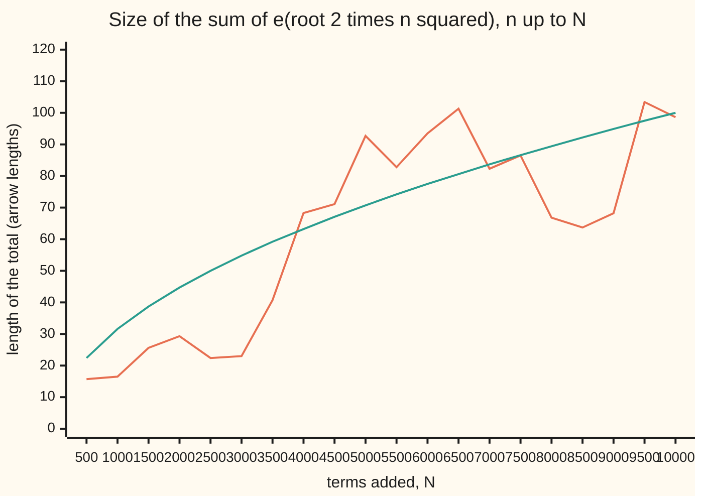

# Weyl differencing: squaring an exponential sum to lower its degree, and van der Corput's bounds

[Syllabus](../../../SYLLABUS.md) → [Algebraic and analytic number theory](../README.md) → [Additive Combinatorics and Probabilistic Number Theory](../README.md#s08) → Weyl differencing

---

## General Overview

Take the squares 1, 4, 9, 16, … and multiply each by $`\sqrt 2 = 1.41421356`$. Turn a pointer that many full turns round a circle and draw an arrow of length 1 where it stops. Now add the first 10,000 arrows head to tail.

If every arrow pointed the same way, the total would have length 10,000. It has length 98.55. For the first 1,000 arrows it is 16.46. Arrows that point in random directions would give a total of about $`\sqrt{10{,}000} = 100`$. So these arrows cancel as well as random ones, though nothing about them is random.

Sums like this decide how many ways a number is a sum of squares or cubes, and how large the zeta function gets. Each time the question is: does a sum of arrows cancel?

For the multiples $`\sqrt 2, 2\sqrt 2, 3\sqrt 2, \dots`$, [Equidistribution](03-equidistribution-and-weyls-criterion.md) answered with a geometric series. For squares, Hermann Weyl's trick of 1916 brings that series back. Square the size of the sum, which makes it a sum over pairs of arrows. The arrows at $`n + h`$ and $`n`$ differ by $`\sqrt 2\,(2hn + h^2)`$ turns. That is linear in n, so for each shift h the pairs form a geometric series. Here $`\lVert x\rVert`$ is the distance from x to the nearest whole number.

**Squaring an exponential sum pairs each term with its shifts, and the pairs have a phase of one degree lower; for $`\sqrt 2\,n^2`$ each shift gives a geometric series capped by $`1/(2\lVert 2\sqrt 2\,h\rVert)`$, and adding those caps proves the sum is far below N.**

**What kind of fact this is:** theorems, proved on this card in Why it works: van der Corput's inequality, Weyl's bound for squares with explicit constants, the even spread of $`\{\sqrt 2\, n^2\}`$, the Kusmin–Landau bound and van der Corput's second-derivative test. Weyl's inequality for cubes and higher powers is stated with its source. That the sum stays near $`\sqrt N`$ is only evidence, checked to N = 10,000; the proof gives $`\sqrt{N\log N}`$ times a constant.

### The picture: the sum's size against root N



Orange: the length of the total after N arrows. Teal: $`\sqrt N`$. The largest length for any N up to 10,000 is 109.87. The trivial bound, N itself, is a hundred times higher at the right edge.

---

## The formula

Reminders from [Equidistribution](03-equidistribution-and-weyls-criterion.md): $`e(x) = \cos 2\pi x + i\sin 2\pi x`$ is the point a fraction x of a turn round the unit circle; $`\lVert x\rVert`$ is the distance from x to the nearest whole number; $`\{x\}`$ is the fractional part. A bar, $`\bar z`$, mirrors z in the real axis, so $`z\bar z = \lvert z\rvert^2`$.

The sum on this card is

```math
S(N) = \sum_{n=1}^{N} e(\alpha n^2), \qquad \alpha = \sqrt 2 .
```

**Van der Corput's inequality** works for any complex numbers $`z_1, \dots, z_N`$, with $`z_n = 0`$ outside that range, and any whole number H from 1 to N:

```math
\Bigl\lvert \sum_{n=1}^{N} z_n \Bigr\rvert^2 \le \frac{N + H - 1}{H} \sum_{\lvert h\rvert < H} \Bigl(1 - \frac{\lvert h\rvert}{H}\Bigr)\, r(h), \qquad r(h) = \sum_{n} z_{n+h}\,\bar z_n .
```

**Read it aloud:** the squared size of a sum is at most a weighted total of its **correlations** r(h), each the sum of every term times the mirror image of the term h places earlier, over shifts h shorter than H.

For $`z_n = e(\alpha n^2)`$ the correlation is a geometric series, because $`\alpha(n+h)^2 - \alpha n^2 = \alpha h^2 + 2\alpha h n`$. Keeping every shift gives **Weyl differencing**, an exact identity followed by a bound:

```math
\lvert S(N)\rvert^2 = N + 2\,\mathrm{Re}\sum_{h=1}^{N-1} e(\alpha h^2)\sum_{n=1}^{N-h} e(2\alpha h n) \le N + 2\sum_{h=1}^{N-1}\min\Bigl(N - h,\ \frac{1}{2\lVert 2\alpha h\rVert}\Bigr)
```

**Read it aloud:** the squared size is N, from each arrow paired with itself, plus twice the real part of the shifted pair sums; each is a geometric series no longer than its N − h terms or one over twice the distance from $`2\alpha h`$ to a whole number.

With our numbers: $`\lvert S(10{,}000)\rvert^2 = 9{,}713.1`$, so $`\lvert S\rvert = 98.55`$. The right side adds to 185,713.3, so the bound is $`\lvert S\rvert \le 430.94`$, against the trivial 10,000.

| Symbol | Plain meaning | In our example | Push it up and the answer… |
| --- | --- | --- | --- |
| $`n`$, $`N`$ | the position of a term, and how many terms are added | n from 1 to 10,000 | the trivial bound N grows; the true size grows like $`\sqrt N`$ here |
| $`\alpha`$ | the number that multiplies $`n^2`$ | $`\sqrt 2`$ | — |
| $`S(N)`$ | the sum of the N arrows $`e(\alpha n^2)`$ | $`\lvert S(10{,}000)\rvert = 98.55`$ | — |
| $`z_n`$ | any list of complex numbers; here the n-th arrow | $`e(\sqrt 2\, n^2)`$ | — |
| $`h`$, $`r(h)`$ | the shift between paired terms, and the correlation: the sum of all pairs at that shift | $`\lvert r(1)\rvert = 1.917`$ | larger shifts have fewer pairs, N − h |
| $`H`$ | how many shifts the inequality keeps | 1,000 gives $`\lvert S\rvert \le 379.14`$ | more shifts, more cancellation used |
| $`e(x)`$, $`\lVert x\rVert`$, $`\{x\}`$ | the point x of a turn round the unit circle; distance to the nearest whole number; fractional part | $`\lVert 2\sqrt 2\rVert`$ gives the cap 2.914 at h = 1 | a larger distance, a smaller cap |
| $`a/q`$ | a fraction near α, in lowest terms, with $`\lvert\alpha - a/q\rvert \le 1/q^2`$ | 8119/5741 | the bound is best when q is near N |
| $`k`$, $`m`$ | the power of n in the phase; a whole-number spin in Weyl's criterion | k = 2; spins m = 1, 2, 3 | each extra power costs one more squaring |
| $`f`$, $`t`$, $`L`$ | a smooth phase; the height in $`n^{-it}`$; the length of the range of n | $`f(x) = -t\log x/(2\pi)`$, t = 100,000, L = 10,000 | — |
| $`\lambda`$, $`\rho`$ | a floor for $`f''`$, and the ratio of its ceiling to that floor | λ = 0.0000397887, ρ = 4 | a smaller λ shrinks the $`L\sqrt\lambda`$ part and grows the $`1/\sqrt\lambda`$ part |
| $`\delta`$ | a margin: how far $`f'`$ keeps from every whole number | $`\sqrt\lambda = 0.006308`$; 0.1 on one piece | a larger margin, a smaller piece sum |

### When it holds

- **Any complex numbers, for the inequality.** It uses only Cauchy–Schwarz, and it helps only when the correlations r(h) are small.
- **A polynomial phase, for differencing.** Each squaring lowers the degree by one, and the bound weakens each time.
- **α not too near a fraction with a small denominator.** For $`\alpha = 1393/985`$ the caps become infinite at h = 985, and the sum reaches 325.48 at N = 10,000.
- **A small second derivative, for the second-derivative test.** It needs $`\lambda < 1/4`$. For $`\sqrt 2\,x^2`$ the second derivative is 2.8284, and the formula gives 100,920, more than N.

---

## Why it works

### Step 0: squaring turns one sum into pairs, and pairs have a lower degree

The size of a sum is hard to reach directly. Its square is easier: $`\lvert S\rvert^2 = S\bar S`$ is a sum over all pairs of terms. Group the pairs by their shift h. A pair's phase is a difference, $`\alpha(n+h)^2 - \alpha n^2`$, and the squares cancel in it. What is left is linear in n.

Linear phases give a geometric series with a fixed cap, the case already solved. The price is a square root at the end, and a sum over shifts.

### Step 1: van der Corput's inequality

Shifting the sum does not change it. For each h from 0 to H − 1, the sum of $`z_{n+h}`$ over all n is the same S, because $`z`$ is zero outside 1 to N. So

```math
H\,S = \sum_{n = 2 - H}^{N} \ \sum_{h=0}^{H-1} z_{n+h} .
```

**Read it aloud:** H copies of the sum are the same as N + H − 1 short blocks of H consecutive terms, added up.

Apply Cauchy–Schwarz to the outer sum, which has N + H − 1 terms. Then multiply out the square of each block. Two terms in a block at distance h appear $`H - \lvert h\rvert`$ times. Dividing by $`H^2`$ gives the inequality in the formula.

So $`\lvert S\rvert^2`$ is at most about N/H times the correlation total over H shifts. H = 1 gives the trivial $`N^2`$. The code confirms the inequality at five values of H.

<details>
<summary>Detailed proof: Cauchy–Schwarz on the blocks</summary>

Write $`B_n = \sum_{h=0}^{H-1} z_{n+h}`$ for the block that starts at n. Only the N + H − 1 blocks with $`2 - H \le n \le N`$ can be nonzero, and $`H S = \sum_n B_n`$. Cauchy–Schwarz gives

$`\displaystyle H^2 \lvert S\rvert^2 \le (N + H - 1)\sum_n \lvert B_n\rvert^2 .`$

Expand each square: $`\lvert B_n\rvert^2 = \sum_{h_1, h_2} z_{n+h_1}\bar z_{n+h_2}`$, with $`h_1, h_2`$ from 0 to H − 1. Put $`m = n + h_2`$ and $`h = h_1 - h_2`$. As n runs over all whole numbers, each pair $`(m, h)`$ with $`\lvert h\rvert < H`$ appears once for each choice of $`h_2`$ that keeps $`h_1`$ in range, which is $`H - \lvert h\rvert`$ times. So

$`\displaystyle \sum_n \lvert B_n\rvert^2 = \sum_{\lvert h\rvert < H} (H - \lvert h\rvert) \sum_m z_{m+h}\bar z_m .`$

Divide by $`H^2`$. The correlation at $`-h`$ is the mirror image of the one at h, so the right side is real.

</details>

### Step 2: Weyl differencing on the squares

Keep every shift instead: $`\lvert S\rvert^2 = \sum_{\lvert h\rvert < N} r(h)`$ exactly. Shift 0 gives N; shifts h and −h are mirror images and give $`2\,\mathrm{Re}\, r(h)`$.

For $`z_n = e(\sqrt 2\, n^2)`$ the correlation is

```math
r(h) = e(\sqrt 2\, h^2)\sum_{n=1}^{N-h} e(2\sqrt 2\, h\, n) .
```

**Read it aloud:** the pairs at shift h are a fixed arrow times a geometric series whose step is $`2\sqrt 2\,h`$ turns.

Such a series with step β has size at most $`1/(2\lVert\beta\rVert)`$ ([Equidistribution](03-equidistribution-and-weyls-criterion.md), Step 4), and at most N − h terms. That is the bound in the formula.

The caps are small except where $`2\sqrt 2\, h`$ is nearly a whole number:

| Shift h | $`2\sqrt 2\,h`$ is near | Cap $`1/(2\lVert 2\sqrt 2 h\rVert)`$ | True size $`\lvert r(h)\rvert`$ |
| --- | --- | --- | --- |
| 1 | 3 | 2.914 | 1.917 |
| 6 | 17 | 16.985 | 6.251 |
| 35 | 99 | 98.997 | 54.206 |
| 204 | 577 | 576.999 | 367.100 |
| 1,189 | 3,363 | 3,362.999 | 1,770.706 |

These shifts solve [Pell's equation](../07-Diophantine%20and%20Modular/01-pell-and-continued-fractions-revisited.md) $`x^2 - 8h^2 = 1`$, so 3/1, 17/6, 99/35 are the fractions that best chase $`2\sqrt 2`$ ([Chasing an algebraic number with fractions](../07-Diophantine%20and%20Modular/10-diophantine-approximation-liouville-to-roth.md)).

The code gets $`\lvert S\rvert`$ both ways, term by term and from the closed-form r(h): 16.46 and 98.55 each time. All the caps at N = 10,000 add to 185,713.3, so $`\lvert S\rvert \le 430.94`$. At N = 1,000 they add to 14,039.9, so $`\lvert S\rvert \le 118.49`$.

### Step 3: Weyl's inequality, from one fraction near α

The cap total in Step 2 must still be bounded by hand. **Weyl's inequality** does it with one fraction a/q near α, in lowest terms, with $`\lvert\alpha - a/q\rvert \le 1/q^2`$:

```math
\lvert S(N)\rvert^2 \le N + 2\Bigl(\frac{2N}{q} + 1\Bigr)\bigl(4N + q\,(1 + \log q)\bigr)
```

**Read it aloud:** the squared sum is at most N plus twice the number of blocks of q shifts times what one block can contribute: four full-length terms plus about q log q from the rest.

The idea: over q consecutive shifts, the points $`h'\alpha`$ sit one near each multiple of 1/q. At most four come close to a whole number; the rest sit about 1/q, 2/q, 3/q, … away, and their caps add to a harmonic sum.

<details>
<summary>Detailed proof: one block of q shifts</summary>

Fix a whole number $`h_0`$ and take $`h' = h_0 + j`$ with j from 0 to q − 1. Then $`h'\alpha = h_0\alpha + ja/q + j(\alpha - a/q)`$, and the last part is smaller than $`q \cdot 1/q^2 = 1/q`$ in size. As j runs, $`ja`$ runs over every remainder mod q, since a and q share no factor.

So the points $`h'\alpha`$ sit within 1/q of the points $`u + i/q`$, i from 0 to q − 1, one each, for some u with $`0 \le u < 1/q`$. Write $`j' = \min(i, q - 1 - i)`$. Then $`\lVert u + i/q\rVert \ge j'/q`$, and so

$`\displaystyle \lVert h'\alpha\rVert > \frac{j' - 1}{q} .`$

The values $`j' = 0`$ and $`j' = 1`$ occur for at most four i: bound those terms by N. Each value $`j' \ge 2`$ occurs at most twice and gives a term below $`q/(2(j' - 1))`$. With $`j'`$ at most q/2,

$`\displaystyle \sum_{\text{block}} \min\Bigl(N, \frac{1}{2\lVert h'\alpha\rVert}\Bigr) \le 4N + q\sum_{i=1}^{q/2} \frac{1}{i} \le 4N + q\,(1 + \log q).`$

The terms in Step 2 have $`h' = 2h \le 2N - 2`$, and each is at most $`\min(N, 1/(2\lVert h'\alpha\rVert))`$. All $`h'`$ from 1 to 2N − 2 fit in at most $`2N/q + 1`$ blocks.

</details>

For $`\sqrt 2`$ the fractions come from Pell's equation, $`p^2 - 2q^2 = \pm 1`$, and then $`\lvert\sqrt 2 - p/q\rvert < 1/q^2`$. At N = 1,000 the code takes 1393/985 and gets $`\lvert S\rvert \le 269.00`$. At N = 10,000 it takes 8119/5741 and gets $`\lvert S\rvert \le 930.47`$.

Each Pell denominator is less than three times the one before, so one lies between N/3 and N. Then the right side is at most a constant times $`N\log N`$. **Proved:** $`\lvert S(N)\rvert`$ is at most a constant times $`\sqrt{N\log N}`$. **Evidence only:** the chart's $`\sqrt N`$.

**Higher powers.** For $`e(\alpha n^k)`$, square k − 1 times; each squaring lowers the degree by one. For cubes, a shift $`h_1`$ leaves a square in n, and a second shift $`h_2`$ leaves $`6\alpha h_1h_2\, n`$ plus terms free of n. Weyl's inequality then reads $`\lvert\sum_{n\le N} e(\alpha n^k)\rvert \ll N^{1+\varepsilon}(1/q + 1/N + q/N^k)^{1/2^{k-1}}`$ for every small ε > 0, stated here from Vaughan's book, not proved. For cubes, $`\lvert\sum_{n\le 1000} e(\sqrt 2\, n^3)\rvert = 37.35`$, near $`\sqrt{1000} = 31.62`$: evidence, not a bound.

### Step 4: the fractional parts of $`\sqrt 2\,n^2`$ spread evenly

By Weyl's criterion, $`\{\alpha n^2\}`$ spreads evenly from 0 to 1 exactly when $`S_m(N)/N \to 0`$ for every whole-number spin $`m \ne 0`$, where $`S_m(N) = \sum_{n \le N} e(m\alpha n^2)`$. Fix m and a margin δ below 1/2. Apply Step 2 to $`m\alpha`$ and split the shifts h:

1. **Shifts with $`\lVert 2m\alpha h\rVert < \delta`$.** Bound each by N. The multiples $`2m\alpha h`$ spread evenly, since $`2m\alpha`$ is irrational. So these are about a share 2δ of all shifts, and they add at most about $`2\delta N^2`$.
2. **The other shifts.** Each cap is below $`1/(2\delta)`$, so together they add at most $`N/(2\delta)`$.

The formula doubles both parts. Divide by $`N^2`$: as N grows, $`\lvert S_m(N)/N\rvert^2`$ ends at most about 4δ, for any δ. So the average tends to 0, for every irrational α.

For n up to 10,000, the ten bins of width 0.1 hold 1,016, 963, 990, 1,042, 979, 1,012, 1,027, 1,002, 985 and 984 points. The averages at spins 1, 2 and 3 are 0.009855, 0.003007 and 0.011063. That is evidence; the limit is the theorem.

### Step 5: the same squaring evaluates a sum exactly

For a fraction a/q with q odd, the trick gives an exact answer. Over one full period, n from 1 to q, a shift by h only reorders the terms. So

```math
\Bigl\lvert \sum_{n=1}^{q} e\Bigl(\frac{a n^2}{q}\Bigr)\Bigr\rvert^2 = \sum_{h=1}^{q} e\Bigl(\frac{a h^2}{q}\Bigr) \sum_{n=1}^{q} e\Bigl(\frac{2ahn}{q}\Bigr) = q .
```

**Read it aloud:** the squared size of one period's sum is q, because the inner sum over a full period is q when q divides 2ah and 0 otherwise, and for odd q with a sharing no factor with q that happens only at h = q.

This is a quadratic Gauss sum, the relative of [Gauss sums](../03-Characters%20and%20L-functions/06-gauss-sums.md). For 1393/985 the period sum has size 31.3847, which is $`\sqrt{985}`$. Ten periods line up, so $`\lvert S(9{,}850)\rvert = 313.85 = 10\sqrt{985}`$. A rational α makes the sum grow in step with N, about $`N/\sqrt q`$. That is why Step 3 needs a fraction with q near N, not a small q.

### Step 6: the Kusmin–Landau bound for smooth phases

Now take a smooth phase f, not a polynomial. [Stationary phase](../../20-Harmonic%20analysis/06-Maximal%20Functions%20and%20Beyond/12-oscillatory-integrals-and-stationary-phase.md) proves the tests below for integrals. Suppose $`f'`$ is monotone (only rises, or only falls) and stays between the same two neighboring whole numbers, at least δ from each. Then

```math
\Bigl\lvert \sum_{A \le n \le B} e(f(n)) \Bigr\rvert \le \cot\frac{\pi\delta}{2} + 1 .
```

**Read it aloud:** if the phase's speed keeps δ away from every whole number and moves one way, the sum is at most cot(πδ/2) plus one, however long it is.

The proof is [Summation by parts](../../06-Calculus%20and%20analysis/06-Series/11-summation-by-parts-and-dirichlets-test.md): each arrow is a difference of two neighbors times a factor that changes monotonically, so the regrouped sum is bounded.

<details>
<summary>Detailed proof: Kusmin–Landau by summation by parts</summary>

Write $`w_n = e(f(n))`$ and $`\Delta_n = f(n+1) - f(n)`$. By the mean value theorem $`\Delta_n = f'(\xi)`$ for some ξ, so $`\Delta_n`$ stays in the same safe range, at least δ from every whole number, and $`\Delta_n`$ is monotone in n. Since $`w_{n+1} = w_n e(\Delta_n)`$,

$`\displaystyle w_n = (w_{n+1} - w_n)\, g_n, \qquad g_n = \frac{1}{e(\Delta_n) - 1} = -\frac12 - \frac{i}{2}\cot(\pi\Delta_n).`$

Sum over n from A to B − 1 and regroup (summation by parts):

$`\displaystyle \sum_{n=A}^{B-1} w_n = w_B\, g_{B-1} - w_A\, g_A - \sum_{n=A+1}^{B-1} w_n (g_n - g_{n-1}).`$

Each $`\lvert g_n\rvert = 1/(2\lvert\sin\pi\Delta_n\rvert) \le 1/(2\sin\pi\delta)`$. The cotangent is monotone on each safe range and $`\Delta_n`$ is monotone, so the changes $`g_n - g_{n-1}`$ all point one way. Their sizes add to $`\tfrac12\lvert\cot\pi\Delta_{B-1} - \cot\pi\Delta_A\rvert \le \cot\pi\delta`$. Altogether

$`\displaystyle \Bigl\lvert\sum_{n=A}^{B-1} w_n\Bigr\rvert \le \frac{1}{\sin\pi\delta} + \cot\pi\delta = \frac{1 + \cos\pi\delta}{\sin\pi\delta} = \cot\frac{\pi\delta}{2}.`$

The last term, $`w_B`$, adds at most 1.

</details>

The check takes $`f(x) = -t\log x/(2\pi)`$ with t = 100,000, so that $`e(f(n)) = n^{-it}`$. For n from 10,001 to 14,468 the speed $`f'(x) = -t/(2\pi x)`$ runs from −1.59139 to −1.10005, inside the safe range −1.9 to −1.1, so at least δ = 0.1 from every whole number. The sum's size is 1.5697, and the bound is 7.3138.

### Step 7: van der Corput's second-derivative test

Suppose $`\lambda \le f''(x) \le \rho\lambda`$ on a range of length L, with $`\lambda < 1/4`$. Then

```math
\Bigl\lvert \sum_{A < n \le B} e(f(n)) \Bigr\rvert \le (\rho\lambda L + 2)\Bigl(\frac{2}{\sqrt\lambda} + 1\Bigr) + (\rho\lambda L + 3)\Bigl(\frac{2}{\pi\sqrt\lambda} + 1\Bigr).
```

**Read it aloud:** when the phase curves gently, the sum is at most a few times L root lambda plus a few times one over root lambda.

How it works, with margin $`\delta = \sqrt\lambda`$:

1. The speed $`f'`$ rises by at most $`\rho\lambda L`$, so it passes near at most $`\rho\lambda L + 2`$ whole numbers.
2. Near each one, where $`\lVert f'\rVert < \delta`$, the speed rises at least λ per step. That stretch holds at most $`2\delta/\lambda + 1`$ terms. Bound each by 1.
3. Between those stretches, at most $`\rho\lambda L + 3`$ pieces are left. Step 6 bounds each by $`\cot(\pi\delta/2) + 1 \le 2/(\pi\delta) + 1`$.

The choice $`\delta = \sqrt\lambda`$ balances the two parts.

On the zeta-type sum $`\sum_{10{,}000 < n \le 20{,}000} n^{-it}`$ with t = 100,000: $`f''(x) = t/(2\pi x^2)`$ lies between λ = 0.0000397887 and 4λ. The test gives 1,610.3, against the trivial 10,000. The true size is 125.73. The speed passes −1 at $`x = t/(2\pi)`$, between 10,000 and 20,000. That is a stationary point, and stationary phase predicts a size near $`\sqrt{t/(2\pi)} = 126.16`$.

This test needs no differencing. Van der Corput's third-derivative test applies Step 1 first, then this test to each differenced phase. Graham and Kolesnik's book calls that differencing step the A process.

---

## Worked numbers, by hand

The example: $`S(10{,}000) = \sum_{n \le 10{,}000} e(\sqrt 2\, n^2)`$, bounded by squaring.

| Step | Arithmetic | Value |
| --- | --- | --- |
| trivial bound | 10,000 arrows of length 1 | 10,000 |
| diagonal pairs, h = 0 | each arrow with itself | 10,000 |
| cap at shift 1 | $`1/(2\lVert 2\sqrt 2\rVert)`$, $`2\sqrt 2`$ being nearest 3 | 2.914 |
| cap at shift 1,189 | $`2\sqrt 2 \times 1{,}189`$ is nearly the whole number 3,363 | 3,362.999 |
| all caps, Step 2 | 10,000 + 2 × (sum of 9,999 caps, each cut to at most N − h) | 185,713.3 |
| Weyl's bound | $`\sqrt{185{,}713.3}`$ | 430.94 |
| van der Corput, H = 1,000, using $`\lvert r(h)\rvert`$ | right side 143,743.9, square root | 379.14 |
| true value | added term by term, and from the r(h) | **98.55** |

The sum of 10,000 arrows has length 98.55: proved below 430.94, observed near $`\sqrt N = 100`$.

### What breaks if you drop a piece

| Mistake | Comes out at | What went wrong |
| --- | --- | --- |
| Bounding the sum without squaring | 10,000, the H = 1 row | the triangle inequality ignores all cancellation |
| Dropping the diagonal h = 0 | $`2\,\mathrm{Re}\sum r(h) = -286.9`$, a negative "square" | each arrow paired with itself gives the N = 10,000 |
| Reading the right side at H = N as $`\lvert S\rvert^2`$ | 17,704.0 against 9,713.1 | the weights $`(2N-1)/N \cdot (1 - h/N)`$ make it an upper bound, not the identity |
| α a fraction: 1393/985, within $`1/985^2`$ of $`\sqrt 2`$ | $`\lvert S(10{,}000)\rvert`$ = 325.48; $`\lvert S(9{,}850)\rvert = 10\sqrt{985}`$ = 313.85 | at h = 985 the cap is infinite; a rational α grows like $`N/\sqrt q`$ |
| Second-derivative test on $`\sqrt 2\, n^2`$ | 100,920, ten times N | $`f'' = 2.8284`$ breaks $`\lambda < 1/4`$: the phase turns too fast per step |

The code prints every entry.

---

## Code, from first principles, and it actually runs

The code builds every phase exactly to $`2^{-32}`$ by integer square roots, so both languages see the same arrows. Independent roads: $`\lvert S(N)\rvert`$ term by term against the closed-form series of Weyl differencing; twenty correlations pair by pair against their closed form; every bound against the true value; the Gauss sum against $`\sqrt{985}`$; the Kusmin–Landau and second-derivative bounds against sums of $`n^{-it}`$ added directly.

### Python

```python
# Weyl differencing and van der Corput -- the check behind the card.  Standard library only.
# e(x) = cos 2 pi x + i sin 2 pi x; ||x|| = distance from x to the nearest whole number.
# Roads: S(N) = sum of e(root2 n^2) added term by term, against |S|^2 rebuilt from the squared
# sum's linear inner sums in closed form; van der Corput's inequality and Weyl's bound against
# both; the second-derivative test against a directly added sum of n^(-it).
from math import isqrt, cos, sin, pi, sqrt, log, tan

ONE = 1 << 32
def fr2(m):            # {m root2} for a whole number m >= 0, exact to 2^-32, by integer square root
    return (isqrt(2 * m * m * ONE * ONE) % ONE) / ONE
def e(x): return complex(cos(2 * pi * x), sin(2 * pi * x))
def nrm(x): return min(x, 1 - x)              # ||x|| for x in [0, 1)
def lin(m, L):         # sum_{n=1}^{L} e(root2 m n), a geometric series in closed form
    if L == 0: return 0j
    r = e(fr2(m)); return r * (e(fr2(m * L)) - 1) / (r - 1)

N = 10000
z = [e(fr2(n * n)) for n in range(N + 1)]       # z[n] = e(root2 n^2); z[0] unused
S, run, chart = 0j, {}, []
for n in range(1, N + 1):
    S += z[n]; run[n] = abs(S)
    if n % 500 == 0: chart.append(n)
print("root2 = 1.41421356; S(N) = sum_{n<=N} e(root2 n^2)")
# road 2: |S|^2 = N + 2 Re sum_h r(h), r(h) = sum_n z[n+h] conj(z[n]) = e(root2 h^2) lin(2h, N-h)
def r(h, M): return e(fr2(h * h)) * lin(2 * h, M - h)
for M in (1000, N):
    sq = M + 2 * sum(r(h, M).real for h in range(1, M))
    print(f"N = {M:5d}: |S| added term by term {run[M]:.2f}; from the squared sum {sqrt(sq):.2f}; "
          f"root N {sqrt(M):.2f}; |S|/N {run[M] / M:.6f}")
    assert abs(sq - run[M] ** 2) < 1e-6 * M
for h in range(1, 21):                           # closed-form r(h) against the pairs added directly
    d = sum(z[n + h] * z[n].conjugate() for n in range(1, N - h + 1))
    assert abs(d - r(h, N)) < 1e-5
print("r(h) closed form = r(h) added directly, h = 1..20: yes")
print("chart N:", ", ".join(str(n) for n in chart))
print("chart |S|:", ", ".join(f"{run[n]:.1f}" for n in chart))
print("chart root N:", ", ".join(f"{sqrt(n):.1f}" for n in chart))
print(f"largest |S(N)| for N <= {N}: {max(run.values()):.2f}")
rs = [0j] + [r(h, N) for h in range(1, N)]
assert all(abs(rs[h]) <= min(N - h, 1 / (2 * nrm(fr2(2 * h)))) + 1e-9 for h in range(1, N))
HS = (1, 6, 35, 204, 1189)
print("inner caps 1/(2||2h root2||), h = 1, 6, 35, 204, 1189:", ", ".join(f"{1 / (2 * nrm(fr2(2 * h))):.3f}" for h in HS))
print("  2h root2 is nearest", ", ".join(str(round(2 * h * 1.4142135623730951)) for h in HS))
print("inner sizes |r(h)|, same h:", ", ".join(f"{abs(rs[h]):.3f}" for h in HS))
print(f"without the diagonal h = 0: 2 Re sum r(h) = {2 * sum(x.real for x in rs):.1f}")
# van der Corput's inequality: |S|^2 <= (N+H-1)/H * sum_{|h|<H} (1 - |h|/H) r(h)
print(f"van der Corput, N = {N}, |S|^2 = {run[N] ** 2:.1f}:")
for H in (1, 10, 100, 1000, N):
    w = (N + H - 1) / H
    ex = w * (N + 2 * sum((1 - h / H) * rs[h].real for h in range(1, H)))
    ab = w * (N + 2 * sum((1 - h / H) * abs(rs[h]) for h in range(1, H)))
    print(f"  H = {H:5d}: right side {ex:.1f} (root {sqrt(ex):.2f}); with |r(h)| {ab:.1f} (root {sqrt(ab):.2f})")
    assert run[N] ** 2 <= ex + 1e-6 and ex <= ab + 1e-6
# Weyl: |r(h)| <= min(N-h, 1/(2||2 h root2||)), so |S|^2 <= B; then a fraction p/q near root2 bounds B
def pell(Q):           # largest denominator q <= Q of a fraction p/q with p^2 - 2 q^2 = +-1
    p, q = 1, 1
    while p + q <= Q: p, q = p + 2 * q, p + q
    return p, q
for M in (1000, N):
    B = M + 2 * sum(min(M - h, 1 / (2 * nrm(fr2(2 * h)))) for h in range(1, M))
    Lsum = sum(min(M, 1 / (2 * nrm(fr2(h)))) for h in range(1, 2 * M - 1))
    p, q = pell(M)
    assert abs(p * p - 2 * q * q) == 1
    W = M + 2 * (2 * M / q + 1) * (4 * M + q * (1 + log(q)))
    print(f"Weyl, N = {M:5d}: sum of mins B = {B:.1f}, root {sqrt(B):.2f}; fraction {p}/{q}; "
          f"block bound {W:.1f}, root {sqrt(W):.2f}")
    assert run[M] ** 2 <= B and B - M <= 2 * Lsum + 1e-6 and 2 * Lsum <= W - M
    blks = [sorted((min(M, 1 / (2 * nrm(fr2(h)))) for h in range(h0, min(h0 + q, 2 * M - 1))), reverse=True)
            for h0 in range(1, 2 * M - 1, q)]  # the fold's lemma, one block of q shifts at a time
    tight = max(t * 2 * (i // 2 + 1) / q for b in blks for i, t in enumerate(b[4:]))
    print(f"  {len(blks)} blocks of {q} shifts: largest block sum {max(sum(b) for b in blks):.1f} <= 4N + q(1 + log q) = "
          f"{4 * M + q * (1 + log(q)):.1f}; after each block's top four, worst term / cap q/2, q/2, q/4, ... = {tight:.4f}")
    assert all(sum(b) <= 4 * M + q * (1 + log(q)) for b in blks) and tight < 1
# a rational step: alpha = 1393/985 is within 1/(985^2) of root2, yet its sum grows like N
G = abs(sum(e((1393 * n * n % 985) / 985) for n in range(1, 986)))
T = [0j]
for n in range(1, N + 1): T.append(T[-1] + e((1393 * n * n % 985) / 985))
print(f"1393/985: one period |G| = {G:.4f}, root 985 = {sqrt(985):.4f}; |S(9850)| = {abs(T[9850]):.2f} "
      f"= 10 root 985; |S(1000)| = {abs(T[1000]):.2f}; |S(10000)| = {abs(T[N]):.2f}")
assert abs(G - sqrt(985)) < 1e-9 and abs(abs(T[9850]) - 10 * sqrt(985)) < 1e-7
# equidistribution of {root2 n^2}: ten bins, and Weyl averages at spins m = 1, 2, 3
bins = [0] * 10
for n in range(1, N + 1): bins[int(10 * fr2(n * n))] += 1
avg = [abs(sum(e(fr2(m * n * n)) for n in range(1, N + 1))) / N for m in (1, 2, 3)]
print("{root2 n^2}, n <= 10000, ten bins:", " ".join(str(b) for b in bins))
print("Weyl averages, spins 1, 2, 3:", ", ".join(f"{a:.6f}" for a in avg))
assert sum(bins) == N and max(abs(b - N // 10) for b in bins) < 60 and max(avg) < 0.03
c3 = abs(sum(e(fr2(n ** 3)) for n in range(1, 1001)))
print(f"cubes: |sum_{{n<=1000}} e(root2 n^3)| = {c3:.2f}")
# van der Corput's second-derivative test on sum_{M<n<=2M} n^(-it) = sum e(f(n)), f(x) = -t ln x/(2 pi)
t, M = 100000.0, 10000
f = lambda x: -t * log(x) / (2 * pi)
Z = abs(sum(e(f(n)) for n in range(M + 1, 2 * M + 1)))
lam, rho = t / (2 * pi * (2 * M) ** 2), 4.0                # lam <= f'' <= rho lam on [M, 2M]
K = rho * lam * M + 2
bnd = K * (2 / sqrt(lam) + 1) + (K + 1) * (2 / (pi * sqrt(lam)) + 1)
print(f"t = {t:.0f}, M = {M}: |sum n^(-it)| = {Z:.2f}; second-derivative bound {bnd:.1f}; "
      f"trivial {M}; stationary-phase size root(t/(2 pi)) = {sqrt(t / (2 * pi)):.2f}")
print(f"  lambda = {lam:.10f}, root lambda = {sqrt(lam):.6f}, rho lambda M = {rho * lam * M:.4f}")
assert Z <= bnd < M and abs(Z - sqrt(t / (2 * pi))) < 0.05 * Z
# Kusmin-Landau: f'(x) = -t/(2 pi x) stays in the safe range -1.9..-1.1 for n0 <= n <= n1
n0, n1, cap = int(t / (2 * pi * 1.9)) + 1, int(t / (2 * pi * 1.1)), 1 / tan(pi * 0.1 / 2) + 1
fp = lambda x: -t / (2 * pi * x)
for a in (M + 1, n0):                                       # a piece inside the safe range, then all of it
    KL = abs(sum(e(f(n)) for n in range(a, n1 + 1)))
    print(f"Kusmin-Landau, n = {a}..{n1}, f' from {fp(a):.5f} to {fp(n1):.5f}, delta = 0.1: |sum| = {KL:.4f}, "
          f"bound cot(pi delta/2) + 1 = {cap:.4f}")
    assert -1.9 <= fp(a) and fp(n1) <= -1.1 and KL <= cap
L2 = 2 * sqrt(2)                                           # f'' for root2 x^2
K2 = L2 * N + 2
blind = K2 * (2 / sqrt(L2) + 1) + (K2 + 1) * (2 / (pi * sqrt(L2)) + 1)
print(f"second-derivative bound applied to root2 n^2 (f'' = {L2:.4f} > 1/4), N = {N}: {blind:.0f} > N")
assert blind > N
print("ALL CHECKS PASS")
```

**Ran 2026-11-24 on macOS, Python 3.14.10, standard library only. All checks passed. Output, pasted from the run:**

```
root2 = 1.41421356; S(N) = sum_{n<=N} e(root2 n^2)
N =  1000: |S| added term by term 16.46; from the squared sum 16.46; root N 31.62; |S|/N 0.016464
N = 10000: |S| added term by term 98.55; from the squared sum 98.55; root N 100.00; |S|/N 0.009855
r(h) closed form = r(h) added directly, h = 1..20: yes
chart N: 500, 1000, 1500, 2000, 2500, 3000, 3500, 4000, 4500, 5000, 5500, 6000, 6500, 7000, 7500, 8000, 8500, 9000, 9500, 10000
chart |S|: 15.7, 16.5, 25.6, 29.3, 22.4, 23.0, 40.7, 68.3, 71.1, 92.7, 82.8, 93.5, 101.3, 82.3, 86.5, 66.8, 63.7, 68.2, 103.4, 98.6
chart root N: 22.4, 31.6, 38.7, 44.7, 50.0, 54.8, 59.2, 63.2, 67.1, 70.7, 74.2, 77.5, 80.6, 83.7, 86.6, 89.4, 92.2, 94.9, 97.5, 100.0
largest |S(N)| for N <= 10000: 109.87
inner caps 1/(2||2h root2||), h = 1, 6, 35, 204, 1189: 2.914, 16.985, 98.997, 576.999, 3362.999
  2h root2 is nearest 3, 17, 99, 577, 3363
inner sizes |r(h)|, same h: 1.917, 6.251, 54.206, 367.100, 1770.706
without the diagonal h = 0: 2 Re sum r(h) = -286.9
van der Corput, N = 10000, |S|^2 = 9713.1:
  H =     1: right side 100000000.0 (root 10000.00); with |r(h)| 100000000.0 (root 10000.00)
  H =    10: right side 10016550.5 (root 3164.89); with |r(h)| 10023942.2 (root 3166.06)
  H =   100: right side 1010456.5 (root 1005.21); with |r(h)| 1032686.8 (root 1016.21)
  H =  1000: right side 105290.6 (root 324.49); with |r(h)| 143743.9 (root 379.14)
  H = 10000: right side 17704.0 (root 133.06); with |r(h)| 102850.4 (root 320.70)
Weyl, N =  1000: sum of mins B = 14039.9, root 118.49; fraction 1393/985; block bound 72362.7, root 269.00
  3 blocks of 985 shifts: largest block sum 7773.8 <= 4N + q(1 + log q) = 11774.3; after each block's top four, worst term / cap q/2, q/2, q/4, ... = 0.9979
Weyl, N = 10000: sum of mins B = 185713.3, root 430.94; fraction 8119/5741; block bound 865775.8, root 930.47
  4 blocks of 5741 shifts: largest block sum 58822.6 <= 4N + q(1 + log q) = 95431.6; after each block's top four, worst term / cap q/2, q/2, q/4, ... = 0.9996
1393/985: one period |G| = 31.3847, root 985 = 31.3847; |S(9850)| = 313.85 = 10 root 985; |S(1000)| = 28.12; |S(10000)| = 325.48
{root2 n^2}, n <= 10000, ten bins: 1016 963 990 1042 979 1012 1027 1002 985 984
Weyl averages, spins 1, 2, 3: 0.009855, 0.003007, 0.011063
cubes: |sum_{n<=1000} e(root2 n^3)| = 37.35
t = 100000, M = 10000: |sum n^(-it)| = 125.73; second-derivative bound 1610.3; trivial 10000; stationary-phase size root(t/(2 pi)) = 126.16
  lambda = 0.0000397887, root lambda = 0.006308, rho lambda M = 1.5915
Kusmin-Landau, n = 10001..14468, f' from -1.59139 to -1.10005, delta = 0.1: |sum| = 1.5697, bound cot(pi delta/2) + 1 = 7.3138
Kusmin-Landau, n = 8377..14468, f' from -1.89990 to -1.10005, delta = 0.1: |sum| = 3.2335, bound cot(pi delta/2) + 1 = 7.3138
second-derivative bound applied to root2 n^2 (f'' = 2.8284 > 1/4), N = 10000: 100920 > N
ALL CHECKS PASS
```

### Rust

```rust
// Weyl differencing and van der Corput -- the same check as the Python, in Rust.  No crates.
// e(x) = cos 2 pi x + i sin 2 pi x; ||x|| = distance from x to the nearest whole number.
// Roads: S(N) = sum of e(root2 n^2) added term by term, against |S|^2 rebuilt from the squared
// sum's linear inner sums in closed form; van der Corput's inequality and Weyl's bound against
// both; the second-derivative test against a directly added sum of n^(-it).
use std::f64::consts::PI;
use std::ops::{Add, Mul, Sub, Div};

#[derive(Clone, Copy)]
struct C { re: f64, im: f64 }
impl Add for C { type Output = C; fn add(self, o: C) -> C { C { re: self.re + o.re, im: self.im + o.im } } }
impl Sub for C { type Output = C; fn sub(self, o: C) -> C { C { re: self.re - o.re, im: self.im - o.im } } }
impl Mul for C { type Output = C;
    fn mul(self, o: C) -> C { C { re: self.re * o.re - self.im * o.im, im: self.re * o.im + self.im * o.re } } }
impl Div for C { type Output = C;
    fn div(self, o: C) -> C { let d = o.re * o.re + o.im * o.im;
        C { re: (self.re * o.re + self.im * o.im) / d, im: (self.im * o.re - self.re * o.im) / d } } }
impl C { fn abs(self) -> f64 { self.re.hypot(self.im) } fn conj(self) -> C { C { re: self.re, im: -self.im } } }
const Z0: C = C { re: 0.0, im: 0.0 };
const ONE: u128 = 1 << 32;

fn isqrt(v: u128) -> u128 {
    let mut x = (v as f64).sqrt() as u128;
    if x > 0 { x = (x + v / x) / 2; }
    while x * x > v { x -= 1; }
    while (x + 1) * (x + 1) <= v { x += 1; }
    x
}
// {m root2} for a whole number m >= 0, exact to 2^-32, by integer square root
fn fr2(m: u128) -> f64 {
    let v = m.checked_mul(m).and_then(|a| a.checked_mul(2 * ONE * ONE)).expect("overflow");
    (isqrt(v) % ONE) as f64 / ONE as f64
}
fn e(x: f64) -> C { C { re: (2.0 * PI * x).cos(), im: (2.0 * PI * x).sin() } }
fn nrm(x: f64) -> f64 { x.min(1.0 - x) }
// sum_{n=1}^{L} e(root2 m n), a geometric series in closed form
fn lin(m: u128, l: u128) -> C {
    if l == 0 { return Z0; }
    let r = e(fr2(m)); r * (e(fr2(m * l)) - C { re: 1.0, im: 0.0 }) / (r - C { re: 1.0, im: 0.0 })
}
fn r(h: u128, m: u128) -> C { e(fr2(h * h)) * lin(2 * h, m - h) }
fn pell(q_max: u64) -> (u64, u64) {
    let (mut p, mut q) = (1u64, 1u64);
    while p + q <= q_max { let np = p + 2 * q; q = p + q; p = np; }
    (p, q)
}

fn main() {
    let n_max: usize = 10000;
    let z: Vec<C> = (0..=n_max).map(|n| e(fr2((n * n) as u128))).collect();
    let mut s = Z0; let mut run = vec![0.0f64; n_max + 1]; let mut chart = vec![];
    for n in 1..=n_max { s = s + z[n]; run[n] = s.abs(); if n % 500 == 0 { chart.push(n); } }
    println!("root2 = 1.41421356; S(N) = sum_{{n<=N}} e(root2 n^2)");
    for &m in &[1000usize, n_max] {
        let sq = m as f64 + 2.0 * (1..m).map(|h| r(h as u128, m as u128).re).sum::<f64>();
        println!("N = {:5}: |S| added term by term {:.2}; from the squared sum {:.2}; root N {:.2}; |S|/N {:.6}",
            m, run[m], sq.sqrt(), (m as f64).sqrt(), run[m] / m as f64);
        assert!((sq - run[m] * run[m]).abs() < 1e-6 * m as f64);
    }
    for h in 1..=20usize {
        let mut d = Z0;
        for n in 1..=(n_max - h) { d = d + z[n + h] * z[n].conj(); }
        assert!((d - r(h as u128, n_max as u128)).abs() < 1e-5);
    }
    println!("r(h) closed form = r(h) added directly, h = 1..20: yes");
    let j = |v: Vec<String>| v.join(", ");
    println!("chart N: {}", j(chart.iter().map(|n| n.to_string()).collect()));
    println!("chart |S|: {}", j(chart.iter().map(|&n| format!("{:.1}", run[n])).collect()));
    println!("chart root N: {}", j(chart.iter().map(|&n| format!("{:.1}", (n as f64).sqrt())).collect()));
    println!("largest |S(N)| for N <= {}: {:.2}", n_max, run.iter().cloned().fold(0.0, f64::max));
    let nf = n_max as f64;
    let rs: Vec<C> = (0..n_max).map(|h| if h == 0 { Z0 } else { r(h as u128, n_max as u128) }).collect();
    assert!((1..n_max).all(|h| rs[h].abs() <= (nf - h as f64).min(1.0 / (2.0 * nrm(fr2(2 * h as u128)))) + 1e-9));
    let hs = [1usize, 6, 35, 204, 1189];
    println!("inner caps 1/(2||2h root2||), h = 1, 6, 35, 204, 1189: {}", j(hs.iter().map(|&h| format!("{:.3}", 1.0 / (2.0 * nrm(fr2(2 * h as u128))))).collect()));
    println!("  2h root2 is nearest {}", j(hs.iter().map(|&h| format!("{}", (2.0 * h as f64 * 2f64.sqrt()).round())).collect()));
    println!("inner sizes |r(h)|, same h: {}", j(hs.iter().map(|&h| format!("{:.3}", rs[h].abs())).collect()));
    println!("without the diagonal h = 0: 2 Re sum r(h) = {:.1}", 2.0 * rs.iter().map(|x| x.re).sum::<f64>());
    println!("van der Corput, N = {}, |S|^2 = {:.1}:", n_max, run[n_max] * run[n_max]);
    for &hh in &[1usize, 10, 100, 1000, n_max] {
        let hf = hh as f64; let w = (nf + hf - 1.0) / hf;
        let ex = w * (nf + 2.0 * (1..hh).map(|h| (1.0 - h as f64 / hf) * rs[h].re).sum::<f64>());
        let ab = w * (nf + 2.0 * (1..hh).map(|h| (1.0 - h as f64 / hf) * rs[h].abs()).sum::<f64>());
        println!("  H = {:5}: right side {:.1} (root {:.2}); with |r(h)| {:.1} (root {:.2})", hh, ex, ex.sqrt(), ab, ab.sqrt());
        assert!(run[n_max] * run[n_max] <= ex + 1e-6 && ex <= ab + 1e-6);
    }
    for &m in &[1000usize, n_max] {
        let mf = m as f64;
        let b = mf + 2.0 * (1..m).map(|h| (mf - h as f64).min(1.0 / (2.0 * nrm(fr2(2 * h as u128))))).sum::<f64>();
        let lsum: f64 = (1..2 * m - 1).map(|h| mf.min(1.0 / (2.0 * nrm(fr2(h as u128))))).sum();
        let (p, q) = pell(m as u64);
        assert!(((p * p) as i64 - (2 * q * q) as i64).abs() == 1);
        let qf = q as f64;
        let w = mf + 2.0 * (2.0 * mf / qf + 1.0) * (4.0 * mf + qf * (1.0 + qf.ln()));
        println!("Weyl, N = {:5}: sum of mins B = {:.1}, root {:.2}; fraction {}/{}; block bound {:.1}, root {:.2}",
            m, b, b.sqrt(), p, q, w, w.sqrt());
        assert!(run[m] * run[m] <= b && b - mf <= 2.0 * lsum + 1e-6 && 2.0 * lsum <= w - mf);
        let (mut blks, mut h0, qu) = (vec![], 1usize, q as usize);   // the fold's lemma, one block of q shifts at a time
        while h0 < 2 * m - 1 {
            let mut bl: Vec<f64> = (h0..(h0 + qu).min(2 * m - 1)).map(|h| mf.min(1.0 / (2.0 * nrm(fr2(h as u128))))).collect();
            bl.sort_by(|x, y| y.partial_cmp(x).unwrap()); blks.push(bl); h0 += qu;
        }
        let tight = blks.iter().flat_map(|bl| bl.iter().skip(4).enumerate().map(|(i, t)| t * 2.0 * (i / 2 + 1) as f64 / qf))
            .fold(0.0, f64::max);
        let allow = 4.0 * mf + qf * (1.0 + qf.ln());
        let bmax = blks.iter().map(|bl| bl.iter().sum::<f64>()).fold(0.0, f64::max);
        println!("  {} blocks of {} shifts: largest block sum {:.1} <= 4N + q(1 + log q) = {:.1}; after each block's top four, worst term / cap q/2, q/2, q/4, ... = {:.4}",
            blks.len(), q, bmax, allow, tight);
        assert!(blks.iter().all(|bl| bl.iter().sum::<f64>() <= allow) && tight < 1.0);
    }
    let rat = |n: usize| e(((1393 * n * n) % 985) as f64 / 985.0);
    let g = (1..=985).fold(Z0, |a, n| a + rat(n)).abs();
    let mut t = vec![Z0];
    for n in 1..=n_max { let last = t[n - 1]; t.push(last + rat(n)); }
    println!("1393/985: one period |G| = {:.4}, root 985 = {:.4}; |S(9850)| = {:.2} = 10 root 985; |S(1000)| = {:.2}; |S(10000)| = {:.2}",
        g, 985f64.sqrt(), t[9850].abs(), t[1000].abs(), t[n_max].abs());
    assert!((g - 985f64.sqrt()).abs() < 1e-9 && (t[9850].abs() - 10.0 * 985f64.sqrt()).abs() < 1e-7);
    let mut bins = [0i64; 10];
    for n in 1..=n_max { bins[(10.0 * fr2((n * n) as u128)) as usize] += 1; }
    let avg: Vec<f64> = [1u128, 2, 3].iter()
        .map(|&m| (1..=n_max).fold(Z0, |a, n| a + e(fr2(m * (n * n) as u128))).abs() / nf).collect();
    println!("{{root2 n^2}}, n <= 10000, ten bins: {}", bins.iter().map(|b| b.to_string()).collect::<Vec<_>>().join(" "));
    println!("Weyl averages, spins 1, 2, 3: {}", j(avg.iter().map(|a| format!("{:.6}", a)).collect()));
    assert!(bins.iter().sum::<i64>() == n_max as i64 && bins.iter().all(|&b| (b - 1000).abs() < 60)
        && avg.iter().cloned().fold(0.0, f64::max) < 0.03);
    let c3 = (1..=1000u128).fold(Z0, |a, n| a + e(fr2(n * n * n))).abs();
    println!("cubes: |sum_{{n<=1000}} e(root2 n^3)| = {:.2}", c3);
    let (tt, mm) = (100000.0f64, 10000usize);
    let f = |x: f64| -tt * x.ln() / (2.0 * PI);
    let zz = (mm + 1..=2 * mm).fold(Z0, |a, n| a + e(f(n as f64))).abs();
    let (lam, rho) = (tt / (2.0 * PI * (2.0 * mm as f64).powi(2)), 4.0);
    let k = rho * lam * mm as f64 + 2.0;
    let bnd = k * (2.0 / lam.sqrt() + 1.0) + (k + 1.0) * (2.0 / (PI * lam.sqrt()) + 1.0);
    println!("t = {:.0}, M = {}: |sum n^(-it)| = {:.2}; second-derivative bound {:.1}; trivial {}; stationary-phase size root(t/(2 pi)) = {:.2}",
        tt, mm, zz, bnd, mm, (tt / (2.0 * PI)).sqrt());
    println!("  lambda = {:.10}, root lambda = {:.6}, rho lambda M = {:.4}", lam, lam.sqrt(), rho * lam * mm as f64);
    assert!(zz <= bnd && bnd < mm as f64 && (zz - (tt / (2.0 * PI)).sqrt()).abs() < 0.05 * zz);
    // Kusmin-Landau: f'(x) = -t/(2 pi x) stays in the safe range -1.9..-1.1 for n0 <= n <= n1
    let (n0, n1, cap) = ((tt / (2.0 * PI * 1.9)) as usize + 1, (tt / (2.0 * PI * 1.1)) as usize, 1.0 / (PI * 0.1 / 2.0).tan() + 1.0);
    let fp = |x: f64| -tt / (2.0 * PI * x);
    for a in [mm + 1, n0] {                     // a piece inside the safe range, then all of it
        let kl = (a..=n1).fold(Z0, |s, n| s + e(f(n as f64))).abs();
        println!("Kusmin-Landau, n = {}..{}, f' from {:.5} to {:.5}, delta = 0.1: |sum| = {:.4}, bound cot(pi delta/2) + 1 = {:.4}",
            a, n1, fp(a as f64), fp(n1 as f64), kl, cap);
        assert!(-1.9 <= fp(a as f64) && fp(n1 as f64) <= -1.1 && kl <= cap);
    }
    let l2 = 2.0 * 2f64.sqrt();
    let k2 = l2 * nf + 2.0;
    let blind = k2 * (2.0 / l2.sqrt() + 1.0) + (k2 + 1.0) * (2.0 / (PI * l2.sqrt()) + 1.0);
    println!("second-derivative bound applied to root2 n^2 (f'' = {:.4} > 1/4), N = {}: {:.0} > N", l2, n_max, blind);
    assert!(blind > nf);
    println!("ALL CHECKS PASS");
}
```

**Ran 2026-11-24 on macOS, rustc 1.98.1, no crates. All checks passed. Output, pasted from the run:**

```
root2 = 1.41421356; S(N) = sum_{n<=N} e(root2 n^2)
N =  1000: |S| added term by term 16.46; from the squared sum 16.46; root N 31.62; |S|/N 0.016464
N = 10000: |S| added term by term 98.55; from the squared sum 98.55; root N 100.00; |S|/N 0.009855
r(h) closed form = r(h) added directly, h = 1..20: yes
chart N: 500, 1000, 1500, 2000, 2500, 3000, 3500, 4000, 4500, 5000, 5500, 6000, 6500, 7000, 7500, 8000, 8500, 9000, 9500, 10000
chart |S|: 15.7, 16.5, 25.6, 29.3, 22.4, 23.0, 40.7, 68.3, 71.1, 92.7, 82.8, 93.5, 101.3, 82.3, 86.5, 66.8, 63.7, 68.2, 103.4, 98.6
chart root N: 22.4, 31.6, 38.7, 44.7, 50.0, 54.8, 59.2, 63.2, 67.1, 70.7, 74.2, 77.5, 80.6, 83.7, 86.6, 89.4, 92.2, 94.9, 97.5, 100.0
largest |S(N)| for N <= 10000: 109.87
inner caps 1/(2||2h root2||), h = 1, 6, 35, 204, 1189: 2.914, 16.985, 98.997, 576.999, 3362.999
  2h root2 is nearest 3, 17, 99, 577, 3363
inner sizes |r(h)|, same h: 1.917, 6.251, 54.206, 367.100, 1770.706
without the diagonal h = 0: 2 Re sum r(h) = -286.9
van der Corput, N = 10000, |S|^2 = 9713.1:
  H =     1: right side 100000000.0 (root 10000.00); with |r(h)| 100000000.0 (root 10000.00)
  H =    10: right side 10016550.5 (root 3164.89); with |r(h)| 10023942.2 (root 3166.06)
  H =   100: right side 1010456.5 (root 1005.21); with |r(h)| 1032686.8 (root 1016.21)
  H =  1000: right side 105290.6 (root 324.49); with |r(h)| 143743.9 (root 379.14)
  H = 10000: right side 17704.0 (root 133.06); with |r(h)| 102850.4 (root 320.70)
Weyl, N =  1000: sum of mins B = 14039.9, root 118.49; fraction 1393/985; block bound 72362.7, root 269.00
  3 blocks of 985 shifts: largest block sum 7773.8 <= 4N + q(1 + log q) = 11774.3; after each block's top four, worst term / cap q/2, q/2, q/4, ... = 0.9979
Weyl, N = 10000: sum of mins B = 185713.3, root 430.94; fraction 8119/5741; block bound 865775.8, root 930.47
  4 blocks of 5741 shifts: largest block sum 58822.6 <= 4N + q(1 + log q) = 95431.6; after each block's top four, worst term / cap q/2, q/2, q/4, ... = 0.9996
1393/985: one period |G| = 31.3847, root 985 = 31.3847; |S(9850)| = 313.85 = 10 root 985; |S(1000)| = 28.12; |S(10000)| = 325.48
{root2 n^2}, n <= 10000, ten bins: 1016 963 990 1042 979 1012 1027 1002 985 984
Weyl averages, spins 1, 2, 3: 0.009855, 0.003007, 0.011063
cubes: |sum_{n<=1000} e(root2 n^3)| = 37.35
t = 100000, M = 10000: |sum n^(-it)| = 125.73; second-derivative bound 1610.3; trivial 10000; stationary-phase size root(t/(2 pi)) = 126.16
  lambda = 0.0000397887, root lambda = 0.006308, rho lambda M = 1.5915
Kusmin-Landau, n = 10001..14468, f' from -1.59139 to -1.10005, delta = 0.1: |sum| = 1.5697, bound cot(pi delta/2) + 1 = 7.3138
Kusmin-Landau, n = 8377..14468, f' from -1.89990 to -1.10005, delta = 0.1: |sum| = 3.2335, bound cot(pi delta/2) + 1 = 7.3138
second-derivative bound applied to root2 n^2 (f'' = 2.8284 > 1/4), N = 10000: 100920 > N
ALL CHECKS PASS
```

### Lean

Lean proves van der Corput's inequality, Weyl differencing's exact identity and the Gauss sum's size, and checks some worked counts.

- Take any complex numbers $`z_1, \dots, z_N`$, zero outside 1 to N, and any whole number H from 1 to N. Then van der Corput's inequality holds.
- Take any real α and any N. Then $`\lvert S(N)\rvert^2`$ is exactly N plus twice the real part of the shifted pair sums.
- Take q odd and a whole number a sharing no factor with q. Then one period's sum of $`e(an^2/q)`$, n from 1 to q, has squared size exactly q.
- Take h = 1, 6, 35, 204 and 1,189. Then $`x^2 - 8h^2 = 1`$ for x = 3, 17, 99, 577 and 3,363 in turn.
- Take the fractions 1393/985 and 8119/5741, written p/q. Then each is in lowest terms, with $`p^2 - 2q^2 = -1`$.
- Take the card's ten bin counts for $`\{\sqrt 2\,n^2\}`$, n up to 10,000. Then they add to 10,000.

Left to the Python and Rust checks: the cap bounds, Weyl's inequality, the even spread, Kusmin–Landau, the second-derivative test, the bin counts and the decimals.

```lean
-- Weyl differencing: van der Corput's inequality for any finite list of complex numbers, the exact squaring identity for sums of e(α n²), and the size √q of a quadratic Gauss sum.
import Mathlib.Analysis.SpecialFunctions.Trigonometric.Basic
import Mathlib.Analysis.Complex.Basic
import Mathlib.Data.Int.Interval
import Mathlib.Order.Interval.Finset.Nat
import Mathlib.Algebra.Order.Chebyshev
import Mathlib.Analysis.SpecialFunctions.Complex.CircleAddChar
import Mathlib.NumberTheory.LegendreSymbol.AddCharacter
import Mathlib.Analysis.RCLike.Basic
import Mathlib.Tactic

open Finset

/-- `e x = exp(2πix)`: the point a fraction `x` of a turn round the unit circle. -/
noncomputable def e (x : ℝ) : ℂ := Complex.exp (2 * Real.pi * Complex.I * x)

theorem sum_Icc_int_shift (f : ℤ → ℂ) (a b c : ℤ) :
    ∑ n ∈ Icc a b, f (n + c) = ∑ m ∈ Icc (a + c) (b + c), f m := by
  refine sum_nbij' (fun n => n + c) (fun m => m - c) ?_ ?_ ?_ ?_ ?_
  · intro n hn; simp only [mem_Icc] at hn ⊢; omega
  · intro m hm; simp only [mem_Icc] at hm ⊢; omega
  · intro n _; simp
  · intro m _; simp
  · intro n _; rfl

#print axioms sum_Icc_int_shift

theorem card_shift_overlap (H : ℕ) (h : ℤ) (hh : h ∈ Ioo (-(H : ℤ)) H) :
    ((#((Ico (0 : ℤ) H).filter (fun b => h + b ∈ Ico (0 : ℤ) H)) : ℕ) : ℝ) = H - |(h : ℝ)| := by
  simp only [mem_Ioo] at hh
  rcases le_or_gt 0 h with h0 | h0
  · have hset : (Ico (0 : ℤ) H).filter (fun b => h + b ∈ Ico (0 : ℤ) H) = Ico 0 (H - h) := by
      ext b; simp only [mem_filter, mem_Ico]; omega
    rw [hset, Int.card_Ico, abs_of_nonneg (by exact_mod_cast h0)]
    have : ((((H : ℤ) - h - 0).toNat : ℕ) : ℤ) = H - h := by
      rw [Int.toNat_of_nonneg (by omega)]; ring
    have := congrArg (fun t : ℤ => (t : ℝ)) this
    push_cast at this
    exact this
  · have hset : (Ico (0 : ℤ) H).filter (fun b => h + b ∈ Ico (0 : ℤ) H) = Ico (-h) H := by
      ext b; simp only [mem_filter, mem_Ico]; omega
    rw [hset, Int.card_Ico, abs_of_neg (by exact_mod_cast h0)]
    have : ((((H : ℤ) - -h).toNat : ℕ) : ℤ) = H + h := by
      rw [Int.toNat_of_nonneg (by omega)]; ring
    have := congrArg (fun t : ℤ => (t : ℝ)) this
    push_cast at this
    rw [this]; ring

#print axioms card_shift_overlap

theorem sum_sum_sub_eq_weighted (H : ℕ) (f : ℤ → ℂ) :
    ∑ a ∈ Ico (0 : ℤ) H, ∑ b ∈ Ico (0 : ℤ) H, f (a - b) =
      ∑ h ∈ Ioo (-(H : ℤ)) H, (((H : ℝ) - |(h : ℝ)| : ℝ) : ℂ) * f h := by
  rw [sum_comm]
  have step : ∀ b ∈ Ico (0 : ℤ) H, ∑ a ∈ Ico (0 : ℤ) H, f (a - b) =
      ∑ h ∈ Ioo (-(H : ℤ)) H, if h + b ∈ Ico (0 : ℤ) H then f h else 0 := by
    intro b hb
    rw [← sum_filter]
    refine sum_nbij' (fun a => a - b) (fun h => h + b) ?_ ?_ ?_ ?_ ?_
    · intro a ha; simp only [mem_Ico] at hb ha; simp only [mem_filter, mem_Ioo, mem_Ico]; omega
    · intro h hh; simp only [mem_filter, mem_Ioo, mem_Ico] at hh; simp only [mem_Ico]; omega
    · intro a _; simp
    · intro h _; simp
    · intro a _; rfl
  rw [sum_congr rfl step, sum_comm]
  refine sum_congr rfl (fun h hh => ?_)
  rw [← sum_filter, sum_const, nsmul_eq_mul]
  congr 1
  have hc := card_shift_overlap H h hh
  have : ((#((Ico (0 : ℤ) H).filter (fun b => h + b ∈ Ico (0 : ℤ) H)) : ℕ) : ℂ) =
      ((((#((Ico (0 : ℤ) H).filter (fun b => h + b ∈ Ico (0 : ℤ) H)) : ℕ) : ℝ)) : ℂ) := by
    push_cast; rfl
  rw [this, hc]

#print axioms sum_sum_sub_eq_weighted

theorem e_add (x y : ℝ) : e (x + y) = e x * e y := by
  unfold e
  rw [← Complex.exp_add]
  congr 1
  push_cast
  ring

#print axioms e_add

theorem e_conj (x : ℝ) : (starRingEnd ℂ) (e x) = e (-x) := by
  unfold e
  rw [← Complex.exp_conj]
  congr 1
  simp [Complex.conj_ofReal, map_ofNat]

#print axioms e_conj

theorem e_zero : e 0 = 1 := by simp [e]

#print axioms e_zero

theorem sum_Icc_square_split (N : ℕ) (g : ℕ → ℕ → ℂ) :
    ∑ m ∈ Icc 1 N, ∑ n ∈ Icc 1 N, g m n =
      ∑ n ∈ Icc 1 N, g n n +
        ∑ h ∈ Ico 1 N, ∑ n ∈ Icc 1 (N - h), (g (n + h) n + g n (n + h)) := by
  set S := Icc 1 N ×ˢ Icc 1 N with hS
  rw [← sum_product' (f := g)]
  rw [← sum_filter_add_sum_filter_not S (fun p : ℕ × ℕ => p.1 = p.2)]
  rw [← sum_filter_add_sum_filter_not (S.filter (fun p : ℕ × ℕ => ¬ p.1 = p.2))
    (fun p : ℕ × ℕ => p.2 < p.1)]
  simp_rw [sum_add_distrib]
  congr 1
  · refine (sum_nbij' (fun n => (n, n)) Prod.fst ?_ ?_ ?_ ?_ ?_).symm
    · intro n hn
      rw [mem_filter, hS, mem_product]
      exact ⟨⟨hn, hn⟩, rfl⟩
    · intro p hp
      simp only [hS, mem_filter, mem_product, mem_Icc] at hp ⊢
      omega
    · intro n _; rfl
    · intro p hp
      simp only [hS, mem_filter, mem_product, mem_Icc] at hp
      exact Prod.ext rfl hp.2
    · intro n _; rfl
  congr 1
  · rw [sum_sigma']
    refine sum_nbij' (fun p => (⟨p.1 - p.2, p.2⟩ : (_ : ℕ) × ℕ))
      (fun x => (x.2 + x.1, x.2)) ?_ ?_ ?_ ?_ ?_
    · intro p hp
      simp only [hS, mem_filter, mem_product, mem_Icc, mem_sigma, mem_Ico] at hp ⊢
      omega
    · intro x hx
      simp only [hS, mem_filter, mem_product, mem_Icc, mem_sigma, mem_Ico] at hx ⊢
      omega
    · intro p hp
      simp only [hS, mem_filter, mem_product, mem_Icc] at hp
      refine Prod.ext ?_ rfl; dsimp only; omega
    · intro x hx
      simp only [mem_Icc, mem_sigma, mem_Ico] at hx
      ext <;> simp
    · intro p hp
      simp only [hS, mem_filter, mem_product, mem_Icc] at hp
      dsimp only
      congr 1; omega
  · rw [sum_sigma']
    refine sum_nbij' (fun p => (⟨p.2 - p.1, p.1⟩ : (_ : ℕ) × ℕ))
      (fun x => (x.2, x.2 + x.1)) ?_ ?_ ?_ ?_ ?_
    · intro p hp
      simp only [hS, mem_filter, mem_product, mem_Icc, mem_sigma, mem_Ico] at hp ⊢
      omega
    · intro x hx
      simp only [hS, mem_filter, mem_product, mem_Icc, mem_sigma, mem_Ico] at hx ⊢
      omega
    · intro p hp
      simp only [hS, mem_filter, mem_product, mem_Icc] at hp
      refine Prod.ext rfl ?_; dsimp only; omega
    · intro x hx
      simp only [mem_Icc, mem_sigma, mem_Ico] at hx
      ext <;> simp
    · intro p hp
      simp only [hS, mem_filter, mem_product, mem_Icc] at hp
      dsimp only
      congr 1; omega

#print axioms sum_Icc_square_split

theorem e_int_div_eq_stdAddChar (q : ℕ) [NeZero q] (j : ℤ) :
    e ((j : ℝ) / q) = ZMod.stdAddChar (N := q) (j : ZMod q) := by
  rw [ZMod.stdAddChar_coe, e]
  congr 1
  push_cast
  ring

#print axioms e_int_div_eq_stdAddChar

theorem sum_Icc_eq_sum_zmod (q : ℕ) [NeZero q] (f : ZMod q → ℂ) :
    ∑ n ∈ Icc 1 q, f (n : ZMod q) = ∑ x : ZMod q, f x := by
  have hq : 1 ≤ q := Nat.one_le_iff_ne_zero.mpr (NeZero.ne q)
  refine Finset.sum_bij' (fun n _ => (n : ZMod q)) (fun x _ => if x = 0 then q else x.val)
    (fun _ _ => mem_univ _) ?_ ?_ ?_ (fun _ _ => rfl)
  · intro x _
    simp only [mem_Icc]
    split_ifs with h
    · exact ⟨hq, le_rfl⟩
    · exact ⟨Nat.one_le_iff_ne_zero.mpr ((ZMod.val_ne_zero x).mpr h), (ZMod.val_lt x).le⟩
  · intro n hn
    simp only [mem_Icc] at hn
    split_ifs with h
    · rw [ZMod.natCast_eq_zero_iff] at h
      exact (Nat.le_antisymm hn.2 (Nat.le_of_dvd (by omega) h)).symm
    · rw [ZMod.val_natCast]
      apply Nat.mod_eq_of_lt
      rcases Nat.lt_or_ge n q with h' | h'
      · exact h'
      · exfalso; apply h; rw [show n = q by omega]; exact ZMod.natCast_self q
  · intro x _
    split_ifs with h
    · rw [h]; exact ZMod.natCast_self q
    · exact ZMod.natCast_zmod_val x

#print axioms sum_Icc_eq_sum_zmod

/-- Van der Corput's inequality. For any complex numbers `z 1, …, z N` (with `z n = 0` outside
1 to N) and any whole number `H` from 1 to N, the squared size of their sum is at most
`(N + H - 1)/H` times the total over shifts `|h| < H` of the weight `1 - |h|/H` times the
correlation `r(h) = ∑ₙ z (n + h) · conj (z n)`. -/
theorem van_der_corput_inequality (N H : ℕ) (z : ℤ → ℂ)
    (hz : ∀ n : ℤ, n ∉ Icc (1 : ℤ) N → z n = 0) (hH1 : 1 ≤ H) (hHN : H ≤ N) :
    ‖∑ n ∈ Icc (1 : ℤ) N, z n‖ ^ 2 ≤
      ((N + H - 1 : ℝ) / H) *
        (∑ h ∈ Ioo (-(H : ℤ)) H,
          ((1 - |(h : ℝ)| / H : ℝ) : ℂ) *
            ∑ n ∈ Icc (1 : ℤ) N, z (n + h) * (starRingEnd ℂ) (z n)).re := by
  set S := ∑ n ∈ Icc (1 : ℤ) N, z n with hSdef
  set r : ℤ → ℂ := fun h => ∑ n ∈ Icc (1 : ℤ) N, z (n + h) * (starRingEnd ℂ) (z n) with hr
  set A := Ico (0 : ℤ) H with hAdef
  set I := Icc (2 - (H : ℤ)) N with hIdef
  set w : ℤ → ℂ := fun n => ∑ a ∈ A, z (n + a) with hw
  have supp : ∀ (T : Finset ℤ) (f : ℤ → ℂ), Icc (1 : ℤ) N ⊆ T →
      (∀ m, m ∉ Icc (1 : ℤ) N → f m = 0) → ∑ m ∈ T, f m = ∑ m ∈ Icc (1 : ℤ) N, f m :=
    fun T f hT hf => (sum_subset hT (fun m _ hm => hf m hm)).symm
  have hA : ∀ a ∈ A, ∑ n ∈ I, z (n + a) = S := by
    intro a ha
    rw [hIdef, sum_Icc_int_shift z]
    apply supp _ _ _ hz
    intro m hm
    simp only [hAdef, mem_Ico] at ha
    simp only [mem_Icc] at hm ⊢
    omega
  have hsumw : ∑ n ∈ I, w n = (H : ℂ) * S := by
    simp only [hw]
    rw [sum_comm, sum_congr rfl hA, sum_const, hAdef, Int.card_Ico, nsmul_eq_mul]
    simp
  have hcard : (#I : ℝ) = N + H - 1 := by
    have h1 : ((N : ℤ) + 1 - (2 - H)).toNat = N + H - 1 := by omega
    rw [hIdef, Int.card_Icc, h1, Nat.cast_sub (by omega)]
    push_cast
    ring
  have hCS : (H : ℝ) ^ 2 * ‖S‖ ^ 2 ≤ (N + H - 1) * ∑ n ∈ I, ‖w n‖ ^ 2 := by
    have h1 : (H : ℝ) ^ 2 * ‖S‖ ^ 2 = ‖∑ n ∈ I, w n‖ ^ 2 := by
      rw [hsumw, norm_mul, mul_pow]
      simp
    rw [h1, ← hcard]
    calc ‖∑ n ∈ I, w n‖ ^ 2 ≤ (∑ n ∈ I, ‖w n‖) ^ 2 := by
          gcongr
          exact norm_sum_le _ _
      _ ≤ #I * ∑ n ∈ I, ‖w n‖ ^ 2 := sq_sum_le_card_mul_sum_sq
  have hcorr : ∀ a ∈ A, ∀ b ∈ A,
      ∑ n ∈ I, z (n + a) * (starRingEnd ℂ) (z (n + b)) = r (a - b) := by
    intro a _ b hb
    have h1 := sum_Icc_int_shift (fun m => z (m + (a - b)) * (starRingEnd ℂ) (z m))
      (2 - (H : ℤ)) N b
    beta_reduce at h1
    rw [show (∑ n ∈ I, z (n + a) * (starRingEnd ℂ) (z (n + b))) =
        ∑ n ∈ I, z (n + b + (a - b)) * (starRingEnd ℂ) (z (n + b)) from
        sum_congr rfl (fun n _ => by ring_nf), hIdef, h1]
    apply supp
    · intro m hm
      simp only [hAdef, mem_Ico] at hb
      simp only [mem_Icc] at hm ⊢
      omega
    · intro m hm
      simp [hz m hm]
  have hnorm : ∑ n ∈ I, ‖w n‖ ^ 2 = (∑ a ∈ A, ∑ b ∈ A, r (a - b)).re := by
    have h1 : ∀ n, (‖w n‖ ^ 2 : ℝ) = (w n * (starRingEnd ℂ) (w n)).re := by
      intro n
      rw [Complex.mul_conj, Complex.normSq_eq_norm_sq, Complex.ofReal_re]
    simp_rw [h1]
    rw [← Complex.re_sum]
    congr 1
    simp only [hw, map_sum, sum_mul_sum]
    rw [sum_comm]
    refine sum_congr rfl (fun a ha => ?_)
    rw [sum_comm]
    exact sum_congr rfl (fun b hb => hcorr a ha b hb)
  have hcount := sum_sum_sub_eq_weighted H r
  set Q := ∑ h ∈ Ioo (-(H : ℤ)) H, (((H : ℝ) - |(h : ℝ)| : ℝ) : ℂ) * r h with hQ
  have hmain : (H : ℝ) ^ 2 * ‖S‖ ^ 2 ≤ (N + H - 1) * Q.re := by
    rw [← hcount, ← hnorm]
    exact hCS
  have hrhs : (∑ h ∈ Ioo (-(H : ℤ)) H, ((1 - |(h : ℝ)| / H : ℝ) : ℂ) * r h) =
      ((1 / H : ℝ) : ℂ) * Q := by
    rw [hQ, mul_sum]
    refine sum_congr rfl (fun h _ => ?_)
    rw [← mul_assoc, ← Complex.ofReal_mul]
    congr 2
    have : (H : ℝ) ≠ 0 := by positivity
    field_simp
  have hHpos : (0 : ℝ) < H := by exact_mod_cast hH1
  show ‖S‖ ^ 2 ≤ ((N + H - 1 : ℝ) / H) *
    (∑ h ∈ Ioo (-(H : ℤ)) H, ((1 - |(h : ℝ)| / H : ℝ) : ℂ) * r h).re
  rw [hrhs, Complex.re_ofReal_mul]
  rw [show ((N + H - 1 : ℝ) / H) * (1 / H * Q.re) = (N + H - 1) * Q.re / H ^ 2 by
    field_simp]
  rw [le_div_iff₀ (by positivity)]
  linarith

/-- Weyl differencing for squares, as an exact identity. For any real `α` and any `N`, the squared
size of `S(N) = ∑_{n=1}^{N} e(α n²)` is `N` (each term paired with itself) plus twice the real part
of `∑_{h=1}^{N-1} e(α h²) ∑_{n=1}^{N-h} e(2 α h n)`, a sum of geometric series. -/
theorem weyl_differencing_squares (α : ℝ) (N : ℕ) :
    ‖∑ n ∈ Icc 1 N, e (α * (n : ℝ) ^ 2)‖ ^ 2 =
      (N : ℝ) + 2 * (∑ h ∈ Ico 1 N,
        e (α * (h : ℝ) ^ 2) * ∑ n ∈ Icc 1 (N - h), e (2 * α * h * n)).re := by
  set S := ∑ n ∈ Icc 1 N, e (α * (n : ℝ) ^ 2)
  set T := ∑ h ∈ Ico 1 N, e (α * (h : ℝ) ^ 2) * ∑ n ∈ Icc 1 (N - h), e (2 * α * h * n)
  have key : S * (starRingEnd ℂ) S = (N : ℂ) + (T + (starRingEnd ℂ) T) := by
    rw [map_sum, sum_mul_sum, sum_Icc_square_split]
    congr 1
    · rw [sum_congr rfl (fun n _ => by rw [e_conj, ← e_add, add_neg_cancel, e_zero])]
      simp
    · simp only [T, map_sum, map_mul, mul_sum, ← sum_add_distrib]
      refine sum_congr rfl (fun h _ => sum_congr rfl (fun n _ => ?_))
      simp only [e_conj, ← e_add]
      push_cast
      congr 2 <;> ring
  have h1 := Complex.mul_conj S
  rw [key, Complex.normSq_eq_norm_sq] at h1
  have h2 := congrArg Complex.re h1
  simp only [Complex.add_re, Complex.natCast_re, Complex.conj_re, Complex.ofReal_re] at h2
  rw [← h2]
  ring

/-- The quadratic Gauss sum by squaring. For odd `q` and `a` sharing no factor with `q`, the sum of
`e(a n² / q)` over one full period `n = 1, …, q` has squared size exactly `q`. -/
theorem quadratic_gauss_sum_norm_sq (q : ℕ) (a : ℤ) (hq : Odd q) (ha : IsCoprime a q) :
    ‖∑ n ∈ Icc 1 q, e ((a : ℝ) * (n : ℝ) ^ 2 / q)‖ ^ 2 = q := by
  have hq0 : q ≠ 0 := by rintro rfl; exact absurd hq (by decide)
  have : NeZero q := ⟨hq0⟩
  set ψ : AddChar (ZMod q) ℂ := ZMod.stdAddChar (N := q) with hψ
  set A : ZMod q := (a : ZMod q)
  have hA : IsUnit A := by
    obtain ⟨u, v, huv⟩ := ha
    have := congrArg (fun t : ℤ => (t : ZMod q)) huv
    simp only [Int.cast_add, Int.cast_mul, Int.cast_natCast, ZMod.natCast_self, mul_zero,
      add_zero, Int.cast_one] at this
    exact IsUnit.of_mul_eq_one_right _ this
  have h2 : IsUnit (2 : ZMod q) := by
    obtain ⟨k, hk⟩ := hq
    refine IsUnit.of_mul_eq_one ((k : ZMod q) + 1) ?_
    have h0 : ((2 * k + 1 : ℕ) : ZMod q) = 0 := by rw [← hk]; exact ZMod.natCast_self q
    push_cast at h0
    linear_combination h0
  have hsum : ∑ n ∈ Icc 1 q, e ((a : ℝ) * (n : ℝ) ^ 2 / q) = ∑ x : ZMod q, ψ (A * x ^ 2) := by
    rw [← sum_Icc_eq_sum_zmod q (fun x => ψ (A * x ^ 2))]
    refine sum_congr rfl (fun n _ => ?_)
    have := e_int_div_eq_stdAddChar q (a * (n : ℤ) ^ 2)
    push_cast at this
    rw [this]
  rw [hsum]
  set G := ∑ x : ZMod q, ψ (A * x ^ 2)
  have hconj : (starRingEnd ℂ) G = ∑ y : ZMod q, ψ (-(A * y ^ 2)) := by
    rw [map_sum]
    refine sum_congr rfl (fun y _ => ?_)
    rw [AddChar.map_neg_eq_conj]
  have hprod : G * (starRingEnd ℂ) G = q := by
    rw [hconj, sum_mul_sum]
    -- ∑ x ∑ y ψ(Ax²) ψ(-Ay²)
    rw [sum_comm]
    have : ∀ y : ZMod q, ∑ x : ZMod q, ψ (A * x ^ 2) * ψ (-(A * y ^ 2)) =
        ∑ h : ZMod q, ψ (A * h ^ 2) * ψ (h * (2 * A) * y) := by
      intro y
      rw [← Fintype.sum_equiv (Equiv.addRight y) _ _ (fun _ => rfl)]
      refine sum_congr rfl (fun h _ => ?_)
      rw [← AddChar.map_add_eq_mul, ← AddChar.map_add_eq_mul]
      congr 1
      simp only [Equiv.coe_addRight]
      ring
    simp_rw [this]
    rw [sum_comm]
    simp_rw [← mul_sum]
    classical
    have hm : ∀ h : ZMod q, ∑ y : ZMod q, ψ (h * (2 * A) * y) =
        if h = 0 then (q : ℂ) else 0 := by
      intro h
      have := AddChar.sum_mulShift (ψ := ψ) (h * (2 * A)) (ZMod.isPrimitive_stdAddChar q)
      simp_rw [mul_comm _ (h * (2 * A))] at this
      rw [this, ZMod.card]
      have hu : IsUnit (2 * A) := h2.mul hA
      simp only [hu.mul_left_eq_zero]
      split_ifs <;> simp
    simp_rw [hm]
    simp
  have := Complex.mul_conj G
  rw [hprod, Complex.normSq_eq_norm_sq] at this
  exact_mod_cast this.symm

-- The shifts with large caps solve Pell's equation x² - 8h² = 1: 2√2·h is nearest 3, 17, 99, 577, 3363.
example : (3 : ℤ) ^ 2 - 8 * 1 ^ 2 = 1 := by norm_num
example : (17 : ℤ) ^ 2 - 8 * 6 ^ 2 = 1 := by norm_num
example : (99 : ℤ) ^ 2 - 8 * 35 ^ 2 = 1 := by norm_num
example : (577 : ℤ) ^ 2 - 8 * 204 ^ 2 = 1 := by norm_num
example : (3363 : ℤ) ^ 2 - 8 * 1189 ^ 2 = 1 := by norm_num

-- The fractions 1393/985 and 8119/5741 near √2 come from p² - 2q² = ±1.
example : (1393 : ℤ) ^ 2 - 2 * 985 ^ 2 = -1 := by norm_num
example : (8119 : ℤ) ^ 2 - 2 * 5741 ^ 2 = -1 := by norm_num
example : Nat.gcd 1393 985 = 1 ∧ Nat.gcd 8119 5741 = 1 := by decide

-- The ten bins of {√2 n²} for n up to 10,000 hold all 10,000 points.
example : 1016 + 963 + 990 + 1042 + 979 + 1012 + 1027 + 1002 + 985 + 984 = 10000 := by norm_num

#print axioms van_der_corput_inequality
#print axioms weyl_differencing_squares
#print axioms quadratic_gauss_sum_norm_sq
```

**Checked 2026-11-24 on macOS, Lean 4.36.0-rc2, Mathlib v4.36.0-rc2. Every proof is complete and uses only Lean's standard axioms. Output, pasted from the run:**

```
'sum_Icc_int_shift' depends on axioms: [propext, Classical.choice, Quot.sound]
'card_shift_overlap' depends on axioms: [propext, Classical.choice, Quot.sound]
'sum_sum_sub_eq_weighted' depends on axioms: [propext, Classical.choice, Quot.sound]
'e_add' depends on axioms: [propext, Classical.choice, Quot.sound]
'e_conj' depends on axioms: [propext, Classical.choice, Quot.sound]
'e_zero' depends on axioms: [propext, Classical.choice, Quot.sound]
'sum_Icc_square_split' depends on axioms: [propext, Classical.choice, Quot.sound]
'e_int_div_eq_stdAddChar' depends on axioms: [propext, Classical.choice, Quot.sound]
'sum_Icc_eq_sum_zmod' depends on axioms: [propext, Classical.choice, Quot.sound]
'van_der_corput_inequality' depends on axioms: [propext, Classical.choice, Quot.sound]
'weyl_differencing_squares' depends on axioms: [propext, Classical.choice, Quot.sound]
'quadratic_gauss_sum_norm_sq' depends on axioms: [propext, Classical.choice, Quot.sound]
```

> [!TIP]
> **Try changing**
> - Guess first: what do the bounds give at N = 2,000? Change `for M in (1000, N):` to `for M in (1000, 2000, N):` in the Weyl loop. Answer: 175.46 from the caps and 402.07 from the blocks; the true size is 29.34.
> - Guess first: does H = 3,000 beat H = 1,000 in van der Corput's inequality? Add `3000` to the list `(1, 10, 100, 1000, N)`. Answer: yes. Using $`\lvert r(h)\rvert`$ it gives 307.46, against 379.14.
> - Guess first: with t = 120,000 the stationary point $`t/(2\pi)`$ moves right but stays below 20,000. What size does the zeta-type sum have? Change `100000.0` to `120000.0`. Answer: 139.35, near the stationary-phase size 138.20; the test gives 1,592.8. Then an assert stops the run: at n = 10,001 the speed, −1.90967, is outside the safe range.
> - Guess first: do 12 bits of phase still give 16.46? Change `ONE = 1 << 32` to `ONE = 1 << 12`. Answer: no. The squared-sum road gives 17.87 against 16.46, and the first assert stops the run.

---

## The usual mistake

> [!warning]
> **Reading a bound as the size.** Weyl differencing proves $`\lvert S(10{,}000)\rvert \le 430.94`$, and the block bound gives 930.47. The true size is 98.55. The bounds prove that cancellation happens; they do not measure it. The $`\sqrt N`$ in the chart is evidence to N = 10,000, not a theorem from this card.
>
> Smaller traps:
> - **Forgetting the diagonal.** Without it the "square" is −286.9.
> - **Taking any α.** 1393/985, within $`1/985^2`$ of $`\sqrt 2`$, reaches 325.48 at N = 10,000 and keeps growing.
> - **Treating van der Corput's inequality as an equation.** At H = N its right side is 17,704.0, not 9,713.1.
> - **Using the second-derivative test on a fast phase.** For $`\sqrt 2\, n^2`$ it returns 100,920.

---

## Where you meet it in real life

- **Sums of squares and cubes.** The circle method counts the ways to write n as a sum of k-th powers. It needs sums of $`e(\alpha n^k)`$ to be small for most α (the "minor arcs"), and Weyl's inequality supplies that.
- **The size of the zeta function.** Sums of $`n^{-it}`$ build $`\zeta(1/2 + it)`$. This method gives the bound $`\lvert\zeta(1/2 + it)\rvert \ll t^{1/6 + \varepsilon}`$ used on [Zero-density estimates](../02-The%20Zeta%20Function%20and%20the%20Prime%20Number%20Theorem/11-zero-density-estimates-and-primes-in-short-intervals.md). The Vinogradov–Korobov region on [The zero-free region](../02-The%20Zeta%20Function%20and%20the%20Prime%20Number%20Theorem/03-the-zero-free-region.md) also rests on exponential sums.
- **Divisors.** Van der Corput's 1922 paper used these sums to shrink the error in Dirichlet's divisor problem: how far the number of divisors of 1 to x, added up, strays from $`x\log x + (2\gamma - 1)x`$, with γ Euler's constant ([Average orders](../01-Arithmetic%20Functions%20Again/05-average-orders-and-the-hyperbola-method.md)).

> **Say it back**
> A sum of arrows $`e(\sqrt 2\,n^2)`$ is hard to bound directly, so square its size. The square is a sum over pairs, and a pair's phase drops from degree 2 to degree 1, so each shift gives a geometric series with a small cap. Adding the caps proves the sum of 10,000 arrows is at most 430.94; the truth is 98.55. The same squaring proves that $`\{\alpha n^2\}`$ spreads evenly for every irrational α, and evaluates a Gauss sum exactly. For smooth phases, summation by parts gives the Kusmin–Landau bound, and splitting by where the speed is near a whole number gives van der Corput's second-derivative test.

---

## What this builds on

- [Equidistribution](03-equidistribution-and-weyls-criterion.md): Weyl's criterion and the capped geometric series for linear phases. This card reduces squares to that case.
- [Chasing an algebraic number with fractions](../07-Diophantine%20and%20Modular/10-diophantine-approximation-liouville-to-roth.md): how near fractions come to an irrational number. Here it decides which shifts h have large caps.
- [Summation by parts](../../06-Calculus%20and%20analysis/06-Series/11-summation-by-parts-and-dirichlets-test.md): the regrouping that proves the Kusmin–Landau bound in Step 6.
- [Stationary phase](../../20-Harmonic%20analysis/06-Maximal%20Functions%20and%20Beyond/12-oscillatory-integrals-and-stationary-phase.md): van der Corput's tests for integrals. This card proves their versions for sums.
- [Gauss sums](../03-Characters%20and%20L-functions/06-gauss-sums.md): sums over a full period with an exact size. Step 5 gets the quadratic one by squaring.

## Where this goes next

- [The circle method](09-hardy-littlewood-circle-method.md): the next card. It splits the circle into major and minor arcs, and Weyl's inequality controls the minor arcs.
- [Roth's theorem](11-roths-theorem-on-three-term-progressions.md): exponential sums again, used to tell a structured set from a random-looking one.

The question this card leaves open: the sum of $`e(\sqrt 2\,n^2)`$ stays near $`\sqrt N`$ in every test, but differencing proves only $`\sqrt{N\log N}`$; how much of the true cancellation can a proof capture?

---

## Sources

Verified 2026-11-24: every link below resolves to the publisher's page.

- Weyl, Hermann. "Über die Gleichverteilung von Zahlen mod. Eins." *Mathematische Annalen* 77 (1916): 313–352. [doi:10.1007/BF01475864](https://doi.org/10.1007/BF01475864). The differencing trick and the even spread of polynomial values.
- van der Corput, J. G. "Verschärfung der Abschätzung beim Teilerproblem." *Mathematische Annalen* 87 (1922): 39–65. [doi:10.1007/BF01458035](https://doi.org/10.1007/BF01458035). Van der Corput's exponential-sum estimates, applied to Dirichlet's divisor problem.
- Graham, S. W., and G. Kolesnik. *Van der Corput's Method of Exponential Sums*. London Mathematical Society Lecture Note Series 126. Cambridge University Press, 1991. [doi:10.1017/CBO9780511661976](https://doi.org/10.1017/CBO9780511661976). Chapter 2: the Kusmin–Landau bound, the second-derivative test and the Weyl–van der Corput inequality.
- Vaughan, R. C. *The Hardy–Littlewood Method*. 2nd ed. Cambridge University Press, 1997. [doi:10.1017/CBO9780511470929](https://doi.org/10.1017/CBO9780511470929). Chapter 2: Weyl's inequality for every power k and its use on the minor arcs.
