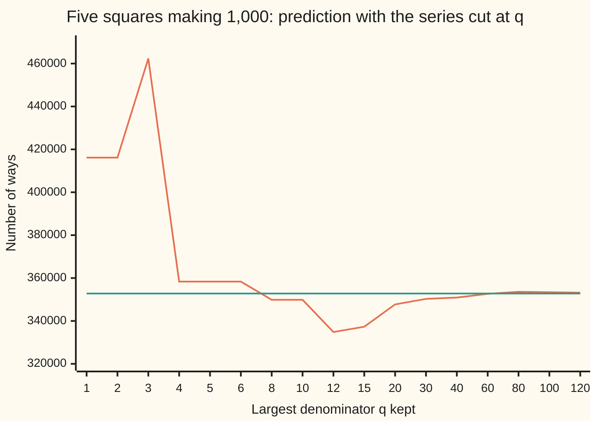

# The circle method: count solutions as an integral round the circle, split into major and minor arcs

[Syllabus](../../../SYLLABUS.md) → [Algebraic and analytic number theory](../README.md) → [Additive Combinatorics and Probabilistic Number Theory](../README.md#s08) → The circle method

---

## General Overview

The number 1,000 is a sum of five squares in exactly **352,800** ways. One way is 961 + 36 + 1 + 1 + 1, that is $`31^2 + 6^2 + 1^2 + 1^2 + 1^2`$. Signs and order count, so $`(-31)^2 + 1^2 + 6^2 + 1^2 + 1^2`$ is a different way. A computer finds all 352,800 by listing them.

The circle method predicts that count without listing anything. It multiplies two numbers:

- **A real-number size**, 416,139.1. This is how many solutions there would be if the five numbers could be any real numbers, measured per unit of n (the target number).
- **A congruence correction**, 0.8477935. Squares do not land on every remainder equally often mod 2, 3, 5 and so on, and this factor counts how often five squares hit the remainder of 1,000 mod each prime power.

Their product is 352,800.0. Cutting the correction off after the first 120 terms gives 0.8487 and a prediction of 353,195.9, high by 0.112 percent.

Where do the two factors come from? The method writes the count as an average of waves round a circle. The waves pile up near fractions with small denominators, such as 0, 1/4 and 1/5: these are the **major arcs**. Everywhere else, the **minor arcs**, they mostly cancel. The major arcs give the two factors. The hard part of every circle-method proof is showing that the minor arcs really are small.

**The circle method writes a count of solutions as an integral of a wave sum round the unit circle, takes the main term from short arcs near fractions with small denominators, where the sum factors into a congruence count times a real-number size, and proves the rest of the circle contributes less.**

**What kind of fact this is:** a theorem. For five or more squares, $`r_s(n)`$ (the number of ways) equals the predicted main term plus an error that is a fixed power of n smaller. The key steps are proved on this card in Why it works: the integral identity, the local factors from Gauss sums, and Weyl's inequality for squares. The full error bookkeeping is stated with a source (Vaughan, chapters 2 and 4). A sharper fact, that for five squares the full product is exactly $`r_5(n)`$, is Siegel's 1935 theorem, stated with a source. The counts at 1,000 and 1,001 are evidence, not proof.

### The picture: where the waves pile up

The wave sum $`f(\alpha)`$ adds one wave for each whole number x from −31 to 31, each turning at speed $`x^2`$. Its size at a point α of the circle:

```
alpha = 0                 ##########################################  63.00
alpha = 1/4               ##############################              44.55
alpha = 1/5               ###################                         28.51
largest at minor samples  ##################                          27.22
typical (root mean sq.)   #######                                     11.18
alpha = 1/2               #                                            1.00
```

Each `#` is 1.5. At 0 all 63 waves line up. At 1/4 and 1/5 they partly line up. At 1/2 they cancel almost exactly, because every square is even or odd in step with x itself. The minor-arc bar is the largest $`\lvert f\rvert`$ at the 5,000 sample points; between samples it can be a little larger. The major arcs (within 1/(200q) of a fraction a/q with $`q \le 10`$) are 6.22 percent of the circle and carry 99.80 percent of the count.

---

## The formula

Notation first, in words. As on [The large sieve](../04-Sieves%20and%20Prime%20Gaps/03-the-large-sieve.md), $`e(x) = e^{2\pi i x}`$ is the point a fraction x of a turn round the unit circle, and $`\lVert\theta\rVert`$ is the distance from θ to the nearest whole number. Here q is always a denominator, which is also the modulus of the sum $`S(q,a)`$ below.

The count is an integral round the circle:

```math
r_5(n) = \int_0^1 f(\alpha)^5\, e(-n\alpha)\, d\alpha, \qquad f(\alpha) = \sum_{\lvert x\rvert \le P} e(\alpha x^2)
```

**Read it aloud:** raise the wave sum of the squares to the fifth power, turn it back by n, and average round the circle; what is left is the number of ways to make n from five squares.

The prediction is a product of two factors:

```math
r_5(n) = \mathfrak{S}(n)\, J(n) + o(n^{3/2}), \qquad J(n) = \frac{\pi^{5/2}}{\Gamma(5/2)}\, n^{3/2} = \frac{4\pi^2}{3}\, n^{3/2}
```

```math
\mathfrak{S}(n) = \sum_{q=1}^{\infty} \frac{1}{q^5} \sum_{\substack{1 \le a \le q \\ \gcd(a,q) = 1}} S(q,a)^5\, e(-an/q), \qquad S(q,a) = \sum_{x=0}^{q-1} e(a x^2/q)
```

**Read it aloud:** the number of ways is about the real-number size $`J(n)`$ (the **singular integral**) times the congruence correction $`\mathfrak{S}(n)`$ (the **singular series**), up to an error that grows more slowly than $`n^{3/2}`$.

For n = 1,000: $`J = 13.1595 \times 31{,}622.78 = 416{,}139.1`$, and $`\mathfrak{S} = 0.8477935`$, so the product is 352,800.0.

| Symbol | Plain meaning | In our example | Push it up and the answer… |
| --- | --- | --- | --- |
| $`n`$ | the number to be written as squares | 1,000 | the count grows like $`n^{3/2}`$ |
| $`s`$, $`r_s(n)`$ | how many squares; the number of ways, signs and order counted | 5; 352,800 | more squares, many more ways |
| $`\alpha`$, $`\beta`$ | a point on the circle, from 0 to 1; a small offset from a fraction | 1/4; within 1/(200q) | — |
| $`e(x)`$ | a fraction x of a full turn, $`e^{2\pi i x}`$ | e(1/4) = i | — |
| $`P`$, $`x`$ | the largest root used, $`\lfloor\sqrt{n}\rfloor`$; a whole number from −P to P | 31; 6 | more waves in the sum |
| $`f(\alpha)`$, $`v(\beta)`$ | the wave sum of the squares; its smooth real twin, $`\int_{-\sqrt n}^{\sqrt n} e(\beta t^2)\,dt`$ | 63 at α = 0 | bigger peaks |
| $`q`$, $`a`$, $`p`$, $`k`$ | a denominator, a numerator sharing no factor with it, a prime; the power in a modulus $`p^k`$ | 4, 1; 7; 6, for mod 64 | larger q, smaller peak |
| $`S(q,a)`$, $`g`$, $`(n/p)`$ | the squares' wave sum mod q; the quadratic Gauss sum $`S(p,1)`$, of size $`\sqrt{p}`$; the Legendre symbol, +1 if n is a square mod p and −1 if not | S(4,1) = 2 + 2i; size √7 for p = 7; (1000/7) = −1 | — |
| $`\mathfrak{S}(n)`$ | the singular series: the congruence correction | 0.8477935 | n with good remainders, more ways |
| $`J(n)`$, $`\Gamma`$ | the singular integral: the real-number size; the gamma function, $`\Gamma(5/2) = 1.32934039`$ | 416,139.1 | grows like $`n^{3/2}`$ |
| $`\lVert\theta\rVert`$, $`h`$ | distance to the nearest whole number; the shift in Weyl differencing | ‖0.3‖ = 0.3 | — |
| $`o(\cdot)`$ | an error that is eventually a vanishing share of what is inside | $`o(n^{3/2})`$ | — |

### When it holds

- **Five or more squares.** With four, the correction $`\mathfrak{S}`$ can fall towards zero: for 1,024 it is 0.0024, the count $`r_4(1{,}024) = 24`$ divided by the size 10,106.5. That ratio equals the series because $`x_1^2 + \dots + x_4^2`$ is also alone in its genus (Step 6). No fixed error bound stays below a main term that small.
- **The minor arcs proved small.** For squares, Weyl's inequality does this once $`s \ge 5`$. Cubes and higher powers need more terms, and how many is Waring's problem.
- **n large.** The theorem is about the limit. At n = 1,000 the minor-arc bound of Step 5 is at least 1,171,731 (the largest $`\lvert f\rvert`$ at the sample points times the mean of $`\lvert f\rvert^4`$), larger than the count itself. The minor-arc part, integrated exactly, is 701.9.
- **Every congruence solvable.** If n has no solution mod some prime power, the correction is 0 and so is the count. Three squares at 1,007 = 8 × 125 + 7 show it: the factor at 2 is 0, and $`r_3(1{,}007) = 0`$.

---

## Why it works

### Step 0: the idea, a filter that keeps only exact hits

A wave $`e(m\alpha)`$, averaged round the whole circle, gives 1 when m = 0 and 0 for every other whole number m. The turns cancel. So averaging a product of waves against $`e(-n\alpha)`$ keeps only the terms whose total is exactly n. [Goldbach](../04-Sieves%20and%20Prime%20Gaps/07-goldbach-and-chens-theorem.md) uses the same filter for sums of primes; this card is the general framework.

### Step 1: the count is an integral

Multiply out $`f(\alpha)^5`$. Each term is $`e((x_1^2 + \dots + x_5^2)\alpha)`$ for one choice of five whole numbers from −31 to 31. Average against $`e(-1{,}000\alpha)`$ and each term with $`x_1^2 + \dots + x_5^2 = 1{,}000`$ gives 1; every other term gives 0. That is the integral formula.

The code checks it exactly. The exponents run from 0 to $`5 \times 31^2 = 4{,}805`$, so 5,000 equally spaced points on the circle separate them. The sampled average is 352,800.0 for 1,000 and 240,960.0 for 1,001, the direct counts.

### Step 2: near a fraction a/q, the wave sum factors

Take α close to $`a/q`$: say $`\alpha = a/q + \beta`$ with β small. Split x by its remainder r mod q. Then $`e(\alpha x^2) = e(ar^2/q)\, e(\beta x^2)`$. The first factor depends only on r. The second turns slowly, so each remainder class contributes about one q-th of the smooth integral $`v(\beta)`$. Hence

```math
f\!\left(\tfrac{a}{q} + \beta\right) \approx \frac{S(q,a)}{q}\, v(\beta)
```

At β = 0 each remainder class holds about 63/q of the 63 numbers, so the peak is about $`63 \times \lvert S(q,a)\rvert / q`$. For 1/4: $`S(4,1) = 1 + i + 1 + i = 2 + 2i`$, of size $`\sqrt{8}`$, so the peak is about $`63 \times \sqrt{8}/4`$, which is 44.55 to two places, the bar in the picture. For 1/2, $`S(2,1) = 1 + e(1/2) = 0`$: no peak at all.

The sum $`S(q,a)`$ is a quadratic Gauss sum. For an odd prime p, $`S(p,a) = (a/p)\, g`$, where g has size exactly $`\sqrt{p}`$ ([Gauss sums](../03-Characters%20and%20L-functions/06-gauss-sums.md)). So the peak at $`a/q`$ shrinks like $`1/\sqrt{q}`$. In general $`\lvert S(q,a)\rvert \le \sqrt{2q}`$.

### Step 3: the major arcs give series times integral

The major arcs are the short arcs round each $`a/q`$ with $`q \le Q`$. On one of them, the fifth power of Step 2 splits:

```math
\int_{\text{arc at } a/q} f(\alpha)^5 e(-n\alpha)\, d\alpha \approx \Bigl(\frac{S(q,a)}{q}\Bigr)^{5} e(-an/q) \int_{-\infty}^{\infty} v(\beta)^5 e(-n\beta)\, d\beta
```

The last integral is $`J(n)`$. It is the real-number version of Step 1: the density of real points $`(t_1, \dots, t_5)`$ with $`t_1^2 + \dots + t_5^2 = n`$. That density is the rate at which the volume of the five-dimensional ball grows with n. The ball of squared radius n has volume $`(8\pi^2/15)\, n^{5/2}`$; its rate of growth is $`(4\pi^2/3)\, n^{3/2}`$.

<details>
<summary>Detailed proof: the singular integral is the growth rate of the ball</summary>

Let $`V(n)`$ be the volume of the set of real points with $`t_1^2 + \dots + t_5^2 \le n`$. The real Fourier inversion (wing 20) gives, for the thin shell between n and n + ε,

$`\displaystyle \int_{-\infty}^{\infty} v(\beta)^5\, e(-n\beta)\, d\beta = \lim_{\varepsilon \to 0} \frac{V(n+\varepsilon) - V(n)}{\varepsilon} = V'(n).`$

The volume of a ball of radius R in five dimensions is $`(8\pi^2/15) R^5`$, and here $`R = \sqrt{n}`$, so $`V(n) = (8\pi^2/15)\, n^{5/2}`$. Differentiating gives

$`\displaystyle V'(n) = \frac{5}{2} \cdot \frac{8\pi^2}{15}\, n^{3/2} = \frac{4\pi^2}{3}\, n^{3/2} = \frac{\pi^{5/2}}{\Gamma(5/2)}\, n^{3/2},`$

because $`\Gamma(5/2) = \tfrac{3}{2} \cdot \tfrac{1}{2} \cdot \sqrt{\pi}`$. The limits $`\pm\sqrt{n}`$ in $`v`$ cut no real solution off, since every coordinate of a point on the sphere is at most $`\sqrt{n}`$ in size.

The code checks the volume against whole-number points: the ball of radius $`\sqrt{1000}`$ holds 166,711,479 of them, against a volume of 166,455,624.

</details>

Adding over every $`a`$ and every $`q \le Q`$ gives the first part of $`\mathfrak{S}(n)`$ times $`J(n)`$. The rest of the series is small for five squares: each term is at most $`q \cdot (2/q)^{5/2}`$ in size, and those add up to a finite total. For four squares the same bound gives a series like $`\sum 1/q`$, which does not converge.

### Step 4: the series is a product of congruence counts

The q-th term of the series is multiplicative in q. So the series is a product over primes p of a **local factor**: the number of solutions of $`x_1^2 + \dots + x_5^2 \equiv n`$ mod $`p^k`$, divided by $`p^{4k}`$, for k large. That ratio is how much more or less often five random squares hit n mod $`p^k`$ than five random numbers would.

For an odd prime p that does not divide n, Gauss sums give the factor in closed form:

```math
1 + \frac{(n/p)}{p^2}
```

<details>
<summary>Detailed proof: the local factor is 1 + (n/p)/p²</summary>

Let g be the quadratic Gauss sum mod p. Then $`S(p,a) = (a/p)\, g`$ and $`g^2 = (-1/p)\, p`$ ([Gauss sums](../03-Characters%20and%20L-functions/06-gauss-sums.md)). So

$`\displaystyle S(p,a)^5 = \Bigl(\frac{a}{p}\Bigr) g^5 = \Bigl(\frac{a}{p}\Bigr)\, g\, p^2.`$

Summing against $`e(-an/p)`$ over a from 1 to p − 1 gives a Gauss sum again: $`\sum_a (a/p)\, e(-an/p) = (-n/p)\, g`$. Hence

$`\displaystyle \frac{1}{p^5} \sum_{a} S(p,a)^5 e(-an/p) = \frac{p^2\, g^2}{p^5} \Bigl(\frac{-n}{p}\Bigr) = \frac{1}{p^2} \Bigl(\frac{-1}{p}\Bigr)\Bigl(\frac{-n}{p}\Bigr) = \frac{(n/p)}{p^2}.`$

The terms for $`p^2, p^3, \dots`$ are all 0 when p does not divide n: a similar Gauss-sum calculation makes them cancel (Vaughan, chapter 4). So the local factor is $`1 + (n/p)/p^2`$.

</details>

For 1,000: it leaves remainder 1 mod 3, a square, so the factor at 3 is 1 + 1/9 = 1.1111111. It leaves 6 mod 7, not a square, so the factor at 7 is 1 − 1/49 = 0.9795918. The primes 2 and 5 divide 1,000, so the code counts solutions mod 64 and mod 625 directly: 0.7812500 and 1.0063872. Every count matches the Gauss-sum value.

For p not dividing 2n the factor is within $`1/p^2`$ of 1, and for five squares the other factors stay above a fixed positive amount. So the series is bounded below: no n is starved by its remainders.

### Step 5: the minor arcs, by Weyl's inequality

Off the major arcs, α is close only to fractions with large denominators. There the waves must be shown to cancel. [Weyl differencing](08-weyl-differencing-and-van-der-corput.md) squares the sum and pairs x with x + h. The square $`(x+h)^2 - x^2 = 2hx + h^2`$ is linear in x, and a linear wave sum is a geometric series:

```math
\lvert f(\alpha)\rvert^2 \le \sum_{\lvert h\rvert \le 2P} \min\Bigl(2P + 1,\ \frac{1}{2\lVert 2h\alpha\rVert}\Bigr)
```

<details>
<summary>Detailed proof: Weyl's inequality for squares</summary>

Write $`\lvert f\rvert^2 = f \bar{f}`$ as a double sum over x and y from −P to P, and set h = x − y:

$`\displaystyle \lvert f(\alpha)\rvert^2 = \sum_{\lvert h\rvert \le 2P} e(\alpha h^2) \sum_{y} e(2h\alpha\, y),`$

where y runs over a block of at most 2P + 1 consecutive whole numbers. The inner sum is geometric with ratio $`e(2h\alpha)`$. Its size is at most the number of terms, and also at most $`1/\lvert \sin(\pi \cdot 2h\alpha)\rvert \le 1/(2\lVert 2h\alpha\rVert)`$, because $`\lvert\sin \pi\theta\rvert \ge 2\lVert\theta\rVert`$. Taking absolute values term by term gives the inequality.

</details>

If $`2h\alpha`$ stays away from whole numbers for most h, most terms are small. For α near $`a/q`$ with q large, the values $`2h\alpha`$ spread round the circle, and the sum gives $`\lvert f\rvert`$ a fixed power of P below the trivial 2P + 1. The code checks the inequality at every minor-arc sample point: the worst ratio of $`\lvert f\rvert^2`$ to the bound is 0.6132. The bound caps $`\lvert f\rvert`$ at 39.13 there; the largest $`\lvert f\rvert`$ there is 27.22.

Then the minor arcs are bounded in two moves:

1. Pull out the largest value: the minor-arc integral is at most $`\max \lvert f\rvert`$ times the average of $`\lvert f\rvert^4`$.
2. The average of $`\lvert f\rvert^4`$ counts solutions of $`x_1^2 + x_2^2 = x_3^2 + x_4^2`$, which is about $`P^2`$ times a logarithm (43,041.0 here).

So the minor arcs are at most a fixed power of P below $`P \cdot P^2 = P^3`$. The main term $`\mathfrak{S}(n) J(n)`$ has size $`P^3`$, since $`n^{3/2} = P^3`$. The main term wins for n large enough.

### Step 6: why five, and what is exact

With four squares, step 1 of the minor-arc bound has no spare factor of f to pull out. The average of $`\lvert f\rvert^4`$ alone, $`P^2`$ times a logarithm, is larger than the main term of size $`P^2`$. At n = 1,000 it is 43,041.0 against $`r_4(1{,}000) = 3{,}744`$. Four squares need finer tools: Kloosterman's 1926 refinement of the major arcs.

For five squares there is a stronger theorem. Siegel proved in 1935 that the full product of local factors times $`J(n)`$ is exactly the count, for forms alone in their genus (every form agreeing with $`x_1^2 + \dots + x_5^2`$ mod every prime power is the same form after a change of variables). The code's product over the primes up to 200,000 gives 352,800.0 for 1,000 and 240,960.0 for 1,001. That is Siegel's theorem seen in numbers, not a proof of it.

---

## Worked numbers, by hand

The example: the five-square count of 1,000, predicted and counted.

| Step | Arithmetic | Value |
| --- | --- | --- |
| real-number size | $`4\pi^2/3 \times 1{,}000^{3/2} = 13.1595 \times 31{,}622.78`$ | 416,139.1 |
| factor at 2 | count solutions mod 64 | 0.7812500 |
| factor at 3 | 1,000 ≡ 1, a square: 1 + 1/9 | 1.1111111 |
| factor at 5 | count solutions mod 625 | 1.0063872 |
| factor at 7 | 1,000 ≡ 6, not a square: 1 − 1/49 | 0.9795918 |
| all primes to 200,000 | multiply every factor | 0.8477935 |
| prediction | 0.8477935 × 416,139.1 | 352,800.0 |
| direct count | list every solution | **352,800** |

The full product lands on the count, as Siegel's theorem says it must. Summed as a series to q = 120 instead, the correction is 0.8487 and the prediction 353,195.9, high by 0.112 percent.

For 1,001 = 7 × 11 × 13 the size is 416,763.4 and the factor at 2 drops to 0.6250000. The series to 120 gives 0.5783 and 240,995.7, against a true 240,960: high by 0.015 percent.

How the prediction moves as the series is cut later, against the count:



The orange line is the prediction with the series cut at q. The teal line is the true count, 352,800. Flat stretches are denominators whose terms are 0 for this n, such as q = 2, 5 and 6.

### What breaks if you drop a piece

| Mistake | Comes out at | What went wrong |
| --- | --- | --- |
| Leave out the singular series | 416,139.1 against 352,800, 18.0 percent high | Squares favour some remainders; the real-number size alone ignores them |
| Too few major arcs, q ≤ 5 | major arcs 359,276.0, minor arcs −6,476.0 | The peaks at denominators 6 to 10 sit in the minor arcs and do not cancel |
| Three squares at 1,007 | size 199.4, true count 0 | 1,007 = 8 × 125 + 7 has no solution mod 8: the factor at 2 is 0.0000 |
| Four squares at 1,024 | size 10,106.5, true count 24, correction 0.0024 | Below five squares the correction is not bounded below, so no error bound stays below it |

The last row is the hypothesis $`s \ge 5`$ failing. The code prints every row.

---

## Code, from first principles, and it actually runs

The code reaches the count of 1,000 and 1,001 by four roads. Road 1 lists solutions, by convolving the square counts five times. Road 2 is the circle integral, sampled exactly at 5,000 points. Its major and minor arcs are integrated exactly, one wave at a time, from the counts of road 1, and Weyl's inequality is checked at every minor-arc sample point. Road 3 is the prediction: the series from Gauss sums up to q = 120, times $`J(n)`$, with $`\Gamma(5/2)`$ found by Simpson's rule and the volume checked by lattice points. Road 4 rebuilds the local factors by counting solutions mod $`p^k`$, then multiplies them over the primes up to 200,000.

### Python

```python
# The circle method for five squares -- the check behind the card.  Standard library only.
# Road 1 counts r_5(n) directly.  Road 2 is the circle integral, done exactly with 5,000
# sample points, then split into major and minor arcs.  Road 3 is the prediction: the
# singular series from Gauss sums, times the singular integral.  Road 4 rebuilds the
# series from local solution counts mod p^k.  math.gamma appears only as a cross-check.
import math

def reps(s, N):                      # r_s(m) for m <= N: signs and order counted
    sq = [0] * (N + 1)
    for x in range(-math.isqrt(N), math.isqrt(N) + 1): sq[x * x] += 1
    r = [1] + [0] * N
    for _ in range(s):
        r = [sum(r[m - k] * sq[k] for k in range(m + 1) if sq[k]) for m in range(N + 1)]
    return r

r5, r3, r4 = reps(5, 1001), reps(3, 1007), reps(4, 1024)
print(f"count, r_5(1000) = {r5[1000]:,}, r_5(1001) = {r5[1001]:,}")

# ---- road 2: the circle integral, sampled at alpha = j/M ----
M, P = 5000, 31                      # 5 x 31^2 = 4,805 < 5,000, so the samples are exact
C = [math.cos(2 * math.pi * k / M) for k in range(M)]
S_ = [math.sin(2 * math.pi * k / M) for k in range(M)]
f = []
for j in range(M):
    ks = [(j * x * x) % M for x in range(-P, P + 1)]
    f.append(complex(sum(C[k] for k in ks), sum(S_[k] for k in ks)))
def piece(js, n): return sum((f[j] ** 5 * complex(C[-j * n % M], S_[-j * n % M])).real for j in js) / M
I1000, I1001 = piece(range(M), 1000), piece(range(M), 1001)
print(f"integral, n = 1000: {I1000:,.1f}; n = 1001: {I1001:,.1f}")
assert round(I1000) == r5[1000] and round(I1001) == r5[1001]

def arcs(Q, W):                      # sample points within W/(qM) = 1/(200q) of a/q, for q <= Q
    return {j for q in range(1, Q + 1) for a in range(q + 1) if math.gcd(a, q) == 1
            for j in range(M) if abs(j * q - a * M) <= W}
c = [1] + [0] * (5 * P * P)          # c[m]: ways to make m from five squares of -31..31, every m to 4,805
for _ in range(5): c = [sum(c[m - x * x] * (2 if x else 1) for x in range(min(P, math.isqrt(m)) + 1)) for m in range(len(c))]
def arc(q, n, w):                    # exact integral of f^5 e(-n alpha) = sum c[m] e((m-n) alpha) over the arcs
    return sum(cm * (2 * w if m == n else math.cos(2 * math.pi * (m - n) * a / q) * math.sin(2 * math.pi * (m - n) * w)
                     / (math.pi * (m - n))) for a in range(q) if math.gcd(a, q) == 1 for m, cm in enumerate(c) if cm)
assert c[1000] == r5[1000] and abs(sum(arc(d, 1000, 1 / 20) for d in (1, 2, 5, 10)) - r5[1000]) < 1e-6  # arcs round each a/10 tile the circle
for Q in (10, 5):
    mj = arcs(Q, 25); mn = [j for j in range(M) if j not in mj]; maj = sum(arc(q, 1000, 25 / (q * M)) for q in range(1, Q + 1))
    sh = sum(2 * 25 / (q * M) for q in range(1, Q + 1) for a in range(q) if math.gcd(a, q) == 1)
    print(f"arcs q <= {Q}, integrated exactly: share of circle {sh:.4f}, of count {maj / r5[1000]:.4f}; major {maj:,.1f}, "
          f"minor {r5[1000] - maj:,.1f}; largest |f| at the minor-arc samples {max(abs(f[j]) for j in mn):.2f}")
    if Q == 10: minor = mn
print(f"|f| at 0, 1/4, 1/5, 1/2: {abs(f[0]):.2f}, {abs(f[1250]):.2f}, {abs(f[1000]):.2f}, {abs(f[2500]):.2f}; "
      f"root mean square {math.sqrt(sum(abs(z) ** 2 for z in f) / M):.2f}")
mean4 = sum(abs(z) ** 4 for z in f) / M
print(f"mean of |f|^4 = {mean4:,.1f}; minor-arc bound max|f| x mean|f|^4 at least "
      f"{max(abs(f[j]) for j in minor) * mean4:,.0f}, from the sampled max")

# ---- Weyl's inequality: |f|^2 <= sum over |h| <= 2P of min(2P+1, 1/(2||2h alpha||)) ----
def weyl(j):
    t = 0.0
    for h in range(-2 * P, 2 * P + 1):
        d = (2 * h * j) % M; d = min(d, M - d) / M
        t += 2 * P + 1 if d == 0 else min(2 * P + 1, 1 / (2 * d))
    return t
wr = max(abs(f[j]) ** 2 / weyl(j) for j in minor)
print(f"Weyl at the minor-arc samples: worst |f|^2 / bound = {wr:.4f}, bound on |f| <= {math.sqrt(max(weyl(j) for j in minor)):.2f}")
assert wr <= 1

# ---- road 3: singular series from Gauss sums, singular integral from the ball ----
def e(x): return complex(math.cos(2 * math.pi * x), math.sin(2 * math.pi * x))
def A(q, n, s=5):
    return sum(sum(e(a * x * x / q) for x in range(q)) ** s * e(-a * n / q)
               for a in range(1, q + 1) if math.gcd(a, q) == 1).real / q ** s
G52 = 3 * math.sqrt(math.pi) / 4     # Gamma(5/2) = (3/2)(1/2)Gamma(1/2)
h = 60 / 60000                       # Simpson's rule for the integral of t^(3/2) e^(-t) on [0, 60]
simp = sum((1 if k in (0, 60000) else 4 if k % 2 else 2) * (k * h) ** 1.5 * math.exp(-k * h)
           for k in range(60001)) * h / 3
print(f"Gamma(5/2) = {G52:.8f}; by Simpson's rule {simp:.8f}")
assert abs(simp - G52) < 1e-6 and abs(math.gamma(2.5) - G52) < 1e-12   # math.gamma: cross-check only
def J(n, s=5, g=G52): return math.pi ** (s / 2) * n ** (s / 2 - 1) / g
print(f"J(1000) = (4 pi^2 / 3) x 1000^(3/2) = {4 * math.pi ** 2 / 3:.4f} x {1000 ** 1.5:,.2f}")
ball = 8 * math.pi ** 2 / 15 * 1000 ** 2.5
print(f"lattice points in the ball of radius sqrt(1000): {sum(r5[:1001]):,}; volume {ball:,.0f}")
series = {}
for n in (1000, 1001):
    part, cut = 0.0, {}
    for q in range(1, 121):
        part += A(q, n); cut[q] = part
    series[n] = cut
    print(f"n = {n}: J = {J(n):,.1f}, series to 120 = {part:.4f}, prediction {part * J(n):,.1f}, "
          f"off by {100 * (part * J(n) / r5[n] - 1):.3f}%")
pts = (1, 2, 3, 4, 5, 6, 8, 10, 12, 15, 20, 30, 40, 60, 80, 100, 120)
print("chart, prediction with series cut at q:", ", ".join(f"{series[1000][q] * J(1000):.0f}" for q in pts))
assert abs(series[1000][120] * J(1000) / r5[1000] - 1) < 0.002

# ---- road 4: local factors, by counting solutions mod p^k and by Gauss sums ----
def density(p, k, n, s=5):
    m = p ** k; c = [0] * m
    for x in range(m): c[x * x % m] += 1
    cur = c
    for _ in range(s - 1):
        nw = [0] * m
        for i in range(m):
            if cur[i]:
                for t in range(m):
                    if c[t]: nw[(i + t) % m] += cur[i] * c[t]
        cur = nw
    return cur[n % m] / m ** (s - 1)
local = {}
for n, ps in ((1000, ((2, 6), (3, 2), (5, 4), (7, 2))), (1001, ((2, 6), (7, 2), (11, 2), (13, 2)))):
    for p, k in ps:
        g = 1 + sum(A(p ** i, n) for i in range(1, k + 1))
        local[n, p] = density(p, k, n)
        print(f"local factor n = {n}, p = {p}: count {local[n, p]:.7f}, Gauss sums {g:.7f}")
        assert abs(g - local[n, p]) < 1e-9
sieve = bytearray([1]) * 200001; sieve[:2] = b"\0\0"
for i in range(2, 448):
    if sieve[i]: sieve[i * i::i] = bytearray(len(sieve[i * i::i]))
for n in (1000, 1001):
    prod = 1.0
    for p in range(2, 200001):
        if sieve[p]:
            leg = pow(n, (p - 1) // 2, p)
            prod *= local[n, p] if (n, p) in local else 1 + (1 if leg == 1 else -1) / p ** 2
    print(f"full product to 200,000, n = {n}: series {prod:.7f}, times J = {prod * J(n):,.1f}")
    assert abs(prod * J(n) - r5[n]) < 1

# ---- what breaks ----
print(f"drop the series: J = {J(1000):,.1f} against {r5[1000]:,}, {100 * (J(1000) / r5[1000] - 1):.1f}% high")
print(f"three squares at 1007: J = {J(1007, 3, math.sqrt(math.pi) / 2):,.1f}, r_3 = {r3[1007]}, "
      f"2-adic factor {density(2, 5, 1007, 3):.4f}")
print(f"four squares at 1024: J = {J(1024, 4, 1.0):,.1f}, r_4 = {r4[1024]}, r_4 / J {r4[1024] / J(1024, 4, 1.0):.4f}; "
      f"r_4(1000) = {r4[1000]:,}")
assert r3[1007] == 0 and density(2, 5, 1007, 3) == 0 and r4[1024] == 24
print("ALL CHECKS PASS")
```

**Ran 2026-11-24 on macOS, Python 3.14.10, standard library only. All checks passed. Output, pasted from the run:**

```
count, r_5(1000) = 352,800, r_5(1001) = 240,960
integral, n = 1000: 352,800.0; n = 1001: 240,960.0
arcs q <= 10, integrated exactly: share of circle 0.0622, of count 0.9980; major 352,098.1, minor 701.9; largest |f| at the minor-arc samples 27.22
arcs q <= 5, integrated exactly: share of circle 0.0347, of count 1.0184; major 359,276.0, minor -6,476.0; largest |f| at the minor-arc samples 32.71
|f| at 0, 1/4, 1/5, 1/2: 63.00, 44.55, 28.51, 1.00; root mean square 11.18
mean of |f|^4 = 43,041.0; minor-arc bound max|f| x mean|f|^4 at least 1,171,731, from the sampled max
Weyl at the minor-arc samples: worst |f|^2 / bound = 0.6132, bound on |f| <= 39.13
Gamma(5/2) = 1.32934039; by Simpson's rule 1.32934039
J(1000) = (4 pi^2 / 3) x 1000^(3/2) = 13.1595 x 31,622.78
lattice points in the ball of radius sqrt(1000): 166,711,479; volume 166,455,624
n = 1000: J = 416,139.1, series to 120 = 0.8487, prediction 353,195.9, off by 0.112%
n = 1001: J = 416,763.4, series to 120 = 0.5783, prediction 240,995.7, off by 0.015%
chart, prediction with series cut at q: 416139, 416139, 462377, 358342, 358342, 358342, 349849, 349849, 334851, 337313, 347725, 350286, 350915, 352628, 353607, 353386, 353196
local factor n = 1000, p = 2: count 0.7812500, Gauss sums 0.7812500
local factor n = 1000, p = 3: count 1.1111111, Gauss sums 1.1111111
local factor n = 1000, p = 5: count 1.0063872, Gauss sums 1.0063872
local factor n = 1000, p = 7: count 0.9795918, Gauss sums 0.9795918
local factor n = 1001, p = 2: count 0.6250000, Gauss sums 0.6250000
local factor n = 1001, p = 7: count 0.9995835, Gauss sums 0.9995835
local factor n = 1001, p = 11: count 0.9999317, Gauss sums 0.9999317
local factor n = 1001, p = 13: count 0.9999650, Gauss sums 0.9999650
full product to 200,000, n = 1000: series 0.8477935, times J = 352,800.0
full product to 200,000, n = 1001: series 0.5781697, times J = 240,960.0
drop the series: J = 416,139.1 against 352,800, 18.0% high
three squares at 1007: J = 199.4, r_3 = 0, 2-adic factor 0.0000
four squares at 1024: J = 10,106.5, r_4 = 24, r_4 / J 0.0024; r_4(1000) = 3,744
ALL CHECKS PASS
```

### Rust

```rust
// The circle method for five squares -- the check behind the card.  std only.
// Road 1 counts r_5(n) directly.  Road 2 is the circle integral, done exactly with 5,000
// sample points, then split into major and minor arcs.  Road 3 is the prediction: the
// singular series from Gauss sums, times the singular integral.  Road 4 rebuilds the
// series from local solution counts mod p^k.
use std::collections::{HashMap, HashSet};
use std::f64::consts::PI;
#[derive(Clone, Copy)]
struct Cx(f64, f64);
impl Cx {
    fn mul(self, o: Cx) -> Cx { Cx(self.0 * o.0 - self.1 * o.1, self.0 * o.1 + self.1 * o.0) }
    fn abs(self) -> f64 { self.0.hypot(self.1) }
    fn pow(self, n: u32) -> Cx { // binary powering, in the same order as Python's
        let (mut r, mut a, mut m) = (Cx(1.0, 0.0), self, 1);
        while m <= n { if n & m != 0 { r = r.mul(a); } m <<= 1; if m <= n { a = a.mul(a); } } r }
}
fn e(x: f64) -> Cx { Cx((2.0 * PI * x).cos(), (2.0 * PI * x).sin()) }
fn gcd(a: i64, b: i64) -> i64 { if b == 0 { a.abs() } else { gcd(b, a % b) } }
fn commas(x: f64, d: usize) -> String {
    let s = format!("{:.*}", d, x.abs());
    let (int, frac) = match s.find('.') { Some(i) => (&s[..i], &s[i..]), None => (&s[..], "") };
    let mut out = String::new();
    for (i, ch) in int.chars().enumerate() { if i > 0 && (int.len() - i) % 3 == 0 { out.push(','); } out.push(ch); }
    format!("{}{}{}", if x < 0.0 && s.chars().any(|c| c != '0' && c != '.') { "-" } else { "" }, out, frac)
}
fn reps(s: usize, n: usize) -> Vec<u64> { // r_s(m) for m <= n: signs and order counted
    let mut sq = vec![0u64; n + 1];
    let r0 = (n as f64).sqrt() as i64;
    for x in -r0..=r0 { if ((x * x) as usize) <= n { sq[(x * x) as usize] += 1; } }
    let mut r = vec![0u64; n + 1]; r[0] = 1;
    for _ in 0..s {
        r = (0..=n).map(|m| (0..=m).filter(|&k| sq[k] > 0).map(|k| r[m - k] * sq[k]).sum()).collect();
    }
    r
}
fn a_term(q: i64, n: i64, s: u32) -> f64 {
    let mut t = Cx(0.0, 0.0);
    for a in 1..=q {
        if gcd(a, q) != 1 { continue; }
        let mut g = Cx(0.0, 0.0);
        for x in 0..q { let z = e((a * x * x) as f64 / q as f64); g = Cx(g.0 + z.0, g.1 + z.1); }
        let z = g.pow(s).mul(e((-a * n) as f64 / q as f64));
        t = Cx(t.0 + z.0, t.1 + z.1);
    }
    t.0 / (q as f64).powi(s as i32)
}
fn density(p: usize, k: u32, n: usize, s: usize) -> f64 {
    let m = p.pow(k); let mut c = vec![0u64; m];
    for x in 0..m { c[x * x % m] += 1; }
    let mut cur = c.clone();
    for _ in 0..s - 1 {
        let mut nw = vec![0u64; m];
        for i in 0..m { if cur[i] > 0 { for t in 0..m { if c[t] > 0 { nw[(i + t) % m] += cur[i] * c[t]; } } } }
        cur = nw;
    }
    cur[n % m] as f64 / (m as f64).powi(s as i32 - 1)
}
fn jint(n: f64, s: f64, g: f64) -> f64 { PI.powf(s / 2.0) * n.powf(s / 2.0 - 1.0) / g }
fn main() {
    let (r5, r3, r4) = (reps(5, 1001), reps(3, 1007), reps(4, 1024));
    println!("count, r_5(1000) = {}, r_5(1001) = {}", commas(r5[1000] as f64, 0), commas(r5[1001] as f64, 0));
    // ---- road 2: the circle integral, sampled at alpha = j/M ----
    let (m, p) = (5000i64, 31i64); // 5 x 31^2 = 4,805 < 5,000, so the samples are exact
    let cs: Vec<f64> = (0..m).map(|k| (2.0 * PI * k as f64 / m as f64).cos()).collect();
    let sn: Vec<f64> = (0..m).map(|k| (2.0 * PI * k as f64 / m as f64).sin()).collect();
    let f: Vec<Cx> = (0..m).map(|j| {
        let (mut re, mut im) = (0.0, 0.0);
        for x in -p..=p { let k = ((j * x * x) % m) as usize; re += cs[k]; im += sn[k]; }
        Cx(re, im)
    }).collect();
    let piece = |js: &Vec<i64>, n: i64| -> f64 {
        let mut t = 0.0;
        for &j in js { let k = (-j * n).rem_euclid(m) as usize; t += f[j as usize].pow(5).mul(Cx(cs[k], sn[k])).0; }
        t / m as f64
    };
    let all: Vec<i64> = (0..m).collect(); let (i0, i1) = (piece(&all, 1000), piece(&all, 1001));
    println!("integral, n = 1000: {}; n = 1001: {}", commas(i0, 1), commas(i1, 1));
    assert!(i0.round() as u64 == r5[1000] && i1.round() as u64 == r5[1001]);
    let mut c = vec![0u64; 4806]; c[0] = 1;  // c[m]: ways to make m from five squares of -31..31, every m to 4,805
    for _ in 0..5 { c = (0..4806usize).map(|k| (0..=p as usize).filter(|x| x * x <= k).map(|x| c[k - x * x] * if x == 0 { 1 } else { 2 }).sum::<u64>()).collect(); }
    let arc = |q: i64, n: i64, w: f64| -> f64 { let mut t = 0.0; // exact integral of f^5 e(-n alpha) = sum c[m] e((m-n) alpha) over the arcs
        for a in (0..q).filter(|&a| gcd(a, q) == 1) { for (k, &cm) in c.iter().enumerate() { if cm == 0 { continue; } let d = (k as i64 - n) as f64;
            t += cm as f64 * if k as i64 == n { 2.0 * w } else { (2.0 * PI * d * a as f64 / q as f64).cos() * (2.0 * PI * d * w).sin() / (PI * d) }; } }
        t };
    assert!(c[1000] == r5[1000] && ([1i64, 2, 5, 10].iter().map(|&d| arc(d, 1000, 0.05)).sum::<f64>() - r5[1000] as f64).abs() < 1e-6); // arcs round each a/10 tile the circle
    let mut minor: Vec<i64> = vec![];
    for qq in [10i64, 5] {
        let mut mj = HashSet::new();
        for q in 1..=qq { for a in 0..=q { if gcd(a, q) == 1 { for j in 0..m { if (j * q - a * m).abs() <= 25 { mj.insert(j); } } } } }
        let mn: Vec<i64> = (0..m).filter(|j| !mj.contains(j)).collect();
        let maj = (1..=qq).fold(0.0, |s, q| s + arc(q, 1000, 25.0 / (q * m) as f64));
        let sh = (1..=qq).flat_map(|q| (0..q).filter(move |&a| gcd(a, q) == 1).map(move |_| 2.0 * 25.0 / (q * m) as f64)).fold(0.0, |s, x| s + x);
        let mx = mn.iter().map(|&j| f[j as usize].abs()).fold(0.0, f64::max);
        println!("arcs q <= {}, integrated exactly: share of circle {:.4}, of count {:.4}; major {}, minor {}; largest |f| at the minor-arc samples {:.2}",
            qq, sh, maj / r5[1000] as f64, commas(maj, 1), commas(r5[1000] as f64 - maj, 1), mx);
        if qq == 10 { minor = mn; }
    }
    let rms = (f.iter().map(|z| z.abs().powi(2)).sum::<f64>() / m as f64).sqrt();
    println!("|f| at 0, 1/4, 1/5, 1/2: {:.2}, {:.2}, {:.2}, {:.2}; root mean square {:.2}",
        f[0].abs(), f[1250].abs(), f[1000].abs(), f[2500].abs(), rms);
    let mean4 = f.iter().map(|z| z.abs().powi(4)).sum::<f64>() / m as f64; let mxm = minor.iter().map(|&j| f[j as usize].abs()).fold(0.0, f64::max);
    println!("mean of |f|^4 = {}; minor-arc bound max|f| x mean|f|^4 at least {}, from the sampled max", commas(mean4, 1), commas(mxm * mean4, 0));
    // ---- Weyl's inequality: |f|^2 <= sum over |h| <= 2P of min(2P+1, 1/(2||2h alpha||)) ----
    let weyl = |j: i64| -> f64 { let mut t = 0.0;
        for h in -2 * p..=2 * p {
            let d = (2 * h * j).rem_euclid(m); let d = d.min(m - d) as f64 / m as f64;
            t += if d == 0.0 { (2 * p + 1) as f64 } else { ((2 * p + 1) as f64).min(1.0 / (2.0 * d)) };
        }
        t
    };
    let wr = minor.iter().map(|&j| f[j as usize].abs().powi(2) / weyl(j)).fold(0.0, f64::max); let wb = minor.iter().map(|&j| weyl(j)).fold(0.0, f64::max).sqrt();
    println!("Weyl at the minor-arc samples: worst |f|^2 / bound = {:.4}, bound on |f| <= {:.2}", wr, wb);
    assert!(wr <= 1.0);
    // ---- road 3: singular series from Gauss sums, singular integral from the ball ----
    let g52 = 3.0 * PI.sqrt() / 4.0; // Gamma(5/2) = (3/2)(1/2)Gamma(1/2)
    let h = 60.0 / 60000.0; // Simpson's rule for the integral of t^(3/2) e^(-t) on [0, 60]
    let simp = (0..=60000).map(|k| { let t = k as f64 * h;
        (if k == 0 || k == 60000 { 1.0 } else if k % 2 == 1 { 4.0 } else { 2.0 }) * t.powf(1.5) * (-t).exp() }).sum::<f64>() * h / 3.0;
    println!("Gamma(5/2) = {:.8}; by Simpson's rule {:.8}", g52, simp);
    assert!((simp - g52).abs() < 1e-6);
    println!("J(1000) = (4 pi^2 / 3) x 1000^(3/2) = {:.4} x {}", 4.0 * PI * PI / 3.0, commas(1000f64.powf(1.5), 2));
    let ball = 8.0 * PI * PI / 15.0 * 1000f64.powf(2.5);
    println!("lattice points in the ball of radius sqrt(1000): {}; volume {}", commas(r5[..1001].iter().sum::<u64>() as f64, 0), commas(ball, 0));
    let mut series: HashMap<i64, Vec<f64>> = HashMap::new();
    for n in [1000i64, 1001] {
        let (mut part, mut cut) = (0.0, vec![0.0; 121]);
        for q in 1..=120 { part += a_term(q, n, 5); cut[q as usize] = part; }
        let jn = jint(n as f64, 5.0, g52);
        println!("n = {}: J = {}, series to 120 = {:.4}, prediction {}, off by {:.3}%", n, commas(jn, 1), part,
            commas(part * jn, 1), 100.0 * (part * jn / r5[n as usize] as f64 - 1.0));
        series.insert(n, cut);
    }
    let j1000 = jint(1000.0, 5.0, g52); let pts = [1, 2, 3, 4, 5, 6, 8, 10, 12, 15, 20, 30, 40, 60, 80, 100, 120];
    let ch: Vec<String> = pts.iter().map(|&q| format!("{:.0}", series[&1000][q] * j1000)).collect();
    println!("chart, prediction with series cut at q: {}", ch.join(", "));
    assert!((series[&1000][120] * j1000 / r5[1000] as f64 - 1.0).abs() < 0.002);
    // ---- road 4: local factors, by counting solutions mod p^k and by Gauss sums ----
    let mut local: HashMap<(usize, usize), f64> = HashMap::new();
    for (n, ps) in [(1000usize, [(2usize, 6u32), (3, 2), (5, 4), (7, 2)]), (1001, [(2, 6), (7, 2), (11, 2), (13, 2)])] {
        for (pp, k) in ps {
            let g = 1.0 + (1..=k).map(|i| a_term(pp.pow(i) as i64, n as i64, 5)).sum::<f64>();
            let d = density(pp, k, n, 5); local.insert((n, pp), d);
            println!("local factor n = {}, p = {}: count {:.7}, Gauss sums {:.7}", n, pp, d, g);
            assert!((g - d).abs() < 1e-9);
        }
    }
    let lim = 200000usize; let mut sv = vec![true; lim + 1]; sv[0] = false; sv[1] = false;
    for i in 2..448 { if sv[i] { let mut k = i * i; while k <= lim { sv[k] = false; k += i; } } }
    for n in [1000usize, 1001] {
        let mut prod = 1.0;
        for pp in 2..=lim {
            if !sv[pp] { continue; }
            let (mut b, mut ex, mut lg) = ((n % pp) as u64, ((pp - 1) / 2) as u64, 1u64);
            while ex > 0 { if ex & 1 == 1 { lg = lg * b % pp as u64; } b = b * b % pp as u64; ex >>= 1; }
            prod *= match local.get(&(n, pp)) { Some(&d) => d, None => 1.0 + (if lg == 1 { 1.0 } else { -1.0 }) / (pp as f64).powi(2) };
        }
        let jn = jint(n as f64, 5.0, g52);
        println!("full product to 200,000, n = {}: series {:.7}, times J = {}", n, prod, commas(prod * jn, 1));
        assert!((prod * jn - r5[n] as f64).abs() < 1.0);
    }
    // ---- what breaks ----
    println!("drop the series: J = {} against {}, {:.1}% high", commas(j1000, 1), commas(r5[1000] as f64, 0), 100.0 * (j1000 / r5[1000] as f64 - 1.0));
    let d3 = density(2, 5, 1007, 3);
    println!("three squares at 1007: J = {}, r_3 = {}, 2-adic factor {:.4}", commas(jint(1007.0, 3.0, PI.sqrt() / 2.0), 1), r3[1007], d3);
    let j4 = jint(1024.0, 4.0, 1.0);
    println!("four squares at 1024: J = {}, r_4 = {}, r_4 / J {:.4}; r_4(1000) = {}", commas(j4, 1), r4[1024], r4[1024] as f64 / j4, commas(r4[1000] as f64, 0));
    assert!(r3[1007] == 0 && d3 == 0.0 && r4[1024] == 24);
    println!("ALL CHECKS PASS");
}
```

**Ran 2026-11-24 on macOS, rustc 1.98.1, no crates. All checks passed. Output, pasted from the run:**

```
count, r_5(1000) = 352,800, r_5(1001) = 240,960
integral, n = 1000: 352,800.0; n = 1001: 240,960.0
arcs q <= 10, integrated exactly: share of circle 0.0622, of count 0.9980; major 352,098.1, minor 701.9; largest |f| at the minor-arc samples 27.22
arcs q <= 5, integrated exactly: share of circle 0.0347, of count 1.0184; major 359,276.0, minor -6,476.0; largest |f| at the minor-arc samples 32.71
|f| at 0, 1/4, 1/5, 1/2: 63.00, 44.55, 28.51, 1.00; root mean square 11.18
mean of |f|^4 = 43,041.0; minor-arc bound max|f| x mean|f|^4 at least 1,171,731, from the sampled max
Weyl at the minor-arc samples: worst |f|^2 / bound = 0.6132, bound on |f| <= 39.13
Gamma(5/2) = 1.32934039; by Simpson's rule 1.32934039
J(1000) = (4 pi^2 / 3) x 1000^(3/2) = 13.1595 x 31,622.78
lattice points in the ball of radius sqrt(1000): 166,711,479; volume 166,455,624
n = 1000: J = 416,139.1, series to 120 = 0.8487, prediction 353,195.9, off by 0.112%
n = 1001: J = 416,763.4, series to 120 = 0.5783, prediction 240,995.7, off by 0.015%
chart, prediction with series cut at q: 416139, 416139, 462377, 358342, 358342, 358342, 349849, 349849, 334851, 337313, 347725, 350286, 350915, 352628, 353607, 353386, 353196
local factor n = 1000, p = 2: count 0.7812500, Gauss sums 0.7812500
local factor n = 1000, p = 3: count 1.1111111, Gauss sums 1.1111111
local factor n = 1000, p = 5: count 1.0063872, Gauss sums 1.0063872
local factor n = 1000, p = 7: count 0.9795918, Gauss sums 0.9795918
local factor n = 1001, p = 2: count 0.6250000, Gauss sums 0.6250000
local factor n = 1001, p = 7: count 0.9995835, Gauss sums 0.9995835
local factor n = 1001, p = 11: count 0.9999317, Gauss sums 0.9999317
local factor n = 1001, p = 13: count 0.9999650, Gauss sums 0.9999650
full product to 200,000, n = 1000: series 0.8477935, times J = 352,800.0
full product to 200,000, n = 1001: series 0.5781697, times J = 240,960.0
drop the series: J = 416,139.1 against 352,800, 18.0% high
three squares at 1007: J = 199.4, r_3 = 0, 2-adic factor 0.0000
four squares at 1024: J = 10,106.5, r_4 = 24, r_4 / J 0.0024; r_4(1000) = 3,744
ALL CHECKS PASS
```

### Lean

Lean proves Steps 1, 4 and 5 of Why it works exactly, not just at 1,000, and checks some worked numbers.

- Take any whole number n, with $`P = \lfloor\sqrt{n}\rfloor`$. Then the average of $`f(\alpha)^5 e(-n\alpha)`$ round the circle is exactly $`r_5(n)`$, signs and order counted.
- Take any whole number P and any real α. Then $`\lvert f(\alpha)\rvert^2`$ is at most the sum over $`\lvert h\rvert \le 2P`$ of $`\min(2P + 1, 1/(2\lVert 2h\alpha\rVert))`$. A term with $`\lVert 2h\alpha\rVert = 0`$ counts as 2P + 1.
- Take an odd prime p that does not divide n, and any k ≥ 1. Then the local factor counted mod $`p^k`$ is exactly $`1 + (n/p)/p^2`$.
- Take n = 1,000. Then P = 31, and $`31^2 + 6^2 + 1^2 + 1^2 + 1^2 = 1{,}000`$.
- Take P = 31. Then the largest exponent, $`5 \times 31^2 = 4{,}805`$, is below the 5,000 sample points.
- Take n = 1,000 and p = 3. Then (1000/3) = +1, and exactly 90 choices of five remainders mod 3 have squares adding to 1,000 mod 3.
- Take n = 1,000 and p = 7. Then (1000/7) = −1.
- Take three squares mod 8. Then no three add to 7, the remainder of 1,007 = 8 × 125 + 7.
- Take 1,001. Then it factors as 7 × 11 × 13.

Left to the Python and Rust checks: the counts 352,800 and 240,960, the arc split, the singular series and integral, and every decimal.

```lean
-- The circle method: the five-square count is exactly the circle integral of the fifth power of the wave sum, Weyl's inequality bounds the wave sum of the squares, and the local factor at an odd prime not dividing n is 1 + (n/p)/p².
import Mathlib.Analysis.SpecialFunctions.Integrals.Basic
import Mathlib.Analysis.SpecialFunctions.Complex.Circle
import Mathlib.Algebra.Order.Round
import Mathlib.Data.Fintype.Pi
import Mathlib.NumberTheory.LegendreSymbol.Basic
import Mathlib.Tactic.NormNum.LegendreSymbol
import Mathlib.Tactic.NormNum.Prime
import Mathlib.Analysis.SpecialFunctions.Trigonometric.Bounds
import Mathlib.Analysis.SpecialFunctions.Complex.CircleAddChar
import Mathlib.NumberTheory.GaussSum
import Mathlib.NumberTheory.LegendreSymbol.QuadraticChar.Basic

open Complex

lemma circle_integral_exp_int (m : ℤ) :
    ∫ α in (0 : ℝ)..1, exp (2 * Real.pi * I * (m : ℂ) * (α : ℂ)) = if m = 0 then 1 else 0 := by
  split_ifs with hm
  · subst hm; simp
  · have hc : (2 * Real.pi * I * (m : ℂ)) ≠ 0 := by
      have : (m : ℂ) ≠ 0 := by exact_mod_cast hm
      have hpi : (Real.pi : ℂ) ≠ 0 := by exact_mod_cast Real.pi_ne_zero
      simp [hpi, I_ne_zero, this]
    rw [integral_exp_mul_complex hc]
    have : exp (2 * Real.pi * I * (m : ℂ) * ((1:ℝ) : ℂ)) = 1 := by
      rw [show 2 * Real.pi * I * (m : ℂ) * ((1:ℝ) : ℂ) = m * (2 * Real.pi * I) by push_cast; ring]
      exact exp_int_mul_two_pi_mul_I m
    rw [this]; simp

/-- Step 1, the count is an integral: with P = ⌊√n⌋ and the wave sum
f(α) = Σ e(αx²) over the whole numbers x from −P to P, where e(t) = exp(2πit),
the average of f(α)⁵ e(−nα) round the circle 0 ≤ α ≤ 1 is exactly r₅(n), the number of
ways to write n as a sum of five squares of whole numbers, signs and order counted. -/
theorem five_squares_count_eq_circle_integral (n : ℕ) :
    ∫ α in (0 : ℝ)..1,
        (∑ x ∈ Finset.Icc (-(Nat.sqrt n : ℤ)) (Nat.sqrt n),
            exp (2 * Real.pi * I * (α : ℂ) * ((x : ℂ) ^ 2))) ^ 5 *
          exp (-(2 * Real.pi * I * (n : ℂ) * (α : ℂ))) =
      (Nat.card {x : Fin 5 → ℤ // ∑ i, x i ^ 2 = (n : ℤ)} : ℂ) := by
  set S := Finset.Icc (-(Nat.sqrt n : ℤ)) (Nat.sqrt n) with hS
  set T := Fintype.piFinset (fun _ : Fin 5 => S) with hT
  have hexp : ∀ α : ℝ, (∑ x ∈ S, exp (2 * Real.pi * I * (α : ℂ) * ((x : ℂ) ^ 2))) ^ 5 *
          exp (-(2 * Real.pi * I * (n : ℂ) * (α : ℂ))) =
        ∑ v ∈ T, exp (2 * Real.pi * I * (((∑ i, v i ^ 2 - n : ℤ)) : ℂ) * (α : ℂ)) := by
    intro α
    have h5 : (∑ x ∈ S, exp (2 * Real.pi * I * (α : ℂ) * ((x : ℂ) ^ 2))) ^ 5 =
        ∏ _i : Fin 5, ∑ x ∈ S, exp (2 * Real.pi * I * (α : ℂ) * ((x : ℂ) ^ 2)) := by
      simp
    rw [h5, Finset.prod_univ_sum, Finset.sum_mul]
    refine Finset.sum_congr rfl fun v _ => ?_
    rw [← exp_sum, ← exp_add]
    congr 1
    push_cast
    rw [sub_eq_add_neg, mul_add, add_mul, Finset.mul_sum, Finset.sum_mul]
    congr 1
    · refine Finset.sum_congr rfl fun i _ => by ring
    · ring
  simp_rw [hexp]
  rw [intervalIntegral.integral_finsetSum]
  swap
  · intro v _
    apply Continuous.intervalIntegrable
    fun_prop
  simp_rw [circle_integral_exp_int]
  rw [Finset.sum_ite, Finset.sum_const_zero, add_zero, Finset.sum_const, nsmul_eq_mul, mul_one]
  norm_cast
  have hmem : ∀ x : Fin 5 → ℤ, ∑ i, x i ^ 2 = (n : ℤ) → x ∈ T := by
    intro x hx
    rw [hT, Fintype.mem_piFinset]
    intro i
    rw [hS, Finset.mem_Icc, ← abs_le]
    have hle : x i ^ 2 ≤ n := by
      rw [← hx]
      exact Finset.single_le_sum (f := fun j => x j ^ 2) (fun j _ => sq_nonneg _) (Finset.mem_univ i)
    have h1 : (x i).natAbs ^ 2 ≤ n := by
      have : ((x i).natAbs ^ 2 : ℤ) ≤ n := by rw [Int.natAbs_sq]; exact hle
      exact_mod_cast this
    have h2 : (x i).natAbs ≤ Nat.sqrt n := Nat.le_sqrt'.mpr h1
    rw [Int.abs_eq_natAbs]; exact_mod_cast h2
  have e : {x : Fin 5 → ℤ // ∑ i, x i ^ 2 = (n : ℤ)} ≃
      {x // x ∈ T.filter (fun v => ∑ i, v i ^ 2 - (n:ℤ) = 0)} :=
    Equiv.subtypeEquivRight (fun x => by
      rw [Finset.mem_filter, sub_eq_zero]
      exact ⟨fun h => ⟨hmem x h, h⟩, fun h => h.2⟩)
  rw [Nat.card_congr e, Nat.card_eq_fintype_card, Fintype.card_coe]

lemma weyl_geom_identity (z : ℂ) (h0 : z ≠ 0) (a : ℤ) (m : ℕ) :
    (z - 1) * ∑ y ∈ Finset.Icc a (a + m - 1), z ^ y = z ^ (a + m) - z ^ a := by
  induction m with
  | zero =>
    have : Finset.Icc a (a + ((0:ℕ):ℤ) - 1) = ∅ := by
      ext y; simp only [Finset.mem_Icc, Finset.notMem_empty, iff_false]; omega
    rw [this]; simp
  | succ m ih =>
    have hins : Finset.Icc a (a + ((m + 1 : ℕ) : ℤ) - 1) = insert (a + m) (Finset.Icc a (a + m - 1)) := by
      ext y; simp only [Finset.mem_Icc, Finset.mem_insert]; push_cast; omega
    have hnot : (a + m) ∉ Finset.Icc a (a + m - 1) := by simp
    rw [hins, Finset.sum_insert hnot, mul_add, ih]
    have hz : z ^ (a + ((m + 1 : ℕ) : ℤ)) = z ^ (a + m) * z := by
      rw [← zpow_add_one₀ h0]; push_cast; ring_nf
    rw [hz]; ring

lemma weyl_norm_sub_one (θ : ℝ) :
    4 * |θ - round θ| ≤ ‖exp (2 * Real.pi * I * (θ : ℂ)) - 1‖ := by
  set δ := θ - round θ with hδ
  have hz : exp (2 * Real.pi * I * (θ : ℂ)) = exp (I * ((2 * Real.pi * δ : ℝ) : ℂ)) := by
    have : (2 * Real.pi * I * (θ : ℂ)) = I * ((2 * Real.pi * δ : ℝ) : ℂ) + (round θ : ℤ) * (2 * Real.pi * I) := by
      rw [hδ]; push_cast; ring
    rw [this, exp_add, exp_int_mul_two_pi_mul_I, mul_one]
  rw [hz, norm_exp_I_mul_ofReal_sub_one]
  have hb : |δ| ≤ 1 / 2 := abs_sub_round θ
  have h1 : |Real.pi * δ| ≤ Real.pi / 2 := by
    rw [abs_mul, abs_of_pos Real.pi_pos]
    nlinarith [Real.pi_pos]
  have h2 := Real.mul_abs_le_abs_sin h1
  rw [abs_mul, abs_of_pos Real.pi_pos] at h2
  have h3 : 2 / Real.pi * (Real.pi * |δ|) = 2 * |δ| := by
    field_simp
  rw [h3] at h2
  rw [show 2 * Real.pi * δ / 2 = Real.pi * δ by ring, Real.norm_eq_abs, abs_mul]
  norm_num
  linarith

lemma weyl_geom_bound (θ : ℝ) (a b : ℤ) (hδ : θ - round θ ≠ 0) :
    ‖∑ y ∈ Finset.Icc a b, exp (2 * Real.pi * I * (θ : ℂ) * (y : ℂ))‖ ≤
      1 / (2 * |θ - round θ|) := by
  set z := exp (2 * Real.pi * I * (θ : ℂ)) with hzdef
  have hpow : ∀ y : ℤ, exp (2 * Real.pi * I * (θ : ℂ) * (y : ℂ)) = z ^ y := by
    intro y; rw [hzdef, ← exp_int_mul]; ring_nf
  simp_rw [hpow]
  have hpos : 0 < |θ - round θ| := abs_pos.mpr hδ
  have hz1 := weyl_norm_sub_one θ
  rw [← hzdef] at hz1
  have hzn : ‖z‖ = 1 := by
    rw [hzdef, show 2 * Real.pi * I * (θ : ℂ) = ((2 * Real.pi * θ : ℝ) : ℂ) * I by push_cast; ring]
    exact norm_exp_ofReal_mul_I _
  have hzpos : 0 < ‖z - 1‖ := by linarith
  have hz0 : z ≠ 0 := by intro h; rw [h] at hzn; simp at hzn
  have key : ‖∑ y ∈ Finset.Icc a b, z ^ y‖ * ‖z - 1‖ ≤ 2 := by
    by_cases hab : b < a
    · rw [Finset.Icc_eq_empty (by omega)]; simp
    · obtain ⟨m, hm⟩ : ∃ m : ℕ, b = a + m - 1 := ⟨(b - a + 1).toNat, by omega⟩
      rw [hm, mul_comm, ← norm_mul, weyl_geom_identity z hz0]
      calc ‖z ^ (a + m) - z ^ a‖ ≤ ‖z ^ (a + m)‖ + ‖z ^ a‖ := norm_sub_le _ _
        _ = 2 := by rw [norm_zpow, norm_zpow, hzn]; norm_num
  rw [le_div_iff₀ (by positivity)]
  calc ‖∑ y ∈ Finset.Icc a b, z ^ y‖ * (2 * |θ - round θ|)
      = (‖∑ y ∈ Finset.Icc a b, z ^ y‖ * (4 * |θ - round θ|)) / 2 := by ring
    _ ≤ (‖∑ y ∈ Finset.Icc a b, z ^ y‖ * ‖z - 1‖) / 2 := by gcongr
    _ ≤ 2 / 2 := by gcongr
    _ = 1 := by norm_num

lemma weyl_norm_sum_le_card (θ : ℝ) (s : Finset ℤ) :
    ‖∑ y ∈ s, exp (2 * Real.pi * I * (θ : ℂ) * (y : ℂ))‖ ≤ s.card := by
  calc ‖∑ y ∈ s, exp (2 * Real.pi * I * (θ : ℂ) * (y : ℂ))‖
      ≤ ∑ y ∈ s, ‖exp (2 * Real.pi * I * (θ : ℂ) * (y : ℂ))‖ := norm_sum_le _ _
    _ = ∑ _y ∈ s, (1 : ℝ) := by
        refine Finset.sum_congr rfl fun y _ => ?_
        rw [show 2 * Real.pi * I * (θ : ℂ) * (y : ℂ) = ((2 * Real.pi * θ * y : ℝ) : ℂ) * I by
          push_cast; ring]
        exact norm_exp_ofReal_mul_I _
    _ = s.card := by simp

lemma weyl_reindex (P : ℕ) (F : ℤ → ℤ → ℂ) :
    ∑ x ∈ Finset.Icc (-(P : ℤ)) P, ∑ y ∈ Finset.Icc (-(P : ℤ)) P, F x y =
      ∑ h ∈ Finset.Icc (-(2 * P : ℤ)) (2 * P),
        ∑ y ∈ Finset.Icc (max (-(P : ℤ)) (-(P : ℤ) - h)) (min (P : ℤ) (P - h)), F (y + h) y := by
  rw [← Finset.sum_product' (f := fun x y => F x y)]
  rw [← Finset.sum_finset_product' (((Finset.Icc (-(2 * P : ℤ)) (2 * P)) ×ˢ
      (Finset.Icc (-(P : ℤ)) P)).filter
      (fun q => q.2 ∈ Finset.Icc (max (-(P : ℤ)) (-(P : ℤ) - q.1)) (min (P : ℤ) (P - q.1))))
      _ _ ?_ (f := fun h y => F (y + h) y)]
  swap
  · intro q
    simp only [Finset.mem_filter, Finset.mem_product, Finset.mem_Icc]
    omega
  refine Finset.sum_nbij' (fun p => (p.1 - p.2, p.2)) (fun q => (q.2 + q.1, q.2)) ?_ ?_ ?_ ?_ ?_
  · intro p hp
    simp only [Finset.mem_filter, Finset.mem_product, Finset.mem_Icc] at hp ⊢
    omega
  · intro q hq
    simp only [Finset.mem_filter, Finset.mem_product, Finset.mem_Icc] at hq ⊢
    omega
  · intro p _; ext <;> simp
  · intro q _; ext <;> simp
  · intro p _; simp

/-- Step 5, Weyl's inequality for squares: for every whole number P and every real α, the wave
sum f(α) = Σ e(αx²) over x from −P to P satisfies
|f(α)|² ≤ Σ over |h| ≤ 2P of min(2P + 1, 1/(2‖2hα‖)), where ‖θ‖ = |θ − round θ| is the distance
from θ to the nearest whole number, and a term with ‖2hα‖ = 0 is 2P + 1. -/
theorem weyl_inequality_for_squares (P : ℕ) (α : ℝ) :
    ‖∑ x ∈ Finset.Icc (-(P : ℤ)) P, exp (2 * Real.pi * I * (α : ℂ) * ((x : ℂ) ^ 2))‖ ^ 2 ≤
      ∑ h ∈ Finset.Icc (-(2 * P : ℤ)) (2 * P),
        (if |2 * h * α - round (2 * h * α)| = 0 then (2 * P + 1 : ℝ)
          else min (2 * P + 1 : ℝ) (1 / (2 * |2 * h * α - round (2 * h * α)|))) := by
  set f := ∑ x ∈ Finset.Icc (-(P : ℤ)) P, exp (2 * Real.pi * I * (α : ℂ) * ((x : ℂ) ^ 2)) with hf
  have hsq : ‖f‖ ^ 2 = ‖f * (starRingEnd ℂ) f‖ := by
    rw [norm_mul, Complex.norm_conj, sq]
  have hconj : ∀ y : ℤ, (starRingEnd ℂ) (exp (2 * Real.pi * I * (α : ℂ) * ((y : ℂ) ^ 2))) =
      exp (-(2 * Real.pi * I * (α : ℂ) * ((y : ℂ) ^ 2))) := by
    intro y
    rw [← exp_conj]; congr 1
    simp [map_mul, conj_ofReal, conj_I, map_ofNat]
  have hprod : f * (starRingEnd ℂ) f =
      ∑ h ∈ Finset.Icc (-(2 * P : ℤ)) (2 * P),
        exp (2 * Real.pi * I * (α : ℂ) * ((h : ℂ) ^ 2)) *
        ∑ y ∈ Finset.Icc (max (-(P : ℤ)) (-(P : ℤ) - h)) (min (P : ℤ) (P - h)),
          exp (2 * Real.pi * I * ((2 * h * α : ℝ) : ℂ) * (y : ℂ)) := by
    rw [hf, map_sum, Finset.sum_mul_sum, weyl_reindex]
    refine Finset.sum_congr rfl fun h _ => ?_
    rw [Finset.mul_sum]
    refine Finset.sum_congr rfl fun y _ => ?_
    rw [hconj, ← exp_add, ← exp_add]
    congr 1
    push_cast; ring
  rw [hsq, hprod]
  refine (norm_sum_le _ _).trans (Finset.sum_le_sum fun h hh => ?_)
  rw [norm_mul, show 2 * Real.pi * I * (α : ℂ) * ((h : ℂ) ^ 2) = ((2 * Real.pi * α * h ^ 2 : ℝ) : ℂ) * I by
    push_cast; ring, norm_exp_ofReal_mul_I, one_mul]
  have hcard : ‖∑ y ∈ Finset.Icc (max (-(P : ℤ)) (-(P : ℤ) - h)) (min (P : ℤ) (P - h)),
          exp (2 * Real.pi * I * ((2 * h * α : ℝ) : ℂ) * (y : ℂ))‖ ≤ (2 * P + 1 : ℝ) := by
    refine (weyl_norm_sum_le_card _ _).trans ?_
    rw [Int.card_Icc]
    have : (min (P : ℤ) (P - h) + 1 - max (-(P : ℤ)) (-(P : ℤ) - h)).toNat ≤ 2 * P + 1 := by omega
    exact_mod_cast this
  split_ifs with h0
  · exact hcard
  · refine le_min hcard ?_
    have := weyl_geom_bound (2 * h * α) (max (-(P : ℤ)) (-(P : ℤ) - h)) (min (P : ℤ) (P - h))
      (fun h1 => h0 (by rw [h1, abs_zero]))
    exact this

lemma five_sq_fourier_count (p : ℕ) [Fact p.Prime] (hp : p ≠ 2) (a : ZMod p) (ha : a ≠ 0) :
    ((Finset.univ.filter (fun x : Fin 5 → ZMod p => ∑ i, x i ^ 2 = a)).card : ℂ) =
      (p : ℂ) ^ 4 + (p : ℂ) ^ 2 * (quadraticChar (ZMod p) a : ℂ) := by
  classical
  have hF : ringChar (ZMod p) ≠ 2 := by rwa [ZMod.ringChar_zmod_n]
  have hcard : Fintype.card (ZMod p) = p := ZMod.card p
  set χ : MulChar (ZMod p) ℂ := (quadraticChar (ZMod p)).ringHomComp (Int.castRingHom ℂ) with hχ
  have hχapp : ∀ t, χ t = (quadraticChar (ZMod p) t : ℂ) := fun t => rfl
  have hχ1 : χ ≠ 1 := (MulChar.ringHomComp_ne_one_iff (RingHom.injective_int _)).mpr
    (quadraticChar_ne_one hF)
  have hχq : χ.IsQuadratic := (quadraticChar_isQuadratic (ZMod p)).comp _
  set ψ : AddChar (ZMod p) ℂ := ZMod.stdAddChar (N := p) with hψ
  have hψp : ψ.IsPrimitive := ZMod.isPrimitive_stdAddChar p
  set g := gaussSum χ ψ with hg
  have hg2 : g ^ 2 = χ (-1) * p := by
    rw [hg, gaussSum_sq hχ1 hχq hψp, hcard]
  -- the sum over a shifted Gauss sum
  have hshift : ∀ t : ZMod p, t ≠ 0 → ∑ y, χ y * ψ (t * y) = χ t * g := by
    intro t ht
    have := gaussSum_mulShift_eq χ ψ (Units.mk0 t ht)
    rw [hχq.inv] at this
    simpa [gaussSum, AddChar.mulShift_apply, hg] using this
  -- the one-variable sum
  have hS : ∀ t : ZMod p, t ≠ 0 → ∑ x : ZMod p, ψ (t * x ^ 2) = χ t * g := by
    intro t ht
    have hfib : ∑ x : ZMod p, ψ (t * x ^ 2) =
        ∑ y : ZMod p, ((Finset.univ.filter (fun x : ZMod p => x ^ 2 = y)).card : ℂ) * ψ (t * y) := by
      rw [← Finset.sum_fiberwise Finset.univ (fun x : ZMod p => x ^ 2)]
      refine Finset.sum_congr rfl fun y _ => ?_
      rw [Finset.sum_congr rfl (g := fun _ => ψ (t * y)), Finset.sum_const, nsmul_eq_mul]
      intro x hx
      rw [(Finset.mem_filter.mp hx).2]
    have hsq : ∀ y : ZMod p, ((Finset.univ.filter (fun x : ZMod p => x ^ 2 = y)).card : ℂ) = χ y + 1 := by
      intro y
      have h := quadraticChar_card_sqrts hF y
      rw [Set.toFinset_ofPred] at h
      rw [hχapp]
      exact_mod_cast h
    rw [hfib]
    simp_rw [hsq, add_mul, one_mul, Finset.sum_add_distrib]
    rw [hshift t ht]
    have h0 : ∑ y : ZMod p, ψ (t * y) = 0 := by
      have := AddChar.sum_mulShift (ψ := ψ) t hψp
      rw [ite_eq_right_of_eq_false _ _ (eq_false ht)] at this
      simpa [mul_comm] using this
    rw [h0, add_zero]
  have hS' : ∀ t : ZMod p, (∑ x : ZMod p, ψ (t * x ^ 2)) ^ 5 =
      (if t = 0 then (p : ℂ) ^ 5 else 0) + χ t * g ^ 5 := by
    intro t
    by_cases ht : t = 0
    · subst ht; simp [hcard, MulChar.map_zero]
    · rw [hS t ht, ite_eq_right_of_eq_false _ _ (eq_false ht), zero_add, mul_pow]
      congr 1
      rcases quadraticChar_dichotomy ht with h | h <;> norm_num [hχapp, h]
  -- orthogonality
  have horth : ∀ x : Fin 5 → ZMod p,
      ∑ t : ZMod p, ψ (t * (∑ i, x i ^ 2 - a)) = if ∑ i, x i ^ 2 = a then (p : ℂ) else 0 := by
    intro x
    rw [AddChar.sum_mulShift _ hψp, hcard]
    simp [sub_eq_zero]
  have hcount : (p : ℂ) * ((Finset.univ.filter (fun x : Fin 5 → ZMod p => ∑ i, x i ^ 2 = a)).card : ℂ)
      = ∑ x : Fin 5 → ZMod p, ∑ t : ZMod p, ψ (t * (∑ i, x i ^ 2 - a)) := by
    simp_rw [horth]
    rw [Finset.sum_ite, Finset.sum_const_zero, add_zero, Finset.sum_const, nsmul_eq_mul, mul_comm]
  have hsplit : ∀ (t : ZMod p) (x : Fin 5 → ZMod p),
      ψ (t * (∑ i, x i ^ 2 - a)) = ψ (-(t * a)) * ∏ i, ψ (t * x i ^ 2) := by
    intro t x
    rw [mul_sub, sub_eq_add_neg, AddChar.map_add_eq_mul, mul_comm, Finset.mul_sum]
    congr 1
    simp only [Fin.sum_univ_five, Fin.prod_univ_five, AddChar.map_add_eq_mul]
  have hmain : (p : ℂ) * ((Finset.univ.filter (fun x : Fin 5 → ZMod p => ∑ i, x i ^ 2 = a)).card : ℂ)
      = ∑ t : ZMod p, ψ (-(t * a)) * (∑ y : ZMod p, ψ (t * y ^ 2)) ^ 5 := by
    rw [hcount, Finset.sum_comm]
    refine Finset.sum_congr rfl fun t _ => ?_
    simp_rw [hsplit]
    rw [← Finset.mul_sum]
    congr 1
    rw [← Finset.card_fin 5, ← Finset.prod_const, Finset.card_fin]
    rw [Fintype.prod_sum]
  simp_rw [hS', mul_add, Finset.sum_add_distrib] at hmain
  have h1 : ∑ t : ZMod p, ψ (-(t * a)) * (if t = 0 then (p : ℂ) ^ 5 else 0) = (p : ℂ) ^ 5 := by
    simp
  have h2 : ∑ t : ZMod p, ψ (-(t * a)) * (χ t * g ^ 5) = g ^ 6 * χ (-a) := by
    have := hshift (-a) (neg_ne_zero.mpr ha)
    calc ∑ t : ZMod p, ψ (-(t * a)) * (χ t * g ^ 5) = g ^ 5 * ∑ t, χ t * ψ (-a * t) := by
          rw [Finset.mul_sum]
          refine Finset.sum_congr rfl fun t _ => ?_
          rw [show -a * t = -(t * a) by ring]; ring
      _ = g ^ 6 * χ (-a) := by rw [this]; ring
  rw [h1, h2] at hmain
  have hg6 : g ^ 6 = χ (-1) * (p : ℂ) ^ 3 := by
    rw [show g ^ 6 = (g ^ 2) ^ 3 by ring, hg2, mul_pow]
    congr 1
    rcases quadraticChar_dichotomy (F := ZMod p) (a := -1) (by simp) with h | h <;> norm_num [hχapp, h]
  have hneg : χ (-1) * χ (-a) = χ a := by
    rw [← map_mul]; congr 1; ring
  rw [hg6, mul_assoc, mul_comm ((p : ℂ) ^ 3), ← mul_assoc, hneg] at hmain
  have hp0 : (p : ℂ) ≠ 0 := by exact_mod_cast (Fact.out : p.Prime).ne_zero
  apply mul_left_cancel₀ hp0
  rw [hmain, hχapp]
  ring

open Finset in
lemma five_sq_linear_count (p : ℕ) [Fact p.Prime] (w : Fin 5 → ZMod p) (i0 : Fin 5)
    (hw : w i0 ≠ 0) (c : ZMod p) :
    (univ.filter (fun b : Fin 5 → ZMod p => c + ∑ i, w i * b i = 0)).card = p ^ 4 := by
  classical
  have hind : ∀ c c' : ZMod p, (univ.filter (fun b : Fin 5 → ZMod p => c + ∑ i, w i * b i = 0)).card =
      (univ.filter (fun b : Fin 5 → ZMod p => c' + ∑ i, w i * b i = 0)).card := by
    intro c c'
    set s := (c - c') / w i0 with hs
    have hlin : ∀ b : Fin 5 → ZMod p, ∀ t : ZMod p,
        ∑ i, w i * (b + (Pi.single i0 t : Fin 5 → ZMod p)) i = ∑ i, w i * b i + w i0 * t := by
      intro b t
      simp only [Pi.add_apply, mul_add, Finset.sum_add_distrib, Pi.single_apply, mul_ite, mul_zero,
        Finset.sum_ite_eq', Finset.mem_univ, ite_true]
    refine Finset.card_bij' (fun b _ => b + (Pi.single i0 s : Fin 5 → ZMod p)) (fun b _ => b + (Pi.single i0 (-s) : Fin 5 → ZMod p))
      ?_ ?_ ?_ ?_
    · intro b hb
      simp only [mem_filter, mem_univ, true_and] at hb ⊢
      rw [hlin, hs, mul_div_cancel₀ _ hw]
      linear_combination hb
    · intro b hb
      simp only [mem_filter, mem_univ, true_and] at hb ⊢
      rw [hlin, hs, mul_neg, mul_div_cancel₀ _ hw]
      linear_combination hb
    · intro b _
      ext i; simp only [Pi.add_apply, Pi.single_apply]; split_ifs <;> ring
    · intro b _
      ext i; simp only [Pi.add_apply, Pi.single_apply]; split_ifs <;> ring
  have htot := Finset.card_eq_sum_card_fiberwise (s := (univ : Finset (Fin 5 → ZMod p)))
    (t := univ) (f := fun b => -∑ i, w i * b i) (fun _ _ => Finset.mem_coe.mpr (mem_univ _))
  have hfib : ∀ c' : ZMod p, (univ.filter (fun b : Fin 5 → ZMod p => -∑ i, w i * b i = c')).card =
      (univ.filter (fun b : Fin 5 → ZMod p => c + ∑ i, w i * b i = 0)).card := by
    intro c'
    rw [hind c c']
    congr 1
    apply Finset.filter_congr
    intro b _
    rw [neg_eq_iff_add_eq_zero, add_comm]
  rw [Finset.sum_congr rfl (fun c' _ => hfib c'), Finset.sum_const, Finset.card_univ,
    Finset.card_univ, ZMod.card, smul_eq_mul, Fintype.card_fun, ZMod.card, Fintype.card_fin] at htot
  have hp : 0 < p := (Fact.out : p.Prime).pos
  have : p * p ^ 4 = p * (univ.filter (fun b : Fin 5 → ZMod p => c + ∑ i, w i * b i = 0)).card := by
    rw [← htot]; ring
  exact (Nat.eq_of_mul_eq_mul_left hp this).symm

lemma five_sq_digit_equiv (q p : ℕ) [NeZero q] [NeZero p] :
    Function.Bijective (fun ab : ZMod q × ZMod p =>
      (((ab.1.val + q * ab.2.val : ℕ)) : ZMod (q * p))) := by
  have : NeZero (q * p) := ⟨Nat.mul_ne_zero (NeZero.ne q) (NeZero.ne p)⟩
  rw [Fintype.bijective_iff_injective_and_card]
  refine ⟨?_, by simp [ZMod.card]⟩
  rintro ⟨a, b⟩ ⟨a', b'⟩ h
  rw [ZMod.natCast_eq_natCast_iff'] at h
  have ha := a.val_lt; have hb := b.val_lt; have ha' := a'.val_lt; have hb' := b'.val_lt
  have hlt : ∀ x y : ℕ, x < q → y < p → x + q * y < q * p := by
    intro x y hx hy
    calc x + q * y < q + q * y := by omega
      _ = q * (y + 1) := by ring
      _ ≤ q * p := Nat.mul_le_mul_left _ hy
  rw [Nat.mod_eq_of_lt (hlt _ _ ha hb), Nat.mod_eq_of_lt (hlt _ _ ha' hb')] at h
  have hq : 0 < q := Nat.pos_of_ne_zero (NeZero.ne q)
  have h1 : a.val = a'.val := by
    have := congrArg (· % q) h
    simpa [Nat.add_mul_mod_self_left, Nat.mod_eq_of_lt ha, Nat.mod_eq_of_lt ha'] using this
  have h2 : b.val = b'.val := by
    have := congrArg (· / q) h
    rwa [Nat.add_mul_div_left _ _ hq, Nat.add_mul_div_left _ _ hq, Nat.div_eq_of_lt ha,
      Nat.div_eq_of_lt ha', zero_add, zero_add] at this
  rw [ZMod.val_injective _ h1, ZMod.val_injective _ h2]

open Finset in
lemma five_sq_lift_count (p q n : ℕ) [Fact p.Prime] [NeZero q] (hp : p ≠ 2) (hpq : p ∣ q)
    (hn : ¬ p ∣ n) :
    (univ.filter (fun x : Fin 5 → ZMod (q * p) => ∑ i, x i ^ 2 = (n : ZMod (q * p)))).card =
      p ^ 4 * (univ.filter (fun x : Fin 5 → ZMod q => ∑ i, x i ^ 2 = (n : ZMod q))).card := by
  classical
  have : NeZero p := ⟨(Fact.out : p.Prime).ne_zero⟩
  have : NeZero (q * p) := ⟨Nat.mul_ne_zero (NeZero.ne q) (NeZero.ne p)⟩
  have hq : (0 : ℤ) < q := by exact_mod_cast Nat.pos_of_ne_zero (NeZero.ne q)
  set ef := fun ab : ZMod q × ZMod p => (((ab.1.val + q * ab.2.val : ℕ)) : ZMod (q * p)) with hef
  have hbij := five_sq_digit_equiv q p
  set eq := Equiv.ofBijective ef hbij with heq
  -- the integer form of the condition mod q·p
  set A : (Fin 5 → ZMod q) → Fin 5 → ℤ := fun a i => ((a i).val : ℤ) with hA
  set B : (Fin 5 → ZMod p) → Fin 5 → ℤ := fun b i => ((b i).val : ℤ) with hB
  set D : (Fin 5 → ZMod q) → ℤ := fun a => ∑ i, A a i ^ 2 - n with hD
  have hcondq : ∀ a : Fin 5 → ZMod q, (∑ i, a i ^ 2 = (n : ZMod q)) ↔ (q : ℤ) ∣ D a := by
    intro a
    rw [← sub_eq_zero, ← ZMod.intCast_zmod_eq_zero_iff_dvd]
    simp only [hD, hA]
    push_cast
    simp
  have hcondqp : ∀ (a : Fin 5 → ZMod q) (b : Fin 5 → ZMod p),
      (∑ i, (ef (a i, b i)) ^ 2 = (n : ZMod (q * p))) ↔
        ((q * p : ℕ) : ℤ) ∣ D a + q * (2 * ∑ i, A a i * B b i + q * ∑ i, B b i ^ 2) := by
    intro a b
    rw [← sub_eq_zero, ← ZMod.intCast_zmod_eq_zero_iff_dvd]
    simp only [hef, hD, hA, hB]
    push_cast
    simp only [Fin.sum_univ_five]
    constructor <;> intro h <;> linear_combination h
  have hint : ∀ (a : Fin 5 → ZMod q) (b : Fin 5 → ZMod p),
      ((q * p : ℕ) : ℤ) ∣ D a + q * (2 * ∑ i, A a i * B b i + q * ∑ i, B b i ^ 2) ↔
        (q : ℤ) ∣ D a ∧ (p : ℤ) ∣ D a / q + 2 * ∑ i, A a i * B b i := by
    intro a b
    obtain ⟨r, hr⟩ := hpq
    have hpq' : (p : ℤ) ∣ q := ⟨r, by exact_mod_cast hr⟩
    push_cast
    constructor
    · intro h
      have hqD : (q : ℤ) ∣ D a := by
        have h1 : (q : ℤ) ∣ D a + q * (2 * ∑ i, A a i * B b i + q * ∑ i, B b i ^ 2) :=
          (Dvd.intro _ rfl).trans h
        have h2 : (q : ℤ) ∣ q * (2 * ∑ i, A a i * B b i + q * ∑ i, B b i ^ 2) := Dvd.intro _ rfl
        simpa using (Int.dvd_add_left h2).mp h1
      refine ⟨hqD, ?_⟩
      obtain ⟨E, hE⟩ := hqD
      rw [hE] at h
      rw [hE, Int.mul_ediv_cancel_left _ hq.ne']
      rw [← mul_add] at h
      have h3 := (mul_dvd_mul_iff_left hq.ne').mp h
      have h4 : (p : ℤ) ∣ q * ∑ i, B b i ^ 2 := hpq'.mul_right _
      rw [← add_assoc] at h3
      exact (Int.dvd_add_left h4).mp h3
    · rintro ⟨⟨E, hE⟩, h⟩
      rw [hE, Int.mul_ediv_cancel_left _ hq.ne'] at h
      rw [hE, ← mul_add, ← add_assoc]
      exact mul_dvd_mul_left _ (dvd_add h (hpq'.mul_right _))
  -- some coordinate is a unit mod p
  have hunit : ∀ a : Fin 5 → ZMod q, (q : ℤ) ∣ D a → ∃ i0, (2 * (A a i0 : ZMod p)) ≠ 0 := by
    intro a hqa
    have hpD : (p : ℤ) ∣ D a := (Int.natCast_dvd_natCast.mpr hpq).trans hqa
    rw [← ZMod.intCast_zmod_eq_zero_iff_dvd] at hpD
    simp only [hD] at hpD
    push_cast at hpD
    by_contra hall
    push Not at hall
    have h2 : (2 : ZMod p) ≠ 0 := by
      intro h2
      have : ((2 : ℕ) : ZMod p) = 0 := by exact_mod_cast h2
      rw [ZMod.natCast_eq_zero_iff] at this
      have := (Nat.prime_dvd_prime_iff_eq (Fact.out : p.Prime) Nat.prime_two).mp this
      exact hp this
    have hz : ∀ i, (A a i : ZMod p) = 0 := fun i => (mul_eq_zero.mp (hall i)).resolve_left h2
    simp only [hz] at hpD
    norm_num at hpD
    exact hn ((ZMod.natCast_eq_zero_iff n p).mp hpD)
  -- counting
  have hcard_lhs : (univ.filter (fun x : Fin 5 → ZMod (q * p) => ∑ i, x i ^ 2 = (n : ZMod (q * p)))).card
      = (univ.filter (fun y : (Fin 5 → ZMod q) × (Fin 5 → ZMod p) =>
          ∑ i, (ef (y.1 i, y.2 i)) ^ 2 = (n : ZMod (q * p)))).card := by
    symm
    refine Finset.card_bij (fun y _ => fun i => ef (y.1 i, y.2 i)) ?_ ?_ ?_
    · intro y hy
      simpa using hy
    · intro y _ y' _ h
      have h' : ∀ i, (y.1 i, y.2 i) = (y'.1 i, y'.2 i) := fun i => hbij.1 (congrFun h i)
      ext i
      · exact congrArg Prod.fst (h' i)
      · exact congrArg Prod.snd (h' i)
    · intro x hx
      have hsym : ∀ z, ef ((eq.symm z).1, (eq.symm z).2) = z := fun z => by
        rw [Prod.mk.eta]; exact eq.apply_symm_apply z
      refine ⟨(fun i => (eq.symm (x i)).1, fun i => (eq.symm (x i)).2), ?_, ?_⟩
      · simp only [mem_filter, mem_univ, true_and] at hx ⊢
        simp only [hsym]; exact hx
      · funext i
        exact hsym (x i)
  rw [hcard_lhs, Finset.card_filter, Fintype.sum_prod_type]
  have hinner : ∀ a : Fin 5 → ZMod q,
      (∑ b : Fin 5 → ZMod p, if ∑ i, (ef (a i, b i)) ^ 2 = (n : ZMod (q * p)) then 1 else 0) =
        if ∑ i, a i ^ 2 = (n : ZMod q) then p ^ 4 else 0 := by
    intro a
    rw [← Finset.card_filter]
    simp_rw [hcondqp, hint]
    split_ifs with ha
    · have hqa := (hcondq a).mp ha
      obtain ⟨i0, hi0⟩ := hunit a hqa
      rw [← five_sq_linear_count p (fun i => 2 * (A a i : ZMod p)) i0 hi0 ((D a / q : ℤ) : ZMod p)]
      congr 1
      apply Finset.filter_congr
      intro b _
      rw [and_iff_right hqa, ← ZMod.intCast_zmod_eq_zero_iff_dvd]
      push_cast
      simp only [hB, Int.cast_natCast, ZMod.natCast_zmod_val, Finset.mul_sum, mul_assoc]
    · have : ¬ (q : ℤ) ∣ D a := fun h => ha ((hcondq a).mpr h)
      simp [this]
  simp_rw [hinner]
  rw [Finset.sum_ite, Finset.sum_const_zero, add_zero, Finset.sum_const, smul_eq_mul, mul_comm]

lemma five_sq_lift_count_of_eq (p q m n : ℕ) [Fact p.Prime] [NeZero q] [NeZero m] (hp : p ≠ 2)
    (hpq : p ∣ q) (hn : ¬ p ∣ n) (hm : m = q * p) :
    (Finset.univ.filter (fun x : Fin 5 → ZMod m => ∑ i, x i ^ 2 = (n : ZMod m))).card =
      p ^ 4 * (Finset.univ.filter (fun x : Fin 5 → ZMod q => ∑ i, x i ^ 2 = (n : ZMod q))).card := by
  subst hm
  convert five_sq_lift_count p q n hp hpq hn

lemma five_sq_prime_power_count (p n : ℕ) [Fact p.Prime] (hp : p ≠ 2) (hn : ¬ p ∣ n) (j : ℕ) :
    (Finset.univ.filter (fun x : Fin 5 → ZMod (p ^ (j + 1)) =>
        ∑ i, x i ^ 2 = (n : ZMod (p ^ (j + 1))))).card =
      p ^ (4 * j) * (Finset.univ.filter (fun x : Fin 5 → ZMod p => ∑ i, x i ^ 2 = (n : ZMod p))).card := by
  have : NeZero p := ⟨(Fact.out : p.Prime).ne_zero⟩
  induction j with
  | zero =>
    have h1 : ∀ m : ℕ, [NeZero m] → m = p →
        (Finset.univ.filter (fun x : Fin 5 → ZMod m => ∑ i, x i ^ 2 = (n : ZMod m))).card =
        (Finset.univ.filter (fun x : Fin 5 → ZMod p => ∑ i, x i ^ 2 = (n : ZMod p))).card := by
      intro m _ hm; subst hm; convert rfl
    rw [h1 _ (by simp)]; simp
  | succ j ih =>
    rw [five_sq_lift_count_of_eq p (p ^ (j + 1)) (p ^ (j + 1 + 1)) n hp (dvd_pow_self p (by omega)) hn
      (pow_succ p (j + 1)), ih]
    ring

/-- Step 4, the local factor: for an odd prime p that does not divide n, and every k ≥ 1, the
number of solutions of x₁² + ⋯ + x₅² ≡ n mod pᵏ, divided by p^(4k), is 1 + (n/p)/p², where
(n/p) is the Legendre symbol. -/
theorem five_squares_local_factor (p k n : ℕ) [Fact p.Prime] (hp : p ≠ 2) (hn : ¬ p ∣ n)
    (hk : 1 ≤ k) :
    ((Finset.univ.filter (fun x : Fin 5 → ZMod (p ^ k) => ∑ i, x i ^ 2 = (n : ZMod (p ^ k)))).card
        : ℚ) / ((p : ℚ) ^ k) ^ 4 = 1 + (legendreSym p n : ℚ) / (p : ℚ) ^ 2 := by
  obtain ⟨j, rfl⟩ : ∃ j, k = j + 1 := ⟨k - 1, by omega⟩
  rw [five_sq_prime_power_count p n hp hn j]
  have hna : (n : ZMod p) ≠ 0 := by
    rw [Ne, ZMod.natCast_eq_zero_iff]; exact hn
  have hC := five_sq_fourier_count p hp (n : ZMod p) hna
  have hZ : ((Finset.univ.filter (fun x : Fin 5 → ZMod p => ∑ i, x i ^ 2 = (n : ZMod p))).card : ℤ) =
      (p : ℤ) ^ 4 + (p : ℤ) ^ 2 * legendreSym p n := by
    have : legendreSym p n = quadraticChar (ZMod p) (n : ZMod p) := by
      rw [legendreSym, Int.cast_natCast]
    rw [this]
    exact_mod_cast hC
  have hQ : ((Finset.univ.filter (fun x : Fin 5 → ZMod p => ∑ i, x i ^ 2 = (n : ZMod p))).card : ℚ) =
      (p : ℚ) ^ 4 + (p : ℚ) ^ 2 * (legendreSym p n : ℚ) := by
    exact_mod_cast hZ
  have hp0 : (p : ℚ) ≠ 0 := by exact_mod_cast (Fact.out : p.Prime).ne_zero
  push_cast
  rw [hQ]
  field_simp
  ring

/-! The card's whole-number examples. -/

-- One of the 352,800 ways: 1,000 = 31² + 6² + 1² + 1² + 1².
example : (31 : ℤ) ^ 2 + 6 ^ 2 + 1 ^ 2 + 1 ^ 2 + 1 ^ 2 = 1000 := by norm_num

-- P = ⌊√1000⌋ = 31, and the exponents run to 5 × 31² = 4,805, below the 5,000 sample points.
example : Nat.sqrt 1000 = 31 := by rw [eq_comm, Nat.eq_sqrt]; norm_num
example : 5 * 31 ^ 2 = 4805 ∧ 4805 < 5000 := by norm_num

-- The factor at 3: 1,000 leaves 1 mod 3, a square, so (1000/3) = +1; solutions mod 3 number
-- 3⁴ + 3² = 90, and 90 / 81 = 10/9 = 1 + 1/9.
section three
local instance : Fact (Nat.Prime 3) := ⟨by norm_num⟩
example : 1000 % 3 = 1 ∧ legendreSym 3 1000 = 1 := by norm_num
example : (Finset.univ.filter (fun x : Fin 5 → ZMod 3 => ∑ i, x i ^ 2 = (1000 : ZMod 3))).card
    = 90 := by decide
end three

-- The factor at 7: 1,000 leaves 6 mod 7, not a square, so (1000/7) = −1 and the factor is 1 − 1/49.
section seven
local instance : Fact (Nat.Prime 7) := ⟨by norm_num⟩
example : 1000 % 7 = 6 ∧ legendreSym 7 1000 = -1 := by norm_num
end seven

-- 1,001 = 7 × 11 × 13.
example : (1001 : ℕ) = 7 * 11 * 13 := by norm_num

-- Three squares at 1,007 = 8 × 125 + 7: no three squares make 7 mod 8, so r₃(1,007) = 0.
example : (1007 : ℕ) = 8 * 125 + 7 := by norm_num
example : ∀ a b c : ZMod 8, a ^ 2 + b ^ 2 + c ^ 2 ≠ 7 := by decide

#print axioms five_squares_count_eq_circle_integral
#print axioms weyl_inequality_for_squares
#print axioms five_squares_local_factor
#print axioms circle_integral_exp_int
#print axioms weyl_geom_identity
#print axioms weyl_norm_sub_one
#print axioms weyl_geom_bound
#print axioms weyl_norm_sum_le_card
#print axioms weyl_reindex
#print axioms five_sq_fourier_count
#print axioms five_sq_linear_count
#print axioms five_sq_digit_equiv
#print axioms five_sq_lift_count
#print axioms five_sq_lift_count_of_eq
#print axioms five_sq_prime_power_count
```

**Checked 2026-11-24 on macOS, Lean 4.36.0-rc2, Mathlib v4.36.0-rc2. Every proof is complete and uses only Lean's standard axioms. Output, pasted from the run:**

```
'five_squares_count_eq_circle_integral' depends on axioms: [propext, Classical.choice, Quot.sound]
'weyl_inequality_for_squares' depends on axioms: [propext, Classical.choice, Quot.sound]
'five_squares_local_factor' depends on axioms: [propext, Classical.choice, Quot.sound]
'circle_integral_exp_int' depends on axioms: [propext, Classical.choice, Quot.sound]
'weyl_geom_identity' depends on axioms: [propext, Classical.choice, Quot.sound]
'weyl_norm_sub_one' depends on axioms: [propext, Classical.choice, Quot.sound]
'weyl_geom_bound' depends on axioms: [propext, Classical.choice, Quot.sound]
'weyl_norm_sum_le_card' depends on axioms: [propext, Classical.choice, Quot.sound]
'weyl_reindex' depends on axioms: [propext, Classical.choice, Quot.sound]
'five_sq_fourier_count' depends on axioms: [propext, Classical.choice, Quot.sound]
'five_sq_linear_count' depends on axioms: [propext, Classical.choice, Quot.sound]
'five_sq_digit_equiv' depends on axioms: [propext, Classical.choice, Quot.sound]
'five_sq_lift_count' depends on axioms: [propext, Classical.choice, Quot.sound]
'five_sq_lift_count_of_eq' depends on axioms: [propext, Classical.choice, Quot.sound]
'five_sq_prime_power_count' depends on axioms: [propext, Classical.choice, Quot.sound]
```

> [!TIP]
> **Try changing**
> - Guess first: is 1,001 predicted better or worse than 1,000? Read the n = 1001 line of road 3: the series to 120 gives 240,995.7 against 240,960, off by 0.015 percent, better than 0.112.
> - Guess first: what happens with fewer major arcs? Change `for Q in (10, 5):` to `for Q in (10, 5, 3):`. Answer: the arcs for q ≤ 3 cover 2.17 percent of the circle and give 462,243.6, and the minor arcs then carry −109,443.6.
> - Guess first: does a longer series always help? Change the `pts` tuple in road 3 to `range(1, 13)`, so the chart line prints every cut from 1 to 12. Answer: no. At q = 3 the prediction jumps to 462,377, from 8 to 10 it sits at 349,849, and at 12 it falls to 334,851. The series wanders before it settles at 352,800.
> - Guess first: three squares miss 1,007 = 8 × 125 + 7. Do they miss 1,006 too? Change every `1007` to `1006`. Answer: no. The factor at 2 is 1.5000, $`r_3(1{,}006) = 240`$, and the last assert stops the run, since it expects 0.

---

## The usual mistake

> [!warning]
> **Believing the minor arcs are small because the waves "look random".** Proving it is the whole difficulty. At 1,000 the minor-arc bound is at least 1,171,731, more than three times the count of 352,800. The minor-arc part itself, 701.9, is something the code computes; the theorem only says the main term wins for n large enough.
>
> - **Leaving out the singular series.** The real-number size alone gives 416,139.1 for 1,000, 18.0 percent high.
> - **Cutting the series early and trusting it.** Cut at q = 3, the prediction is 462,377, further off than no correction at all.
> - **Running the method on four squares.** At 1,024 the size is 10,106.5 and the count is 24; the correction falls to 0.0024 and no error bound stays below it.
> - **Expecting a peak at every fraction.** At 1/2 the wave sum is 1.00, not 63/2, because $`S(2,1) = 0`$; the q = 2 term leaves the prediction at 416,139.

---

## Where you meet it in real life

- **Partition counts.** Hardy and Ramanujan built the first version of the method in 1918 to count partitions, the ways to write n as a sum of positive whole numbers. Its exact form, refined by Rademacher, is how computer algebra systems compute partition counts for n in the billions.
- **Sums of three primes.** Vinogradov's 1937 theorem and Helfgott's 2013 proof for every odd number above 5 both run on major and minor arcs ([Goldbach](../04-Sieves%20and%20Prime%20Gaps/07-goldbach-and-chens-theorem.md)).
- **Waring's problem.** Hardy and Littlewood developed the method in the 1920s for this question: how many k-th powers suffice for every large number. The best known bounds for each k come from sharper minor-arc estimates.
- **Counting lattice vectors.** The number of points of the lattice $`\mathbb{Z}^5`$ at squared distance n from the origin is $`r_5(n)`$. Siegel's product formula gives such counts for many quadratic forms, used to study lattices in coding theory and crystallography.

> **Say it back**
> The circle method writes the number of solutions as an average round the circle of a wave sum raised to a power. Near fractions with small denominators, the major arcs, the sum factors into a Gauss sum times a smooth integral. Adding those pieces gives the singular series, a product of congruence counts, times the singular integral, a real-number size. Weyl's inequality shows the rest of the circle contributes less, which works for five or more squares. For 1,000 the product is 0.8477935 × 416,139.1 = 352,800, the exact count.

---

## What this builds on

- [Weyl differencing](08-weyl-differencing-and-van-der-corput.md): squaring a wave sum to lower its degree, the step that bounds the minor arcs here.
- [Four squares and beyond](../07-Diophantine%20and%20Modular/03-four-squares-and-warings-problem.md): Lagrange's theorem and Waring's problem, the question this method was built to count.
- [Goldbach](../04-Sieves%20and%20Prime%20Gaps/07-goldbach-and-chens-theorem.md): the same filter and the same major and minor arcs, worked for sums of primes.
- [Gauss sums](../03-Characters%20and%20L-functions/06-gauss-sums.md): the exact size $`\sqrt{p}`$ that sets the height of each peak and the local factor $`1 + (n/p)/p^2`$.

The card also uses [The large sieve](../04-Sieves%20and%20Prime%20Gaps/03-the-large-sieve.md) for e(x) and ‖θ‖, [Quadratic residues](../03-Characters%20and%20L-functions/02-quadratic-residues-and-the-legendre-symbol.md) for the Legendre symbol, and [Equidistribution](03-equidistribution-and-weyls-criterion.md) for exponential sums that test how evenly points spread. [Kloosterman sums](../03-Characters%20and%20L-functions/11-kloosterman-sums.md) carry Kloosterman's refinement of the major arcs, which reaches four squares, where this card's argument stops.

## Where this goes next

- [Small doubling](10-plunnecke-ruzsa-and-freiman.md): the next card. It turns from counting solutions to the structure of sets whose sums stay small.
- [Roth's theorem](11-roths-theorem-on-three-term-progressions.md): the same split into large and small Fourier coefficients, used to find three-term progressions in any dense set.

The question this card leaves open: how few k-th powers does the method need for every large number, and can the minor arcs be bounded well enough to reach the true answer for cubes?

---

## Sources

Verified 2026-11-24: every link below resolves to the publisher's page.

- Hardy, G. H., and S. Ramanujan. "Asymptotic formulae in combinatory analysis." *Proceedings of the London Mathematical Society* (2) 17 (1918): 75–115. [DOI 10.1112/plms/s2-17.1.75](https://doi.org/10.1112/plms/s2-17.1.75). The first version of the method: peaks of a generating function near fractions with small denominators.
- Weyl, Hermann. "Über die Gleichverteilung von Zahlen mod. Eins." *Mathematische Annalen* 77 (1916): 313–352. [DOI 10.1007/BF01475864](https://doi.org/10.1007/BF01475864). The differencing step and the bound on exponential sums of polynomials.
- Siegel, Carl Ludwig. "Über die analytische Theorie der quadratischen Formen." *Annals of Mathematics* 36 (1935): 527–606. [DOI 10.2307/1968644](https://doi.org/10.2307/1968644). The product of local densities as the exact count, averaged over a genus.
- Vaughan, R. C. *The Hardy–Littlewood Method*, 2nd edition. Cambridge University Press, 1997. [DOI 10.1017/CBO9780511470929](https://doi.org/10.1017/CBO9780511470929). Major and minor arcs for squares and higher powers (chapter 2) and the singular series (chapter 4).
- Nathanson, Melvyn B. *Additive Number Theory: The Classical Bases*. Springer, Graduate Texts in Mathematics 164, 1996. [DOI 10.1007/978-1-4757-3845-2](https://doi.org/10.1007/978-1-4757-3845-2). A complete treatment of the circle method for Waring's problem, side by side with Goldbach.
