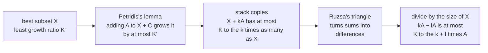

# Small doubling: Plunnecke-Ruzsa bounds every sum of copies, and Freiman finds the progression inside

[Syllabus](../../../SYLLABUS.md) → [Algebraic and analytic number theory](../README.md) → [Additive Combinatorics and Probabilistic Number Theory](../README.md#s08) → Small doubling

---

## General Overview

Take ten whole numbers in two clumps: 0, 1, 2, 3, 4 and 100, 101, 102, 103, 104. Call the set A. Add every pair, a number to itself included, and count the different totals. There are **27**: the clumps 0 to 8, 100 to 108 and 200 to 208.

Ten numbers give 27 sums, so the set roughly **doubles** when added to itself: 27 / 10 = 2.7. Ten numbers can give as many as 55 different sums. Few sums means many coincidences, and coincidences mean structure.

Two facts make that precise.

- **Plünnecke–Ruzsa** says the doubling controls everything that follows. Add three copies of A and the count is at most 2.7 × 2.7 × 2.7 × 10 = 196.83. The true count is 52.
- **Freiman's theorem** says where the structure lives. A set that barely grows sits inside a short grid of evenly spaced numbers. Here the grid is "start at 0, step 1 up to 4 times, step 100 up to once": exactly the ten members of A.

This card proves the first fact in full, by a short argument found in 2012, and states the second with its sources.

**If adding a finite set of integers to itself multiplies its size by only K, then any k copies added minus l copies subtracted have at most K to the power k + l times as many members, and the set lies inside a generalised arithmetic progression (a grid of evenly spaced steps in a few directions) of boundedly many dimensions and comparable size.**

**What kind of fact this is:** Ruzsa's triangle inequality and the Plünnecke–Ruzsa bound are theorems, proved on this card in Why it works. Freiman's theorem is a theorem stated with named sources (first proved by Freiman, later by Ruzsa, with much sharper bounds by Chang in 2002), not proved here. The counts in the code are evidence for the bounds, not proof.

### The picture: the bound against the truth

Sizes of A added to itself two, three and four times, beside the Plünnecke–Ruzsa ceiling for each.

```
|2A|     ##                                        27
K^2|A|   #####                                     72.9
|3A|     ####                                      52
K^3|A|   ###############                           196.83
|4A|     ######                                    85
K^4|A|   ########################################  531.441
```

Each `#` is about 13.3. The ceiling grows by a factor 2.7 each time. The true count grows much more slowly, because A is a flat two-row grid: each extra copy only widens the rows and adds one more.

---

## The formula

Notation first, in words. A is a finite set of integers, and bars count members: $`\lvert A\rvert`$ is how many A holds.

- The **sumset** $`A + B`$ is every sum a + b with a in A and b in B, repeats counted once ([Sum-product](06-sum-product-and-additive-energy.md) introduces it). The **difference set** $`A - B`$ is every a − b.
- $`kA`$ means k copies of A added: $`3A = A + A + A`$. It is not the set of every member times k. $`0A`$ is the set holding only 0.
- $`kA - lA`$ is k copies added, then l copies subtracted.
- The **doubling constant** is $`K = \lvert A + A\rvert / \lvert A\rvert`$. For our A it is 2.7.

### Ruzsa's triangle inequality

For any finite sets X, Y and Z of integers:

```math
\lvert X\rvert\,\lvert Y - Z\rvert \;\le\; \lvert X - Y\rvert\,\lvert X - Z\rvert
```

**Read it aloud:** the size of X times the size of Y minus Z is at most the size of X minus Y times the size of X minus Z.

The same proof gives the form with sums on the right, which is the one used below: $`\lvert X\rvert\,\lvert Y - Z\rvert \le \lvert X + Y\rvert\,\lvert X + Z\rvert`$. With X = A and Y = Z = 2A: $`10 \times 85 = 850 \le 52^2 = 2{,}704`$.

### The Plünnecke–Ruzsa bound

For every finite set A of integers and all k, l ≥ 0 with k + l ≥ 1:

```math
\lvert kA - lA\rvert \;\le\; K^{k+l}\,\lvert A\rvert, \qquad K = \frac{\lvert A + A\rvert}{\lvert A\rvert}
```

**Read it aloud:** k copies added and l copies taken away give at most the doubling constant, raised to the total number of copies, times the size of A.

For our A, $`\lvert 3A\rvert = 52 \le 2.7^3 \times 10 = 196.83`$, and $`\lvert 2A - 2A\rvert = 85 \le 2.7^4 \times 10 = 531.441`$.

### Freiman's theorem

A **generalised arithmetic progression** of dimension d is a grid of evenly spaced steps in d directions:

```math
P = \{\,a_0 + x_1 v_1 + \dots + x_d v_d \;:\; 0 \le x_i < L_i\,\}
```

Here $`a_0`$ is the start, $`v_1, \dots, v_d`$ are the steps and $`L_1, \dots, L_d`$ are how many times each step may be taken, counting zero. P has at most $`L_1 \cdots L_d`$ members. It is **proper** when all those combinations give different numbers.

Freiman's theorem says: for every K there are numbers d(K) and f(K) such that

```math
\lvert A + A\rvert \le K\lvert A\rvert \quad\Longrightarrow\quad A \subseteq P, \quad \dim P \le d(K), \quad \lvert P\rvert \le f(K)\,\lvert A\rvert
```

**Read it aloud:** a set whose sumset is at most K times its size lies inside a generalised progression whose dimension and size, compared with A, are bounded by numbers that depend only on K.

For our A: $`a_0 = 0`$, steps $`v_1 = 1`$ and $`v_2 = 100`$, lengths $`L_1 = 5`$ and $`L_2 = 2`$. P is proper, has 5 × 2 = 10 members, and equals A.

| Symbol | Plain meaning | In our example | Push it up and the answer… |
| --- | --- | --- | --- |
| $`A`$ | a finite set of integers | 0 to 4 with 100 to 104 | — |
| $`\lvert A\rvert`$ | how many members a set has | 10 | the bound scales with it |
| $`A + B`$, $`A - B`$ | every sum, every difference, repeats once | $`\lvert A + A\rvert = \lvert A - A\rvert = 27`$ | — |
| $`kA`$, $`kA - lA`$; $`k`$, $`l`$ | k copies added, then l copies subtracted; the two copy counts | $`\lvert 3A\rvert = 52`$, k = 3, l = 0 | the bound gains a factor K per copy |
| $`K`$ | the doubling constant $`\lvert A + A\rvert / \lvert A\rvert`$ | 2.7 | every bound loosens |
| $`X`$, $`K'`$ | Petridis's subset of A with the least ratio $`\lvert X + B\rvert / \lvert X\rvert`$, and that ratio | with B = A: X = A, K′ = 2.7 | — |
| $`B`$, $`C`$, $`S`$; $`c`$ | the set added in Petridis's lemma, and any finite set; S is the set in What breaks; c, one member of C in the fold | B = A, C = 2A; S = {0, 2, 5, 7, 17} | — |
| $`Y`$, $`Z`$; $`x`$, $`y`$, $`z`$; $`e`$, $`y_e`$, $`z_e`$ | the sets in Ruzsa's triangle; their members; a difference and the one chosen way of writing it | Y = Z = 2A | — |
| $`W`$, $`V`$ | in the fold: the members of X already covered on each side | — | — |
| $`P`$; $`a_0`$, $`v_i`$, $`L_i`$ | a generalised progression; its start, steps and lengths | 0; steps 1 and 100; lengths 5 and 2 | a bigger grid |
| $`d`$; $`d(K)`$, $`f(K)`$ | the dimension, how many steps P uses; Freiman's bounds on dimension and on size over $`\lvert A\rvert`$ | 2; 1 is allowed by Chang | more room, less structure |
| $`\alpha`$, $`c_0`$ | in Chang's bound: a number with $`\lvert A + A\rvert < \alpha\lvert A\rvert`$, and a fixed constant | α just above 2.7 | a larger allowed dimension |

### When it holds

- **One K for the whole set.** Plünnecke–Ruzsa uses the doubling of A itself. A set with a small part that adds well and a large part that does not has a large K, and the bound is then weak.
- **Petridis's subset must be the best one.** The key lemma in Why it works uses the subset with the least ratio. Use any other subset and the lemma can fail: with A = S = {0, 2, 5, 7, 17} and B = {0, 2}, Worked numbers shows 13 against a claimed ceiling of 12.8.
- **Integers, or any group with no elements of finite order (no member that returns to 0 when added to itself enough times), for Freiman in this form.** In vectors of 0s and 1s added digit by digit mod 2, the set of all 1,024 ten-digit vectors has K = 1, yet no grid of fewer than 10 dimensions holds it. There the theorem needs subgroups instead of grids.
- **Freiman's bounds are existence bounds.** The theorem promises some d(K) and f(K), and Chang's explicit size bound is enormous. Our A happens to fit a grid of exactly its own size; the theorem does not promise that.

---

## Why it works

### Step 0: one good subset makes each copy cost at most K

The bound $`K^{k+l}`$ looks like "each new copy multiplies the size by at most K". That sentence is not a proof. Adding A to a large set C can grow C by more than adding A to A grew A.

Petridis's idea is to look for the subset of A that grows least when A is added to it. That subset, X, keeps its low growth: adding A to X + C grows it by at most the same ratio, for every set C. Then copies can be stacked one at a time. A second, older trick, Ruzsa's triangle inequality, turns sums into differences.



### Step 1: Ruzsa's triangle inequality

Fix, for each difference e in Y − Z, one way of writing it: $`e = y_e - z_e`$ with $`y_e`$ in Y and $`z_e`$ in Z. Send each pair (x, e), with x in X, to the pair $`(x + y_e,\; x + z_e)`$.

The target lies in (X + Y) × (X + Z). The map never sends two pairs to one place. Subtracting the two coordinates gives $`y_e - z_e = e`$, so the target names e; then $`x = (x + y_e) - y_e`$ names x. Counting both sides gives

```math
\lvert X\rvert\,\lvert Y - Z\rvert \le \lvert X + Y\rvert\,\lvert X + Z\rvert
```

With $`(x - y_e,\; x - z_e)`$ instead, the same count gives the difference form stated in The formula. The code builds the map for X = A and Y = Z = 2A: 10 × 85 = 850 pairs, 850 different targets.

It is called a triangle inequality because, written with logarithms, it says that one "distance" between Y and Z is at most the sum of the distances through X.

### Step 2: Petridis's lemma

Let A and B be finite sets of integers, and X a nonempty subset of A with the least ratio $`K' = \lvert X + B\rvert / \lvert X\rvert`$. Taking X = A shows $`K' \le \lvert A + B\rvert / \lvert A\rvert`$, which is K when B = A. The lemma: for every finite set C,

```math
\lvert X + B + C\rvert \;\le\; K'\,\lvert X + C\rvert
```

The proof adds the members of C one at a time. Each new member c adds a fresh slice to both sides. The slice on the left is X + B + c minus what is already there. The best-subset choice says that the part of X already covered cannot grow by less than K′. So the left side grows by at most K′ times what the right side grows.

<details>
<summary>Detailed proof: Petridis's lemma, by adding one member of C at a time</summary>

Induction on the size of C. If C has one member c, both sides are translates: $`\lvert X + B + c\rvert = \lvert X + B\rvert = K'\lvert X\rvert = K'\lvert X + c\rvert`$.

Now suppose the lemma holds for C, and add a new member c. Let W be the members x of X with $`x + B + c \subseteq X + B + C`$, the part already covered. Everything in X + B + c outside W + B + c is new, so

$`\displaystyle \lvert X + B + (C \cup \{c\})\rvert \le \lvert X + B + C\rvert + \lvert X + B\rvert - \lvert W + B\rvert.`$

W is a subset of X, hence of A. By the choice of X, $`\lvert W + B\rvert \ge K'\lvert W\rvert`$; this holds for empty W too. With the lemma for C, the right side is at most $`K'(\lvert X + C\rvert + \lvert X\rvert - \lvert W\rvert)`$.

On the other side, let V be the members x of X with $`x + c \in X + C`$. Then exactly $`\lvert X\rvert - \lvert V\rvert`$ new members appear:

$`\displaystyle \lvert X + (C \cup \{c\})\rvert = \lvert X + C\rvert + \lvert X\rvert - \lvert V\rvert.`$

If $`x + c \in X + C`$, then $`x + c + B \subseteq X + C + B`$, so V is inside W and $`\lvert V\rvert \le \lvert W\rvert`$. Hence

$`\displaystyle \lvert X + B + (C \cup \{c\})\rvert \le K'(\lvert X + C\rvert + \lvert X\rvert - \lvert V\rvert) = K'\lvert X + (C \cup \{c\})\rvert.`$

</details>

With B = A, the code checks all 1,023 nonempty subsets of our A. The least ratio is 27/10 = 2.7, reached only by A itself. The lemma with C = 2A reads 85 ≤ 140.4.

### Step 3: stack the copies

Take B = A and C = (k − 1)A in the lemma: $`\lvert X + kA\rvert \le K'\lvert X + (k-1)A\rvert`$. Repeat down to $`\lvert X + 0A\rvert = \lvert X\rvert`$:

```math
\lvert X + kA\rvert \;\le\; K'^{\,k}\,\lvert X\rvert \;\le\; K^{k}\,\lvert X\rvert
```

Since X + kA contains a translate of kA (a copy of kA shifted by one fixed number), this already gives $`\lvert kA\rvert \le K^k\lvert X\rvert \le K^k\lvert A\rvert`$: the bound with no subtraction.

### Step 4: subtract with the triangle

Put Y = kA and Z = lA in the triangle inequality of Step 1, then use Step 3 twice:

```math
\lvert X\rvert\,\lvert kA - lA\rvert \;\le\; \lvert X + kA\rvert\,\lvert X + lA\rvert \;\le\; K^{k}\lvert X\rvert \cdot K^{l}\lvert X\rvert
```

Divide by $`\lvert X\rvert`$: $`\lvert kA - lA\rvert \le K^{k+l}\lvert X\rvert \le K^{k+l}\lvert A\rvert`$, since X sits inside A. That is the Plünnecke–Ruzsa bound.

For k = l = 2: 10 × 85 = 850 ≤ 52 × 52 = 2,704, so $`\lvert 2A - 2A\rvert \le 270.4`$, already inside the stated bound 531.441.

### Step 5: why the true counts are so much smaller here

A is the grid a + 100b with 0 ≤ a ≤ 4 and 0 ≤ b ≤ 1. Any k + l copies, added or subtracted, give a grid with k + l + 1 rows of 4(k + l) + 1 numbers each. The rows stay apart while 4(k + l) < 100. So

```math
\lvert kA - lA\rvert = \big(4(k+l) + 1\big)\big(k + l + 1\big)
```

That grows like the square of k + l, because the grid has two dimensions. The bound grows like $`2.7^{k+l}`$, which is far faster. A d-dimensional grid grows like the d-th power of the number of copies. The bound must cover every set with doubling 2.7, so it cannot use the grid shape of this one.

### Step 6: Freiman's theorem, stated

Freiman's theorem reads Step 5 backwards. If the sums grow slowly, the set must be close to a grid.

- **The smallest case is proved by hand.** For integers, $`\lvert A + A\rvert \ge 2\lvert A\rvert - 1`$: list A in increasing order $`a_1 < \dots < a_n`$, and $`a_1 + a_1 < a_1 + a_2 < a_2 + a_2 < a_2 + a_3 < \dots < a_n + a_n`$ are 2n − 1 different sums. For our A that floor is 19, and the floor is reached only by a progression.
- **Freiman's 3k − 4 theorem** (Freiman; in Tao and Vu, chapter 5): if $`\lvert A + A\rvert \le 3\lvert A\rvert - 4`$, then A lies in one progression of at most $`\lvert A + A\rvert - \lvert A\rvert + 1`$ terms. Our A has 27 sums against 3 × 10 − 4 = 26, one too many, and the promise fails: it would give a progression of at most 18 terms, but the shortest one holding A has 105.
- **Freiman's theorem in general** gives some dimension and size bound for every K. Freiman proved it first; Ruzsa's later proof, the method Chang improves, uses sumset bounds like those on this card.
- **Chang's bounds (2002):** if $`\lvert A + A\rvert < \alpha\lvert A\rvert`$, then A lies in a proper progression P of dimension at most $`\lfloor \alpha - 1\rfloor`$ with $`\log(\lvert P\rvert / \lvert A\rvert) < c_0\,\alpha^2(\log\alpha)^3`$, for a fixed constant $`c_0`$.

Chang's dimension bound for our A is 1, since α can be any number just above 2.7. So a one-dimensional progression must hold A, and one does: 0 to 104 in steps of 1, with 105 terms, 10.5 times the size of A. The two-dimensional grid holds A with no waste at all. Dimension and size trade against each other.

The strongest hoped-for form asks for f(K) polynomial in K, allowing a few translates of a grid. It is the **polynomial Freiman–Ruzsa conjecture**. Gowers, Green, Manners and Tao proved it in 2023 for vectors of 0s and 1s added mod 2, with subgroups in place of grids.

---

## Worked numbers, by hand

| Step | Arithmetic | Value |
| --- | --- | --- |
| size of A | 5 + 5 | 10 |
| A + A | rows 0–8, 100–108, 200–208: 3 × 9 | 27 |
| doubling constant K | 27 / 10 | 2.7 |
| A − A | rows −104 to −96, −4 to 4, 96 to 104: 3 × 9 | 27 |
| 3A | 4 rows of 13 | 52 |
| ceiling for 3A | $`2.7^3 \times 10`$ | 196.83 |
| 2A − 2A | 5 rows of 17 | 85 |
| triangle step | 10 × 85 = 850 ≤ 52 × 52 = 2,704 | 850 ≤ 2,704 |
| ceiling for 2A − 2A | $`2.7^4 \times 10`$ | 531.441 |
| Freiman's grid | start 0, steps 1 and 100, lengths 5 and 2 | 5 × 2 = **10 members, equal to A** |

The bound is a ceiling, not an estimate: 52 sits far below 196.83. The grid of size 10 is the structure that Freiman's theorem says must exist, here with no wasted places.

### What breaks if you drop a piece

| Mistake | Comes out at | What went wrong |
| --- | --- | --- |
| Petridis's lemma with A = S = {0, 2, 5, 7, 17}, B = {0, 2}, C = {0, 5} and X = S, not the best subset | 13 sums against a claimed ceiling of 12.8 | S is not its own best subset. The best, {0, 2}, gives 6 ≤ 6. |
| 2A read as "every member doubled" | 10 members, not 27 | 2A is A + A, every pair sum |
| Freiman's 3k − 4 theorem used outside its range | promised ≤ 18 terms; the shortest progression holding A has 105 | 27 sums exceed 3 × 10 − 4 = 26 |
| Freiman in mod-2 vectors | all 1,024 ten-digit vectors: K = 1, yet at least 10 dimensions | each step v has v + v = 0, so a step repeats after 2 terms |
| The ceiling read as the size of 3A | 196.83, not 52 | the bound is an upper limit; the grid grows only like a square |

The code prints every one.

---

## Code, from first principles, and it actually runs

The code takes four roads. It lists every sum and drops repeats. It reaches each count again from the row formula of Step 5. It runs the proof on A: Petridis's best subset among all 1,023, his lemma for four sets C, and Ruzsa's map, checked never to merge two pairs. And it tests 300 random six-member sets against the bound, drawn by a SplitMix64 generator (seed 2026) written out in both languages. Ratios are compared as whole-number products, so nothing is rounded before a test.

### Python

```python
# Plunnecke-Ruzsa and Freiman -- the check behind the card.  Standard library only.
# A = {0..4} with {100..104}.  Every sumset is counted by brute force and set beside
# a block-count formula, the Plunnecke-Ruzsa bound, Petridis's best subset, Ruzsa's
# injection, the progression Freiman predicts, and 300 random sets as evidence.
from itertools import combinations
def plus(X, Y): return sorted({x + y for x in X for y in Y})
def minus(X, Y): return sorted({x - y for x in X for y in Y})
def copies(X, k):                       # kA: k copies of X added; 0A = {0}
    out = [0]
    for _ in range(k): out = plus(out, X)
    return out
def dec(num, den):                      # exact decimal of num/den when den divides 10^8
    k = next(k for k in range(9) if 10**k % den == 0)
    s = str(num * 10**k // den).rjust(k + 1, "0")
    return (s[:len(s) - k] + "." + s[len(s) - k:]).rstrip("0").rstrip(".") if k else s
def name(k, l): return (f"{k}A" if k > 1 else "A") + (f"-{l}A" if l > 1 else "-A" if l else "")
def yn(c): return "yes" if c else "no"
def best_subsets(A, B):                 # Petridis: nonempty X in A with least |X+B|/|X|
    subs = [X for r in range(1, len(A) + 1) for X in combinations(A, r)]
    lo = min(subs, key=lambda X: len(plus(X, B)) / len(X))
    num, den = len(plus(lo, B)), len(lo)
    return num, den, [X for X in subs if len(plus(X, B)) * den == num * len(X)]

A = list(range(5)) + list(range(100, 105))
n, s2 = len(A), len(plus(A, A))
print(f"|A| = {n}, |A+A| = {s2}, K = {dec(s2, n)}; floor 2|A|-1 = {2 * n - 1}, most possible {n * (n + 1) // 2}")
for k, l in [(1, 1), (2, 0), (2, 1), (3, 0), (2, 2), (4, 0), (3, 3)]:
    size = len(minus(copies(A, k), copies(A, l)))
    m = k + l
    blocks = (4 * m + 1) * (m + 1)      # road two: m+1 blocks of 4m+1, from the 2-D picture
    bound = dec(s2**m, n**(m - 1))      # K^(k+l)|A| = 27^m / 10^(m-1)
    print(f"|{name(k, l)}| = {size}; blocks (4*{m}+1)({m}+1) = {blocks}; bound K^{m}|A| = {bound}")
    assert size == blocks and size * n**(m - 1) <= s2**m
num, den, best = best_subsets(A, A)
print(f"Petridis: least |X+A|/|X| = {num}/{den} = {dec(num, den)}, among {2**n - 1} subsets, reached by {len(best)}; it is A itself: {yn(list(best[0]) == A)}")
X = list(best[0])
for cname, C in [("A", A), ("2A", copies(A, 2)), ("3A", copies(A, 3)), ("-A", minus([0], A))]:
    lhs, rhs = len(plus(plus(X, A), C)), len(plus(X, C))
    print(f"lemma with C = {cname}: |X+A+C| = {lhs} <= K'|X+C| = {dec(num * rhs, den)}")
    assert lhs * den <= num * rhs
Y = copies(A, 2)                        # Ruzsa: (x, d) -> (x + y_d, x + z_d), d = y_d - z_d
pick = {}
for y in Y:
    for z in Y: pick.setdefault(y - z, (y, z))
image = {(x + pick[d][0], x + pick[d][1]) for x in A for d in pick}
XY = set(plus(A, Y))
print(f"Ruzsa map on A x (2A-2A): {n} x {len(pick)} = {n * len(pick)} pairs, {len(image)} distinct images, "
      f"all in (A+2A)x(A+2A): {yn(all(a in XY and b in XY for a, b in image))}")
print(f"triangle: |A||2A-2A| = {n * len(pick)} <= |A+2A|^2 = {len(XY)**2} <= (K^2|A|)^2 = {dec(s2**4, n**2)}")
print(f"so |2A-2A| <= {dec(len(XY)**2, n)} <= K^4|A| = {dec(s2**4, n**3)}")
assert len(image) == n * len(pick) and n * len(pick) <= len(XY)**2
P = sorted({a + 100 * b for a in range(5) for b in range(2)})
print(f"Freiman: P = a + 100b (0<=a<=4, 0<=b<=1) has {len(P)} members = 5 x 2, equals A: {yn(P == A)}")
g = 0
for a in A:                             # Euclid's algorithm on the gaps from the least member
    h = a - A[0]
    while h: g, h = h, g % h
line = (A[-1] - A[0]) // g + 1
print(f"shortest 1-D progression holding A: step {g}, {line} terms = {dec(line, n)} x |A|")
print(f"3k-4 test: |A+A| = {s2} vs 3|A|-4 = {3 * n - 4}; its promise, length <= {s2 - n + 1}, would fail: {line} terms")
print(f"Chang: |A+A| < alpha|A| for alpha just above {dec(s2, n)} gives dimension <= {s2 // n - 1}")
assert P == A and line == 105 and s2 > 3 * n - 4
V = list(range(1 << 10))                # all 1,024 vectors of 0s and 1s, added by XOR
xs = {u ^ v for u in V for v in V}
print(f"mod-2 vectors: |A| = {len(V)}, |A+A| = {len(xs)}, K = {len(xs) // len(V)}; a step v has v+v = 0, "
      f"so dimension >= {len(V).bit_length() - 1}")
assert len(xs) == len(V)
T = [0, 1, 3]
print(f"mistake, A-A taken as no bigger than A+A: T = {T} has |T+T| = {len(plus(T, T))}, |T-T| = {len(minus(T, T))}")
assert len(minus(T, T)) > len(plus(T, T))
D = sorted({2 * a for a in A})
print(f"mistake, kA read as k times each member: 2*A has {len(D)} members, 2A has {s2}")
A2, B2, C2 = [0, 2, 5, 7, 17], [0, 2], [0, 5]
lhs, rhs, ab = len(plus(plus(A2, B2), C2)), len(plus(A2, C2)), len(plus(A2, B2))
print(f"mistake, Petridis step with X = all of S = {A2}, B = {B2}, C = {C2}: "
      f"|S+B+C| = {lhs} > (|S+B|/|S|)|S+C| = ({ab}/{len(A2)}) x {rhs} = {dec(ab * rhs, len(A2))}")
num2, den2, best2 = best_subsets(A2, B2)
for Xb in best2:
    l2, r2 = len(plus(plus(Xb, B2), C2)), len(plus(Xb, C2))
    print(f"  best X = {list(Xb)}, ratio {dec(num2, den2)}: |X+B+C| = {l2} <= {dec(num2 * r2, den2)}")
    assert l2 * den2 <= num2 * r2
assert lhs * len(A2) > ab * rhs
state = 2026                            # SplitMix64, seed 2026: random sets as evidence
def rnd():
    global state
    state = (state + 0x9E3779B97F4A7C15) % 2**64
    z = state
    z = (z ^ (z >> 30)) * 0xBF58476D1CE4E5B9 % 2**64
    z = (z ^ (z >> 27)) * 0x94D049BB133111EB % 2**64
    return z ^ (z >> 31)
tests, worst = 0, (0, 1)
for _ in range(300):
    R = set()
    while len(R) < 6: R.add(rnd() % 50)
    R = sorted(R); r2s = len(plus(R, R))
    for k in range(5):
        for l in range(5 - k):
            if k + l < 2 or l == 0 and k == 2 or k == 0: continue
            sz = len(minus(copies(R, k), copies(R, l)))
            top, bot = sz * 6**(k + l - 1), r2s**(k + l)
            assert top <= bot
            tests += 1
            if top * worst[1] > worst[0] * bot: worst = (top, bot)
print(f"random sets: 300 sets of 6 from 0..49, {tests} bounds with k+l = 2 to 4 checked, worst size/bound = {worst[0] / worst[1]:.4f}")
print("ALL CHECKS PASS")
```

**Ran 2026-11-24 on macOS, Python 3.14.10, standard library only. All checks passed. Output, pasted from the run:**

```
|A| = 10, |A+A| = 27, K = 2.7; floor 2|A|-1 = 19, most possible 55
|A-A| = 27; blocks (4*2+1)(2+1) = 27; bound K^2|A| = 72.9
|2A| = 27; blocks (4*2+1)(2+1) = 27; bound K^2|A| = 72.9
|2A-A| = 52; blocks (4*3+1)(3+1) = 52; bound K^3|A| = 196.83
|3A| = 52; blocks (4*3+1)(3+1) = 52; bound K^3|A| = 196.83
|2A-2A| = 85; blocks (4*4+1)(4+1) = 85; bound K^4|A| = 531.441
|4A| = 85; blocks (4*4+1)(4+1) = 85; bound K^4|A| = 531.441
|3A-3A| = 175; blocks (4*6+1)(6+1) = 175; bound K^6|A| = 3874.20489
Petridis: least |X+A|/|X| = 27/10 = 2.7, among 1023 subsets, reached by 1; it is A itself: yes
lemma with C = A: |X+A+C| = 52 <= K'|X+C| = 72.9
lemma with C = 2A: |X+A+C| = 85 <= K'|X+C| = 140.4
lemma with C = 3A: |X+A+C| = 126 <= K'|X+C| = 229.5
lemma with C = -A: |X+A+C| = 52 <= K'|X+C| = 72.9
Ruzsa map on A x (2A-2A): 10 x 85 = 850 pairs, 850 distinct images, all in (A+2A)x(A+2A): yes
triangle: |A||2A-2A| = 850 <= |A+2A|^2 = 2704 <= (K^2|A|)^2 = 5314.41
so |2A-2A| <= 270.4 <= K^4|A| = 531.441
Freiman: P = a + 100b (0<=a<=4, 0<=b<=1) has 10 members = 5 x 2, equals A: yes
shortest 1-D progression holding A: step 1, 105 terms = 10.5 x |A|
3k-4 test: |A+A| = 27 vs 3|A|-4 = 26; its promise, length <= 18, would fail: 105 terms
Chang: |A+A| < alpha|A| for alpha just above 2.7 gives dimension <= 1
mod-2 vectors: |A| = 1024, |A+A| = 1024, K = 1; a step v has v+v = 0, so dimension >= 10
mistake, A-A taken as no bigger than A+A: T = [0, 1, 3] has |T+T| = 6, |T-T| = 7
mistake, kA read as k times each member: 2*A has 10 members, 2A has 27
mistake, Petridis step with X = all of S = [0, 2, 5, 7, 17], B = [0, 2], C = [0, 5]: |S+B+C| = 13 > (|S+B|/|S|)|S+C| = (8/5) x 8 = 12.8
  best X = [0, 2], ratio 1.5: |X+B+C| = 6 <= 6
  best X = [5, 7], ratio 1.5: |X+B+C| = 6 <= 6
  best X = [0, 2, 5, 7], ratio 1.5: |X+B+C| = 9 <= 9
random sets: 300 sets of 6 from 0..49, 2400 bounds with k+l = 2 to 4 checked, worst size/bound = 0.4630
ALL CHECKS PASS
```

### Rust

Same numbers, same labels, built with `rustc --edition 2021 -O`.

```rust
// Plunnecke-Ruzsa and Freiman -- the same check as the Python, in Rust.  No crates.
// A = {0..4} with {100..104}.  Every sumset is counted by brute force and set beside
// a block-count formula, the Plunnecke-Ruzsa bound, Petridis's best subset, Ruzsa's
// injection, the progression Freiman predicts, and 300 random sets as evidence.
use std::collections::{BTreeMap, BTreeSet};

fn plus(x: &[i64], y: &[i64]) -> Vec<i64> {
    let s: BTreeSet<i64> = x.iter().flat_map(|a| y.iter().map(move |b| a + b)).collect();
    s.into_iter().collect()
}
fn minus(x: &[i64], y: &[i64]) -> Vec<i64> {
    let s: BTreeSet<i64> = x.iter().flat_map(|a| y.iter().map(move |b| a - b)).collect();
    s.into_iter().collect()
}
fn copies(x: &[i64], k: u32) -> Vec<i64> {     // kA: k copies of X added; 0A = {0}
    let mut out = vec![0];
    for _ in 0..k { out = plus(&out, x) }
    out
}
fn dec(num: u128, den: u128) -> String {       // exact decimal of num/den when den divides 10^8
    let k = (0..9).find(|&k| 10u128.pow(k) % den == 0).unwrap() as usize;
    if k == 0 { return (num / den).to_string() }
    let mut s = (num * 10u128.pow(k as u32) / den).to_string();
    while s.len() < k + 1 { s.insert(0, '0') }
    let t = format!("{}.{}", &s[..s.len() - k], &s[s.len() - k..]);
    t.trim_end_matches('0').trim_end_matches('.').to_string()
}
fn name(k: u32, l: u32) -> String {
    let a = if k > 1 { format!("{}A", k) } else { "A".to_string() };
    let b = if l > 1 { format!("-{}A", l) } else if l == 1 { "-A".to_string() } else { String::new() };
    a + &b
}
fn yn(c: bool) -> &'static str { if c { "yes" } else { "no" } }
fn best_subsets(a: &[i64], b: &[i64]) -> (u128, u128, Vec<Vec<i64>>) {   // Petridis's best X
    let mut subs: Vec<Vec<i64>> = (1u32..(1 << a.len()))
        .map(|m| (0..a.len()).filter(|i| m >> i & 1 == 1).map(|i| a[i]).collect()).collect();
    subs.sort_by(|p, q| (p.len(), p).cmp(&(q.len(), q)));
    let (mut num, mut den) = (0u128, 0u128);
    for x in &subs {
        let (s, t) = (plus(x, b).len() as u128, x.len() as u128);
        if den == 0 || s * den < num * t { num = s; den = t }
    }
    let best = subs.into_iter().filter(|x| plus(x, b).len() as u128 * den == num * x.len() as u128).collect();
    (num, den, best)
}
fn fmt(v: &[i64]) -> String { format!("{:?}", v) }

fn main() {
    let a: Vec<i64> = (0..5).chain(100..105).collect();
    let (n, s2) = (a.len() as u128, plus(&a, &a).len() as u128);
    println!("|A| = {}, |A+A| = {}, K = {}; floor 2|A|-1 = {}, most possible {}", n, s2, dec(s2, n), 2 * n - 1, n * (n + 1) / 2);
    for (k, l) in [(1u32, 1u32), (2, 0), (2, 1), (3, 0), (2, 2), (4, 0), (3, 3)] {
        let size = minus(&copies(&a, k), &copies(&a, l)).len() as u128;
        let m = k + l;
        let blocks = (4 * m as u128 + 1) * (m as u128 + 1);    // road two: m+1 blocks of 4m+1
        let bound = dec(s2.pow(m), n.pow(m - 1));               // K^(k+l)|A| = 27^m / 10^(m-1)
        println!("|{}| = {}; blocks (4*{}+1)({}+1) = {}; bound K^{}|A| = {}", name(k, l), size, m, m, blocks, m, bound);
        assert!(size == blocks && size * n.pow(m - 1) <= s2.pow(m));
    }
    let (num, den, best) = best_subsets(&a, &a);
    println!("Petridis: least |X+A|/|X| = {}/{} = {}, among {} subsets, reached by {}; it is A itself: {}",
             num, den, dec(num, den), (1u128 << n) - 1, best.len(), yn(best[0] == a));
    let x = best[0].clone();
    for (cname, c) in [("A", a.clone()), ("2A", copies(&a, 2)), ("3A", copies(&a, 3)), ("-A", minus(&[0], &a))] {
        let (lhs, rhs) = (plus(&plus(&x, &a), &c).len() as u128, plus(&x, &c).len() as u128);
        println!("lemma with C = {}: |X+A+C| = {} <= K'|X+C| = {}", cname, lhs, dec(num * rhs, den));
        assert!(lhs * den <= num * rhs);
    }
    let y = copies(&a, 2);                     // Ruzsa: (x, d) -> (x + y_d, x + z_d), d = y_d - z_d
    let mut pick: BTreeMap<i64, (i64, i64)> = BTreeMap::new();
    for &p in &y { for &q in &y { pick.entry(p - q).or_insert((p, q)); } }
    let image: BTreeSet<(i64, i64)> = a.iter().flat_map(|&u| pick.values().map(move |&(p, q)| (u + p, u + q))).collect();
    let xy: BTreeSet<i64> = plus(&a, &y).into_iter().collect();
    let pairs = n * pick.len() as u128;
    let xy2 = (xy.len() as u128).pow(2);
    println!("Ruzsa map on A x (2A-2A): {} x {} = {} pairs, {} distinct images, all in (A+2A)x(A+2A): {}",
             n, pick.len(), pairs, image.len(), yn(image.iter().all(|(p, q)| xy.contains(p) && xy.contains(q))));
    println!("triangle: |A||2A-2A| = {} <= |A+2A|^2 = {} <= (K^2|A|)^2 = {}", pairs, xy2, dec(s2.pow(4), n.pow(2)));
    println!("so |2A-2A| <= {} <= K^4|A| = {}", dec(xy2, n), dec(s2.pow(4), n.pow(3)));
    assert!(image.len() as u128 == pairs && pairs <= xy2);
    let p: Vec<i64> = (0..5).flat_map(|u| (0..2).map(move |v| u + 100 * v)).collect::<BTreeSet<i64>>().into_iter().collect();
    println!("Freiman: P = a + 100b (0<=a<=4, 0<=b<=1) has {} members = 5 x 2, equals A: {}", p.len(), yn(p == a));
    let mut g = 0i64;
    for &u in &a {                             // Euclid's algorithm on the gaps from the least member
        let mut h = u - a[0];
        while h != 0 { (g, h) = (h, g % h) }
    }
    let line = ((a[a.len() - 1] - a[0]) / g + 1) as u128;
    println!("shortest 1-D progression holding A: step {}, {} terms = {} x |A|", g, line, dec(line, n));
    println!("3k-4 test: |A+A| = {} vs 3|A|-4 = {}; its promise, length <= {}, would fail: {} terms", s2, 3 * n - 4, s2 - n + 1, line);
    println!("Chang: |A+A| < alpha|A| for alpha just above {} gives dimension <= {}", dec(s2, n), s2 / n - 1);
    assert!(p == a && line == 105 && s2 > 3 * n - 4);
    let v: Vec<u32> = (0..1u32 << 10).collect();   // all 1,024 vectors of 0s and 1s, added by XOR
    let xs: BTreeSet<u32> = v.iter().flat_map(|&p| v.iter().map(move |&q| p ^ q)).collect();
    println!("mod-2 vectors: |A| = {}, |A+A| = {}, K = {}; a step v has v+v = 0, so dimension >= {}",
             v.len(), xs.len(), xs.len() / v.len(), v.len().trailing_zeros());
    assert!(xs.len() == v.len());
    let t = vec![0i64, 1, 3];
    println!("mistake, A-A taken as no bigger than A+A: T = {} has |T+T| = {}, |T-T| = {}", fmt(&t), plus(&t, &t).len(), minus(&t, &t).len());
    assert!(minus(&t, &t).len() > plus(&t, &t).len());
    let d: BTreeSet<i64> = a.iter().map(|u| 2 * u).collect();
    println!("mistake, kA read as k times each member: 2*A has {} members, 2A has {}", d.len(), s2);
    let (a2, b2, c2) = (vec![0i64, 2, 5, 7, 17], vec![0i64, 2], vec![0i64, 5]);
    let (lhs, rhs, ab) = (plus(&plus(&a2, &b2), &c2).len() as u128, plus(&a2, &c2).len() as u128, plus(&a2, &b2).len() as u128);
    println!("mistake, Petridis step with X = all of S = {}, B = {}, C = {}: |S+B+C| = {} > (|S+B|/|S|)|S+C| = ({}/{}) x {} = {}",
             fmt(&a2), fmt(&b2), fmt(&c2), lhs, ab, a2.len(), rhs, dec(ab * rhs, a2.len() as u128));
    let (num2, den2, best2) = best_subsets(&a2, &b2);
    for xb in &best2 {
        let (l2, r2) = (plus(&plus(xb, &b2), &c2).len() as u128, plus(xb, &c2).len() as u128);
        println!("  best X = {}, ratio {}: |X+B+C| = {} <= {}", fmt(xb), dec(num2, den2), l2, dec(num2 * r2, den2));
        assert!(l2 * den2 <= num2 * r2);
    }
    assert!(lhs * a2.len() as u128 > ab * rhs);
    let mut state: u64 = 2026;                 // SplitMix64, seed 2026: random sets as evidence
    let mut rnd = || {
        state = state.wrapping_add(0x9E3779B97F4A7C15);
        let mut z = state;
        z = (z ^ (z >> 30)).wrapping_mul(0xBF58476D1CE4E5B9);
        z = (z ^ (z >> 27)).wrapping_mul(0x94D049BB133111EB);
        z ^ (z >> 31)
    };
    let (mut tests, mut worst) = (0u32, (0u128, 1u128));
    for _ in 0..300 {
        let mut r: BTreeSet<i64> = BTreeSet::new();
        while r.len() < 6 { r.insert((rnd() % 50) as i64); }
        let r: Vec<i64> = r.into_iter().collect();
        let r2s = plus(&r, &r).len() as u128;
        for k in 0..5u32 {
            for l in 0..(5 - k) {
                if k + l < 2 || (l == 0 && k == 2) || k == 0 { continue }
                let sz = minus(&copies(&r, k), &copies(&r, l)).len() as u128;
                let (top, bot) = (sz * 6u128.pow(k + l - 1), r2s.pow(k + l));
                assert!(top <= bot);
                tests += 1;
                if top * worst.1 > worst.0 * bot { worst = (top, bot) }
            }
        }
    }
    println!("random sets: 300 sets of 6 from 0..49, {} bounds with k+l = 2 to 4 checked, worst size/bound = {:.4}",
             tests, worst.0 as f64 / worst.1 as f64);
    println!("ALL CHECKS PASS");
}
```

**Ran 2026-11-24 on macOS, rustc 1.98.1, no crates. All checks passed. Output, pasted from the run:**

```
|A| = 10, |A+A| = 27, K = 2.7; floor 2|A|-1 = 19, most possible 55
|A-A| = 27; blocks (4*2+1)(2+1) = 27; bound K^2|A| = 72.9
|2A| = 27; blocks (4*2+1)(2+1) = 27; bound K^2|A| = 72.9
|2A-A| = 52; blocks (4*3+1)(3+1) = 52; bound K^3|A| = 196.83
|3A| = 52; blocks (4*3+1)(3+1) = 52; bound K^3|A| = 196.83
|2A-2A| = 85; blocks (4*4+1)(4+1) = 85; bound K^4|A| = 531.441
|4A| = 85; blocks (4*4+1)(4+1) = 85; bound K^4|A| = 531.441
|3A-3A| = 175; blocks (4*6+1)(6+1) = 175; bound K^6|A| = 3874.20489
Petridis: least |X+A|/|X| = 27/10 = 2.7, among 1023 subsets, reached by 1; it is A itself: yes
lemma with C = A: |X+A+C| = 52 <= K'|X+C| = 72.9
lemma with C = 2A: |X+A+C| = 85 <= K'|X+C| = 140.4
lemma with C = 3A: |X+A+C| = 126 <= K'|X+C| = 229.5
lemma with C = -A: |X+A+C| = 52 <= K'|X+C| = 72.9
Ruzsa map on A x (2A-2A): 10 x 85 = 850 pairs, 850 distinct images, all in (A+2A)x(A+2A): yes
triangle: |A||2A-2A| = 850 <= |A+2A|^2 = 2704 <= (K^2|A|)^2 = 5314.41
so |2A-2A| <= 270.4 <= K^4|A| = 531.441
Freiman: P = a + 100b (0<=a<=4, 0<=b<=1) has 10 members = 5 x 2, equals A: yes
shortest 1-D progression holding A: step 1, 105 terms = 10.5 x |A|
3k-4 test: |A+A| = 27 vs 3|A|-4 = 26; its promise, length <= 18, would fail: 105 terms
Chang: |A+A| < alpha|A| for alpha just above 2.7 gives dimension <= 1
mod-2 vectors: |A| = 1024, |A+A| = 1024, K = 1; a step v has v+v = 0, so dimension >= 10
mistake, A-A taken as no bigger than A+A: T = [0, 1, 3] has |T+T| = 6, |T-T| = 7
mistake, kA read as k times each member: 2*A has 10 members, 2A has 27
mistake, Petridis step with X = all of S = [0, 2, 5, 7, 17], B = [0, 2], C = [0, 5]: |S+B+C| = 13 > (|S+B|/|S|)|S+C| = (8/5) x 8 = 12.8
  best X = [0, 2], ratio 1.5: |X+B+C| = 6 <= 6
  best X = [5, 7], ratio 1.5: |X+B+C| = 6 <= 6
  best X = [0, 2, 5, 7], ratio 1.5: |X+B+C| = 9 <= 9
random sets: 300 sets of 6 from 0..49, 2400 bounds with k+l = 2 to 4 checked, worst size/bound = 0.4630
ALL CHECKS PASS
```

The two outputs match line for line.

### Lean

Lean proves Ruzsa's triangle inequality, Petridis's lemma and the Plünnecke–Ruzsa bound for every finite set of integers, and checks the worked numbers.

- Take any finite sets X, Y and Z of integers. Then both forms of Ruzsa's triangle inequality hold, with differences and with sums on the right.
- Take finite sets A and B of integers, and X a nonempty subset of A with the least ratio K′. Then $`\lvert X + B + C\rvert \le K'\lvert X + C\rvert`$ for every finite set C.
- Take any finite set A of integers, and k, l ≥ 0 with k + l ≥ 1. Then $`\lvert kA - lA\rvert \le K^{k+l}\lvert A\rvert`$.
- Our A has 10 members, 27 sums and 27 differences, so K = 2.7.
- 3A has 52 members, and 2A − 2A and 4A have 85 each, below the ceilings 196.83 and 531.441.
- Take X = A and Y = Z = 2A. Then the triangle step reads 10 × 85 = 850 ≤ 52 × 52 = 2,704.
- With B = A, no nonempty subset of A has a ratio below 2.7, so A itself is a best subset.
- Take the grid a + 100b with 0 ≤ a ≤ 4 and 0 ≤ b ≤ 1. Then it has 10 members and equals A.
- Take S = {0, 2, 5, 7, 17}, B = {0, 2} and C = {0, 5}. Then S + B + C has 13 members against 12.8.
- The best subset {0, 2} of S gives 6 against 6.
- Doubling each member of A gives 10 numbers, but 2A has 27; and {0, 1, 3} has 6 sums but 7 differences.

Freiman's theorem stays stated; the row formula, Ruzsa's map, the 3k − 4 test, mod-2 vectors and random sets are left to Python and Rust.

```lean
-- Small doubling: if a finite set of integers has doubling constant K = |A + A| / |A|, then k copies added minus l copies subtracted have at most K^(k+l) |A| members (Plunnecke-Ruzsa), with Ruzsa's triangle inequality and Petridis's lemma on the way.
import Mathlib.Combinatorics.Additive.PluenneckeRuzsa
import Mathlib.Tactic.NormNum

open scoped Pointwise

/-- **Plunnecke-Ruzsa bound.** For every finite set `A` of integers and all `k, l ≥ 0` with
`k + l ≥ 1`, the set `kA - lA` (k copies of `A` added, then l copies subtracted) has at most
`K ^ (k + l) * |A|` members, where `K = |A + A| / |A|` is the doubling constant. -/
theorem plunnecke_ruzsa_bound (A : Finset ℤ) (k l : ℕ) (hkl : 1 ≤ k + l) :
    ((k • A - l • A).card : ℚ) ≤ (((A + A).card : ℚ) / A.card) ^ (k + l) * A.card := by
  obtain rfl | hA := A.eq_empty_or_nonempty
  · rcases Nat.eq_zero_or_pos k with rfl | hk
    · obtain ⟨l, rfl⟩ : ∃ m, l = m + 1 := ⟨l - 1, by omega⟩
      simp [succ_nsmul]
    · obtain ⟨k, rfl⟩ : ∃ m, k = m + 1 := ⟨k - 1, by omega⟩
      simp [succ_nsmul]
  have h := Finset.pluennecke_ruzsa_inequality_nsmul_sub_nsmul_add hA A k l
  have h' : ((k • A - l • A).card : ℚ) ≤
      (((((A + A).card : ℚ≥0) / A.card) ^ (k + l) * A.card : ℚ≥0) : ℚ) := by
    exact_mod_cast h
  simpa using h'

/-- **Ruzsa's triangle inequality.** For any finite sets `X`, `Y`, `Z` of integers,
`|X| |Y - Z| ≤ |X - Y| |X - Z|`, and the same holds with sums on the right:
`|X| |Y - Z| ≤ |X + Y| |X + Z|`. -/
theorem ruzsa_triangle_inequality (X Y Z : Finset ℤ) :
    X.card * (Y - Z).card ≤ (X - Y).card * (X - Z).card ∧
      X.card * (Y - Z).card ≤ (X + Y).card * (X + Z).card := by
  constructor
  · have h := Finset.ruzsa_triangle_inequality_sub_sub_sub Y X Z
    rw [← Finset.card_neg (Y - X), neg_sub, ← Finset.card_neg (Z - X), neg_sub] at h
    rw [Nat.mul_comm]; exact h
  · have h := Finset.ruzsa_triangle_inequality_sub_add_add Y X Z
    rw [add_comm Y X, add_comm Z X, Nat.mul_comm] at h
    exact h

/-- **Petridis's lemma.** Let `A` and `B` be finite sets of integers and `X` a nonempty subset
of `A` whose ratio `K' = |X + B| / |X|` is the least among all nonempty subsets of `A`. Then for
every finite set `C` of integers, `|X + B + C| ≤ K' |X + C|`. -/
theorem petridis_lemma (A B X : Finset ℤ) (hXA : X ⊆ A) (hX : X.Nonempty)
    (hbest : ∀ W ⊆ A, W.Nonempty →
      ((X + B).card : ℚ) / X.card ≤ ((W + B).card : ℚ) / W.card)
    (C : Finset ℤ) :
    ((X + B + C).card : ℚ) ≤ ((X + B).card : ℚ) / X.card * (X + C).card := by
  have hX0 : (0 : ℚ) < X.card := by exact_mod_cast hX.card_pos
  have hcond : ∀ A' ⊆ X, (X + B).card * A'.card ≤ (A' + B).card * X.card := by
    intro A' hA'
    obtain rfl | hne := A'.eq_empty_or_nonempty
    · simp
    have hpos : (0 : ℚ) < A'.card := by exact_mod_cast hne.card_pos
    have := hbest A' (hA'.trans hXA) hne
    rw [div_le_div_iff₀ hX0 hpos] at this
    exact_mod_cast this
  have h := Finset.pluennecke_petridis_inequality_add C hcond
  have e1 : C + X + B = X + B + C := by
    rw [add_comm C X, add_assoc, add_comm C B, ← add_assoc]
  have e2 : C + X = X + C := add_comm _ _
  rw [e1, e2] at h
  have h' : ((X + B + C).card : ℚ) * X.card ≤ (X + B).card * (X + C).card := by
    exact_mod_cast h
  rw [div_mul_eq_mul_div, le_div_iff₀ hX0]
  exact h'

/-- The card's set: 0 to 4 together with 100 to 104. -/
def twoClumps : Finset ℤ := {0, 1, 2, 3, 4, 100, 101, 102, 103, 104}

-- |A| = 10, |A + A| = 27, |A - A| = 27, so K = 27 / 10 = 2.7.
example : twoClumps.card = 10 := by decide +kernel
example : (twoClumps + twoClumps).card = 27 := by decide +kernel
example : (twoClumps - twoClumps).card = 27 := by decide +kernel
-- |3A| = 52 and |2A - 2A| = |4A| = 85.
example : ((3 : ℕ) • twoClumps).card = 52 := by decide +kernel
example : ((2 : ℕ) • twoClumps - (2 : ℕ) • twoClumps).card = 85 := by decide +kernel
example : ((4 : ℕ) • twoClumps).card = 85 := by decide +kernel
-- The ceilings: 52 ≤ 2.7^3 × 10 = 196.83 and 85 ≤ 2.7^4 × 10 = 531.441.
example : (52 : ℚ) ≤ (27 / 10) ^ 3 * 10 ∧ (27 / 10 : ℚ) ^ 3 * 10 = 19683 / 100 := by norm_num
example : (85 : ℚ) ≤ (27 / 10) ^ 4 * 10 ∧ (27 / 10 : ℚ) ^ 4 * 10 = 531441 / 1000 := by norm_num
-- Triangle step with X = A, Y = Z = 2A: 10 × 85 = 850 ≤ |A + 2A|^2 = 52^2 = 2704.
example : (twoClumps + (2 : ℕ) • twoClumps).card = 52 := by decide +kernel
example : twoClumps.card * ((2 : ℕ) • twoClumps - (2 : ℕ) • twoClumps).card = 850 ∧
    850 ≤ 52 * 52 := by decide +kernel
-- Petridis: among all nonempty subsets of A, none has |W + A| / |W| below 27 / 10.
example : ∀ W ∈ twoClumps.powerset, W.Nonempty → 27 * W.card ≤ 10 * (W + twoClumps).card := by
  decide +kernel
-- Freiman's grid: {a + 100 b : 0 ≤ a ≤ 4, 0 ≤ b ≤ 1} has 5 × 2 = 10 members and equals A.
example : (Finset.range 5 ×ˢ Finset.range 2).image (fun p => (p.1 : ℤ) + 100 * p.2) = twoClumps := by
  decide +kernel
-- What breaks: with S = {0, 2, 5, 7, 17}, B = {0, 2}, C = {0, 5} and X = S, |S + B + C| = 13
-- while (|S + B| / |S|) |S + C| = (8 / 5) × 8 = 12.8; the best subset {0, 2} gives 6 ≤ 6.
example : (({0, 2, 5, 7, 17} : Finset ℤ) + {0, 2} + {0, 5}).card = 13 ∧
    (({0, 2, 5, 7, 17} : Finset ℤ) + {0, 2}).card = 8 ∧
    (({0, 2, 5, 7, 17} : Finset ℤ) + {0, 5}).card = 8 ∧ 13 * 5 > 8 * 8 := by decide +kernel
example : (({0, 2} : Finset ℤ) + {0, 2} + {0, 5}).card = 6 ∧
    (({0, 2} : Finset ℤ) + {0, 2}).card = 3 ∧ (({0, 2} : Finset ℤ) + {0, 5}).card = 4 ∧
    6 * 2 ≤ 3 * 4 := by decide +kernel
-- Mistakes: 2A is not "every member doubled" (10 members, not 27), and for T = {0, 1, 3},
-- |T + T| = 6 but |T - T| = 7.
example : (twoClumps.image (fun a => 2 * a)).card = 10 := by decide +kernel
example : (({0, 1, 3} : Finset ℤ) + {0, 1, 3}).card = 6 ∧
    (({0, 1, 3} : Finset ℤ) - {0, 1, 3}).card = 7 := by decide +kernel

#print axioms plunnecke_ruzsa_bound
#print axioms ruzsa_triangle_inequality
#print axioms petridis_lemma
```

**Checked 2026-11-24 on macOS, Lean 4.36.0-rc2, Mathlib v4.36.0-rc2. Every proof is complete and uses only Lean's standard axioms. Output, pasted from the run:**

```
'plunnecke_ruzsa_bound' depends on axioms: [propext, Classical.choice, Quot.sound]
'ruzsa_triangle_inequality' depends on axioms: [propext, Classical.choice, Quot.sound]
'petridis_lemma' depends on axioms: [propext, Classical.choice, Quot.sound]
```

> [!TIP]
> **Try changing**
> Guess first, then run it. Some asserts are pinned to this A, so expect one to stop the program.
> - **Move the clumps together.** Change `range(100, 105)` to `range(7, 12)`. Guess first: do the rows still stay apart? They overlap: A + A has 23 members, K = 2.3, and the row formula's assert stops the run at 23 against 27.
> - **One clump only.** Set `A = list(range(10))`. Guess first: how many sums? 19, exactly the floor 2|A| − 1, with K = 1.9. The row formula stops the run again, since there is now one row.
> - **Drop the 17.** Set `A2`, the set S, to `[0, 2, 5, 7]`. Guess first: does the Petridis failure survive? No: S is now one of its own best subsets, the count is 9 against 9, and the final assert of that block stops the run.
> - **Bigger mod-2 vectors.** Change `1 << 10` to `1 << 12`. Guess first: 4,096 vectors, K still 1, and at least 12 dimensions. The run passes.

---

## The usual mistake

> [!warning]
> **"Each extra copy multiplies the size by at most K, so the bound is obvious."** It is not. Adding a set to a big set C can grow C by a larger ratio than it grew the original set. In the lemma of Step 2 take A = S = {0, 2, 5, 7, 17}, B = {0, 2} and C = {0, 5}. Adding B to S gives 8 members, a ratio of 8/5, and S + C has 8 members, yet S + B + C has 13 against 8/5 × 8 = 12.8. Petridis's lemma holds only for the best subset; that choice is the whole proof.
>
> - **Reading kA as k times each member.** Doubling each member of A gives 10 numbers; A + A has 27.
> - **Reading the ceiling as the size.** Plünnecke–Ruzsa allows 196.83 members in 3A; there are 52. The bound must hold for every set with doubling 2.7, so for a grid like A it is loose.
> - **Assuming A − A is no bigger than A + A.** Here both have 27, but for {0, 1, 3} the sums are 0, 1, 2, 3, 4, 6, six of them, and the differences run from −3 to 3, seven. Plünnecke–Ruzsa bounds the difference set by $`K^2\lvert A\rvert`$, not by $`\lvert A + A\rvert`$.

---

## Where you meet it in real life

- **Long progressions in dense sets.** Gowers's proof of Szemerédi's theorem uses a form of Freiman's theorem to find structure in sets with many additive coincidences ([Long progressions](05-szemeredi-and-green-tao-in-outline.md)).
- **Sum-product estimates.** Proofs that a set cannot be small for both adding and multiplying move between A + A, A − A and A + A + A with the Plünnecke–Ruzsa bound ([Sum-product](06-sum-product-and-additive-energy.md)).
- **Machine-checked proofs.** Mathlib, the shared library of the Lean proof checker, contains Ruzsa's triangle inequality and the Plünnecke–Ruzsa bound, proved by Petridis's argument.

> **Say it back**
> The set 0 to 4 with 100 to 104 has 10 members and 27 pair sums, so its doubling constant is 2.7. Ruzsa's triangle inequality comes from one map that never merges two pairs. Petridis's best subset grows by at most its own ratio whatever is added to it, so copies stack, and the triangle turns sums into differences: any k copies minus l copies have at most 2.7 to the power k + l times 10 members. The truth, 52 for three copies, is far smaller because A is a two-dimensional grid. Freiman's theorem says every set with small doubling sits in such a grid of bounded dimension and comparable size.

---

## What this builds on

- [Sum-product](06-sum-product-and-additive-energy.md): the sumset A + B, and additive energy as the count of coincidences that small doubling forces.
- [Long progressions](05-szemeredi-and-green-tao-in-outline.md): arithmetic progressions and Szemerédi's theorem, whose proof by Gowers uses the structure this card describes.
- [Cosets and Lagrange's theorem](../../03-Algebra/08-Groups/04-cosets-and-lagranges-theorem.md): a subgroup H has H + H = H, the case K = 1 that breaks Freiman's grids in mod-2 vectors.

## Where this goes next

- [Roth's theorem](11-roths-theorem-on-three-term-progressions.md): the next card proves that dense sets hold three-term progressions, the first case of Szemerédi's theorem.

Other cards on this shelf: [Typical numbers have about log log n distinct prime factors](01-hardy-ramanujan-and-typical-prime-factor-counts.md), [Erdos-Kac](02-erdos-kac-theorem.md), [Equidistribution](03-equidistribution-and-weyls-criterion.md), [Three distances](04-three-distance-theorem.md), [Erdos problems](07-erdos-problems-and-computer-search.md), [Weyl differencing](08-weyl-differencing-and-van-der-corput.md) and [The circle method](09-hardy-littlewood-circle-method.md).

The question this card leaves open: over the integers, can f(K) be made polynomial in K, as the 2023 theorem does for vectors mod 2? The cited sources leave it open; its current status belongs to the frontier wing.

---

## Sources

Verified 2026-11-24: every link below resolves to the publisher's page.

- Petridis, Giorgis. "New proofs of Plünnecke-type estimates for product sets in groups." *Combinatorica* 32 (2012): 721–733. [DOI 10.1007/s00493-012-2818-5](https://doi.org/10.1007/s00493-012-2818-5). The best-subset lemma and the short proof of Plünnecke–Ruzsa in Steps 2 to 4.
- Tao, Terence, and Van H. Vu. *Additive Combinatorics*. Cambridge University Press, 2006. [DOI 10.1017/CBO9780511755149](https://doi.org/10.1017/CBO9780511755149). Ruzsa's triangle inequality and sumset estimates (chapter 2); generalised progressions (chapter 3); Freiman's theorem and the 3k − 4 theorem (chapter 5).
- Chang, Mei-Chu. "A polynomial bound in Freiman's theorem." *Duke Mathematical Journal* 113 (2002): 399–419. [DOI 10.1215/S0012-7094-02-11331-3](https://doi.org/10.1215/S0012-7094-02-11331-3). The dimension bound ⌊α − 1⌋ and the size bound quoted in Step 6.
- Gowers, W. T., Ben Green, Freddie Manners, and Terence Tao. "On a conjecture of Marton." Preprint, 2023. [arXiv 2311.05762](https://arxiv.org/abs/2311.05762). The polynomial Freiman–Ruzsa conjecture, proved for vectors mod 2.
