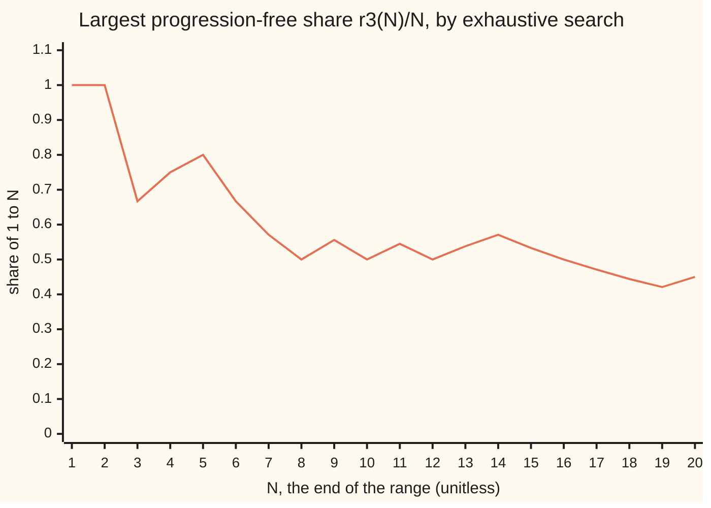

# Roth's theorem: a dense set of whole numbers must hold three in arithmetic progression

[Syllabus](../../../SYLLABUS.md) → [Algebraic and analytic number theory](../README.md) → [Additive Combinatorics and Probabilistic Number Theory](../README.md#s08) → Roth's theorem

---

## General Overview

Choose numbers from 1 to 9, but never three that are evenly spaced, such as 2, 5, 8. Three evenly spaced numbers form a **three-term progression**: a start x, then x + d and x + 2d, with step d at least 1.

The best possible is five numbers, for example 1, 2, 4, 8, 9. A sixth number always completes a progression. An exhaustive search finds exactly four largest progression-free sets in 1 to 9, all of size 5, so $`r_3(9) = 5`$. A full search of 1 to 20 gives $`r_3(20) = 9`$, reached by just 2 sets. Here $`r_3(N)`$ is the size of the largest progression-free set in 1 to N, as on [Long progressions](05-szemeredi-and-green-tao-in-outline.md); it is not the three-squares count of [The circle method](09-hardy-littlewood-circle-method.md).

That card states Roth's 1953 theorem, that the share $`r_3(N)/N`$ tends to 0. This card proves it. The proof counts progressions with waves, using the discrete Fourier transform: the tool that splits a list of numbers into waves of each frequency.

1. **Count with waves.** The number of progressions is a random-set guess plus one correction per wave.
2. **Small waves mean many progressions.** Then the count is close to the guess, which is large.
3. **A big wave means a denser piece.** The set is then denser on some long progression inside 1 to N. Zoom in and repeat. Density cannot pass 1, so the zooming must stop.

**A set with no three-term progression must have one large wave; that wave makes the set denser on a long sub-progression, and since density cannot pass 1, a progression-free set can fill at most a share 72/log log N of 1 to N.**

**What kind of fact this is:** a theorem (Roth, 1953), proved on this card in full in Why it works, with the long steps in folds. The constant 72 is explicit, from this proof, and far from the best known. The values of $`r_3`$ are proved by exhaustive search. The bounds of Behrend, of Kelley and Meka, and of Bloom and Sisask are stated with sources, not proved.

### The picture: the largest progression-free share, N = 1 to 20



The line: $`r_3(N)/N`$, from the code's search, 0.556 at 9 and 0.450 at 20. No finite table shows that it reaches 0; the theorem does.

---

## The formula

Notation first, in words.

- $`[N]`$ is the set 1 to N. A set $`A`$ inside it has **density** $`\delta`$ (delta): its share, $`|A|/N`$.
- A progression x, x + d, x + 2d is three numbers x, y, z with $`x + z = 2y`$ and $`x \ne z`$. The **trivial** solutions have x = y = z.
- $`M`$ is an odd modulus above 2N; numbers are read in Z mod M, a clock of M hours. The frequency $`\xi`$ (xi) runs from 0 to M − 1.
- $`1_A`$ is 1 on A and 0 off it. The arrow $`e(t) = e^{2\pi i t}`$ is a fraction t of a turn round the unit circle ([Equidistribution](03-equidistribution-and-weyls-criterion.md)).
- $`\widehat{A}(\xi)`$, the **size of wave** $`\xi`$ **in A**, is the transform of $`1_A`$ from [The discrete Fourier transform](../../07-Complex%20analysis/08-Transforms%20in%20Outline/02-discrete-fourier-transform.md), divided by M.

```math
\widehat{A}(\xi) = \frac{1}{M}\sum_{x=0}^{M-1} 1_A(x)\, e(-x\xi/M), \qquad \widehat{A}(0) = \frac{|A|}{M}
```

**Read it aloud:** turn each member x of A back by x times $`\xi`$ steps of an M-th of a turn, add the arrows, and divide by M.

The counting identity:

```math
\#\{(x, d) \text{ mod } M : x,\ x+d,\ x+2d \in A\} \;=\; M^2 \sum_{\xi=0}^{M-1} \widehat{A}(\xi)^2\, \widehat{A}(-2\xi)
```

**Read it aloud:** the pairs (x, d) of A on the clock, step 0 included, number M squared times a sum over waves: each wave's size squared, times the size of the wave at minus twice its frequency.

The wave $`\xi = 0`$ gives $`M^2(|A|/M)^3`$, the **random guess**: a random set with A's share keeps each of the $`M^2`$ pairs (x, d) with chance share cubed. For A = {1, 2, 4, 8, 9} and M = 19 it is 6.578947. The true count is 5, so the other 18 waves add −1.578947.

Roth's theorem, with the constant this card proves (log is the natural logarithm, as everywhere in this wing):

```math
r_3(N) < \frac{72\, N}{\log\log N} \quad \text{for every } N \ge 3, \qquad \text{so} \qquad \frac{r_3(N)}{N} \longrightarrow 0
```

**Read it aloud:** a progression-free set fills less than a share 72 over log log N of 1 to N, and that share shrinks to nothing.

| Symbol | Plain meaning | In our example | Push it up and the answer… |
| --- | --- | --- | --- |
| $`N`$, $`[N]`$ | the end of the range; the numbers 1 to N | 9; 1 to 9 | room for a smaller share |
| $`A`$, $`\delta`$ | the set; its density, the share of $`[N]`$ it fills | {1, 2, 4, 8, 9}; 0.555556 | progressions are forced sooner |
| $`x`$, $`d`$; $`y`$, $`z`$ | first term and step; the other two terms | x = 2, d = 3: 2, 5, 8 | — |
| $`r_3(N)`$ | size of the largest progression-free set in $`[N]`$ | 5 at N = 9; 9 at N = 20 | grows, while its share falls |
| $`M`$, $`\xi`$ | an odd modulus above 2N; a frequency | 19; 0 to 18 | — |
| $`1_A`$, $`e(t)`$ | 1 on A, else 0; the arrow a fraction t of a turn round | — | — |
| $`\widehat{A}(\xi)`$ | size of wave $`\xi`$ in A | 0.2632 at 0; 0.1528 at 3 | a bigger wave: more structure |
| $`T(g_1, g_2, g_3)`$ | count of pairs (x, d) mod M, with weights $`g_1(x) g_2(x+d) g_3(x+2d)`$ | 5 for A itself | — |
| $`P`$, $`f`$ | $`[N]`$ as a set; the balanced function $`1_A - \delta 1_P`$ | T(P) = 41; f adds to 0 | — |
| $`\theta`$, $`\kappa`$, $`S`$ | the large wave's frequency $`\xi/M`$; its correlation with f, divided by N; the largest correlation | 9/19; $`\kappa N`$ = 1.585729; S = 2.144651 | κ up: a bigger density jump |
| $`q`$, $`Q`$, $`s_Q`$, $`\lVert t\rVert`$ | the step of the pieces; one piece; the surplus, f added over Q; distance from t to the nearest whole number | 2; 2, 4, 6, 8; 0.777778; 0.052632 | — |
| $`L`$, $`c`$, $`K`$, $`u`$, $`C`$ | shortest piece; shrink factor per zoom; number of zooms; the slowest path of the density; a fixed constant in Step 6 | K = 435 at δ = 0.1 | — |

### When it holds

- **An odd modulus above 2N.** Then clock progressions are true progressions. With modulus 9, {1, 2, 4, 8, 9} shows 13 pairs, not 5: 8, 9, 10 wraps to 8, 0, 1. Oddness makes $`-2\xi`$ visit every frequency once.
- **The balanced function, not the set.** The largest wave of A itself is always $`\xi = 0`$, here 0.2632, which is just $`|A|/M`$. Subtract the density first.
- **Three terms only.** For four terms a set can lack large waves and still be skewed by quadratic patterns; see [Long progressions](05-szemeredi-and-green-tao-in-outline.md).
- **Large N.** The bound says nothing until $`\log\log N > 72`$. At a million, 72/log log N is 27.42.

---

## Why it works

### Step 0: structure or randomness

A set either looks random to every wave, or it correlates with one.

If it looks random, it holds about as many progressions as a random set of its share: a fixed fraction of all pairs (x, d), far more than the trivial ones.

If one wave is large, the set leans towards the places where that wave points one way. Those places contain a long progression on which the set is denser. Zoom in and repeat. Each zoom raises the density by a fixed amount, and density cannot pass 1.

### Step 1: the count is a sum of waves

A pair (x, d) gives x, y = x + d, z = x + 2d, with $`x + z \equiv 2y`$ (mod M), and each such triple comes from one pair. The DFT card's Step 0 gives a filter: averaging $`e(\xi t/M)`$ over all $`\xi`$ gives 1 when M divides t, and 0 otherwise. Filter $`t = x + z - 2y`$, and the triple sum splits into one sum per letter, each a wave size of A.

For the example, the code counts 5 pairs directly, and the Fourier sum gives 5.000000.

<details>
<summary>Detailed proof: the counting identity</summary>

For real weights $`g_1, g_2, g_3`$ on Z mod M, define $`T(g_1, g_2, g_3)`$ as the sum of $`g_1(x)\, g_2(x+d)\, g_3(x+2d)`$ over all pairs (x, d). With y = x + d and z = x + 2d this is the sum over triples with $`x + z - 2y \equiv 0`$.

For a whole number t, the average of $`e(\xi t/M)`$ over $`\xi = 0, \dots, M-1`$ is 1 if M divides t and 0 otherwise: the arrows are evenly spread round the circle and cancel. So

$`\displaystyle T = \frac{1}{M}\sum_{\xi}\ \sum_{x,y,z} g_1(x)\, g_2(y)\, g_3(z)\, e\big(\xi(x + z - 2y)/M\big).`$

The exponential splits into three factors. The sum over x of $`g_1(x)\, e(\xi x/M)`$ is $`M\,\widehat{g_1}(-\xi)`$, and likewise for the others, so

$`\displaystyle T = M^2 \sum_{\xi} \widehat{g_1}(-\xi)\, \widehat{g_2}(2\xi)\, \widehat{g_3}(-\xi) = M^2 \sum_{\xi} \widehat{g_1}(\xi)\, \widehat{g_2}(-2\xi)\, \widehat{g_3}(\xi),`$

after renaming $`\xi`$ as $`-\xi`$. With all three weights equal to $`1_A`$ this is the identity on the card.

</details>

### Step 2: Parseval caps the corrections

The wave sizes cannot all be large. By Parseval's identity ([Plancherel](../../20-Harmonic%20analysis/02-The%20Fourier%20Transform/05-plancherel-and-l2.md)):

```math
\sum_{\xi=0}^{M-1} | \widehat{A}(\xi)|^2 = \frac{|A|}{M}
```

**Read it aloud:** the squared wave sizes add up to the set's share, here 0.263158 both ways.

In each correction, bound $`|\widehat{A}(-2\xi)|`$ by the largest wave away from $`\xi = 0`$; the squared sizes left add up to at most the share. So the corrections total at most $`M^2 \times \max_{\xi \ne 0} |\widehat{A}(\xi)| \times |A|/M`$.

Here the largest is 0.1528 and the cap is 14.518200, above the guess 6.578947. So at N = 9 the cap cannot force a progression, and A has none. The cap wins only when every wave is small next to the share squared; Step 3 turns that into a lemma.

### Step 3: a progression-free set has one large wave

Take any progression-free A inside $`[N]`$ with density $`\delta`$, read mod M = 2N + 1.

1. **The count is trivial.** For x, y, z in $`[N]`$, x + z − 2y lies strictly between −2N and 2N, so it is a multiple of M only when it is 0. The only solutions are x = y = z: $`|A|`$ of them.
2. **Compare with the guess.** Write $`1_A = \delta 1_P + f`$, with $`P = [N]`$. The **balanced function** f adds up to 0. The count is then $`\delta^3 T(P)`$ plus three corrections, each containing f.
3. **Bound each correction** by $`\delta N`$ times S, the largest **correlation** of f with a wave. The correlation with wave $`\xi`$ is the size of the sum of $`f(x)\, e(-x\xi/M)`$ over x: large when f leans the way the wave points.

With $`T(P)`$ the number of solutions of x + z = 2y in $`[N]`$, the result is:

```math
\max_{\xi}\ \Big| \sum_{x=1}^{N} f(x)\, e(-x\xi/M) \Big| \;\ge\; \frac{1}{3}\left(\frac{\delta^2\, T(P)}{N} - 1\right) \;\ge\; \frac{\delta^2 N}{12} \quad \text{when } N \ge 4/\delta^2
```

**Read it aloud:** some wave correlates with the balanced function by at least density squared times N over 12, once N is at least 4 over density squared.

In the example, T(P) = 41 and $`\delta^3 T(P)`$ = 7.030178. The corrections, 0, −1.790123 and −0.240055, add to −2.030178, bringing the count to 5. The promise is a correlation of at least 0.135345; the largest is 2.144651, at $`\xi = 2`$.

<details>
<summary>Detailed proof: the large-wave lemma</summary>

Write $`S`$ for the largest of $`| \sum_x f(x)\, e(-x\xi/M)|`$ over all $`\xi`$, so $`|\widehat{f}(\xi)| \le S/M`$ for every $`\xi`$.

Since $`1_A = \delta 1_P + f`$, change one slot at a time:

$`\displaystyle T(1_A, 1_A, 1_A) - T(\delta 1_P, \delta 1_P, \delta 1_P) = T(f, 1_A, 1_A) + T(\delta 1_P, f, 1_A) + T(\delta 1_P, \delta 1_P, f).`$

Take the first term. By the identity and the Cauchy–Schwarz inequality (a sum of products is at most the square root of the product of the two sums of squares),

$`\displaystyle | T(f, g, h)| \le M^2 \cdot \frac{S}{M} \Big(\sum_{\xi} |\widehat{g}(-2\xi)|^2\Big)^{1/2} \Big(\sum_{\xi} |\widehat{h}(\xi)|^2\Big)^{1/2}.`$

M is odd, so $`-2\xi`$ runs over every frequency once, and the first sum is the full sum. Parseval turns each sum into $`\frac{1}{M}\sum_x g(x)^2`$. For g equal to $`1_A`$ or $`\delta 1_P`$ that is at most $`\delta N/M`$. So the term is at most $`M^2 \cdot (S/M) \cdot (\delta N / M) = \delta N S`$. The other two terms are bounded the same way, with f in the middle or last slot.

Step 3's first point gives $`T(1_A, 1_A, 1_A) = |A| = \delta N`$. Hence $`\delta N \ge \delta^3 T(P) - 3\delta N S`$, which rearranges to $`S \ge (\delta^2 T(P)/N - 1)/3`$.

Last, x + z = 2y in $`[N]`$ needs x and z of the same parity, and then y is fixed. So $`T(P) = \lceil N/2\rceil^2 + \lfloor N/2\rfloor^2 \ge N^2/2`$; for N = 9 that is 25 + 16 = 41. Then $`S \ge (\delta^2 N/2 - 1)/3`$, which is at least $`\delta^2 N/12`$ once $`\delta^2 N \ge 4`$.

</details>

### Step 4: a large wave gives a denser piece

Let $`\theta = \xi/M`$ be a large wave's frequency, with correlation $`\kappa N`$.

1. **Find a step on which the wave barely turns.** Dirichlet's approximation theorem ([Chasing an algebraic number with fractions](../07-Diophantine%20and%20Modular/10-diophantine-approximation-liouville-to-roth.md)) gives a whole number q, at most $`\sqrt N`$, with $`\| q\theta\| < 1/\sqrt N`$. Here $`\| t\|`$ is the distance from t to the nearest whole number, so the wave turns almost a whole number of times per step q.
2. **Cut 1 to N into short progressions with step q.** On each piece the wave is almost constant. So the correlation is nearly the sum, over pieces, of the size of the **surplus**: the piece's count of A minus $`\delta`$ times its length.
3. **Take the best piece.** The surpluses add up to 0, and their sizes to at least $`\kappa N/2`$. So the positive ones carry at least $`\kappa N/4`$, and some piece has density at least $`\delta + \kappa/4`$.

With $`\kappa = \delta^2/12`$ from Step 3, the density rises to at least $`\delta + \delta^2/48`$, on a piece of at least $`\delta^2 \sqrt N/(96\pi)`$ terms.

In the example, take the wave $`\xi = 9`$, with correlation 1.585729. Here $`\theta = 9/19`$, and q = 2 gives $`\| 18/19\| = 0.052632`$: the wave flips at almost every step, so it compares odd numbers with even ones.

| Piece, step 2 | Members of A | Density | Surplus |
| --- | --- | ---: | ---: |
| 1, 3, 5, 7, 9 | 1, 9 | 0.400000 | −0.777778 |
| 2, 4, 6, 8 | 2, 4, 8 | 0.750000 | 0.777778 |

On the even numbers the density is 0.75, up from 0.555556. Relabel 2, 4, 6, 8 as 1, 2, 3, 4: A becomes {1, 2, 4}, still progression-free. At N = 9 the proof's guaranteed piece is under one term long, so this shows the mechanism, not the guarantee.

A larger case: the base-3 set of [Long progressions](05-szemeredi-and-green-tao-in-outline.md), 64 numbers in 1 to 729, density 0.087791. As 729 is above 4 over density squared, 519.0, Step 3's simpler promise, $`\delta^2 N/12`$, is a correlation of 0.468221. The largest is 38.531182, at the slowest wave, $`\xi = 1`$: the set is lopsided. Its thirds hold 32, 32 and 0 members, so the first third has density 0.131687.

<details>
<summary>Detailed proof: the density-increment lemma</summary>

Assume f on $`[N]`$ has $`| f| \le 1`$ and adds up to 0, that $`|\sum_{x=1}^N f(x)\, e(\theta x)| \ge \kappa N`$, and that $`N \ge (8\pi/\kappa)^2`$. Put $`L = \kappa\sqrt N/(8\pi)`$, which is then at least 1.

Dirichlet gives $`1 \le q \le \sqrt N`$ with $`\| q\theta\| < 1/\sqrt N`$. Each class of $`[N]`$ mod q is a progression with step q and at least $`\lfloor N/q\rfloor \ge \lfloor\sqrt N\rfloor \ge \lceil L\rceil`$ terms. Cut each class into consecutive pieces of between $`\lceil L\rceil`$ and $`2\lceil L\rceil - 1`$ terms.

Two terms x and $`x_0`$ of one piece differ by jq with $`| j| \le 2L`$. So $`\|\theta(x - x_0)\| \le 2L/\sqrt N = \kappa/(4\pi)`$, and since $`| e(t) - 1| \le 2\pi\| t\|`$, the wave moves by at most $`\kappa/2`$ across the piece. Writing $`s_Q`$ for the sum of f over a piece Q,

$`\displaystyle \kappa N \le \sum_{Q} \Big| \sum_{x \in Q} f(x)\, e(\theta x)\Big| \le \sum_Q \Big( | s_Q| + \frac{\kappa}{2}| Q| \Big),`$

so $`\sum_Q | s_Q| \ge \kappa N/2`$. Since $`\sum_Q s_Q = 0`$, also $`\sum_Q (| s_Q| + s_Q) \ge \kappa N/2 = \sum_Q \frac{\kappa}{2}| Q|`$. Some piece has $`| s_Q| + s_Q \ge \frac{\kappa}{2}| Q|`$. The left side is $`2s_Q`$ if $`s_Q > 0`$ and 0 otherwise, so $`s_Q \ge \frac{\kappa}{4}| Q|`$. As $`s_Q = | A \cap Q| - \delta| Q|`$, the density of A on Q is at least $`\delta + \kappa/4`$, and Q has at least L terms.

</details>

### Step 5: zoom until the density would pass 1

Each zoom raises the density from $`\delta_i`$ to at least $`\delta_i + \delta_i^2/48`$, and cuts the length from $`N_i`$ to at least $`c\sqrt{N_i}`$, with $`c = \delta^2/(96\pi)`$.

Density cannot pass 1, so at most K zooms happen: K is the number of steps $`u \mapsto u + u^2/48`$ takes from $`\delta`$ to above 1. The zooms stop only when the length is too short for Steps 3 and 4. That caps N:

| Density | Zooms K | log log N stays below | 72/density | Digits of N, about |
| ---: | ---: | ---: | ---: | ---: |
| 0.5 | 49 | 36.617 | 144.0 | $`10^{15.5}`$ |
| 0.1 | 435 | 304.546 | 720.0 | $`10^{131.9}`$ |
| 0.01 | 4,757 | 3,300.697 | 7,200.0 | $`10^{1433.1}`$ |

The middle row: a progression-free set of density 0.1 can exist only while log log N is below 304.546, so N has at most about $`10^{131.9}`$ digits. The proved 72 is generous: over the densities 0.01, 0.02, …, 1.00, density times threshold is at most 33.007.

<details>
<summary>Detailed proof: the iteration and the constant 72</summary>

Let $`A_0 = A`$, $`N_0 = N`$, $`\delta_0 = \delta`$. While $`N_i \ge c^{-2}`$, Steps 3 and 4 apply, since $`\delta_i \ge \delta`$ makes their conditions $`N_i \ge (96\pi/\delta_i^2)^2`$ hold. They give a progression of length $`N_{i+1} \ge c\sqrt{N_i}`$ on which A has density $`\delta_{i+1} \ge \delta_i + \delta_i^2/48`$. Relabel it as $`[N_{i+1}]`$; the new set is still progression-free.

**Zooms.** Let $`u_0 = \delta`$, $`u_{j+1} = u_j + u_j^2/48`$, and let K be the first index with $`u_K > 1`$. By induction $`\delta_i \ge u_i`$, so zoom number K cannot happen: some $`i \le K - 1`$ has $`N_i < c^{-2}`$. To count K, note that while u lies between $`2^j\delta`$ and $`2^{j+1}\delta`$ each step adds at least $`(2^j\delta)^2/48`$. So fewer than $`48/(2^j\delta) + 1`$ steps start there. Adding over $`j = 0, 1, \dots`$ up to $`\log_2(1/\delta)`$ gives $`K < 96/\delta + \log_2(1/\delta) + 1 \le 98/\delta`$.

**Lengths.** By induction $`N_i \ge c^{2 - 2^{1-i}} N^{2^{-i}} \ge c^2 N^{2^{-i}}`$, as $`c < 1`$. So $`c^2 N^{2^{-(K-1)}} < c^{-2}`$, which gives

$`\displaystyle \log\log N < (K - 1)\log 2 + \log\big(4\log(96\pi/\delta^2)\big).`$

**The constant.** The first part is below $`98\log 2/\delta = 67.93/\delta`$. For the second, $`\log x \le x - 1`$ gives $`\log(96\pi/\delta^2) \le 5.709 + 2(1/\delta - 1) \le 5.709/\delta`$, and then $`\log(22.84/\delta) \le 3.128 + 1/\delta - 1 \le 3.128/\delta`$. The total is below $`71.06/\delta < 72/\delta`$. So $`\delta < 72/\log\log N`$, and $`r_3(N) = \delta N < 72N/\log\log N`$.

</details>

### Step 6: what is known beyond this card

- **Below:** Behrend (1946) built progression-free sets in $`[N]`$ of size at least $`N e^{-C\sqrt{\log N}}`$, for a fixed constant C > 0. For large N that beats N to any fixed power below 1.
- **Above:** Kelley and Meka (2023) proved $`r_3(N) \le N e^{-C(\log N)^{1/12}}`$, which falls faster than every power of $`1/\log N`$. Bloom and Sisask (2023) raised the exponent 1/12 to 1/9.

The two shapes match except for the exponent on $`\log N`$: one half below, one ninth above. Which exponent is the truth is open as of 2026-11-24.

---

## Worked numbers, by hand

The example A = {1, 2, 4, 8, 9} inside 1 to 9, carried through every step.

| Step | Arithmetic | Value |
| --- | --- | --- |
| density | 5 / 9 | 0.555556 |
| modulus | 2 × 9 + 1 | 19 |
| pairs (x, d) mod 19 | only x = y = z survive, one per member | 5 |
| random guess, $`\xi = 0`$ | $`19^2 \times (5/19)^3 = 125/19`$ | 6.578947 |
| the other 18 waves | 5 − 6.578947 | −1.578947 |
| integer solutions in 1 to 9 | $`5^2 + 4^2`$ | T(P) = 41 |
| guess on the integers | $`(5/9)^3 \times 41`$ | 7.030178 |
| promised correlation | $`((5/9)^2 \times 41/9 - 1)/3`$ | 0.135345 |
| wave $`\xi = 9`$ | measured correlation | 1.585729 |
| Dirichlet step | $`\lVert 2 \times 9/19\rVert = 1/19`$ | q = 2, 0.052632 |
| **denser piece** | 3 of 2, 4, 6, 8 | **0.750000** |

A has a usable wave, and it points to the even numbers, where A is denser.

### What breaks if you drop a piece

| Mistake | Comes out at | What went wrong |
| --- | --- | --- |
| Modulus 9 instead of 19 | 13 pairs, not 5 | M is not above 2N: 8, 9, 10 wraps to 8, 0, 1, a progression only on the clock |
| Largest wave of A itself | 0.2632 at $`\xi = 0`$ | That is $`\lvert A\rvert/M`$, the density; balance first |
| Read the $`\xi = 0`$ term as the count | 6.578947, not 5 | The other 18 waves add −1.578947 |
| Use the bound at a million | 72/log log N = 27.42 | The bound only beats 1 once log log N passes 72 |

The first row is the hypothesis "M above 2N" failing. The code prints all four.

---

## Code, from first principles, and it actually runs

Every answer comes by at least two independent roads. The code finds $`r_3(N)`$ by trying every subset up to N = 12 and by a pruned exhaustive search up to 20. It counts the example's progressions directly and by the Fourier sum, and T(P) by enumeration and by the parity formula. It checks that the corrections add up to the count minus the guess, that each lemma's promise is met, and that the exact zoom count stays under the constant 72.

### Python

```python
# Roth's theorem on three-term progressions -- the check behind the card.
# Standard library only.  Road one finds r3(N), the largest progression-free
# set in 1..N, by trying every subset and by a pruned exhaustive search.  Road
# two counts progressions of A = {1, 2, 4, 8, 9} modulo M = 19 directly and by
# the Fourier sum.  Then it runs the density-increment step on A and on the
# base-3 set in 1..729, and the iteration that gives 72 N / log log N.
import math

def e(t):                                         # the arrow e(t), a turn t round the circle
    return complex(math.cos(2 * math.pi * t), math.sin(2 * math.pi * t))

def fx(v):                                        # six decimals, never "-0.000000"
    s = f"{v:.6f}"
    return "0.000000" if s == "-0.000000" else s

def has3(S):                                      # does S hold x, y, z with x + z = 2y, x < z?
    T = set(S)
    return any((x + z) % 2 == 0 and (x + z) // 2 in T for x in S for z in S if x < z)

def r3_dfs(n):                                    # pruned exhaustive search: size, all best sets
    best = [0, []]
    def go(pos, ch):
        if len(ch) + n - pos + 1 < best[0]: return
        if pos > n:
            if len(ch) > best[0]: best[:] = [len(ch), []]
            best[1].append(sorted(ch)); return
        if all(2 * y - pos not in ch for y in ch):
            ch.add(pos); go(pos + 1, ch); ch.discard(pos)
        go(pos + 1, ch)
    go(1, set())
    return best

brute = [max(bin(m).count("1") for m in range(2**n)
             if not has3([i + 1 for i in range(n) if m >> i & 1])) for n in range(1, 13)]
R = [r3_dfs(n) for n in range(1, 21)]
r3 = [r[0] for r in R]
print("r3(N) by trying every subset, N = 1..12:", brute)
print("r3(N) by pruned exhaustive search, N = 1..20:", r3)
print("largest progression-free sets in 1..9:", R[8][1])
print(f"largest in 1..20: size {r3[19]}, {len(R[19][1])} such sets, first {R[19][1][0]}")
print("chart, share r3(N)/N:", ", ".join(f"{r3[n - 1] / n:.3f}" for n in range(1, 21)))
assert brute == r3[:12] and r3[8] == 5 and r3[19] == 9 and [1, 2, 4, 8, 9] in R[8][1]
b9 = [[i + 1 for i in range(9) if m >> i & 1] for m in range(2**9) if bin(m).count("1") == 5]
b9 = sorted(S for S in b9 if not has3(S))         # the largest sets in 1..9 again, by trying every subset
assert b9 == sorted(R[8][1]) and len(b9) == 4 and len(R[19][1]) == 2

A, N = [1, 2, 4, 8, 9], 9
M, dens = 2 * N + 1, len(A) / N
ind = [1 if x in A else 0 for x in range(M)]       # A as a set of residues mod M
def hat(g, xi):                                   # hat g(xi) = (1/M) sum g(x) e(-x xi / M)
    return sum(g[x] * e(-(x * xi % M) / M) for x in range(M)) / M
def T(g1, g2, g3, m=M):                           # weighted count of x, x + d, x + 2d mod m
    return sum(g1[x] * g2[(x + d) % m] * g3[(x + 2 * d) % m] for x in range(m) for d in range(m))
H = [hat(ind, xi) for xi in range(M)]
terms = [M * M * H[xi] ** 2 * H[-2 * xi % M] for xi in range(M)]
direct = T(ind, ind, ind)
print(f"A = {A}, N = {N}, modulus M = {M}, density in 1..{N} = {dens:.6f}")
print(f"pairs (x, d) mod {M} with x, x+d, x+2d in A, counted directly: {direct}")
print(f"the same by the Fourier sum: {sum(terms).real:.6f}; xi = 0 term {terms[0].real:.6f}; "
      f"other {M - 1} terms {sum(terms[1:]).real:.6f}")
print("sizes |hat A(xi)|, xi = 0..9:", ", ".join(f"{abs(h):.4f}" for h in H[:10]))
print(f"Parseval: sum of |hat A|^2 = {sum(abs(h) ** 2 for h in H):.6f}, |A|/M = {len(A) / M:.6f}")
hmax = max(abs(h) for h in H[1:]); cap = M * hmax * len(A)   # M^2 x largest x |A|/M
print(f"largest |hat A(xi)| with xi != 0: {hmax:.4f}; Parseval caps the other terms at {cap:.6f}")
assert direct == len(A) and abs(sum(terms) - direct) < 1e-9 and abs(sum(terms[1:])) <= cap
assert abs(sum(abs(h) ** 2 for h in H) - len(A) / M) < 1e-12

TP = sum(1 for x in range(1, N + 1) for y in range(1, N + 1) for z in range(1, N + 1) if x + z == 2 * y)
P = [1 if 1 <= x <= N else 0 for x in range(M)]
f = [ind[x] - dens * P[x] for x in range(M)]      # the balanced function, zero sum
dP = [dens * p for p in P]
corr = [abs(sum(f[x] * e(-(x * xi % M) / M) for x in range(M))) for xi in range(M)]
big = max(range(1, (M + 1) // 2), key=lambda xi: corr[xi])
c3 = [T(f, ind, ind).real, T(dP, f, ind).real, T(dP, dP, f).real]
promise = (dens**2 * TP / N - 1) / 3
print(f"integer solutions of x + z = 2y in 1..{N}: T(P) = {TP} (formula {(N + 1) // 2}^2 + {N // 2}^2); "
      f"density^3 T(P) = {dens**3 * TP:.6f}")
print("three correction terms:", ", ".join(fx(c) for c in c3), f"; sum {sum(c3):.6f}")
print(f"largest |sum f(x) e(-x xi/{M})|: {corr[big]:.6f} at xi = {big}; the proof promises at least {promise:.6f}")
assert TP == ((N + 1) // 2) ** 2 + (N // 2) ** 2 and abs(sum(c3) - (direct - dens**3 * TP)) < 1e-9
assert all(abs(c) <= dens * N * corr[big] + 1e-9 for c in c3) and corr[big] >= promise > 0

xi, Q = 9, math.isqrt(N)                          # the step: wave xi, Dirichlet with q <= sqrt N
def dist(q): r = q * xi % M; return min(r, M - r) / M
q = next(q for q in range(1, Q + 1) if dist(q) <= 1 / (Q + 1))
print(f"wave xi = {xi}: correlation {corr[xi]:.6f}; Dirichlet gives q = {q}, ||q theta|| = {dist(q):.6f}")
pieces = [list(range(a, N + 1, q)) for a in range(1, q + 1)]
for Pc in pieces:
    k = sum(1 for x in Pc if x in A)
    print(f"piece {Pc}: {k} of {len(Pc)} in A, density {k / len(Pc):.6f}, surplus {k - dens * len(Pc):.6f}")
top = max(pieces, key=lambda Pc: sum(1 for x in Pc if x in A) / len(Pc))
new = [(x - top[0]) // q + 1 for x in top if x in A]
print(f"rescaled: {new} inside 1..{len(top)}, density {len(new) / len(top):.6f}, progression-free: "
      f"{'no' if has3(new) else 'yes'}")
assert not has3(new) and len(new) / len(top) - dens >= corr[xi] / N / 4

N3 = 729; M3 = 2 * N3 + 1                           # the base-3 set: digits 0 and 1, plus one
B = [m + 1 for m in range(N3) if all(m // 3**j % 3 < 2 for j in range(6))]
d3 = len(B) / N3; inB = set(B)
f3 = [(1 if x in inB else 0) - d3 for x in range(N3 + 1)]
c3x = [abs(sum(f3[x] * e(-(x * k % M3) / M3) for x in range(1, N3 + 1))) for k in range(1, N3 + 1)]
k3 = max(range(N3), key=lambda k: c3x[k]) + 1
thirds = [sum(1 for x in B if 243 * j < x <= 243 * (j + 1)) for j in range(3)]
print(f"base-3 set in 1..{N3}: {len(B)} members, density {d3:.6f}, progression-free: {'no' if has3(B) else 'yes'}")
print(f"  promise {d3**2 * N3 / 12:.6f} (N >= 4/density^2 = {4 / d3**2:.1f}); largest {c3x[k3 - 1]:.6f} at xi = {k3}")
print(f"  thirds of 1..{N3}: {thirds} members, densities", ", ".join(f"{t / 243:.6f}" for t in thirds))
assert not has3(B) and c3x[k3 - 1] >= d3**2 * N3 / 12 and N3 >= 4 / d3**2 and max(thirds) / 243 > d3

def steps(d0):                                    # density steps u -> u + u^2/48 until above 1
    u, k = d0, 0
    while u <= 1: u += u * u / 48; k += 1
    return k
def threshold(d0):                                # log log N above this forbids density d0
    return (steps(d0) - 1) * math.log(2) + math.log(4 * math.log(96 * math.pi / d0**2))
print("density | steps K | log log N must stay below | 72/density | digits of N, about 10^")
for d0 in (0.5, 0.1, 0.01):
    t = threshold(d0)
    print(f"{d0} | {steps(d0)} | {t:.3f} | {72 / d0:.1f} | {t / math.log(10) - math.log10(math.log(10)):.1f}")
worst = max(threshold(j / 100) * j / 100 for j in range(1, 101))
print(f"largest density x threshold over density 0.01..1.00: {worst:.3f} (the card's constant is 72)")
a96 = math.log(96 * math.pi); b96 = math.log(4 * a96)     # the fold's constants
print(f"constant: log(96 pi) = {a96:.3f}, 4 x that = {4 * a96:.2f}, its log = {b96:.3f}, "
      f"98 log 2 = {98 * math.log(2):.2f}, sum {98 * math.log(2) + b96:.2f}")
assert all(steps(j / 100) - 1 <= 98 * 100 / j for j in range(1, 101)) and worst < 72
assert 98 * math.log(2) + b96 < 72

W = [1 if x in [a % N for a in A] else 0 for x in range(N)]  # A read modulo 9: 9 becomes 0
wrap = T(W, W, W, m=N)
print(f"mistake, modulus {N} instead of {M}: {wrap} pairs, not {direct}; 8, 9, 10 wraps to 8, 0, 1")
print(f"mistake, largest |hat A| of A itself: {abs(H[0]):.4f} at xi = 0, which is |A|/M = {len(A) / M:.4f}")
print(f"mistake, the bound at N = 10^6: 72 / log log N = {72 / math.log(math.log(10**6)):.2f}, above 1")
assert wrap == 13 and wrap > direct
print("ALL CHECKS PASS")
```

**Ran 2026-11-24 on macOS, Python 3.14.10, standard library only. All checks passed. Output, pasted from the run:**

```
r3(N) by trying every subset, N = 1..12: [1, 2, 2, 3, 4, 4, 4, 4, 5, 5, 6, 6]
r3(N) by pruned exhaustive search, N = 1..20: [1, 2, 2, 3, 4, 4, 4, 4, 5, 5, 6, 6, 7, 8, 8, 8, 8, 8, 8, 9]
largest progression-free sets in 1..9: [[1, 2, 4, 8, 9], [1, 2, 6, 7, 9], [1, 2, 6, 8, 9], [1, 3, 4, 8, 9]]
largest in 1..20: size 9, 2 such sets, first [1, 2, 6, 7, 9, 14, 15, 18, 20]
chart, share r3(N)/N: 1.000, 1.000, 0.667, 0.750, 0.800, 0.667, 0.571, 0.500, 0.556, 0.500, 0.545, 0.500, 0.538, 0.571, 0.533, 0.500, 0.471, 0.444, 0.421, 0.450
A = [1, 2, 4, 8, 9], N = 9, modulus M = 19, density in 1..9 = 0.555556
pairs (x, d) mod 19 with x, x+d, x+2d in A, counted directly: 5
the same by the Fourier sum: 5.000000; xi = 0 term 6.578947; other 18 terms -1.578947
sizes |hat A(xi)|, xi = 0..9: 0.2632, 0.1343, 0.0988, 0.1528, 0.0510, 0.1319, 0.0848, 0.0684, 0.1004, 0.0620
Parseval: sum of |hat A|^2 = 0.263158, |A|/M = 0.263158
largest |hat A(xi)| with xi != 0: 0.1528; Parseval caps the other terms at 14.518200
integer solutions of x + z = 2y in 1..9: T(P) = 41 (formula 5^2 + 4^2); density^3 T(P) = 7.030178
three correction terms: 0.000000, -1.790123, -0.240055 ; sum -2.030178
largest |sum f(x) e(-x xi/19)|: 2.144651 at xi = 2; the proof promises at least 0.135345
wave xi = 9: correlation 1.585729; Dirichlet gives q = 2, ||q theta|| = 0.052632
piece [1, 3, 5, 7, 9]: 2 of 5 in A, density 0.400000, surplus -0.777778
piece [2, 4, 6, 8]: 3 of 4 in A, density 0.750000, surplus 0.777778
rescaled: [1, 2, 4] inside 1..4, density 0.750000, progression-free: yes
base-3 set in 1..729: 64 members, density 0.087791, progression-free: yes
  promise 0.468221 (N >= 4/density^2 = 519.0); largest 38.531182 at xi = 1
  thirds of 1..729: [32, 32, 0] members, densities 0.131687, 0.131687, 0.000000
density | steps K | log log N must stay below | 72/density | digits of N, about 10^
0.5 | 49 | 36.617 | 144.0 | 15.5
0.1 | 435 | 304.546 | 720.0 | 131.9
0.01 | 4757 | 3300.697 | 7200.0 | 1433.1
largest density x threshold over density 0.01..1.00: 33.007 (the card's constant is 72)
constant: log(96 pi) = 5.709, 4 x that = 22.84, its log = 3.128, 98 log 2 = 67.93, sum 71.06
mistake, modulus 9 instead of 19: 13 pairs, not 5; 8, 9, 10 wraps to 8, 0, 1
mistake, largest |hat A| of A itself: 0.2632 at xi = 0, which is |A|/M = 0.2632
mistake, the bound at N = 10^6: 72 / log log N = 27.42, above 1
ALL CHECKS PASS
```

### Rust

The same checks and the same output, built with `rustc --edition 2021 -O`. Rust writes its own small complex-number type.

```rust
// Roth's theorem on three-term progressions -- the same check as the Python, in
// Rust.  No crates.  Road one finds r3(N), the largest progression-free set in
// 1..N, by trying every subset and by a pruned exhaustive search.  Road two
// counts progressions of A = {1, 2, 4, 8, 9} modulo M = 19 directly and by the
// Fourier sum.  Then it runs the density-increment step on A and on the base-3
// set in 1..729, and the iteration that gives 72 N / log log N.
use std::f64::consts::PI;

#[derive(Clone, Copy)]
struct C { re: f64, im: f64 }                       // a small complex number
impl C {
    fn add(self, o: C) -> C { C { re: self.re + o.re, im: self.im + o.im } }
    fn mul(self, o: C) -> C { C { re: self.re * o.re - self.im * o.im, im: self.re * o.im + self.im * o.re } }
    fn sc(self, k: f64) -> C { C { re: self.re * k, im: self.im * k } }
    fn abs(self) -> f64 { self.re.hypot(self.im) }
}
fn e(t: f64) -> C { C { re: (2.0 * PI * t).cos(), im: (2.0 * PI * t).sin() } }   // the arrow e(t)
fn fx(v: f64) -> String { let s = format!("{:.6}", v); if s == "-0.000000" { "0.000000".into() } else { s } }
fn has3(s: &[usize]) -> bool {                      // x, y, z in s with x + z = 2y, x < z?
    s.iter().any(|&x| s.iter().any(|&z| x < z && (x + z) % 2 == 0 && s.contains(&((x + z) / 2))))
}
fn go(pos: usize, n: usize, ch: &mut Vec<usize>, best: &mut (usize, Vec<Vec<usize>>)) {
    if ch.len() + n + 1 - pos < best.0 { return; }
    if pos > n {
        if ch.len() > best.0 { *best = (ch.len(), Vec::new()); }
        best.1.push(ch.clone()); return;
    }
    if ch.iter().all(|&y| { let z = 2 * y as i64 - pos as i64; z <= 0 || !ch.contains(&(z as usize)) }) {
        ch.push(pos); go(pos + 1, n, ch, best); ch.pop();
    }
    go(pos + 1, n, ch, best);
}
fn tw(g1: &[f64], g2: &[f64], g3: &[f64], m: usize) -> f64 {   // weighted count of x, x+d, x+2d mod m
    let mut s = 0.0;
    for x in 0..m { for d in 0..m { s += g1[x] * g2[(x + d) % m] * g3[(x + 2 * d) % m]; } }
    s
}
fn steps(d0: f64) -> usize { let (mut u, mut k) = (d0, 0); while u <= 1.0 { u += u * u / 48.0; k += 1; } k }
fn threshold(d0: f64) -> f64 { (steps(d0) - 1) as f64 * 2f64.ln() + (4.0 * (96.0 * PI / (d0 * d0)).ln()).ln() }
fn join(v: &[f64], p: usize) -> String { v.iter().map(|x| format!("{:.*}", p, x)).collect::<Vec<_>>().join(", ") }

fn main() {
    let brute: Vec<u32> = (1..=12usize).map(|n| (0..1usize << n).filter(|m| {
        let s: Vec<usize> = (0..n).filter(|i| m >> i & 1 == 1).map(|i| i + 1).collect(); !has3(&s)
    }).map(|m| m.count_ones()).max().unwrap()).collect();
    let rr: Vec<(usize, Vec<Vec<usize>>)> = (1..=20).map(|n| {
        let mut b = (0, Vec::new()); go(1, n, &mut Vec::new(), &mut b); b }).collect();
    let r3: Vec<usize> = rr.iter().map(|r| r.0).collect();
    println!("r3(N) by trying every subset, N = 1..12: {:?}", brute);
    println!("r3(N) by pruned exhaustive search, N = 1..20: {:?}", r3);
    println!("largest progression-free sets in 1..9: {:?}", rr[8].1);
    println!("largest in 1..20: size {}, {} such sets, first {:?}", r3[19], rr[19].1.len(), rr[19].1[0]);
    let share: Vec<f64> = (1..=20).map(|n| r3[n - 1] as f64 / n as f64).collect();
    println!("chart, share r3(N)/N: {}", join(&share, 3));
    assert!(brute.iter().zip(&r3).all(|(b, r)| *b as usize == *r) && r3[8] == 5 && r3[19] == 9 && rr[8].1.contains(&vec![1, 2, 4, 8, 9]));
    let mut b9: Vec<Vec<usize>> = (0..1usize << 9).filter(|m| m.count_ones() == 5)       // the largest sets in 1..9 again,
        .map(|m| (0..9).filter(|i| m >> i & 1 == 1).map(|i| i + 1).collect::<Vec<usize>>()).filter(|s| !has3(s)).collect();
    let mut r9 = rr[8].1.clone(); r9.sort(); b9.sort();                                    // by trying every subset
    assert!(b9 == r9 && b9.len() == 4 && rr[19].1.len() == 2);

    let a = [1usize, 2, 4, 8, 9]; let n = 9usize;
    let (m, dens) = (2 * n + 1, a.len() as f64 / n as f64);
    let ind: Vec<f64> = (0..m).map(|x| if a.contains(&x) { 1.0 } else { 0.0 }).collect();
    let hat = |g: &[f64], xi: usize| (0..m).fold(C { re: 0.0, im: 0.0 },
        |s, x| s.add(e(-((x * xi % m) as f64) / m as f64).sc(g[x]))).sc(1.0 / m as f64);
    let h: Vec<C> = (0..m).map(|xi| hat(&ind, xi)).collect();
    let terms: Vec<C> = (0..m).map(|xi| h[xi].mul(h[xi]).mul(h[(2 * m - 2 * xi) % m]).sc((m * m) as f64)).collect();
    let tot = terms.iter().fold(C { re: 0.0, im: 0.0 }, |s, t| s.add(*t));
    let rest = terms[1..].iter().fold(C { re: 0.0, im: 0.0 }, |s, t| s.add(*t));
    let direct = tw(&ind, &ind, &ind, m).round() as i64;
    let pars: f64 = h.iter().map(|z| z.abs().powi(2)).sum();
    println!("A = {:?}, N = {}, modulus M = {}, density in 1..{} = {:.6}", a, n, m, n, dens);
    println!("pairs (x, d) mod {} with x, x+d, x+2d in A, counted directly: {}", m, direct);
    println!("the same by the Fourier sum: {:.6}; xi = 0 term {:.6}; other {} terms {:.6}", tot.re, terms[0].re, m - 1, rest.re);
    println!("sizes |hat A(xi)|, xi = 0..9: {}", join(&h[..10].iter().map(|z| z.abs()).collect::<Vec<_>>(), 4));
    println!("Parseval: sum of |hat A|^2 = {:.6}, |A|/M = {:.6}", pars, a.len() as f64 / m as f64);
    let hmax = h[1..].iter().map(|z| z.abs()).fold(0.0, f64::max); let cap = m as f64 * hmax * a.len() as f64;
    println!("largest |hat A(xi)| with xi != 0: {:.4}; Parseval caps the other terms at {:.6}", hmax, cap);
    assert!(direct == a.len() as i64 && (tot.re - direct as f64).abs() < 1e-9 && tot.im.abs() < 1e-9 && rest.abs() <= cap);
    assert!((pars - a.len() as f64 / m as f64).abs() < 1e-12);

    let mut tp = 0usize;
    for x in 1..=n { for y in 1..=n { for z in 1..=n { if x + z == 2 * y { tp += 1; } } } }
    let p: Vec<f64> = (0..m).map(|x| if 1 <= x && x <= n { 1.0 } else { 0.0 }).collect();
    let f: Vec<f64> = (0..m).map(|x| ind[x] - dens * p[x]).collect();      // the balanced function
    let dp: Vec<f64> = p.iter().map(|q| dens * q).collect();
    let corr: Vec<f64> = (0..m).map(|xi| (0..m).fold(C { re: 0.0, im: 0.0 },
        |s, x| s.add(e(-((x * xi % m) as f64) / m as f64).sc(f[x]))).abs()).collect();
    let mut big = 1; for xi in 1..(m + 1) / 2 { if corr[xi] > corr[big] { big = xi; } }
    let c3 = [tw(&f, &ind, &ind, m), tw(&dp, &f, &ind, m), tw(&dp, &dp, &f, m)];
    let promise = (dens * dens * tp as f64 / n as f64 - 1.0) / 3.0;
    let csum: f64 = c3.iter().sum();
    println!("integer solutions of x + z = 2y in 1..{}: T(P) = {} (formula {}^2 + {}^2); density^3 T(P) = {:.6}",
             n, tp, (n + 1) / 2, n / 2, dens.powi(3) * tp as f64);
    println!("three correction terms: {} ; sum {:.6}", c3.iter().map(|&c| fx(c)).collect::<Vec<_>>().join(", "), csum);
    println!("largest |sum f(x) e(-x xi/{})|: {:.6} at xi = {}; the proof promises at least {:.6}", m, corr[big], big, promise);
    assert!(tp == ((n + 1) / 2).pow(2) + (n / 2).pow(2) && (csum - (direct as f64 - dens.powi(3) * tp as f64)).abs() < 1e-9);
    assert!(c3.iter().all(|c| c.abs() <= dens * n as f64 * corr[big] + 1e-9) && corr[big] >= promise && promise > 0.0);

    let (xi, qq) = (9usize, 3usize);                // the step: wave xi, Dirichlet with q <= sqrt N
    let dist = |q: usize| { let r = q * xi % m; r.min(m - r) as f64 / m as f64 };
    let q = (1..=qq).find(|&q| dist(q) <= 1.0 / (qq + 1) as f64).unwrap();
    println!("wave xi = {}: correlation {:.6}; Dirichlet gives q = {}, ||q theta|| = {:.6}", xi, corr[xi], q, dist(q));
    let pieces: Vec<Vec<usize>> = (1..=q).map(|s| (s..=n).step_by(q).collect()).collect();
    let cnt = |pc: &Vec<usize>| pc.iter().filter(|x| a.contains(x)).count();
    for pc in &pieces {
        let k = cnt(pc);
        println!("piece {:?}: {} of {} in A, density {:.6}, surplus {:.6}", pc, k, pc.len(), k as f64 / pc.len() as f64, k as f64 - dens * pc.len() as f64);
    }
    let mut top = &pieces[0];
    for pc in &pieces { if cnt(pc) as f64 / pc.len() as f64 > cnt(top) as f64 / top.len() as f64 { top = pc; } }
    let new: Vec<usize> = top.iter().filter(|x| a.contains(x)).map(|x| (x - top[0]) / q + 1).collect();
    let nd = new.len() as f64 / top.len() as f64;
    println!("rescaled: {:?} inside 1..{}, density {:.6}, progression-free: {}", new, top.len(), nd, if has3(&new) { "no" } else { "yes" });
    assert!(!has3(&new) && nd - dens >= corr[xi] / n as f64 / 4.0);

    let (n3, m3) = (729usize, 1459usize);           // the base-3 set: digits 0 and 1, plus one
    let b: Vec<usize> = (0..n3).filter(|&v| (0..6).all(|j| v / 3usize.pow(j) % 3 < 2)).map(|v| v + 1).collect();
    let d3 = b.len() as f64 / n3 as f64;
    let mut inb = vec![false; n3 + 1]; for &x in &b { inb[x] = true; }
    let c3x: Vec<f64> = (1..=n3).map(|k| (1..=n3).fold(C { re: 0.0, im: 0.0 }, |s, x|
        s.add(e(-((x * k % m3) as f64) / m3 as f64).sc(if inb[x] { 1.0 } else { 0.0 } - d3))).abs()).collect();
    let mut k3 = 0; for k in 0..n3 { if c3x[k] > c3x[k3] { k3 = k; } }
    let thirds: Vec<usize> = (0..3).map(|j| b.iter().filter(|&&x| 243 * j < x && x <= 243 * (j + 1)).count()).collect();
    println!("base-3 set in 1..{}: {} members, density {:.6}, progression-free: {}", n3, b.len(), d3, if has3(&b) { "no" } else { "yes" });
    println!("  promise {:.6} (N >= 4/density^2 = {:.1}); largest {:.6} at xi = {}", d3 * d3 * n3 as f64 / 12.0, 4.0 / (d3 * d3), c3x[k3], k3 + 1);
    println!("  thirds of 1..{}: {:?} members, densities {}", n3, thirds, join(&thirds.iter().map(|&t| t as f64 / 243.0).collect::<Vec<_>>(), 6));
    assert!(!has3(&b) && c3x[k3] >= d3 * d3 * n3 as f64 / 12.0 && n3 as f64 >= 4.0 / (d3 * d3) && *thirds.iter().max().unwrap() as f64 / 243.0 > d3);

    println!("density | steps K | log log N must stay below | 72/density | digits of N, about 10^");
    for d0 in [0.5f64, 0.1, 0.01] {
        let t = threshold(d0);
        println!("{} | {} | {:.3} | {:.1} | {:.1}", d0, steps(d0), t, 72.0 / d0, t / 10f64.ln() - 10f64.ln().log10());
    }
    let worst = (1..=100).map(|j| threshold(j as f64 / 100.0) * j as f64 / 100.0).fold(f64::MIN, f64::max);
    println!("largest density x threshold over density 0.01..1.00: {:.3} (the card's constant is 72)", worst);
    let (a96, l2) = ((96.0 * PI).ln(), 2f64.ln()); let b96 = (4.0 * a96).ln();   // the fold's constants
    println!("constant: log(96 pi) = {:.3}, 4 x that = {:.2}, its log = {:.3}, 98 log 2 = {:.2}, sum {:.2}", a96, 4.0 * a96, b96, 98.0 * l2, 98.0 * l2 + b96);
    assert!((1..=100).all(|j| (steps(j as f64 / 100.0) - 1) as f64 <= 98.0 * 100.0 / j as f64) && worst < 72.0);
    assert!(98.0 * l2 + b96 < 72.0);

    let w: Vec<f64> = (0..n).map(|x| if a.iter().any(|&v| v % n == x) { 1.0 } else { 0.0 }).collect();
    let wrap = tw(&w, &w, &w, n).round() as i64;    // A read modulo 9: 9 becomes 0
    println!("mistake, modulus {} instead of {}: {} pairs, not {}; 8, 9, 10 wraps to 8, 0, 1", n, m, wrap, direct);
    println!("mistake, largest |hat A| of A itself: {:.4} at xi = 0, which is |A|/M = {:.4}", h[0].abs(), a.len() as f64 / m as f64);
    println!("mistake, the bound at N = 10^6: 72 / log log N = {:.2}, above 1", 72.0 / (1e6f64).ln().ln());
    assert!(wrap == 13 && wrap > direct);
    println!("ALL CHECKS PASS");
}
```

**Ran 2026-11-24 on macOS, rustc 1.98.1, no crates. All checks passed. Output, pasted from the run:**

```
r3(N) by trying every subset, N = 1..12: [1, 2, 2, 3, 4, 4, 4, 4, 5, 5, 6, 6]
r3(N) by pruned exhaustive search, N = 1..20: [1, 2, 2, 3, 4, 4, 4, 4, 5, 5, 6, 6, 7, 8, 8, 8, 8, 8, 8, 9]
largest progression-free sets in 1..9: [[1, 2, 4, 8, 9], [1, 2, 6, 7, 9], [1, 2, 6, 8, 9], [1, 3, 4, 8, 9]]
largest in 1..20: size 9, 2 such sets, first [1, 2, 6, 7, 9, 14, 15, 18, 20]
chart, share r3(N)/N: 1.000, 1.000, 0.667, 0.750, 0.800, 0.667, 0.571, 0.500, 0.556, 0.500, 0.545, 0.500, 0.538, 0.571, 0.533, 0.500, 0.471, 0.444, 0.421, 0.450
A = [1, 2, 4, 8, 9], N = 9, modulus M = 19, density in 1..9 = 0.555556
pairs (x, d) mod 19 with x, x+d, x+2d in A, counted directly: 5
the same by the Fourier sum: 5.000000; xi = 0 term 6.578947; other 18 terms -1.578947
sizes |hat A(xi)|, xi = 0..9: 0.2632, 0.1343, 0.0988, 0.1528, 0.0510, 0.1319, 0.0848, 0.0684, 0.1004, 0.0620
Parseval: sum of |hat A|^2 = 0.263158, |A|/M = 0.263158
largest |hat A(xi)| with xi != 0: 0.1528; Parseval caps the other terms at 14.518200
integer solutions of x + z = 2y in 1..9: T(P) = 41 (formula 5^2 + 4^2); density^3 T(P) = 7.030178
three correction terms: 0.000000, -1.790123, -0.240055 ; sum -2.030178
largest |sum f(x) e(-x xi/19)|: 2.144651 at xi = 2; the proof promises at least 0.135345
wave xi = 9: correlation 1.585729; Dirichlet gives q = 2, ||q theta|| = 0.052632
piece [1, 3, 5, 7, 9]: 2 of 5 in A, density 0.400000, surplus -0.777778
piece [2, 4, 6, 8]: 3 of 4 in A, density 0.750000, surplus 0.777778
rescaled: [1, 2, 4] inside 1..4, density 0.750000, progression-free: yes
base-3 set in 1..729: 64 members, density 0.087791, progression-free: yes
  promise 0.468221 (N >= 4/density^2 = 519.0); largest 38.531182 at xi = 1
  thirds of 1..729: [32, 32, 0] members, densities 0.131687, 0.131687, 0.000000
density | steps K | log log N must stay below | 72/density | digits of N, about 10^
0.5 | 49 | 36.617 | 144.0 | 15.5
0.1 | 435 | 304.546 | 720.0 | 131.9
0.01 | 4757 | 3300.697 | 7200.0 | 1433.1
largest density x threshold over density 0.01..1.00: 33.007 (the card's constant is 72)
constant: log(96 pi) = 5.709, 4 x that = 22.84, its log = 3.128, 98 log 2 = 67.93, sum 71.06
mistake, modulus 9 instead of 19: 13 pairs, not 5; 8, 9, 10 wraps to 8, 0, 1
mistake, largest |hat A| of A itself: 0.2632 at xi = 0, which is |A|/M = 0.2632
mistake, the bound at N = 10^6: 72 / log log N = 27.42, above 1
ALL CHECKS PASS
```

The two outputs match line for line.

### Lean

Lean proves Roth's theorem with the card's constant 72, the counting identity for every modulus, and the worked counts for 1 to 9.

- Take any N of at least 3. Then $`r_3(N) < 72N/\log\log N`$.
- The share $`r_3(N)/N`$ tends to 0.
- Take any modulus M and any set A on the clock. Then the pairs (x, d) with all three terms in A number $`M^2 \sum_{\xi} \widehat{A}(\xi)^2\, \widehat{A}(-2\xi)`$.
- The largest progression-free set in 1 to 9 has five members, and {1, 2, 4, 8, 9} has no three-term progression.
- Modulo 19, that set has exactly 5 pairs (x, d); modulo 9 it shows 13.
- In 1 to 9, x + z = 2y has 41 solutions, which is $`5^2 + 4^2`$.

The decimal wave sizes, the zoom table, $`r_3(20) = 9`$ and the chart's shares are left to the Python and Rust checks.

```lean
-- Roth's theorem: a progression-free set in 1 to N has fewer than 72 N / log log N members, so its share tends to 0, and progressions mod M are counted by a sum of waves.
import Mathlib.Combinatorics.Additive.AP.Three.Defs
import Mathlib.Analysis.SpecialFunctions.Complex.CircleAddChar
import Mathlib.Analysis.SpecialFunctions.Log.Basic
import Mathlib.Order.Filter.AtTopBot.Basic
import Mathlib.Topology.Instances.Real.Lemmas
import Mathlib.Combinatorics.Additive.Corner.Roth
import Mathlib.NumberTheory.DiophantineApproximation.Basic
import Mathlib.NumberTheory.LegendreSymbol.AddCharacter
import Mathlib.Analysis.SpecialFunctions.Trigonometric.Bounds
import Mathlib.Analysis.Real.Pi.Bounds
import Mathlib.Analysis.Complex.ExponentialBounds

open Finset Filter Topology

/-- The size of wave `ξ` in a set `A` of residues mod `M`:
`(1/M) * ∑ x, 1_A(x) * e(-x ξ / M)`, where `ZMod.stdAddChar j = exp (2 π i j / M)`. -/
noncomputable def waveSize (M : ℕ) [NeZero M] (A : Finset (ZMod M)) (ξ : ZMod M) : ℂ :=
  (1 / (M : ℂ)) * ∑ x : ZMod M, (if x ∈ A then (1 : ℂ) else 0) * ZMod.stdAddChar (-(x * ξ))

/-- `ee t = exp (2 π i t)`. -/
noncomputable def rothE (t : ℝ) : ℂ := Complex.exp (Complex.I * ((2 * Real.pi * t : ℝ) : ℂ))

lemma rothE_add (s t : ℝ) : rothE (s + t) = rothE s * rothE t := by
  unfold rothE
  rw [← Complex.exp_add]; congr 1; push_cast; ring

#print axioms rothE_add

lemma rothE_int (k : ℤ) : rothE k = 1 := by
  unfold rothE
  rw [Complex.exp_eq_one_iff]
  exact ⟨k, by push_cast; ring⟩

#print axioms rothE_int

lemma norm_rothE (t : ℝ) : ‖rothE t‖ = 1 := by
  unfold rothE
  exact Complex.norm_exp_I_mul_ofReal _

#print axioms norm_rothE

lemma rothE_neg (t : ℝ) : rothE (-t) = starRingEnd ℂ (rothE t) := by
  unfold rothE
  rw [← Complex.exp_conj]; congr 1
  rw [map_mul, Complex.conj_I, Complex.conj_ofReal]; push_cast; ring

#print axioms rothE_neg

lemma norm_rothE_sub_one (t : ℝ) : ‖rothE t - 1‖ ≤ 2 * Real.pi * |t| := by
  unfold rothE
  refine Real.norm_exp_I_mul_ofReal_sub_one_le.trans ?_
  rw [Real.norm_eq_abs, abs_mul, abs_of_pos (by positivity : (0:ℝ) < 2 * Real.pi)]

#print axioms norm_rothE_sub_one

lemma rothE_nat_mul (n : ℕ) (t : ℝ) : rothE (n * t) = rothE t ^ n := by
  induction n with
  | zero => simp [rothE]
  | succ n ih => rw [pow_succ, ← ih, ← rothE_add]; congr 1; push_cast; ring

#print axioms rothE_nat_mul

lemma rothE_ne_one (t : ℝ) (h : rothE t = 1) : ∃ k : ℤ, t = k := by
  unfold rothE at h
  rw [Complex.exp_eq_one_iff] at h
  obtain ⟨k, hk⟩ := h
  refine ⟨k, ?_⟩
  have h2 : (((2 * Real.pi * t : ℝ)) : ℂ) * Complex.I = ((2 * Real.pi * k : ℝ) : ℂ) * Complex.I := by
    rw [mul_comm]; rw [hk]; push_cast; ring
  have h3 := mul_right_cancel₀ Complex.I_ne_zero h2
  have h4 : 2 * Real.pi * t = 2 * Real.pi * k := by exact_mod_cast h3
  have hpi : (2 * Real.pi) ≠ 0 := by positivity
  exact mul_left_cancel₀ hpi h4

#print axioms rothE_ne_one

/-- Orthogonality: `∑_{ξ < M} e(k ξ / M) = M` if `k = 0` and `0` if `0 < |k| < M`. -/
lemma sum_rothE (M : ℕ) (hM : 0 < M) (k : ℤ) (hk : |k| < M) :
    ∑ ξ ∈ range M, rothE (k * ξ / M) = if k = 0 then (M : ℂ) else 0 := by
  split_ifs with h0
  · subst h0; simp [rothE]
  · have hterm : ∀ ξ : ℕ, rothE (k * ξ / M) = rothE (k / M) ^ ξ := by
      intro ξ; rw [← rothE_nat_mul]; congr 1; ring
    simp_rw [hterm]
    have hr : rothE (k / M) ≠ 1 := by
      intro h
      obtain ⟨j, hj⟩ := rothE_ne_one _ h
      have hMr : (M : ℝ) ≠ 0 := by positivity
      have hkj : (k : ℝ) = j * M := by field_simp at hj; linarith
      have hkj' : k = j * M := by exact_mod_cast hkj
      rcases eq_or_ne j 0 with hj0 | hj0
      · exact h0 (by simp [hkj', hj0])
      · have : (M : ℤ) ≤ |k| := by
          rw [hkj', abs_mul, abs_of_nonneg (by positivity : (0:ℤ) ≤ M)]
          have : 1 ≤ |j| := Int.one_le_abs hj0
          nlinarith
        linarith
    rw [geom_sum_eq hr, ← rothE_nat_mul]
    have : ((M : ℕ) : ℝ) * (k / M) = (k : ℝ) := by field_simp
    rw [this, rothE_int]; simp

#print axioms sum_rothE

/-- The progression count `#{(a, c, b) : a + c = 2 b}` weighted by `g b`, written with waves. -/
lemma roth_fourier (n : ℕ) (A : Finset ℕ) (hA : A ⊆ range n) (g : ℕ → ℝ) :
    ((2 * n : ℕ) : ℂ) * (((∑ a ∈ A, ∑ c ∈ A, ∑ b ∈ range n,
        if a + c = 2 * b then g b else 0 : ℝ)) : ℂ) =
      ∑ ξ ∈ range (2 * n), (∑ a ∈ A, rothE (a * ξ / (2 * n : ℕ))) ^ 2 *
        ∑ b ∈ range n, (g b : ℂ) * rothE (b * (-2 * ξ / (2 * n : ℕ))) := by
  rcases Nat.eq_zero_or_pos n with rfl | hn
  · simp
  set M := 2 * n with hMdef
  have hM : 0 < M := by omega
  symm
  calc ∑ ξ ∈ range M, (∑ a ∈ A, rothE (a * ξ / (M : ℕ))) ^ 2 *
        ∑ b ∈ range n, (g b : ℂ) * rothE (b * (-2 * ξ / (M : ℕ)))
      = ∑ ξ ∈ range M, ∑ a ∈ A, ∑ c ∈ A, ∑ b ∈ range n,
          (g b : ℂ) * rothE ((((a : ℤ) + c - 2 * b : ℤ) : ℝ) * ξ / M) := by
        refine sum_congr rfl fun ξ _ => ?_
        rw [sq, sum_mul_sum, sum_mul]
        refine sum_congr rfl fun a _ => ?_
        rw [sum_mul]
        refine sum_congr rfl fun c _ => ?_
        rw [mul_sum]
        refine sum_congr rfl fun b _ => ?_
        rw [show ((((a : ℤ) + c - 2 * b : ℤ) : ℝ) * ξ / M) =
            a * ξ / M + c * ξ / M + b * (-2 * ξ / M) by push_cast; ring, rothE_add, rothE_add]
        ring
    _ = ∑ a ∈ A, ∑ c ∈ A, ∑ b ∈ range n, ∑ ξ ∈ range M,
          (g b : ℂ) * rothE ((((a : ℤ) + c - 2 * b : ℤ) : ℝ) * ξ / M) := by
        rw [sum_comm]
        refine sum_congr rfl fun a _ => ?_
        rw [sum_comm]
        refine sum_congr rfl fun c _ => ?_
        rw [sum_comm]
    _ = ∑ a ∈ A, ∑ c ∈ A, ∑ b ∈ range n,
          (g b : ℂ) * (if ((a : ℤ) + c - 2 * b : ℤ) = 0 then (M : ℂ) else 0) := by
        refine sum_congr rfl fun a ha => sum_congr rfl fun c hc => sum_congr rfl fun b hb => ?_
        rw [← mul_sum, sum_rothE M hM]
        have ha' := mem_range.1 (hA ha)
        have hc' := mem_range.1 (hA hc)
        have hb' := mem_range.1 hb
        rw [abs_lt]; constructor <;> omega
    _ = _ := by
        push_cast
        rw [mul_sum]
        refine sum_congr rfl fun a _ => ?_
        rw [mul_sum]
        refine sum_congr rfl fun c _ => ?_
        rw [mul_sum]
        refine sum_congr rfl fun b _ => ?_
        by_cases h : a + c = 2 * b
        · have : ((a : ℤ) + c - 2 * b) = 0 := by omega
          rw [if_pos this, if_pos h]; ring
        · have : ¬ ((a : ℤ) + c - 2 * b) = 0 := by omega
          simp [h, this]

#print axioms roth_fourier

/-- Parseval for a set of whole numbers below `M`. -/
lemma roth_parseval (M : ℕ) (hM : 0 < M) (A : Finset ℕ) (hA : ∀ a ∈ A, a < M) :
    ∑ ξ ∈ range M, ‖∑ a ∈ A, rothE (a * ξ / M)‖ ^ 2 = M * #A := by
  have key : ((∑ ξ ∈ range M, ‖∑ a ∈ A, rothE (a * ξ / M)‖ ^ 2 : ℝ) : ℂ) = (M : ℂ) * #A := by
    push_cast
    simp_rw [← Complex.mul_conj', map_sum, ← rothE_neg, sum_mul_sum]
    calc ∑ ξ ∈ range M, ∑ a ∈ A, ∑ c ∈ A, rothE (a * ξ / M) * rothE (-(c * ξ / M))
        = ∑ ξ ∈ range M, ∑ a ∈ A, ∑ c ∈ A, rothE ((((a : ℤ) - c : ℤ) : ℝ) * ξ / M) := by
          refine sum_congr rfl fun ξ _ => sum_congr rfl fun a _ => sum_congr rfl fun c _ => ?_
          rw [← rothE_add]; congr 1; push_cast; ring
      _ = ∑ a ∈ A, ∑ c ∈ A, ∑ ξ ∈ range M, rothE ((((a : ℤ) - c : ℤ) : ℝ) * ξ / M) := by
          rw [sum_comm]; refine sum_congr rfl fun a _ => ?_; rw [sum_comm]
      _ = ∑ a ∈ A, ∑ c ∈ A, if a = c then (M : ℂ) else 0 := by
          refine sum_congr rfl fun a ha => sum_congr rfl fun c hc => ?_
          rw [sum_rothE M hM]
          · by_cases h : a = c
            · simp [h]
            · have : ¬ ((a : ℤ) - c = 0) := by omega
              simp [h, this]
          · have := hA a ha; have := hA c hc
            rw [abs_lt]; constructor <;> omega
      _ = (M : ℂ) * #A := by
          simp [sum_ite_eq, mul_comm]
  exact_mod_cast key

#print axioms roth_parseval

/-- Parity count: pairs `(a, c)` from `A` with `a + c` even number at least `#A² / 2`. -/
lemma roth_parity_count (n : ℕ) (A : Finset ℕ) (hA : A ⊆ range n) :
    ((#A : ℝ) ^ 2 / 2) ≤ ∑ a ∈ A, ∑ c ∈ A, ∑ b ∈ range n, (if a + c = 2 * b then (1 : ℝ) else 0) := by
  have h1 : ∀ a ∈ A, ∀ c ∈ A, ∑ b ∈ range n, (if a + c = 2 * b then (1 : ℝ) else 0) =
      (1 + (-1 : ℝ) ^ a * (-1) ^ c) / 2 := by
    intro a ha c hc
    have ha' := mem_range.1 (hA ha)
    have hc' := mem_range.1 (hA hc)
    rw [← pow_add]
    rcases Nat.even_or_odd (a + c) with ⟨k, hk⟩ | ⟨k, hk⟩
    · rw [sum_eq_single k]
      · rw [if_pos (by omega), hk, Even.neg_one_pow ⟨k, rfl⟩]; norm_num
      · intro b _ hb; rw [if_neg (by omega)]
      · intro hk'; exact absurd (mem_range.2 (by omega)) hk'
    · rw [sum_eq_zero, hk, Odd.neg_one_pow ⟨k, rfl⟩]
      · norm_num
      · intro b _; rw [if_neg (by omega)]
  rw [sum_congr rfl fun a ha => sum_congr rfl fun c hc => h1 a ha c hc]
  have h2 : ∑ a ∈ A, ∑ c ∈ A, (1 + (-1 : ℝ) ^ a * (-1) ^ c) / 2 =
      ((#A : ℝ) ^ 2 + (∑ a ∈ A, (-1 : ℝ) ^ a) ^ 2) / 2 := by
    rw [sq, sq, sum_mul_sum]
    simp only [add_div, sum_add_distrib, sum_const, nsmul_eq_mul, sum_div]; ring
  rw [h2]
  have := sq_nonneg (∑ a ∈ A, (-1 : ℝ) ^ a)
  linarith

#print axioms roth_parity_count

/-- A progression-free set has a large wave in its balanced function. -/
lemma roth_large_coeff (n : ℕ) (hn : 0 < n) (A : Finset ℕ) (hA : A ⊆ range n)
    (hAP : ThreeAPFree (A : Set ℕ)) :
    ∃ θ : ℝ, (#A : ℝ) / n * #A / 2 - 1 ≤
      ‖∑ b ∈ range n, (((if b ∈ A then (1 : ℝ) else 0) - (#A : ℝ) / n : ℝ) : ℂ) * rothE (b * θ)‖ := by
  set δ : ℝ := (#A : ℝ) / n with hδ
  set g : ℕ → ℝ := fun b => (if b ∈ A then (1 : ℝ) else 0) - δ with hg
  set T : ℕ → ℂ := fun ξ => ∑ b ∈ range n, (g b : ℂ) * rothE (b * (-2 * ξ / (2 * n : ℕ)))
    with hT
  have hne : (range (2 * n)).Nonempty := ⟨0, mem_range.2 (by omega)⟩
  obtain ⟨ξ0, _, hmax⟩ := (range (2 * n)).exists_max_image (fun ξ => ‖T ξ‖) hne
  refine ⟨-2 * ξ0 / (2 * n : ℕ), ?_⟩
  change δ * #A / 2 - 1 ≤ ‖T ξ0‖
  set Λ : ℝ := ∑ a ∈ A, ∑ c ∈ A, ∑ b ∈ range n, if a + c = 2 * b then g b else 0 with hΛ
  have hΛ1 : (∑ a ∈ A, ∑ c ∈ A, ∑ b ∈ range n,
      if a + c = 2 * b then (if b ∈ A then (1 : ℝ) else 0) else 0) = #A := by
    have : ∀ a ∈ A, ∀ c ∈ A, (∑ b ∈ range n,
        if a + c = 2 * b then (if b ∈ A then (1 : ℝ) else 0) else 0) = if a = c then 1 else 0 := by
      intro a ha c hc
      rw [sum_eq_single a]
      · by_cases h : a = c
        · subst h; simp [ha]; omega
        · rw [if_neg h, if_neg (by omega)]
      · intro b _ hba
        by_cases h1 : a + c = 2 * b
        · by_cases h2 : b ∈ A
          · exact absurd (hAP ha h2 hc (by omega)) (Ne.symm hba)
          · simp [h1, h2]
        · simp [h1]
      · intro h; exact absurd (hA ha) h
    rw [sum_congr rfl fun a ha => sum_congr rfl fun c hc => this a ha c hc]
    simp
  have hsplit : Λ = #A - δ * ∑ a ∈ A, ∑ c ∈ A, ∑ b ∈ range n,
      (if a + c = 2 * b then (1 : ℝ) else 0) := by
    rw [hΛ, ← hΛ1, mul_sum, ← sum_sub_distrib]
    refine sum_congr rfl fun a _ => ?_
    rw [mul_sum, ← sum_sub_distrib]
    refine sum_congr rfl fun c _ => ?_
    rw [mul_sum, ← sum_sub_distrib]
    refine sum_congr rfl fun b _ => ?_
    by_cases h : a + c = 2 * b <;> simp [h, hg]
  have hE := roth_parity_count n A hA
  have hδ0 : 0 ≤ δ := by positivity
  have hΛle : Λ ≤ #A - δ * ((#A : ℝ) ^ 2 / 2) := by
    rw [hsplit]; nlinarith [mul_le_mul_of_nonneg_left hE hδ0]
  -- the wave bound
  have hF := roth_fourier n A hA g
  have hP := roth_parseval (2 * n) (by omega) A (fun a ha => by
    have := mem_range.1 (hA ha); omega)
  have hbound : ((2 * n : ℕ) : ℝ) * |Λ| ≤ ‖T ξ0‖ * (((2 * n : ℕ) : ℝ) * #A) := by
    have h1 : ((2 * n : ℕ) : ℝ) * |Λ| = ‖((2 * n : ℕ) : ℂ) * (Λ : ℂ)‖ := by
      rw [norm_mul, Complex.norm_natCast, Complex.norm_real, Real.norm_eq_abs]
    rw [h1, hF, ← hP, mul_sum]
    refine (norm_sum_le _ _).trans (sum_le_sum fun ξ hξ => ?_)
    rw [norm_mul, norm_pow, mul_comm]
    exact mul_le_mul_of_nonneg_right (hmax ξ hξ) (by positivity)
  have hM : (0 : ℝ) < ((2 * n : ℕ) : ℝ) := by exact_mod_cast (by omega : 0 < 2 * n)
  have hb2 : |Λ| ≤ ‖T ξ0‖ * #A := by
    rw [mul_comm (‖T ξ0‖), mul_assoc] at hbound
    have := le_of_mul_le_mul_left (by linarith [hbound, mul_comm (((2 * n : ℕ) : ℝ)) (#A * ‖T ξ0‖)] : ((2 * n : ℕ) : ℝ) * |Λ| ≤ ((2 * n : ℕ) : ℝ) * (#A * ‖T ξ0‖)) hM
    linarith
  rcases Nat.eq_zero_or_pos #A with h0 | hpos
  · rw [h0]; simp only [Nat.cast_zero, mul_zero, zero_div, zero_sub]; linarith [norm_nonneg (T ξ0)]
  · have hApos : (0 : ℝ) < #A := by exact_mod_cast hpos
    have : (#A : ℝ) * (δ * #A / 2 - 1) ≤ #A * ‖T ξ0‖ := by
      nlinarith [neg_abs_le Λ]
    exact le_of_mul_le_mul_left this hApos

#print axioms roth_large_coeff

lemma roth_sum_range_mul {β : Type*} [AddCommMonoid β] (h : ℕ → β) (q K : ℕ) :
    ∑ x ∈ range (q * K), h x = ∑ j ∈ range K, ∑ r ∈ range q, h (q * j + r) := by
  induction K with
  | zero => simp
  | succ K ih => rw [Nat.mul_succ, sum_range_add, ih, sum_range_succ]

#print axioms roth_sum_range_mul

/-- Cut `0, ..., q L T - 1` into `q T` progressions of step `q` and length `L`. -/
lemma roth_decomp {β : Type*} [AddCommMonoid β] (F : ℕ → β) (q L T : ℕ) :
    ∑ x ∈ range (q * (L * T)), F x =
      ∑ r ∈ range q, ∑ t ∈ range T, ∑ i ∈ range L, F (q * (L * t + i) + r) := by
  rw [roth_sum_range_mul, sum_comm]
  refine sum_congr rfl fun r _ => ?_
  rw [roth_sum_range_mul (fun j => F (q * j + r)) L T]

#print axioms roth_decomp

lemma roth_decomp_of_support {β : Type*} [AddCommMonoid β] (F : ℕ → β) (n q L T : ℕ)
    (hcover : n ≤ q * (L * T)) (hF : ∀ x, n ≤ x → F x = 0) :
    ∑ x ∈ range n, F x =
      ∑ r ∈ range q, ∑ t ∈ range T, ∑ i ∈ range L, F (q * (L * t + i) + r) := by
  rw [← roth_decomp]
  refine sum_subset (range_subset_range.2 hcover) fun x _ hx => hF x ?_
  simpa using hx

#print axioms roth_decomp_of_support

/-- On each progression of step `q` the wave turns by at most `2 π L β`. -/
lemma roth_block_bound (n q L T : ℕ) (hcover : n ≤ q * (L * T)) (h : ℕ → ℝ)
    (hh : ∀ x, n ≤ x → h x = 0) (θ β : ℝ) (j : ℤ) (hβ : |q * θ - j| ≤ β) :
    ‖∑ x ∈ range n, (h x : ℂ) * rothE (x * θ)‖ ≤
      ∑ r ∈ range q, ∑ t ∈ range T, |∑ i ∈ range L, h (q * (L * t + i) + r)| +
        2 * Real.pi * L * β * ∑ x ∈ range n, |h x| := by
  have hβ0 : 0 ≤ β := (abs_nonneg _).trans hβ
  rw [roth_decomp_of_support _ n q L T hcover (fun x hx => by simp [hh x hx]),
    roth_decomp_of_support (fun x => |h x|) n q L T hcover (fun x hx => by simp [hh x hx]),
    mul_sum, ← sum_add_distrib]
  refine (norm_sum_le _ _).trans (sum_le_sum fun r _ => ?_)
  rw [mul_sum, ← sum_add_distrib]
  refine (norm_sum_le _ _).trans (sum_le_sum fun t _ => ?_)
  set x0 : ℕ := q * (L * t) + r
  have hexp : ∀ i : ℕ, rothE (((q * (L * t + i) + r : ℕ) : ℝ) * θ) =
      rothE (x0 * θ) * rothE (i * (q * θ - j)) := by
    intro i
    rw [← rothE_add, show (((q * (L * t + i) + r : ℕ) : ℝ) * θ) =
        x0 * θ + i * (q * θ - j) + ((i * j : ℤ) : ℝ) by simp [x0]; push_cast; ring,
      rothE_add, rothE_int, mul_one]
  have hsplit : ∑ i ∈ range L, (h (q * (L * t + i) + r) : ℂ) * rothE (((q * (L * t + i) + r : ℕ) : ℝ) * θ)
      = rothE (x0 * θ) * ((∑ i ∈ range L, (h (q * (L * t + i) + r) : ℂ)) +
          ∑ i ∈ range L, (h (q * (L * t + i) + r) : ℂ) * (rothE (i * (q * θ - j)) - 1)) := by
    rw [← sum_add_distrib, mul_sum]
    refine sum_congr rfl fun i _ => ?_
    rw [hexp]; ring
  rw [hsplit, norm_mul, norm_rothE, one_mul]
  refine (norm_add_le _ _).trans (add_le_add ?_ ?_)
  · rw [← Complex.ofReal_sum, Complex.norm_real, Real.norm_eq_abs]
  · rw [mul_sum]
    refine (norm_sum_le _ _).trans (sum_le_sum fun i hi => ?_)
    rw [norm_mul, Complex.norm_real, Real.norm_eq_abs, mul_comm]
    refine mul_le_mul_of_nonneg_right ?_ (abs_nonneg _)
    refine (norm_rothE_sub_one _).trans ?_
    have hi' : (i : ℝ) ≤ L := by exact_mod_cast (mem_range.1 hi).le
    rw [abs_mul, Nat.abs_cast]
    have := mul_le_mul hi' hβ (abs_nonneg _) (Nat.cast_nonneg L)
    have hpi : 0 ≤ 2 * Real.pi := by positivity
    nlinarith [mul_le_mul_of_nonneg_left this hpi]

#print axioms roth_block_bound

/-- Pigeonhole on the blocks: some block is long and has a density increment. -/
lemma roth_pigeon {ι : Type*} (s : Finset ι) (S a c : ι → ℝ) (κ L0 δ N : ℝ) (hκ : 0 ≤ κ)
    (hL0 : 0 ≤ L0) (hδ : 0 ≤ δ) (hS : ∀ i, S i = a i - δ * c i) (hac : ∀ i, a i ≤ c i)
    (hc0 : ∀ i, 0 ≤ c i) (hsum : ∑ i ∈ s, S i = 0) (hcN : ∑ i ∈ s, c i ≤ N)
    (hbig : 2 * κ * N + 2 * #s * L0 < ∑ i ∈ s, |S i|) :
    ∃ i ∈ s, κ * c i ≤ S i ∧ L0 ≤ c i := by
  by_contra hcon
  push Not at hcon
  have hpt : ∀ i ∈ s, |S i| ≤ 2 * (κ * c i + L0) - S i := by
    intro i hi
    have hci := hc0 i
    have hk : 0 ≤ κ * c i := mul_nonneg hκ hci
    have hSc : S i ≤ c i := by rw [hS]; nlinarith [hac i, mul_nonneg hδ hci]
    have hSle : S i ≤ κ * c i + L0 := by
      by_cases h : κ * c i ≤ S i
      · have := hcon i hi h; linarith
      · linarith
    rcases le_or_gt 0 (S i) with h | h
    · rw [abs_of_nonneg h]; linarith
    · rw [abs_of_neg h]; linarith
  have := sum_le_sum hpt
  rw [sum_sub_distrib, hsum, ← mul_sum, sum_add_distrib, ← mul_sum, sum_const, nsmul_eq_mul] at this
  nlinarith

#print axioms roth_pigeon

/-- A progression of step `q > 0` pulls a progression-free set back to a progression-free set. -/
lemma roth_threeAPFree_pullback (A : Finset ℕ) (hAP : ThreeAPFree (A : Set ℕ)) (q L t r : ℕ)
    (hq : 0 < q) :
    ThreeAPFree (((range L).filter fun i => q * (L * t + i) + r ∈ A : Finset ℕ) : Set ℕ) := by
  intro a ha b hb c hc habc
  simp only [coe_filter, Set.mem_setOf_eq] at ha hb hc
  have h1 : q * (L * t + a) + r + (q * (L * t + c) + r) =
      q * (L * t + b) + r + (q * (L * t + b) + r) := by
    have : q * (a + c) = q * (b + b) := by rw [habc]
    nlinarith [this]
  have h2 := hAP ha.2 hb.2 hc.2 h1
  have h3 : q * (L * t + a) = q * (L * t + b) := by omega
  have h4 := Nat.eq_of_mul_eq_mul_left hq h3
  omega

#print axioms roth_threeAPFree_pullback

/-- Roth's density increment, with the exact density `#A / n`. -/
lemma roth_increment (n : ℕ) (A : Finset ℕ) (hA : A ⊆ range n) (hAP : ThreeAPFree (A : Set ℕ))
    (hbig : 202 ≤ (#A : ℝ) / n * √n) :
    ∃ m : ℕ, ∃ A' : Finset ℕ, A' ⊆ range m ∧ ThreeAPFree (A' : Set ℕ) ∧
      ((#A : ℝ) / n + ((#A : ℝ) / n) ^ 2 / 16) * m ≤ #A' ∧
        ((#A : ℝ) / n) ^ 3 * √n / 6464 ≤ m := by
  obtain ⟨δ, hδ⟩ : ∃ δ : ℝ, δ = (#A : ℝ) / n := ⟨_, rfl⟩
  rw [← hδ] at hbig ⊢
  have hn : 0 < n := by
    rcases Nat.eq_zero_or_pos n with h | h
    · subst h; simp at hbig; linarith
    · exact h
  have hnR : (0 : ℝ) < n := by exact_mod_cast hn
  have hAn : (#A : ℝ) ≤ n := by
    have := card_le_card hA; rw [card_range] at this; exact_mod_cast this
  have hδ1 : δ ≤ 1 := by rw [hδ, div_le_one hnR]; exact hAn
  have hsqrt0 : 0 ≤ √(n : ℝ) := Real.sqrt_nonneg _
  have hδ0 : 0 < δ := by
    by_contra h; push Not at h
    have : δ * √n ≤ 0 := mul_nonpos_of_nonpos_of_nonneg h hsqrt0
    linarith
  have hsq : √(n : ℝ) * √n = n := Real.mul_self_sqrt hnR.le
  have hA_eq : (#A : ℝ) = δ * n := by rw [hδ]; field_simp
  have hδ2n : 8 < δ ^ 2 * n := by nlinarith
  obtain ⟨θ, hθ⟩ := roth_large_coeff n hn A hA hAP
  rw [← hδ] at hθ
  obtain ⟨Q, hQ⟩ : ∃ Q : ℕ, Q = Nat.sqrt n := ⟨_, rfl⟩
  have hQ1 : 0 < Q := hQ ▸ Nat.sqrt_pos.2 hn
  have hQ2 : Q * Q ≤ n := hQ ▸ Nat.sqrt_le n
  have hQ3 : n < (Q + 1) * (Q + 1) := hQ ▸ Nat.lt_succ_sqrt n
  have hQR : √(n : ℝ) < Q + 1 := by
    rw [Real.sqrt_lt' (by positivity)]
    have : (n : ℝ) < ((Q + 1) * (Q + 1) : ℕ) := by exact_mod_cast hQ3
    push_cast at this; nlinarith
  obtain ⟨j, k, hk0, hkQ, hjk⟩ := Real.exists_int_int_abs_mul_sub_le θ hQ1
  obtain ⟨q, hqdef⟩ : ∃ q : ℕ, q = k.toNat := ⟨_, rfl⟩
  have hqk : (q : ℤ) = k := by rw [hqdef]; exact Int.toNat_of_nonneg hk0.le
  have hq0 : 0 < q := by omega
  have hqQ : q ≤ Q := by omega
  have hqR : (q : ℝ) = k := by exact_mod_cast hqk
  obtain ⟨L, hLdef⟩ : ∃ L : ℕ, L = ⌊δ * (Q + 1) / 101⌋₊ := ⟨_, rfl⟩
  have hQ1R : (1 : ℝ) ≤ Q := by exact_mod_cast hQ1
  have hLarg : 0 ≤ δ * (Q + 1) / 101 := by positivity
  have hLle : (L : ℝ) ≤ δ * (Q + 1) / 101 := hLdef ▸ Nat.floor_le hLarg
  have hLge : δ * (Q + 1) / 101 - 1 < L := by
    rw [hLdef]; linarith [Nat.lt_floor_add_one (δ * (Q + 1) / 101)]
  have hδQ : 202 < δ * (Q + 1) := by nlinarith
  have hL0 : 0 < L := by
    have : (0 : ℝ) < L := by linarith
    exact_mod_cast this
  have hLQ : L ≤ Q := by
    have : (L : ℝ) ≤ Q := by nlinarith
    exact_mod_cast this
  obtain ⟨T, hTdef⟩ : ∃ T : ℕ, T = n / (q * L) + 1 := ⟨_, rfl⟩
  have hqL : 0 < q * L := Nat.mul_pos hq0 hL0
  have hcover : n ≤ q * (L * T) := by
    have := Nat.lt_mul_div_succ n hqL; rw [← mul_assoc, hTdef]; omega
  have hqTL : q * T * L ≤ 2 * n := by
    have h1 : q * L * (n / (q * L)) ≤ n := Nat.mul_div_le n (q * L)
    have h2 : q * L ≤ Q * Q := Nat.mul_le_mul hqQ hLQ
    have : q * T * L = q * L * (n / (q * L)) + q * L := by rw [hTdef]; ring
    omega
  -- the balanced function, extended by zero
  obtain ⟨h, hhdef⟩ : ∃ h : ℕ → ℝ,
      h = fun x => (if x ∈ A then (1 : ℝ) else 0) - (if x < n then δ else 0) := ⟨_, rfl⟩
  have hh : ∀ x, n ≤ x → h x = 0 := by
    intro x hx
    have : x ∉ A := fun hxA => by have := mem_range.1 (hA hxA); omega
    simp [hhdef, this, not_lt.2 hx]
  have hF0 : δ * #A / 2 - 1 ≤ ‖∑ x ∈ range n, (h x : ℂ) * rothE (x * θ)‖ := by
    refine hθ.trans (le_of_eq ?_)
    congr 1
    refine sum_congr rfl fun x hx => ?_
    simp [hhdef, mem_range.1 hx, hδ]
  have hblock := roth_block_bound n q L T hcover h hh θ (1 / (Q + 1)) j (by rw [hqR]; exact hjk)
  have habs : ∑ x ∈ range n, |h x| ≤ 2 * #A := by
    have h1 : ∀ x ∈ range n, |h x| ≤ (if x ∈ A then (1 : ℝ) else 0) + δ := by
      intro x hx
      simp only [hhdef, if_pos (mem_range.1 hx)]
      split_ifs <;> rw [abs_le] <;> constructor <;> linarith
    refine (sum_le_sum h1).trans (le_of_eq ?_)
    rw [sum_add_distrib, sum_ite_mem, inter_eq_right.2 hA]
    simp only [sum_const, card_range, nsmul_eq_mul, mul_one]
    rw [hA_eq]; ring
  have hQpos : (0 : ℝ) < Q + 1 := by positivity
  have hdir : 2 * Real.pi * L * (1 / (Q + 1)) * ∑ x ∈ range n, |h x| ≤ δ * #A / 8 := by
    have hpi := Real.pi_lt_d2
    have hpi0 := Real.pi_pos
    have h1 : (L : ℝ) * (1 / (Q + 1)) ≤ δ / 101 := by
      rw [mul_one_div, div_le_iff₀ hQpos]; linarith
    have h2 : 0 ≤ ∑ x ∈ range n, |h x| := sum_nonneg fun _ _ => abs_nonneg _
    have hLnn : (0 : ℝ) ≤ L * (1 / (Q + 1)) := by positivity
    calc 2 * Real.pi * L * (1 / (Q + 1)) * ∑ x ∈ range n, |h x|
        = 2 * Real.pi * (L * (1 / (Q + 1))) * ∑ x ∈ range n, |h x| := by ring
      _ ≤ 2 * Real.pi * (δ / 101) * (2 * #A) := by
          apply mul_le_mul (mul_le_mul_of_nonneg_left h1 (by positivity)) habs h2 (by positivity)
      _ ≤ δ * #A / 8 := by
          have : 0 ≤ δ * #A := mul_nonneg hδ0.le (Nat.cast_nonneg _)
          nlinarith
  have hbl : 3 * (δ * #A) / 8 - 1 ≤
      ∑ r ∈ range q, ∑ t ∈ range T, |∑ i ∈ range L, h (q * (L * t + i) + r)| := by
    linarith
  -- pigeonhole over the blocks
  obtain ⟨S, hSdef⟩ : ∃ S : ℕ × ℕ → ℝ,
    S = fun p => ∑ i ∈ range L, h (q * (L * p.2 + i) + p.1) := ⟨_, rfl⟩
  obtain ⟨a, hadef⟩ : ∃ a : ℕ × ℕ → ℝ, a = fun p => ∑ i ∈ range L,
    (if q * (L * p.2 + i) + p.1 ∈ A then (1 : ℝ) else 0) := ⟨_, rfl⟩
  obtain ⟨c, hcdef⟩ : ∃ c : ℕ × ℕ → ℝ, c = fun p => ∑ i ∈ range L,
    (if q * (L * p.2 + i) + p.1 < n then (1 : ℝ) else 0) := ⟨_, rfl⟩
  have hS : ∀ p, S p = a p - δ * c p := by
    intro p
    simp only [hSdef, hadef, hcdef, hhdef, mul_sum, ← sum_sub_distrib]
    refine sum_congr rfl fun i _ => ?_
    split_ifs <;> ring
  have hac : ∀ p, a p ≤ c p := by
    intro p
    rw [hadef, hcdef]
    refine sum_le_sum fun i _ => ?_
    by_cases h1 : q * (L * p.2 + i) + p.1 ∈ A
    · have := mem_range.1 (hA h1); simp [h1, this]
    · simp only [h1, if_false]; split_ifs <;> norm_num
  have hc0 : ∀ p, 0 ≤ c p := fun p => by
    rw [hcdef]; exact sum_nonneg fun i _ => by split_ifs <;> norm_num
  have hsum : ∑ p ∈ range q ×ˢ range T, S p = 0 := by
    rw [sum_product]
    simp only [hSdef]
    rw [← roth_decomp_of_support h n q L T hcover hh]
    simp only [hhdef, sum_sub_distrib, sum_ite_mem, inter_eq_right.2 hA]
    rw [sum_ite_of_true (fun x hx => mem_range.1 hx)]
    simp only [sum_const, card_range, nsmul_eq_mul, mul_one]
    rw [hA_eq]; ring
  have hcN : ∑ p ∈ range q ×ˢ range T, c p ≤ n := by
    rw [sum_product]
    simp only [hcdef]
    rw [← roth_decomp_of_support (fun x => if x < n then (1 : ℝ) else 0) n q L T hcover
      (fun x hx => by simp [not_lt.2 hx])]
    rw [sum_ite_of_true (fun x hx => mem_range.1 hx)]
    simp
  have hcard : (#(range q ×ˢ range T) : ℝ) * L ≤ 2 * n := by
    rw [card_product, card_range, card_range]
    exact_mod_cast hqTL
  have hpig := roth_pigeon (range q ×ˢ range T) S a c (δ ^ 2 / 16) (δ ^ 2 * L / 32) δ n
    (by positivity) (by positivity) hδ0.le hS hac hc0 hsum hcN (by
      rw [sum_product]
      simp only [hSdef]
      have hAδ : δ * (#A : ℝ) = δ ^ 2 * n := by rw [hA_eq]; ring
      have : 2 * (δ ^ 2 / 16) * n + 2 * #(range q ×ˢ range T) * (δ ^ 2 * L / 32) ≤
          δ ^ 2 * n / 4 := by
        have := mul_le_mul_of_nonneg_left hcard (by positivity : (0 : ℝ) ≤ δ ^ 2 / 16)
        nlinarith
      linarith)
  obtain ⟨⟨r, t⟩, _, hinc, hlong⟩ := hpig
  obtain ⟨A', hA'def⟩ : ∃ A' : Finset ℕ, A' = (range L).filter fun i => q * (L * t + i) + r ∈ A :=
    ⟨_, rfl⟩
  obtain ⟨m, hmdef⟩ : ∃ m : ℕ, m = #((range L).filter fun i => q * (L * t + i) + r < n) := ⟨_, rfl⟩
  have hcm : c (r, t) = m := by simp only [hcdef, sum_boole, hmdef]
  have ham : a (r, t) = #A' := by simp only [hadef, sum_boole, hA'def]
  refine ⟨m, A', ?_, hA'def ▸ roth_threeAPFree_pullback A hAP q L t r hq0, ?_, ?_⟩
  · intro i hi
    rw [hA'def, mem_filter] at hi
    have hin := mem_range.1 (hA hi.2)
    rw [mem_range]
    have : range (i + 1) ⊆ (range L).filter fun i => q * (L * t + i) + r < n := by
      intro i' hi'
      rw [mem_range] at hi'
      rw [mem_filter, mem_range]
      refine ⟨by have := mem_range.1 hi.1; omega, ?_⟩
      have : q * (L * t + i') ≤ q * (L * t + i) := Nat.mul_le_mul_left q (by omega)
      omega
    have := card_le_card this
    rw [card_range] at this
    rw [hmdef]; exact this
  · rw [← ham, ← hcm]
    have := hS (r, t)
    rw [this] at hinc
    linarith
  · rw [← hcm]
    have hLb : δ * √n / 202 ≤ L := by
      have : δ * √n < δ * (Q + 1) := mul_lt_mul_of_pos_left hQR hδ0
      linarith
    have : δ ^ 3 * √n / 6464 = δ ^ 2 * (δ * √n / 202) / 32 := by ring
    rw [this]
    have := mul_le_mul_of_nonneg_left hLb (by positivity : (0 : ℝ) ≤ δ ^ 2)
    linarith

#print axioms roth_increment

/-- The numbers behind each step of the iteration. -/
lemma roth_numeric (δ E' : ℝ) (hδ0 : 0 < δ) (hδ1 : δ ≤ 1) (hE' : E' ≤ Real.exp (72 / δ - 4)) :
    (6464 / δ ^ 3) ^ 2 * Real.exp (2 * E') ≤ Real.exp (Real.exp (72 / δ)) ∧
      (202 / δ) ^ 2 ≤ Real.exp (Real.exp (72 / δ)) := by
  set u := 72 / δ with hu
  have hu72 : 72 ≤ u := by rw [hu, le_div_iff₀ hδ0]; linarith
  have hinv : 1 / δ = u / 72 := by rw [hu]; field_simp
  set E := Real.exp u with hE
  have hE12 : 12 * u ≤ E := by
    have := Real.quadratic_le_exp_of_nonneg (by linarith : (0 : ℝ) ≤ u)
    nlinarith
  have hu6 : u ^ 6 ≤ Real.exp (6 * u) := by
    rw [show (6 : ℝ) * u = ((6 : ℕ) : ℝ) * u by norm_num, Real.exp_nat_mul]
    exact pow_le_pow_left₀ (by linarith) (by linarith [Real.add_one_le_exp u]) 6
  have hexp6 : Real.exp (6 * u) ≤ Real.exp (E / 2) := Real.exp_le_exp.2 (by linarith)
  have hE0 : 0 < E := Real.exp_pos u
  constructor
  · have h1 : 6464 / δ ^ 3 ≤ u ^ 3 := by
      have : 6464 / δ ^ 3 = 6464 * (1 / δ) ^ 3 := by field_simp
      rw [this, hinv]
      have : 0 ≤ u ^ 3 := by positivity
      nlinarith
    have h2 : (6464 / δ ^ 3) ^ 2 ≤ Real.exp (E / 2) := by
      calc (6464 / δ ^ 3) ^ 2 ≤ (u ^ 3) ^ 2 := pow_le_pow_left₀ (by positivity) h1 2
        _ = u ^ 6 := by ring
        _ ≤ _ := hu6.trans hexp6
    have h4 : (13 : ℝ) ≤ Real.exp 4 := by
      have := Real.quadratic_le_exp_of_nonneg (by norm_num : (0 : ℝ) ≤ 4); linarith
    have h3 : Real.exp (2 * E') ≤ Real.exp (E / 2) := by
      apply Real.exp_le_exp.2
      have : Real.exp (u - 4) * Real.exp 4 = E := by rw [← Real.exp_add]; simp [hE]
      have h5 : Real.exp (u - 4) ≤ E / 13 := by
        rw [le_div_iff₀ (by norm_num)]
        have := Real.exp_pos (u - 4)
        nlinarith
      linarith
    calc (6464 / δ ^ 3) ^ 2 * Real.exp (2 * E') ≤ Real.exp (E / 2) * Real.exp (E / 2) :=
          mul_le_mul h2 h3 (Real.exp_pos _).le (Real.exp_pos _).le
      _ = Real.exp E := by rw [← Real.exp_add]; ring_nf
  · have h1 : 202 / δ ≤ u ^ 3 := by
      have : 202 / δ = 202 * (1 / δ) := by ring
      rw [this, hinv]
      have hu2 : 72 * 72 ≤ u * u := mul_le_mul hu72 hu72 (by norm_num) (by linarith)
      have := mul_le_mul_of_nonneg_left hu2 (by linarith : (0 : ℝ) ≤ u)
      nlinarith
    calc (202 / δ) ^ 2 ≤ (u ^ 3) ^ 2 := pow_le_pow_left₀ (by positivity) h1 2
      _ = u ^ 6 := by ring
      _ ≤ Real.exp (E / 2) := hu6.trans hexp6
      _ ≤ Real.exp E := Real.exp_le_exp.2 (by linarith)

#print axioms roth_numeric

/-- The iterated density increment: a progression-free set of density at least `δ` in
`0, ..., n - 1` forces `n < exp (exp (72 / δ))`. -/
lemma roth_bound (k : ℕ) : ∀ δ : ℝ, 0 < δ → 17 / δ ≤ k → ∀ (n : ℕ) (A : Finset ℕ),
    A ⊆ range n → ThreeAPFree (A : Set ℕ) → δ * n ≤ #A →
      (n : ℝ) < Real.exp (Real.exp (72 / δ)) := by
  induction k with
  | zero =>
    intro δ hδ hk
    have : 0 < 17 / δ := by positivity
    norm_num at hk; linarith
  | succ k ih =>
    intro δ hδ hk n A hA hAP hδA
    have hAn : (#A : ℝ) ≤ n := by
      have := card_le_card hA; rw [card_range] at this; exact_mod_cast this
    have hnn : (0 : ℝ) ≤ n := Nat.cast_nonneg n
    by_cases hδ1 : 1 < δ
    · have : (n : ℝ) ≤ 0 := by nlinarith
      exact this.trans_lt (Real.exp_pos _)
    push Not at hδ1
    have hsq0 : 0 ≤ √(n : ℝ) := Real.sqrt_nonneg _
    have hsq : √(n : ℝ) ^ 2 = n := Real.sq_sqrt hnn
    have hnum := roth_numeric δ
    by_cases hs : δ * √n < 202
    · have h1 : √(n : ℝ) < 202 / δ := by rw [lt_div_iff₀ hδ]; linarith
      have h2 : (n : ℝ) < (202 / δ) ^ 2 := by
        rw [← hsq]; exact pow_lt_pow_left₀ h1 hsq0 (by norm_num)
      exact h2.trans_le (hnum 0 hδ hδ1 (Real.exp_pos _).le).2
    push Not at hs
    have hn : 0 < n := by
      rcases Nat.eq_zero_or_pos n with h | h
      · subst h; simp at hs; linarith
      · exact h
    have hnR : (0 : ℝ) < n := by exact_mod_cast hn
    have hδa : δ ≤ (#A : ℝ) / n := by rw [le_div_iff₀ hnR]; exact hδA
    obtain ⟨m, A', hA', hAP', hdens, hlen⟩ := roth_increment n A hA hAP (by
      have := mul_le_mul_of_nonneg_right hδa hsq0; linarith)
    set δ' := δ + δ ^ 2 / 16 with hδ'
    have hδ'0 : 0 < δ' := by positivity
    have h17 : 17 / δ' ≤ k := by
      have : 17 / δ - 1 - 17 / δ' = (δ - δ ^ 2) / (16 * δ') := by
        rw [hδ']; field_simp; ring
      have : 0 ≤ (δ - δ ^ 2) / (16 * δ') := div_nonneg (by nlinarith) (by positivity)
      push_cast at hk; linarith
    have h72 : 72 / δ' ≤ 72 / δ - 4 := by
      have : 72 / δ - 4 - 72 / δ' = (δ / 2 - δ ^ 2 / 4) / δ' := by
        rw [hδ']; field_simp; ring
      have : 0 ≤ (δ / 2 - δ ^ 2 / 4) / δ' := div_nonneg (by nlinarith) (by positivity)
      linarith
    have hδ'm : δ' * m ≤ #A' := by
      refine le_trans ?_ hdens
      apply mul_le_mul_of_nonneg_right _ (Nat.cast_nonneg m)
      nlinarith
    have hm := ih δ' hδ'0 h17 m A' hA' hAP' hδ'm
    -- √n is at most 6464 m / δ³
    have hδa0 : 0 ≤ (#A : ℝ) / n := by positivity
    have h3 : δ ^ 3 * √n / 6464 ≤ m := by
      refine le_trans ?_ hlen
      have := pow_le_pow_left₀ hδ.le hδa 3
      have := mul_le_mul_of_nonneg_right this hsq0
      linarith
    have h4 : √(n : ℝ) < 6464 / δ ^ 3 * Real.exp (Real.exp (72 / δ')) := by
      have hδ3 : 0 < δ ^ 3 := by positivity
      rw [div_mul_eq_mul_div, lt_div_iff₀ hδ3]
      nlinarith
    have h5 : (n : ℝ) < (6464 / δ ^ 3) ^ 2 * Real.exp (2 * Real.exp (72 / δ')) := by
      rw [← hsq]
      have := pow_lt_pow_left₀ h4 hsq0 (by norm_num : 2 ≠ 0)
      rw [mul_pow, ← Real.exp_nat_mul] at this
      push_cast at this
      exact this
    exact h5.trans_le (hnum _ hδ hδ1 (Real.exp_le_exp.2 h72)).1

#print axioms roth_bound

lemma roth_addRothNumber_Icc (N : ℕ) : addRothNumber (Icc 1 N) = rothNumberNat N := by
  rw [← Finset.Ico_add_one_right_eq_Icc, addRothNumber_Ico]
  simp

#print axioms roth_addRothNumber_Icc

/-- **Roth's theorem, with the card's constant.** For every `N ≥ 3`, the largest set in
`1, ..., N` with no three-term progression `x, x + d, x + 2d` (`d ≥ 1`) has fewer than
`72 N / log log N` members: `r₃(N) < 72 N / log log N`. -/
theorem roth_number_lt_seventy_two_mul_div_log_log (N : ℕ) (hN : 3 ≤ N) :
    (addRothNumber (Icc 1 N) : ℝ) < 72 * N / Real.log (Real.log N) := by
  rw [roth_addRothNumber_Icc]
  have hNR : (3 : ℝ) ≤ N := by exact_mod_cast hN
  have hN0 : (0 : ℝ) < N := by linarith
  have hlog1 : 1 < Real.log N := by
    rw [Real.lt_log_iff_exp_lt hN0]
    have := Real.exp_one_lt_d9
    linarith
  have hL : 0 < Real.log (Real.log N) := Real.log_pos hlog1
  have hr : (rothNumberNat N : ℝ) ≤ N := by exact_mod_cast rothNumberNat_le N
  by_cases hL72 : Real.log (Real.log N) < 72
  · rw [lt_div_iff₀ hL]; nlinarith
  push Not at hL72
  by_contra hcon
  push Not at hcon
  obtain ⟨t, ht, hcard, hAP⟩ := rothNumberNat_spec N
  have hδ0 : 0 < 72 / Real.log (Real.log N) := by positivity
  have hδt : 72 / Real.log (Real.log N) * N ≤ #t := by
    rw [hcard, div_mul_eq_mul_div]; exact hcon
  have key := roth_bound ⌈17 / (72 / Real.log (Real.log N))⌉₊ _ hδ0 (Nat.le_ceil _) N t ht hAP hδt
  have h72 : 72 / (72 / Real.log (Real.log N)) = Real.log (Real.log N) := by field_simp
  rw [h72, Real.exp_log (by linarith), Real.exp_log hN0] at key
  exact lt_irrefl _ key

/-- **Roth's theorem, the share.** The largest progression-free share `r₃(N) / N` of
`1, ..., N` tends to 0 as `N` grows. -/
theorem roth_number_share_tendsto_zero :
    Tendsto (fun N : ℕ => (addRothNumber (Icc 1 N) : ℝ) / N) atTop (𝓝 0) := by
  simp only [roth_addRothNumber_Icc]
  exact rothNumberNat_isLittleO_id.tendsto_div_nhds_zero

/-- **The counting identity.** For a set `A` of residues mod `M`, the number of pairs `(x, d)`
mod `M` with `x`, `x + d`, `x + 2d` all in `A` (step 0 included) equals
`M² * ∑ ξ, Â(ξ)² * Â(-2ξ)`. -/
theorem three_term_count_eq_fourier_sum (M : ℕ) [NeZero M] (A : Finset (ZMod M)) :
    ((univ.filter fun p : ZMod M × ZMod M =>
        p.1 ∈ A ∧ p.1 + p.2 ∈ A ∧ p.1 + 2 * p.2 ∈ A).card : ℂ) =
      (M : ℂ) ^ 2 * ∑ ξ : ZMod M, waveSize M A ξ ^ 2 * waveSize M A (-2 * ξ) := by
  classical
  set ψ : AddChar (ZMod M) ℂ := ZMod.stdAddChar with hψ
  set f : ZMod M → ℂ := fun x => if x ∈ A then 1 else 0 with hf
  have hM : (M : ℂ) ≠ 0 := Nat.cast_ne_zero.2 (NeZero.ne M)
  have orth : ∀ t : ZMod M, ∑ ξ : ZMod M, ψ (ξ * t) = if t = 0 then (M : ℂ) else 0 := by
    intro t
    rw [AddChar.sum_mulShift t (ZMod.isPrimitive_stdAddChar M)]
    simp [ZMod.card]
  have hw : ∀ ξ : ZMod M, waveSize M A ξ ^ 2 * waveSize M A (-2 * ξ) =
      (1 / (M : ℂ)) ^ 3 * ∑ a : ZMod M, ∑ c : ZMod M, ∑ b : ZMod M,
        f a * f b * f c * ψ (ξ * (2 * c - a - b)) := by
    intro ξ
    simp only [waveSize]
    rw [show ∀ x z : ℂ, ((1 / (M : ℂ)) * x) ^ 2 * ((1 / (M : ℂ)) * z) =
      (1 / (M : ℂ)) ^ 3 * (x * x * z) from fun x z => by ring]
    congr 1
    rw [sum_mul_sum, sum_mul]
    refine sum_congr rfl fun a _ => ?_
    simp_rw [mul_sum, sum_mul]
    refine sum_congr rfl fun c _ => sum_congr rfl fun b _ => ?_
    simp only [hf, hψ]
    rw [show ξ * (2 * c - a - b) = -(a * ξ) + -(b * ξ) + -(c * (-2 * ξ)) by ring,
      AddChar.map_add_eq_mul, AddChar.map_add_eq_mul]
    ring
  have hR : (M : ℂ) ^ 2 * ∑ ξ : ZMod M, waveSize M A ξ ^ 2 * waveSize M A (-2 * ξ) =
      ∑ a : ZMod M, ∑ c : ZMod M, f a * f c * f (2 * c - a) := by
    simp_rw [hw]
    rw [← mul_sum]
    have hswap : ∑ ξ : ZMod M, ∑ a : ZMod M, ∑ c : ZMod M, ∑ b : ZMod M,
          f a * f b * f c * ψ (ξ * (2 * c - a - b)) =
        ∑ a : ZMod M, ∑ c : ZMod M, ∑ b : ZMod M,
          f a * f b * f c * ∑ ξ : ZMod M, ψ (ξ * (2 * c - a - b)) := by
      rw [sum_comm]
      refine sum_congr rfl fun a _ => ?_
      rw [sum_comm]
      refine sum_congr rfl fun c _ => ?_
      rw [sum_comm]
      refine sum_congr rfl fun b _ => ?_
      rw [mul_sum]
    rw [hswap, mul_sum, mul_sum]
    refine sum_congr rfl fun a _ => ?_
    rw [mul_sum, mul_sum]
    refine sum_congr rfl fun c _ => ?_
    simp_rw [orth]
    rw [sum_eq_single (2 * c - a)]
    · rw [if_pos (by ring)]
      field_simp
    · intro b _ hb
      rw [if_neg (fun h => hb (by linear_combination -h))]
      ring
    · intro h; exact absurd (mem_univ _) h
  rw [hR, natCast_card_filter, ← univ_product_univ, sum_product]
  refine sum_congr rfl fun x _ => ?_
  refine Fintype.sum_equiv (Equiv.addLeft x) _ _ fun d => ?_
  rw [Equiv.coe_addLeft, show 2 * (x + d) - x = x + 2 * d by ring]
  simp only [hf]
  by_cases h1 : x ∈ A <;> by_cases h2 : x + d ∈ A <;> by_cases h3 : x + 2 * d ∈ A <;>
    simp [h1, h2, h3]

/-- r₃(9) = 5: the largest progression-free set in 1 to 9 has five members. -/
example : addRothNumber (Icc 1 9) = 5 := by
  refine le_antisymm (Nat.lt_succ_iff.1 ?_) ?_
  · exact addRothNumber_lt_of_forall_not_threeAPFree (by decide +kernel)
  · have hfree : ThreeAPFree (({1, 2, 4, 8, 9} : Finset ℕ) : Set ℕ) := by decide
    exact hfree.le_addRothNumber (by decide)

/-- {1, 2, 4, 8, 9} has no three-term progression with step at least 1. -/
example : ∀ x ∈ ({1, 2, 4, 8, 9} : Finset ℕ), ∀ d ∈ Icc 1 4,
    ¬ (x + d ∈ ({1, 2, 4, 8, 9} : Finset ℕ) ∧ x + 2 * d ∈ ({1, 2, 4, 8, 9} : Finset ℕ)) := by
  decide

/-- Mod 19, A = {1, 2, 4, 8, 9} has exactly 5 pairs (x, d): only the trivial ones. -/
example : (univ.filter fun p : ZMod 19 × ZMod 19 =>
    p.1 ∈ ({1, 2, 4, 8, 9} : Finset (ZMod 19)) ∧ p.1 + p.2 ∈ ({1, 2, 4, 8, 9} : Finset (ZMod 19)) ∧
      p.1 + 2 * p.2 ∈ ({1, 2, 4, 8, 9} : Finset (ZMod 19))).card = 5 := by
  decide

/-- Mod 9 (too small a clock), the same set shows 13 pairs, not 5. -/
example : (univ.filter fun p : ZMod 9 × ZMod 9 =>
    p.1 ∈ ({1, 2, 4, 8, 9} : Finset (ZMod 9)) ∧ p.1 + p.2 ∈ ({1, 2, 4, 8, 9} : Finset (ZMod 9)) ∧
      p.1 + 2 * p.2 ∈ ({1, 2, 4, 8, 9} : Finset (ZMod 9))).card = 13 := by
  decide

/-- T(P) = 41: the solutions of x + z = 2y with x, y, z in 1 to 9 number 5² + 4². -/
example : ((Icc 1 9 ×ˢ Icc 1 9 ×ˢ Icc 1 9).filter fun t : ℕ × ℕ × ℕ =>
    t.1 + t.2.2 = 2 * t.2.1).card = 5 ^ 2 + 4 ^ 2 := by
  decide

#print axioms roth_number_lt_seventy_two_mul_div_log_log
#print axioms roth_number_share_tendsto_zero
#print axioms three_term_count_eq_fourier_sum
```

**Checked 2026-11-24 on macOS, Lean 4.36.0-rc2, Mathlib v4.36.0-rc2. Every proof is complete and uses only Lean's standard axioms. Output, pasted from the run:**

```
'rothE_add' depends on axioms: [propext, Classical.choice, Quot.sound]
'rothE_int' depends on axioms: [propext, Classical.choice, Quot.sound]
'norm_rothE' depends on axioms: [propext, Classical.choice, Quot.sound]
'rothE_neg' depends on axioms: [propext, Classical.choice, Quot.sound]
'norm_rothE_sub_one' depends on axioms: [propext, Classical.choice, Quot.sound]
'rothE_nat_mul' depends on axioms: [propext, Classical.choice, Quot.sound]
'rothE_ne_one' depends on axioms: [propext, Classical.choice, Quot.sound]
'sum_rothE' depends on axioms: [propext, Classical.choice, Quot.sound]
'roth_fourier' depends on axioms: [propext, Classical.choice, Quot.sound]
'roth_parseval' depends on axioms: [propext, Classical.choice, Quot.sound]
'roth_parity_count' depends on axioms: [propext, Classical.choice, Quot.sound]
'roth_large_coeff' depends on axioms: [propext, Classical.choice, Quot.sound]
'roth_sum_range_mul' depends on axioms: [propext, Classical.choice, Quot.sound]
'roth_decomp' depends on axioms: [propext, Classical.choice, Quot.sound]
'roth_decomp_of_support' depends on axioms: [propext, Classical.choice, Quot.sound]
'roth_block_bound' depends on axioms: [propext, Classical.choice, Quot.sound]
'roth_pigeon' depends on axioms: [propext, Classical.choice, Quot.sound]
'roth_threeAPFree_pullback' depends on axioms: [propext, Classical.choice, Quot.sound]
'roth_increment' depends on axioms: [propext, Classical.choice, Quot.sound]
'roth_numeric' depends on axioms: [propext, Classical.choice, Quot.sound]
'roth_bound' depends on axioms: [propext, Classical.choice, Quot.sound]
'roth_addRothNumber_Icc' depends on axioms: [propext, Classical.choice, Quot.sound]
'roth_number_lt_seventy_two_mul_div_log_log' depends on axioms: [propext, Classical.choice, Quot.sound]
'roth_number_share_tendsto_zero' depends on axioms: [propext, Classical.choice, Quot.sound]
'three_term_count_eq_fourier_sum' depends on axioms: [propext, Classical.choice, Quot.sound]
```

> [!TIP]
> **Try changing**
> - **Use the largest wave.** Guess first: change `xi, Q = 9,` to `xi, Q = 2,`. Dirichlet gives q = 1, so the one piece is all of 1 to 9, density 0.555556, and an assert stops the run: pieces must be short.
> - **Shrink the modulus.** Guess first: change `2 * N + 1` to `N + 2`, so M = 11. Both roads now count 9, not 5, and an assert stops the run: clock progressions are no longer true ones.
> - **Double the density step.** Guess first: change `u * u / 48` to `u * u / 24`. At density 0.1 the zooms fall from 435 to 219, and the worst ratio from 33.007 to 16.538.
> - **Another largest set.** Guess first: change `[1, 2, 4, 8, 9], 9` to `[1, 3, 4, 8, 9], 9`. The count stays 5 and the guess 6.578947, since only the density enters it. The wave $`\xi = 9`$ now favours odd numbers: density 0.600000.

---

## The usual mistake

> [!warning]
> **Treating clock progressions as true progressions.** On a clock of 9 hours, {1, 2, 4, 8, 9} shows 13 pairs, because 8, 9, 10 reads 8, 0, 1. The proof needs an odd modulus above 2N, here 19, where the count is the true 5.
>
> Smaller traps:
> - **Reading the** $`\xi = 0`$ **term as the count.** It is the random guess, 6.578947; the true count is 5.
> - **Taking the largest wave of A itself.** It is always at $`\xi = 0`$, 0.2632 here, and says only what the density is. Use the balanced function.
> - **Expecting a useful number at real sizes.** At a million, 72/log log N is 27.42.
> - **Mixing up Roth's two theorems.** Roth's 1955 theorem on approximating algebraic numbers, on [Chasing an algebraic number with fractions](../07-Diophantine%20and%20Modular/10-diophantine-approximation-liouville-to-roth.md), is a different result.

---

## Where you meet it in real life

- **Fast matrix multiplication.** Coppersmith and Winograd's 1990 algorithm for multiplying large matrices builds on progression-free sets of Behrend's kind.
- **Counting patterns quickly.** Counting solutions of x + z = 2y among M numbers directly takes $`M^2`$ checks. The identity needs only transforms, which [The fast Fourier transform](../../16-Numerical%20analysis/07-PDE%20Solvers/09-the-fast-fourier-transform.md) computes in about $`M \log M`$ steps.
- **Theoretical computer science.** The Kelley–Meka bound appeared at FOCS, a computer science conference, where progression-free sets bound how well some communication protocols can do.

> **Say it back**
> A progression-free set in 1 to N avoids every triple x, x + d, x + 2d; the largest has $`r_3(N)`$ members, 5 for N = 9. Read on a clock of M hours, the number of progressions is a random guess plus one correction per wave, and Parseval caps the corrections. A progression-free set has far fewer progressions than the guess, so one wave must be large. A large wave makes the set denser on a long progression, and density cannot pass 1, so the zooming forces a share below 72/log log N.

---

## What this builds on

- [Long progressions](05-szemeredi-and-green-tao-in-outline.md): states Roth's and Szemerédi's theorems and the base-3 set; this card proves the case of three terms.
- [Equidistribution](03-equidistribution-and-weyls-criterion.md): the arrow e(t), and testing randomness with waves.
- [The discrete Fourier transform](../../07-Complex%20analysis/08-Transforms%20in%20Outline/02-discrete-fourier-transform.md): the transform on the clock, and the cancellation that filters x + z − 2y.
- [Plancherel](../../20-Harmonic%20analysis/02-The%20Fourier%20Transform/05-plancherel-and-l2.md): Parseval's identity, the cap in Steps 2 and 3.
- [Chasing an algebraic number with fractions](../07-Diophantine%20and%20Modular/10-diophantine-approximation-liouville-to-roth.md): proves Dirichlet's approximation theorem, which finds the step q.
- [The circle method](09-hardy-littlewood-circle-method.md): the same move, counting solutions of an equation by summing waves, for sums of five squares.

## Where this goes next

- [Machines in proofs](../../25-Frontier/01-How%20Research%20Works/06-computer-assistance-and-formal-verification.md): exhaustive search as proof, as for $`r_3(20) = 9`$, and proof assistants that check arguments like this one.
- [Proof](../../25-Frontier/01-How%20Research%20Works/01-what-counts-as-a-proof.md): why the falling table in the picture is evidence and the zooming argument is proof.
- [Erdos problems](../../25-Frontier/03-Primes%20and%20Numbers/07-erdos-problems-selected.md): the frontier wing's survey of Erdős's problems, which include progressions in sets whose reciprocals add up to infinity.

This card shows that $`r_3(N)/N`$ tends to 0; whether the true size of $`r_3(N)`$ is near Behrend's construction or near the Kelley–Meka bound is the question it leaves open.

---

## Sources

Verified 2026-11-24: every link below resolves to the publisher's page.

- Roth, K. F. "On Certain Sets of Integers." *Journal of the London Mathematical Society* s1-28, no. 1 (1953): 104–109. [DOI 10.1112/jlms/s1-28.1.104](https://doi.org/10.1112/jlms/s1-28.1.104). The theorem and the density-increment proof.
- Behrend, F. A. "On Sets of Integers Which Contain No Three Terms in Arithmetical Progression." *Proceedings of the National Academy of Sciences* 32, no. 12 (1946): 331–332. [DOI 10.1073/pnas.32.12.331](https://doi.org/10.1073/pnas.32.12.331). The large progression-free sets in Step 6.
- Kelley, Zander, and Raghu Meka. "Strong Bounds for 3-Progressions." *2023 IEEE 64th Annual Symposium on Foundations of Computer Science (FOCS)* (2023): 933–973. [DOI 10.1109/focs57990.2023.00059](https://doi.org/10.1109/focs57990.2023.00059). The upper bound in Step 6.
- Bloom, Thomas F., and Olof Sisask. "An Improvement to the Kelley–Meka Bounds on Three-Term Arithmetic Progressions." arXiv preprint 2309.02353 (2023). [DOI 10.48550/arXiv.2309.02353](https://doi.org/10.48550/arXiv.2309.02353). The exponent 1/9 in Step 6.
- Zhao, Yufei. *Graph Theory and Additive Combinatorics*. Cambridge University Press, 2023. [DOI 10.1017/9781009310956](https://doi.org/10.1017/9781009310956). Chapter 6, "Forbidding 3-term arithmetic progressions": Roth's proof in the integers, step by step.
