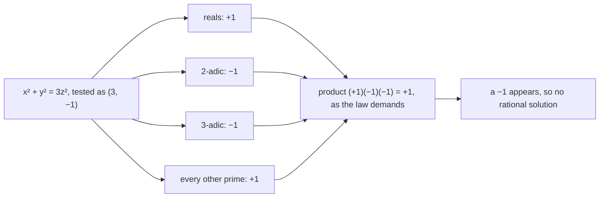

# Hasse-Minkowski: a quadratic equation has a rational solution exactly when it has one in every completion

[Syllabus](../../../SYLLABUS.md) → [Algebraic and analytic number theory](../README.md) → [Local Fields and Class Field Theory](../README.md#s09) → Hasse-Minkowski

---

## General Overview

Take two equations that look almost the same: $`x^2 + y^2 = 5z^2`$ and $`x^2 + y^2 = 3z^2`$. The first has the whole-number solution $`(1, 2, 1)`$, since $`1 + 4 = 5`$. The second has only $`(0, 0, 0)`$. Why?

The reason sits at the prime 3. Squares leave remainder 0 or 1 on division by 3. So $`x^2 + y^2`$ is a multiple of 3 only when both $`x`$ and $`y`$ are. Then $`x^2 + y^2`$ is a multiple of 9, so $`3z^2`$ is too, and 3 divides $`z`$. Every solution divides by 3 forever, so only zero survives. The equation fails "at 3".

That failure is **local**: it shows up in arithmetic modulo powers of one prime, which is arithmetic in the 3-adic numbers $`\mathbb{Q}_3`$ ([The p-adic numbers](../06-Algebraic%20Numbers/10-p-adic-numbers-and-hensels-lemma.md)). A rational solution is also a solution in the reals and in every $`\mathbb{Q}_p`$, so every local test is necessary. The **Hasse-Minkowski theorem** says that for quadratic equations the local tests are also enough.

The local tests come down to one sign per **place** (a prime, or the reals), the **Hilbert symbol**, and those signs obey one parity law, the **product formula**. That law is quadratic reciprocity in another form. With it, deciding a quadratic equation in three unknowns takes a few Legendre symbols.

The principle fails for cubics. Selmer's equation $`3x^3 + 4y^3 + 5z^3 = 0`$ has solutions in the reals and in every $`\mathbb{Q}_p`$, yet none in whole numbers except zero.

**A quadratic equation with rational coefficients has a nonzero rational solution exactly when it has one in the reals and in every p-adic field; for three unknowns each local test is one Hilbert symbol, and quadratic reciprocity forces the symbols to multiply to 1.**

**What kind of fact this is:** the Hilbert symbol is a definition. The product formula and Legendre's theorem (the three-unknown case of Hasse-Minkowski) are theorems, proved on this card in Why it works, as are the two key cases of the odd-prime formula. The symbol's multiplication rule, the formula at the prime 2 and the case of four or more unknowns are stated with sources (Serre, Hasse). That Selmer's cubic has no rational solution is a theorem stated with its source (Selmer 1951); the code's search is evidence only.

### The picture: one sign at each place for x² + y² = 3z²



Each arrow is one local test. The equation fails at two places, 2 and 3. It can never fail at exactly one: the product of all the signs is always +1.

---

## The formula

Some words first. A **place** $`v`$ is either a prime $`p`$ or the symbol $`\infty`$, which stands for the ordinary size and the reals. The **completion** $`\mathbb{Q}_v`$ is $`\mathbb{Q}_p`$ for a prime and $`\mathbb{R}`$ for $`\infty`$. Ostrowski's list on [The p-adic numbers](../06-Algebraic%20Numbers/10-p-adic-numbers-and-hensels-lemma.md) shows these are all the completions of the fractions.

For nonzero fractions $`a, b`$ the **Hilbert symbol** records whether $`z^2 = ax^2 + by^2`$ has a solution other than zero at the place $`v`$:

```math
(a, b)_v = \begin{cases} +1 & z^2 = ax^2 + by^2 \text{ has a solution } (x, y, z) \ne (0, 0, 0) \text{ in } \mathbb{Q}_v \\ -1 & \text{it has none} \end{cases}
```

**Read it aloud:** a comma b at v is plus one when the equation z squared equals a x squared plus b y squared has a nonzero solution over the completion at v, and minus one when it has none.

**How to compute it.** At $`\infty`$: $`(a, b)_\infty = -1`$ exactly when $`a`$ and $`b`$ are both negative. At a prime, pull out the powers of $`p`$: $`a = p^\alpha u`$ and $`b = p^\beta w`$, with $`p`$ dividing neither $`u`$ nor $`w`$. For an odd prime, with $`(u/p)`$ the Legendre symbol ([Quadratic residues](../03-Characters%20and%20L-functions/02-quadratic-residues-and-the-legendre-symbol.md)):

```math
(a, b)_p = (-1)^{\alpha\beta\,\frac{p-1}{2}} \left(\frac{u}{p}\right)^{\beta} \left(\frac{w}{p}\right)^{\alpha}
```

At $`p = 2`$, with two parities $`\varepsilon(u) = \frac{u-1}{2}`$ and $`\omega(u) = \frac{u^2-1}{8}`$, each read mod 2 (Serre's names; not wing 07's $`\varepsilon(n)`$, shelf 08's $`\omega(n)`$, shelf 06's $`\omega = (1 + \sqrt d)/2`$ or the next card's cube root of 1):

```math
(a, b)_2 = (-1)^{\varepsilon(u)\varepsilon(w) + \alpha\,\omega(w) + \beta\,\omega(u)}
```

**The product formula.** For any nonzero fractions $`a, b`$, only finitely many symbols are $`-1`$, and

```math
\prod_{v} (a, b)_v = 1
```

**Read it aloud:** multiply the Hilbert symbols over the reals and every prime, and the answer is always plus one.

**Hasse-Minkowski.** A quadratic form is a sum of squares and cross products of the unknowns, as on [Quadratic forms](../../03-Algebra/07-Eigenvalues%20and%20Symmetric%20Matrices/05-quadratic-forms-and-positive-definite.md). Let $`Q`$ be one with rational coefficients, $`n`$ unknowns, and a nonzero determinant. Then

```math
Q(x_1, \dots, x_n) = 0 \text{ has a nonzero solution in } \mathbb{Q} \iff \text{it has one in } \mathbb{R} \text{ and in every } \mathbb{Q}_p
```

**Read it aloud:** a quadratic form has a nonzero rational zero exactly when it has a nonzero zero over the reals and over every p-adic field.

For three unknowns, the form $`ax^2 + by^2 = cz^2`$ with whole positive $`a, b, c`$ multiplies through by $`c`$ to $`(cz)^2 = (ac)x^2 + (bc)y^2`$. So it is solvable at $`v`$ exactly when $`(ac, bc)_v = +1`$. For the example $`a = b = 1`$, $`c = 3`$: the symbol is $`(3, 3)_v`$, which equals $`(3, -1)_v`$ because $`(3, -3)_v = 1`$ (the point $`x = y = 1, z = 0`$).

| Symbol | Plain meaning | In our example | Push it up and the answer… |
| --- | --- | --- | --- |
| $`a, b, c`$ | $`a, b`$: the two nonzero numbers inside the symbol; on Legendre's form $`ax^2 + by^2 = cz^2`$, the three coefficients | symbol $`(3, -1)`$; form $`a = b = 1, c = 3`$ | only their square-free parts matter |
| $`x, y, z`$; $`t`$ | the unknowns; $`t`$ is whichever of them is a unit | $`(1, 2, 1)`$ for $`c = 5`$ | — |
| $`v`$; $`p, q`$ | a place: a prime, or $`\infty`$ for the reals; $`p, q`$ are primes | $`\infty, 2, 3, 5, \dots`$ | — |
| $`\mathbb{Q}_v`$ | the completion at $`v`$: $`\mathbb{Q}_p`$, or $`\mathbb{R}`$ | $`\mathbb{Q}_3`$ | — |
| $`(a, b)_v`$ | the Hilbert symbol: +1 solvable at $`v`$, −1 not | $`(3, -1)_3 = -1`$ | — |
| $`\alpha, \beta`$ | how many times $`p`$ divides $`a`$ and $`b`$ | at 3: $`\alpha = 1, \beta = 0`$ | odd counts bring Legendre symbols in |
| $`u, w`$ | $`a`$ and $`b`$ with the powers of $`p`$ removed | at 3: $`u = 1, w = -1`$ | — |
| $`(u/p)`$ | the Legendre symbol: +1 if $`u`$ is a square mod $`p`$, −1 if not | $`(-1/3) = -1`$ | — |
| $`\varepsilon(u), \omega(u)`$ | two parities used only at 2: $`u`$ mod 4 and $`u`$ mod 8 | $`\varepsilon(3) = \varepsilon(-1) = 1`$ | — |
| $`Q`$; $`r_1, r_2, r_3`$ | a quadratic form, or its value at a point; the square roots in Legendre's proof | $`x^2 + y^2 - 3z^2`$; for $`c = 5`$: $`r_3 = 2`$ | — |
| $`n`$; $`N`$ | the number of unknowns; the power $`p^N`$ the search works mod | $`n = 3`$; $`N = 3`$, or 5 at $`p = 2`$ | at $`n \ge 5`$ only the reals can fail |

### When it holds

- **Quadratic, not higher degree.** Selmer's cubic passes every local test and has no rational solution. Cubics need extra data, the Tate-Shafarevich group, to measure the gap.
- **Every place, the reals included.** $`x^2 + y^2 + z^2 = 0`$ passes every odd prime. It fails only at 2 and at the reals. Skip both and the test says yes wrongly.
- **Solutions in $`\mathbb{Q}_p`$, not just mod p.** $`x^2 + y^2 = 3z^2`$ has a primitive solution mod 3 (one whose entries are not all multiples of 3), $`(0, 0, 1)`$. It has none mod 9, and that is the true answer at 3.
- **The p = 2 rule is its own formula.** Using the odd-prime formula at 2 gives $`(3, -1)_2 = +1`$ and breaks the product formula.
- **Nonzero determinant, a convenience.** A form with determinant 0, such as $`(x - y)^2`$, always has a rational zero, here $`(1, 1)`$, so the theorem holds for it trivially; nothing breaks.

---

## Why it works

### Step 0: one rational solution is a solution everywhere, and reciprocity ties the places together

A rational point is a point in $`\mathbb{R}`$ and in every $`\mathbb{Q}_p`$. So one local failure rules out a rational solution. The work is the other direction.

For three unknowns the plan has three parts. First, compute each local answer as a sign. Second, show the signs multiply to 1, using quadratic reciprocity. Third, build a rational solution from the local conditions with a counting argument due to Legendre.

### Step 1: the Hilbert symbol at an odd prime

Take an odd prime $`p`$. Only $`a`$ and $`b`$ up to square factors matter, since $`a t^2 x^2 = a (tx)^2`$. So the powers $`\alpha, \beta`$ only matter as 0 or 1. Two cases carry the formula. A **unit** here is a number not divisible by $`p`$. **Hensel's lemma** turns a solution mod $`p`$ into an exact solution in $`\mathbb{Q}_p`$ when the slope (the derivative in one unknown) is not divisible by $`p`$.

**Two units: $`(u, w)_p = +1`$.** The numbers $`u x^2`$, for $`x`$ from 0 to $`p - 1`$, take $`(p+1)/2`$ different remainders. So do the numbers $`1 - w y^2`$. Together that is $`p + 1`$ remainders among only $`p`$, so two coincide: $`u x^2 \equiv 1 - w y^2`$. Then $`(x, y, 1)`$ solves $`z^2 \equiv ux^2 + wy^2 \pmod p`$ with $`z = 1`$. The slope in $`z`$ is $`2z = 2`$, not divisible by $`p`$, so Hensel's lemma lifts it to $`\mathbb{Q}_p`$.

**One factor of p: $`(p, u)_p = (u/p)`$.** If $`u`$ is a square mod $`p`$, then $`(0, 1, \sqrt{u})`$ solves $`z^2 = px^2 + uy^2`$ mod $`p`$, and Hensel lifts $`\sqrt{u}`$. If $`u`$ is not a square, take a solution with no common factor $`p`$. Mod $`p`$: $`z^2 \equiv u y^2`$, so $`p`$ divides $`y`$ and $`z`$. Then $`p^2`$ divides $`px^2`$, so $`p`$ divides $`x`$ too, which contradicts "no common factor".

The symbol is **bimultiplicative**: $`(a, bb')_v = (a, b)_v (a, b')_v`$, and the same in the first slot. This is stated here and proved in Serre, chapter III. With it, and with $`(p, p)_p = (p, -1)_p`$, the two cases give the full odd-prime formula. At $`p = 2`$ the formula is stated, not proved here (Serre, chapter III). The code tests both formulas against a brute-force search for every pair of squarefree $`a, b`$ from −7 to 7 at the primes 2, 3, 5, 7: 576 of 576 agree.

<details>
<summary>Why a search mod a fixed power of p is a complete test</summary>

The search looks for a **primitive** solution of $`z^2 = ax^2 + by^2`$ mod $`p^N`$: one with $`x, y, z`$ not all divisible by $`p`$. Here $`a, b`$ are squarefree, so $`p`$ divides each at most once. Take $`N = 3`$ for odd $`p`$ and $`N = 5`$ for $`p = 2`$.

A solution in $`\mathbb{Q}_p`$ scales to a primitive one in $`\mathbb{Z}_p`$ and reduces to a primitive one mod every $`p^N`$. So "none found" means $`-1`$.

Conversely, take a primitive solution mod $`p^N`$, and a unit coordinate $`t`$. The slope in $`t`$ is $`2z`$, $`-2ax`$ or $`-2by`$. It has at most 1 factor $`p`$ for odd $`p`$, and at most 2 factors 2 at $`p = 2`$. The sharper form of Hensel's lemma lifts any root where the value is divisible by more than twice the slope's powers of $`p`$: more than 2 at odd $`p`$, more than 4 at 2. So $`N = 3`$ and $`N = 5`$ suffice, and "found" means $`+1`$.

</details>

### Step 2: the product formula is quadratic reciprocity

Both sides of the product formula multiply in $`a`$ and in $`b`$. So it is enough to check it when $`a`$ and $`b`$ are each −1, 2 or an odd prime. Only places dividing $`2ab`$, and $`\infty`$, can give −1. The cases:

| Pair | Symbols that can be −1 | Their product is 1 because |
| --- | --- | --- |
| $`(-1, -1)`$ | at $`\infty`$: −1; at 2: −1 | $`(-1)(-1) = 1`$ |
| $`(-1, 2)`$, $`(2, 2)`$ | at 2: +1 | nothing to cancel |
| $`(-1, p)`$ | at $`p`$: $`(-1/p)`$; at 2: $`(-1)^{\varepsilon(p)}`$ | the first supplement, $`(-1/p) = (-1)^{(p-1)/2}`$ |
| $`(2, p)`$ | at $`p`$: $`(2/p)`$; at 2: $`(-1)^{\omega(p)}`$ | the second supplement, $`(2/p) = +1`$ exactly when $`p \equiv \pm 1 \pmod 8`$ |
| $`(p, q)`$, $`p \ne q`$ odd | at $`p`$: $`(q/p)`$; at $`q`$: $`(p/q)`$; at 2: $`(-1)^{\varepsilon(p)\varepsilon(q)}`$ | quadratic reciprocity |
| $`(p, p)`$ | equals $`(p, -1)`$ | the row for $`(-1, p)`$ |

The last row uses $`(p, -p)_v = 1`$, which holds because $`x = y = 1, z = 0`$ solves $`z^2 = px^2 - py^2`$.

The $`(p, q)`$ row is the heart. Its product is $`(q/p)(p/q)(-1)^{\frac{p-1}{2}\frac{q-1}{2}}`$, and [Quadratic reciprocity](../03-Characters%20and%20L-functions/07-quadratic-reciprocity-via-gauss-sums.md) says that is 1. The product formula is reciprocity, written so that the prime 2 and the reals take part on equal terms.

**Proof against count.** The proof covers every pair. The code adds two exact counts: all 3,600 pairs $`a, b`$ from −30 to 30 give product 1, and for all 552 ordered pairs of distinct odd primes below 100, $`(q/p)(p/q)`$ equals $`(p, q)_2`$.

### Step 3: Legendre's theorem builds the rational solution

**Legendre's theorem.** Let $`a, b, c`$ be positive, squarefree and pairwise coprime. Then $`ax^2 + by^2 = cz^2`$ has a nonzero whole-number solution exactly when

- $`bc`$ is a square mod $`a`$,
- $`ac`$ is a square mod $`b`$, and
- $`-ab`$ is a square mod $`c`$.

The conditions are necessary by the argument in the overview. Say an odd prime $`p`$ divides $`c`$ and a primitive solution exists. Mod $`p`$, $`ax^2 + by^2 \equiv 0`$. If $`p`$ divided $`x`$ it would divide $`y`$, then $`p^2`$ would divide $`cz^2`$, and $`p`$ would divide $`z`$. So $`x`$ is a unit and $`-ab \equiv (by/x)^2`$.

For sufficiency, the shape of the proof is:

1. Each condition gives a square root $`r`$ that factors the form into two linear pieces modulo $`a`$, $`b`$ or $`c`$. Together, three linear congruences force $`ax^2 + by^2 - cz^2 \equiv 0 \pmod{abc}`$.
2. A box with $`0 \le x \le \sqrt{bc}`$, $`0 \le y \le \sqrt{ac}`$, $`0 \le z \le \sqrt{ab}`$ holds more than $`abc`$ points. By the pigeonhole principle, two points agree in all three congruences. Their difference is a small nonzero solution of the congruences.
3. Small means $`-abc \le Q \le 2abc`$, and $`Q`$ is a multiple of $`abc`$. Squarefree coefficients rule out the ends except in trivial cases, so $`Q = 0`$ or $`Q = abc`$.
4. If $`Q = abc`$, one identity turns the point into an exact zero.

<details>
<summary>Detailed proof: the congruences, the box and the identity</summary>

**The congruences.** Since $`bc`$ is a square mod $`a`$ and $`b`$ is a unit mod $`a`$, there is $`r_1`$ with $`b r_1^2 \equiv c \pmod a`$. Then $`by^2 - cz^2 \equiv b(y - r_1 z)(y + r_1 z) \pmod a`$. So $`y \equiv r_1 z \pmod a`$ makes $`Q = ax^2 + by^2 - cz^2 \equiv 0 \pmod a`$. In the same way, $`z \equiv r_2 x \pmod b`$ with $`c r_2^2 \equiv a`$ gives $`Q \equiv 0 \pmod b`$, and $`x \equiv r_3 y \pmod c`$ with $`a r_3^2 \equiv -b`$ gives $`Q \equiv 0 \pmod c`$. The moduli are coprime, so $`Q \equiv 0 \pmod{abc}`$.

**The box.** The number of points with $`0 \le x \le \sqrt{bc}`$, $`0 \le y \le \sqrt{ac}`$, $`0 \le z \le \sqrt{ab}`$ is

$`\displaystyle (\lfloor\sqrt{bc}\rfloor + 1)(\lfloor\sqrt{ac}\rfloor + 1)(\lfloor\sqrt{ab}\rfloor + 1) > \sqrt{bc \cdot ac \cdot ab} = abc.`$

The three congruences have $`abc`$ joint residue patterns, so two points share one. Their difference $`(x, y, z)`$ is nonzero, satisfies the congruences, and has $`x^2 \le bc`$, $`y^2 \le ac`$, $`z^2 \le ab`$.

**The size.** Then $`Q \le a \cdot bc + b \cdot ac = 2abc`$ and $`Q \ge -c \cdot ab`$. Equality at the top needs $`bc`$ and $`ac`$ to be squares, so $`a = b = c = 1`$, where $`(1, 0, 1)`$ is a solution anyway. Equality at the bottom needs $`x = y = 0`$ and $`ab = 1`$. Then the form is $`x^2 + y^2 = cz^2`$ with $`-1`$ a square mod $`c`$, so every odd prime factor of $`c`$ is 1 mod 4 and $`c`$ is a sum of two squares by [Two squares](../07-Diophantine%20and%20Modular/02-sums-of-squares-and-gaussian-integers.md). Otherwise $`Q`$ is 0 or $`abc`$.

**The identity.** For any $`x, y, z`$,

$`\displaystyle a(xz + by)^2 + b(yz - ax)^2 - c(z^2 + ab)^2 = (z^2 + ab)\,(ax^2 + by^2 - cz^2 - abc).`$

So if $`Q = abc`$, the point $`(xz + by,\ yz - ax,\ z^2 + ab)`$ is a zero. It is nonzero, since $`z^2 + ab > 0`$.

</details>

The code runs this construction. For $`x^2 + y^2 = 5z^2`$ the box finds $`(-2, -1, 0)`$ with $`Q = 5`$, and the identity turns it into $`(1, 2, 1)`$. For $`11x^2 + 13y^2 = 2z^2`$ it finds $`(-5, 1, 1)`$ with $`Q = 286`$, and the identity gives $`(1, 7, 18)`$: $`11 + 637 = 648`$.

### Step 4: Legendre's conditions are the local tests, and one place comes free

For $`p`$ odd dividing $`c`$, the condition "$`-ab`$ is a square mod $`p`$" is exactly solvability in $`\mathbb{Q}_p`$: Step 3 showed it is necessary, and Hensel lifts it. The same holds for primes dividing $`a`$ or $`b`$. At an odd prime dividing none of them, Step 1's unit case gives +1 for free. At the reals, $`ax^2 + by^2 = cz^2`$ with positive coefficients always has a real zero.

Every form in three unknowns reaches Legendre's shape without changing its answer at any place. Diagonalise it, clear denominators, move the terms so all three coefficients are positive, and absorb square factors into the unknowns. If a prime $`p`$ divides all three coefficients, divide by it. If it divides exactly two, say $`a = pa'`$ and $`b = pb'`$, then $`p`$ divides $`z`$; put $`z = pz'`$ and divide by $`p`$ to get $`a'x^2 + b'y^2 = (pc)z'^2`$, whose coefficients have a smaller product. (If all three coefficients have one sign, the reals already fail.)

So for three unknowns: solvable at every place implies Legendre's conditions, which imply a rational solution. That is Hasse-Minkowski for $`n = 3`$, proved.

The prime 2 never appears in Legendre's conditions. The product formula explains why. If every symbol but one is +1, the last must be +1 too. So any single place can be skipped, and Legendre skips 2.

For $`x^2 + y^2 = nz^2`$ the test reads: $`(n, -1)_v = +1`$ at every place. From $`n = 1`$ to 50 the code finds 24 such $`n`$. A direct search with $`z`$ below 30 finds the same 24. So does the whole-number test $`n = a^2 + b^2`$, which matches because both tests say the same thing: every prime that is 3 mod 4 divides $`n`$ an even number of times.

### Step 5: four or more unknowns, and where cubics break

**Stated, not proved here.** Hasse-Minkowski holds for every $`n`$ (Hasse 1923; Serre, chapter IV). The case $`n = 4`$ reduces to $`n = 3`$ but needs [Dirichlet's theorem](../03-Characters%20and%20L-functions/04-dirichlets-theorem-on-primes-in-progressions.md) to find a suitable auxiliary prime. For $`n \ge 5`$, every form already has a zero in every $`\mathbb{Q}_p`$. So a form in five or more unknowns has a rational zero exactly when it takes both signs over the reals.

**Selmer's cubic breaks the principle.** For $`3x^3 + 4y^3 + 5z^3 = 0`$ the code finds local solutions that Hensel lifts:

- at 2: $`(1, 0, 1)`$ gives 8, and the slope $`9x^2`$ is odd;
- at 3: $`(0, 1, 4)`$ gives 324, divisible by $`3^3`$, and the slope $`12y^2`$ has one factor 3;
- at 5: $`(1, 2, 0)`$ gives 35, and the slope $`9x^2`$ is a unit;
- at every prime from 7 to 199: at least 18 nonzero solutions mod $`p`$. Each lifts: some coordinate $`t`$ is not divisible by $`p`$, and neither is its slope, $`3t^2`$ times 3, 4 or 5, since $`p`$ is larger than 5.

The reals give $`(1, 1, -1.118689)`$. For every prime beyond 199, Hasse's bound on [The curve mod p](../../22-Algebraic%20geometry/04-Elliptic%20Curves/05-reduction-mod-p-and-hasse.md) guarantees points mod $`p`$. Yet Selmer proved there is no nonzero rational solution (Selmer 1951). The code's search over $`|x|, |y| \le 60`$ finds none, which is evidence, not proof.

---

## Worked numbers, by hand

Decide $`x^2 + y^2 = 3z^2`$, tested as $`(3, -1)_v`$.

| Step | Arithmetic | Value |
| --- | --- | --- |
| places that can fail | $`\infty`$ and the primes dividing $`2 \cdot 3 \cdot (-1)`$ | $`\infty, 2, 3`$ |
| at $`\infty`$ | 3 is positive | $`(3, -1)_\infty = +1`$ |
| at 3: split | $`3 = 3^1 \cdot 1`$, $`-1 = 3^0 \cdot (-1)`$ | $`\alpha = 1, \beta = 0, u = 1, w = -1`$ |
| at 3: formula | $`(-1)^0 \cdot (1/3)^0 \cdot (-1/3)^1`$; squares mod 3 are only 1, and $`-1 \equiv 2`$ | $`(3, -1)_3 = -1`$ |
| at 2: parities | $`\varepsilon(3) = 1`$, $`\varepsilon(-1) = -1 \equiv 1`$, $`\alpha = \beta = 0`$ | exponent 1 |
| at 2: formula | $`(-1)^1`$ | $`(3, -1)_2 = -1`$ |
| product over all places | $`(+1)(-1)(-1)`$ | $`+1`$ |
| verdict | a −1 appears | **no nonzero rational solution** |

The product is +1, as the law demands, and the equation fails at two places. The same steps for $`(5, -1)`$ give +1 at $`\infty`$, 2 and 5: $`(-1/5) = +1`$ because $`2^2 = 4 \equiv -1`$. So $`x^2 + y^2 = 5z^2`$ is solvable, and $`(1, 2, 1)`$ is a witness.

### What breaks if you drop a piece

| Mistake | Comes out at | What went wrong |
| --- | --- | --- |
| Test $`x^2 + y^2 = 3z^2`$ mod 3 instead of mod 9 | 2 primitive solutions mod 3: a false yes | mod 9 has 0; one power of $`p`$ is not $`\mathbb{Q}_p`$ |
| Use the odd-prime formula at $`p = 2`$ | $`(3, -1)_2 = +1`$, product over places −1 | the prime 2 has its own rule; the product formula exposes the error |
| Skip 2 and the reals for $`x^2 + y^2 + z^2 = 0`$ | every odd prime says yes | $`(-1, -1)`$ is −1 at 2 and at $`\infty`$ |
| Apply the principle to Selmer's cubic | passes at 2, 3, 5, every prime from 7 to 199, and the reals | 0 rational solutions with $`\lvert x\rvert, \lvert y\rvert \le 60`$; cubics are not quadratic |

The code prints every row.

---

## Code, from first principles, and it actually runs

The code takes three independent roads. Road 1 computes the Hilbert symbol by its formula. Road 2 searches for primitive solutions mod $`p^3`$, or $`2^5`$, which Hensel's lemma lifts, and must agree with road 1 in all 576 cases. Road 3 builds rational solutions by Legendre's box and checks every yes and no against a direct search.

### Python

```python
# Hasse-Minkowski and the Hilbert symbol -- the check behind the card.  Standard
# library only.  Road 1: the Hilbert symbol by its formula.  Road 2: brute-force
# search for primitive solutions mod p^N, which Hensel's lemma lifts.  Road 3:
# Legendre's box builds rational solutions; direct searches confirm yes and no.
from math import gcd, isqrt

def split(n, p):                     # n = p^k * u with p not dividing u
    k = 0
    while n % p == 0:
        n //= p
        k += 1
    return k, n

def leg(u, p):                       # Legendre symbol by Euler's criterion
    r = pow(u % p, (p - 1) // 2, p)
    return -1 if r == p - 1 else r

def hs(a, b, p, odd_rule=False):     # road 1: (a, b)_p; p = 0 is the real place
    if p == 0:
        return -1 if a < 0 and b < 0 else 1
    al, u = split(a, p)
    be, v = split(b, p)
    if p == 2 and not odd_rule:
        e = lambda w: (w - 1) // 2 % 2
        w = lambda w: (w * w - 1) // 8 % 2
        return (-1) ** ((e(u) * e(v) + al * w(v) + be * w(u)) % 2)
    return (-1) ** (al * be * (p - 1) // 2 % 2) * leg(u, p) ** be * leg(v, p) ** al

def bf(a, b, p):                     # road 2: z^2 = a x^2 + b y^2, primitive, mod p^N
    m = p ** (5 if p == 2 else 3)
    sq = {z * z % m for z in range(m)}
    usq = {z * z % m for z in range(m) if z % p}
    for x in range(m):
        for y in range(m):
            t = (a * x * x + b * y * y) % m
            if t in (sq if x % p or y % p else usq):
                return 1
    return -1

def primes(n): return [p for p in range(2, n + 1) if all(p % q for q in range(2, isqrt(p) + 1))]

def places(a, b):                    # the real place and every prime dividing 2ab
    return [0] + [p for p in primes(abs(2 * a * b)) if (2 * a * b) % p == 0]

def local_yes(a, b): return all(hs(a, b, p) == 1 for p in places(a, b))

def prodp(a, b):                     # product of (a, b)_v over every place v
    out = 1
    for p in places(a, b):
        out *= hs(a, b, p)
    return out

for n in (3, 5):                     # the examples: x^2 + y^2 = n z^2 is x^2 = n z^2 - y^2
    s = {p: hs(n, -1, p) for p in [0, 2, 3, 5, 7]}
    print(f"({n}, -1) at " + ", ".join(f"{p or 'inf'}: {s[p]:+d}" for p in s) + f"; product over all places {prodp(n, -1):+d}")
    assert prodp(n, -1) == 1
assert [hs(3, -1, p) for p in (0, 2, 3)] == [1, -1, -1] and local_yes(5, -1)
SF = [-7, -6, -5, -3, -2, -1, 1, 2, 3, 5, 6, 7]
agree = sum(hs(a, b, p) == bf(a, b, p) for a in SF for b in SF for p in (2, 3, 5, 7))
print(f"formula against brute-force search, squarefree a, b from -7 to 7, p = 2, 3, 5, 7: {agree} of {4 * len(SF) ** 2} agree")
assert agree == 4 * len(SF) ** 2
bad = sum(prodp(a, b) != 1 for a in range(-30, 31) for b in range(-30, 31) if a and b)
print(f"product formula over all 3,600 pairs a, b from -30 to 30: {bad} failures")
assert bad == 0
P = [p for p in primes(100) if p > 2]
rec = sum(leg(q, p) * leg(p, q) == hs(p, q, 2) for p in P for q in P if p != q)
print(f"odd primes p != q below 100: (q/p)(p/q) = (p, q)_2 in {rec} of {len(P) * (len(P) - 1)} pairs")
assert rec == len(P) * (len(P) - 1)

def prim(n, m):                      # primitive x^2 + y^2 = n z^2 mod m, n multiple of p
    return sum((x * x + y * y - n * z * z) % m == 0 and gcd(gcd(x, y), gcd(z, m)) == 1
               for x in range(m) for y in range(m) for z in range(m))
print(f"x^2 + y^2 = 3z^2: primitive solutions mod 3: {prim(3, 3)}, mod 9: {prim(3, 9)}")
assert prim(3, 3) > 0 and prim(3, 9) == 0

def legendre(a, b, c):               # road 3: a x^2 + b y^2 = c z^2, a, b, c > 0
    r = [next(t for t in range(m) if (k * t * t - j) % m == 0) for k, j, m in
         ((b, c, a), (c, a, b), (a, -b, c))]
    X, Y, Z = isqrt(b * c), isqrt(a * c), isqrt(a * b)
    box = [(x, y, z) for x in range(-X, X + 1) for y in range(-Y, Y + 1) for z in range(Z + 1)
           if (x, y, z) != (0, 0, 0) and (y - r[0] * z) % a == 0 and (z - r[1] * x) % b == 0
           and (x - r[2] * y) % c == 0]
    vals = sorted({a * x * x + b * y * y - c * z * z for x, y, z in box})
    x, y, z = next(v for v in box if a * v[0] ** 2 + b * v[1] ** 2 - c * v[2] ** 2 in (0, a * b * c))
    q = a * x * x + b * y * y - c * z * z
    print(f"Legendre {a}x^2 + {b}y^2 = {c}z^2: roots {r}, box {X} x {Y} x {Z}, {len(box)} vectors, "
          f"values of Q {vals}; first ({x}, {y}, {z}), Q = {q}")
    if q:                            # Q = abc: the identity turns it into a zero
        x, y, z = x * z + b * y, y * z - a * x, z * z + a * b
    g = gcd(gcd(x, y), z)
    x, y, z = abs(x // g), abs(y // g), abs(z // g)
    assert a * x * x + b * y * y == c * z * z and z > 0
    print(f"  solution ({x}, {y}, {z}): {a * x * x} + {b * y * y} = {c * z * z}")
legendre(1, 1, 5)
legendre(11, 13, 2)
yes = [n for n in range(1, 51) if local_yes(n, -1)]
srch = [n for n in range(1, 51) if any(isqrt(n * z * z - x * x) ** 2 == n * z * z - x * x
        for z in range(1, 30) for x in range(isqrt(n) * z + 1))]
r2 = [n for n in range(1, 51) if any(isqrt(n - x * x) ** 2 == n - x * x for x in range(isqrt(n) + 1))]
print(f"x^2 + y^2 = n z^2, n = 1 to 50: {len(yes)} pass every local test: {yes}")
print(f"  same list by search with z below 30: {yes == srch}; by n = a^2 + b^2 in whole numbers: {yes == r2}")
assert yes == srch == r2
house = [p for p in primes(200) if local_yes(p, -5)]
whole = [p for p in primes(200) if any(isqrt(p - 5 * y * y) ** 2 == p - 5 * y * y for y in range(isqrt(p // 5) + 1))]
print(f"house: primes below 200 with x^2 + 5y^2 = p z^2 locally solvable: {house}")
print(f"  {len(house)} primes, equal to whole-number x^2 + 5y^2 = p: {house == whole}; residues mod 20 {sorted({p % 20 for p in house})}")
assert house == whole and {p % 20 for p in house if p != 5} == {1, 9}
f = lambda x, y, z: 3 * x ** 3 + 4 * y ** 3 + 5 * z ** 3
for p in (2, 3, 5):                  # Selmer: a point mod p^(2v+1) where d/dt has v_p = v
    for i in range(3):
        v = split(3 * (3, 4, 5)[i], p)[0]
        m = p ** (2 * v + 1)
        w = next((t for t in ((x, y, z) for x in range(m) for y in range(m) for z in range(m))
                  if t[i] % p and f(*t) % m == 0), None)
        if w:
            print(f"Selmer at {p}: ({w[0]}, {w[1]}, {w[2]}) gives {f(*w)}, divisible by {p}^{2 * v + 1}; "
                  f"unit {'xyz'[i]}, slope {3 * (3, 4, 5)[i]}{'xyz'[i]}^2 has v_{p} = {v}: lifts")
            break
    assert w
cnt = {p: sum(f(x, y, z) % p == 0 for x in range(p) for y in range(p) for z in range(p)) - 1
       for p in primes(200) if p > 5}
print(f"Selmer mod p, 7 <= p < 200: fewest nonzero solutions {min(cnt.values())}, at p = {min(cnt, key=cnt.get)}; "
      f"real point (1, 1, {-(7 / 5) ** (1 / 3):.6f})")
assert min(cnt.values()) > 0
B, hits = 60, 0
for x in range(-B, B + 1):           # 5 z^3 = -(3x^3 + 4y^3): is it 5 times a cube?
    for y in range(-B, B + 1):
        t = -(3 * x ** 3 + 4 * y ** 3)
        r = round(abs(t / 5) ** (1 / 3)) * (1 if t >= 0 else -1)
        hits += (x, y) != (0, 0) and any(5 * z ** 3 == t for z in (r - 1, r, r + 1))
print(f"Selmer over Q: nonzero solutions with |x|, |y| <= {B}: {hits}")
assert hits == 0
wrong = hs(3, -1, 2, odd_rule=True)  # the odd-prime formula used at p = 2
print(f"mistake, odd-prime rule at 2: (3, -1)_2 comes out {wrong:+d}, product over places "
      f"{hs(3, -1, 0) * wrong * hs(3, -1, 3):+d}; true (3, -1)_2 = {hs(3, -1, 2):+d}")
assert hs(3, -1, 0) * wrong * hs(3, -1, 3) == -1
print(f"mistake, skip 2 and inf for x^2 + y^2 + z^2 = 0: odd primes say yes; (-1, -1) at 2: {hs(-1, -1, 2):+d}, "
      f"at inf: {hs(-1, -1, 0):+d}")
assert hs(-1, -1, 2) == hs(-1, -1, 0) == -1 and all(hs(-1, -1, p) == 1 for p in P)
print("ALL CHECKS PASS")
```

**Ran 2026-11-24 on macOS, Python 3.14.10, standard library only. All checks passed. Output, pasted from the run:**

```
(3, -1) at inf: +1, 2: -1, 3: -1, 5: +1, 7: +1; product over all places +1
(5, -1) at inf: +1, 2: +1, 3: +1, 5: +1, 7: +1; product over all places +1
formula against brute-force search, squarefree a, b from -7 to 7, p = 2, 3, 5, 7: 576 of 576 agree
product formula over all 3,600 pairs a, b from -30 to 30: 0 failures
odd primes p != q below 100: (q/p)(p/q) = (p, q)_2 in 552 of 552 pairs
x^2 + y^2 = 3z^2: primitive solutions mod 3: 2, mod 9: 0
Legendre 1x^2 + 1y^2 = 5z^2: roots [0, 0, 2], box 2 x 2 x 1, 9 vectors, values of Q [-5, 0, 5]; first (-2, -1, 0), Q = 5
  solution (1, 2, 1): 1 + 4 = 5
Legendre 11x^2 + 13y^2 = 2z^2: roots [1, 5, 1], box 5 x 4 x 11, 3 vectors, values of Q [0, 286]; first (-5, 1, 1), Q = 286
  solution (1, 7, 18): 11 + 637 = 648
x^2 + y^2 = n z^2, n = 1 to 50: 24 pass every local test: [1, 2, 4, 5, 8, 9, 10, 13, 16, 17, 18, 20, 25, 26, 29, 32, 34, 36, 37, 40, 41, 45, 49, 50]
  same list by search with z below 30: True; by n = a^2 + b^2 in whole numbers: True
house: primes below 200 with x^2 + 5y^2 = p z^2 locally solvable: [5, 29, 41, 61, 89, 101, 109, 149, 181]
  9 primes, equal to whole-number x^2 + 5y^2 = p: True; residues mod 20 [1, 5, 9]
Selmer at 2: (1, 0, 1) gives 8, divisible by 2^1; unit x, slope 9x^2 has v_2 = 0: lifts
Selmer at 3: (0, 1, 4) gives 324, divisible by 3^3; unit y, slope 12y^2 has v_3 = 1: lifts
Selmer at 5: (1, 2, 0) gives 35, divisible by 5^1; unit x, slope 9x^2 has v_5 = 0: lifts
Selmer mod p, 7 <= p < 200: fewest nonzero solutions 18, at p = 7; real point (1, 1, -1.118689)
Selmer over Q: nonzero solutions with |x|, |y| <= 60: 0
mistake, odd-prime rule at 2: (3, -1)_2 comes out +1, product over places -1; true (3, -1)_2 = -1
mistake, skip 2 and inf for x^2 + y^2 + z^2 = 0: odd primes say yes; (-1, -1) at 2: -1, at inf: -1
ALL CHECKS PASS
```

### Rust

Same numbers, same labels, built with `rustc --edition 2021 -O`.

```rust
// Hasse-Minkowski and the Hilbert symbol -- the same check as the Python, in
// Rust.  No crates.  Road 1: the Hilbert symbol by its formula.  Road 2: brute-
// force search for primitive solutions mod p^N, which Hensel's lemma lifts.
// Road 3: Legendre's box builds rational solutions; searches confirm yes and no.
use std::collections::HashSet;

fn gcd(a: i64, b: i64) -> i64 { if b == 0 { a.abs() } else { gcd(b, a.rem_euclid(b)) } }
fn isqrt(n: i64) -> i64 { let mut r = (n as f64).sqrt() as i64; while r * r > n { r -= 1; } while (r + 1) * (r + 1) <= n { r += 1; } r }
fn issq(n: i64) -> bool { n >= 0 && isqrt(n).pow(2) == n }
fn split(mut n: i64, p: i64) -> (i64, i64) { let mut k = 0; while n % p == 0 { n /= p; k += 1; } (k, n) }
fn powmod(mut b: i64, mut e: i64, m: i64) -> i64 {
    let mut r = 1 % m; b = b.rem_euclid(m);
    while e > 0 { if e & 1 == 1 { r = r * b % m; } b = b * b % m; e >>= 1; }
    r
}
fn leg(u: i64, p: i64) -> i64 { let r = powmod(u, (p - 1) / 2, p); if r == p - 1 { -1 } else { r } }
fn sgn(e: i64) -> i64 { if e.rem_euclid(2) == 0 { 1 } else { -1 } }
fn hs_rule(a: i64, b: i64, p: i64, odd_rule: bool) -> i64 { // road 1; p = 0 is the real place
    if p == 0 { return if a < 0 && b < 0 { -1 } else { 1 }; }
    let ((al, u), (be, v)) = (split(a, p), split(b, p));
    if p == 2 && !odd_rule {
        let e = |w: i64| (w - 1).div_euclid(2).rem_euclid(2);
        let w = |w: i64| ((w * w - 1) / 8).rem_euclid(2);
        return sgn(e(u) * e(v) + al * w(v) + be * w(u));
    }
    sgn(al * be * (p - 1) / 2) * leg(u, p).pow(be as u32) * leg(v, p).pow(al as u32)
}
fn hs(a: i64, b: i64, p: i64) -> i64 { hs_rule(a, b, p, false) }
fn bf(a: i64, b: i64, p: i64) -> i64 { // road 2: z^2 = a x^2 + b y^2, primitive, mod p^N
    let m = p.pow(if p == 2 { 5 } else { 3 });
    let sq: HashSet<i64> = (0..m).map(|z| z * z % m).collect();
    let usq: HashSet<i64> = (0..m).filter(|z| z % p != 0).map(|z| z * z % m).collect();
    for x in 0..m { for y in 0..m {
        let t = (a * x * x + b * y * y).rem_euclid(m);
        if (if x % p != 0 || y % p != 0 { &sq } else { &usq }).contains(&t) { return 1; }
    } }
    -1
}
fn primes(n: i64) -> Vec<i64> { (2..=n).filter(|&p| (2..=isqrt(p)).all(|q| p % q != 0)).collect() }
fn places(a: i64, b: i64) -> Vec<i64> {
    let n = 2 * a * b;
    let mut v = vec![0]; v.extend(primes(n.abs()).into_iter().filter(|p| n % p == 0)); v
}
fn local_yes(a: i64, b: i64) -> bool { places(a, b).iter().all(|&p| hs(a, b, p) == 1) }
fn prodp(a: i64, b: i64) -> i64 { places(a, b).iter().map(|&p| hs(a, b, p)).product() }
fn list(v: &[i64]) -> String { format!("[{}]", v.iter().map(|x| x.to_string()).collect::<Vec<_>>().join(", ")) }
fn py(b: bool) -> &'static str { if b { "True" } else { "False" } }
fn prim(n: i64, m: i64) -> usize { // primitive x^2 + y^2 = n z^2 mod m
    let mut c = 0;
    for x in 0..m { for y in 0..m { for z in 0..m {
        if (x * x + y * y - n * z * z).rem_euclid(m) == 0 && gcd(gcd(x, y), gcd(z, m)) == 1 { c += 1; }
    } } }
    c
}
fn legendre(a: i64, b: i64, c: i64) { // road 3: a x^2 + b y^2 = c z^2, a, b, c > 0
    let r: Vec<i64> = [(b, c, a), (c, a, b), (a, -b, c)].iter()
        .map(|&(k, j, m)| (0..m).find(|t| (k * t * t - j).rem_euclid(m) == 0).unwrap()).collect();
    let (bx, by, bz) = (isqrt(b * c), isqrt(a * c), isqrt(a * b));
    let mut bxs = vec![];
    for x in -bx..=bx { for y in -by..=by { for z in 0..=bz {
        if (x, y, z) != (0, 0, 0) && (y - r[0] * z).rem_euclid(a) == 0 && (z - r[1] * x).rem_euclid(b) == 0
            && (x - r[2] * y).rem_euclid(c) == 0 { bxs.push((x, y, z)); }
    } } }
    let q = |&(x, y, z): &(i64, i64, i64)| a * x * x + b * y * y - c * z * z;
    let mut vals: Vec<i64> = bxs.iter().map(q).collect::<HashSet<_>>().into_iter().collect();
    vals.sort();
    let (mut x, mut y, mut z) = *bxs.iter().find(|v| q(v) == 0 || q(v) == a * b * c).unwrap();
    let qv = q(&(x, y, z));
    println!("Legendre {}x^2 + {}y^2 = {}z^2: roots {}, box {} x {} x {}, {} vectors, values of Q {}; first ({}, {}, {}), Q = {}",
             a, b, c, list(&r), bx, by, bz, bxs.len(), list(&vals), x, y, z, qv);
    if qv != 0 { let t = (x * z + b * y, y * z - a * x, z * z + a * b); x = t.0; y = t.1; z = t.2; }
    let g = gcd(gcd(x, y), z);
    let (x, y, z) = ((x / g).abs(), (y / g).abs(), (z / g).abs());
    assert!(a * x * x + b * y * y == c * z * z && z > 0);
    println!("  solution ({}, {}, {}): {} + {} = {}", x, y, z, a * x * x, b * y * y, c * z * z);
}
fn f(x: i64, y: i64, z: i64) -> i64 { 3 * x.pow(3) + 4 * y.pow(3) + 5 * z.pow(3) }

fn main() {
    for n in [3, 5] { // the examples: x^2 + y^2 = n z^2 is x^2 = n z^2 - y^2
        let s: Vec<String> = [0, 2, 3, 5, 7].iter()
            .map(|&p| format!("{}: {:+}", if p == 0 { "inf".to_string() } else { p.to_string() }, hs(n, -1, p))).collect();
        println!("({}, -1) at {}; product over all places {:+}", n, s.join(", "), prodp(n, -1));
        assert!(prodp(n, -1) == 1);
    }
    assert!([0, 2, 3].iter().map(|&p| hs(3, -1, p)).collect::<Vec<_>>() == vec![1, -1, -1] && local_yes(5, -1));
    let sf = [-7, -6, -5, -3, -2, -1, 1, 2, 3, 5, 6, 7];
    let mut agree = 0;
    for &a in &sf { for &b in &sf { for p in [2, 3, 5, 7] { if hs(a, b, p) == bf(a, b, p) { agree += 1; } } } }
    println!("formula against brute-force search, squarefree a, b from -7 to 7, p = 2, 3, 5, 7: {} of {} agree", agree, 4 * sf.len() * sf.len());
    assert!(agree == 4 * sf.len() * sf.len());
    let mut bad = 0;
    for a in -30..=30 { for b in -30..=30 { if a != 0 && b != 0 && prodp(a, b) != 1 { bad += 1; } } }
    println!("product formula over all 3,600 pairs a, b from -30 to 30: {} failures", bad);
    assert!(bad == 0);
    let pp: Vec<i64> = primes(100).into_iter().filter(|&p| p > 2).collect();
    let mut rec = 0;
    for &p in &pp { for &q in &pp { if p != q && leg(q, p) * leg(p, q) == hs(p, q, 2) { rec += 1; } } }
    println!("odd primes p != q below 100: (q/p)(p/q) = (p, q)_2 in {} of {} pairs", rec, pp.len() * (pp.len() - 1));
    assert!(rec == pp.len() * (pp.len() - 1));
    println!("x^2 + y^2 = 3z^2: primitive solutions mod 3: {}, mod 9: {}", prim(3, 3), prim(3, 9));
    assert!(prim(3, 3) > 0 && prim(3, 9) == 0);
    legendre(1, 1, 5);
    legendre(11, 13, 2);
    let yes: Vec<i64> = (1..=50).filter(|&n| local_yes(n, -1)).collect();
    let srch: Vec<i64> = (1..=50).filter(|&n| (1..30).any(|z| (0..=isqrt(n) * z).any(|x| issq(n * z * z - x * x)))).collect();
    let r2: Vec<i64> = (1..=50).filter(|&n| (0..=isqrt(n)).any(|x| issq(n - x * x))).collect();
    println!("x^2 + y^2 = n z^2, n = 1 to 50: {} pass every local test: {}", yes.len(), list(&yes));
    println!("  same list by search with z below 30: {}; by n = a^2 + b^2 in whole numbers: {}", py(yes == srch), py(yes == r2));
    assert!(yes == srch && srch == r2);
    let house: Vec<i64> = primes(200).into_iter().filter(|&p| local_yes(p, -5)).collect();
    let whole: Vec<i64> = primes(200).into_iter().filter(|&p| (0..=isqrt(p / 5)).any(|y| issq(p - 5 * y * y))).collect();
    let mut res: Vec<i64> = house.iter().map(|p| p % 20).collect::<HashSet<_>>().into_iter().collect();
    res.sort();
    println!("house: primes below 200 with x^2 + 5y^2 = p z^2 locally solvable: {}", list(&house));
    println!("  {} primes, equal to whole-number x^2 + 5y^2 = p: {}; residues mod 20 {}", house.len(), py(house == whole), list(&res));
    assert!(house == whole && house.iter().filter(|&&p| p != 5).all(|p| p % 20 == 1 || p % 20 == 9));
    let co = [3, 4, 5];
    for p in [2, 3, 5] { // Selmer: a point mod p^(2v+1) where d/dt has v_p = v
        let mut found = false;
        'outer: for i in 0..3 {
            let v = split(3 * co[i], p).0;
            let m = p.pow((2 * v + 1) as u32);
            for x in 0..m { for y in 0..m { for z in 0..m {
                let t = [x, y, z];
                if t[i] % p != 0 && f(x, y, z) % m == 0 {
                    let nm = ["x", "y", "z"][i];
                    println!("Selmer at {}: ({}, {}, {}) gives {}, divisible by {}^{}; unit {}, slope {}{}^2 has v_{} = {}: lifts",
                             p, x, y, z, f(x, y, z), p, 2 * v + 1, nm, 3 * co[i], nm, p, v);
                    found = true;
                    break 'outer;
                }
            } } }
        }
        assert!(found);
    }
    let mut best = (i64::MAX, 0);
    for p in primes(200).into_iter().filter(|&p| p > 5) {
        let mut c = -1;
        for x in 0..p { for y in 0..p { for z in 0..p { if f(x, y, z) % p == 0 { c += 1; } } } }
        if c < best.0 { best = (c, p); }
    }
    println!("Selmer mod p, 7 <= p < 200: fewest nonzero solutions {}, at p = {}; real point (1, 1, {:.6})",
             best.0, best.1, -(7.0f64 / 5.0).cbrt());
    assert!(best.0 > 0);
    let (bb, mut hits) = (60i64, 0);
    for x in -bb..=bb { for y in -bb..=bb { // 5 z^3 = -(3x^3 + 4y^3): is it 5 times a cube?
        let t = -(3 * x.pow(3) + 4 * y.pow(3));
        let r = (t as f64 / 5.0).abs().cbrt().round() as i64 * if t >= 0 { 1 } else { -1 };
        if (x, y) != (0, 0) && [r - 1, r, r + 1].iter().any(|z| 5 * z.pow(3) == t) { hits += 1; }
    } }
    println!("Selmer over Q: nonzero solutions with |x|, |y| <= {}: {}", bb, hits);
    assert!(hits == 0);
    let wrong = hs_rule(3, -1, 2, true); // the odd-prime formula used at p = 2
    println!("mistake, odd-prime rule at 2: (3, -1)_2 comes out {:+}, product over places {:+}; true (3, -1)_2 = {:+}",
             wrong, hs(3, -1, 0) * wrong * hs(3, -1, 3), hs(3, -1, 2));
    assert!(hs(3, -1, 0) * wrong * hs(3, -1, 3) == -1);
    println!("mistake, skip 2 and inf for x^2 + y^2 + z^2 = 0: odd primes say yes; (-1, -1) at 2: {:+}, at inf: {:+}",
             hs(-1, -1, 2), hs(-1, -1, 0));
    assert!(hs(-1, -1, 2) == -1 && hs(-1, -1, 0) == -1 && pp.iter().all(|&p| hs(-1, -1, p) == 1));
    println!("ALL CHECKS PASS");
}
```

**Ran 2026-11-24 on macOS, rustc 1.98.1, no crates. All checks passed. Output, pasted from the run:**

```
(3, -1) at inf: +1, 2: -1, 3: -1, 5: +1, 7: +1; product over all places +1
(5, -1) at inf: +1, 2: +1, 3: +1, 5: +1, 7: +1; product over all places +1
formula against brute-force search, squarefree a, b from -7 to 7, p = 2, 3, 5, 7: 576 of 576 agree
product formula over all 3,600 pairs a, b from -30 to 30: 0 failures
odd primes p != q below 100: (q/p)(p/q) = (p, q)_2 in 552 of 552 pairs
x^2 + y^2 = 3z^2: primitive solutions mod 3: 2, mod 9: 0
Legendre 1x^2 + 1y^2 = 5z^2: roots [0, 0, 2], box 2 x 2 x 1, 9 vectors, values of Q [-5, 0, 5]; first (-2, -1, 0), Q = 5
  solution (1, 2, 1): 1 + 4 = 5
Legendre 11x^2 + 13y^2 = 2z^2: roots [1, 5, 1], box 5 x 4 x 11, 3 vectors, values of Q [0, 286]; first (-5, 1, 1), Q = 286
  solution (1, 7, 18): 11 + 637 = 648
x^2 + y^2 = n z^2, n = 1 to 50: 24 pass every local test: [1, 2, 4, 5, 8, 9, 10, 13, 16, 17, 18, 20, 25, 26, 29, 32, 34, 36, 37, 40, 41, 45, 49, 50]
  same list by search with z below 30: True; by n = a^2 + b^2 in whole numbers: True
house: primes below 200 with x^2 + 5y^2 = p z^2 locally solvable: [5, 29, 41, 61, 89, 101, 109, 149, 181]
  9 primes, equal to whole-number x^2 + 5y^2 = p: True; residues mod 20 [1, 5, 9]
Selmer at 2: (1, 0, 1) gives 8, divisible by 2^1; unit x, slope 9x^2 has v_2 = 0: lifts
Selmer at 3: (0, 1, 4) gives 324, divisible by 3^3; unit y, slope 12y^2 has v_3 = 1: lifts
Selmer at 5: (1, 2, 0) gives 35, divisible by 5^1; unit x, slope 9x^2 has v_5 = 0: lifts
Selmer mod p, 7 <= p < 200: fewest nonzero solutions 18, at p = 7; real point (1, 1, -1.118689)
Selmer over Q: nonzero solutions with |x|, |y| <= 60: 0
mistake, odd-prime rule at 2: (3, -1)_2 comes out +1, product over places -1; true (3, -1)_2 = -1
mistake, skip 2 and inf for x^2 + y^2 + z^2 = 0: odd primes say yes; (-1, -1) at 2: -1, at inf: -1
ALL CHECKS PASS
```

### Lean

Lean proves Legendre's theorem from Step 3 for every allowed $`a, b, c`$, and checks the card's whole-number worked examples.

- Take $`a, b, c`$ positive, squarefree and pairwise coprime. Then $`ax^2 + by^2 = cz^2`$ has a nonzero whole-number solution exactly when Legendre's three conditions hold.
- $`x^2 + y^2 = 5z^2`$ has the solution $`(1, 2, 1)`$. Also $`-1`$ is a square mod 5, but not mod 3.
- Mod 3, $`x^2 + y^2 = 3z^2`$ has 2 primitive solutions. Mod 9 it has none.
- The identity behind Legendre's last step holds for all whole numbers. It turns $`(-5, 1, 1)`$ into $`(1, 7, 18)`$ for $`11x^2 + 13y^2 = 2z^2`$.
- For $`x^2 + y^2 = 5z^2`$, the box point $`(-2, -1, 0)`$ gives $`Q = 5`$. The identity turns it into $`(1, 2, 1)`$.
- Selmer's local points $`(1, 0, 1)`$, $`(0, 1, 4)`$ and $`(1, 2, 0)`$ give 8, 324 and 35.
- The primes 29, 41, 61 and 89 each equal $`x^2 + 5y^2`$ in whole numbers.

The Python and Rust checks cover the rest: the Hilbert symbol, the product formula, Selmer's searches and the list of 24.

The general Hasse-Minkowski theorem and the product formula are not in Lean yet. Mathlib, Lean's maths library, has neither Hilbert symbols nor that theorem, and proving them from scratch was too large for this check.

```lean
-- Legendre's theorem, the three-unknown case of Hasse-Minkowski: for positive, squarefree, pairwise coprime a, b, c, the equation a x^2 + b y^2 = c z^2 has a whole-number solution other than (0, 0, 0) exactly when bc is a square mod a, ac is a square mod b, and -ab is a square mod c.
import Mathlib.LinearAlgebra.QuadraticForm.Basic
import Mathlib.LinearAlgebra.Matrix.Determinant.Basic
import Mathlib.NumberTheory.Padics.PadicNumbers
import Mathlib.Basic.Real.Basic
import Mathlib.Data.ZMod.Basic
import Mathlib.Algebra.Squarefree.Basic
import Mathlib.Algebra.BigOperators.Finprod
import Mathlib.Data.Nat.Prime.Basic
import Mathlib.Data.Nat.Squarefree
import Mathlib.NumberTheory.SumTwoSquares
import Mathlib.RingTheory.PrincipalIdealDomain
import Mathlib.RingTheory.Coprime.Lemmas

/-! A quadratic form in `n` unknowns with rational coefficients is given by its symmetric
matrix `A`; Mathlib's `A.toQuadraticForm'` is the form `x ↦ xᵀ A x`, and `A.det` is the
form's determinant. Over the reals or over `ℚ_[p]` the same form has the matrix `A.map Rat.cast`. -/

/-- If a prime `p` divides `A` exactly once, does not divide `B`, and divides `Z`, then any
solution of `A X² + B Y² + C Z² = 0` has `p ∣ X` and `p ∣ Y`. -/
theorem legendre_aux_dvd (p : ℕ) (hp : p.Prime) (A B C X Y Z : ℤ)
    (h : A * X ^ 2 + B * Y ^ 2 + C * Z ^ 2 = 0) (hA : (p : ℤ) ∣ A) (hA2 : ¬ (p : ℤ) * p ∣ A)
    (hB : ¬ (p : ℤ) ∣ B) (hZ : (p : ℤ) ∣ Z) : (p : ℤ) ∣ X ∧ (p : ℤ) ∣ Y := by
  have hpp : Prime (p : ℤ) := Nat.prime_iff_prime_int.mp hp
  have hY2 : (p : ℤ) ∣ B * Y ^ 2 := by
    have : B * Y ^ 2 = -(A * X ^ 2 + C * Z ^ 2) := by linear_combination h
    rw [this]
    exact (dvd_add (dvd_mul_of_dvd_left hA _) (dvd_mul_of_dvd_right (dvd_pow hZ two_ne_zero) _)).neg_right
  have hY : (p : ℤ) ∣ Y := by
    rcases hpp.dvd_or_dvd hY2 with h1 | h1
    · exact absurd h1 hB
    · exact hpp.dvd_of_dvd_pow h1
  refine ⟨?_, hY⟩
  by_contra hX
  obtain ⟨y, rfl⟩ := hY
  obtain ⟨z, rfl⟩ := hZ
  have h2 : (p : ℤ) * p ∣ A * X ^ 2 := ⟨-(B * y ^ 2 + C * z ^ 2), by linear_combination h⟩
  have hcop : IsCoprime ((p : ℤ) * p) (X ^ 2) := by
    have : IsCoprime (p : ℤ) X := (Irreducible.coprime_iff_not_dvd hpp.irreducible).mpr hX
    exact (this.mul_left this).pow_right
  exact hA2 (hcop.dvd_of_dvd_mul_right h2)

/-- An integer with no prime factor in common with `a` is a unit mod `a`. -/
theorem legendre_aux_unit (a : ℕ) (z : ℤ) (h : ∀ p : ℕ, p.Prime → (p : ℤ) ∣ z → ¬ (p : ℤ) ∣ a) :
    IsUnit (z : ZMod a) := by
  have hc : Nat.Coprime z.natAbs a := Nat.coprime_of_dvd fun k hk h1 h2 =>
    h k hk (Int.natCast_dvd.mpr h1) (Int.natCast_dvd_natCast.mpr h2)
  have hc' : IsCoprime z (a : ℤ) := Int.isCoprime_iff_gcd_eq_one.mpr (by simpa [Int.gcd] using hc)
  obtain ⟨u, v, huv⟩ := hc'
  refine IsUnit.of_mul_eq_one (u : ZMod a) ?_
  have := congrArg (Int.cast : ℤ → ZMod a) huv
  push_cast at this
  rw [ZMod.natCast_self] at this
  linear_combination this

/-- A squarefree number that is a perfect square is `1`. -/
theorem legendre_aux_sq (m : ℕ) (hm : Squarefree m) (x : ℤ) (h : (m : ℤ) = x ^ 2) : m = 1 := by
  have : m = x.natAbs * x.natAbs := by
    have := congrArg Int.natAbs h
    simpa [Int.natAbs_pow, sq, Int.natAbs_mul] using this
  have hu := hm x.natAbs (by rw [this])
  rw [Nat.isUnit_iff] at hu
  rw [this, hu]

/-- A nonzero solution can be taken with no prime dividing all three coordinates. -/
theorem legendre_aux_primitive (a b c : ℤ)
    (h : ∃ x y z : ℤ, (x, y, z) ≠ (0, 0, 0) ∧ a * x ^ 2 + b * y ^ 2 = c * z ^ 2) :
    ∃ x y z : ℤ, (x, y, z) ≠ (0, 0, 0) ∧ a * x ^ 2 + b * y ^ 2 = c * z ^ 2 ∧
      ∀ p : ℕ, p.Prime → ¬ ((p : ℤ) ∣ x ∧ (p : ℤ) ∣ y ∧ (p : ℤ) ∣ z) := by
  classical
  have hex : ∃ n : ℕ, ∃ x y z : ℤ, (x, y, z) ≠ (0, 0, 0) ∧ a * x ^ 2 + b * y ^ 2 = c * z ^ 2 ∧
      x.natAbs + y.natAbs + z.natAbs = n := by
    obtain ⟨x, y, z, h1, h2⟩ := h
    exact ⟨_, x, y, z, h1, h2, rfl⟩
  obtain ⟨x, y, z, h1, h2, h3⟩ := Nat.find_spec hex
  refine ⟨x, y, z, h1, h2, ?_⟩
  rintro p hp ⟨⟨x', rfl⟩, ⟨y', rfl⟩, ⟨z', rfl⟩⟩
  have hp0 : (p : ℤ) ≠ 0 := by exact_mod_cast hp.ne_zero
  have hne : (x', y', z') ≠ (0, 0, 0) := by
    intro h0
    simp only [Prod.mk.injEq] at h0
    obtain ⟨rfl, rfl, rfl⟩ := h0
    exact h1 (by simp)
  have heq : a * x' ^ 2 + b * y' ^ 2 = c * z' ^ 2 := by
    have : ((p : ℤ) * p) * (a * x' ^ 2 + b * y' ^ 2 - c * z' ^ 2) = 0 := by linear_combination h2
    rcases mul_eq_zero.mp this with h4 | h4
    · exact absurd h4 (mul_ne_zero hp0 hp0)
    · linear_combination h4
  have hmin := Nat.find_min' hex ⟨x', y', z', hne, heq, rfl⟩
  have hpos : 0 < x'.natAbs + y'.natAbs + z'.natAbs := by
    by_contra h0
    have hx : x' = 0 := by omega
    have hy : y' = 0 := by omega
    have hz : z' = 0 := by omega
    exact hne (by simp [hx, hy, hz])
  rw [← h3] at hmin
  simp only [Int.natAbs_mul, Int.natAbs_natCast] at hmin
  have := hp.two_le
  nlinarith

#print axioms legendre_aux_dvd
#print axioms legendre_aux_unit
#print axioms legendre_aux_sq
#print axioms legendre_aux_primitive

/-- Legendre's theorem, the case of three unknowns proved on the card. Let `a, b, c` be
positive, squarefree and pairwise coprime. Then `a x² + b y² = c z²` has a whole-number
solution other than `(0, 0, 0)` exactly when `bc` is a square mod `a`, `ac` is a square
mod `b`, and `-ab` is a square mod `c`. -/
theorem legendre_ternary_solvable_iff (a b c : ℕ) (ha : 0 < a) (hb : 0 < b) (hc : 0 < c)
    (hsa : Squarefree a) (hsb : Squarefree b) (hsc : Squarefree c)
    (hab : Nat.Coprime a b) (hbc : Nat.Coprime b c) (hca : Nat.Coprime c a) :
    (∃ x y z : ℤ, (x, y, z) ≠ (0, 0, 0) ∧ (a : ℤ) * x ^ 2 + b * y ^ 2 = c * z ^ 2) ↔
      (IsSquare ((b * c : ℕ) : ZMod a) ∧ IsSquare ((a * c : ℕ) : ZMod b) ∧
        IsSquare (-((a * b : ℕ) : ZMod c))) := by
  -- facts about primes dividing one coefficient
  have nsq : ∀ (m : ℕ), Squarefree m → ∀ p : ℕ, p.Prime → ¬ (p : ℤ) * p ∣ (m : ℤ) := by
    intro m hm p hp hd
    have : p * p ∣ m := by exact_mod_cast hd
    exact (Nat.squarefree_iff_prime_squarefree.mp hm) p hp this
  have ndv : ∀ (m n : ℕ), Nat.Coprime m n → ∀ p : ℕ, p.Prime → (p : ℤ) ∣ (m : ℤ) →
      ¬ (p : ℤ) ∣ (n : ℤ) := by
    intro m n hmn p hp h1 h2
    have h1' : p ∣ m := by exact_mod_cast h1
    have h2' : p ∣ n := by exact_mod_cast h2
    have := Nat.dvd_gcd h1' h2'
    rw [hmn] at this
    exact hp.one_lt.ne' (Nat.dvd_one.mp this)
  constructor
  · intro hsol
    obtain ⟨x, y, z, -, heq, hprim⟩ := legendre_aux_primitive _ _ _ hsol
    refine ⟨?_, ?_, ?_⟩
    · -- mod a
      have hz : IsUnit (z : ZMod a) := by
        refine legendre_aux_unit a z fun p hp hpz hpa => ?_
        have := legendre_aux_dvd p hp a b (-c) x y z (by linear_combination heq) hpa
          (nsq a hsa p hp) (ndv a b hab p hp hpa) hpz
        exact hprim p hp ⟨this.1, this.2, hpz⟩
      obtain ⟨u, hu⟩ := hz
      have key : ((a * x ^ 2 + b * y ^ 2 : ℤ) : ZMod a) = ((c * z ^ 2 : ℤ) : ZMod a) := by
        rw [heq]
      push_cast at key
      rw [ZMod.natCast_self] at key
      have hinv : (z : ZMod a) * ((u⁻¹ : (ZMod a)ˣ) : ZMod a) = 1 := by
        rw [← hu]; exact Units.mul_inv u
      refine ⟨(b : ZMod a) * y * ((u⁻¹ : (ZMod a)ˣ) : ZMod a), ?_⟩
      push_cast
      linear_combination (-((b : ZMod a) * ((u⁻¹ : (ZMod a)ˣ) : ZMod a) ^ 2)) * key +
        (-((b : ZMod a) * c * ((z : ZMod a) * ((u⁻¹ : (ZMod a)ˣ) : ZMod a) + 1))) * hinv
    · -- mod b
      have hz : IsUnit (z : ZMod b) := by
        refine legendre_aux_unit b z fun p hp hpz hpb => ?_
        have := legendre_aux_dvd p hp b a (-c) y x z (by linear_combination heq) hpb
          (nsq b hsb p hp) (ndv b a hab.symm p hp hpb) hpz
        exact hprim p hp ⟨this.2, this.1, hpz⟩
      obtain ⟨u, hu⟩ := hz
      have key : ((a * x ^ 2 + b * y ^ 2 : ℤ) : ZMod b) = ((c * z ^ 2 : ℤ) : ZMod b) := by
        rw [heq]
      push_cast at key
      rw [ZMod.natCast_self] at key
      have hinv : (z : ZMod b) * ((u⁻¹ : (ZMod b)ˣ) : ZMod b) = 1 := by
        rw [← hu]; exact Units.mul_inv u
      refine ⟨(a : ZMod b) * x * ((u⁻¹ : (ZMod b)ˣ) : ZMod b), ?_⟩
      push_cast
      linear_combination (-((a : ZMod b) * ((u⁻¹ : (ZMod b)ˣ) : ZMod b) ^ 2)) * key +
        (-((a : ZMod b) * c * ((z : ZMod b) * ((u⁻¹ : (ZMod b)ˣ) : ZMod b) + 1))) * hinv
    · -- mod c
      have hx : IsUnit (x : ZMod c) := by
        refine legendre_aux_unit c x fun p hp hpx hpc => ?_
        have hpc' : (p : ℤ) ∣ -(c : ℤ) := hpc.neg_right
        have hnsq : ¬ (p : ℤ) * p ∣ -(c : ℤ) := fun h => nsq c hsc p hp (dvd_neg.mp h)
        have := legendre_aux_dvd p hp (-c) b a z y x (by linear_combination heq) hpc'
          hnsq (ndv c b hbc.symm p hp hpc) hpx
        exact hprim p hp ⟨hpx, this.2, this.1⟩
      obtain ⟨u, hu⟩ := hx
      have key : ((a * x ^ 2 + b * y ^ 2 : ℤ) : ZMod c) = ((c * z ^ 2 : ℤ) : ZMod c) := by
        rw [heq]
      push_cast at key
      rw [ZMod.natCast_self] at key
      have hinv : (x : ZMod c) * ((u⁻¹ : (ZMod c)ˣ) : ZMod c) = 1 := by
        rw [← hu]; exact Units.mul_inv u
      refine ⟨(b : ZMod c) * y * ((u⁻¹ : (ZMod c)ˣ) : ZMod c), ?_⟩
      push_cast
      linear_combination (-((b : ZMod c) * ((u⁻¹ : (ZMod c)ˣ) : ZMod c) ^ 2)) * key +
        ((a : ZMod c) * b * ((x : ZMod c) * ((u⁻¹ : (ZMod c)ˣ) : ZMod c) + 1)) * hinv
  · rintro ⟨⟨r, hr⟩, ⟨s, hs⟩, ⟨t, ht⟩⟩
    have : NeZero a := ⟨ha.ne'⟩
    have : NeZero b := ⟨hb.ne'⟩
    have : NeZero c := ⟨hc.ne'⟩
    push_cast at hr hs ht
    set X := Nat.sqrt (b * c) with hX
    set Y := Nat.sqrt (a * c) with hY
    set Z := Nat.sqrt (a * b) with hZ
    let S : Finset (ℕ × ℕ × ℕ) :=
      Finset.range (X + 1) ×ˢ Finset.range (Y + 1) ×ˢ Finset.range (Z + 1)
    let f : ℕ × ℕ × ℕ → ZMod a × ZMod b × ZMod c := fun q =>
      ((b : ZMod a) * q.2.1 - r * q.2.2, (a : ZMod b) * q.1 - s * q.2.2,
        (a : ZMod c) * q.1 - t * q.2.1)
    have hcard : (Finset.univ : Finset (ZMod a × ZMod b × ZMod c)).card < S.card := by
      simp only [S, Finset.card_univ, Fintype.card_prod, ZMod.card, Finset.card_product,
        Finset.card_range]
      have h1 : b * c < (X + 1) ^ 2 := Nat.lt_succ_sqrt' _
      have h2 : a * c < (Y + 1) ^ 2 := Nat.lt_succ_sqrt' _
      have h3 : a * b < (Z + 1) ^ 2 := Nat.lt_succ_sqrt' _
      have h4 : (a * (b * c)) ^ 2 < ((X + 1) * ((Y + 1) * (Z + 1))) ^ 2 := by
        have e1 : (a * (b * c)) ^ 2 = (b * c) * ((a * c) * (a * b)) := by ring
        have e2 : ((X + 1) * ((Y + 1) * (Z + 1))) ^ 2 =
            (X + 1) ^ 2 * ((Y + 1) ^ 2 * (Z + 1) ^ 2) := by ring
        rw [e1, e2]
        exact Nat.mul_lt_mul'' h1 (Nat.mul_lt_mul'' h2 h3)
      exact lt_of_pow_lt_pow_left₀ 2 (Nat.zero_le _) h4
    obtain ⟨q1, hq1, q2, hq2, hne, hfeq⟩ := Finset.exists_ne_map_eq_of_card_lt_of_maps_to hcard
      (f := f) (fun _ _ => Finset.mem_coe.2 (Finset.mem_univ _))
    simp only [S, Finset.mem_product, Finset.mem_range] at hq1 hq2
    simp only [f, Prod.mk.injEq] at hfeq
    obtain ⟨e1, e2, e3⟩ := hfeq
    set x : ℤ := (q1.1 : ℤ) - q2.1 with hxdef
    set y : ℤ := (q1.2.1 : ℤ) - q2.2.1 with hydef
    set z : ℤ := (q1.2.2 : ℤ) - q2.2.2 with hzdef
    have hnz : (x, y, z) ≠ (0, 0, 0) := by
      intro h0
      simp only [Prod.mk.injEq] at h0
      obtain ⟨h01, h02, h03⟩ := h0
      apply hne
      ext <;> omega
    set Q : ℤ := a * x ^ 2 + b * y ^ 2 - c * z ^ 2 with hQ
    -- Q vanishes mod a, b and c
    have hQa : (a : ℤ) ∣ Q := by
      rw [← ZMod.intCast_zmod_eq_zero_iff_dvd]
      have hlin : (b : ZMod a) * (y : ZMod a) = r * (z : ZMod a) := by
        simp only [hydef, hzdef]; push_cast; linear_combination e1
      have hu : IsUnit (b : ZMod a) := (ZMod.isUnit_iff_coprime b a).mpr hab.symm
      have h0 : (b : ZMod a) * ((b : ZMod a) * (y : ZMod a) ^ 2 - c * (z : ZMod a) ^ 2) = 0 := by
        linear_combination ((b : ZMod a) * y + r * z) * hlin - (z : ZMod a) ^ 2 * hr
      have h00 := (hu.mul_right_eq_zero).mp h0
      simp only [hQ]; push_cast
      rw [ZMod.natCast_self]
      linear_combination h00
    have hQb : (b : ℤ) ∣ Q := by
      rw [← ZMod.intCast_zmod_eq_zero_iff_dvd]
      have hlin : (a : ZMod b) * (x : ZMod b) = s * (z : ZMod b) := by
        simp only [hxdef, hzdef]; push_cast; linear_combination e2
      have hu : IsUnit (a : ZMod b) := (ZMod.isUnit_iff_coprime a b).mpr hab
      have h0 : (a : ZMod b) * ((a : ZMod b) * (x : ZMod b) ^ 2 - c * (z : ZMod b) ^ 2) = 0 := by
        linear_combination ((a : ZMod b) * x + s * z) * hlin - (z : ZMod b) ^ 2 * hs
      have h00 := (hu.mul_right_eq_zero).mp h0
      simp only [hQ]; push_cast
      rw [ZMod.natCast_self]
      linear_combination h00
    have hQc : (c : ℤ) ∣ Q := by
      rw [← ZMod.intCast_zmod_eq_zero_iff_dvd]
      have hlin : (a : ZMod c) * (x : ZMod c) = t * (y : ZMod c) := by
        simp only [hxdef, hydef]; push_cast; linear_combination e3
      have hu : IsUnit (a : ZMod c) := (ZMod.isUnit_iff_coprime a c).mpr hca.symm
      have h0 : (a : ZMod c) * ((a : ZMod c) * (x : ZMod c) ^ 2 + b * (y : ZMod c) ^ 2) = 0 := by
        linear_combination ((a : ZMod c) * x + t * y) * hlin - (y : ZMod c) ^ 2 * ht
      have h00 := (hu.mul_right_eq_zero).mp h0
      simp only [hQ]; push_cast
      rw [ZMod.natCast_self]
      linear_combination h00
    have hN : ((a * b * c : ℕ) : ℤ) ∣ Q := by
      have c1 : IsCoprime (a : ℤ) (b : ℤ) := Nat.isCoprime_iff_coprime.mpr hab
      have c2 : IsCoprime (a : ℤ) (c : ℤ) := Nat.isCoprime_iff_coprime.mpr hca.symm
      have c3 : IsCoprime (b : ℤ) (c : ℤ) := Nat.isCoprime_iff_coprime.mpr hbc
      push_cast
      exact (c2.mul_left c3).mul_dvd (c1.mul_dvd hQa hQb) hQc
    obtain ⟨k, hk⟩ := hN
    push_cast at hk
    -- size bounds
    have hXb : ((X : ℤ)) ^ 2 ≤ (b : ℤ) * c := by exact_mod_cast Nat.sqrt_le' (b * c)
    have hYb : ((Y : ℤ)) ^ 2 ≤ (a : ℤ) * c := by exact_mod_cast Nat.sqrt_le' (a * c)
    have hZb : ((Z : ℤ)) ^ 2 ≤ (a : ℤ) * b := by exact_mod_cast Nat.sqrt_le' (a * b)
    have hx2 : x ^ 2 ≤ (X : ℤ) ^ 2 := sq_le_sq' (by omega) (by omega)
    have hy2 : y ^ 2 ≤ (Y : ℤ) ^ 2 := sq_le_sq' (by omega) (by omega)
    have hz2 : z ^ 2 ≤ (Z : ℤ) ^ 2 := sq_le_sq' (by omega) (by omega)
    have ha' : (0 : ℤ) < a := by exact_mod_cast ha
    have hb' : (0 : ℤ) < b := by exact_mod_cast hb
    have hc' : (0 : ℤ) < c := by exact_mod_cast hc
    have Ax : (a : ℤ) * x ^ 2 ≤ a * b * c := by
      calc (a : ℤ) * x ^ 2 ≤ a * X ^ 2 := mul_le_mul_of_nonneg_left hx2 ha'.le
        _ ≤ a * (b * c) := mul_le_mul_of_nonneg_left hXb ha'.le
        _ = a * b * c := by ring
    have By : (b : ℤ) * y ^ 2 ≤ a * b * c := by
      calc (b : ℤ) * y ^ 2 ≤ b * Y ^ 2 := mul_le_mul_of_nonneg_left hy2 hb'.le
        _ ≤ b * (a * c) := mul_le_mul_of_nonneg_left hYb hb'.le
        _ = a * b * c := by ring
    have Cz : (c : ℤ) * z ^ 2 ≤ a * b * c := by
      calc (c : ℤ) * z ^ 2 ≤ c * Z ^ 2 := mul_le_mul_of_nonneg_left hz2 hc'.le
        _ ≤ c * (a * b) := mul_le_mul_of_nonneg_left hZb hc'.le
        _ = a * b * c := by ring
    have Ax0 : 0 ≤ (a : ℤ) * x ^ 2 := by positivity
    have By0 : 0 ≤ (b : ℤ) * y ^ 2 := by positivity
    have Cz0 : 0 ≤ (c : ℤ) * z ^ 2 := by positivity
    have hNpos : (0 : ℤ) < a * b * c := by positivity
    have hk1 : -1 ≤ k := by
      by_contra hlt
      have : k ≤ -2 := by omega
      have := mul_le_mul_of_nonneg_left this hNpos.le
      linarith
    have hk2 : k ≤ 2 := by
      by_contra hlt
      have : 3 ≤ k := by omega
      have := mul_le_mul_of_nonneg_left this hNpos.le
      linarith
    interval_cases k
    · -- Q = -abc: then x = y = 0 and z² = ab, so a = b = 1 and c is a sum of two squares
      have hax : (a : ℤ) * x ^ 2 = 0 := by linarith
      have hby : (b : ℤ) * y ^ 2 = 0 := by linarith
      have hcz : (c : ℤ) * z ^ 2 = a * b * c := by linarith
      have hab1 : a * b = 1 := by
        refine legendre_aux_sq (a * b) ((Nat.squarefree_mul hab).mpr ⟨hsa, hsb⟩) z ?_
        have : (c : ℤ) * (z ^ 2 - a * b) = 0 := by linear_combination hcz
        rcases mul_eq_zero.mp this with h | h
        · omega
        · push_cast; linear_combination -h
      have ha1 : a = 1 := Nat.eq_one_of_mul_eq_one_right hab1
      have hb1 : b = 1 := Nat.eq_one_of_mul_eq_one_left hab1
      subst ha1 hb1
      have hm1 : IsSquare (-1 : ZMod c) := ⟨t, by simpa using ht⟩
      obtain ⟨u, v, huv⟩ := Nat.eq_sq_add_sq_of_isSquare_mod_neg_one hm1
      refine ⟨u, v, 1, by simp, ?_⟩
      push_cast
      rw [huv]; push_cast; ring
    · -- Q = 0
      exact ⟨x, y, z, hnz, by linear_combination hk⟩
    · -- Q = abc: Legendre's identity gives a solution
      refine ⟨x * z + b * y, y * z - a * x, z ^ 2 + a * b, ?_, ?_⟩
      · intro h0
        simp only [Prod.mk.injEq] at h0
        have : (0 : ℤ) < z ^ 2 + a * b := by positivity
        omega
      · linear_combination (z ^ 2 + (a : ℤ) * b) * hk
    · -- Q = 2abc: then x² = bc and y² = ac, forcing a = b = c = 1
      have hax : (a : ℤ) * x ^ 2 = a * b * c := by linarith
      have hby : (b : ℤ) * y ^ 2 = a * b * c := by linarith
      have hbc1 : b * c = 1 := by
        refine legendre_aux_sq (b * c) ((Nat.squarefree_mul hbc).mpr ⟨hsb, hsc⟩) x ?_
        have : (a : ℤ) * (x ^ 2 - b * c) = 0 := by linear_combination hax
        rcases mul_eq_zero.mp this with h | h
        · omega
        · push_cast; linear_combination -h
      have hac1 : a * c = 1 := by
        refine legendre_aux_sq (a * c) ((Nat.squarefree_mul hca.symm).mpr ⟨hsa, hsc⟩) y ?_
        have : (b : ℤ) * (y ^ 2 - a * c) = 0 := by linear_combination hby
        rcases mul_eq_zero.mp this with h | h
        · omega
        · push_cast; linear_combination -h
      have hb1 : b = 1 := Nat.eq_one_of_mul_eq_one_right hbc1
      have ha1 : a = 1 := Nat.eq_one_of_mul_eq_one_right hac1
      have hc1 : c = 1 := Nat.eq_one_of_mul_eq_one_left hbc1
      subst ha1 hb1 hc1
      exact ⟨1, 0, 1, by simp, by norm_num⟩

/-! The card's whole-number worked examples. -/

-- x² + y² = 5z² has the solution (1, 2, 1): 1 + 4 = 5.
example : (1 : ℤ) ^ 2 + 2 ^ 2 = 5 * 1 ^ 2 := by norm_num
-- (3, -1)_3 = -1 because -1 is not a square mod 3.
example : ∀ r : ZMod 3, r * r ≠ -1 := by decide
-- (-1/5) = +1 because 2² = 4 ≡ -1 mod 5.
example : (2 : ZMod 5) * 2 = -1 := by decide
-- x² + y² = 3z²: 2 primitive solutions mod 3, namely (0, 0, 1) and (0, 0, 2) ...
example : ((Finset.univ : Finset (ZMod 3 × ZMod 3 × ZMod 3)).filter
    (fun t => t.1 ^ 2 + t.2.1 ^ 2 = 3 * t.2.2 ^ 2 ∧ t ≠ (0, 0, 0))).card = 2 := by decide
-- ... but none mod 9: every solution mod 9 has x, y, z all multiples of 3.
example : ∀ x y z : ZMod 9, x ^ 2 + y ^ 2 = 3 * z ^ 2 → 3 * x = 0 ∧ 3 * y = 0 ∧ 3 * z = 0 := by
  decide
-- Legendre's box for 11x² + 13y² = 2z²: (-5, 1, 1) gives Q = 286 = 11 · 13 · 2,
-- and the identity turns it into (1, 7, 18): 11 + 637 = 648.
example : 11 * (-5 : ℤ) ^ 2 + 13 * 1 ^ 2 - 2 * 1 ^ 2 = 11 * 13 * 2 := by norm_num
example : (-5 : ℤ) * 1 + 13 * 1 = 8 ∧ (1 : ℤ) * 1 - 11 * (-5) = 56 ∧ (1 : ℤ) ^ 2 + 11 * 13 = 144 ∧
    (8, 56, 144) = (8 * 1, 8 * 7, 8 * 18) := by norm_num
example : 11 * 1 ^ 2 + 13 * 7 ^ 2 = 2 * 18 ^ 2 ∧ 13 * 7 ^ 2 = 637 ∧ 2 * 18 ^ 2 = 648 := by norm_num
-- For x² + y² = 5z² the box finds (-2, -1, 0) with Q = 5, and the identity gives (1, 2, 1).
example : (-2 : ℤ) ^ 2 + (-1) ^ 2 - 5 * 0 ^ 2 = 5 ∧
    ((-2 : ℤ) * 0 + 1 * (-1), (-1 : ℤ) * 0 - 1 * (-2), (0 : ℤ) ^ 2 + 1 * 1) = (-1, 2, 1) := by
  norm_num
-- The identity behind Legendre's last step.
example (a b c x y z : ℤ) :
    a * (x * z + b * y) ^ 2 + b * (y * z - a * x) ^ 2 - c * (z ^ 2 + a * b) ^ 2 =
      (z ^ 2 + a * b) * (a * x ^ 2 + b * y ^ 2 - c * z ^ 2 - a * b * c) := by ring
-- Selmer's cubic 3x³ + 4y³ + 5z³: local points (1, 0, 1) at 2, (0, 1, 4) at 3, (1, 2, 0) at 5.
example : 3 * 1 ^ 3 + 4 * 0 ^ 3 + 5 * 1 ^ 3 = 8 ∧ 3 * 0 ^ 3 + 4 * 1 ^ 3 + 5 * 4 ^ 3 = 324 ∧
    324 = 3 ^ 3 * 12 ∧ 3 * 1 ^ 3 + 4 * 2 ^ 3 + 5 * 0 ^ 3 = 35 ∧ 35 = 5 * 7 := by norm_num
-- The house example: 29 = 3² + 5 · 2², 41 = 6² + 5 · 1², 61 = 4² + 5 · 3², 89 = 3² + 5 · 4².
example : 29 = 3 ^ 2 + 5 * 2 ^ 2 ∧ 41 = 6 ^ 2 + 5 * 1 ^ 2 ∧ 61 = 4 ^ 2 + 5 * 3 ^ 2 ∧
    89 = 3 ^ 2 + 5 * 4 ^ 2 := by norm_num

#print axioms legendre_ternary_solvable_iff
```

**Checked 2026-11-25 on macOS, Lean 4.36.0-rc2, Mathlib v4.36.0-rc2. Every proof is complete and uses only Lean's standard axioms. Output, pasted from the run:**

```
'legendre_aux_dvd' depends on axioms: [propext, Classical.choice, Quot.sound]
'legendre_aux_unit' depends on axioms: [propext, Classical.choice, Quot.sound]
'legendre_aux_sq' depends on axioms: [propext]
'legendre_aux_primitive' depends on axioms: [propext, Classical.choice, Quot.sound]
'legendre_ternary_solvable_iff' depends on axioms: [propext, Classical.choice, Quot.sound]
```

> [!TIP]
> **Try changing**
> Guess first, then run it.
> - **Another sum of two squares.** Change `legendre(1, 1, 5)` to `legendre(1, 1, 13)`. Guess first: which solution comes out? The box finds $`(-3, 2, 0)`$ with $`Q = 13`$, and the identity gives $`(2, 3, 1)`$: $`4 + 9 = 13`$.
> - **A third example.** Change `for n in (3, 5):` to `for n in (3, 5, 7):`. Guess first: where does $`x^2 + y^2 = 7z^2`$ fail? At 2 and at 7, each −1, and the product is still +1.
> - **A form that fails Legendre's test.** Change `legendre(11, 13, 2)` to `legendre(3, 5, 7)`. Guess first. The program stops with `StopIteration`: no square root exists, because $`bc = 35`$ leaves 2 mod 3, and 2 is not a square mod 3.
> - **A longer list.** Change every `range(1, 51)` to `range(1, 101)` and the label to `n = 1 to 100`. Guess first. It finds 43 numbers, and all three roads still agree.

---

## The usual mistake

> [!warning]
> **Expecting every equation to obey the local-global principle.** It holds for quadratic equations. It fails for Selmer's cubic $`3x^3 + 4y^3 + 5z^3 = 0`$, which has solutions in the reals and at every prime, yet no nonzero rational one. Local tests can rule an equation out; for degree 3 and up they cannot always rule it in.
>
> - **Stopping at one power of p.** Mod 3, $`x^2 + y^2 = 3z^2`$ has 2 primitive solutions. Mod 9 it has 0. A solution mod $`p`$ proves nothing until Hensel's lemma, with its slope condition, lifts it.
> - **Using the odd-prime rule at 2.** It gives $`(3, -1)_2 = +1`$, and the product over places comes out −1, which is impossible. At 2, use the formula with $`\varepsilon`$ and $`\omega`$.
> - **Forgetting the reals.** $`x^2 + y^2 + z^2 = 0`$ passes every odd prime. The reals are a place, and $`(-1, -1)_\infty = -1`$.

---

## Where you meet it in real life

- **Rational points on conics.** A curve $`ax^2 + by^2 = c`$ has a rational point exactly when its Hilbert symbols are all +1. Computer algebra systems decide such curves this way, then find all points from one ([Conics](../../22-Algebraic%20geometry/03-Plane%20Curves/01-conics-and-rational-parametrisation.md)).
- **Primes of the form $`x^2 + 5y^2`$, the shelf's house example.** The equation $`x^2 + 5y^2 = pz^2`$ is decided by $`(p, -5)_v`$. Below 200 the local test passes for 5, 29, 41, 61, 89, 101, 109, 149 and 181. These are exactly the primes equal to $`x^2 + 5y^2`$ in whole numbers, and apart from 5 they are 1 or 9 mod 20. Rational and whole-number answers agree here because each genus of discriminant −20 holds one class ([Composition and genus](../06-Algebraic%20Numbers/11-gauss-composition-and-genus-theory.md)).
- **Classifying quadratic forms.** The number of unknowns, the determinant up to a square, the signs over the reals and the Hilbert symbols decide when two rational forms match after a change of variables (Serre, chapter IV).
- **Ranks of elliptic curves.** Computing a cubic curve's rank starts with local tests like Selmer's. Equations that pass them all yet have no rational point form the Tate-Shafarevich group, met on [Rational points on a cubic](../07-Diophantine%20and%20Modular/05-elliptic-curves-over-q-and-mordell-weil.md).

> **Say it back**
> A rational solution is a solution in the reals and in every p-adic field, so local tests are necessary. For quadratic equations they are also enough: that is Hasse-Minkowski. With three unknowns each local test is a Hilbert symbol, computed from Legendre symbols at odd primes and from parities mod 8 at 2. Quadratic reciprocity makes the symbols multiply to 1 over all places, so one place can always be skipped. $`x^2 + y^2 = 3z^2`$ fails at 2 and 3 and has no rational solution, while Selmer's cubic passes everywhere and still has none.

---

## What this builds on

- [The p-adic numbers](../06-Algebraic%20Numbers/10-p-adic-numbers-and-hensels-lemma.md): the completions $`\mathbb{Q}_p`$, Ostrowski's list of places, and Hensel's lemma, which lifts every local solution on this card.
- [Quadratic reciprocity](../03-Characters%20and%20L-functions/07-quadratic-reciprocity-via-gauss-sums.md): the law and its two supplements, which become the product formula here.
- [Quadratic residues](../03-Characters%20and%20L-functions/02-quadratic-residues-and-the-legendre-symbol.md): the Legendre symbol and Euler's criterion, used for every Hilbert symbol at an odd prime.
- [Two squares](../07-Diophantine%20and%20Modular/02-sums-of-squares-and-gaussian-integers.md): which numbers are sums of two squares, the edge case of Legendre's proof and the check on the list of 24.
- [Quadratic forms](../../03-Algebra/07-Eigenvalues%20and%20Symmetric%20Matrices/05-quadratic-forms-and-positive-definite.md): forms as sums of squares and cross products, and diagonalising them, which brings every form to $`ax^2 + by^2 = cz^2`$.
- [Composition and genus](../06-Algebraic%20Numbers/11-gauss-composition-and-genus-theory.md): one class per genus at −20, which turns the rational answer for $`x^2 + 5y^2`$ into a whole-number one.
- [Dirichlet's theorem](../03-Characters%20and%20L-functions/04-dirichlets-theorem-on-primes-in-progressions.md): primes in progressions, the tool behind the case of four unknowns.

## Where this goes next

- [Decomposition and inertia groups](02-decomposition-and-inertia-groups.md): how a prime's splitting in a number field sits inside the Galois group, the next step in reading a field one place at a time.
- [Local fields](03-local-fields-and-the-different.md): completions of number fields, where Hilbert symbols live in general.
- [Artin reciprocity](05-artin-reciprocity-and-the-hilbert-class-field.md): the law that generalises quadratic reciprocity, and with it the product formula, to every abelian extension; it explains the 1 or 9 mod 20 rule.
- [Adeles and ideles](06-adeles-and-ideles.md): all completions held at once, where the product formula becomes a statement about one group.
- [Kronecker-Weber](04-kronecker-weber-theorem.md): the abelian extensions of the fractions, the ones class field theory describes.
- [Conics](../../22-Algebraic%20geometry/03-Plane%20Curves/01-conics-and-rational-parametrisation.md): once Hasse-Minkowski gives one rational point on a conic, a line through it gives them all.
- [Birch and Swinnerton-Dyer](../../22-Algebraic%20geometry/04-Elliptic%20Curves/08-birch-and-swinnerton-dyer-statement.md): for cubic curves the local-global gap is measured by the Tate-Shafarevich group, which appears in its formula.

The question this card leaves open: for cubic equations local tests are not enough, so how large can the gap between local and rational solutions be?

---

## Sources

Verified 2026-11-24: every link below resolves to the publisher's page.

- Serre, Jean-Pierre. *A Course in Arithmetic*. Graduate Texts in Mathematics 7. Springer, 1973. [doi:10.1007/978-1-4684-9884-4](https://doi.org/10.1007/978-1-4684-9884-4). Chapter III: the Hilbert symbol, its formulas at odd primes and at 2, and the product formula from reciprocity. Chapter IV: Hasse-Minkowski for every number of unknowns and the classification of forms.
- Ireland, Kenneth, and Michael Rosen. *A Classical Introduction to Modern Number Theory*, 2nd ed. Graduate Texts in Mathematics 84. Springer, 1990. [doi:10.1007/978-1-4757-2103-4](https://doi.org/10.1007/978-1-4757-2103-4). Legendre's theorem on $`ax^2 + by^2 + cz^2 = 0`$, with the pigeonhole proof used in Step 3.
- Hasse, Helmut. "Über die Darstellbarkeit von Zahlen durch quadratische Formen im Körper der rationalen Zahlen." *Journal für die reine und angewandte Mathematik* 152 (1923). [doi:10.1515/crll.1923.152.129](https://doi.org/10.1515/crll.1923.152.129). The original local-global theorem for quadratic forms over the fractions.
- Selmer, Ernst S. "The Diophantine equation ax³ + by³ + cz³ = 0." *Acta Mathematica* 85 (1951), 203–362. [doi:10.1007/BF02395746](https://doi.org/10.1007/BF02395746). The proof that $`3x^3 + 4y^3 + 5z^3 = 0`$ has no nonzero rational solution though it has one at every place.
