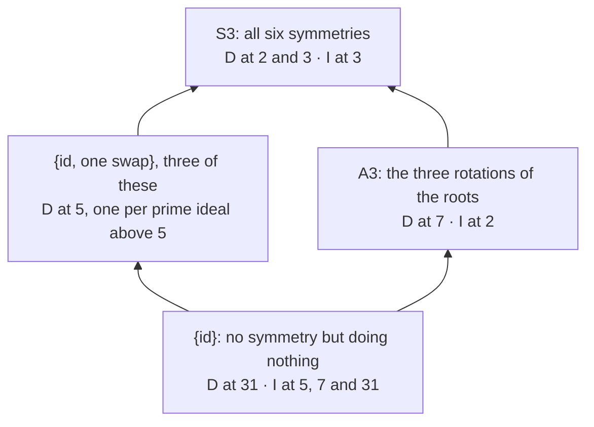

# Decomposition and inertia groups: how one prime's splitting sits inside the Galois group

[Syllabus](../../../SYLLABUS.md) → [Algebraic and analytic number theory](../README.md) → [Local Fields and Class Field Theory](../README.md#s09) → Decomposition and inertia groups

---

## General Overview

Take the three roots of $`x^3 - 2`$: the real cube root $`\alpha`$ of 2, and $`\omega\alpha`$ and $`\omega^2\alpha`$, where $`\omega`$ is a cube root of 1 other than 1 (not the $`(1 + \sqrt d)/2`$ of rings of integers, nor the 2-adic parity $`\omega(u)`$ of [Hasse-Minkowski](01-hasse-minkowski-and-the-hilbert-symbol.md)). The smallest field holding all three is $`L = \mathbb{Q}(\alpha, \omega)`$, of degree 6. Its six symmetries shuffle the three roots in all six ways: the group $`S_3`$ ([Computing a Galois group](../05-Fields%20and%20Galois%20Theory/06-computing-a-galois-group.md)).

Now push an ordinary prime into $`L`$ and watch it break up ([Splitting and ramification](../06-Algebraic%20Numbers/08-splitting-and-ramification.md)). Five primes show five different patterns:

- **31** breaks into six prime ideals. Mod 31 the polynomial $`x^3 - 2`$ has three roots, 4, 7 and 20 (since $`4^3 = 64 = 2 + 2 \times 31`$), and $`x^2 + x + 1`$, the polynomial of $`\omega`$, has two.
- **5** breaks into three prime ideals, each leaving $`5^2`$ remainders.
- **7** breaks into two, each leaving $`7^3`$ remainders.
- **2** becomes one prime ideal cubed, leaving $`2^2`$ remainders.
- **3** becomes one prime ideal to the sixth power.

This card shows that each pattern is written inside $`S_3`$. Pick one prime ideal above a prime $`p`$. The symmetries that keep it in place form a subgroup $`D`$, the **decomposition group**. Those that also leave every remainder modulo it unchanged form a smaller subgroup $`I`$, the **inertia group**. Their two sizes give back the whole pattern.

**The symmetries that keep one prime ideal in place form a group D of size e times f, those that also fix every remainder form a group I of size e, and D modulo I is the remainder field's symmetry group, generated by Frobenius.**

**What kind of fact this is:** two theorems, proved on this card in Why it works for every Galois number field. The reading of a smaller field's primes off $`D`$ is stated with a source. The code checks every prime below 50 for $`x^3 - 2`$; that checks the code, not the theorems.

### The picture: where each prime sits among the subgroups of S3



Each arrow means "sits inside". Higher up means fewer prime ideals; a larger inertia group means more ramification (repeated prime factors).

---

## The formula

Notation first, from earlier cards. $`L`$ is a **Galois number field** of degree $`n`$ over $`\mathbb{Q}`$: it holds every conjugate of each of its numbers. $`G = \mathrm{Gal}(L/\mathbb{Q})`$ is its group of $`n`$ symmetries ([The Galois correspondence](../05-Fields%20and%20Galois%20Theory/05-galois-groups-and-the-fundamental-theorem.md)). $`O_L`$ is its ring of algebraic integers.

An ordinary prime $`p`$ factors in $`O_L`$ into prime ideals. Write $`\mathfrak{P}`$ for one of them. The **residue field** $`O_L/\mathfrak{P}`$ is the remainders modulo $`\mathfrak{P}`$: a finite field with $`p^f`$ members, $`\mathrm{GF}(p^f)`$. As on [Splitting and ramification](../06-Algebraic%20Numbers/08-splitting-and-ramification.md), $`e`$ counts how often $`\mathfrak{P}`$ repeats, $`f`$ is its residue degree and $`g`$ counts the prime ideals above $`p`$.

A symmetry $`\sigma`$ moves a prime ideal to a prime ideal: $`\sigma(\mathfrak{P})`$ is the set of all $`\sigma(x)`$ with $`x`$ in $`\mathfrak{P}`$. New on this card:

```math
D_{\mathfrak{P}} = \{\, \sigma \in G : \sigma(\mathfrak{P}) = \mathfrak{P} \,\}, \qquad I_{\mathfrak{P}} = \{\, \sigma \in D_{\mathfrak{P}} : \sigma(x) \equiv x \pmod{\mathfrak{P}} \text{ for every } x \in O_L \,\}
```

**Read it aloud:** the decomposition group is the symmetries that carry the prime ideal to itself; the inertia group is those among them that leave every remainder modulo it unchanged.

The theorem ties their sizes to the splitting:

```math
n = efg, \qquad \lvert D_{\mathfrak{P}} \rvert = ef, \qquad \lvert I_{\mathfrak{P}} \rvert = e, \qquad D_{\mathfrak{P}}/I_{\mathfrak{P}} \cong \mathrm{Gal}\big((O_L/\mathfrak{P})/\mathrm{GF}(p)\big) = \{\mathrm{id}, \mathrm{Frob}, \dots, \mathrm{Frob}^{f-1}\}
```

**Read it aloud:** the degree is e times f times g; the decomposition group has e times f members and the inertia group e; and the decomposition group modulo the inertia group is the symmetry group of the residue field, which is Frobenius and its repeats.

Here $`\mathrm{Frob}`$ raises each remainder to the $`p`$-th power, the symmetry of a finite field from [Finite fields](../05-Fields%20and%20Galois%20Theory/09-finite-fields-and-frobenius.md). $`D/I`$ is a **quotient group**: $`D`$ with members that differ by an element of $`I`$ counted as one ([Normal subgroups and quotient groups](../../03-Algebra/08-Groups/06-normal-subgroups-and-quotient-groups.md)).

Read the other way, the subgroups give the splitting: $`e = \lvert I \rvert`$, $`f = \lvert D \rvert / \lvert I \rvert`$ and $`g = n / \lvert D \rvert`$. Worked once, at 2: $`D = S_3`$ and $`I = A_3`$, so $`e = 3`$, $`f = 6/3 = 2`$ and $`g = 6/6 = 1`$.

| Symbol | Plain meaning | In our example | Push it up and the answer… |
| --- | --- | --- | --- |
| $`L`$, $`n`$, $`G`$ | a Galois number field, its degree, its symmetries | $`\mathbb{Q}(\alpha, \omega)`$, 6, $`S_3`$ | more symmetries, more possible patterns |
| $`\alpha`$, $`\omega`$; $`r_0, r_1, r_2`$ | the real cube root of 2, a cube root of 1 other than 1; the roots $`\alpha`$, $`\omega\alpha`$, $`\omega^2\alpha`$ | $`r_0 = \alpha`$ | — |
| $`\sigma`$, $`\tau`$; $`s`$, $`t`$; $`(r_0\ r_1)`$ | single symmetries; $`\sigma`$ sends $`\alpha`$ to $`\omega^s\alpha`$ and $`\omega`$ to $`\omega^t`$; the symmetry swapping $`r_0`$ and $`r_1`$ and fixing $`r_2`$ | the Frobenius at one prime above 5 | — |
| $`A_3`$, $`S_3`$ | the three rotations of the roots; all six shuffles | $`I`$ at 2; $`D`$ at 2 | — |
| $`p`$; $`\mathfrak{P}`$ | an ordinary prime; one prime ideal of $`O_L`$ above it | 5; one of three above 5 | — |
| $`O_L/\mathfrak{P}`$ | the residue field, $`\mathrm{GF}(p^f)`$ | $`\mathrm{GF}(5^2)`$ at 5 | — |
| $`e`$, $`f`$, $`g`$ | repeats of $`\mathfrak{P}`$; residue degree; number of prime ideals above $`p`$ | 1, 2, 3 at 5 | their product stays $`n`$ |
| $`D_{\mathfrak{P}}`$ | decomposition group: symmetries keeping $`\mathfrak{P}`$ in place | two members at 5 | $`g = n / \lvert D \rvert`$ falls |
| $`I_{\mathfrak{P}}`$ | inertia group: those also fixing every remainder | $`\{\mathrm{id}\}`$ at 5, $`A_3`$ at 2 | $`e`$ rises: more ramification |
| $`\mathrm{Frob}`$; $`\mathrm{Frob}_{\mathfrak{P}}`$ | the $`p`$-th power map on the residue field; a symmetry in $`D`$ that acts as it | $`(r_0\ r_1)`$ at 5 | — |
| $`N(x)`$; $`\mathfrak{Q}`$, $`\theta`$, $`h(X)`$ | the norm, the product of all conjugates of $`x`$; helpers inside the two folded proofs: another prime ideal above $`p`$, a number chosen by the Chinese remainder theorem, and the polynomial whose roots are its conjugates | — | — |
| $`K`$, $`H`$ | the house fields: $`K = \mathbb{Q}(\sqrt{-5})`$ and $`H = \mathbb{Q}(\sqrt{-5}, i)`$ | used in Step 5 | — |

### When it holds

- **The field must be Galois.** The field $`\mathbb{Q}(\alpha)`$ alone has one symmetry only, doing nothing, and 5 splits into two prime ideals with different residue degrees, 1 and 2. One $`e`$ times one $`f`$ times $`g`$ then gives $`1 \times 1 \times 2 = 2`$, not the degree 3.
- **Use the full ring of integers.** In the house field $`H`$, the ring $`\mathbb{Z}[\sqrt{-5}, i]`$ misses $`(1 + i\sqrt{-5})/2`$; the full ring is $`\mathbb{Z}[i, (1 + \sqrt{5})/2]`$. Computed from that smaller ring, 2 shows $`e = 4`$ and $`f = 1`$; the truth is $`e = 2`$ and $`f = 2`$.
- **D and I belong to a prime ideal, not to p.** Moving to another prime ideal above $`p`$ replaces $`D`$ by $`\tau D \tau^{-1}`$, a **conjugate** subgroup: the same subgroup seen after relabelling by the symmetry $`\tau`$. Only when $`D`$ is normal does $`p`$ alone fix it.
- **Frobenius is one symmetry only when e = 1.** At a ramified prime, every member of a whole coset of $`I`$ acts as Frobenius: at 2, three symmetries do.

---

## Why it works

### Step 0: the idea is a group acting on a finite set

The prime ideals above $`p`$ form a finite set, and $`G`$ shuffles them. The decomposition group is the **stabiliser** of one of them: the symmetries that leave it where it is. Counting with orbit times stabiliser ([Group actions](../../03-Algebra/08-Groups/08-group-actions-and-counting.md)) gives $`\lvert D \rvert`$. Then a symmetry that keeps $`\mathfrak{P}`$ in place also shuffles the remainders modulo $`\mathfrak{P}`$, and the finite-field picture finishes the job.

### Step 1: G carries any prime ideal above p to any other

Above 5 there are three prime ideals, and the symmetries move each one to each of the others. This holds in every Galois number field: the action is **transitive**, a single orbit. The proof plays the Chinese remainder theorem against the norm, the product of all conjugates.

<details>
<summary>Detailed proof: the symmetries reach every prime ideal above p</summary>

Suppose $`\mathfrak{Q}`$ lies above $`p`$ but differs from every $`\sigma(\mathfrak{P})`$. Distinct prime ideals share no factor, so the Chinese remainder theorem applies in its form for ideals: when no prime ideal divides two of the chosen ideals, any choice of remainders modulo each one is met by a single member of $`O_L`$. The proof is the whole-number one from [The Chinese remainder theorem](../../02-Number%20theory/03-Clock%20Arithmetic/06-chinese-remainder-theorem.md), with 1 written as a sum of one member from each of two ideals in place of Bézout's identity. Here it gives an $`x`$ in $`O_L`$ with $`x \equiv 0 \pmod{\mathfrak{Q}}`$ and $`x \equiv 1 \pmod{\sigma(\mathfrak{P})}`$ for every $`\sigma`$ in $`G`$.

The norm $`N(x)`$ is the product of all $`\sigma(x)`$. It is an ordinary integer, and the factor with $`\sigma = \mathrm{id}`$ lies in $`\mathfrak{Q}`$, so $`N(x)`$ lies in $`\mathfrak{Q} \cap \mathbb{Z} = p\mathbb{Z}`$, which sits inside $`\mathfrak{P}`$.

A prime ideal that holds a product holds a factor. So some $`\sigma(x)`$ lies in $`\mathfrak{P}`$, which means $`x`$ lies in $`\sigma^{-1}(\mathfrak{P})`$. That contradicts $`x \equiv 1`$ modulo $`\sigma^{-1}(\mathfrak{P})`$.

</details>

### Step 2: one e and one f for every prime ideal, so efg = n

A symmetry $`\sigma`$ fixes the ideal $`p\,O_L`$, so it maps its factorisation onto itself. If $`\mathfrak{P}`$ appears $`e`$ times, so does $`\sigma(\mathfrak{P})`$. And $`\sigma`$ turns remainders modulo $`\mathfrak{P}`$ into remainders modulo $`\sigma(\mathfrak{P})`$, one for one, so both residue fields have $`p^f`$ members.

By Step 1 every prime ideal above $`p`$ is some $`\sigma(\mathfrak{P})`$. So all $`g`$ of them share one $`e`$ and one $`f`$. [Splitting and ramification](../06-Algebraic%20Numbers/08-splitting-and-ramification.md) proves that the products $`e_i f_i`$ add to $`n`$. Here that sum is $`g`$ equal terms:

```math
n = e_1 f_1 + \cdots + e_g f_g = efg, \qquad \lvert D \rvert = \frac{\lvert G \rvert}{g} = ef
```

**Read it aloud:** the degree is g copies of e times f, and since the orbit has g members, the stabiliser has n over g, which is e times f, members.

At 5: $`g = 3`$, so $`\lvert D \rvert = 6/3 = 2`$. The three prime ideals above 5 have the three different two-member subgroups $`\{\mathrm{id}, (r_0\ r_1)\}`$, $`\{\mathrm{id}, (r_0\ r_2)\}`$ and $`\{\mathrm{id}, (r_1\ r_2)\}`$: conjugates, as Step 1 predicts.

### Step 3: D maps onto the symmetries of the residue field, and I is the kernel

A symmetry $`\sigma`$ in $`D`$ keeps $`\mathfrak{P}`$ in place, so it sends each remainder $`x \bmod \mathfrak{P}`$ to $`\sigma(x) \bmod \mathfrak{P}`$. That is a symmetry of the residue field $`\mathrm{GF}(p^f)`$. So $`D`$ maps into $`\mathrm{Gal}(\mathrm{GF}(p^f)/\mathrm{GF}(p))`$, which [Finite fields](../05-Fields%20and%20Galois%20Theory/09-finite-fields-and-frobenius.md) shows is $`f`$ repeats of Frobenius.

The symmetries sent to "do nothing" are exactly $`I`$, by its definition. So $`I`$ is the **kernel** of this map, and a kernel is always a normal subgroup. The key fact is that the map is **onto**: some symmetry of $`L`$ acts as Frobenius.

<details>
<summary>Detailed proof: some symmetry in D acts as Frobenius on the residue field</summary>

The nonzero members of $`\mathrm{GF}(p^f)`$ form a cyclic group under multiplication, so pick a generator $`\bar\theta`$. By the Chinese remainder theorem pick $`\theta`$ in $`O_L`$ with $`\theta \equiv \bar\theta \pmod{\mathfrak{P}}`$ and $`\theta \equiv 0`$ modulo every other prime ideal above $`p`$.

Let $`h(X)`$ be the product of $`X - \sigma(\theta)`$ over all $`\sigma`$ in $`G`$. Every symmetry only reorders the factors, so the coefficients are rational. They are algebraic integers too, so they are ordinary integers.

Reduce modulo $`\mathfrak{P}`$. Then $`\bar\theta`$ is a root of $`\bar h`$. Its coefficients lie in $`\mathrm{GF}(p)`$, so $`\bar h(\bar\theta^{\,p}) = \bar h(\bar\theta)^p = 0`$. So $`\bar\theta^{\,p} \equiv \sigma(\theta) \pmod{\mathfrak{P}}`$ for some $`\sigma`$.

If $`\sigma`$ were outside $`D`$, then $`\sigma^{-1}(\mathfrak{P})`$ would be another prime ideal above $`p`$. Then $`\theta`$ lies in it, $`\sigma(\theta)`$ lies in $`\mathfrak{P}`$, and $`\bar\theta^{\,p} = 0`$. That is impossible, since $`\bar\theta`$ is nonzero. So $`\sigma`$ is in $`D`$.

On the residue field, $`\sigma`$ sends the generator $`\bar\theta`$ to $`\bar\theta^{\,p}`$. A field symmetry is fixed by where it sends a generator, so $`\sigma`$ acts as Frobenius. Frobenius generates the whole group, so the map is onto.

</details>

A map onto a group of $`f`$ members with kernel $`I`$ gives:

```math
D/I \cong \mathrm{Gal}\big(\mathrm{GF}(p^f)/\mathrm{GF}(p)\big), \qquad \lvert I \rvert = \frac{\lvert D \rvert}{f} = \frac{ef}{f} = e
```

**Read it aloud:** the decomposition group modulo the inertia group is the residue field's symmetry group, so the inertia group has e members.

When $`e = 1`$ the inertia group is trivial and exactly one symmetry acts as Frobenius: the **Frobenius element** $`\mathrm{Frob}_{\mathfrak{P}}`$. It generates $`D`$. At 31 it is $`\mathrm{id}`$, at 5 the swap $`(r_0\ r_1)`$ and at 7 the rotation $`(r_0\ r_2\ r_1)`$, each for the first prime ideal the code finds. At 2 the whole coset of $`I`$ acts as Frobenius: the three swaps.

### Step 4: read each prime's splitting off D and I

$`S_3`$ has subgroups of sizes 1, 2, 3 and 6, and the five primes use them all:

| $`p`$ | $`x^3 - 2`$ mod $`p`$; $`x^2 + x + 1`$ mod $`p`$ | $`D`$ | $`I`$ | $`e, f, g`$ |
| --- | --- | --- | --- | --- |
| 31 | three lines; two lines | $`\{\mathrm{id}\}`$ | $`\{\mathrm{id}\}`$ | 1, 1, 6 |
| 5 | a line and a quadratic; a quadratic | $`\{\mathrm{id}, (r_0\ r_1)\}`$ | $`\{\mathrm{id}\}`$ | 1, 2, 3 |
| 7 | a cubic; two lines | $`A_3`$ | $`\{\mathrm{id}\}`$ | 1, 3, 2 |
| 2 | a line cubed; a quadratic | $`S_3`$ | $`A_3`$ | 3, 2, 1 |
| 3 | a line cubed; a line squared | $`S_3`$ | $`S_3`$ | 6, 1, 1 |

A "line" is a factor of degree 1 and a "quadratic" or "cubic" an irreducible factor of degree 2 or 3.

For an unramified prime, $`D`$ is the cyclic subgroup generated by the Frobenius element. A swap has order 2 and a rotation order 3, so $`f`$ is 2 or 3 and $`g`$ is 3 or 2. For every prime $`p`$ larger than 3, $`D`$ has two members exactly when $`p`$ is 2 more than a multiple of 3. Then $`\omega`$ is missing mod $`p`$, which forces $`f`$ to be even, and 2 is the only even choice. The code confirms this below 50.

The same subgroups describe the smaller field $`\mathbb{Q}(\alpha)`$. Its prime ideals above $`p`$ match the orbits of $`D`$ on the three roots, and each orbit's size is that prime ideal's $`e_i f_i`$ (stated and proved in Marcus, chapter 4, cited below). At 5, $`D = \{\mathrm{id}, (r_0\ r_1)\}`$ has orbits $`\{r_2\}`$ and $`\{r_0, r_1\}`$, of sizes 1 and 2. Mod 5, $`x^3 - 2`$ factors as a line times an irreducible quadratic: degrees 1 and 2. The code checks this match for every prime below 50.

### Step 5: the house field, where inertia shows that nothing ramifies

The shelf's house example is $`K = \mathbb{Q}(\sqrt{-5})`$, where 6 factors two ways, and $`H = \mathbb{Q}(\sqrt{-5}, i)`$, its Hilbert class field ([Artin reciprocity](05-artin-reciprocity-and-the-hilbert-class-field.md)). $`H`$ has degree 4 and four symmetries: change the sign of $`\sqrt{-5}`$, of $`i`$, of both, or of neither. Write them $`{+}{+}`$, $`{-}{+}`$, $`{+}{-}`$, $`{-}{-}`$, the sign on $`\sqrt{-5}`$ first. The symmetries fixing $`K`$ are $`\mathrm{Gal}(H/K) = \{{+}{+}, {+}{-}\}`$.

| $`p`$ | $`e, f, g`$ in $`H`$ | $`D`$ | $`I`$ |
| --- | --- | --- | --- |
| 29 | 1, 1, 4 | $`\{{+}{+}\}`$ | $`\{{+}{+}\}`$ |
| 3 | 1, 2, 2 | $`\{{+}{+}, {+}{-}\}`$ | $`\{{+}{+}\}`$ |
| 5 | 2, 1, 2 | $`\{{+}{+}, {-}{+}\}`$ | the same |
| 2 | 2, 2, 1 | all four | $`\{{+}{+}, {-}{-}\}`$ |

At 2 the inertia group comes from the three quadratic fields inside $`H`$. The prime 2 ramifies in $`\mathbb{Q}(i)`$ and in $`K`$ but not in $`\mathbb{Q}(\sqrt{5})`$. Here a rule from Marcus, chapter 4, applies: a prime is unramified in the field fixed by a subgroup exactly when $`I`$ lies inside that subgroup. So $`I`$ is the pair fixing $`\sqrt{5} = -i\sqrt{-5}`$, namely $`\{{+}{+}, {-}{-}\}`$. Road 2 of the code finds the same pair from the definition, working in the full ring $`\mathbb{Z}[i, (1 + \sqrt{5})/2]`$.

The ramification of a prime ideal of $`H`$ over $`K`$ is the size of $`I \cap \mathrm{Gal}(H/K)`$, by the same chapter of Marcus. At 2 and at 5 that intersection is $`\{{+}{+}\}`$, one symmetry. So no prime ideal of $`K`$ ramifies in $`H`$, though 2 and 5 ramify over $`\mathbb{Q}`$. That is the defining property of a Hilbert class field.

$`D`$ also sorts the primes of $`K`$. At 3, $`D = \mathrm{Gal}(H/K)`$: 3 splits in $`K`$ into two prime ideals that no single number generates, and each stays prime in $`H`$. Below 50, $`D`$ is trivial exactly at 29 and 41, the primes that are 1 or 9 mod 20.

**Where proof ends and evidence begins.** Steps 1 to 3 are proved for every Galois number field and every prime. The subfield reading in Step 4 and the intersection rule in Step 5 are stated with sources. The code's agreement on the primes below 50 is evidence that the code is right, not further proof.

---

## Worked numbers, by hand

Everything at the prime 2, where both groups are visible.

| Step | Arithmetic | Value |
| --- | --- | --- |
| $`x^3 - 2`$ mod 2 | $`-2 \equiv 0`$, so $`x^3`$ | one root, three times: in $`\mathbb{Q}(\alpha)`$, 2 is a cube, $`e \ge 3`$ |
| $`x^2 + x + 1`$ mod 2 | at 0 and at 1 it gives 1 | no root: 2 stays prime in $`\mathbb{Q}(\omega)`$, $`f \ge 2`$ |
| $`efg = 6`$ | $`e \ge 3`$, $`f \ge 2`$ | $`e = 3`$, $`f = 2`$, $`g = 1`$ |
| $`D`$ | $`g = 1`$, so nothing can move $`\mathfrak{P}`$ | all six: $`S_3`$ |
| residue field | $`\alpha \mapsto 0`$, $`\omega \mapsto`$ a root of $`x^2 + x + 1`$ | $`\mathrm{GF}(4)`$ |
| what $`\sigma`$ does there | $`\sigma`$ sends $`\alpha`$ to $`\omega^s\alpha`$, still 0, and $`\omega`$ to $`\omega^t`$ | it acts as $`\bar\omega \mapsto \bar\omega^{\,t}`$ |
| $`I`$ | the three with $`t = 1`$ | **$`A_3`$, 3 members $`= e`$** |
| $`D/I`$ | $`6 / 3`$ | **2 members $`= f`$: Frobenius on $`\mathrm{GF}(4)`$** |
| Frobenius | the three with $`t = 2`$ | **3 symmetries, one coset** |

So at 2 the inertia group is the three rotations of the roots, of size $`e = 3`$, and the three swaps all square the residue field $`\mathrm{GF}(4)`$: the 6 symmetries split as $`e \times f = 3 \times 2`$.

### What breaks if you drop a piece

| Mistake | Comes out at | What went wrong |
| --- | --- | --- |
| Treat $`\mathbb{Q}(\alpha)`$ as Galois and read $`efg`$ off its first prime ideal above 5 | $`1 \times 1 \times 2 = 2`$, not 3 | its two prime ideals above 5 have $`f = 1`$ and $`f = 2`$; only a Galois field has one $`e`$ and one $`f`$ |
| Take $`I`$ to be $`D`$ at 2 | $`e = 6`$, so $`efg = 12`$, not 6 | $`D`$ also holds the symmetries acting as Frobenius on $`\mathrm{GF}(4)`$ |
| Use $`\mathbb{Z}[\sqrt{-5}, i]`$ for the integers of $`H`$ at 2 | one point, fixed by all 4: $`e = 4`$, $`f = 1`$ | the ring misses $`(1 + i\sqrt{-5})/2`$; truly $`e = 2`$, $`f = 2`$ |
| Call one symmetry "the Frobenius at 2" | 3 candidates | at a ramified prime Frobenius is a coset of $`I`$ |

The code prints all four.

---

## Code, from first principles, and it actually runs

The code reaches $`e`$, $`f`$, $`g`$, $`D`$ and $`I`$ by **two roads** that share no step.

1. **Road 1** factors $`x^3 - 2`$ and $`x^2 + x + 1`$ modulo $`p`$ by trying every remainder, as on [Splitting and ramification](../06-Algebraic%20Numbers/08-splitting-and-ramification.md). In the smaller fields, $`e`$ and $`f`$ can only grow on the way up to $`L`$. If no factor repeats, nothing ramifies in either smaller field. Then the rule from Marcus in Step 5 puts $`I`$ inside the symmetries fixing each smaller field, and only $`\mathrm{id}`$ fixes both, so $`e = 1`$ and $`f`$, the order of Frobenius, is the least common multiple of the factor degrees. Otherwise the growth rule and $`efg = 6`$ leave one answer at every prime the code tries.
2. **Road 2** never factors. It builds $`\mathrm{GF}(p^k)`$ for $`k = 1, 2, 3`$ and lists the **points**: pairs $`(a, b)`$ with $`a^3 = 2`$ and $`b^2 + b + 1 = 0`$. A point is a way to send $`\alpha`$ to $`a`$ and $`\omega`$ to $`b`$, which is the remainder map modulo one prime ideal. That needs $`\mathbb{Z}[\alpha, \omega]`$ to be the full ring of integers, and it is, except at 3. At 3 the answer still stands: 3 is totally ramified with remainders $`\mathrm{GF}(3)`$, so every symmetry fixes the one prime ideal and acts trivially on its remainders, as the one point says. Raising both entries to the $`p`$-th power gives another point for the same prime ideal, so prime ideals match Frobenius orbits of points. The symmetry $`(s, t)`$, which sends $`\alpha`$ to $`\omega^s\alpha`$ and $`\omega`$ to $`\omega^t`$, moves the point $`(a, b)`$ to $`(b^s a, b^t)`$. $`D`$ is the symmetries keeping a point inside its orbit, and $`I`$ those fixing it.

Road 2 also checks Step 3 directly: the map from $`D`$ to Frobenius powers respects composition, is onto, and has kernel $`I`$. An assert ties the action on points to the root labels $`r_0, r_1, r_2`$, so the named swaps and rotations are checked too. Both roads run on every prime below 50 and on the house field, where road 2 uses the full ring $`\mathbb{Z}[i, (1 + \sqrt{5})/2]`$. Only `math.lcm` is imported.

### Python

```python
# Decomposition and inertia groups -- the check behind the card.  Imports only
# math.lcm.  L is the splitting field of x^3 - 2: a^3 = 2, w^2 + w + 1 = 0; the
# symmetry (s, t) sends a to w^s a and w to w^t, so root r_j = w^j a goes to
# r_(tj+s).  Road 1 factors subfield polynomials mod p and uses efg = n.  Road 2
# never factors: it builds GF(p^k), lists the points (a, b), and reads D and I
# off how the symmetries move one point.  The house field H = Q(sqrt-5, i) too.
from math import lcm
def mul(u, v, p, m):                     # product in GF(p^k) = GF(p)[z]/(m)
    k = len(m) - 1
    r = [sum(u[i] * v[d - i] for i in range(k) if 0 <= d - i < k) for d in range(2 * k - 1)]
    for d in range(2 * k - 2, k - 1, -1):
        c = r[d] % p
        r[d - k:d + 1] = [x - c * y for x, y in zip(r[d - k:d + 1], m)]
    return tuple(x % p for x in r[:k])
def pw(x, n, p, m):                      # x to the power n, one multiplication at a time
    return (1,) + (0,) * (len(m) - 2) if n == 0 else mul(pw(x, n - 1, p, m), x, p, m)
def ev(poly, x, p, m):                   # a whole-number polynomial at x, by Horner
    acc = (0,) * (len(m) - 1)
    for c in reversed(poly):
        acc = mul(acc, x, p, m)
        acc = ((acc[0] + c) % p,) + acc[1:]
    return acc
def elems(p, k):                         # every k-tuple mod p, first entry slowest
    return [tuple(i // p ** (k - 1 - j) % p for j in range(k)) for i in range(p ** k)]
def modulus(p, k):                       # a rootless monic of degree 2 or 3 is irreducible
    return (0, 1) if k == 1 else next(t + (1,) for t in elems(p, k) if all(
        sum(c * r ** i for i, c in enumerate(t + (1,))) % p for r in range(p)))
def pattern(poly, p):                    # [(degree, exponent)] of poly's factors mod p
    c, out = [x % p for x in poly], []
    for r in range(p):
        e = 0
        while len(c) > 1 and sum(x * r ** i for i, x in enumerate(c)) % p == 0:
            q = [0] * (len(c) - 1)       # divide by (x - r), top coefficient first
            for i in range(len(c) - 1, 0, -1):
                q[i - 1] = (c[i] + r * (q[i] if i < len(q) else 0)) % p
            c, e = q, e + 1
        out += [(1, e)] if e else []
    return out + ([(len(c) - 1, 1)] if len(c) > 1 else [])
def road1(F, p):                         # e, f only grow up a tower; efg = n pins them
    pats = [pattern(s, p) for s in F["subs"]]
    le, lf = lcm(*[e for pt in pats for _, e in pt]), lcm(*[d for pt in pats for d, _ in pt])
    n, gmax = F["n"], max(len(pt) for pt in pats)
    return [(e, f, n // (e * f)) for e in range(1, n + 1) for f in range(1, n + 1)
            if n % (e * f) == 0 and e % le == 0 and f % lf == 0 and n // (e * f) >= gmax
            and (le > 1 or (e, f) == (1, lf))]
def act(F, g, pt, p, m):                 # the point pt composed with the symmetry g
    a, b = pt
    if F["n"] == 6:
        return (mul(pw(b, g[0], p, m), a, p, m), pw(b, g[1], p, m))
    flip = lambda x, s, c=0: x if s > 0 else tuple(((c if j == 0 else 0) - y) % p for j, y in enumerate(x))
    return (flip(a, g[1]), flip(b, g[0] * g[1], 1)) if "phi" in F else (flip(a, g[0]), flip(b, g[1]))
def road2(F, p):
    for k in (1, 2, 3):                  # the smallest GF(p^k) holding a point
        m = modulus(p, k)
        roots = [[x for x in elems(p, k) if ev(poly, x, p, m) == (0,) * k] for poly in (F["px"], F["py"])]
        pts = [(x, y) for x in roots[0] for y in roots[1]]
        if pts:
            break
    orbits, seen = [], set()
    for pt in pts:                       # Frobenius orbits: one per prime ideal above p
        if pt not in seen:
            o = [pt]
            while (nxt := (pw(o[-1][0], p, p, m), pw(o[-1][1], p, p, m))) != pt:
                o.append(nxt)
            orbits.append(o)
            seen.update(o)
    D_of = lambda o: [g for g in F["G"] if act(F, g, o[0], p, m) in o]
    O, f = orbits[0], len(orbits[0])
    D = D_of(O)
    kk = {g: O.index(act(F, g, O[0], p, m)) for g in D}     # g acts on GF(p^f) as Frob^kk
    I = [g for g in D if act(F, g, O[0], p, m) == O[0]]
    ok = (all(O.index(act(F, h, act(F, g, O[0], p, m), p, m)) == (kk[g] + kk[h]) % f for g in D for h in D)
          and sorted(set(kk.values())) == list(range(f)) and [g for g in D if kk[g] == 0] == I
          and sorted({act(F, g, O[0], p, m) for g in F["G"]}) == sorted(pts))
    return dict(k=k, npts=len(pts), e=len(I), f=f, g=len(orbits), D=D, I=I, ok=ok,
                frob=[g for g in D if kk[g] == 1 % f], allD=[D_of(o) for o in orbits])
perm = lambda g, j: (g[1] * j + g[0]) % 3
def cyc(g):                              # a cubic symmetry as cycles of r0, r1, r2
    out, seen = "", set()
    for j in range(3):
        c = [j]
        while j not in seen and perm(g, c[-1]) != j:
            c.append(perm(g, c[-1]))
        seen.update(c)
        out += "(" + " ".join(f"r{x}" for x in c) + ")" if len(c) > 1 else ""
    return out or "id"
nest = lambda g, n, j: j if n == 0 else nest(g, n - 1, perm(g, j))      # g applied n times
order = lambda g: min(n for n in range(1, 7) if all(nest(g, n, j) == j for j in range(3)))
orbit_sizes = lambda D: sorted(len(o) for o in {frozenset(perm(g, j) for g in D) for j in range(3)})
CUBIC = dict(n=6, px=(-2, 0, 0, 1), py=(1, 1, 1), subs=[(-2, 0, 0, 1), (1, 1, 1)],
             G=[(s, t) for t in (1, 2) for s in range(3)])
HOUSE = dict(n=4, px=(5, 0, 1), py=(1, 0, 1), subs=[(5, 0, 1), (1, 0, 1), (-1, -1, 1)],
             G=[(u, v) for u in (1, -1) for v in (1, -1)])
FULL = dict(HOUSE, px=(1, 0, 1), py=(-1, -1, 1), phi=1)   # all of O_H: Z[i, phi], phi = (1 + sqrt5)/2; g sends phi to 1 - phi if g0 g1 = -1
sg = lambda g: ("+" if g[0] > 0 else "-") + ("+" if g[1] > 0 else "-")
show = lambda S, nm: "{" + ", ".join(nm(g) for g in S) + "}"
print("L = splitting field of x^3 - 2, n = 6, G = S3 on r0 = a, r1 = w a, r2 = w^2 a")
print(f"by hand: 4^3 = {4 ** 3} = 2 + 2 x 31; roots of x^3 - 2 mod 31: {[r for r in range(31) if (r ** 3 - 2) % 31 == 0]}; of x^2 + x + 1 mod 31: {[r for r in range(31) if (r * r + r + 1) % 31 == 0]}")
print(f"(degree, power) of the factors of x^3 - 2 and x^2 + x + 1 mod 31, 5, 7, 2, 3: {[(pattern(CUBIC['px'], p), pattern(CUBIC['py'], p)) for p in (31, 5, 7, 2, 3)]}")
R = {p: road2(CUBIC, p) for p in (31, 5, 7, 2, 3)}
for p, x in R.items():
    print(f"p={p}: road 1 (e,f,g) = {road1(CUBIC, p)[0]} | road 2 {(x['e'], x['f'], x['g'])}, {x['npts']} "
          f"point{'s' * (x['npts'] > 1)} in GF({p}^{x['k']}) | D = {show(x['D'], cyc)} | I = {show(x['I'], cyc)}")
print(f"p=5: the 3 primes above 5 have D = {', '.join(show(D, cyc) for D in R[5]['allD'])}")
print(f"Frobenius at 31, 5, 7: {cyc(R[31]['frob'][0])}, {cyc(R[5]['frob'][0])}, {cyc(R[7]['frob'][0])}; "
      f"at 2, {len(R[2]['frob'])} symmetries act as Frobenius on GF(4): {show(R[2]['frob'], cyc)}")
o3 = sorted(order(g) for g in R[3]["I"])
print(f"p=3: orders in I = S3: {o3}; none is 6, so I is not cyclic")
sweep = [p for p in range(2, 50) if all(p % d for d in range(2, p))]
rows = {p: road2(CUBIC, p) for p in sweep}
agree = all(road1(CUBIC, p) == [(rows[p]["e"], rows[p]["f"], rows[p]["g"])] and rows[p]["ok"] for p in sweep)
orb = all(orbit_sizes(rows[p]["D"]) == sorted(d * e for d, e in pattern(CUBIC["px"], p)) for p in sweep)
print(f"primes below 50: road 1 = road 2, D onto Gal(GF(p^f)/GF(p)) with kernel I, G moves one point to all: "
      f"{'yes' if agree else 'no'}\nprimes below 50: D's orbits on r0, r1, r2 = factors of x^3 - 2 mod p: {'yes' if orb else 'no'}")
for size in (1, 2, 3): print(f"  |D| = {size}, unramified: {[p for p in sweep if p > 3 and len(rows[p]['D']) == size]}")
print("house H = Q(sqrt-5, i), O_H = Z[i, (1+sqrt5)/2], n = 4, symmetry = (sign on sqrt-5, sign on i), Gal(H/K) = {++, +-}")
for p in (29, 3, 5, 2):
    x = road2(FULL, p)
    print(f"p={p}: e={x['e']} f={x['f']} g={x['g']} | D = {show(x['D'], sg)} | I = {show(x['I'], sg)}")
    assert road1(HOUSE, p) == [(x["e"], x["f"], x["g"])] and x["ok"]
h2, i5, r2 = road1(HOUSE, 2), road2(HOUSE, 5)["I"], road2(FULL, 2)
clean = [i for i, s in enumerate(HOUSE["subs"]) if all(e == 1 for _, e in pattern(s, 2))]
im = [g for g in HOUSE["G"] if all((g[0], g[1], g[0] * g[1])[j] == 1 for j in clean)]   # g's sign on sqrt-5, i, sqrt5
print(f"p=2 by road 1: (e,f,g) = {h2[0]}; 2 is unramified only in Q(sqrt5), so I = {show(im, sg)}")
meet = [len([g for g in I if g[0] == 1]) for I in (r2["I"], i5)]
print(f"I meets Gal(H/K) in {meet[0]} symmetry at 2 and {meet[1]} at 5: H/K is unramified at 2 and 5")
hsweep = [p for p in sweep if p > 2 and road2(HOUSE, p)["D"] == [(1, 1)]]
print(f"odd primes below 50 with D trivial in H: {hsweep}")
k5, b2 = pattern(CUBIC["px"], 5), road2(HOUSE, 2)
print(f"mistake 1, Q(a) not Galois: x^3 - 2 mod 5 has factor degrees {[d for d, _ in k5]}; e f g from the first prime = 1 x {k5[0][0]} x {len(k5)} = {k5[0][0] * len(k5)}, not 3")
print(f"mistake 2, I read as D at 2: e = {len(R[2]['D'])}, e f g = {len(R[2]['D']) * 2}, not 6")
print(f"mistake 3, Z[sqrt-5, i] taken as all integers of H at 2: {b2['npts']} point, fixed by {b2['e']}: e = {b2['e']}, f = {b2['f']}; truly e = {r2['e']}, f = {r2['f']}")
assert all(road1(CUBIC, p) == [(x["e"], x["f"], x["g"])] and x["ok"] for p, x in R.items())
assert [len(x["D"]) for x in R.values()] == [1, 2, 3, 6, 6] and [len(x["I"]) for x in R.values()] == [1, 1, 1, 3, 6]
assert agree and orb and len({tuple(D) for D in R[5]["allD"]}) == 3 and o3 == [1, 2, 2, 2, 3, 3]
assert [p for p in sweep if p > 3 and len(rows[p]["D"]) == 2] == [p for p in sweep if p % 3 == 2 and p > 2]
assert h2 == [(2, 2, 1)] and clean == [2] and im == r2["I"] and meet == [1, 1] and hsweep == [p for p in sweep if p % 20 in (1, 9)]
assert (b2["e"], b2["f"]) == (4, 1) and sorted(R[2]["frob"]) == sorted(set(R[2]["D"]) - set(R[2]["I"])) and [order(R[p]["frob"][0]) for p in (31, 5, 7)] == [1, 2, 3]
assert all(b[0] ** j * a[0] % 31 == 5 ** perm(g, j) * 4 % 31 for g in CUBIC["G"] for a, b in [act(CUBIC, g, ((4,), (5,)), 31, (0, 1))] for j in range(3))   # act agrees with perm
print("ALL CHECKS PASS")
```

**Ran 2026-11-24 on macOS, Python 3.14.10, standard library only. All checks passed. Output, pasted from the run:**

```
L = splitting field of x^3 - 2, n = 6, G = S3 on r0 = a, r1 = w a, r2 = w^2 a
by hand: 4^3 = 64 = 2 + 2 x 31; roots of x^3 - 2 mod 31: [4, 7, 20]; of x^2 + x + 1 mod 31: [5, 25]
(degree, power) of the factors of x^3 - 2 and x^2 + x + 1 mod 31, 5, 7, 2, 3: [([(1, 1), (1, 1), (1, 1)], [(1, 1), (1, 1)]), ([(1, 1), (2, 1)], [(2, 1)]), ([(3, 1)], [(1, 1), (1, 1)]), ([(1, 3)], [(2, 1)]), ([(1, 3)], [(1, 2)])]
p=31: road 1 (e,f,g) = (1, 1, 6) | road 2 (1, 1, 6), 6 points in GF(31^1) | D = {id} | I = {id}
p=5: road 1 (e,f,g) = (1, 2, 3) | road 2 (1, 2, 3), 6 points in GF(5^2) | D = {id, (r0 r1)} | I = {id}
p=7: road 1 (e,f,g) = (1, 3, 2) | road 2 (1, 3, 2), 6 points in GF(7^3) | D = {id, (r0 r1 r2), (r0 r2 r1)} | I = {id}
p=2: road 1 (e,f,g) = (3, 2, 1) | road 2 (3, 2, 1), 2 points in GF(2^2) | D = {id, (r0 r1 r2), (r0 r2 r1), (r1 r2), (r0 r1), (r0 r2)} | I = {id, (r0 r1 r2), (r0 r2 r1)}
p=3: road 1 (e,f,g) = (6, 1, 1) | road 2 (6, 1, 1), 1 point in GF(3^1) | D = {id, (r0 r1 r2), (r0 r2 r1), (r1 r2), (r0 r1), (r0 r2)} | I = {id, (r0 r1 r2), (r0 r2 r1), (r1 r2), (r0 r1), (r0 r2)}
p=5: the 3 primes above 5 have D = {id, (r0 r1)}, {id, (r0 r2)}, {id, (r1 r2)}
Frobenius at 31, 5, 7: id, (r0 r1), (r0 r2 r1); at 2, 3 symmetries act as Frobenius on GF(4): {(r1 r2), (r0 r1), (r0 r2)}
p=3: orders in I = S3: [1, 2, 2, 2, 3, 3]; none is 6, so I is not cyclic
primes below 50: road 1 = road 2, D onto Gal(GF(p^f)/GF(p)) with kernel I, G moves one point to all: yes
primes below 50: D's orbits on r0, r1, r2 = factors of x^3 - 2 mod p: yes
  |D| = 1, unramified: [31, 43]
  |D| = 2, unramified: [5, 11, 17, 23, 29, 41, 47]
  |D| = 3, unramified: [7, 13, 19, 37]
house H = Q(sqrt-5, i), O_H = Z[i, (1+sqrt5)/2], n = 4, symmetry = (sign on sqrt-5, sign on i), Gal(H/K) = {++, +-}
p=29: e=1 f=1 g=4 | D = {++} | I = {++}
p=3: e=1 f=2 g=2 | D = {++, +-} | I = {++}
p=5: e=2 f=1 g=2 | D = {++, -+} | I = {++, -+}
p=2: e=2 f=2 g=1 | D = {++, +-, -+, --} | I = {++, --}
p=2 by road 1: (e,f,g) = (2, 2, 1); 2 is unramified only in Q(sqrt5), so I = {++, --}
I meets Gal(H/K) in 1 symmetry at 2 and 1 at 5: H/K is unramified at 2 and 5
odd primes below 50 with D trivial in H: [29, 41]
mistake 1, Q(a) not Galois: x^3 - 2 mod 5 has factor degrees [1, 2]; e f g from the first prime = 1 x 1 x 2 = 2, not 3
mistake 2, I read as D at 2: e = 6, e f g = 12, not 6
mistake 3, Z[sqrt-5, i] taken as all integers of H at 2: 1 point, fixed by 4: e = 4, f = 1; truly e = 2, f = 2
ALL CHECKS PASS
```

### Rust

Same numbers, same labels, built with `rustc --edition 2021 -O`.

```rust
// Decomposition and inertia groups -- the same check as the Python, in Rust.  No
// crates.  L is the splitting field of x^3 - 2: a^3 = 2, w^2 + w + 1 = 0; the
// symmetry (s, t) sends a to w^s a and w to w^t, so root r_j = w^j a goes to
// r_(tj+s).  Road 1 factors subfield polynomials mod p and uses efg = n.  Road 2
// never factors: it builds GF(p^k), lists the points (a, b), and reads D and I
// off how the symmetries move one point.  The house field H = Q(sqrt-5, i) too.
type E = Vec<i64>; type Pt = (E, E); type G = (i64, i64);
struct Field { n: usize, px: Vec<i64>, py: Vec<i64>, subs: Vec<Vec<i64>>, g: Vec<G>, phi: bool }
struct R2 { k: u32, npts: usize, e: usize, f: usize, g: usize, d: Vec<G>, i: Vec<G>, ok: bool, frob: Vec<G>, all_d: Vec<Vec<G>> }

fn mul(u: &E, v: &E, p: i64, m: &E) -> E {            // product in GF(p^k) = GF(p)[z]/(m)
    let (k, mut r) = (m.len() - 1, vec![0i64; 2 * m.len() - 3]);
    for i in 0..k { for j in 0..k { r[i + j] += u[i] * v[j] } }
    for d in (k..2 * k - 1).rev() { let c = r[d].rem_euclid(p); for i in 0..=k { r[d - k + i] -= c * m[i] } }
    r[..k].iter().map(|x| x.rem_euclid(p)).collect()
}
fn pw(x: &E, n: i64, p: i64, m: &E) -> E {            // x to the power n, one multiplication at a time
    let mut one = vec![0i64; m.len() - 1];
    one[0] = 1;
    (0..n).fold(one, |acc, _| mul(&acc, x, p, m))
}
fn ev(poly: &[i64], x: &E, p: i64, m: &E) -> E {      // a whole-number polynomial at x, by Horner
    let mut acc = vec![0i64; m.len() - 1];
    for c in poly.iter().rev() { acc = mul(&acc, x, p, m); acc[0] = (acc[0] + c).rem_euclid(p) }
    acc
}
fn elems(p: i64, k: u32) -> Vec<E> {                  // every k-tuple mod p, first entry slowest
    (0..p.pow(k)).map(|i| (0..k).map(|j| i / p.pow(k - 1 - j) % p).collect()).collect()
}
fn val(c: &[i64], r: i64, p: i64) -> i64 { c.iter().rev().fold(0, |a, x| (a * r + x).rem_euclid(p)) }
fn modulus(p: i64, k: u32) -> E {                     // a rootless monic of degree 2 or 3 is irreducible
    if k == 1 { return vec![0, 1] }
    elems(p, k).into_iter().map(|mut t| { t.push(1); t }).find(|t| (0..p).all(|r| val(t, r, p) != 0)).unwrap()
}
fn pattern(poly: &[i64], p: i64) -> Vec<(usize, usize)> { // [(degree, exponent)] of poly's factors mod p
    let (mut c, mut out): (Vec<i64>, Vec<(usize, usize)>) = (poly.iter().map(|x| x.rem_euclid(p)).collect(), vec![]);
    for r in 0..p {
        let mut e = 0;
        while c.len() > 1 && val(&c, r, p) == 0 {
            let mut q = vec![0i64; c.len() - 1];             // divide by (x - r), top coefficient first
            for i in (1..c.len()).rev() { q[i - 1] = (c[i] + r * if i < q.len() { q[i] } else { 0 }).rem_euclid(p) }
            (c, e) = (q, e + 1);
        }
        if e > 0 { out.push((1, e)) }
    }
    if c.len() > 1 { out.push((c.len() - 1, 1)) }
    out }
fn gcd(a: usize, b: usize) -> usize { if b == 0 { a } else { gcd(b, a % b) } }
fn lcm(v: impl Iterator<Item = usize>) -> usize { v.fold(1, |a, b| a / gcd(a, b) * b) }
fn road1(fd: &Field, p: i64) -> Vec<(usize, usize, usize)> { // e, f only grow up a tower; efg = n pins them
    let pats: Vec<_> = fd.subs.iter().map(|s| pattern(s, p)).collect();
    let le = lcm(pats.iter().flatten().map(|x| x.1));
    let lf = lcm(pats.iter().flatten().map(|x| x.0));
    let (n, gmax) = (fd.n, pats.iter().map(|x| x.len()).max().unwrap());
    (1..=n).flat_map(|e| (1..=n).map(move |f| (e, f))).filter(|&(e, f)| n % (e * f) == 0 && e % le == 0 && f % lf == 0
        && n / (e * f) >= gmax && (le > 1 || (e, f) == (1, lf))).map(|(e, f)| (e, f, n / (e * f))).collect()
}
fn act(fd: &Field, g: G, pt: &Pt, p: i64, m: &E) -> Pt { // the point pt composed with the symmetry g
    let (a, b) = pt;
    if fd.n == 6 { return (mul(&pw(b, g.0, p, m), a, p, m), pw(b, g.1, p, m)) }
    let flip = |x: &E, s: i64, c: i64| -> E { if s > 0 { x.clone() } else { x.iter().enumerate().map(|(j, y)| (if j == 0 { c } else { 0 } - y).rem_euclid(p)).collect() } };
    if fd.phi { (flip(a, g.1, 0), flip(b, g.0 * g.1, 1)) } else { (flip(a, g.0, 0), flip(b, g.1, 0)) }
}
fn road2(fd: &Field, p: i64) -> R2 {
    let (mut k, mut m, mut pts) = (0, vec![], vec![]);
    for kk in 1..=3u32 {                                  // the smallest GF(p^k) holding a point
        (m, k) = (modulus(p, kk), kk);
        let z = vec![0i64; kk as usize];
        let xs: Vec<E> = elems(p, kk).into_iter().filter(|x| ev(&fd.px, x, p, &m) == z).collect();
        let ys: Vec<E> = elems(p, kk).into_iter().filter(|y| ev(&fd.py, y, p, &m) == z).collect();
        pts = xs.iter().flat_map(|x| ys.iter().map(move |y| (x.clone(), y.clone()))).collect::<Vec<Pt>>();
        if !pts.is_empty() { break }
    }
    let mut orbits: Vec<Vec<Pt>> = vec![];
    for pt in &pts {                                      // Frobenius orbits: one per prime ideal above p
        if orbits.iter().any(|o| o.contains(pt)) { continue }
        let mut o = vec![pt.clone()];
        loop { let l = o.last().unwrap(); let nxt = (pw(&l.0, p, p, &m), pw(&l.1, p, p, &m)); if &nxt == pt { break } o.push(nxt) }
        orbits.push(o);
    }
    let d_of = |o: &Vec<Pt>| -> Vec<G> { fd.g.iter().copied().filter(|&g| o.contains(&act(fd, g, &o[0], p, &m))).collect() };
    let (o, f, d) = (&orbits[0], orbits[0].len(), d_of(&orbits[0]));
    let idx = |q: &Pt| o.iter().position(|x| x == q).unwrap();
    let kk: Vec<usize> = d.iter().map(|&g| idx(&act(fd, g, &o[0], p, &m))).collect(); // g acts as Frob^kk
    let i: Vec<G> = d.iter().copied().filter(|&g| act(fd, g, &o[0], p, &m) == o[0]).collect();
    let mut ok = true;
    for (a, &g) in d.iter().enumerate() { for (b, &h) in d.iter().enumerate() {
        ok &= idx(&act(fd, h, &act(fd, g, &o[0], p, &m), p, &m)) == (kk[a] + kk[b]) % f } }
    let mut vals = kk.clone(); vals.sort(); vals.dedup(); ok &= vals == (0..f).collect::<Vec<_>>();
    ok &= d.iter().zip(&kk).filter(|x| *x.1 == 0).map(|x| *x.0).collect::<Vec<G>>() == i;
    let (mut reach, mut sp): (Vec<Pt>, Vec<Pt>) = (fd.g.iter().map(|&g| act(fd, g, &o[0], p, &m)).collect(), pts.clone());
    reach.sort(); reach.dedup(); sp.sort(); ok &= reach == sp;
    let frob = d.iter().zip(&kk).filter(|x| *x.1 == 1 % f).map(|x| *x.0).collect();
    R2 { k, npts: pts.len(), e: i.len(), f, g: orbits.len(), all_d: orbits.iter().map(|x| d_of(x)).collect(), d, i, ok, frob }
}
fn perm(g: G, j: i64) -> i64 { (g.1 * j + g.0).rem_euclid(3) }
fn cyc(g: G) -> String {                              // a cubic symmetry as cycles of r0, r1, r2
    let (mut out, mut seen) = (String::new(), vec![]);
    for j in 0..3 {
        let mut c = vec![j];
        while !seen.contains(&j) && perm(g, *c.last().unwrap()) != j { c.push(perm(g, *c.last().unwrap())) }
        seen.extend(c.iter().copied());
        if c.len() > 1 { out += &format!("({})", c.iter().map(|x| format!("r{}", x)).collect::<Vec<_>>().join(" ")) }
    }
    if out.is_empty() { "id".to_string() } else { out } }
fn order(g: G) -> usize { (1..7).find(|&n| (0..3).all(|j| (0..n).fold(j, |x, _| perm(g, x)) == j)).unwrap() }
fn orbit_sizes(d: &[G]) -> Vec<usize> {               // D's orbits on the three roots
    let mut os: Vec<Vec<i64>> = (0..3).map(|j| { let mut o: Vec<i64> = d.iter().map(|&g| perm(g, j)).collect(); o.sort(); o.dedup(); o }).collect();
    os.sort(); os.dedup();
    let mut s: Vec<usize> = os.iter().map(|o| o.len()).collect(); s.sort(); s }
fn sg(g: G) -> String { format!("{}{}", if g.0 > 0 { "+" } else { "-" }, if g.1 > 0 { "+" } else { "-" }) }
fn show(s: &[G], nm: fn(G) -> String) -> String { format!("{{{}}}", s.iter().map(|&g| nm(g)).collect::<Vec<_>>().join(", ")) }
fn yn(b: bool) -> &'static str { if b { "yes" } else { "no" } } fn t3(x: (usize, usize, usize)) -> String { format!("({}, {}, {})", x.0, x.1, x.2) }
fn main() {
    let cubic = Field { n: 6, px: vec![-2, 0, 0, 1], py: vec![1, 1, 1], subs: vec![vec![-2, 0, 0, 1], vec![1, 1, 1]],
        g: [1, 2].iter().flat_map(|&t| (0..3).map(move |s| (s, t))).collect(), phi: false };
    let house = Field { n: 4, px: vec![5, 0, 1], py: vec![1, 0, 1], subs: vec![vec![5, 0, 1], vec![1, 0, 1], vec![-1, -1, 1]],
        g: [1, -1].iter().flat_map(|&u| [1, -1].iter().map(move |&v| (u, v))).collect(), phi: false };
    let full = Field { n: 4, px: vec![1, 0, 1], py: vec![-1, -1, 1], subs: house.subs.clone(), g: house.g.clone(), phi: true }; // all of O_H: Z[i, phi]
    println!("L = splitting field of x^3 - 2, n = 6, G = S3 on r0 = a, r1 = w a, r2 = w^2 a");
    let ps = [31i64, 5, 7, 2, 3];
    println!("by hand: 4^3 = {} = 2 + 2 x 31; roots of x^3 - 2 mod 31: {:?}; of x^2 + x + 1 mod 31: {:?}\n(degree, power) of the factors of x^3 - 2 and x^2 + x + 1 mod 31, 5, 7, 2, 3: {:?}", 4i64.pow(3),
        (0..31).filter(|r| (r * r * r - 2) % 31 == 0).collect::<Vec<i64>>(), (0..31).filter(|r| (r * r + r + 1) % 31 == 0).collect::<Vec<i64>>(), ps.iter().map(|&p| (pattern(&cubic.px, p), pattern(&cubic.py, p))).collect::<Vec<_>>()); let r: Vec<R2> = ps.iter().map(|&p| road2(&cubic, p)).collect();
    for (x, &p) in r.iter().zip(&ps) {
        println!("p={}: road 1 (e,f,g) = {} | road 2 {}, {} point{} in GF({}^{}) | D = {} | I = {}", p, t3(road1(&cubic, p)[0]),
            t3((x.e, x.f, x.g)), x.npts, if x.npts > 1 { "s" } else { "" }, p, x.k, show(&x.d, cyc), show(&x.i, cyc));
        assert!(road1(&cubic, p) == vec![(x.e, x.f, x.g)] && x.ok);
    }
    println!("p=5: the 3 primes above 5 have D = {}", r[1].all_d.iter().map(|d| show(d, cyc)).collect::<Vec<_>>().join(", "));
    println!("Frobenius at 31, 5, 7: {}, {}, {}; at 2, {} symmetries act as Frobenius on GF(4): {}",
        cyc(r[0].frob[0]), cyc(r[1].frob[0]), cyc(r[2].frob[0]), r[3].frob.len(), show(&r[3].frob, cyc));
    let mut o3: Vec<usize> = r[4].i.iter().map(|&g| order(g)).collect(); o3.sort();
    println!("p=3: orders in I = S3: {:?}; none is 6, so I is not cyclic", o3);
    let sweep: Vec<i64> = (2..50).filter(|&p| (2..p).all(|d| p % d != 0)).collect();
    let rows: Vec<R2> = sweep.iter().map(|&p| road2(&cubic, p)).collect();
    let agree = sweep.iter().zip(&rows).all(|(&p, x)| road1(&cubic, p) == vec![(x.e, x.f, x.g)] && x.ok);
    let orb = sweep.iter().zip(&rows).all(|(&p, x)| {
        let mut s: Vec<usize> = pattern(&cubic.px, p).iter().map(|(d, e)| d * e).collect(); s.sort(); orbit_sizes(&x.d) == s });
    println!("primes below 50: road 1 = road 2, D onto Gal(GF(p^f)/GF(p)) with kernel I, G moves one point to all: {}", yn(agree));
    println!("primes below 50: D's orbits on r0, r1, r2 = factors of x^3 - 2 mod p: {}", yn(orb));
    let by_size = |n: usize| -> Vec<i64> { sweep.iter().zip(&rows).filter(|(&p, x)| p > 3 && x.d.len() == n).map(|x| *x.0).collect() };
    for size in 1..=3 { println!("  |D| = {}, unramified: {:?}", size, by_size(size)) }
    println!("house H = Q(sqrt-5, i), O_H = Z[i, (1+sqrt5)/2], n = 4, symmetry = (sign on sqrt-5, sign on i), Gal(H/K) = {{++, +-}}");
    for p in [29i64, 3, 5, 2] {
        let x = road2(&full, p); println!("p={}: e={} f={} g={} | D = {} | I = {}", p, x.e, x.f, x.g, show(&x.d, sg), show(&x.i, sg));
        assert!(road1(&house, p) == vec![(x.e, x.f, x.g)] && x.ok);
    }
    let (h2, i5, r2) = (road1(&house, 2), road2(&house, 5).i, road2(&full, 2));
    let clean: Vec<usize> = (0..3).filter(|&i| pattern(&house.subs[i], 2).iter().all(|x| x.1 == 1)).collect();
    let im: Vec<G> = house.g.iter().copied().filter(|g| clean.iter().all(|&j| [g.0, g.1, g.0 * g.1][j] == 1)).collect(); // g's sign on sqrt-5, i, sqrt5
    println!("p=2 by road 1: (e,f,g) = {}; 2 is unramified only in Q(sqrt5), so I = {}", t3(h2[0]), show(&im, sg));
    let meet: Vec<usize> = [&r2.i, &i5].iter().map(|i| i.iter().filter(|g| g.0 == 1).count()).collect();
    println!("I meets Gal(H/K) in {} symmetry at 2 and {} at 5: H/K is unramified at 2 and 5", meet[0], meet[1]);
    let hsweep: Vec<i64> = sweep.iter().copied().filter(|&p| p > 2 && road2(&house, p).d == vec![(1, 1)]).collect();
    println!("odd primes below 50 with D trivial in H: {:?}", hsweep);
    let (k5, b2) = (pattern(&cubic.px, 5), road2(&house, 2));
    println!("mistake 1, Q(a) not Galois: x^3 - 2 mod 5 has factor degrees {:?}; e f g from the first prime = 1 x {} x {} = {}, not 3",
        k5.iter().map(|x| x.0).collect::<Vec<_>>(), k5[0].0, k5.len(), k5[0].0 * k5.len());
    println!("mistake 2, I read as D at 2: e = {}, e f g = {}, not 6", r[3].d.len(), r[3].d.len() * 2);
    println!("mistake 3, Z[sqrt-5, i] taken as all integers of H at 2: {} point, fixed by {}: e = {}, f = {}; truly e = {}, f = {}", b2.npts, b2.e, b2.e, b2.f, r2.e, r2.f);
    assert!(r.iter().map(|x| x.d.len()).collect::<Vec<_>>() == vec![1, 2, 3, 6, 6] && r.iter().map(|x| x.i.len()).collect::<Vec<_>>() == vec![1, 1, 1, 3, 6]);
    assert!(agree && orb && { let mut ds = r[1].all_d.clone(); ds.sort(); ds.dedup(); ds.len() == 3 } && o3 == vec![1, 2, 2, 2, 3, 3]);
    assert!(by_size(2) == sweep.iter().copied().filter(|&p| p % 3 == 2 && p > 2).collect::<Vec<_>>());
    let want: Vec<i64> = sweep.iter().copied().filter(|p| p % 20 == 1 || p % 20 == 9).collect();
    assert!(h2 == vec![(2, 2, 1)] && clean == vec![2] && im == r2.i && meet == vec![1, 1] && hsweep == want);
    let (mut dmi, mut fr): (Vec<G>, Vec<G>) = (r[3].d.iter().copied().filter(|g| !r[3].i.contains(g)).collect(), r[3].frob.clone()); dmi.sort(); fr.sort();
    assert!((b2.e, b2.f) == (4, 1) && fr == dmi && [0, 1, 2].iter().map(|&j| order(r[j].frob[0])).collect::<Vec<_>>() == vec![1, 2, 3]);
    assert!(cubic.g.iter().all(|&g| { let (a, b) = act(&cubic, g, &(vec![4], vec![5]), 31, &vec![0, 1]); (0..3).all(|j| b[0].pow(j as u32) * a[0] % 31 == 5i64.pow(perm(g, j) as u32) * 4 % 31) })); // act agrees with perm
    println!("ALL CHECKS PASS");
}
```

**Ran 2026-11-24 on macOS, rustc 1.98.1, no crates. All checks passed. Output, pasted from the run:**

```
L = splitting field of x^3 - 2, n = 6, G = S3 on r0 = a, r1 = w a, r2 = w^2 a
by hand: 4^3 = 64 = 2 + 2 x 31; roots of x^3 - 2 mod 31: [4, 7, 20]; of x^2 + x + 1 mod 31: [5, 25]
(degree, power) of the factors of x^3 - 2 and x^2 + x + 1 mod 31, 5, 7, 2, 3: [([(1, 1), (1, 1), (1, 1)], [(1, 1), (1, 1)]), ([(1, 1), (2, 1)], [(2, 1)]), ([(3, 1)], [(1, 1), (1, 1)]), ([(1, 3)], [(2, 1)]), ([(1, 3)], [(1, 2)])]
p=31: road 1 (e,f,g) = (1, 1, 6) | road 2 (1, 1, 6), 6 points in GF(31^1) | D = {id} | I = {id}
p=5: road 1 (e,f,g) = (1, 2, 3) | road 2 (1, 2, 3), 6 points in GF(5^2) | D = {id, (r0 r1)} | I = {id}
p=7: road 1 (e,f,g) = (1, 3, 2) | road 2 (1, 3, 2), 6 points in GF(7^3) | D = {id, (r0 r1 r2), (r0 r2 r1)} | I = {id}
p=2: road 1 (e,f,g) = (3, 2, 1) | road 2 (3, 2, 1), 2 points in GF(2^2) | D = {id, (r0 r1 r2), (r0 r2 r1), (r1 r2), (r0 r1), (r0 r2)} | I = {id, (r0 r1 r2), (r0 r2 r1)}
p=3: road 1 (e,f,g) = (6, 1, 1) | road 2 (6, 1, 1), 1 point in GF(3^1) | D = {id, (r0 r1 r2), (r0 r2 r1), (r1 r2), (r0 r1), (r0 r2)} | I = {id, (r0 r1 r2), (r0 r2 r1), (r1 r2), (r0 r1), (r0 r2)}
p=5: the 3 primes above 5 have D = {id, (r0 r1)}, {id, (r0 r2)}, {id, (r1 r2)}
Frobenius at 31, 5, 7: id, (r0 r1), (r0 r2 r1); at 2, 3 symmetries act as Frobenius on GF(4): {(r1 r2), (r0 r1), (r0 r2)}
p=3: orders in I = S3: [1, 2, 2, 2, 3, 3]; none is 6, so I is not cyclic
primes below 50: road 1 = road 2, D onto Gal(GF(p^f)/GF(p)) with kernel I, G moves one point to all: yes
primes below 50: D's orbits on r0, r1, r2 = factors of x^3 - 2 mod p: yes
  |D| = 1, unramified: [31, 43]
  |D| = 2, unramified: [5, 11, 17, 23, 29, 41, 47]
  |D| = 3, unramified: [7, 13, 19, 37]
house H = Q(sqrt-5, i), O_H = Z[i, (1+sqrt5)/2], n = 4, symmetry = (sign on sqrt-5, sign on i), Gal(H/K) = {++, +-}
p=29: e=1 f=1 g=4 | D = {++} | I = {++}
p=3: e=1 f=2 g=2 | D = {++, +-} | I = {++}
p=5: e=2 f=1 g=2 | D = {++, -+} | I = {++, -+}
p=2: e=2 f=2 g=1 | D = {++, +-, -+, --} | I = {++, --}
p=2 by road 1: (e,f,g) = (2, 2, 1); 2 is unramified only in Q(sqrt5), so I = {++, --}
I meets Gal(H/K) in 1 symmetry at 2 and 1 at 5: H/K is unramified at 2 and 5
odd primes below 50 with D trivial in H: [29, 41]
mistake 1, Q(a) not Galois: x^3 - 2 mod 5 has factor degrees [1, 2]; e f g from the first prime = 1 x 1 x 2 = 2, not 3
mistake 2, I read as D at 2: e = 6, e f g = 12, not 6
mistake 3, Z[sqrt-5, i] taken as all integers of H at 2: 1 point, fixed by 4: e = 4, f = 1; truly e = 2, f = 2
ALL CHECKS PASS
```

The two outputs match line for line.

### Lean

Lean proves Steps 1 to 3 for every Galois number field $`L`$, every prime $`p`$ and every prime ideal $`\mathfrak{P}`$ above it.

- The symmetries carry $`\mathfrak{P}`$ to every prime ideal above $`p`$.
- Take $`D`$ and $`I`$ for $`\mathfrak{P}`$. Then $`\lvert D \rvert = ef`$, $`\lvert I \rvert = e`$ and $`efg = n`$.
- Each member of $`D`$ acts on the residue field $`O_L/\mathfrak{P}`$. This map reaches every symmetry of the residue field, and its kernel is exactly $`I`$.
- Some symmetry of $`L`$ acts as Frobenius on the residue field.
- Take any $`\sigma`$ in $`D`$. Then $`\sigma`$ acts on the residue field as $`\mathrm{Frob}^k`$ for some $`k < f`$.
- Exactly one symmetry acts as Frobenius precisely when $`e = 1`$.
- The worked numbers are checked too, such as the roots of $`x^3 - 2`$ modulo 31 and the six members of $`S_3`$.

Computing $`D`$ and $`I`$ at each prime below 50, in $`L`$ and in the house field, is left to the Python and Rust checks.

```lean
-- Decomposition and inertia groups: in a Galois number field the symmetries reach every prime ideal above p, the decomposition group of one has e times f members and its inertia group e, so efg equals the degree, and the decomposition group maps onto the residue field's symmetries with kernel the inertia group, Frobenius being one symmetry exactly when e = 1.
import Mathlib.NumberTheory.RamificationInertia.Galois
import Mathlib.NumberTheory.NumberField.Basic
import Mathlib.FieldTheory.Galois.IsGaloisGroup
import Mathlib.RingTheory.Frobenius
import Mathlib.GroupTheory.Perm.Cycle.Type
import Mathlib.Data.ZMod.Basic
import Mathlib.Tactic.NormNum

open NumberField
open scoped Pointwise

/-- The main theorem of the card. Let `K` be a Galois number field of degree `n` over `ℚ`,
`p` a prime and `𝔓` a prime ideal of its full ring of integers `O_K` above `p`, with
ramification index `e` and residue degree `f`. Then the symmetries carry `𝔓` to every prime
ideal above `p`; the decomposition group `D` (symmetries with `σ(𝔓) = 𝔓`) has `e·f` members;
the inertia group `I` (symmetries with `σ(x) ≡ x mod 𝔓` for every `x`) has `e` members; and
the number `g` of prime ideals above `p` satisfies `g·e·f = n`. -/
theorem decomposition_and_inertia_group_sizes (K : Type*) [Field K] [NumberField K]
    [IsGalois ℚ K] (p : ℕ) (hp : p.Prime) (P : Ideal (𝓞 K)) [P.IsPrime]
    [P.LiesOver (Ideal.span {(p : ℤ)})] :
    (∀ Q ∈ (Ideal.span {(p : ℤ)}).primesOver (𝓞 K), ∃ σ : K ≃ₐ[ℚ] K, σ • P = Q) ∧
    Nat.card (MulAction.stabilizer (K ≃ₐ[ℚ] K) P) = P.ramificationIdx ℤ * P.inertiaDeg ℤ ∧
    Nat.card (P.inertia (K ≃ₐ[ℚ] K)) = P.ramificationIdx ℤ ∧
    ((Ideal.span {(p : ℤ)}).primesOver (𝓞 K)).ncard *
      (P.ramificationIdx ℤ * P.inertiaDeg ℤ) = Module.finrank ℚ K := by
  have hmax : (Ideal.span {(p : ℤ)}).IsMaximal :=
    PrincipalIdealRing.isMaximal_of_irreducible (Nat.prime_iff_prime_int.mp hp).irreducible
  have : Finite (ℤ ⧸ Ideal.span {(p : ℤ)}) := by
    have : NeZero p := ⟨hp.ne_zero⟩
    exact Finite.of_equiv _ (Int.quotientSpanNatEquivZMod p).symm.toEquiv
  have : (Ideal.span {(p : ℤ)}).IsPrime := hmax.isPrime
  have : PerfectField (Ideal.span {(p : ℤ)}).ResidueField := inferInstance
  have hsep : Algebra.HasSeparableResidueFieldsAt ℤ (𝓞 K) (Ideal.span {(p : ℤ)}) := inferInstance
  have hS := Ideal.card_stabilizer_eq_card_inertia_mul_finrank (G := K ≃ₐ[ℚ] K)
    (Ideal.span {(p : ℤ)}) P
  have hI := Ideal.card_inertia_eq_ramificationIdxIn (G := K ≃ₐ[ℚ] K) (Ideal.span {(p : ℤ)}) P
  rw [Ideal.ramificationIdxIn_eq_ramificationIdx (Ideal.span {(p : ℤ)}) P (K ≃ₐ[ℚ] K)] at hI
  have hF := Ideal.ncard_primesOver_mul_ramificationIdxIn_mul_inertiaDegIn
    (Ideal.span {(p : ℤ)}) (𝓞 K) (K ≃ₐ[ℚ] K)
  rw [Ideal.ramificationIdxIn_eq_ramificationIdx (Ideal.span {(p : ℤ)}) P (K ≃ₐ[ℚ] K),
    Ideal.inertiaDegIn_eq_inertiaDeg (Ideal.span {(p : ℤ)}) P (K ≃ₐ[ℚ] K),
    ] at hF
  refine ⟨fun Q hQ => ?_, by rw [hS, hI], hI,
    hF.trans (IsGalois.card_aut_eq_finrank ℚ K)⟩
  have := hQ.1
  have := hQ.2
  exact Ideal.exists_smul_eq_of_isGaloisGroup (Ideal.span {(p : ℤ)}) P Q (K ≃ₐ[ℚ] K)

/-- Step 3 of the card: `D/I` is the residue field's symmetry group. Each symmetry in the
decomposition group `D` of `𝔓` acts on the residue field `O_K/𝔓` over `GF(p) = ℤ/p`; this map
from `D` onto `Gal((O_K/𝔓)/GF(p))` is onto, and the symmetries sent to the identity are
exactly the inertia group `I`. -/
theorem decomposition_group_onto_residue_galois_with_kernel_inertia (K : Type*) [Field K]
    [NumberField K] [IsGalois ℚ K] (p : ℕ) (hp : p.Prime) (P : Ideal (𝓞 K)) [P.IsPrime]
    [P.LiesOver (Ideal.span {(p : ℤ)})] :
    Function.Surjective
        (Ideal.Quotient.stabilizerHom P (Ideal.span {(p : ℤ)}) (K ≃ₐ[ℚ] K)) ∧
      (Ideal.Quotient.stabilizerHom P (Ideal.span {(p : ℤ)}) (K ≃ₐ[ℚ] K)).ker =
        P.inertia (MulAction.stabilizer (K ≃ₐ[ℚ] K) P) := by
  exact ⟨Ideal.Quotient.stabilizerHom_surjective (K ≃ₐ[ℚ] K) (Ideal.span {(p : ℤ)}) P,
    Ideal.Quotient.ker_stabilizerHom P (Ideal.span {(p : ℤ)}) (K ≃ₐ[ℚ] K)⟩

/-- Frobenius: some symmetry acts on `O_K/𝔓` as the `p`-th power map; every member of the
decomposition group acts as one of `Frob⁰, …, Frob^(f-1)`, so `D/I` is generated by Frobenius;
and exactly one symmetry acts as Frobenius precisely when `e = 1` (at a ramified prime a whole
coset of `I` does). -/
theorem frobenius_generates_and_unique_iff_unramified (K : Type*) [Field K] [NumberField K]
    [IsGalois ℚ K] (p : ℕ) (hp : p.Prime) (P : Ideal (𝓞 K)) [P.IsPrime]
    [P.LiesOver (Ideal.span {(p : ℤ)})] :
    (∃ σ : K ≃ₐ[ℚ] K, ∀ x : 𝓞 K, σ • x - x ^ p ∈ P) ∧
    (∀ σ ∈ MulAction.stabilizer (K ≃ₐ[ℚ] K) P,
      ∃ k < P.inertiaDeg ℤ, ∀ x : 𝓞 K, σ • x - x ^ (p ^ k) ∈ P) ∧
    ((∃! σ : K ≃ₐ[ℚ] K, ∀ x : 𝓞 K, σ • x - x ^ p ∈ P) ↔ P.ramificationIdx ℤ = 1) := by
  have hIcard : Nat.card (P.inertia (K ≃ₐ[ℚ] K)) = P.ramificationIdx ℤ :=
    (decomposition_and_inertia_group_sizes K p hp P).2.2.1
  have hmax : (Ideal.span {(p : ℤ)}).IsMaximal :=
    PrincipalIdealRing.isMaximal_of_irreducible (Nat.prime_iff_prime_int.mp hp).irreducible
  have : NeZero p := ⟨hp.ne_zero⟩
  have hcardZ : Nat.card (ℤ ⧸ Ideal.span {(p : ℤ)}) = p := by
    rw [Nat.card_congr (Int.quotientSpanNatEquivZMod p).toEquiv, Nat.card_zmod]
  have : Finite (ℤ ⧸ Ideal.span {(p : ℤ)}) :=
    Finite.of_equiv _ (Int.quotientSpanNatEquivZMod p).symm.toEquiv
  have hPmax : P.IsMaximal := Ideal.IsMaximal.of_liesOver_isMaximal P (Ideal.span {(p : ℤ)})
  have : Finite (𝓞 K ⧸ P) := inferInstance
  have hunder : P.under ℤ = Ideal.span {(p : ℤ)} := (Ideal.over_def P _).symm
  have hF : ∀ σ : K ≃ₐ[ℚ] K, IsArithFrobAt ℤ σ P ↔ ∀ x : 𝓞 K, σ • x - x ^ p ∈ P := by
    intro σ
    unfold IsArithFrobAt AlgHom.IsArithFrobAt
    rw [hunder, hcardZ]
    rfl
  obtain ⟨σ₀, h₀⟩ := IsArithFrobAt.exists_of_isInvariant ℤ (K ≃ₐ[ℚ] K) P
  have h₀' := (hF σ₀).mp h₀
  refine ⟨⟨σ₀, h₀'⟩, ?_, ?_⟩
  · intro σ hσ
    let := Ideal.Quotient.field (Ideal.span {(p : ℤ)})
    let := Ideal.Quotient.field P
    let := Fintype.ofFinite (ℤ ⧸ Ideal.span {(p : ℤ)})
    obtain ⟨n, hn⟩ := (FiniteField.bijective_frobeniusAlgEquivOfAlgebraic_pow
      (ℤ ⧸ Ideal.span {(p : ℤ)}) (𝓞 K ⧸ P)).2
      (Ideal.Quotient.stabilizerHom P (Ideal.span {(p : ℤ)}) (K ≃ₐ[ℚ] K) ⟨σ, hσ⟩)
    refine ⟨n.1, ?_, fun x => ?_⟩
    · rw [Ideal.inertiaDeg_eq_of_isMaximal (Ideal.span {(p : ℤ)}) P]
      exact n.2
    · rw [← Ideal.Quotient.eq]
      have hx := congrArg (fun f => f (Ideal.Quotient.mk P x)) hn
      simp only [AlgEquiv.coe_pow, FiniteField.coe_frobeniusAlgEquivOfAlgebraic_iterate,
        Ideal.Quotient.stabilizerHom_apply, Fintype.card_eq_nat_card, hcardZ] at hx
      rw [map_pow, hx]
      rfl
  · have hconj : ∀ τ ∈ P.inertia (K ≃ₐ[ℚ] K), ∀ x : 𝓞 K, (τ * σ₀) • x - x ^ p ∈ P := by
      intro τ hτ x
      have h1 := (Ideal.mem_inertia.mp hτ) (σ₀ • x)
      have := P.add_mem h1 (h₀' x)
      rw [mul_smul]
      convert this using 1
      ring
    constructor
    · rintro ⟨σ, -, huniq⟩
      rw [← hIcard, Subgroup.card_eq_one, Subgroup.eq_bot_iff_forall]
      intro τ hτ
      have e1 := huniq (τ * σ₀) (hconj τ hτ)
      have e2 := huniq σ₀ h₀'
      have : τ * σ₀ = 1 * σ₀ := by rw [e1, e2, one_mul]
      exact mul_right_cancel this
    · intro he
      rw [← hIcard, Subgroup.card_eq_one] at he
      refine ⟨σ₀, h₀', fun σ hσ => ?_⟩
      have := IsArithFrobAt.mul_inv_mem_inertia ((hF σ).mpr hσ) h₀
      rw [he, Subgroup.mem_bot, mul_inv_eq_one] at this
      exact this

-- The card's worked numbers.
-- 31 splits completely: 4³ = 64 = 2 + 2 × 31, and 31 is 1 mod 3.
example : (4 : ℤ) ^ 3 = 64 ∧ (64 : ℤ) = 2 + 2 * 31 ∧ 31 % 3 = 1 := by norm_num
-- Mod 31, x³ - 2 has the three roots 4, 7, 20 and x² + x + 1 the two roots 5, 25.
example : (Finset.univ.filter (fun x : ZMod 31 => x ^ 3 - 2 = 0)) = {4, 7, 20} := by decide
example : (Finset.univ.filter (fun x : ZMod 31 => x ^ 2 + x + 1 = 0)) = {5, 25} := by decide
-- At 5: x³ - 2 has the single root 3 (a line times a quadratic); x² + x + 1 has no root.
example : (Finset.univ.filter (fun x : ZMod 5 => x ^ 3 - 2 = 0)) = {3} := by decide
example : ∀ x : ZMod 5, x ^ 2 + x + 1 ≠ 0 := by decide
-- At 7: x³ - 2 has no root (an irreducible cubic); x² + x + 1 has the two roots 2 and 4.
example : ∀ x : ZMod 7, x ^ 3 - 2 ≠ 0 := by decide
example : (Finset.univ.filter (fun x : ZMod 7 => x ^ 2 + x + 1 = 0)) = {2, 4} := by decide
-- At 2: x³ - 2 = x³ (a line cubed) and x² + x + 1 has no root (a quadratic).
example : (∀ x : ZMod 2, x ^ 3 - 2 = x ^ 3) ∧ (∀ x : ZMod 2, x ^ 2 + x + 1 ≠ 0) := by decide
-- At 3: x³ - 2 = (x + 1)³ and x² + x + 1 = (x - 1)².
example : (∀ x : ZMod 3, x ^ 3 - 2 = (x + 1) ^ 3) ∧
    (∀ x : ZMod 3, x ^ 2 + x + 1 = (x - 1) ^ 2) := by decide
-- e·f·g = 6 at 31, 5, 7, 2 and 3: (1,1,6), (1,2,3), (1,3,2), (3,2,1), (6,1,1).
example : 1 * 1 * 6 = 6 ∧ 1 * 2 * 3 = 6 ∧ 1 * 3 * 2 = 6 ∧ 3 * 2 * 1 = 6 ∧ 6 * 1 * 1 = 6 := by
  norm_num
-- Reading off the subgroups at 2: |D| = 6, |I| = 3 give e = 3, f = 6/3 = 2, g = 6/6 = 1.
example : 6 / 3 = 2 ∧ 6 / 6 = 1 := by norm_num
-- S₃ has 6 members: one identity, three swaps, two rotations (A₃ = identity and rotations).
example : Fintype.card (Equiv.Perm (Fin 3)) = 6 ∧
    (Finset.univ.filter (fun σ : Equiv.Perm (Fin 3) => σ.cycleType = {2})).card = 3 ∧
    (Finset.univ.filter (fun σ : Equiv.Perm (Fin 3) => σ.cycleType = {3})).card = 2 := by
  decide
-- At 3, I = S₃ is not cyclic: every member has order dividing 2 or 3, none has order 6.
example : ∀ σ : Equiv.Perm (Fin 3), σ ^ 2 = 1 ∨ σ ^ 3 = 1 := by decide
-- Below 50, the unramified primes with |D| = 2 are those 2 mod 3.
example : (List.range 50).filter (fun p => p.Prime ∧ p > 3 ∧ p % 3 = 2) =
    [5, 11, 17, 23, 29, 41, 47] := by decide
-- House field: below 50, D is trivial exactly at the odd primes 1 or 9 mod 20, namely 29 and 41.
example : (List.range 50).filter (fun p => p.Prime ∧ p > 2 ∧ (p % 20 = 1 ∨ p % 20 = 9)) =
    [29, 41] := by decide
-- 29 and 41 are x² + 5y².
example : (29 : ℤ) = 3 ^ 2 + 5 * 2 ^ 2 ∧ (41 : ℤ) = 6 ^ 2 + 5 * 1 ^ 2 := by norm_num
-- Mod 29, both x² + 5 and x² + 1 have two roots, so 29 splits completely in H.
example : (Finset.univ.filter (fun x : ZMod 29 => x ^ 2 + 5 = 0)) = {13, 16} ∧
    (Finset.univ.filter (fun x : ZMod 29 => x ^ 2 + 1 = 0)) = {12, 17} := by decide

#print axioms decomposition_and_inertia_group_sizes
#print axioms decomposition_group_onto_residue_galois_with_kernel_inertia
#print axioms frobenius_generates_and_unique_iff_unramified
```

**Checked 2026-11-24 on macOS, Lean 4.36.0-rc2, Mathlib v4.36.0-rc2. Every proof is complete and uses only Lean's standard axioms. Output, pasted from the run:**

```
'decomposition_and_inertia_group_sizes' depends on axioms: [propext, Classical.choice, Quot.sound]
'decomposition_group_onto_residue_galois_with_kernel_inertia' depends on axioms: [propext, Classical.choice, Quot.sound]
'frobenius_generates_and_unique_iff_unramified' depends on axioms: [propext, Classical.choice, Quot.sound]
```

> [!TIP]
> **Try changing**
> - **Guess first:** do the house primes 41 and 7 behave like 29 and 3? Change `for p in (29, 3, 5, 2):` to `for p in (41, 7, 5, 2):`. They do: 41 shows $`e, f, g = 1, 1, 4`$ with $`D = \{{+}{+}\}`$, and 7 shows $`1, 2, 2`$ with $`D = \{{+}{+}, {+}{-}\}`$, since 41 is 1 mod 20 and 7 is 7 mod 20. Every check still passes.
> - **Guess first:** below 100, do more primes split completely in $`L`$? Change `range(2, 50)` to `range(2, 100)` and wait a minute or two. No: $`\lvert D \rvert = 1`$ still lists only 31 and 43, while the two-member list grows to 12 primes and the rotation list to 9. The checks pass.
> - **Guess first:** what if inertia were read as "keeps the orbit", the test for $`D`$? Change `act(F, g, O[0], p, m) == O[0]]` to `act(F, g, O[0], p, m) in O]` in the line defining `I`. Then $`I = D`$, $`e`$ comes out as $`ef`$, and the assert inside the house loop stops the run at 3, where $`f = 2`$.

---

## The usual mistake

> [!warning]
> **Calling D "the decomposition group of p".** $`D`$ belongs to one prime ideal $`\mathfrak{P}`$, not to the ordinary prime $`p`$. Above 5 there are three prime ideals, and their decomposition groups are the three different subgroups $`\{\mathrm{id}, (r_0\ r_1)\}`$, $`\{\mathrm{id}, (r_0\ r_2)\}`$ and $`\{\mathrm{id}, (r_1\ r_2)\}`$. Only their conjugacy class belongs to 5. That class is what [Chebotarev](../06-Algebraic%20Numbers/09-chebotarev-density-and-splitting-statistics.md) counts.
>
> - **Inertia read as the whole decomposition group.** At 2 this gives $`e = 6`$ and $`efg = 12`$, twice the degree.
> - **One Frobenius at a ramified prime.** At 2 three symmetries act as Frobenius on $`\mathrm{GF}(4)`$; only the coset is defined.
> - **Assuming inertia is cyclic.** At 3, $`I = S_3`$, whose members have orders 1, 2, 2, 2, 3 and 3: none has order 6. Here 3 divides $`e = 6`$, the case called wild ramification, where inertia has finer structure ([Local fields](03-local-fields-and-the-different.md)).

---

## Where you meet it in real life

- **Computing Galois groups.** Computer algebra systems factor a polynomial modulo many primes and read off shuffle shapes. Step 4 is why that works: the factor degrees are the orbit sizes of a Frobenius element ([Computing a Galois group](../05-Fields%20and%20Galois%20Theory/06-computing-a-galois-group.md)).
- **Which primes are $`x^2 + 5y^2`$.** A prime other than 2 and 5 is of that form exactly when its decomposition group in the house field $`H`$ is trivial: 29 and 41 below 50 (Cox, cited below).
- **Class field theory.** The Artin map sends each unramified prime ideal to its Frobenius element, and inertia groups certify that the Hilbert class field adds no ramification ([Artin reciprocity](05-artin-reciprocity-and-the-hilbert-class-field.md)).
- **Prime statistics.** [Chebotarev](../06-Algebraic%20Numbers/09-chebotarev-density-and-splitting-statistics.md) counts how often each conjugacy class of Frobenius elements turns up; in $`L`$, the trivial decomposition group belongs to one prime in six in the long run.

> **Say it back**
> The symmetries of a Galois number field shuffle the prime ideals above a prime p, reaching all of them. The ones that keep a prime ideal in place form the decomposition group, of size e times f. Each of those acts on the residue field, and the ones that act trivially form the inertia group, of size e. What is left, D modulo I, is the residue field's own symmetry group, generated by Frobenius. So e, f and g can be read off two subgroups: at 2 in the splitting field of x^3 − 2, D is all six symmetries and I the three rotations.

---

## What this builds on

- [Splitting and ramification](../06-Algebraic%20Numbers/08-splitting-and-ramification.md): $`e`$, $`f`$, $`g`$, the sum of $`e_i f_i`$ equal to $`n`$, and factoring modulo $`p`$.
- [Chebotarev](../06-Algebraic%20Numbers/09-chebotarev-density-and-splitting-statistics.md): used Frobenius elements without $`D`$ and $`I`$; this card supplies them.
- [The Galois correspondence](../05-Fields%20and%20Galois%20Theory/05-galois-groups-and-the-fundamental-theorem.md): subgroups and the fields they fix.
- [Computing a Galois group](../05-Fields%20and%20Galois%20Theory/06-computing-a-galois-group.md): the group $`S_3`$ of $`x^3 - 2`$ and cycle types modulo a prime.
- [Finite fields](../05-Fields%20and%20Galois%20Theory/09-finite-fields-and-frobenius.md): Frobenius generates the symmetries of $`\mathrm{GF}(p^f)`$, and the multiplicative group is cyclic.
- [Group actions](../../03-Algebra/08-Groups/08-group-actions-and-counting.md): orbit size times stabiliser size equals the group's size.
- [Normal subgroups and quotient groups](../../03-Algebra/08-Groups/06-normal-subgroups-and-quotient-groups.md): a kernel is normal, and the quotient $`D/I`$.

## Where this goes next

- [Local fields](03-local-fields-and-the-different.md): completing a number field at one prime ideal, every local field as an unramified step followed by an Eisenstein step, and the different, which measures ramification more finely and tells tame from wild. The higher ramification groups, a chain of subgroups inside $`I`$, are a later topic.
- [Kronecker-Weber](04-kronecker-weber-theorem.md): every abelian extension of $`\mathbb{Q}`$ sits inside a field of roots of unity; inertia groups at the ramified primes are a standard tool in the proof.
- [Artin reciprocity](05-artin-reciprocity-and-the-hilbert-class-field.md): the Frobenius elements of an abelian extension, gathered into one map.
- [Adeles and ideles](06-adeles-and-ideles.md): all the local pictures, one per prime, in a single object.

This card reads one prime at a time; it leaves open how the Frobenius elements of all the primes fit together into one law.

---

## Sources

Verified 2026-11-24: every link below resolves to the publisher's page.

- Neukirch, Jürgen. *Algebraic Number Theory*. Springer, Grundlehren 322, 1999. [doi:10.1007/978-3-662-03983-0](https://doi.org/10.1007/978-3-662-03983-0). Chapter I, section 9, "Hilbert's ramification theory": decomposition and inertia groups, transitivity, and $`D/I`$ as the residue field's Galois group.
- Marcus, Daniel A. *Number Fields*, 2nd ed. Springer Universitext, 2018. [doi:10.1007/978-3-319-90233-3](https://doi.org/10.1007/978-3-319-90233-3). Chapter 4, "Galois theory applied to prime decomposition": the same theorems with many worked fields, and the splitting in intermediate fields.
- Cox, David A. *Primes of the Form x² + ny²*, 2nd ed. Wiley, 2013. [doi:10.1002/9781118400722](https://doi.org/10.1002/9781118400722). Chapter 2: the field $`\mathbb{Q}(\sqrt{-5}, i)`$ as the Hilbert class field of $`\mathbb{Q}(\sqrt{-5})`$, and primes $`x^2 + 5y^2`$.
