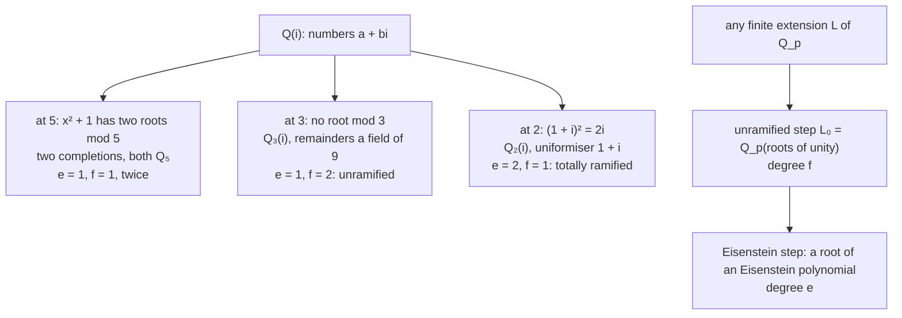

# Local fields: completing a number field at one prime, and the different that measures ramification

[Syllabus](../../../SYLLABUS.md) → [Algebraic and analytic number theory](../README.md) → [Local Fields and Class Field Theory](../README.md#s09) → Local fields

---

## General Overview

Take the Gaussian numbers $`a + bi`$, where $`i^2 = -1`$: the field Q(i), with whole numbers Z[i]. Look at it through one prime at a time, using the p-adic numbers $`\mathbb{Q}_p`$ ([The p-adic numbers](../06-Algebraic%20Numbers/10-p-adic-numbers-and-hensels-lemma.md)), where multiples of high powers of $`p`$ count as small.

Three primes give three different pictures.

- **At 5, $`i`$ is already there.** $`2^2 + 1 = 5`$, so 2 is a square root of $`-1`$ modulo 5. Hensel's lemma lifts it one digit at a time: 2, 7, 57, 182, 2057, 14557, each one a root of $`x^2 + 1`$ modulo the next power of 5. So $`\mathbb{Q}_5`$ contains $`i`$, and Q(i) seen at 5 is two copies of $`\mathbb{Q}_5`$, one per root.
- **At 3, $`i`$ is new but gentle.** No square is $`-1`$ modulo 3. Adding $`i`$ gives a field of degree 2 over $`\mathbb{Q}_3`$ whose remainders form a field of 9 members. The prime 3 stays prime: nothing is repeated.
- **At 2, $`i`$ is new and rough.** $`(1 + i)^2 = 2i`$, so 2 becomes a square times a unit. The number $`1 + i`$ is "half a 2": it divides 2 twice.

The **different** turns the roughness into one ideal. For $`\mathbb{Z}[i]`$ it is generated by the derivative of $`x^2 + 1`$ at $`i`$, which is $`2i = (1 + i)^2`$. Its norm is 4, the size of the discriminant $`-4`$ of Q(i). Smooth primes leave no trace in it; the rough prime 2 leaves $`(1 + i)^2`$.

**Completing a number field at a prime breaks it into local fields, each an unramified step followed by an Eisenstein step; the different is the ideal of derivatives that records the ramification prime by prime, and its norm is the size of the discriminant.**

**What kind of fact this is:** the completion, the uniformiser and the different are definitions. Three theorems are proved on this card in Why it works: the different of $`\mathbb{Z}[\alpha]`$ is $`(f'(\alpha))`$, its norm is $`|d_K|`$, and Eisenstein polynomials give exactly the totally ramified steps. The different's exponent, $`e - 1`$ when $`p`$ does not divide $`e`$ and at least $`e`$ when it does, is proved from two cited facts: the different multiplies along a tower, and $`1, \pi, \dots, \pi^{e-1}`$ is a basis over the unramified step. The split into an unramified and a totally ramified step is proved in Steps 2 and 3, and the splitting of $`K`$ into completions is stated with its key idea and sourced to Neukirch.

### The picture: one field, three primes, two steps



Top half: the example. Bottom half: the theorem, every local field built in those two steps; the fields at 3 and 2 are the two pure cases.

---

## The formula

Some words first, from earlier cards.

- A **number field** $`K`$ of degree $`n`$ has a ring of integers $`O_K`$. A prime $`p`$ factors in $`O_K`$ into prime ideals $`\mathfrak{p}`$, each with a **ramification index** $`e`$ (how often it repeats) and a **residue degree** $`f`$ (its norm is $`p^f`$) ([Splitting and ramification](../06-Algebraic%20Numbers/08-splitting-and-ramification.md)).
- The **trace** $`\mathrm{Tr}(x)`$ is the sum of the conjugates of $`x`$, and the **discriminant** $`d_K`$ is the determinant of the table $`\mathrm{Tr}(w_i w_j)`$ over an integral basis $`w_1, \dots, w_n`$ ([Norm, trace and discriminant](../06-Algebraic%20Numbers/02-norms-traces-and-discriminants.md)).
- The **completion** of a space with a distance adds a limit for every list whose terms bunch together ([Complete space](../../17-Topology/01-Metric%20Spaces/05-completeness-and-completion.md)).

New on this card: three constructions.

**1. The completion at a prime.** Write $`v_\mathfrak{p}(x)`$ for the number of times $`\mathfrak{p}`$ divides $`x`$. Measure size by

```math
|x|_\mathfrak{p} = N(\mathfrak{p})^{-v_\mathfrak{p}(x)}, \qquad K_\mathfrak{p} = \text{the completion of } K \text{ under } |x|_\mathfrak{p}, \qquad [K_\mathfrak{p} : \mathbb{Q}_p] = e f
```

**Read it aloud:** a number is small at the prime ideal p when p divides it many times; completing under that size gives the local field K-sub-p, whose degree over the p-adic numbers is e times f.

Inside $`K_\mathfrak{p}`$ sit its integers $`O_\mathfrak{p}`$, the members of size at most 1. A **uniformiser** $`\pi`$ is a member with $`v_\mathfrak{p}(\pi) = 1`$: one copy of $`\mathfrak{p}`$. In $`\mathbb{Q}_2(i)`$ it is $`1 + i`$. A field $`K_\mathfrak{p}`$, or any finite extension of $`\mathbb{Q}_p`$, is a **local field**.

**2. The two-step shape.** A finite extension $`L`$ of $`\mathbb{Q}_p`$ is **unramified** when $`e = 1`$ and **totally ramified** when $`f = 1`$. An **Eisenstein polynomial** at $`p`$ is monic (top coefficient 1), has every lower coefficient divisible by $`p`$, and has constant term not divisible by $`p^2`$.

```math
\mathbb{Q}_p \;\subseteq\; L_0 = \mathbb{Q}_p(\zeta_{p^f - 1}) \;\subseteq\; L = L_0(\pi), \qquad [L_0 : \mathbb{Q}_p] = f, \quad [L : L_0] = e, \quad \pi \text{ a root of an Eisenstein polynomial over } L_0
```

**Read it aloud:** every local field is the p-adic numbers, then an unramified step of degree f made by roots of unity, then a totally ramified step of degree e made by one Eisenstein root.

Here $`\zeta_m`$ is a root of unity of order $`m`$: a number whose $`m`$-th power is 1 and no smaller power is.

**3. The different.** The **dual lattice** of $`O_K`$ is every $`x`$ in $`K`$ whose trace against every integer is a whole number. It contains $`O_K`$, and it is an ideal with denominators. Its inverse is the different $`\mathfrak{D}_K`$.

```math
\mathfrak{D}_K^{-1} = \{\, x \in K : \mathrm{Tr}(x y) \in \mathbb{Z} \text{ for every } y \in O_K \,\}, \qquad \mathfrak{D}_K = (f'(\alpha)) \ \text{ when } O_K = \mathbb{Z}[\alpha], \qquad N(\mathfrak{D}_K) = |d_K|
```

**Read it aloud:** the inverse different is everything whose trace with every integer is whole; when the integers are built from one root alpha of f, the different is generated by the derivative of f at alpha, and its norm is the size of the discriminant.

Here $`f(x)`$, with an argument, is a polynomial; $`f`$ alone stays the residue degree. Worked once: $`f(x) = x^2 + 1`$, $`f'(i) = 2i`$, $`N(2i) = 4 = |{-4}|`$.

**4. Its exponent at each prime.** For a prime $`\mathfrak{p}`$ with ramification index $`e`$ above $`p`$:

```math
v_\mathfrak{p}(\mathfrak{D}_K) = e - 1 \ \text{ if } p \nmid e \ (\text{tame}), \qquad v_\mathfrak{p}(\mathfrak{D}_K) \ge e \ \text{ if } p \mid e \ (\text{wild})
```

**Read it aloud:** the different holds the prime e minus 1 times when p does not divide e, called tame ramification, and at least e times when it does, called wild ramification.

In $`\mathbb{Q}(i)`$ at 2, $`e = 2`$ and $`p = 2`$ divides it: wild, and the exponent is 2, not $`e - 1 = 1`$.

| Symbol | Plain meaning | In our example | Push it up and the answer… |
| --- | --- | --- | --- |
| $`K`$, $`n`$, $`O_K`$ | the number field, its degree, its integers | Q(i), 2, Z[i] | more primes above each $`p`$ possible |
| $`p`$, $`\mathfrak{p}`$, $`N(\cdot)`$ | an ordinary prime; a prime ideal dividing it; an ideal's count of remainders | 2; $`(1 + i)`$; $`N(1 + i) = 2`$ | — |
| $`v_\mathfrak{p}`$, $`v_\pi`$, $`v`$; $`\lvert x\rvert_\mathfrak{p}`$ | how many times $`\mathfrak{p}`$ (or $`\pi`$) divides; $`v`$ is scaled so $`v(p) = 1`$; the size built from it | $`v_\mathfrak{p}(2i) = 2`$; $`\lvert 2i\rvert_\mathfrak{p} = 2^{-2}`$ | the number gets smaller at $`\mathfrak{p}`$ |
| $`K_\mathfrak{p}`$, $`O_\mathfrak{p}`$ | the completion at $`\mathfrak{p}`$; its members of size at most 1 | Q₂(i) and Z₂[i] | — |
| $`e`$, $`f`$ | ramification index; residue degree | 2 and 1 at 2; 1 and 2 at 3 | $`e f`$ is the local degree |
| $`\pi`$ | a uniformiser: one copy of $`\mathfrak{p}`$ | $`1 + i`$ at 2; 3 at 3 | — |
| $`L`$, $`L_0`$, $`O_L`$ | a finite extension of $`\mathbb{Q}_p`$; its largest unramified part; its integers | Q₃(i), its own $`L_0`$ | — |
| $`\zeta_m`$, $`q`$ | a root of unity of order $`m`$; the remainder count $`p^f`$ | $`\zeta_8`$ in Q₃(i); $`q = 9`$ | — |
| $`f(x)`$, $`h_j(x)`$, $`\alpha`$, $`f'(\alpha)`$, $`b_j`$ | the polynomial of a root that builds $`O_K`$; its irreducible factors over $`\mathbb{Q}_p`$; that root; the derivative there; the coefficients of $`f(x)/(x - \alpha)`$ | $`x^2 + 1`$, $`i`$, $`2i`$; $`b_0 = i`$, $`b_1 = 1`$ | — |
| $`g(x)`$, $`a_j`$, $`\beta`$ | an Eisenstein polynomial, its coefficients, a root | $`x^2 - 2x + 2`$; $`2, -2`$; $`1 + i`$ | — |
| $`\mathrm{Tr}`$, $`w_i`$, $`w_j^*`$, $`\mathfrak{D}_K^{-1}`$ | trace; an integral basis; its dual basis; the dual lattice | $`\mathrm{Tr}(a + bi) = 2a`$; $`1, i`$; $`\tfrac12, -\tfrac{i}{2}`$; half of Z[i] | — |
| $`\mathfrak{D}_K`$, $`d_K`$ | the different; the discriminant | $`(2i) = (1 + i)^2`$, norm 4; $`d_K = -4`$ | more ramification, a bigger different |

### When it holds

- **The whole ring of integers.** $`\mathfrak{D}_K = (f'(\alpha))`$ needs $`O_K = \mathbb{Z}[\alpha]`$. For Q(√5) the smaller ring Z[√5] gives $`N(2\sqrt{5}) = -20`$, not $`d_K = 5`$, and makes the inert 2 look ramified.
- **A prime ideal, not a prime number.** A split prime has one completion per prime ideal: at 5, two copies of $`\mathbb{Q}_5`$, not one field of degree 2.
- **The plain Hensel lemma needs a simple root.** At 2 the root 1 of $`x^2 + 1`$ has derivative 2, divisible by 2, and it dies: 0 roots modulo 4. The sharper form, which needs $`f(1)`$ to hold more factors 2 than twice those in $`f'(1)`$, fails too: each holds one.

---

## Why it works

### Step 0: the idea

In a completion every other prime becomes a unit. What is left is a field with one prime $`\pi`$, described by two numbers: $`e`$ (how many $`\pi`$ make a $`p`$) and $`f`$ (how big the remainders are).

The different asks a calculus question. Ramification is a repeated root modulo $`p`$, and at a repeated root the derivative vanishes. So the ideal $`(f'(\alpha))`$ catches ramification. The product of all the conjugate derivatives is the discriminant, which is why the norms match.

### Step 1: the completion and its degree

The size $`|x|_\mathfrak{p}`$ obeys the strong triangle inequality, as $`|x|_p`$ does: if $`\mathfrak{p}^m`$ divides $`x`$ and $`y`$ it divides $`x + y`$. Completing gives $`K_\mathfrak{p}`$.

Each member of $`O_\mathfrak{p}`$ has a digit expansion $`c_0 + c_1 \pi + c_2 \pi^2 + \cdots`$, with digits from a fixed list of $`p^f`$ remainders. Pick $`f`$ members of $`O_\mathfrak{p}`$ whose remainders form a basis of the remainder field over Z mod p. Since $`p = \pi^e \times`$ a unit, their products with $`1, \pi, \dots, \pi^{e-1}`$ form a basis over $`\mathbb{Z}_p`$. That is $`e f`$ basis members, so $`[K_\mathfrak{p} : \mathbb{Q}_p] = e f`$.

The splitting of $`K`$ into completions is the factoring of $`f(x)`$ over $`\mathbb{Q}_p`$. Each irreducible factor over $`\mathbb{Q}_p`$ gives one completion, and the degrees add up to $`n`$.

<details>
<summary>Key idea: one completion per p-adic factor</summary>

Over $`\mathbb{Q}_p`$, $`f(x)`$ factors into distinct irreducible pieces $`h_j(x)`$. Write $`K \otimes \mathbb{Q}_p`$ for the ring $`\mathbb{Q}_p[x]/(f(x))`$. Sending $`\alpha`$ to a root of $`h_j(x)`$ places $`K`$ densely inside the field $`\mathbb{Q}_p[x]/(h_j(x))`$. That field has one size extending $`|x|_p`$, and on $`K`$ it is the size of one prime ideal above $`p`$. Different pieces give different prime ideals, and every one arises. So

$`\displaystyle K \otimes \mathbb{Q}_p \;\cong\; \prod_{\mathfrak{p} \mid p} K_\mathfrak{p}, \qquad \sum_{\mathfrak{p} \mid p} e_\mathfrak{p} f_\mathfrak{p} = n.`$

For $`x^2 + 1`$ there are two factors over $`\mathbb{Q}_5`$ and one over $`\mathbb{Q}_3`$ and $`\mathbb{Q}_2`$. Neukirch, chapter II, proves this in full.

</details>

**Where proof ends and evidence begins.** The code counts the roots of $`x^2 + 1`$ modulo $`p^k`$ for $`k = 1`$ to 6. It finds 2 at every level for $`p = 5`$, none for $`p = 3`$, and 1, then 0, for $`p = 2`$. Those counts are exact for six levels; the statement for every level is Hensel's lemma.

### Step 2: the unramified step

Let $`L`$ have remainders forming the finite field of $`q = p^f`$ members. Every nonzero member of that finite field is a root of $`x^{q-1} - 1`$ ([Finite fields](../05-Fields%20and%20Galois%20Theory/09-finite-fields-and-frobenius.md)). The derivative $`(q - 1)x^{q-2}`$ is not divisible by $`p`$ at those roots, so Hensel lifts each of them to a root of unity in $`L`$.

Those roots of unity generate $`L_0 = \mathbb{Q}_p(\zeta_{q-1})`$. Its polynomial is the Hensel lift of the degree-$`f`$ polynomial of a generator of that finite field, so its degree is $`f`$, and its remainders are the whole finite field, so $`e = 1`$: unramified. So the unramified extension of degree $`f`$ is unique: any such field contains these roots of unity, and they already fill a field of degree $`f`$.

In the example, $`\mathbb{Z}[i]`$ modulo 3 has 9 members, and all 8 nonzero ones are invertible: a field. In it $`1 + i`$ has order 8, so it is a root of $`x^8 - 1`$ of full order. Hensel lifts it to $`\zeta_8`$ in $`\mathbb{Q}_3(i)`$. So $`\mathbb{Q}_3(i) = \mathbb{Q}_3(\zeta_8)`$, the unramified quadratic extension of $`\mathbb{Q}_3`$.

### Step 3: the Eisenstein step

Above $`L_0`$ nothing new happens to the remainders, so $`[L : L_0] = e`$ and the extension is totally ramified. Take a uniformiser $`\pi`$ of $`L`$. Then $`1, \pi, \dots, \pi^{e-1}`$ is a basis of $`O_L`$ over $`O_{L_0}`$ (Serre, chapter I), and $`\pi`$ generates $`L`$ over $`L_0`$.

Its polynomial is Eisenstein. Measure by $`v`$, scaled so that $`v(p) = 1`$. Each of the $`e`$ conjugates of $`\pi`$ has $`v = 1/e`$. The lower coefficients are sums of products of conjugates, so each has $`v > 0`$: divisible by $`p`$. The constant term is the product of all $`e`$ of them, so it has $`v = 1`$ exactly: not divisible by $`p^2`$.

The converse also holds: a root of an Eisenstein polynomial of degree $`e`$ is a uniformiser of a totally ramified extension of degree $`e`$.

<details>
<summary>Detailed proof: Eisenstein roots are uniformisers</summary>

Let $`g(x) = x^e + a_{e-1}x^{e-1} + \cdots + a_0`$ be Eisenstein over $`L_0`$, and $`\beta`$ a root, with $`v`$ extended to $`L_0(\beta)`$ and $`v(p) = 1`$.

If $`v(\beta) \le 0`$, the term $`\beta^e`$ has the smallest $`v`$ of all terms, and the sum cannot be 0. So $`v(\beta) > 0`$. Then every term $`a_j \beta^j`$ with $`1 \le j \le e - 1`$ has $`v > 1`$, while $`a_0`$ has $`v = 1`$. For the sum to vanish, $`\beta^e`$ must cancel $`a_0`$:

$`\displaystyle e\,v(\beta) = v(a_0) = 1, \qquad v(\beta) = \tfrac{1}{e}.`$

So the ramification index of $`L_0(\beta)`$ is at least $`e`$. Its degree is at most $`e`$, the degree of $`g`$. Since $`e f \le`$ the degree, it is exactly $`e`$, $`g`$ is irreducible, the residue degree is 1, and $`\beta`$ is a uniformiser.

</details>

In the example, $`1 + i`$ is a root of $`(x - 1)^2 + 1 = x^2 - 2x + 2`$. The lower coefficients $`-2`$ and $`2`$ are even, and 2 is not divisible by 4: Eisenstein at 2. So $`\mathbb{Q}_2(i)`$ is totally ramified of degree 2 with uniformiser $`1 + i`$, and $`L_0 = \mathbb{Q}_2`$.

### Step 4: the different is the derivative

The dual lattice needs a dual basis: members $`w_j^*`$ with $`\mathrm{Tr}(w_i w_j^*) = 1`$ when $`i = j`$ and 0 otherwise. The dual lattice is the whole-number combinations of the $`w_j^*`$.

For the basis $`1, \alpha, \dots, \alpha^{n-1}`$ of $`\mathbb{Z}[\alpha]`$, Euler found the dual basis. Divide $`f(x)`$ by $`x - \alpha`$ and write the quotient as $`b_0 + b_1 x + \cdots + b_{n-1}x^{n-1}`$. Then the dual basis is $`b_0/f'(\alpha), \dots, b_{n-1}/f'(\alpha)`$.

The $`b_j`$ lie in $`\mathbb{Z}[\alpha]`$, and they span it: $`b_{n-1} = 1`$, $`b_{n-2} = \alpha + (\text{a whole number})`$, and so on down. So the dual lattice is $`\tfrac{1}{f'(\alpha)}\mathbb{Z}[\alpha]`$, and the different is $`(f'(\alpha))`$.

<details>
<summary>Detailed proof: Euler's formula for the dual basis</summary>

Let $`\alpha_1, \dots, \alpha_n`$ be the roots of $`f(x)`$. For each power $`x^r`$ with $`0 \le r \le n - 1`$, the polynomial

$`\displaystyle \sum_{k=1}^{n} \frac{f(x)}{x - \alpha_k} \cdot \frac{\alpha_k^{\,r}}{f'(\alpha_k)}`$

has degree at most $`n - 1`$ and equals $`\alpha_k^r`$ at each root $`x = \alpha_k`$, because $`f(x)/(x - \alpha_k)`$ is $`f'(\alpha_k)`$ there and 0 at the other roots. A polynomial of degree below $`n`$ fixed at $`n`$ points is unique, so the sum is $`x^r`$.

The sum is the trace of $`\frac{f(x)}{x - \alpha}\cdot\frac{\alpha^r}{f'(\alpha)}`$, taken term by term in the powers of $`x`$. Compare the coefficients of $`x^j`$ on both sides:

$`\displaystyle \mathrm{Tr}\!\left(\frac{b_j\,\alpha^r}{f'(\alpha)}\right) = \begin{cases} 1 & j = r \\ 0 & j \ne r. \end{cases}`$

That is the statement that $`b_j/f'(\alpha)`$ is the dual basis of $`\alpha^r`$.

</details>

For $`\mathbb{Z}[i]`$: $`f'(i) = 2i`$, and the dual lattice is $`\tfrac{1}{2i}\mathbb{Z}[i] = \tfrac12\mathbb{Z}[i]`$: $`\tfrac12`$ has traces 1 and 0 against 1 and $`i`$.

### Step 5: the norm of the different is the discriminant

Write each basis member through the dual basis. The trace table does it: $`w_i = \sum_j \mathrm{Tr}(w_i w_j)\, w_j^*`$. So $`O_K`$ sits inside the dual lattice as the image of the trace table, and the number of dual-lattice members per member of $`O_K`$ is

```math
[\mathfrak{D}_K^{-1} : O_K] = \big|\det[\mathrm{Tr}(w_i w_j)]\big| = |d_K|
```

**Read it aloud:** the dual lattice holds the size of the discriminant times as many members as the integers do.

That index also equals $`N(\mathfrak{D}_K)`$: inverting an ideal inverts its norm, and the index of $`O_K`$ in $`\mathfrak{a}^{-1}`$ equals the index of $`\mathfrak{a}`$ in $`O_K`$. So $`N(\mathfrak{D}_K) = |d_K|`$, for every number field, with no assumption about $`\mathbb{Z}[\alpha]`$.

When $`O_K = \mathbb{Z}[\alpha]`$ there is another road. $`N(f'(\alpha))`$ is the product of $`f'(\alpha_k)`$ over all roots, which is $`\pm`$ the polynomial discriminant: $`d_K = (-1)^{n(n-1)/2} N(f'(\alpha))`$.

For four fields the code takes two independent roads, the trace-table determinant and the norm of $`f'(\alpha)`$. A direct count of the dual lattice checks the index formula, though it equals the determinant for any whole-number table:

| Field | Polynomial | $`d_K`$ by trace table | $`N(f'(\alpha))`$ | dual-lattice count |
| --- | --- | ---: | ---: | ---: |
| Q(i) | $`x^2 + 1`$ | −4 | 4 | 4 |
| Q(√−5) | $`x^2 + 5`$ | −20 | 20 | 20 |
| Q(√5) | $`x^2 - x - 1`$ | 5 | −5 | 5 |
| Q(∛2) | $`x^3 - 2`$ | −108 | 108 | 108 |

The second row is the shelf's house example: the different of $`\mathbb{Z}[\sqrt{-5}]`$ is $`(2\sqrt{-5})`$, of norm 20, the modulus in the $`x^2 + 5y^2`$ rule.

### Step 6: tame and wild, read off the Eisenstein polynomial

The different is local: its $`\mathfrak{p}`$-part is the different of $`K_\mathfrak{p}`$ over $`\mathbb{Q}_p`$, because the trace on $`K \otimes \mathbb{Q}_p`$ is the sum of the local traces (Neukirch, chapter III, section 2). The different multiplies along a tower (same section), and the unramified step contributes nothing: there $`f'(\zeta)`$ is a unit, since $`x^{q-1} - 1`$ has no repeated root modulo $`p`$. So all of $`v_\mathfrak{p}(\mathfrak{D}_K)`$ comes from the Eisenstein step.

Let $`g(x) = x^e + a_{e-1}x^{e-1} + \cdots + a_0`$ be Eisenstein with root $`\pi`$, and measure by $`v_\pi`$, so $`v_\pi(p) = e`$. The derivative is

```math
g'(\pi) = e\,\pi^{e-1} + \sum_{j=1}^{e-1} j\,a_j\,\pi^{j-1}, \qquad v_\pi\big(j\,a_j\,\pi^{j-1}\big) = e\,v_p(j\,a_j) + j - 1
```

**Read it aloud:** the derivative at pi is e times pi to the e minus 1, plus the other terms, and each term's count of pi is e times the count of p in its coefficient, plus j minus 1.

The terms have different counts modulo $`e`$, because $`j - 1`$ runs over $`0, \dots, e - 1`$. So no two can cancel, and $`v_\pi(g'(\pi))`$ is the smallest count.

- The lower terms each have $`v_p(a_j) \ge 1`$, so counts of at least $`e + j - 1 \ge e`$.
- The top term has count $`e\,v_p(e) + e - 1`$.

If $`p`$ does not divide $`e`$, the top term counts $`e - 1`$ and wins: **tame**, exponent $`e - 1`$. If $`p`$ divides $`e`$, every term counts at least $`e`$: **wild**, exponent at least $`e`$. The top term also caps it at $`e\,v_p(e) + e - 1`$.

The code computes the exponent this way and again from the norm, $`v_p(N(\mathfrak{D}_K))`$, since $`f = 1`$ at every ramified prime here:

| Field, prime | $`e`$ | exponent by Eisenstein | by the norm | tame rule $`e - 1`$ | kind |
| --- | ---: | ---: | ---: | ---: | --- |
| Q(i), 2 | 2 | 2 | 2 | 1 | wild |
| Q(√−5), 2 | 2 | 2 | 2 | 1 | wild |
| Q(√−5), 5 | 2 | 1 | 1 | 1 | tame |
| Q(√5), 5 | 2 | 1 | 1 | 1 | tame |
| Q(∛2), 2 | 3 | 2 | 2 | 2 | tame |
| Q(∛2), 3 | 3 | 3 | 3 | 2 | wild |

Multiplying the prime powers back gives the norms: $`2^2 = 4`$, $`2^2 \times 5 = 20`$, $`5`$, $`2^2 \times 3^3 = 108`$.

---

## Worked numbers, by hand

| Step | Arithmetic | Value |
| --- | --- | --- |
| root mod 5 | $`2^2 + 1 = 5`$ | root 2 |
| next digit | $`f(2)/5 = 1`$; slope $`f'(2) = 4`$; $`1 + 4t \equiv 0 \pmod 5`$ | $`t = 1`$, root $`2 + 5 = 7`$ |
| check mod 25 | $`7^2 + 1 = 50 = 2 \times 25`$ | $`i \equiv 7 \pmod{25}`$; the lift goes on 57, 182, 2057, 14557 |
| at 3 | squares mod 3 are 0 and 1, never 2 | inert: $`\mathbb{Z}[i]/3`$ has 9 members, 8 invertible |
| at 2 | $`(1 + i)^2 = 1 + 2i - 1`$ | $`2i`$: $`e = 2`$, uniformiser $`1 + i`$ |
| Eisenstein test | $`(x - 1)^2 + 1 = x^2 - 2x + 2`$; $`-2, 2`$ even, 2 not divisible by 4 | totally ramified |
| trace table | $`\mathrm{Tr}(1) = 2`$, $`\mathrm{Tr}(i) = 0`$, $`\mathrm{Tr}(i^2) = -2`$ | rows $`(2, 0)`$ and $`(0, -2)`$, determinant $`-4`$ |
| the different | $`f'(i) = 2i`$, $`N(2i) = 0^2 + 2^2`$ | $`(2i) = (1 + i)^2`$, norm 4 |
| its exponent at $`1 + i`$ | wild, since 2 divides $`e = 2`$ | 2, not $`e - 1 = 1`$ |
| norm against discriminant | $`N(\mathfrak{D}) = 4`$, $`\lvert d_K\rvert = \lvert -4\rvert`$ | **4 = 4** |

Only the prime 2 contributes to the different of $`\mathbb{Z}[i]`$, and it contributes twice, one more than a tame prime of the same index would.

### What breaks if you drop a piece

| Mistake | Comes out at | What went wrong |
| --- | --- | --- |
| Tame rule $`e - 1`$ at 2 in $`\mathbb{Q}(i)`$ | different of norm 2, not 4 | 2 divides $`e = 2`$: the ramification is wild |
| $`\mathbb{Z}[\sqrt{5}]`$ taken for the integers of $`\mathbb{Q}(\sqrt{5})`$ | $`N(2\sqrt{5}) = -20`$, dual count 20, a double root of $`x^2 - 5`$ mod 2 | the ring is too small; the true $`d_K = 5`$ and 2 is inert |
| Lifting the root 1 of $`x^2 + 1`$ mod 2 | 0 roots mod 4 | the slope $`2`$ is divisible by 2, so Hensel does not apply; $`i`$ is not in $`\mathbb{Q}_2`$ |
| 5 read as one completion of degree 2 | 2 roots mod 5, so 2 completions of degree 1 | a split prime has one completion per prime ideal |

The code prints every row.

---

## Code, from first principles, and it actually runs

Nothing is imported. The code completes Q(i) at 5, 3 and 2 by root searches and Hensel's step. It then reaches the norm of the different for four fields by two independent roads: the trace-table determinant and the norm of $`f'(\alpha)`$ as a determinant. A third road reads each prime's exponent off an Eisenstein polynomial and multiplies the prime powers back. A direct count of the dual lattice, modulo $`|d_K|`$, checks the index formula.

### Python

```python
# Local fields and the different -- the check behind the card.  Nothing is
# imported.  Part 1 completes Q(i) at 5, 3 and 2 by searching roots of
# x^2 + 1 modulo prime powers.  Part 2 reaches the norm of the different two
# ways for four fields with O_K = Z[alpha], the trace-form determinant and the
# norm of f'(alpha); a count of the dual lattice checks the index.  Part 3 reads
# each ramified prime's share of the different off an Eisenstein polynomial.
def ev(f, x):                            # f(x); coefficients lowest first
    return sum(c * x ** k for k, c in enumerate(f))

def roots(f, m):                         # every r mod m with f(r) = 0 mod m, by search
    return [r for r in range(m) if ev(f, r) % m == 0]

def lift(f, df, a, p, k):                # Hensel: one new p-adic digit per step
    out, q = [a], p
    for _ in range(k - 1):
        t = next(t for t in range(p) if (ev(f, a) // q + t * ev(df, a)) % p == 0)
        a, q = a + t * q, q * p
        out.append(a)
    return out

def mulmat(h, f):                        # matrix of "multiply by h(alpha)" on 1, alpha, ...
    n, cols, cur = len(f) - 1, [], h[:] + [0] * len(f)
    for _ in range(n):
        for d in range(len(cur) - 1, n - 1, -1):     # reduce by the monic f
            c, cur[d] = cur[d], 0
            for i in range(n):
                cur[d - n + i] -= c * f[i]
        cols.append(cur[:n])
        cur = [0] + cur[:-1]
    return [[cols[j][i] for j in range(n)] for i in range(n)]

def det(a):                              # Bareiss: exact integer determinant
    a, n, sign, prev = [row[:] for row in a], len(a), 1, 1
    for k in range(n - 1):
        if a[k][k] == 0:
            s = next(i for i in range(k + 1, n) if a[i][k] != 0)
            a[k], a[s], sign = a[s], a[k], -sign
        for i in range(k + 1, n):
            for j in range(k + 1, n):
                a[i][j] = (a[i][j] * a[k][k] - a[i][k] * a[k][j]) // prev
        prev = a[k][k]
    return sign * a[n - 1][n - 1]

def vp(x, p):                            # how many times p divides x
    v = 0
    while x % p == 0:
        x, v = x // p, v + 1
    return v

def dual_count(T, m):                    # a/m, a mod m, with Tr(a/m * alpha^j) whole for all j
    n, hits, a = len(T), 0, [0] * len(T)
    while True:
        hits += all(sum(a[i] * T[i][j] for i in range(n)) % m == 0 for j in range(n))
        i = 0
        while i < n and a[i] == m - 1:
            a[i], i = 0, i + 1
        if i == n:
            return hits
        a[i] += 1

def shift(f, r):                         # coefficients of f(x + r), by Taylor shift
    g, n = f[:], len(f) - 1
    for i in range(n):
        for j in range(n - 1, i - 1, -1):
            g[j] += r * g[j + 1]
    return g

def tform(f):                            # the trace form: Tr(alpha^(i + j)), a matrix trace
    n = len(f) - 1
    return [[sum(mulmat([0] * (i + j) + [1], f)[t][t] for t in range(n)) for j in range(n)] for i in range(n)]

def eisenstein(g, p):
    return g[-1] == 1 and all(c % p == 0 for c in g[:-1]) and g[0] % (p * p) != 0

def yn(claim):
    return "yes" if claim else "no"

def gmul(u, v, m):                       # (a + bi)(c + di) mod m
    return ((u[0] * v[0] - u[1] * v[1]) % m, (u[0] * v[1] + u[1] * v[0]) % m)

def order(u, m):
    x, k = u, 1
    while x != (1, 0):
        x, k = gmul(x, u, m), k + 1
    return k

f = [1, 0, 1]                            # x^2 + 1
counts = {p: [len(roots(f, p ** k)) for k in range(1, 7)] for p in (5, 3, 2)}
for p in (5, 3, 2):
    print(f"roots of x^2 + 1 mod {p}^k, k = 1..6: {counts[p]}")
chain = lift(f, [0, 2], 2, 5, 6)
print(f"i in Q_5, lifted from 2: {chain}")
nonzero = [(a, b) for a in range(3) for b in range(3) if (a, b) != (0, 0)]
inv = [u for u in nonzero if any(gmul(u, v, 3) == (1, 0) for v in nonzero)]
print(f"Z[i]/3: 9 members, {len(inv)} of 8 nonzero invertible; order of i {order((0, 1), 3)}, "
      f"of 1 + i {order((1, 1), 3)}")
sq = gmul((1, 1), (1, 1), 10 ** 6)
pi_poly = shift(f, -1)                   # x^2 + 1 at x - 1: the polynomial of 1 + i
print(f"1 + i: norm 2; (1 + i)^2 = {sq[0]} + {sq[1]}i; its polynomial {pi_poly} "
      f"(lowest first) Eisenstein at 2: {yn(eisenstein(pi_poly, 2))}")
names = {2: "split, two completions Q_5", 1: "ramified, e = 2", 0: "inert, f = 2"}
print("; ".join(f"p = {p}: {names[len(roots(f, p))]}" for p in (5, 3, 2)))

fields = [("Q(i)", "x^2 + 1", [1, 0, 1]), ("Q(sqrt-5)", "x^2 + 5", [5, 0, 1]),
          ("Q(sqrt5)", "x^2 - x - 1", [-1, -1, 1]), ("Q(2^(1/3))", "x^3 - 2", [-2, 0, 0, 1])]
table = []
for name, shown, h in fields:
    n, T = len(h) - 1, tform(h)
    dk, nd = det(T), det(mulmat([k * h[k] for k in range(1, n + 1)], h))
    cnt = dual_count(T, abs(dk))
    print(f"{name:11} {shown:12} d_K by trace form {dk:5}; N(f'(alpha)) {nd:5}; dual lattice index {cnt:4}")
    print(f"  trace form {T}")
    prod = 1
    for p in (q for q in (2, 3, 5) if dk % q == 0):
        r = next(r for r in range(p) if eisenstein(shift(h, r), p))
        g = shift(h, r)                  # pi = alpha - r is a uniformiser; e = n, f = 1
        v = min(n * vp(j * g[j], p) + j - 1 for j in range(1, n + 1) if g[j])
        kind = "tame" if n % p else "wild"
        print(f"  at {p}: pi = alpha - {r}, e = {n}; v(different) {v} by Eisenstein, "
              f"{vp(abs(nd), p)} from the norm; tame rule e - 1 = {n - 1}: {kind}")
        table.append((name, p, n, v, vp(abs(nd), p), kind))
        prod *= p ** v
    assert prod == abs(nd) == abs(dk) == cnt                  # three roads and the index count
    assert dk == (-1) ** (n * (n - 1) // 2) * nd
print(f"mistake 1, tame rule at 2 in Q(i): norm 2^1 = {2 ** 1}, not {2 ** table[0][3]}")
z5 = [-5, 0, 1]
nz, d5 = det(mulmat([0, 2], z5)), dual_count(tform(z5), 20)
print(f"mistake 2, Z[sqrt5] for Q(sqrt5): N(2 sqrt5) = {nz}, dual index {d5}, "
      f"roots of x^2 - 5 mod 2: {len(roots(z5, 2))} (a double root), not d_K = 5")
print(f"mistake 3, lifting the root 1 of x^2 + 1 mod 2: roots mod 4 = {len(roots(f, 4))}")
print(f"mistake 4, 5 read as one completion of degree 2: {len(roots(f, 5))} roots mod 5, "
      f"so {len(roots(f, 5))} completions of degree 1")
assert counts == {5: [2] * 6, 3: [0] * 6, 2: [1, 0, 0, 0, 0, 0]}
assert all((a * a + 1) % 5 ** (k + 1) == 0 for k, a in enumerate(chain))
assert len(inv) == 8 and order((1, 1), 3) == 8 and sq == (0, 2)
assert all(v == e - 1 if kind == "tame" else v >= e for _, _, e, v, w, kind in table)
assert all(v == w for _, _, _, v, w, _ in table)          # Eisenstein road against the norm road
assert nz == -20 and d5 == 20 and len(roots(z5, 2)) == 1
assert not any(eisenstein(shift([3, 0, 1], r), 2) for r in range(2))   # x^2 + 2x + 4 fails only the p^2 test
print("ALL CHECKS PASS")
```

**Ran 2026-11-24 on macOS, Python 3.14.10, standard library only. All checks passed. Output, pasted from the run:**

```
roots of x^2 + 1 mod 5^k, k = 1..6: [2, 2, 2, 2, 2, 2]
roots of x^2 + 1 mod 3^k, k = 1..6: [0, 0, 0, 0, 0, 0]
roots of x^2 + 1 mod 2^k, k = 1..6: [1, 0, 0, 0, 0, 0]
i in Q_5, lifted from 2: [2, 7, 57, 182, 2057, 14557]
Z[i]/3: 9 members, 8 of 8 nonzero invertible; order of i 4, of 1 + i 8
1 + i: norm 2; (1 + i)^2 = 0 + 2i; its polynomial [2, -2, 1] (lowest first) Eisenstein at 2: yes
p = 5: split, two completions Q_5; p = 3: inert, f = 2; p = 2: ramified, e = 2
Q(i)        x^2 + 1      d_K by trace form    -4; N(f'(alpha))     4; dual lattice index    4
  trace form [[2, 0], [0, -2]]
  at 2: pi = alpha - 1, e = 2; v(different) 2 by Eisenstein, 2 from the norm; tame rule e - 1 = 1: wild
Q(sqrt-5)   x^2 + 5      d_K by trace form   -20; N(f'(alpha))    20; dual lattice index   20
  trace form [[2, 0], [0, -10]]
  at 2: pi = alpha - 1, e = 2; v(different) 2 by Eisenstein, 2 from the norm; tame rule e - 1 = 1: wild
  at 5: pi = alpha - 0, e = 2; v(different) 1 by Eisenstein, 1 from the norm; tame rule e - 1 = 1: tame
Q(sqrt5)    x^2 - x - 1  d_K by trace form     5; N(f'(alpha))    -5; dual lattice index    5
  trace form [[2, 1], [1, 3]]
  at 5: pi = alpha - 3, e = 2; v(different) 1 by Eisenstein, 1 from the norm; tame rule e - 1 = 1: tame
Q(2^(1/3))  x^3 - 2      d_K by trace form  -108; N(f'(alpha))   108; dual lattice index  108
  trace form [[3, 0, 0], [0, 0, 6], [0, 6, 0]]
  at 2: pi = alpha - 0, e = 3; v(different) 2 by Eisenstein, 2 from the norm; tame rule e - 1 = 2: tame
  at 3: pi = alpha - 2, e = 3; v(different) 3 by Eisenstein, 3 from the norm; tame rule e - 1 = 2: wild
mistake 1, tame rule at 2 in Q(i): norm 2^1 = 2, not 4
mistake 2, Z[sqrt5] for Q(sqrt5): N(2 sqrt5) = -20, dual index 20, roots of x^2 - 5 mod 2: 1 (a double root), not d_K = 5
mistake 3, lifting the root 1 of x^2 + 1 mod 2: roots mod 4 = 0
mistake 4, 5 read as one completion of degree 2: 2 roots mod 5, so 2 completions of degree 1
ALL CHECKS PASS
```

### Rust

Same numbers, same labels, built with `rustc --edition 2021 -O`.

```rust
// Local fields and the different -- the same check as the Python, in Rust.
// No crates.  Part 1 completes Q(i) at 5, 3 and 2 by searching roots of
// x^2 + 1 modulo prime powers.  Part 2 reaches the norm of the different two
// ways for four fields with O_K = Z[alpha], the trace-form determinant and the
// norm of f'(alpha); a count of the dual lattice checks the index.  Part 3 reads
// each ramified prime's share of the different off an Eisenstein polynomial.
type Poly = Vec<i128>;

fn ev(f: &[i128], x: i128) -> i128 {             // f(x); coefficients lowest first
    f.iter().enumerate().map(|(k, c)| c * x.pow(k as u32)).sum()
}

fn roots(f: &[i128], m: i128) -> Vec<i128> {     // every r mod m with f(r) = 0 mod m, by search
    (0..m).filter(|&r| ev(f, r).rem_euclid(m) == 0).collect()
}

fn lift(f: &[i128], df: &[i128], mut a: i128, p: i128, k: usize) -> Vec<i128> {
    let (mut out, mut q) = (vec![a], p);         // Hensel: one new p-adic digit per step
    for _ in 0..k - 1 {
        let t = (0..p).find(|t| (ev(f, a) / q + t * ev(df, a)).rem_euclid(p) == 0).unwrap();
        a += t * q; q *= p; out.push(a);
    }
    out
}

fn mulmat(h: &[i128], f: &[i128]) -> Vec<Vec<i128>> { // "multiply by h(alpha)" on 1, alpha, ...
    let n = f.len() - 1;
    let mut cur: Poly = h.to_vec();
    cur.extend(vec![0; f.len()]);
    let mut cols: Vec<Poly> = Vec::new();
    for _ in 0..n {
        for d in (n..cur.len()).rev() {          // reduce by the monic f
            let c = cur[d]; cur[d] = 0;
            for i in 0..n { cur[d - n + i] -= c * f[i] }
        }
        cols.push(cur[..n].to_vec());
        cur.insert(0, 0); cur.pop();
    }
    (0..n).map(|i| (0..n).map(|j| cols[j][i]).collect()).collect()
}

fn det(m: &[Vec<i128>]) -> i128 {                // Bareiss: exact integer determinant
    let (mut a, n, mut sign, mut prev) = (m.to_vec(), m.len(), 1i128, 1i128);
    for k in 0..n - 1 {
        if a[k][k] == 0 {
            let s = (k + 1..n).find(|&i| a[i][k] != 0).unwrap();
            a.swap(k, s); sign = -sign;
        }
        for i in k + 1..n {
            for j in k + 1..n { a[i][j] = (a[i][j] * a[k][k] - a[i][k] * a[k][j]) / prev }
        }
        prev = a[k][k];
    }
    sign * a[n - 1][n - 1]
}

fn vp(mut x: i128, p: i128) -> i128 {            // how many times p divides x
    let mut v = 0;
    while x % p == 0 { x /= p; v += 1 }
    v
}

fn dual_count(t: &[Vec<i128>], m: i128) -> i128 { // a/m, a mod m, with Tr(a/m * alpha^j) whole
    let (n, mut hits) = (t.len(), 0);
    let mut a = vec![0i128; n];
    loop {
        if (0..n).all(|j| (0..n).map(|i| a[i] * t[i][j]).sum::<i128>().rem_euclid(m) == 0) { hits += 1 }
        let mut i = 0;
        while i < n && a[i] == m - 1 { a[i] = 0; i += 1 }
        if i == n { return hits }
        a[i] += 1;
    }
}

fn shift(f: &[i128], r: i128) -> Poly {          // coefficients of f(x + r), by Taylor shift
    let (mut g, n) = (f.to_vec(), f.len() - 1);
    for i in 0..n {
        for j in (i..n).rev() { g[j] += r * g[j + 1] }
    }
    g
}

fn tform(f: &[i128]) -> Vec<Vec<i128>> {         // the trace form: Tr(alpha^(i + j)), a matrix trace
    let n = f.len() - 1;
    (0..n).map(|i| (0..n).map(|j| {
        let mut h = vec![0i128; i + j]; h.push(1);
        let m = mulmat(&h, f);
        (0..n).map(|t| m[t][t]).sum()
    }).collect()).collect()
}

fn eisenstein(g: &[i128], p: i128) -> bool {
    let n = g.len() - 1;
    g[n] == 1 && g[..n].iter().all(|c| c % p == 0) && g[0] % (p * p) != 0
}

fn yn(claim: bool) -> &'static str { if claim { "yes" } else { "no" } }

fn gmul(u: (i128, i128), v: (i128, i128), m: i128) -> (i128, i128) { // (a + bi)(c + di) mod m
    ((u.0 * v.0 - u.1 * v.1).rem_euclid(m), (u.0 * v.1 + u.1 * v.0).rem_euclid(m))
}

fn order(u: (i128, i128), m: i128) -> i128 {
    let (mut x, mut k) = (u, 1);
    while x != (1, 0) { x = gmul(x, u, m); k += 1 }
    k
}

fn main() {
    let f: Poly = vec![1, 0, 1];                 // x^2 + 1
    let counts: Vec<Vec<usize>> = [5i128, 3, 2].iter()
        .map(|&p| (1..7).map(|k| roots(&f, p.pow(k)).len()).collect()).collect();
    for (idx, p) in [5, 3, 2].iter().enumerate() { println!("roots of x^2 + 1 mod {}^k, k = 1..6: {:?}", p, counts[idx]) }
    let chain = lift(&f, &[0, 2], 2, 5, 6);
    println!("i in Q_5, lifted from 2: {:?}", chain);
    let nonzero: Vec<(i128, i128)> = (0..9).map(|x| (x / 3, x % 3)).filter(|&u| u != (0, 0)).collect();
    let inv: Vec<(i128, i128)> = nonzero.iter().copied()
        .filter(|&u| nonzero.iter().any(|&v| gmul(u, v, 3) == (1, 0))).collect();
    println!("Z[i]/3: 9 members, {} of 8 nonzero invertible; order of i {}, of 1 + i {}",
             inv.len(), order((0, 1), 3), order((1, 1), 3));
    let sq = gmul((1, 1), (1, 1), 1_000_000);
    let pi_poly = shift(&f, -1);                 // x^2 + 1 at x - 1: the polynomial of 1 + i
    println!("1 + i: norm 2; (1 + i)^2 = {} + {}i; its polynomial {:?} (lowest first) Eisenstein at 2: {}",
             sq.0, sq.1, pi_poly, yn(eisenstein(&pi_poly, 2)));
    let name_of = |c: usize| match c { 2 => "split, two completions Q_5", 1 => "ramified, e = 2", _ => "inert, f = 2" };
    let parts: Vec<String> = [5, 3, 2].iter().map(|&p| format!("p = {}: {}", p, name_of(roots(&f, p).len()))).collect();
    println!("{}", parts.join("; "));
    let fields: Vec<(&str, &str, Poly)> = vec![("Q(i)", "x^2 + 1", vec![1, 0, 1]), ("Q(sqrt-5)", "x^2 + 5", vec![5, 0, 1]),
        ("Q(sqrt5)", "x^2 - x - 1", vec![-1, -1, 1]), ("Q(2^(1/3))", "x^3 - 2", vec![-2, 0, 0, 1])];
    let mut table: Vec<(i128, i128, i128, &str)> = Vec::new();   // e, v by Eisenstein, v by norm, kind
    for (name, shown, h) in &fields {
        let (n, t) = (h.len() - 1, tform(h));
        let df: Poly = (1..=n).map(|k| k as i128 * h[k]).collect();
        let (dk, nd) = (det(&t), det(&mulmat(&df, h)));
        let cnt = dual_count(&t, dk.abs());
        println!("{:11} {:12} d_K by trace form {:5}; N(f'(alpha)) {:5}; dual lattice index {:4}", name, shown, dk, nd, cnt);
        println!("  trace form {:?}", t);
        let mut prod = 1i128;
        for p in [2i128, 3, 5].into_iter().filter(|q| dk % q == 0) {
            let r = (0..p).find(|&r| eisenstein(&shift(h, r), p)).unwrap();
            let g = shift(h, r);                 // pi = alpha - r is a uniformiser; e = n, f = 1
            let ni = n as i128;
            let v = (1..=n).filter(|&j| g[j] != 0).map(|j| ni * vp(j as i128 * g[j], p) + j as i128 - 1).min().unwrap();
            let kind = if ni % p != 0 { "tame" } else { "wild" };
            println!("  at {}: pi = alpha - {}, e = {}; v(different) {} by Eisenstein, {} from the norm; tame rule e - 1 = {}: {}",
                     p, r, n, v, vp(nd.abs(), p), ni - 1, kind);
            table.push((ni, v, vp(nd.abs(), p), kind));
            prod *= p.pow(v as u32);
        }
        assert!(prod == nd.abs() && nd.abs() == dk.abs() && dk.abs() == cnt);   // three roads and the index count
        assert!(dk == (-1i128).pow((n * (n - 1) / 2) as u32) * nd);
    }
    println!("mistake 1, tame rule at 2 in Q(i): norm 2^1 = {}, not {}", 2i128.pow(1), 2i128.pow(table[0].1 as u32));
    let z5: Poly = vec![-5, 0, 1];
    let (nz, d5) = (det(&mulmat(&[0, 2], &z5)), dual_count(&tform(&z5), 20));
    println!("mistake 2, Z[sqrt5] for Q(sqrt5): N(2 sqrt5) = {}, dual index {}, roots of x^2 - 5 mod 2: {} (a double root), not d_K = 5",
             nz, d5, roots(&z5, 2).len());
    println!("mistake 3, lifting the root 1 of x^2 + 1 mod 2: roots mod 4 = {}", roots(&f, 4).len());
    println!("mistake 4, 5 read as one completion of degree 2: {} roots mod 5, so {} completions of degree 1",
             roots(&f, 5).len(), roots(&f, 5).len());
    assert!(counts == vec![vec![2; 6], vec![0; 6], vec![1, 0, 0, 0, 0, 0]]);
    assert!(chain.iter().enumerate().all(|(k, a)| (a * a + 1) % 5i128.pow(k as u32 + 1) == 0));
    assert!(inv.len() == 8 && order((1, 1), 3) == 8 && sq == (0, 2));
    assert!(table.iter().all(|&(e, v, _, kind)| if kind == "tame" { v == e - 1 } else { v >= e }));
    assert!(table.iter().all(|&(_, v, w, _)| v == w));          // Eisenstein road against the norm road
    assert!(nz == -20 && d5 == 20 && roots(&z5, 2).len() == 1);
    assert!(!(0..2).any(|r| eisenstein(&shift(&[3, 0, 1], r), 2)));   // x^2 + 2x + 4 fails only the p^2 test
    println!("ALL CHECKS PASS");
}
```

**Ran 2026-11-24 on macOS, rustc 1.98.1, no crates. All checks passed. Output, pasted from the run:**

```
roots of x^2 + 1 mod 5^k, k = 1..6: [2, 2, 2, 2, 2, 2]
roots of x^2 + 1 mod 3^k, k = 1..6: [0, 0, 0, 0, 0, 0]
roots of x^2 + 1 mod 2^k, k = 1..6: [1, 0, 0, 0, 0, 0]
i in Q_5, lifted from 2: [2, 7, 57, 182, 2057, 14557]
Z[i]/3: 9 members, 8 of 8 nonzero invertible; order of i 4, of 1 + i 8
1 + i: norm 2; (1 + i)^2 = 0 + 2i; its polynomial [2, -2, 1] (lowest first) Eisenstein at 2: yes
p = 5: split, two completions Q_5; p = 3: inert, f = 2; p = 2: ramified, e = 2
Q(i)        x^2 + 1      d_K by trace form    -4; N(f'(alpha))     4; dual lattice index    4
  trace form [[2, 0], [0, -2]]
  at 2: pi = alpha - 1, e = 2; v(different) 2 by Eisenstein, 2 from the norm; tame rule e - 1 = 1: wild
Q(sqrt-5)   x^2 + 5      d_K by trace form   -20; N(f'(alpha))    20; dual lattice index   20
  trace form [[2, 0], [0, -10]]
  at 2: pi = alpha - 1, e = 2; v(different) 2 by Eisenstein, 2 from the norm; tame rule e - 1 = 1: wild
  at 5: pi = alpha - 0, e = 2; v(different) 1 by Eisenstein, 1 from the norm; tame rule e - 1 = 1: tame
Q(sqrt5)    x^2 - x - 1  d_K by trace form     5; N(f'(alpha))    -5; dual lattice index    5
  trace form [[2, 1], [1, 3]]
  at 5: pi = alpha - 3, e = 2; v(different) 1 by Eisenstein, 1 from the norm; tame rule e - 1 = 1: tame
Q(2^(1/3))  x^3 - 2      d_K by trace form  -108; N(f'(alpha))   108; dual lattice index  108
  trace form [[3, 0, 0], [0, 0, 6], [0, 6, 0]]
  at 2: pi = alpha - 0, e = 3; v(different) 2 by Eisenstein, 2 from the norm; tame rule e - 1 = 2: tame
  at 3: pi = alpha - 2, e = 3; v(different) 3 by Eisenstein, 3 from the norm; tame rule e - 1 = 2: wild
mistake 1, tame rule at 2 in Q(i): norm 2^1 = 2, not 4
mistake 2, Z[sqrt5] for Q(sqrt5): N(2 sqrt5) = -20, dual index 20, roots of x^2 - 5 mod 2: 1 (a double root), not d_K = 5
mistake 3, lifting the root 1 of x^2 + 1 mod 2: roots mod 4 = 0
mistake 4, 5 read as one completion of degree 2: 2 roots mod 5, so 2 completions of degree 1
ALL CHECKS PASS
```

The two outputs match line for line.

### Lean

Lean proves the three facts about the different for every number field, and checks the card's worked numbers.

- Suppose $`O_K = \mathbb{Z}[\alpha]`$, and $`f(x)`$ is the polynomial of $`\alpha`$. Then $`\mathfrak{D}_K = (f'(\alpha))`$.
- Take any number field $`K`$. Then $`N(\mathfrak{D}_K) = \lvert d_K\rvert`$.
- Take a nonzero prime ideal $`\mathfrak{p}`$ above $`p`$, with ramification index $`e`$, and suppose $`p \nmid e`$. Then $`v_\mathfrak{p}(\mathfrak{D}_K) = e - 1`$: tame.
- Take the same $`\mathfrak{p}`$, but suppose $`p \mid e`$. Then $`v_\mathfrak{p}(\mathfrak{D}_K) \ge e`$: wild.
- Hensel's chain 2, 7, 57, 182, 2057, 14557 gives roots of $`x^2 + 1`$ modulo 5 up to $`5^6`$.
- $`x^2 + 1`$ has no root modulo 3, and none modulo 4.
- In $`\mathbb{Z}[i]`$ modulo 3, $`1 + i`$ has order 8.
- $`(1 + i)^2 = 2i`$, of norm 4, and $`1 + i`$ is a root of the Eisenstein $`x^2 - 2x + 2`$.
- The trace tables have determinants −4, −20, 5 and −108, and $`N(2\sqrt{5}) = -20`$.

The completion's degree $`e f`$ and the two-step shape are left to the Python and Rust checks.

```lean
-- Local fields: the different of a number field whose integers are Z[α] is the ideal (f'(α)), its norm is the size of the discriminant, and a prime's exponent in it is e - 1 when p does not divide e and at least e when it does.
import Mathlib.NumberTheory.NumberField.Discriminant.Different
import Mathlib.LinearAlgebra.Matrix.Determinant.Basic
import Mathlib.NumberTheory.Zsqrtd.GaussianInt
import Mathlib.RingTheory.Etale.Field
import Mathlib.NumberTheory.RamificationInertia.Basic

open NumberField Polynomial

/-- Helper: over a field `F`, if a finite algebra `R` maps onto a finite separable field
extension `k` with nilpotent kernel, the trace on `R` is `n` times the trace on `k`, where
`[R : F] = n [k : F]`. -/
theorem trace_eq_mul_of_nilpotent_ker {F k R : Type*} [Field F] [Field k] [CommRing R]
    [Algebra F k] [Algebra F R] [Module.Finite F R] [Module.Finite F k] [Algebra.IsSeparable F k]
    (g : R →ₐ[F] k) (hg : Function.Surjective g) (hnil : IsNilpotent (RingHom.ker g))
    (n : ℕ) (hn : Module.finrank F R = n * Module.finrank F k) (y : R) :
    Algebra.trace F R y = n * Algebra.trace F k (g y) := by
  have : Algebra.FormallyEtale F k := Algebra.FormallyEtale.of_isSeparable F k
  let s : k →ₐ[F] R := Algebra.FormallySmooth.liftOfSurjective (AlgHom.id F k) g hg hnil
  have hs : ∀ c, g (s c) = c := fun c ↦ Algebra.FormallySmooth.liftOfSurjective_apply _ g hg hnil c
  let : Algebra k R := s.toRingHom.toAlgebra
  have : IsScalarTower F k R := IsScalarTower.of_algebraMap_eq fun c ↦ (s.commutes c).symm
  have : Module.Finite k R := Module.Finite.of_restrictScalars_finite F k R
  have hk : 0 < Module.finrank F k := Module.finrank_pos
  have hfr : Module.finrank k R = n := by
    have := Module.finrank_mul_finrank F k R
    rw [hn, mul_comm n] at this
    exact Nat.eq_of_mul_eq_mul_left hk this
  have hnilp : IsNilpotent (y - s (g y)) := by
    obtain ⟨m, hm⟩ := hnil
    refine ⟨m, ?_⟩
    have hmem : y - s (g y) ∈ RingHom.ker g := by
      simp [RingHom.mem_ker, hs]
    have := Ideal.pow_mem_pow hmem m
    rw [hm] at this
    simpa using this
  have h0 : Algebra.trace k R (y - s (g y)) = 0 := by
    rw [← isNilpotent_iff_eq_zero, Algebra.trace_apply]
    apply LinearMap.isNilpotent_trace_of_isNilpotent
    exact hnilp.map (Algebra.lmul k R)
  have h1 : Algebra.trace k R y = n • g y := by
    have : Algebra.trace k R y = Algebra.trace k R (algebraMap k R (g y))
        + Algebra.trace k R (y - s (g y)) := by
      rw [← map_add]; congr 1; simp [RingHom.algebraMap_toAlgebra]
    rw [this, h0, add_zero, Algebra.trace_algebraMap, hfr]
  rw [← Algebra.trace_trace (S := k), h1, map_nsmul, nsmul_eq_mul]

#print axioms trace_eq_mul_of_nilpotent_ker

/-- The different is the derivative: if the ring of integers of a number field `K` is
`Z[α]` (that is, `α` generates `𝓞 K` as a ring over `Z`) and `f` is the polynomial of `α`,
then the different of `K` is the principal ideal `(f'(α))`. -/
theorem differentIdeal_eq_span_derivative_of_adjoin_eq_top
    {K : Type*} [Field K] [NumberField K] (α : 𝓞 K)
    (hα : Algebra.adjoin ℤ {α} = ⊤) :
    differentIdeal ℤ (𝓞 K) = Ideal.span {aeval α (derivative (minpoly ℤ α))} := by
  have hx : Algebra.adjoin ℚ {algebraMap (𝓞 K) K α} = ⊤ := by
    have h1 : ∀ a : 𝓞 K, algebraMap (𝓞 K) K a ∈ Algebra.adjoin ℚ {algebraMap (𝓞 K) K α} := by
      intro a
      have ha : a ∈ Algebra.adjoin ℤ {α} := hα ▸ Algebra.mem_top
      induction ha using Algebra.adjoin_induction with
      | mem x hx =>
        rw [Set.mem_singleton_iff.mp hx]
        exact Algebra.subset_adjoin rfl
      | algebraMap r => simpa using Subalgebra.intCast_mem _ r
      | add x y _ _ hx hy => simpa using add_mem hx hy
      | mul x y _ _ hx hy => simpa using mul_mem hx hy
    refine eq_top_iff.mpr fun y _ ↦ ?_
    obtain ⟨a, b, -, rfl⟩ := IsFractionRing.div_surjective (A := 𝓞 K) y
    rw [div_eq_mul_inv]
    refine mul_mem (h1 a) ?_
    exact (Algebra.adjoin ℚ {algebraMap (𝓞 K) K α}).inv_mem_of_algebraic (x := ⟨_, h1 b⟩)
      (Algebra.IsAlgebraic.isAlgebraic _)
  rw [← conductor_mul_differentIdeal ℤ ℚ K α hx, conductor_eq_top_of_adjoin_eq_top hα,
    Ideal.top_mul]

/-- The norm of the different is the size of the discriminant: for every number field `K`,
the number of remainders modulo the different `𝔇_K` is `|d_K|`. -/
theorem absNorm_differentIdeal_eq_natAbs_discr
    (K : Type*) [Field K] [NumberField K] :
    (differentIdeal ℤ (𝓞 K)).absNorm = (discr K).natAbs := by
  exact absNorm_differentIdeal K (𝓞 K)

/-- Tame and wild: let `P` be a nonzero prime ideal of `𝓞 K` dividing the prime `p`, with
ramification index `e`. If `p` does not divide `e`, `P` divides the different exactly
`e - 1` times; if `p` divides `e`, `P` divides it at least `e` times. -/
theorem differentIdeal_exponent_tame_wild
    {K : Type*} [Field K] [NumberField K] {p : ℕ} (hp : p.Prime)
    (P : Ideal (𝓞 K)) [P.IsPrime] (hP : P ≠ ⊥) (hpP : (p : 𝓞 K) ∈ P) :
    (¬ p ∣ Ideal.ramificationIdx' (Ideal.span {(p : ℤ)}) P →
        P ^ (Ideal.ramificationIdx' (Ideal.span {(p : ℤ)}) P - 1) ∣ differentIdeal ℤ (𝓞 K) ∧
        ¬ P ^ Ideal.ramificationIdx' (Ideal.span {(p : ℤ)}) P ∣ differentIdeal ℤ (𝓞 K)) ∧
    (p ∣ Ideal.ramificationIdx' (Ideal.span {(p : ℤ)}) P →
        P ^ Ideal.ramificationIdx' (Ideal.span {(p : ℤ)}) P ∣ differentIdeal ℤ (𝓞 K)) := by
  classical
  set p0 : Ideal ℤ := Ideal.span {(p : ℤ)} with hp0def
  have hpZ : Prime (p : ℤ) := Nat.prime_iff_prime_int.mp hp
  have hp0max : p0.IsMaximal := PrincipalIdealRing.isMaximal_of_irreducible hpZ.irreducible
  have hp0ne : p0 ≠ ⊥ := by simp [p0, hp.ne_zero]
  have hmapne : p0.map (algebraMap ℤ (𝓞 K)) ≠ ⊥ :=
    (Ideal.map_eq_bot_iff_of_injective (FaithfulSMul.algebraMap_injective ℤ (𝓞 K))).not.mpr hp0ne
  have hle : p0.map (algebraMap ℤ (𝓞 K)) ≤ P := by
    rw [Ideal.map_span, Ideal.span_le]; simpa using hpP
  set e := Ideal.ramificationIdx' p0 P with he_def
  have he : e ≠ 0 := Ideal.IsDedekindDomain.ramificationIdx'_ne_zero hmapne inferInstance hle
  have : P.IsMaximal := Ideal.IsPrime.isMaximal inferInstance hP
  obtain ⟨Q, hPQ, hQ⟩ := Ideal.eq_prime_pow_mul_coprime hmapne P
  rw [← Ideal.IsDedekindDomain.ramificationIdx'_eq_normalizedFactors_count hmapne inferInstance hP]
    at hQ
  rw [← he_def] at hQ
  have hcop : IsCoprime (P ^ e) Q := (Ideal.isCoprime_iff_sup_eq.mpr hPQ).pow_left
  let : Field (ℤ ⧸ p0) := Ideal.Quotient.field p0
  let : Field (𝓞 K ⧸ P) := Ideal.Quotient.field P
  have : NeZero e := ⟨he⟩
  let : Algebra (ℤ ⧸ p0) (𝓞 K ⧸ P) := Ideal.Quotient.algebraQuotientOfRamificationIdxNeZero p0 P
  have : IsScalarTower ℤ (ℤ ⧸ p0) (𝓞 K ⧸ P) := .of_algebraMap_eq' rfl
  have : Module.Finite (ℤ ⧸ p0) (𝓞 K ⧸ P) := Module.Finite.of_restrictScalars_finite ℤ _ _
  have : IsScalarTower ℤ (ℤ ⧸ p0) (𝓞 K ⧸ P ^ e) := .of_algebraMap_eq' rfl
  have : Module.Finite (ℤ ⧸ p0) (𝓞 K ⧸ P ^ e) := Module.Finite.of_restrictScalars_finite ℤ _ _
  have : NeZero p := ⟨hp.ne_zero⟩
  have : Finite (ℤ ⧸ p0) := Finite.of_equiv _ (Int.quotientSpanNatEquivZMod p).symm.toEquiv
  have : Algebra.IsSeparable (ℤ ⧸ p0) (𝓞 K ⧸ P) := inferInstance
  -- the trace on `𝓞 K ⧸ P ^ e` is `e` times the trace on the residue field
  have htr : ∀ x : 𝓞 K, Algebra.trace (ℤ ⧸ p0) (𝓞 K ⧸ P ^ e) (Ideal.Quotient.mk _ x) =
      (e : ℤ ⧸ p0) * Algebra.trace (ℤ ⧸ p0) (𝓞 K ⧸ P) (Ideal.Quotient.mk P x) := by
    intro x
    let g : (𝓞 K ⧸ P ^ e) →ₐ[ℤ ⧸ p0] (𝓞 K ⧸ P) :=
      { Ideal.Quotient.factor (Ideal.pow_le_self he) with
        commutes' := fun r ↦ by
          obtain ⟨r, rfl⟩ := Ideal.Quotient.mk_surjective r
          rfl }
    have hg : Function.Surjective g := Ideal.Quotient.factor_surjective (Ideal.pow_le_self he)
    have hnil : IsNilpotent (RingHom.ker g) := by
      refine ⟨e, ?_⟩
      have : RingHom.ker g = RingHom.ker (Ideal.Quotient.factor (Ideal.pow_le_self he)) := rfl
      rw [this, Ideal.Quotient.factor_ker, ← Ideal.map_pow, Ideal.map_quotient_self,
        Ideal.zero_eq_bot]
    exact trace_eq_mul_of_nilpotent_ker g hg hnil e
      (Ideal.finrank_prime_pow_ramificationIdx p0 P hP he) _
  -- the trace of an element of `Q`, reduced mod `p`
  have key : ∀ x ∈ Q, Ideal.Quotient.mk p0 (Algebra.intTrace ℤ (𝓞 K) x) =
      (e : ℤ ⧸ p0) * Algebra.trace (ℤ ⧸ p0) (𝓞 K ⧸ P) (Ideal.Quotient.mk P x) := by
    intro x hx
    let : Algebra (ℤ ⧸ p0) (𝓞 K ⧸ Q) := Ideal.Quotient.algebraQuotientOfLEComap (by
      rw [← Ideal.map_le_iff_le_comap, hQ]; exact Ideal.mul_le_right)
    have : IsScalarTower ℤ (ℤ ⧸ p0) (𝓞 K ⧸ Q) := .of_algebraMap_eq' rfl
    have : Module.Finite (ℤ ⧸ p0) (𝓞 K ⧸ Q) := Module.Finite.of_restrictScalars_finite ℤ _ _
    let E : (𝓞 K ⧸ p0.map (algebraMap ℤ (𝓞 K))) ≃ₐ[ℤ ⧸ p0] ((𝓞 K ⧸ P ^ e) × 𝓞 K ⧸ Q) :=
      { __ := (Ideal.quotEquivOfEq hQ).trans (Ideal.quotientMulEquivQuotientProd (P ^ e) Q hcop),
        commutes' := Quotient.ind fun _ ↦ rfl }
    rw [← Algebra.trace_quotient_eq_of_isDedekindDomain, ← Algebra.trace_eq_of_algEquiv E,
      Algebra.trace_prod_apply]
    have h2 : (E (Ideal.Quotient.mk _ x)).2 = 0 := by
      change Ideal.Quotient.mk Q x = 0
      exact Ideal.Quotient.eq_zero_iff_mem.mpr hx
    have h1 : (E (Ideal.Quotient.mk _ x)).1 = Ideal.Quotient.mk (P ^ e) x := rfl
    rw [h2, map_zero, add_zero, h1, htr]
  have hcast : ((e : ℤ ⧸ p0) = 0) ↔ p ∣ e := by
    rw [← map_natCast (Ideal.Quotient.mk p0) e, Ideal.Quotient.eq_zero_iff_mem,
      Ideal.mem_span_singleton, Int.natCast_dvd_natCast]
  refine ⟨fun hpe ↦ ⟨?_, ?_⟩, fun hpe ↦ ?_⟩
  · exact pow_sub_one_dvd_differentIdeal ℤ P e hp0ne
      (Ideal.dvd_iff_le.mpr Ideal.le_pow_ramificationIdx')
  · obtain ⟨y, hy⟩ := Algebra.trace_surjective (ℤ ⧸ p0) (𝓞 K ⧸ P) 1
    obtain ⟨x', rfl⟩ := Ideal.Quotient.mk_surjective y
    obtain ⟨a, ha, b, hb, hab⟩ := Submodule.mem_sup.mp (hPQ ▸ Submodule.mem_top : (1 : 𝓞 K) ∈ P ⊔ Q)
    have hbx : b * x' ∈ Q := Ideal.mul_mem_right _ _ hb
    refine not_dvd_differentIdeal_of_intTrace_notMem ℤ (P ^ e) Q hQ.symm (b * x') hbx ?_
    rw [← Ideal.Quotient.eq_zero_iff_mem, key _ hbx]
    have : Ideal.Quotient.mk P (b * x') = Ideal.Quotient.mk P x' := by
      rw [map_mul, eq_sub_of_add_eq' hab, map_sub, map_one,
        Ideal.Quotient.eq_zero_iff_mem.mpr ha, sub_zero, one_mul]
    rw [this, hy, mul_one]
    exact mt hcast.mp hpe
  · have hzero : ∀ x ∈ Q, Algebra.intTrace ℤ (𝓞 K) x ∈ p0 := by
      intro x hx
      rw [← Ideal.Quotient.eq_zero_iff_mem, key x hx, hcast.mpr hpe, zero_mul]
    have hQbot : Q ≠ ⊥ := by
      rintro rfl
      exact hmapne (by rw [hQ, Ideal.mul_bot])
    have hPebot : P ^ e ≠ ⊥ := pow_ne_zero _ hP
    have hP' : (((P ^ e : Ideal (𝓞 K)) : FractionalIdeal (nonZeroDivisors (𝓞 K)) K)⁻¹) =
        Q / p0.map (algebraMap ℤ (𝓞 K)) := by
      apply inv_involutive.injective
      simp only [hQ, FractionalIdeal.coeIdeal_mul, inv_div, mul_div_assoc]
      rw [div_self (by simpa using hQbot), mul_one, inv_inv]
    rw [Ideal.dvd_iff_le, differentialIdeal_le_iff (K := ℚ) (L := K) hPebot, hP',
      Submodule.map_le_iff_le_comap]
    intro x hx
    rw [Submodule.restrictScalars_mem, FractionalIdeal.mem_coe,
      FractionalIdeal.mem_div_iff_of_ne_zero (by simpa using hmapne)] at hx
    rw [Submodule.mem_comap, LinearMap.coe_restrictScalars, ← FractionalIdeal.coe_one,
      ← div_self (G₀ := FractionalIdeal (nonZeroDivisors ℤ) ℚ) (a := p0) (by simpa using hp0ne),
      FractionalIdeal.mem_coe, FractionalIdeal.mem_div_iff_of_ne_zero (by simpa using hp0ne)]
    simp only [FractionalIdeal.mem_coeIdeal, forall_exists_index, and_imp,
      forall_apply_eq_imp_iff₂] at hx
    intro y hy'
    obtain ⟨y, hy, rfl : algebraMap ℤ ℚ _ = _⟩ := (FractionalIdeal.mem_coeIdeal _).mp hy'
    obtain ⟨z, hz, hz'⟩ := hx _ (Ideal.mem_map_of_mem _ hy)
    have : Algebra.trace ℚ K (algebraMap (𝓞 K) K z) ∈ (p0 : FractionalIdeal (nonZeroDivisors ℤ) ℚ) := by
      rw [← Algebra.algebraMap_intTrace (A := ℤ)]
      exact ⟨Algebra.intTrace ℤ (𝓞 K) z, hzero z hz, rfl⟩
    rwa [mul_comm, ← smul_eq_mul, ← map_smul, Algebra.smul_def, mul_comm,
      ← IsScalarTower.algebraMap_apply, IsScalarTower.algebraMap_apply ℤ (𝓞 K) K, ← hz']

/-! The card's whole-number worked examples. -/

-- At 5: 2 is a root of x^2 + 1 mod 5, and Hensel's chain 2, 7, 57, 182, 2057, 14557.
example : (2 ^ 2 + 1) % 5 = 0 := by norm_num
example : (7 ^ 2 + 1) % 5 ^ 2 = 0 ∧ (57 ^ 2 + 1) % 5 ^ 3 = 0 ∧ (182 ^ 2 + 1) % 5 ^ 4 = 0 ∧
    (2057 ^ 2 + 1) % 5 ^ 5 = 0 ∧ (14557 ^ 2 + 1) % 5 ^ 6 = 0 := by norm_num
-- At 3: no root of x^2 + 1 mod 3 (inert). At 2: the root 1 mod 2 dies mod 4.
example : ∀ x : ZMod 3, x ^ 2 + 1 ≠ 0 := by decide
example : ∀ x : ZMod 2, x ^ 2 + 1 = 0 ↔ x = 1 := by decide
example : ∀ x : ZMod 4, x ^ 2 + 1 ≠ 0 := by decide
-- Z[i] mod 3: (1 + i)^4 = -4, which is not 1 mod 3, and (1 + i)^8 = 16, which is 1 mod 3,
-- so 1 + i has order 8 among the 8 nonzero remainders.
example : (⟨1, 1⟩ : GaussianInt) ^ 4 = ⟨-4, 0⟩ ∧ (⟨1, 1⟩ : GaussianInt) ^ 8 = ⟨16, 0⟩ ∧
    (-4 : ℤ) % 3 ≠ 1 ∧ (16 : ℤ) % 3 = 1 := by decide
-- (1 + i)^2 = 2i in Z[i], and N(2i) = 4.
example : (⟨1, 1⟩ : GaussianInt) ^ 2 = ⟨0, 2⟩ := by decide
example : Zsqrtd.norm (⟨0, 2⟩ : GaussianInt) = 4 := by decide
-- 1 + i is a root of x^2 - 2x + 2, which is Eisenstein at 2.
example : (⟨1, 1⟩ : GaussianInt) ^ 2 - 2 * ⟨1, 1⟩ + 2 = 0 := by decide
example : (-2 : ℤ) % 2 = 0 ∧ (2 : ℤ) % 2 = 0 ∧ (2 : ℤ) % 4 ≠ 0 := by decide
-- The trace tables and their determinants: -4, -20, 5, -108.
example : Matrix.det !![(2 : ℤ), 0; 0, -2] = -4 := by simp [Matrix.det_fin_two]
example : Matrix.det !![(2 : ℤ), 0; 0, -10] = -20 := by simp [Matrix.det_fin_two]
example : Matrix.det !![(2 : ℤ), 1; 1, 3] = 5 := by simp [Matrix.det_fin_two]
example : Matrix.det !![(3 : ℤ), 0, 0; 0, 0, 6; 0, 6, 0] = -108 := by
  simp [Matrix.det_fin_three]
-- Prime powers multiply back to the norms of the different.
example : 2 ^ 2 = 4 ∧ 2 ^ 2 * 5 = 20 ∧ 2 ^ 2 * 3 ^ 3 = 108 := by norm_num
-- Z[√5] is too small: N(2√5) = -20, not d_K = 5.
example : Zsqrtd.norm (⟨0, 2⟩ : ℤ√5) = -20 := by decide

#print axioms differentIdeal_eq_span_derivative_of_adjoin_eq_top
#print axioms absNorm_differentIdeal_eq_natAbs_discr
#print axioms differentIdeal_exponent_tame_wild
```

**Checked 2026-11-24 on macOS, Lean 4.36.0-rc2, Mathlib v4.36.0-rc2. Every proof is complete and uses only Lean's standard axioms. Output, pasted from the run:**

```
'trace_eq_mul_of_nilpotent_ker' depends on axioms: [propext, Classical.choice, Quot.sound]
'differentIdeal_eq_span_derivative_of_adjoin_eq_top' depends on axioms: [propext, Classical.choice, Quot.sound]
'absNorm_differentIdeal_eq_natAbs_discr' depends on axioms: [propext, Classical.choice, Quot.sound]
'differentIdeal_exponent_tame_wild' depends on axioms: [propext, Classical.choice, Quot.sound]
```

> [!TIP]
> **Try changing**
> Guess first, then run it.
> - **A wilder 2.** Add `("Q(sqrt-2)", "x^2 + 2", [2, 0, 1])` to `fields`. Guess the exponent at 2 first. It is 3, the cap $`e\,v_p(e) + e - 1`$ itself: $`d_K = -8`$, all three roads give 8, and the run passes.
> - **A tame 3.** Add `("Q(sqrt-3)", "x^2 - x + 1", [1, -1, 1])`. The ring is $`\mathbb{Z}[(1 + \sqrt{-3})/2]`$, $`d_K = -3`$, and the exponent at 3 is $`e - 1 = 1`$.
> - **The wrong ring.** Replace the cubic with `("bad", "x^2 + 3", [3, 0, 1])`. No shift of $`x^2 + 3`$ is Eisenstein at 2, and the search stops with `StopIteration`: $`\mathbb{Z}[\sqrt{-3}]`$ is not the full ring of integers.
> - **The other root at 5.** Change the lift's start from 2 to 3. The chain is 3, 18, 68, 443, 1068, 1068, the 5-adic $`-i`$; each term plus the matching term of the first chain is a power of 5, and the run still passes, since both chains are roots.

---

## The usual mistake

> [!warning]
> **Reading the different's exponent as e − 1 at every ramified prime.** That rule holds only when $`p`$ does not divide $`e`$. At 2 in $`\mathbb{Q}(i)`$ it predicts a different of norm 2, but the true different $`(2i) = (1 + i)^2`$ has norm 4, the size of $`d_K = -4`$. Every quadratic field is wild at 2 when 2 ramifies, which is why the discriminants $`-4`$ and $`-20`$ carry $`2^2`$, never a lone 2.
>
> - **The wrong ring.** Z[√5] gives $`N(2\sqrt{5}) = -20`$, not $`d_K = 5`$.
> - **Lifting where the slope is divisible by p.** The root 1 of $`x^2 + 1`$ modulo 2 leaves 0 roots modulo 4.
> - **One completion per prime number.** At 5 there are 2 completions of degree 1.

---

## Where you meet it in real life

- **Computer algebra systems.** Programs that find rings of integers test each prime dividing the polynomial discriminant locally, and enlarge the ring where it is too small, as Z[√5] is at 2.
- **The house example.** The rule that a prime is $`x^2 + 5y^2`$ exactly when it is 1 or 9 modulo 20, where $`20 = N(2\sqrt{-5})`$, comes from the Hilbert class field, the largest abelian extension of Q(√−5) unramified at every prime and at infinity ([Artin reciprocity](05-artin-reciprocity-and-the-hilbert-class-field.md)). A different can be taken over any base field, with the base's integers in place of Z in the trace test; over Q(√−5) the Hilbert class field's different is the whole ring, since no prime of Q(√−5) ramifies in it.
- **Local-global questions.** [Hasse-Minkowski](01-hasse-minkowski-and-the-hilbert-symbol.md) decides a quadratic equation by testing it in every $`\mathbb{Q}_p`$ and the reals; local fields are where those tests live.

> **Say it back**
> Completing a number field at a prime ideal gives a local field of degree $`e f`$ over $`\mathbb{Q}_p`$. Every local field is an unramified step of roots of unity, then an Eisenstein step. The different is the inverse of the trace-dual lattice; for $`\mathbb{Z}[\alpha]`$ it is $`(f'(\alpha))`$, and its norm is $`|d_K|`$. A prime's exponent in it is $`e - 1`$ when $`p`$ does not divide $`e`$, and at least $`e`$ when it does. In Z[i] it is $`(1 + i)^2`$, of norm 4.

---

## What this builds on

- [The p-adic numbers](../06-Algebraic%20Numbers/10-p-adic-numbers-and-hensels-lemma.md): $`\mathbb{Q}_p`$, the p-adic size and Hensel's lemma, which lifts 2 to 7, 57, 182.
- [Decomposition and inertia groups](02-decomposition-and-inertia-groups.md): the completion's Galois group is the decomposition group; the Eisenstein step's is the inertia group.
- [Norm, trace and discriminant](../06-Algebraic%20Numbers/02-norms-traces-and-discriminants.md): the trace, the norm and $`d_K`$ as a trace-table determinant.
- [Complete space](../../17-Topology/01-Metric%20Spaces/05-completeness-and-completion.md): the completion of a space with a distance, used here with $`|x|_\mathfrak{p}`$.
- [Splitting and ramification](../06-Algebraic%20Numbers/08-splitting-and-ramification.md): $`e`$, $`f`$ and the rule that $`p`$ ramifies exactly when it divides $`d_K`$, which the different sharpens to an exponent.

## Where this goes next

- [Kronecker-Weber](04-kronecker-weber-theorem.md): every abelian extension of $`\mathbb{Q}`$ sits in a cyclotomic field, proved by controlling ramification one prime at a time.
- [Artin reciprocity](05-artin-reciprocity-and-the-hilbert-class-field.md): abelian extensions classified by their ramification; the Hilbert class field is the largest one unramified everywhere, real places included, so its different over the base field is the whole ring (over Q it is not).
- [Adeles and ideles](06-adeles-and-ideles.md): all the completions of a number field held together in one ring.

The card measures ramification but does not yet say which local fields have an abelian Galois group over $`\mathbb{Q}_p`$, or how to list them all: that is local class field theory.

---

## Sources

Verified 2026-11-24: every link below resolves to the publisher's page.

- Neukirch, Jürgen. *Algebraic Number Theory*. Springer, 1999. [doi:10.1007/978-3-662-03983-0](https://doi.org/10.1007/978-3-662-03983-0). Chapter II builds completions, local fields and their unramified and tamely ramified parts; chapter III, section 2, proves that the different's norm is the discriminant.
- Serre, Jean-Pierre. *Local Fields*. Springer, 1979. [doi:10.1007/978-1-4757-5673-9](https://doi.org/10.1007/978-1-4757-5673-9). Eisenstein polynomials and totally ramified extensions, Euler's dual basis, and the different's exponent $`e - 1`$ in the tame case.
- Cassels, J. W. S. *Local Fields*. Cambridge University Press, 1986. [doi:10.1017/CBO9781139171885](https://doi.org/10.1017/CBO9781139171885). An elementary route to p-adic fields, their finite extensions and the splitting of a number field into completions.
