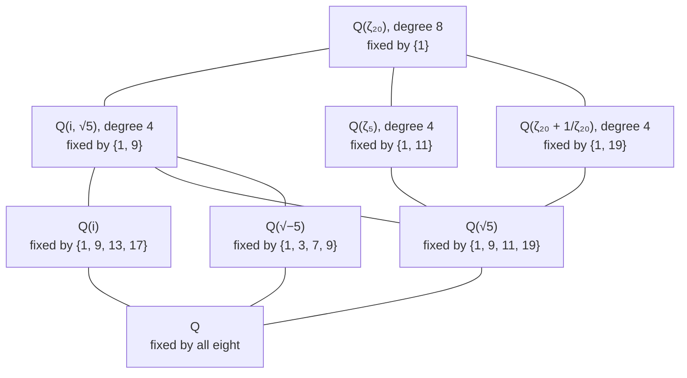

# Kronecker-Weber: every abelian extension of Q sits inside a cyclotomic field

[Syllabus](../../../SYLLABUS.md) → [Algebraic and analytic number theory](../README.md) → [Local Fields and Class Field Theory](../README.md#s09) → Kronecker-Weber

---

## General Overview

Take $`\zeta = e^{2\pi i/5}`$, one fifth of a turn round the unit circle. Add and subtract its powers with the signs + − − +:

```math
\zeta - \zeta^2 - \zeta^3 + \zeta^4 = 2.2360679775 = \sqrt{5}
```

The signs are not random. They are +1 where the exponent is a square mod 5 (1 and 4) and −1 where it is not (2 and 3). So the square root of 5, a number with nothing visibly circular about it, is built from fifth roots of 1. It lives in the **cyclotomic field** $`\mathbb{Q}(\zeta_5)`$: the smallest field (a number system closed under the four operations) holding the rationals and $`\zeta`$.

That placement answers a question about primes. A prime p **splits** in $`\mathbb{Q}(\sqrt{5})`$ when it breaks into two different prime ideals there (the primes of the bigger number system). It is **inert** when it stays prime, and it **ramifies** when it breaks into a repeated factor, as 5 does. For odd p other than 5, p splits exactly when 5 is a square mod p. Because $`\sqrt{5}`$ sits in the field of fifth roots of 1, the answer depends only on p mod 5: p splits exactly when p leaves remainder 1 or 4 on division by 5. Of the 167 primes below 1,000 other than 5, the 78 that split are exactly those.

The same holds for $`\mathbb{Q}(\sqrt{-5})`$, the house field, one level up: it sits inside the field of 20th roots of 1, so its primes are sorted by p mod 20. And it fails for $`\mathbb{Q}(\sqrt[3]{2})`$: that field is missing two of the three cube roots of 2, so no field of roots of 1 holds it, and no remainder rule sorts its primes.

**Every finite extension of the rationals that holds all its conjugates and whose symmetries commute lies inside a field of roots of 1, and there a prime's symmetry is p mod m, so every such field splits its primes by a congruence rule.**

**What kind of fact this is:** a theorem (Kronecker 1853, Weber 1886, first complete proof by Hilbert in 1896). This card proves the step from local fields to the global theorem in full. It outlines the local step, the abelian extensions of the p-adic numbers, and names Washington's chapter 14 for its proof. The prime counts below 1,000 are evidence for the splitting rules, not their proof; the proof is Step 2.

### The picture: the fields inside the 20th roots of 1



Each box names a field and the remainders mod 20 whose symmetries leave it alone. Every one of the eight subgroups of the remainders appears once. The code finds each subgroup by testing every symmetry on an exact formula for the field's generator.

---

## The formula

Notation first, in words. $`\zeta_m = e^{2\pi i/m}`$ is the first mth root of 1 ([Cyclotomic fields](../05-Fields%20and%20Galois%20Theory/08-cyclotomic-extensions-and-roots-of-unity.md)). $`(\mathbb{Z} \bmod m)^{\times}`$ is the set of remainders mod m with a multiplicative undo, under multiplication. $`\mathrm{Gal}(K/\mathbb{Q})`$ is the group of symmetries of a field K that fix every rational. A field K is **abelian** over $`\mathbb{Q}`$ when it is normal (it holds every conjugate of its members) and its symmetries commute.

The theorem:

```math
K/\mathbb{Q} \text{ finite and abelian} \implies K \subseteq \mathbb{Q}(\zeta_m) \text{ for some whole number } m
```

**Read it aloud:** if a finite field over the rationals is normal and its symmetries commute, it sits inside the field of mth roots of 1 for some m.

Inside a cyclotomic field the symmetries are known exactly. The **Artin map** names them by primes:

```math
\mathrm{Art}_m : (\mathbb{Z} \bmod m)^{\times} \to \mathrm{Gal}(\mathbb{Q}(\zeta_m)/\mathbb{Q}), \qquad p \bmod m \mapsto \mathrm{Frob}_p = \sigma_p, \qquad \sigma_p(\zeta_m) = \zeta_m^{\,p}
```

**Read it aloud:** a prime p not dividing m goes to its Frobenius symmetry, which raises every mth root of 1 to the power p; that symmetry depends only on p mod m.

If K is the part of $`\mathbb{Q}(\zeta_m)`$ fixed by a subgroup H of the remainders, then for each prime p not dividing m:

```math
p \text{ splits completely in } K \iff p \bmod m \in H, \qquad f(K) = \text{the smallest } m \text{ with } K \subseteq \mathbb{Q}(\zeta_m)
```

**Read it aloud:** p splits completely in K exactly when its remainder lies in H; and the conductor of K is the smallest m whose roots of 1 hold K.

For $`\mathbb{Q}(\sqrt{5})`$: m = 5, H = {1, 4}, conductor 5. For $`\mathbb{Q}(\sqrt{-5})`$: m = 20, H = {1, 3, 7, 9}, conductor 20.

| Symbol | Plain meaning | In our example | Push it up and the answer… |
| --- | --- | --- | --- |
| $`K`$ | an abelian field over the rationals | $`\mathbb{Q}(\sqrt{5})`$, $`\mathbb{Q}(\sqrt{-5})`$ | a bigger field needs a bigger m |
| $`m`$, $`\zeta_m`$, $`\zeta`$ | how many parts the circle is cut into; the first mth root of 1; $`\zeta`$ alone is $`\zeta_5`$ or $`\zeta_{20}`$, said each time | 5 and 20 | more roots, more fields inside |
| $`\Phi_m`$ | the cyclotomic polynomial, the minimal polynomial of $`\zeta_m`$ | $`\Phi_5 = 1 + x + x^2 + x^3 + x^4`$ | degree $`\varphi(m)`$ |
| $`(\mathbb{Z} \bmod m)^{\times}`$, $`k`$ | remainders mod m with an undo; one of them | 1, 2, 3, 4 mod 5 | — |
| $`\sigma_k`$ | the symmetry $`\zeta \mapsto \zeta^k`$ | $`\sigma_2(\sqrt{5}) = -\sqrt{5}`$ | — |
| $`p`$, $`\mathrm{Frob}_p`$, $`\mathrm{Art}_m`$ | a prime; its Frobenius symmetry; the map from remainders to symmetries | $`\mathrm{Frob}_{11} = \sigma_{11} = \sigma_1`$ on $`\mathbb{Q}(\zeta_5)`$ | — |
| $`H`$ | the remainders whose symmetries fix K | {1, 4} mod 5 | bigger H, smaller K |
| $`f(K)`$ | the conductor: the smallest m with K inside $`\mathbb{Q}(\zeta_m)`$ | 5 and 20 | — |
| $`d_K`$ | the discriminant of K; a prime ramifies exactly when it divides $`d_K`$ | 5 and −20 | more ramified primes |
| $`\mathbb{Q}_p`$, $`K_{\mathfrak{P}}`$ | the p-adic numbers; K completed at a prime ideal $`\mathfrak{P}`$ above p | $`\mathbb{Q}_5(\sqrt{-5})`$ | — |
| $`I_p`$, $`e_p`$ | the inertia group at p; the power of p in the local root of 1, not the ramification index $`e_i`$ | $`\lvert I_5\rvert \le 4`$; $`e_2 = 2`$, $`e_5 = 1`$ | — |
| $`M`$, $`L`$ | the product of the $`p^{e_p}`$; the field K with $`\zeta_M`$ added | 20; $`\mathbb{Q}(\zeta_{20})`$ | — |

### When it holds

- **The field is normal.** $`\mathbb{Q}(\sqrt[3]{2})`$ has one symmetry, the identity, so its symmetry group commutes trivially. But it lacks the two complex cube roots of 2, and every field inside a cyclotomic field is normal. Mod 5, $`x^3 - 2`$ has one root, 3, and a quadratic factor with no root: a mixed pattern no normal field allows.
- **The symmetries commute.** The splitting field of $`x^3 - 2`$ is normal, but its six symmetries do not commute. Every subfield of a cyclotomic field has a commuting group, so it sits in none; its primes need the non-abelian version of [Chebotarev](../06-Algebraic%20Numbers/09-chebotarev-density-and-splitting-statistics.md), not a congruence.
- **The base field is the rationals.** Over $`\mathbb{Q}(\sqrt{-5})`$ the fields $`\mathbb{Q}(\sqrt{-5}, \zeta_m)`$ are abelian, but they are not all the abelian extensions: some abelian extensions of $`\mathbb{Q}(\sqrt{-5})`$ are not abelian over the rationals, so no root of 1 reaches them. Special values of elliptic functions do. Over most base fields no explicit description is known (Hilbert's twelfth problem).
- **The prime does not divide m.** For p dividing the conductor, p mod m is no unit and there is no Frobenius: 5 ramifies in $`\mathbb{Q}(\sqrt{5})`$, where $`x^2 - x - 1`$ has a double root mod 5.

---

## Why it works

### Step 0: the idea

A field is pinned down by how primes behave in it. An abelian field's behaviour at each prime p is a local question, about an abelian extension of the p-adic numbers. Locally, every such extension is a piece of a cyclotomic one. Glue the local roots of 1 into one global $`\zeta_M`$, and the result is a cyclotomic field with at least as much ramification as K. Then K with $`\zeta_M`$ added has nowhere left to hide extra degree: any extra piece would be unramified at every prime, and the rationals have no such extension.

The card works in that order: square roots by hand (Step 1), the Artin map (Step 2) and the conductor (Step 3) show the theorem on the examples. The proof itself is Step 4 (local) and Step 5 (local to global).

### Step 1: every quadratic field is cyclotomic, by Gauss sums

The [Gauss sums](../03-Characters%20and%20L-functions/06-gauss-sums.md) card proves that for an odd prime p the signed sum of pth roots of 1 squares to $`p^* = (-1)^{(p-1)/2}\, p`$. For p = 5 that is the sum in the overview, and $`p^* = 5`$. The code checks it exactly: the square, reduced by $`\Phi_5`$, is [5, 0, 0, 0], meaning the number 5.

The prime 2 gives the rest. $`i = \zeta_4`$, and $`\sqrt{2} = \zeta_8 + \zeta_8^{-1}`$. Any $`\sqrt{d}`$ is a product of these and the $`\sqrt{p^*}`$, so every quadratic field is cyclotomic. For the house field, multiply by $`i = \zeta_{20}^5`$:

```math
\sqrt{-5} = i\sqrt{5} = \zeta_{20} + \zeta_{20}^{9} - \zeta_{20}^{13} - \zeta_{20}^{17}
```

**Read it aloud:** the square root of minus 5 is a signed sum of four 20th roots of 1.

The code evaluates it, 2.2360679775i, and squares it exactly by $`\Phi_{20}`$: −5.

### Step 2: the Artin map, and why it sorts primes

Take a prime p not dividing m. Mod p, raising to the power p respects addition: $`(a + b)^p \equiv a^p + b^p`$, and $`c^p \equiv c`$ for whole c (Fermat). So for any number $`\alpha = \sum c_j \zeta^j`$ with whole coefficients:

```math
\alpha^p \equiv \sum c_j \zeta^{jp} = \sigma_p(\alpha) \pmod p
```

**Read it aloud:** the pth power of alpha is, mod p, the symmetry sigma p applied to alpha.

That congruence is what makes $`\sigma_p`$ the **Frobenius** at p ([Decomposition and inertia groups](02-decomposition-and-inertia-groups.md)): the one symmetry that acts as "raise to the power p" on the remainders mod a prime ideal above p. The code tests it for $`\alpha = \sqrt{5}`$ and the nine primes from 2 to 29 other than 5: every time, $`\alpha^p`$ and $`\sigma_p(\alpha)`$ agree mod p.

Now the splitting rule. In an abelian field the Frobenius of p is one symmetry, and p splits completely exactly when it is the identity on K. On $`\mathbb{Q}(\sqrt{5})`$, $`\sigma_p`$ either fixes $`\sqrt{5}`$ or flips its sign:

| p | p mod 5 | $`\sigma_p(\sqrt{5})`$ | roots of $`x^2 - x - 1`$ mod p |
| --- | --- | --- | --- |
| 2, 7, 17 | 2 | $`-\sqrt{5}`$ | none: inert |
| 3, 13, 23 | 3 | $`-\sqrt{5}`$ | none: inert |
| 11 | 1 | $`+\sqrt{5}`$ | two: split |
| 19, 29 | 4 | $`+\sqrt{5}`$ | two: split |

The last column tests splitting directly. The ring of integers of $`\mathbb{Q}(\sqrt{5})`$ is generated by $`(1 + \sqrt{5})/2`$, a root of $`x^2 - x - 1`$, and p splits exactly when that polynomial has two roots mod p ([Splitting and ramification](../06-Algebraic%20Numbers/08-splitting-and-ramification.md)). The subgroup fixing $`\sqrt{5}`$ is H = {1, 4}. So p splits exactly when p is 1 or 4 mod 5. That is the remainder rule of the overview, proved; the 78 primes below 1,000 are its evidence.

The same reasoning in $`\mathbb{Q}(\zeta_{20})`$ gives the subgroups in the picture. The house example follows: the field $`\mathbb{Q}(i, \sqrt{5})`$ is fixed by H = {1, 9}, so a prime splits completely there exactly when p is 1 or 9 mod 20. That field is the Hilbert class field of $`\mathbb{Q}(\sqrt{-5})`$, its largest abelian extension in which no prime ramifies ([Artin reciprocity](05-artin-reciprocity-and-the-hilbert-class-field.md)), and the primes splitting completely in it are the primes $`x^2 + 5y^2`$ other than 5, which is of that form but ramifies. The code lists the 36 such primes below 1,000, starting 29, 41, 61, 89, 101, 109; every one is 1 or 9 mod 20, and every prime that is 1 or 9 mod 20 is on the list.

### Step 3: the conductor

A field can sit in many cyclotomic fields: $`\mathbb{Q}(\sqrt{5})`$ sits in $`\mathbb{Q}(\zeta_5)`$, $`\mathbb{Q}(\zeta_{10})`$ and $`\mathbb{Q}(\zeta_{20})`$. Since $`\mathbb{Q}(\zeta_a) \cap \mathbb{Q}(\zeta_b) = \mathbb{Q}(\zeta_{\gcd(a,b)})`$, the possible m are the multiples of one smallest value, the **conductor** f(K).

To read it off, take a divisor d of m. The symmetries $`\sigma_k`$ with $`k \equiv 1 \pmod d`$ are the ones fixing $`\zeta_d`$, so K lies in $`\mathbb{Q}(\zeta_d)`$ exactly when all of them lie in H. For $`\mathbb{Q}(\sqrt{-5})`$ with H = {1, 3, 7, 9} mod 20:

- d = 4: the remainders 1 mod 4 are 1, 9, 13, 17, and 13 is not in H.
- d = 5 or 10: the remainders 1 mod 5 are 1 and 11, and 11 is not in H.
- d = 20: only 1, which is in H. So f = 20.

The code finds conductors 5, 4 and 20 for $`\mathbb{Q}(\sqrt{5})`$, $`\mathbb{Q}(i)`$ and $`\mathbb{Q}(\sqrt{-5})`$ this way. A second road uses only primes: the smallest m for which split or inert depends only on p mod m, over the primes below 1,000. It also gives 5, 4 and 20. For a quadratic field the conductor is $`\lvert d_K\rvert`$; for $`\mathbb{Q}(\sqrt{-5})`$, the 4 comes from 2, which ramifies, and the 5 from 5.

### Step 4: the local step, in outline

Fix a prime p and an abelian extension F of $`\mathbb{Q}_p`$, the p-adic numbers ([Local fields](03-local-fields-and-the-different.md)). The **local Kronecker-Weber theorem** says F lies in $`\mathbb{Q}_p(\zeta_n)`$ for some n. The proof is stated here with its key ideas; Washington's chapter 14 gives it in full.

1. **Reduce to a cyclic group of prime-power size.** A finite abelian group is a product of cyclic ones, and a compositum (the smallest field holding several fields) of cyclotomic fields is cyclotomic.
2. **Unramified pieces.** The unramified extension of degree f (here f is a degree, not the conductor) is $`\mathbb{Q}_p(\zeta_{p^f - 1})`$, cyclotomic already.
3. **Tame pieces, prime size q other than p.** Tame means the ramification index (how many times the prime repeats) is prime to p. After an unramified extension such a field is made by a qth root of p times a unit. Commuting symmetries force q to divide p − 1, and then the root lies in $`\mathbb{Q}_p(\zeta_p)`$ times an unramified field.
4. **Wild pieces, size a power of p.** Wild means p divides the ramification index. Kummer theory (the description of extensions made by pth roots) over $`\mathbb{Q}_p(\zeta_p)`$ ([Kummer and Artin-Schreier](../05-Fields%20and%20Galois%20Theory/11-kummer-theory-and-hilbert-90.md)) counts the extensions of exponent p. For odd p their group is at most two copies of $`\mathbb{Z} \bmod p`$, and cyclotomic fields already supply both: the unramified one and the degree-p piece of $`\mathbb{Q}_p(\zeta_{p^2})`$. A cyclic extension of higher degree outside, combined with these, would make a third copy, which the count forbids.
5. **p = 2.** The same, with more cases: $`\mathbb{Q}_2`$ has more square classes.

The code checks the smallest count of this kind, the quadratic extensions. Units of the 5-adic integers fall into 2 square classes, and those of the 2-adic integers into 4, counted mod 125 and mod 64. So $`\mathbb{Q}_5`$ has 3 quadratic extensions and $`\mathbb{Q}_2`$ has 7. Each of them lies in a field of local roots of 1.

### Step 5: from local to global, in full

Let K be finite and abelian over $`\mathbb{Q}`$. Only the primes dividing $`d_K`$ ramify.

1. **Local pieces.** For each ramified p pick a prime ideal $`\mathfrak{P}`$ of K above p. The completion $`K_{\mathfrak{P}}`$ is abelian over $`\mathbb{Q}_p`$: its symmetry group is the decomposition group (the symmetries of K that keep $`\mathfrak{P}`$ in place), a subgroup of an abelian group. By Step 4, $`K_{\mathfrak{P}} \subseteq \mathbb{Q}_p(\zeta_n)`$. Write $`n = p^{e_p} u`$ with p not dividing u.
2. **Glue.** Put $`M = \prod p^{e_p}`$ over the ramified primes, and $`L = K(\zeta_M)`$. L is abelian over $`\mathbb{Q}`$, since its symmetries embed in those of K times those of $`\mathbb{Q}(\zeta_M)`$.
3. **Bound each inertia group.** At a prime above p, L completes to a field inside $`\mathbb{Q}_p(\zeta_{p^{e_p}}, \zeta_{u'})`$ with u' prime to p. The $`\zeta_{u'}`$ part is unramified and the $`\zeta_{p^{e_p}}`$ part has ramification index $`\varphi(p^{e_p})`$. So the inertia group $`I_p`$, the symmetries of L acting trivially on the residue field at p, has $`\lvert I_p\rvert \le \varphi(p^{e_p})`$. Because L is abelian, $`I_p`$ does not depend on the choice of prime above p.
4. **Nothing is unramified.** Let I be the group generated by all the $`I_p`$. Its size is at most $`\prod \varphi(p^{e_p}) = \varphi(M)`$. The field fixed by I is unramified at every prime. By Minkowski's bound every number field other than $`\mathbb{Q}`$ has $`\lvert d\rvert > 1`$ and so a ramified prime ([Class groups](../06-Algebraic%20Numbers/05-class-groups-and-the-minkowski-bound.md)). So that fixed field is $`\mathbb{Q}`$, and I is all of $`\mathrm{Gal}(L/\mathbb{Q})`$.
5. **Count.** $`[L:\mathbb{Q}] = \lvert I\rvert \le \varphi(M) = [\mathbb{Q}(\zeta_M):\mathbb{Q}]`$. But L contains $`\mathbb{Q}(\zeta_M)`$. So $`L = \mathbb{Q}(\zeta_M)`$, and K lies inside it.

On the house field: 2 and 5 ramify. At 5, −1 is a square mod 5, so $`\sqrt{-5}`$ lies in $`\mathbb{Q}_5(\sqrt{5}) \subseteq \mathbb{Q}_5(\zeta_5)`$, and $`e_5 = 1`$. At 2, $`\sqrt{5}`$ generates the unramified quadratic extension, inside $`\mathbb{Q}_2(\zeta_3)`$, so $`\sqrt{-5} = i\sqrt{5}`$ lies in $`\mathbb{Q}_2(i, \zeta_3)`$, and $`i = \zeta_4`$ gives $`e_2 = 2`$. Then M = 4 × 5 = 20, and the inertia bound is $`\varphi(4) \times \varphi(5) = 2 \times 4 = 8 = \varphi(20)`$. The proof lands on $`\mathbb{Q}(\zeta_{20})`$, the field Step 1 found by hand.

<details>
<summary>Detailed proof: why the fixed field of I is unramified everywhere</summary>

Let E be the field fixed by I, and p any prime. The inertia group of E at p is the image of $`I_p`$ under the restriction map from $`\mathrm{Gal}(L/\mathbb{Q})`$ to $`\mathrm{Gal}(E/\mathbb{Q})`$. Restriction kills exactly the symmetries fixing E, which is I, and $`I_p`$ lies in I. So the image is trivial, and p is unramified in E.

Unramified at every prime means no prime divides $`d_E`$, so $`\lvert d_E\rvert = 1`$. Minkowski's bound says each ideal class of E holds an ideal of norm at most $`\sqrt{\lvert d_E\rvert}\,(4/\pi)^{r_2}\, n!/n^n`$, where n is the degree and $`r_2`$ the number of complex pairs. Every ideal has norm at least 1, so

$`\displaystyle \lvert d_E\rvert \ge \Big(\frac{\pi}{4}\Big)^{2 r_2} \Big(\frac{n^n}{n!}\Big)^2 \ge \Big(\frac{\pi}{4}\Big)^{n} \Big(\frac{n^n}{n!}\Big)^2,`$

and the right side exceeds 1 for every n of at least 2 (it is $`\pi^2/4`$ at n = 2 and grows). So n = 1 and E is $`\mathbb{Q}`$.

</details>

---

## Worked numbers, by hand

| Step | Arithmetic | Value |
| --- | --- | --- |
| signs for $`\sqrt{5}`$ | squares mod 5 are 1, 4; non-squares 2, 3 | + − − + |
| the sum | $`\zeta - \zeta^2 - \zeta^3 + \zeta^4`$ with $`\zeta = \zeta_5`$ | 2.2360679775 |
| its square | reduced by $`\Phi_5`$ | 5 |
| Frobenius at 11 | $`\sigma_{11} = \sigma_1`$ since 11 ≡ 1 mod 5 | fixes $`\sqrt{5}`$: 11 splits |
| Frobenius at 13 | $`\sigma_{13} = \sigma_3`$, which flips the sign | 13 is inert |
| house field | $`\sqrt{-5} = i\sqrt{5} = \zeta_{20}^5 \sqrt{5}`$ | inside $`\mathbb{Q}(\zeta_{20})`$ |
| its subgroup | remainders k mod 20 fixing $`\zeta_{20} + \zeta_{20}^9 - \zeta_{20}^{13} - \zeta_{20}^{17}`$ | {1, 3, 7, 9} |
| conductor | 13 ≡ 1 mod 4 and 11 ≡ 1 mod 5 lie outside it | **20** |
| splitting rule | p splits in $`\mathbb{Q}(\sqrt{-5})`$ | **p ≡ 1, 3, 7, 9 mod 20** |

The house field lives in the field of 20th roots of 1 and no smaller one, so whether −5 is a square mod p is decided by p mod 20: 81 of the 166 primes below 1,000 other than 2 and 5 split, all in those four classes.

### What breaks if you drop a piece

| Mistake | Comes out at | What went wrong |
| --- | --- | --- |
| Conductor of $`\mathbb{Q}(\sqrt{-5})`$ taken as 5 | 3 splits and 13 is inert, both 3 mod 5 | The 2 in $`d_K = -20`$ ramifies too; the factor 4 is needed |
| Every sign + in the sum | $`\zeta + \zeta^2 + \zeta^3 + \zeta^4 = -1`$ | The signs must be the squares pattern mod 5 |
| $`x^2 - 5`$ used at p = 2 | one root, 1: 2 looks ramified | $`\mathbb{Z}[\sqrt{5}]`$ is not the ring of integers; $`x^2 - x - 1`$ shows 2 inert |
| $`\mathbb{Q}(\sqrt[3]{2})`$ taken as abelian | mod 5: one root, 3, and $`x^2 + 3x + 4`$ with none | Not normal: the 1 + 2 pattern cannot occur in an abelian field |

Over the 166 primes from 5 to 997, $`x^3 - 2`$ has no root mod 56 of them, one root mod 86 and three roots mod 24. In an abelian cubic field every unramified prime has 0 or 3 roots.

---

## Code, from first principles, and it actually runs

The code keeps numbers in $`\mathbb{Q}(\zeta_m)`$ as lists of whole coefficients on powers of $`\zeta`$ and reduces them exactly by $`\Phi_m`$, built by polynomial division. It reaches each answer by two independent roads. The square roots are checked by exact squaring and by complex evaluation. The Frobenius is checked as the symmetry $`\sigma_p`$ and as the pth power mod p. Splitting comes from the subgroup H and from counting polynomial roots mod each prime below 1,000. The conductor comes from H and from prime data alone.

### Python

```python
# Kronecker-Weber -- the check behind the card.  Standard library only.
# A number in Q(zeta_m) is a list c of m whole numbers, meaning the sum of c[j] zeta^j.
# Equality is tested exactly, after reducing by the cyclotomic polynomial Phi_m, which
# is built here by division.  Splitting is tested by counting roots mod p by brute force.
import cmath
from math import gcd

def cyc(m):                                # Phi_m, low coefficient first
    a = [-1] + [0] * (m - 1) + [1]         # x^m - 1
    for d in range(1, m):
        if m % d == 0:
            b, q = cyc(d), [0] * (len(a) - len(cyc(d)) + 1)
            for i in range(len(q) - 1, -1, -1):
                q[i] = a[i + len(b) - 1]
                for j, y in enumerate(b):
                    a[i + j] -= q[i] * y
            assert not any(a)              # the division is exact
            a = q
    return a

def red(c, m, p=0):                        # remainder mod Phi_m (and mod p if p > 0)
    f, c = cyc(m), c[:]
    n = len(f) - 1
    for i in range(len(c) - 1, n - 1, -1):
        for j, y in enumerate(f):
            c[i - n + j] -= c[i] * y
    return [x % p if p else x for x in c[:n]]

def num(m, terms):                         # terms: {exponent: coefficient}
    c = [0] * m
    for e, k in terms.items():
        c[e % m] += k
    return c

def mul(a, b, m, p=0):                     # product, using zeta^m = 1
    c = [0] * m
    for i, x in enumerate(a):
        for j, y in enumerate(b):
            c[(i + j) % m] += x * y
    return [x % p if p else x for x in c]

def sig(k, a, m):                          # the symmetry zeta -> zeta^k
    c = [0] * m
    for j, x in enumerate(a):
        c[j * k % m] += x
    return c

def val(a, m):
    return sum(x * cmath.exp(2j * cmath.pi * e / m) for e, x in enumerate(a))

def units(m):
    return [k for k in range(1, m) if gcd(k, m) == 1]

def fixer(a, m):                           # the subgroup of (Z mod m)^x fixing a
    return [k for k in units(m) if red(sig(k, a, m), m) == red(a, m)]

def cond(h, m):                            # smallest d | m with every k = 1 mod d inside h
    return min(d for d in range(1, m + 1) if m % d == 0
               and all(k in h for k in units(m) if k % d == 1 % d))

def roots(f, p):                           # f low first; its roots mod p
    return [x for x in range(p) if sum(c * x ** i for i, c in enumerate(f)) % p == 0]

def status(f, p):
    return {2: "split", 0: "inert", 1: "ramified"}[len(roots(f, p))]

def cond_data(f, bad, ps):                 # smallest m making status depend on p mod m
    for m in range(1, 100):
        seen = {}
        for p in ps:
            if p not in bad and m % p and seen.setdefault(p % m, status(f, p)) != status(f, p):
                break
        else:
            return m

def fx(a, m):
    z = val(a, m)
    return f"{round(z.real, 10) + 0.0:.10f} + {round(z.imag, 10) + 0.0:.10f}i"

ps = [p for p in range(2, 1000) if all(p % q for q in range(2, p))]
r5 = num(5, {1: 1, 2: -1, 3: -1, 4: 1})
s20 = num(20, {4: 1, 8: -1, 12: -1, 16: 1})
i20, n20 = num(20, {5: 1}), num(20, {1: 1, 9: 1, 13: -1, 17: -1})
print(f"Phi_5 = {cyc(5)}, Phi_20 = {cyc(20)} (low coefficient first)")
print(f"sqrt5 = z - z^2 - z^3 + z^4 = {fx(r5, 5)}, its square mod Phi_5 = {red(mul(r5, r5, 5), 5)}")
print(f"all plus signs, z + z^2 + z^3 + z^4 = {red(num(5, {1: 1, 2: 1, 3: 1, 4: 1}), 5)}")
print(f"sqrt(-5) = z + z^9 - z^13 - z^17 in Q(zeta_20) = {fx(n20, 20)}, square = {red(mul(n20, n20, 20), 20)}")
print("p  p mod 5  sigma_p(sqrt5)  sqrt5^p = sigma_p(sqrt5) mod p  x^2-x-1 mod p")
for p in [2, 3, 7, 11, 13, 17, 19, 23, 29]:
    sp = sig(p, r5, 5)
    sign = "+sqrt5" if red(sp, 5) == red(r5, 5) else "-sqrt5"
    pw = [1, 0, 0, 0, 0]
    for _ in range(p):
        pw = mul(pw, r5, 5, p)
    frob = red(pw, 5, p) == red(sp, 5, p)
    print(f"{p:<3}{p % 5:^9}{sign:^16}{'yes' if frob else 'no':^33}{status([-1, -1, 1], p)}")
    assert frob and (sign == "+sqrt5") == (status([-1, -1, 1], p) == "split")
h5, h20s, h20i, h20n = fixer(r5, 5), fixer(s20, 20), fixer(i20, 20), fixer(n20, 20)
hhcf = [k for k in h20s if k in h20i]
print(f"fixing sqrt5 in (Z mod 5)^x: {h5}; in (Z mod 20)^x: {h20s}")
print(f"fixing i: {h20i}; fixing sqrt(-5): {h20n}; fixing i and sqrt5: {hhcf}")
sub = {}
for mask in range(1, 256):
    s = [u for b, u in enumerate(units(20)) if mask >> b & 1]
    if 1 in s and all(x * y % 20 in s for x in s for y in s):
        sub[len(s)] = sub.get(len(s), 0) + 1
print(f"subgroups of (Z mod 20)^x by size: {sub}")
print(f"fixing zeta_5: {fixer(num(20, {4: 1}), 20)}; fixing z + 1/z: {fixer(num(20, {1: 1, 19: 1}), 20)}")
c_alg = [cond(h5, 5), cond(h20i, 20), cond(h20n, 20)]
c_dat = [cond_data([-1, -1, 1], [5], ps), cond_data([1, 0, 1], [2], ps), cond_data([5, 0, 1], [2, 5], ps)]
print(f"conductors of Q(sqrt5), Q(i), Q(sqrt(-5)) by subgroup: {c_alg}; by primes below 1000: {c_dat}")
odd = [p for p in ps if p != 5]
sp5 = [p for p in odd if status([-1, -1, 1], p) == "split"]
sp_n = [p for p in ps if p not in (2, 5) and status([5, 0, 1], p) == "split"]
rep = [p for p in ps if p != 5 and any(((p - 5 * y * y) ** 0.5).is_integer() for y in range(1, 15) if p >= 5 * y * y)]
print(f"Q(sqrt5): {len(sp5)} of the {len(odd)} primes below 1000 other than 5 split, exactly those with p mod 5 in {sorted({p % 5 for p in sp5})}")
print(f"Q(sqrt(-5)): {len(sp_n)} of the {len(ps) - 2} other than 2 and 5 split, exactly p mod 20 in {sorted({p % 20 for p in sp_n})}")
print(f"p = x^2 + 5y^2 below 1000, other than 5: {len(rep)} primes, exactly p mod 20 in {sorted({p % 20 for p in rep})}; first {rep[:6]}")
cube = {0: 0, 1: 0, 3: 0}
for p in ps[2:]:
    cube[len(roots([-2, 0, 0, 1], p))] += 1
print(f"x^3 - 2 mod p for {len(ps) - 2} primes 5 to 997: roots 0/1/3 in {cube[0]}/{cube[1]}/{cube[3]} primes")
print(f"mod 5: roots {roots([-2, 0, 0, 1], 5)}, cofactor x^2 + 3x + 4 has roots {roots([4, 3, 1], 5)}")
sq = [len(units(m)) // len({x * x % m for x in units(m)}) for m in (125, 64)]
print(f"local count: square classes of units mod 125 and mod 64: {sq[0]}, {sq[1]}; "
      f"quadratic extensions of Q_5 and Q_2: {2 * sq[0] - 1}, {2 * sq[1] - 1}")
print(f"inertia bound: phi(4) x phi(5) = {len(units(4))} x {len(units(5))} = {len(units(20))} = phi(20)")
print(f"mistake, conductor 5 for Q(sqrt(-5)): 3 is {status([5, 0, 1], 3)}, 13 is {status([5, 0, 1], 13)}, both 3 mod 5")
print(f"mistake, x^2 - 5 at p = 2: roots {roots([-5, 0, 1], 2)} (looks ramified); x^2 - x - 1: {status([-1, -1, 1], 2)}")
assert red(mul(r5, r5, 5), 5) == [5, 0, 0, 0] and red(mul(n20, n20, 20), 20) == [-5] + [0] * 7
assert abs(val(r5, 5) - 5 ** 0.5) < 1e-12 and abs(val(n20, 20) - 1j * 5 ** 0.5) < 1e-12
assert h5 == [1, 4] and h20n == [1, 3, 7, 9] and hhcf == [1, 9] and sub == {1: 1, 2: 3, 4: 3, 8: 1}
assert c_alg == c_dat == [5, 4, 20]
assert all((p in sp5) == (p % 5 in h5) for p in odd)
assert all((p in sp_n) == (p % 20 in h20n) for p in ps if p not in (2, 5))
assert all((p in rep) == (p % 20 in hhcf) for p in ps)
assert cube[1] > 0 and roots([4, 3, 1], 5) == []
print("ALL CHECKS PASS")
```

**Ran 2026-11-24 on macOS, Python 3.14.10, standard library only. All checks passed. Output, pasted from the run:**

```
Phi_5 = [1, 1, 1, 1, 1], Phi_20 = [1, 0, -1, 0, 1, 0, -1, 0, 1] (low coefficient first)
sqrt5 = z - z^2 - z^3 + z^4 = 2.2360679775 + 0.0000000000i, its square mod Phi_5 = [5, 0, 0, 0]
all plus signs, z + z^2 + z^3 + z^4 = [-1, 0, 0, 0]
sqrt(-5) = z + z^9 - z^13 - z^17 in Q(zeta_20) = 0.0000000000 + 2.2360679775i, square = [-5, 0, 0, 0, 0, 0, 0, 0]
p  p mod 5  sigma_p(sqrt5)  sqrt5^p = sigma_p(sqrt5) mod p  x^2-x-1 mod p
2      2         -sqrt5                    yes               inert
3      3         -sqrt5                    yes               inert
7      2         -sqrt5                    yes               inert
11     1         +sqrt5                    yes               split
13     3         -sqrt5                    yes               inert
17     2         -sqrt5                    yes               inert
19     4         +sqrt5                    yes               split
23     3         -sqrt5                    yes               inert
29     4         +sqrt5                    yes               split
fixing sqrt5 in (Z mod 5)^x: [1, 4]; in (Z mod 20)^x: [1, 9, 11, 19]
fixing i: [1, 9, 13, 17]; fixing sqrt(-5): [1, 3, 7, 9]; fixing i and sqrt5: [1, 9]
subgroups of (Z mod 20)^x by size: {1: 1, 2: 3, 4: 3, 8: 1}
fixing zeta_5: [1, 11]; fixing z + 1/z: [1, 19]
conductors of Q(sqrt5), Q(i), Q(sqrt(-5)) by subgroup: [5, 4, 20]; by primes below 1000: [5, 4, 20]
Q(sqrt5): 78 of the 167 primes below 1000 other than 5 split, exactly those with p mod 5 in [1, 4]
Q(sqrt(-5)): 81 of the 166 other than 2 and 5 split, exactly p mod 20 in [1, 3, 7, 9]
p = x^2 + 5y^2 below 1000, other than 5: 36 primes, exactly p mod 20 in [1, 9]; first [29, 41, 61, 89, 101, 109]
x^3 - 2 mod p for 166 primes 5 to 997: roots 0/1/3 in 56/86/24 primes
mod 5: roots [3], cofactor x^2 + 3x + 4 has roots []
local count: square classes of units mod 125 and mod 64: 2, 4; quadratic extensions of Q_5 and Q_2: 3, 7
inertia bound: phi(4) x phi(5) = 2 x 4 = 8 = phi(20)
mistake, conductor 5 for Q(sqrt(-5)): 3 is split, 13 is inert, both 3 mod 5
mistake, x^2 - 5 at p = 2: roots [1] (looks ramified); x^2 - x - 1: inert
ALL CHECKS PASS
```

### Rust

Same numbers, same labels, built with `rustc --edition 2021 -O`.

```rust
// Kronecker-Weber -- the same check as the Python, in Rust.  No crates.
// A number in Q(zeta_m) is a list c of m whole numbers, meaning the sum of c[j] zeta^j.
// Equality is tested exactly, after reducing by the cyclotomic polynomial Phi_m, which
// is built here by division.  Splitting is tested by counting roots mod p by brute force.
use std::collections::BTreeMap;
use std::f64::consts::PI;

fn cyc(m: usize) -> Vec<i64> {                     // Phi_m, low coefficient first
    let mut a = vec![0i64; m + 1];
    (a[0], a[m]) = (-1, 1);
    for d in 1..m {
        if m % d == 0 {
            let b = cyc(d);
            let mut q = vec![0i64; a.len() - b.len() + 1];
            for i in (0..q.len()).rev() {
                q[i] = a[i + b.len() - 1];
                for (j, y) in b.iter().enumerate() { a[i + j] -= q[i] * y }
            }
            assert!(a.iter().all(|&x| x == 0));    // the division is exact
            a = q;
        }
    }
    a
}

fn red(c: &[i64], m: usize, p: i64) -> Vec<i64> {  // remainder mod Phi_m (and mod p if p > 0)
    let f = cyc(m);
    let mut c = c.to_vec();
    let n = f.len() - 1;
    for i in (n..c.len()).rev() {
        let t = c[i];
        for (j, y) in f.iter().enumerate() { c[i - n + j] -= t * y }
    }
    c[..n].iter().map(|&x| if p > 0 { x.rem_euclid(p) } else { x }).collect()
}

fn num(m: usize, terms: &[(usize, i64)]) -> Vec<i64> {
    let mut c = vec![0i64; m];
    for &(e, k) in terms { c[e % m] += k }
    c
}

fn mul(a: &[i64], b: &[i64], m: usize, p: i64) -> Vec<i64> {   // product, using zeta^m = 1
    let mut c = vec![0i64; m];
    for (i, x) in a.iter().enumerate() {
        for (j, y) in b.iter().enumerate() { c[(i + j) % m] += x * y }
    }
    c.iter().map(|&x| if p > 0 { x.rem_euclid(p) } else { x }).collect()
}

fn sig(k: usize, a: &[i64], m: usize) -> Vec<i64> {             // the symmetry zeta -> zeta^k
    let mut c = vec![0i64; m];
    for (j, x) in a.iter().enumerate() { c[j * k % m] += x }
    c
}

fn val(a: &[i64], m: usize) -> (f64, f64) {
    let (mut re, mut im) = (0.0, 0.0);
    for (e, &x) in a.iter().enumerate() {
        let t = 2.0 * PI * e as f64 / m as f64;
        (re, im) = (re + x as f64 * t.cos(), im + x as f64 * t.sin());
    }
    (re, im)
}

fn gcd(a: usize, b: usize) -> usize { if b == 0 { a } else { gcd(b, a % b) } }
fn units(m: usize) -> Vec<usize> { (1..m).filter(|&k| gcd(k, m) == 1).collect() }

fn fixer(a: &[i64], m: usize) -> Vec<usize> {      // the subgroup of (Z mod m)^x fixing a
    units(m).into_iter().filter(|&k| red(&sig(k, a, m), m, 0) == red(a, m, 0)).collect()
}

fn cond(h: &[usize], m: usize) -> usize {          // smallest d | m with every k = 1 mod d inside h
    (1..=m).filter(|d| m % d == 0 && units(m).iter().all(|k| k % d != 1 % d || h.contains(k)))
        .min().unwrap()
}

fn roots(f: &[i64], p: i64) -> Vec<i64> {          // f low first; its roots mod p
    (0..p).filter(|&x| {
        let (mut s, mut xp) = (0i64, 1i64);
        for &c in f { s = (s + c * xp).rem_euclid(p); xp = xp * x % p }
        s == 0
    }).collect()
}

fn status(f: &[i64], p: i64) -> &'static str {
    match roots(f, p).len() { 2 => "split", 0 => "inert", _ => "ramified" }
}

fn cond_data(f: &[i64], bad: &[i64], ps: &[i64]) -> i64 {    // smallest m making status depend on p mod m
    'm: for m in 1..100i64 {
        let mut seen: BTreeMap<i64, &str> = BTreeMap::new();
        for &p in ps {
            if bad.contains(&p) || m % p == 0 { continue }
            if *seen.entry(p % m).or_insert(status(f, p)) != status(f, p) { continue 'm }
        }
        return m;
    }
    0
}

fn r10(x: f64) -> f64 { (x * 1e10).round() / 1e10 + 0.0 }
fn fx(a: &[i64], m: usize) -> String { let (re, im) = val(a, m); format!("{:.10} + {:.10}i", r10(re), r10(im)) }

fn main() {
    let ps: Vec<i64> = (2..1000).filter(|&p| (2..p).all(|q| p % q != 0)).collect();
    let r5 = num(5, &[(1, 1), (2, -1), (3, -1), (4, 1)]);
    let s20 = num(20, &[(4, 1), (8, -1), (12, -1), (16, 1)]);
    let (i20, n20) = (num(20, &[(5, 1)]), num(20, &[(1, 1), (9, 1), (13, -1), (17, -1)]));
    let (q5, qi, qn, c3) = ([-1i64, -1, 1], [1i64, 0, 1], [5i64, 0, 1], [-2i64, 0, 0, 1]);
    println!("Phi_5 = {:?}, Phi_20 = {:?} (low coefficient first)", cyc(5), cyc(20));
    println!("sqrt5 = z - z^2 - z^3 + z^4 = {}, its square mod Phi_5 = {:?}", fx(&r5, 5), red(&mul(&r5, &r5, 5, 0), 5, 0));
    println!("all plus signs, z + z^2 + z^3 + z^4 = {:?}", red(&num(5, &[(1, 1), (2, 1), (3, 1), (4, 1)]), 5, 0));
    println!("sqrt(-5) = z + z^9 - z^13 - z^17 in Q(zeta_20) = {}, square = {:?}", fx(&n20, 20), red(&mul(&n20, &n20, 20, 0), 20, 0));
    println!("p  p mod 5  sigma_p(sqrt5)  sqrt5^p = sigma_p(sqrt5) mod p  x^2-x-1 mod p");
    for p in [2i64, 3, 7, 11, 13, 17, 19, 23, 29] {
        let sp = sig(p as usize, &r5, 5);
        let sign = if red(&sp, 5, 0) == red(&r5, 5, 0) { "+sqrt5" } else { "-sqrt5" };
        let mut pw = vec![1i64, 0, 0, 0, 0];
        for _ in 0..p { pw = mul(&pw, &r5, 5, p) }
        let frob = red(&pw, 5, p) == red(&sp, 5, p);
        println!("{:<3}{:^9}{:^16}{:^33}{}", p, p % 5, sign, if frob { "yes" } else { "no" }, status(&q5, p));
        assert!(frob && (sign == "+sqrt5") == (status(&q5, p) == "split"));
    }
    let (h5, h20s, h20i, h20n) = (fixer(&r5, 5), fixer(&s20, 20), fixer(&i20, 20), fixer(&n20, 20));
    let hhcf: Vec<usize> = h20s.iter().copied().filter(|k| h20i.contains(k)).collect();
    println!("fixing sqrt5 in (Z mod 5)^x: {:?}; in (Z mod 20)^x: {:?}", h5, h20s);
    println!("fixing i: {:?}; fixing sqrt(-5): {:?}; fixing i and sqrt5: {:?}", h20i, h20n, hhcf);
    let u20 = units(20);
    let mut sub: BTreeMap<usize, usize> = BTreeMap::new();
    for mask in 1..256usize {
        let s: Vec<usize> = (0..8).filter(|b| mask >> b & 1 == 1).map(|b| u20[b]).collect();
        if s.contains(&1) && s.iter().all(|x| s.iter().all(|y| s.contains(&(x * y % 20)))) { *sub.entry(s.len()).or_insert(0) += 1 }
    }
    let subs: Vec<String> = sub.iter().map(|(k, v)| format!("{}: {}", k, v)).collect();
    println!("subgroups of (Z mod 20)^x by size: {{{}}}", subs.join(", "));
    println!("fixing zeta_5: {:?}; fixing z + 1/z: {:?}", fixer(&num(20, &[(4, 1)]), 20), fixer(&num(20, &[(1, 1), (19, 1)]), 20));
    let c_alg = vec![cond(&h5, 5) as i64, cond(&h20i, 20) as i64, cond(&h20n, 20) as i64];
    let c_dat = vec![cond_data(&q5, &[5], &ps), cond_data(&qi, &[2], &ps), cond_data(&qn, &[2, 5], &ps)];
    println!("conductors of Q(sqrt5), Q(i), Q(sqrt(-5)) by subgroup: {:?}; by primes below 1000: {:?}", c_alg, c_dat);
    let odd: Vec<i64> = ps.iter().copied().filter(|&p| p != 5).collect();
    let sp5: Vec<i64> = odd.iter().copied().filter(|&p| status(&q5, p) == "split").collect();
    let sp_n: Vec<i64> = ps.iter().copied().filter(|&p| p != 2 && p != 5 && status(&qn, p) == "split").collect();
    let isq = |n: i64| { let r = (n as f64).sqrt().round() as i64; r * r == n };
    let rep: Vec<i64> = ps.iter().copied().filter(|&p| p != 5 && (1..15).any(|y| p >= 5 * y * y && isq(p - 5 * y * y))).collect();
    let cls = |v: &[i64], m: i64| { let s: std::collections::BTreeSet<i64> = v.iter().map(|p| p % m).collect(); s.into_iter().collect::<Vec<i64>>() };
    println!("Q(sqrt5): {} of the {} primes below 1000 other than 5 split, exactly those with p mod 5 in {:?}", sp5.len(), odd.len(), cls(&sp5, 5));
    println!("Q(sqrt(-5)): {} of the {} other than 2 and 5 split, exactly p mod 20 in {:?}", sp_n.len(), ps.len() - 2, cls(&sp_n, 20));
    println!("p = x^2 + 5y^2 below 1000, other than 5: {} primes, exactly p mod 20 in {:?}; first {:?}", rep.len(), cls(&rep, 20), &rep[..6]);
    let mut cube = [0usize; 4];
    for &p in &ps[2..] { cube[roots(&c3, p).len()] += 1 }
    println!("x^3 - 2 mod p for {} primes 5 to 997: roots 0/1/3 in {}/{}/{} primes", ps.len() - 2, cube[0], cube[1], cube[3]);
    println!("mod 5: roots {:?}, cofactor x^2 + 3x + 4 has roots {:?}", roots(&c3, 5), roots(&[4, 3, 1], 5));
    let sq = |m: usize| { let u = units(m); let s: std::collections::BTreeSet<usize> = u.iter().map(|x| x * x % m).collect(); u.len() / s.len() };
    println!("local count: square classes of units mod 125 and mod 64: {}, {}; quadratic extensions of Q_5 and Q_2: {}, {}", sq(125), sq(64), 2 * sq(125) - 1, 2 * sq(64) - 1);
    println!("inertia bound: phi(4) x phi(5) = {} x {} = {} = phi(20)", units(4).len(), units(5).len(), u20.len());
    println!("mistake, conductor 5 for Q(sqrt(-5)): 3 is {}, 13 is {}, both 3 mod 5", status(&qn, 3), status(&qn, 13));
    println!("mistake, x^2 - 5 at p = 2: roots {:?} (looks ramified); x^2 - x - 1: {}", roots(&[-5, 0, 1], 2), status(&q5, 2));
    assert!(red(&mul(&r5, &r5, 5, 0), 5, 0) == vec![5, 0, 0, 0] && red(&mul(&n20, &n20, 20, 0), 20, 0) == vec![-5, 0, 0, 0, 0, 0, 0, 0]);
    let ((a, b), (c, d)) = (val(&r5, 5), val(&n20, 20));
    assert!((a - 5f64.sqrt()).abs() < 1e-12 && b.abs() < 1e-12 && c.abs() < 1e-12 && (d - 5f64.sqrt()).abs() < 1e-12);
    assert!(h5 == vec![1, 4] && h20n == vec![1, 3, 7, 9] && hhcf == vec![1, 9] && subs.join(", ") == "1: 1, 2: 3, 4: 3, 8: 1");
    assert!(c_alg == c_dat && c_dat == vec![5, 4, 20]);
    assert!(odd.iter().all(|&p| sp5.contains(&p) == h5.contains(&((p % 5) as usize))));
    assert!(ps.iter().filter(|&&p| p != 2 && p != 5).all(|&p| sp_n.contains(&p) == h20n.contains(&((p % 20) as usize))));
    assert!(ps.iter().all(|&p| rep.contains(&p) == hhcf.contains(&((p % 20) as usize))));
    assert!(cube[1] > 0 && roots(&[4, 3, 1], 5).is_empty());
    println!("ALL CHECKS PASS");
}
```

**Ran 2026-11-24 on macOS, rustc 1.98.1, no crates. All checks passed. Output, pasted from the run:**

```
Phi_5 = [1, 1, 1, 1, 1], Phi_20 = [1, 0, -1, 0, 1, 0, -1, 0, 1] (low coefficient first)
sqrt5 = z - z^2 - z^3 + z^4 = 2.2360679775 + 0.0000000000i, its square mod Phi_5 = [5, 0, 0, 0]
all plus signs, z + z^2 + z^3 + z^4 = [-1, 0, 0, 0]
sqrt(-5) = z + z^9 - z^13 - z^17 in Q(zeta_20) = 0.0000000000 + 2.2360679775i, square = [-5, 0, 0, 0, 0, 0, 0, 0]
p  p mod 5  sigma_p(sqrt5)  sqrt5^p = sigma_p(sqrt5) mod p  x^2-x-1 mod p
2      2         -sqrt5                    yes               inert
3      3         -sqrt5                    yes               inert
7      2         -sqrt5                    yes               inert
11     1         +sqrt5                    yes               split
13     3         -sqrt5                    yes               inert
17     2         -sqrt5                    yes               inert
19     4         +sqrt5                    yes               split
23     3         -sqrt5                    yes               inert
29     4         +sqrt5                    yes               split
fixing sqrt5 in (Z mod 5)^x: [1, 4]; in (Z mod 20)^x: [1, 9, 11, 19]
fixing i: [1, 9, 13, 17]; fixing sqrt(-5): [1, 3, 7, 9]; fixing i and sqrt5: [1, 9]
subgroups of (Z mod 20)^x by size: {1: 1, 2: 3, 4: 3, 8: 1}
fixing zeta_5: [1, 11]; fixing z + 1/z: [1, 19]
conductors of Q(sqrt5), Q(i), Q(sqrt(-5)) by subgroup: [5, 4, 20]; by primes below 1000: [5, 4, 20]
Q(sqrt5): 78 of the 167 primes below 1000 other than 5 split, exactly those with p mod 5 in [1, 4]
Q(sqrt(-5)): 81 of the 166 other than 2 and 5 split, exactly p mod 20 in [1, 3, 7, 9]
p = x^2 + 5y^2 below 1000, other than 5: 36 primes, exactly p mod 20 in [1, 9]; first [29, 41, 61, 89, 101, 109]
x^3 - 2 mod p for 166 primes 5 to 997: roots 0/1/3 in 56/86/24 primes
mod 5: roots [3], cofactor x^2 + 3x + 4 has roots []
local count: square classes of units mod 125 and mod 64: 2, 4; quadratic extensions of Q_5 and Q_2: 3, 7
inertia bound: phi(4) x phi(5) = 2 x 4 = 8 = phi(20)
mistake, conductor 5 for Q(sqrt(-5)): 3 is split, 13 is inert, both 3 mod 5
mistake, x^2 - 5 at p = 2: roots [1] (looks ramified); x^2 - x - 1: inert
ALL CHECKS PASS
```

The two outputs match line for line.

### Lean

Lean proves the card's worked examples, not Kronecker-Weber itself: the two square roots, the splitting rule for $`\mathbb{Q}(\sqrt{5})`$, and the small counts.

- Take $`\zeta = \zeta_5`$. Then $`(\zeta - \zeta^2 - \zeta^3 + \zeta^4)^2 = 5`$, so $`\sqrt{5}`$ lies in $`\mathbb{Q}(\zeta_5)`$.
- Take $`\zeta = \zeta_{20}`$. Then $`(\zeta + \zeta^9 - \zeta^{13} - \zeta^{17})^2 = -5`$, so $`i\sqrt{5}`$ lies in $`\mathbb{Q}(\zeta_{20})`$.
- Take any prime p other than 5. Then $`x^2 - x - 1`$ has a root mod p exactly when p is 1 or 4 mod 5.
- The table of Step 2 checks: two roots mod 11, 19 and 29, and none mod 2, 3, 7 and 13.
- Mod 5, $`x^2 - x - 1`$ has the one double root 3, so 5 ramifies.
- Mod 20, the remainders 1 mod 4 are 1, 9, 13 and 17. Those 1 mod 5 are 1 and 11.
- The inertia bound of Step 5 holds: $`\varphi(4) \times \varphi(5) = 8 = \varphi(20)`$.
- Mod 5, $`x^3 - 2`$ has the single root 3, and $`x^2 + 3x + 4`$ has none.
- Units mod 125 fall into 2 square classes, and units mod 64 into 4.

The signs of the sums, the decimal values, the Frobenius tests and the prime counts below 1,000 are left to the Python and Rust checks.

```lean
-- Kronecker-Weber: the square roots of 5 and of minus 5 lie in the fields of 5th and 20th roots of 1 (by signed sums of roots of 1 that square to 5 and to minus 5), and a prime other than 5 splits in the field with root 5 exactly when it is 1 or 4 mod 5.
import Mathlib.RingTheory.RootsOfUnity.PrimitiveRoots
import Mathlib.FieldTheory.IntermediateField.Adjoin.Basic
import Mathlib.Analysis.Real.Sqrt
import Mathlib.Analysis.Complex.Basic
import Mathlib.Data.ZMod.Basic
import Mathlib.Tactic

open IntermediateField

/-- Step 1 of the card (the overview's example): for a primitive 5th root of 1, ζ, the signed
sum ζ − ζ² − ζ³ + ζ⁴ (signs + on the squares 1, 4 mod 5 and − on the non-squares 2, 3)
squares to 5, so the square root of 5 lies in the cyclotomic field ℚ(ζ₅). -/
theorem sqrt_five_mem_cyclotomic_five {ζ : ℂ} (hζ : IsPrimitiveRoot ζ 5) :
    (ζ - ζ ^ 2 - ζ ^ 3 + ζ ^ 4) ^ 2 = 5 ∧ ((Real.sqrt 5 : ℝ) : ℂ) ∈ ℚ⟮ζ⟯ := by
  have hs : ∑ i ∈ Finset.range 5, ζ ^ i = 0 := hζ.geom_sum_eq_zero (by norm_num)
  simp only [Finset.sum_range_succ, Finset.sum_range_zero] at hs
  have hsq : (ζ - ζ ^ 2 - ζ ^ 3 + ζ ^ 4) ^ 2 = 5 := by
    linear_combination (-5 + 5 * ζ + ζ ^ 2 - 3 * ζ ^ 3 + ζ ^ 4) * hs
  refine ⟨hsq, ?_⟩
  have hz : ζ ∈ ℚ⟮ζ⟯ := mem_adjoin_simple_self ℚ ζ
  have hg : ζ - ζ ^ 2 - ζ ^ 3 + ζ ^ 4 ∈ ℚ⟮ζ⟯ :=
    add_mem (sub_mem (sub_mem hz (pow_mem hz 2)) (pow_mem hz 3)) (pow_mem hz 4)
  have hr : (((Real.sqrt 5 : ℝ) : ℂ)) ^ 2 = 5 := by
    rw [← Complex.ofReal_pow, Real.sq_sqrt (by norm_num)]; norm_num
  have hprod : ((ζ - ζ ^ 2 - ζ ^ 3 + ζ ^ 4) - ((Real.sqrt 5 : ℝ) : ℂ)) *
      ((ζ - ζ ^ 2 - ζ ^ 3 + ζ ^ 4) + ((Real.sqrt 5 : ℝ) : ℂ)) = 0 := by
    linear_combination hsq - hr
  rcases mul_eq_zero.mp hprod with h | h
  · rw [← sub_eq_zero.mp h]; exact hg
  · rw [show ((Real.sqrt 5 : ℝ) : ℂ) = -(ζ - ζ ^ 2 - ζ ^ 3 + ζ ^ 4) by linear_combination h]
    exact neg_mem hg

/-- Step 1 of the card, the house field: for a primitive 20th root of 1, ζ, the signed sum
ζ + ζ⁹ − ζ¹³ − ζ¹⁷ squares to −5, so the square root of −5 (that is, i√5) lies in the
cyclotomic field ℚ(ζ₂₀). -/
theorem sqrt_neg_five_mem_cyclotomic_twenty {ζ : ℂ} (hζ : IsPrimitiveRoot ζ 20) :
    (ζ + ζ ^ 9 - ζ ^ 13 - ζ ^ 17) ^ 2 = -5 ∧
      Complex.I * ((Real.sqrt 5 : ℝ) : ℂ) ∈ ℚ⟮ζ⟯ := by
  have h10 : ζ ^ 10 = -1 := by
    have := hζ.pow_of_dvd (p := 10) (by norm_num) (by norm_num)
    exact IsPrimitiveRoot.eq_neg_one_of_two_right (by simpa using this)
  have h4 : IsPrimitiveRoot (ζ ^ 4) 5 := by
    simpa using hζ.pow_of_dvd (p := 4) (by norm_num) (by norm_num)
  have hs : ∑ i ∈ Finset.range 5, (ζ ^ 4) ^ i = 0 := h4.geom_sum_eq_zero (by norm_num)
  simp only [Finset.sum_range_succ, Finset.sum_range_zero] at hs
  have hΦ : ζ ^ 8 - ζ ^ 6 + ζ ^ 4 - ζ ^ 2 + 1 = 0 := by
    linear_combination hs - (ζ ^ 2 + ζ ^ 6) * h10
  have hsq : (ζ + ζ ^ 9 - ζ ^ 13 - ζ ^ 17) ^ 2 = -5 := by
    linear_combination (5 + 6 * ζ ^ 2 + ζ ^ 4 - 3 * ζ ^ 10 - 4 * ζ ^ 12 - 3 * ζ ^ 14
      - 2 * ζ ^ 16 - ζ ^ 18 + 2 * ζ ^ 20 + 2 * ζ ^ 22 + ζ ^ 24 + ζ ^ 26) * hΦ
  refine ⟨hsq, ?_⟩
  have hz : ζ ∈ ℚ⟮ζ⟯ := mem_adjoin_simple_self ℚ ζ
  have hg : ζ + ζ ^ 9 - ζ ^ 13 - ζ ^ 17 ∈ ℚ⟮ζ⟯ :=
    sub_mem (sub_mem (add_mem hz (pow_mem hz 9)) (pow_mem hz 13)) (pow_mem hz 17)
  have hr : (Complex.I * ((Real.sqrt 5 : ℝ) : ℂ)) ^ 2 = -5 := by
    rw [mul_pow, Complex.I_sq, ← Complex.ofReal_pow, Real.sq_sqrt (by norm_num)]; push_cast; ring
  have hprod : ((ζ + ζ ^ 9 - ζ ^ 13 - ζ ^ 17) - Complex.I * ((Real.sqrt 5 : ℝ) : ℂ)) *
      ((ζ + ζ ^ 9 - ζ ^ 13 - ζ ^ 17) + Complex.I * ((Real.sqrt 5 : ℝ) : ℂ)) = 0 := by
    linear_combination hsq - hr
  rcases mul_eq_zero.mp hprod with h | h
  · rw [← sub_eq_zero.mp h]; exact hg
  · rw [show Complex.I * ((Real.sqrt 5 : ℝ) : ℂ) = -(ζ + ζ ^ 9 - ζ ^ 13 - ζ ^ 17) by
      linear_combination h]
    exact neg_mem hg

/-- Helper: x² − x − 1 has no root mod 2. -/
theorem no_golden_root_mod_two : ¬ ∃ x : ZMod 2, x ^ 2 - x - 1 = 0 := by
  decide

/-- Helper: the nonzero squares mod 5 are exactly 1 and 4. -/
theorem square_mod_five_table (r : ℕ) (hr : r < 5) (h0 : r ≠ 0) :
    IsSquare ((r : ℕ) : ZMod 5) ↔ r = 1 ∨ r = 4 := by
  interval_cases r
  · exact absurd rfl h0
  all_goals
    simp only [IsSquare]
    decide

#print axioms no_golden_root_mod_two
#print axioms square_mod_five_table

/-- Step 2 of the card, the splitting rule for ℚ(√5): for a prime p other than 5, the
polynomial x² − x − 1 (whose root (1 + √5)/2 generates the ring of integers) has a root mod p,
so that p splits, exactly when p is 1 or 4 mod 5. -/
theorem golden_poly_has_root_mod_p_iff (p : ℕ) [Fact p.Prime] (h5 : p ≠ 5) :
    (∃ x : ZMod p, x ^ 2 - x - 1 = 0) ↔ p % 5 = 1 ∨ p % 5 = 4 := by
  have hp := (Fact.out : p.Prime)
  rcases hp.eq_two_or_odd' with rfl | hodd
  · exact iff_of_false no_golden_root_mod_two (by norm_num)
  have hp2 : p ≠ 2 := by rintro rfl; exact (Nat.not_odd_iff_even.mpr even_two) hodd
  have h2 : (2 : ZMod p) ≠ 0 := by
    intro h
    have h' : ((2 : ℕ) : ZMod p) = 0 := by exact_mod_cast h
    rw [ZMod.natCast_eq_zero_iff] at h'
    have := Nat.le_of_dvd (by norm_num) h'
    have := hp.two_le
    omega
  -- a root of x² − x − 1 is the same as a square root of 5, via y = 2x − 1
  have hroot : (∃ x : ZMod p, x ^ 2 - x - 1 = 0) ↔ IsSquare (5 : ZMod p) := by
    constructor
    · rintro ⟨x, hx⟩
      exact ⟨2 * x - 1, by linear_combination (-4 : ZMod p) * hx⟩
    · rintro ⟨y, hy⟩
      refine ⟨(y + 1) / 2, ?_⟩
      field_simp
      linear_combination -hy
  have : Fact (Nat.Prime 5) := ⟨by norm_num⟩
  have hqr : IsSquare ((5 : ℕ) : ZMod p) ↔ IsSquare ((p : ℕ) : ZMod 5) :=
    (ZMod.exists_sq_eq_prime_iff_of_mod_four_eq_one (p := 5) (q := p) (by norm_num) hp2).symm
  rw [hroot, show (5 : ZMod p) = ((5 : ℕ) : ZMod p) by norm_num, hqr, ← ZMod.natCast_mod p 5]
  have h0 : p % 5 ≠ 0 := by
    intro h
    have : 5 ∣ p := Nat.dvd_of_mod_eq_zero h
    exact h5 ((Nat.prime_dvd_prime_iff_eq (by norm_num) hp).mp this).symm
  exact square_mod_five_table (p % 5) (Nat.mod_lt _ (by norm_num)) h0

-- The table of Step 2: x² − x − 1 has two roots mod 11, 19 and 29, none mod 2, 3, 7, 13.
example : ((Finset.univ : Finset (ZMod 11)).filter (fun x => x ^ 2 - x - 1 = 0)).card = 2 := by
  decide
example : ((Finset.univ : Finset (ZMod 19)).filter (fun x => x ^ 2 - x - 1 = 0)).card = 2 := by
  decide
example : ((Finset.univ : Finset (ZMod 29)).filter (fun x => x ^ 2 - x - 1 = 0)).card = 2 := by
  decide
example : ((Finset.univ : Finset (ZMod 2)).filter (fun x => x ^ 2 - x - 1 = 0)).card = 0 := by
  decide
example : ((Finset.univ : Finset (ZMod 3)).filter (fun x => x ^ 2 - x - 1 = 0)).card = 0 := by
  decide
example : ((Finset.univ : Finset (ZMod 7)).filter (fun x => x ^ 2 - x - 1 = 0)).card = 0 := by
  decide
example : ((Finset.univ : Finset (ZMod 13)).filter (fun x => x ^ 2 - x - 1 = 0)).card = 0 := by
  decide
-- 5 ramifies: x² − x − 1 has the one double root 3 mod 5.
example : (Finset.univ : Finset (ZMod 5)).filter (fun x => x ^ 2 - x - 1 = 0) = {3} := by
  decide
-- Frobenius at 11 and 13: 11 is 1 mod 5, 13 is 3 mod 5.
example : 11 % 5 = 1 ∧ 13 % 5 = 3 := by norm_num
-- The house field's subgroup is {1, 3, 7, 9} mod 20; the remainders that are 1 mod 4 and
-- 1 mod 5 contain 13 and 11, outside it, so the conductor is 20.
example : (Finset.range 20).filter (fun k => Nat.Coprime k 20 ∧ k % 4 = 1) = {1, 9, 13, 17} := by
  decide
example : (Finset.range 20).filter (fun k => Nat.Coprime k 20 ∧ k % 5 = 1) = {1, 11} := by
  decide
-- The inertia bound of Step 5: φ(4) × φ(5) = 2 × 4 = 8 = φ(20).
example : Nat.totient 4 = 2 ∧ Nat.totient 5 = 4 ∧ Nat.totient 20 = 8 := by decide
-- What breaks: mod 5, x³ − 2 has the single root 3, and x² + 3x + 4 has no root.
example : (Finset.univ : Finset (ZMod 5)).filter (fun x => x ^ 3 - 2 = 0) = {3} := by decide
example : (Finset.univ : Finset (ZMod 5)).filter (fun x => x ^ 2 + 3 * x + 4 = 0) = ∅ := by decide
-- The local count: units mod 125 fall into 2 square classes, units mod 64 into 4.
example : ((Finset.range 125).filter (fun k => Nat.Coprime k 125)).card /
    (((Finset.range 125).filter (fun k => Nat.Coprime k 125)).image (fun k => k * k % 125)).card
      = 2 := by decide +kernel
example : ((Finset.range 64).filter (fun k => Nat.Coprime k 64)).card /
    (((Finset.range 64).filter (fun k => Nat.Coprime k 64)).image (fun k => k * k % 64)).card
      = 4 := by decide +kernel

#print axioms sqrt_five_mem_cyclotomic_five
#print axioms sqrt_neg_five_mem_cyclotomic_twenty
#print axioms golden_poly_has_root_mod_p_iff
```

**Checked 2026-11-24 on macOS, Lean 4.36.0-rc2, Mathlib v4.36.0-rc2. Every proof is complete and uses only Lean's standard axioms. Output, pasted from the run:**

```
'no_golden_root_mod_two' depends on axioms: [propext, Classical.choice, Quot.sound]
'square_mod_five_table' depends on axioms: [propext, Classical.choice, Quot.sound]
'sqrt_five_mem_cyclotomic_five' depends on axioms: [propext, Classical.choice, Quot.sound]
'sqrt_neg_five_mem_cyclotomic_twenty' depends on axioms: [propext, Classical.choice, Quot.sound]
'golden_poly_has_root_mod_p_iff' depends on axioms: [propext, Classical.choice, Quot.sound]
```

> [!TIP]
> **Try changing**
> - **Guess first: what is the conductor of $`\mathbb{Q}(\sqrt{-2})`$?** In the line making `c_dat`, change `[1, 0, 1]` (for $`\mathbb{Q}(i)`$) to `[2, 0, 1]`. The data road prints 8, and the conductor assert stops the run, since it still expects 4.
> - **Guess first: does $`\mathbb{Q}(\sqrt{-3})`$ need 12?** Replace `[5, 0, 1], [2, 5]` in `c_dat` with `[1, 1, 1], [3]`, the polynomial of $`(-1 + \sqrt{-3})/2`$ and its ramified prime. The data road prints 3, and the assert stops the run.
> - **Guess first: how many primes below 10,000 other than 5 are $`x^2 + 5y^2`$?** Raise 1000 to 10000 in the prime list and 15 to 45 in the y range; the printed labels still say 1000. The count is 302, every one still 1 or 9 mod 20, and the run passes in about 16 seconds.
> - **Guess first: do 31, 41 and 59 split in $`\mathbb{Q}(\sqrt{5})`$?** Put them in the Frobenius loop's prime list. They are 1, 1 and 4 mod 5, so all three print +sqrt5 and split.

---

## The usual mistake

> [!warning]
> **Taking the conductor of $`\mathbb{Q}(\sqrt{d})`$ to be the prime factors of d.** The conductor is $`\lvert d_K\rvert`$, and for d = −5 that is 20, not 5. The primes 3 and 13 are both 3 mod 5, yet 3 splits in $`\mathbb{Q}(\sqrt{-5})`$ and 13 stays inert. Only p mod 20 decides.
>
> - **Reading "abelian" as "few symmetries".** $`\mathbb{Q}(\sqrt[3]{2})`$ has one symmetry, yet it is in no cyclotomic field, because it is not normal. Mod 5, $`x^3 - 2`$ has exactly one root.
> - **Using any generator to test splitting.** With $`x^2 - 5`$, the prime 2 shows one double root and looks ramified; the ring of integers needs $`x^2 - x - 1`$, which shows 2 inert.
> - **Giving a Frobenius to a ramified prime.** 5 divides the conductor of $`\mathbb{Q}(\sqrt{5})`$; it is no unit mod 5, and $`x^2 - x - 1`$ has a double root mod 5.

---

## Where you meet it in real life

- **Deciding squares mod p.** Whether 5 is a square mod a prime p other than 2 and 5 depends only on p mod 5: 1 or 4 means yes. That is [Quadratic reciprocity](../03-Characters%20and%20L-functions/07-quadratic-reciprocity-via-gauss-sums.md), read as the splitting rule of one cyclotomic subfield.
- **Which primes are $`x^2 + 5y^2`$.** Apart from 5 itself, exactly those that are 1 or 9 mod 20, because the Hilbert class field of $`\mathbb{Q}(\sqrt{-5})`$ is abelian over the rationals and sits in $`\mathbb{Q}(\zeta_{20})`$. Cox's book makes this the start of a whole theory.
- **Straightedge and compass.** The subfields of $`\mathbb{Q}(\zeta_{17})`$, sums of 17th roots of 1 over subgroups, are how Gauss built the regular 17-gon. The theorem says every commuting-symmetry field over the rationals arises the same way.

> **Say it back**
> A field over the rationals whose symmetries commute and which holds all its conjugates lies inside a field of mth roots of 1. Inside $`\mathbb{Q}(\zeta_m)`$ the Frobenius of a prime p is the symmetry $`\zeta \mapsto \zeta^p`$, so it depends only on p mod m. A subfield is fixed by a subgroup H of remainders, and a prime splits completely in it exactly when p mod m lies in H. The smallest m that works is the conductor: 5 for $`\mathbb{Q}(\sqrt{5})`$, 20 for $`\mathbb{Q}(\sqrt{-5})`$. The proof matches each local piece with local roots of 1 and uses that the rationals have no unramified extension.

---

## What this builds on

- [Cyclotomic fields](../05-Fields%20and%20Galois%20Theory/08-cyclotomic-extensions-and-roots-of-unity.md): the degree $`\varphi(m)`$, the symmetries $`\sigma_k`$, and the subfields as fixed fields of subgroups.
- [Local fields](03-local-fields-and-the-different.md): completions of number fields at a prime, and the ramification measured there, which Steps 4 and 5 work in.
- [Decomposition and inertia groups](02-decomposition-and-inertia-groups.md): the Frobenius of a prime and the inertia group, the two tools of Steps 2 and 5.
- [Gauss sums](../03-Characters%20and%20L-functions/06-gauss-sums.md): the signed sum of pth roots of 1 that squares to $`\pm p`$, which puts every quadratic field in a cyclotomic one.

## Where this goes next

- [Artin reciprocity](05-artin-reciprocity-and-the-hilbert-class-field.md): the Artin map for any abelian extension of any number field, with ideal classes in place of remainders mod m, and the Hilbert class field of the house example.
- [Adeles and ideles](06-adeles-and-ideles.md): all the local fields at once, the setting in which the local and global Artin maps become one map.
- [The inverse Galois problem](../../25-Frontier/06-Algebra%2C%20Logic%20and%20Computation/01-inverse-galois-problem.md): every finite abelian group is cut out of a cyclotomic field this way; whether every finite group is a symmetry group over the rationals is open.
- [Hilbert's and Smale's lists](../../25-Frontier/06-Algebra%2C%20Logic%20and%20Computation/05-hilbert-and-smale-problems-selected.md): Hilbert's twelfth problem asks for this theorem's analogue over every base field.

The question this card leaves open: over a base field other than the rationals, what special numbers play the part of the roots of 1?

---

## Sources

Verified 2026-11-24: every link below resolves to the publisher's page.

- Washington, Lawrence C. *Introduction to Cyclotomic Fields*, 2nd ed. Springer, Graduate Texts in Mathematics 83, 1997. [doi:10.1007/978-1-4612-1934-7](https://doi.org/10.1007/978-1-4612-1934-7). Chapter 14, "The Kronecker-Weber Theorem": the local proof outlined in Step 4 and the gluing of Step 5.
- Marcus, Daniel A. *Number Fields*, 2nd ed. Springer, Universitext, 2018. [doi:10.1007/978-3-319-90233-3](https://doi.org/10.1007/978-3-319-90233-3). Chapter 4, "Galois Theory Applied to Prime Decomposition": decomposition and inertia groups, the Frobenius in cyclotomic fields, and a guided proof of the theorem in its exercises.
- Neukirch, Jürgen. *Algebraic Number Theory*. Springer, 1999. [doi:10.1007/978-3-662-03983-0](https://doi.org/10.1007/978-3-662-03983-0). Chapter V, "Local Class Field Theory": local Kronecker-Weber as a consequence of the local reciprocity law.
- Cox, David A. *Primes of the Form x² + ny²*, 2nd ed. Wiley, 2013. [doi:10.1002/9781118400722](https://doi.org/10.1002/9781118400722). The primes $`x^2 + 5y^2`$, genus fields and the Hilbert class field of the house example.
