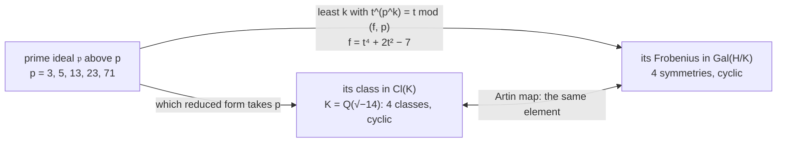

# Artin reciprocity: a prime's Frobenius depends only on its ideal class, and the Hilbert class field

[Syllabus](../../../SYLLABUS.md) → [Algebraic and analytic number theory](../README.md) → [Local Fields and Class Field Theory](../README.md#s09) → Artin reciprocity

---

## General Overview

In the field with root minus five, $`K = \mathbb{Q}(\sqrt{-5})`$, the primes 3 and 29 both split into two prime ideals. Yet they behave differently. $`29 = 3^2 + 5 \times 2^2`$, so its prime ideals are generated by single numbers, $`3 \pm 2\sqrt{-5}`$. The prime 3 is not of the form $`x^2 + 5y^2`$: its prime ideals are not generated by any one number. They are **non-principal**, and they lie in the second of the two ideal classes of $`K`$.

[Composition and genus](../06-Algebraic%20Numbers/11-gauss-composition-and-genus-theory.md) sorted these primes by remainder: $`x^2 + 5y^2`$ takes the split primes that are 1 or 9 mod 20. It also showed where that trick stops. For $`x^2 + 14y^2`$, the primes 23 and 71 lie in the same genus, yet $`23 = 3^2 + 14 \times 1^2`$ and 71 is not of that form.

Class field theory answers for every $`n`$. Above $`K`$ sits a bigger field $`H`$, the **Hilbert class field**, whose symmetry group over $`K`$ is a copy of the class group. Each prime ideal $`\mathfrak{p}`$ of $`K`$ picks out one symmetry of $`H`$, its **Frobenius**. **Artin reciprocity** says that this symmetry is the class of $`\mathfrak{p}`$, read in the copy. So $`\mathfrak{p}`$ is principal exactly when its Frobenius is "do nothing".

For root minus five, $`H = K(i)`$. The Frobenius of a prime ideal above a prime $`p`$ that splits in $`K`$ sends $`i`$ to $`i^p`$: to $`+i`$ when $`p`$ is 1 mod 4, to $`-i`$ when $`p`$ is 3 mod 4. For $`x^2 + 14y^2`$, $`H = K(\alpha)`$ with $`\alpha^4 + 2\alpha^2 - 7 = 0`$. A prime $`p`$ is $`x^2 + 14y^2`$ exactly when $`(-14/p) = 1`$ and that quartic has a root mod $`p`$. It has four roots mod 23, namely 3, 9, 14 and 20, and none mod 71.

**A prime ideal's Frobenius in an abelian extension depends only on its class in a ray class group; for the Hilbert class field that is the ordinary ideal class and the match is exact, so an odd prime not dividing $`n`$ is $`x^2 + ny^2`$ exactly when it splits completely in that field.**

**What kind of fact this is:** theorems. Artin reciprocity (Artin, 1927) and the existence theorem (Takagi, 1920) are stated here with sources, not proved: their proofs do not fit on a card. For $`K = \mathbb{Q}(\sqrt{-5})`$ this card proves directly that $`K(i)`$ is unramified over $`K`$ and that its Frobenius map is an isomorphism from the class group onto $`\mathrm{Gal}(K(i)/K)`$; that $`K(i)`$ is all of $`H`$ then uses the general theorem's $`[H : K] = h_K`$. The step from reciprocity to the test for $`x^2 + 14y^2`$ is proved here; the generator $`\alpha`$ is quoted from Cox. The counts below 10,000 are evidence, not proof.

### The picture: two roads to one group



The top road uses only forms and ideals of $`K`$. The bottom road uses only a polynomial mod $`p`$. The code takes both roads for all 614 split primes below 10,000, and the class order always equals the Frobenius order.

---

## The formula

Notation first, in words.

- An **abelian extension** $`L/K`$ is a Galois extension whose group $`\mathrm{Gal}(L/K)`$ is commutative ([The Galois correspondence](../05-Fields%20and%20Galois%20Theory/05-galois-groups-and-the-fundamental-theorem.md)).
- For a prime ideal $`\mathfrak{p}`$ of $`K`$ that does not ramify in $`L`$, the **Artin symbol** $`\big(\tfrac{L/K}{\mathfrak{p}}\big)`$ is the one symmetry $`\sigma`$ with $`\sigma(x) \equiv x^{N(\mathfrak{p})}`$ modulo $`\mathfrak{P}`$ for every integer $`x`$ of $`L`$. Here $`\mathfrak{P}`$ is a prime ideal of $`L`$ above $`\mathfrak{p}`$, and the norm $`N(\mathfrak{p})`$ is the size of the residue field. This is the Frobenius of [Decomposition and inertia groups](02-decomposition-and-inertia-groups.md). In an abelian group it does not depend on the choice of $`\mathfrak{P}`$.
- The **Artin map** extends the symbol to ideals by multiplying: $`\mathfrak{a} = \mathfrak{p}_1^{k_1} \cdots \mathfrak{p}_r^{k_r}`$ goes to the product of the $`k_i`$-th powers of their symbols.
- The **Hilbert class field** $`H`$ of $`K`$ is the largest abelian extension of $`K`$ that is unramified at every prime ideal and at every real embedding.

Artin reciprocity for the Hilbert class field:

```math
\mathrm{Cl}(K) \;\cong\; \mathrm{Gal}(H/K), \qquad [\mathfrak{a}] \longmapsto \Big(\frac{H/K}{\mathfrak{a}}\Big)
```

**Read it aloud:** the class group of $`K`$ and the symmetry group of $`H`$ over $`K`$ are the same group, and the Artin map, read on classes, is the match.

The consequence for $`x^2 + ny^2`$ (Cox, Theorem 5.1), when $`\mathbb{Z}[\sqrt{-n}]`$ is the whole ring of integers of $`K = \mathbb{Q}(\sqrt{-n})`$ and $`p`$ is an odd prime dividing neither $`n`$ nor the discriminant of $`f_n`$:

```math
p = x^2 + ny^2 \iff \Big(\frac{-n}{p}\Big) = 1 \ \text{ and } \ f_n(t) \equiv 0 \ (\mathrm{mod}\ p) \text{ has a solution } t
```

**Read it aloud:** $`p`$ is $`x^2`$ plus $`n`$ times $`y^2`$ exactly when $`-n`$ is a square mod $`p`$ and the polynomial $`f_n`$ has a root mod $`p`$.

Here $`f_n`$ is the minimal polynomial of a real number $`\alpha`$ with $`H = K(\alpha)`$. For $`n = 5`$, $`\alpha = i`$ is not real, but $`\sqrt{5}`$ also generates $`H`$, with $`f_5 = t^2 - 5`$. For $`n = 14`$, $`\alpha = \sqrt{2\sqrt{2} - 1} = 1.3521934495`$ and $`f_{14} = t^4 + 2t^2 - 7`$.

| Symbol | Plain meaning | In our example | Push it up and the answer… |
| --- | --- | --- | --- |
| $`n`$, $`K`$ | the number in $`x^2 + ny^2`$; the field $`\mathbb{Q}(\sqrt{-n})`$ | 5 and 14 | the class group usually grows |
| $`\mathfrak{p}`$, $`\bar{\mathfrak{p}}`$, $`\mathfrak{a}`$, $`N(\mathfrak{p})`$ | a prime ideal of $`K`$ and its mirror image; any nonzero ideal; the norm | $`\mathfrak{p}_3`$, norm 3 | — |
| $`\mathrm{Cl}(K)`$, $`h_K`$, $`[\mathfrak{a}]`$, $`(a, b, c)`$ | the class group, its size, the class of $`\mathfrak{a}`$ ([Class groups](../06-Algebraic%20Numbers/05-class-groups-and-the-minkowski-bound.md)); the reduced form $`ax^2 + bxy + cy^2`$ that names a class | $`h_K = 2`$ and 4; $`(2, 2, 3)`$, $`(3, 2, 5)`$ | $`[H : K]`$ grows with $`h_K`$ |
| $`H`$, $`\alpha`$, $`f_n`$ | the Hilbert class field; a number generating it; its minimal polynomial | $`K(i)`$; $`K(\alpha)`$, $`t^4 + 2t^2 - 7`$ | a longer $`f_n`$ |
| $`\mathrm{Gal}(H/K)`$, $`\sigma`$ | the symmetries of $`H`$ fixing $`K`$; one of them | 2 and 4 symmetries | — |
| $`\big(\tfrac{L/K}{\mathfrak{p}}\big)`$, $`\mathfrak{P}`$ | the Artin symbol of $`\mathfrak{p}`$; a prime ideal of $`L`$ above it | $`i \mapsto -i`$ for $`\mathfrak{p}_3`$ | — |
| $`k`$, $`k_i`$ | the order of a class, and of a Frobenius: repeats needed to reach "do nothing"; exponents in a factorisation | 4 for $`\mathfrak{p}_3`$ in $`\mathbb{Q}(\sqrt{-14})`$ | — |
| $`L`$, $`\mathfrak{m}`$, $`\mathrm{Cl}_{\mathfrak{m}}(K)`$ | any abelian extension; a modulus; the ray class group mod $`\mathfrak{m}`$ (Step 4) | $`\mathbb{Q}(\zeta_m)`$, $`\mathfrak{m} = m`$ | finer classes, bigger fields |
| $`p`$, $`(-n/p)`$, $`t`$ | an ordinary prime; the Legendre symbol; a trial root mod $`p`$ | 23: $`(-14/23) = 1`$, $`t = 3`$ | — |
| $`x`$, $`y`$; $`\beta`$ | whole numbers in $`x^2 + ny^2`$; a number of $`K`$ generating a principal ideal | $`(3, 1)`$ for 23; $`3 + 2\sqrt{-5}`$ | — |
| $`q`$, $`p^*`$, $`\zeta_p`$, $`\omega`$ | Step 4: a second prime; $`\pm p`$, signed to be 1 mod 4; a $`p`$-th root of 1; a cube root of 1 | $`5^* = 5`$ | — |

The Chebotarev card used $`H`$ for the same field $`\mathbb{Q}(\sqrt{-5}, i)`$ before it had a name.

### When it holds

- **The extension must be abelian.** Only then is the Frobenius one symmetry, not a class of them. Over $`\mathbb{Q}`$, the splitting field of $`x^3 - 2`$ has six non-commuting symmetries, and no congruence on $`p`$ decides its splitting ([Chebotarev](../06-Algebraic%20Numbers/09-chebotarev-density-and-splitting-statistics.md)).
- **The prime must not ramify, and $`p`$ must not divide the discriminant of $`f_n`$.** That discriminant for $`f_{14}`$ is $`-114688 = -2^{14} \times 7`$. Mod 7, $`f_{14} = t^2(t^2 + 2)`$ has the root 0, yet 7 is not $`x^2 + 14y^2`$.
- **$`p`$ must split in $`K`$.** Drop $`(-14/p) = 1`$ and 304 more primes below 10,000 give $`f_{14}`$ a root, starting with 17. None of them is $`x^2 + 14y^2`$.
- **$`\mathbb{Z}[\sqrt{-n}]`$ must be the whole ring of integers.** For $`n = 27`$ it is not. The field $`\mathbb{Q}(\sqrt{-3})`$ has class number 1, so its Hilbert class field is itself. That would make every $`p`$ that is 1 mod 3 equal to $`x^2 + 27y^2`$, but 7 is not. The right field is the **ring class field** of $`\mathbb{Z}[\sqrt{-27}]`$, which is $`K(\sqrt[3]{2})`$ ([Cubic reciprocity](../06-Algebraic%20Numbers/12-cubic-reciprocity-and-jacobi-sums.md)).
- **The theorem promises $`H`$, not $`f_n`$.** Cox builds generators from values of the modular $`j`$-function; $`f_{14}`$ is quoted from him and checked here below 10,000.

---

## Why it works

### Step 0: the Frobenius cannot see principal ideals

In the example, the Artin symbol of $`\mathfrak{p}`$ is read off its norm $`N(\mathfrak{p})`$. A principal ideal $`(\beta)`$ has the norm of a number, and norms of numbers obey congruences that general integers do not. So the Artin map sends principal ideals to "do nothing". Reciprocity says that is all it ignores: what is left is exactly the class group. Steps 1 to 3 prove this for root minus five. Step 4 states the general theorem.

### Step 1: in $`H = K(i)`$, the Frobenius is a sign mod 4

Take a prime ideal $`\mathfrak{p}`$ of $`K = \mathbb{Q}(\sqrt{-5})`$ not above 2. It has a Frobenius $`\sigma`$, because no prime ideal of $`K`$ ramifies in $`K(i)`$ (Step 3, which does not use Steps 1 and 2). That symmetry sends $`i`$ to $`i`$ or $`-i`$, and must agree with the $`N(\mathfrak{p})`$-th power modulo $`\mathfrak{P}`$:

```math
\sigma(i) \equiv i^{N(\mathfrak{p})} = \begin{cases} +i & N(\mathfrak{p}) \equiv 1 \ (\mathrm{mod}\ 4) \\ -i & N(\mathfrak{p}) \equiv 3 \ (\mathrm{mod}\ 4) \end{cases}
```

The two values stay apart mod $`\mathfrak{P}`$, because $`2i`$ is not in a prime ideal away from 2. So the Artin symbol of $`\mathfrak{p}`$ is the sign $`(-1)^{(N(\mathfrak{p}) - 1)/2}`$. Signs and norms both multiply, so the Artin symbol of any odd ideal $`\mathfrak{a}`$ is the same sign, taken of $`N(\mathfrak{a})`$.

For $`\mathfrak{p}_3`$: norm 3, so $`i \mapsto -i`$. For $`\mathfrak{p}_{29}`$: norm 29, so $`i \mapsto +i`$.

### Step 2: principal ideals get +1, and the map is onto

Take a principal odd ideal $`(a + b\sqrt{-5})`$. Its norm $`a^2 + 5b^2`$ is odd, so exactly one of $`a`$, $`b`$ is odd. Then $`a^2 + 5b^2`$ leaves 1 on division by 4, because an odd square is 1 mod 4 and an even square is 0. So every principal ideal has Artin symbol +1. The code confirms the remainder 1 for all $`\lvert a \rvert, \lvert b \rvert \le 50`$.

The ideal $`\mathfrak{p}_3`$ has symbol −1, so the map is onto the two-element group. Its kernel, among the odd ideals, contains the principal odd ideals and has index 2. The principal odd ideals also have index 2 among the odd ideals: $`h_K = 2`$, and every class holds an odd ideal, such as $`\mathfrak{p}_3`$. So the kernel is exactly the principal odd ideals, and $`\mathrm{Cl}(K) \cong \mathrm{Gal}(H/K)`$. That is Artin reciprocity for this field, proved.

The ideals above 2 and 5 need other generators. $`H`$ contains $`\sqrt{5} = -i\sqrt{-5}`$, so also $`(1 + \sqrt{5})/2`$, a root of $`t^2 - t - 1`$. That has no root mod 2, so the Frobenius of $`\mathfrak{p}_2`$ moves it: symbol −1, and $`\mathfrak{p}_2`$ is non-principal. Mod 5, $`t^2 + 1`$ has roots 2 and 3: symbol +1 for $`\mathfrak{p}_5 = (\sqrt{-5})`$, which is principal.

### Step 3: $`H = K(i)`$ is unramified over $`K`$

Only 2 and 5 can ramify in $`H`$, since $`H`$ is built from $`\mathbb{Q}(i)`$ (discriminant −4) and $`\mathbb{Q}(\sqrt{5})`$ (discriminant 5). The prime 2 does not ramify in $`\mathbb{Q}(\sqrt{5})`$. So its inertia group in $`\mathrm{Gal}(H/\mathbb{Q})`$, the symmetries acting trivially on residues ([Decomposition and inertia groups](02-decomposition-and-inertia-groups.md)), fixes $`\sqrt{5}`$ and has at most 2 members. In the same way 5 does not ramify in $`\mathbb{Q}(i)`$. So each of 2 and 5 ramifies with index at most 2 in $`H`$, and it already does so in $`K`$. Nothing new ramifies from $`K`$ to $`H`$. $`K`$ has no real embeddings, so none can ramify. Hence $`H/K`$ is unramified, of degree $`2 = h_K`$. The general theorem (Step 4) says the Hilbert class field has degree $`h_K`$ over $`K`$, so $`K(i)`$ is all of it.

### Step 4: the general theorems, stated

For any number field $`K`$ and any abelian extension $`L/K`$:

1. **Artin reciprocity** (Artin, 1927). There is a modulus $`\mathfrak{m}`$, a product of the ramified primes to suitable powers (and some real embeddings), with this property. The Artin map is onto $`\mathrm{Gal}(L/K)`$, and it sends to "do nothing" every principal ideal $`(\beta)`$ with $`\beta \equiv 1`$ mod $`\mathfrak{m}`$ (and $`\beta`$ positive at the real embeddings in $`\mathfrak{m}`$). So the Frobenius of a prime ideal depends only on its class in the **ray class group** $`\mathrm{Cl}_{\mathfrak{m}}(K)`$: all ideals prime to $`\mathfrak{m}`$, modulo those principal ideals.
2. **The existence theorem** (Takagi, 1920; Cox, section 8). For every modulus $`\mathfrak{m}`$ and every subgroup of $`\mathrm{Cl}_{\mathfrak{m}}(K)`$ there is exactly one abelian $`L`$ whose Artin map has that subgroup as kernel.

With $`\mathfrak{m} = 1`$ the ray class group is $`\mathrm{Cl}(K)`$, and the trivial subgroup gives $`H`$; Furtwängler proved it exists in 1906. The classical proofs combine an analytic count of split primes, by L-functions, with a count of norms; Neukirch, chapter VI, gives an algebraic proof in full.

The classical laws are special cases.

- **Quadratic reciprocity.** Take $`K = \mathbb{Q}`$, $`p^* = \pm p`$ (the sign making $`p^* \equiv 1`$ mod 4) and $`L = \mathbb{Q}(\sqrt{p^*})`$. The Frobenius of $`q`$ acts on $`\sqrt{p^*}`$ by the sign $`(p^*/q)`$. $`L`$ sits inside $`\mathbb{Q}(\zeta_p)`$, where the Frobenius of $`q`$ is $`\zeta \mapsto \zeta^q`$ and depends only on $`q`$ mod $`p`$ ([Kronecker-Weber](04-kronecker-weber-theorem.md)). So $`(p^*/q)`$ depends only on $`q`$ mod $`p`$, which forces $`(p^*/q) = (q/p)`$ ([Quadratic reciprocity](../03-Characters%20and%20L-functions/07-quadratic-reciprocity-via-gauss-sums.md)).
- **Cubic and quartic reciprocity.** Take $`K = \mathbb{Q}(\omega)`$ and $`L = K(\sqrt[3]{2})`$. The Artin symbol of a prime $`\pi`$ is the cubic residue symbol of 2, and reciprocity says it depends only on $`\pi`$ modulo a modulus built from the primes above 2 and 3. The same with $`K = \mathbb{Q}(i)`$ and $`L = K(\sqrt[4]{2})`$ gives Gauss's rule for $`x^2 + 64y^2`$ ([Cubic reciprocity](../06-Algebraic%20Numbers/12-cubic-reciprocity-and-jacobi-sums.md)).

### Step 5: from reciprocity to $`x^2 + ny^2`$

Let $`\mathbb{Z}[\sqrt{-n}]`$ be the ring of integers of $`K`$, and $`p`$ an odd prime dividing neither $`n`$ nor the discriminant of $`f_n`$. Four equivalences:

1. $`p = x^2 + ny^2`$ exactly when $`p = \mathfrak{p}\bar{\mathfrak{p}}`$ with $`\mathfrak{p} = (x + y\sqrt{-n})`$ principal. The norm of $`x + y\sqrt{-n}`$ is $`x^2 + ny^2`$.
2. $`\mathfrak{p}`$ is principal exactly when its Artin symbol is "do nothing": the kernel of the Artin map is the principal ideals.
3. The Artin symbol is "do nothing" exactly when $`\mathfrak{p}`$ splits completely in $`H`$: the Frobenius has order 1, so every prime of $`H`$ above $`\mathfrak{p}`$ has residue field $`\mathbb{F}_p`$.
4. $`\mathfrak{p}`$ splits completely in $`H`$ exactly when $`(-n/p) = 1`$ and $`f_n`$ has a root mod $`p`$. The first condition makes $`p`$ split in $`K`$, so $`\mathfrak{p}`$ has residue field $`\mathbb{F}_p`$. A root of $`f_n`$ mod $`p`$ then gives a prime of $`H`$ above $`\mathfrak{p}`$ with the same residue field (Dedekind's factoring rule, valid as $`p`$ does not divide the discriminant). In a Galois extension all primes above $`\mathfrak{p}`$ look alike, so all of them do.

So one root is enough: for $`n = 14`$ the roots come all four or none.

The same reasoning gives the order $`k`$ of the Frobenius: the least $`k`$ with $`t^{p^k} \equiv t`$ mod $`(f_{14}, p)`$, since the $`p^k`$-th power must fix every root. By reciprocity it equals the order of $`[\mathfrak{p}]`$: the least $`k`$ with $`p^k = x^2 + 14y^2`$, $`x`$ and $`y`$ not both multiples of $`p`$.

---

## Worked numbers, by hand

The prime 3 in $`K = \mathbb{Q}(\sqrt{-14})`$, by both roads.

| Step | Arithmetic | Value |
| --- | --- | --- |
| Does 3 split in $`K`$? | $`-14 = -15 + 1`$, so $`-14 \equiv 1`$, a square mod 3 | yes: $`(-14/3) = 1`$ |
| Its class | $`3x^2 + 2xy + 5y^2`$ at $`(1, 0)`$ is 3 | $`(3, 2, 5)`$, not principal |
| Class order: $`k = 1, 2`$ | 3 is not $`x^2 + 14y^2`$; $`9 = 3^2 + 0`$ uses only multiples of 3 | not principal |
| Class order: $`k = 4`$ | an order divides $`h_K = 4`$, so $`k = 3`$ is skipped; $`81 = 5^2 + 14 \times 2^2`$ | order 4 |
| Roots of $`f_{14}`$ mod 3 | $`f(0) = -7`$, $`f(1) = -4`$, $`f(2) = 17`$: each leaves 2 | no root |
| Frobenius order | least $`k`$ with $`t^{3^k} \equiv t`$ mod $`(f_{14}, 3)`$ | 4 |
| Verdict | class order = Frobenius order | **4: the Frobenius of $`\mathfrak{p}_3`$ generates $`\mathrm{Gal}(H/K)`$** |

So 3 is not $`x^2 + 14y^2`$, and its prime ideal is as far from principal as the class group allows.

The same two roads for five primes, from the code:

| $`p`$ | Class | Class order, with witness | Roots of $`f_{14}`$ mod $`p`$ | Frobenius order |
| ---: | --- | --- | --- | ---: |
| 3 | $`(3, 2, 5)`$ | 4: $`3^4 = 5^2 + 14 \times 2^2`$ | none | 4 |
| 5 | $`(3, -2, 5)`$ | 4: $`5^4 = 11^2 + 14 \times 6^2`$ | none | 4 |
| 13 | $`(3, 2, 5)`$ | 4: $`13^4 = 155^2 + 14 \times 18^2`$ | none | 4 |
| 23 | $`(1, 0, 14)`$ | 1: $`23 = 3^2 + 14 \times 1^2`$ | 3, 9, 14, 20 | 1 |
| 71 | $`(2, 0, 7)`$ | 2: $`71^2 = 55^2 + 14 \times 12^2`$ | none | 2 |

The signs in $`(3, \pm 2, 5)`$ depend on which of $`\mathfrak{p}`$ and $`\bar{\mathfrak{p}}`$ is taken; the two classes are inverses with the same order.

For root minus five, the house example:

| $`p`$ | Class | $`x^2 + 5y^2`$ | $`i^p`$ | Artin symbol |
| ---: | --- | --- | --- | ---: |
| 3 | $`(2, 2, 3)`$ | none | $`-i`$ | −1 |
| 7 | $`(2, 2, 3)`$ | none | $`-i`$ | −1 |
| 29 | $`(1, 0, 5)`$ | $`3^2 + 5 \times 2^2`$ | $`+i`$ | +1 |
| 41 | $`(1, 0, 5)`$ | $`6^2 + 5 \times 1^2`$ | $`+i`$ | +1 |

Symbols multiply as classes do. The ideal $`\mathfrak{p}_3\mathfrak{p}_7`$ has symbol $`(-1)(-1) = +1`$, and indeed $`21 = 4^2 + 5 \times 1^2 = 1^2 + 5 \times 2^2`$. The ideal $`\mathfrak{p}_3\mathfrak{p}_{29}`$ has symbol −1, and 87 is not $`x^2 + 5y^2`$.

Below 10,000 the code sorts all 614 split primes of each field both ways:

```
Q(sqrt-5), split primes below 10,000: 614
class (1, 0, 5), symbol +1     302  ###############
class (2, 2, 3), symbol -1     312  ################

Q(sqrt-14), split primes below 10,000: 614
class (1, 0, 14), Frob order 1 145  #######
class (2, 0, 7),  Frob order 2 153  ########
class (3, ±2, 5), Frob order 4 316  ################
```

One `#` is 20 primes, rounded. The 302 principal primes are all 1 or 9 mod 20. No prime breaks the match of class order and Frobenius order. The near-equal shares per class are [Chebotarev](../06-Algebraic%20Numbers/09-chebotarev-density-and-splitting-statistics.md) applied to $`H`$.

### What breaks if you drop a piece

| Mistake | Comes out at | What went wrong |
| --- | --- | --- |
| Drop $`(-14/p) = 1`$, test only for a root | 17 called $`x^2 + 14y^2`$; 304 such primes below 10,000 | 17 does not split in $`K`$; its Frobenius lies outside $`\mathrm{Gal}(H/K)`$, and such a symmetry can fix a root |
| Use the genus field $`K(\sqrt{2})`$ in place of $`H`$ | 71 called $`x^2 + 14y^2`$, as $`(2/71) = 1`$ | $`K(\sqrt{2})`$ sees only the genus; $`71 = 2 \times 2^2 + 7 \times 3^2`$, a class of order 2 |
| Keep the ramified 7 | $`f_{14} \equiv t^2(t^2 + 2)`$ has the root 0 mod 7 | 7 divides the discriminant; 7 is not $`x^2 + 14y^2`$ |
| Use the Hilbert class field of $`\mathbb{Q}(\sqrt{-3})`$ for $`n = 27`$ | 7 called $`x^2 + 27y^2`$, as 7 is 1 mod 3 | $`\mathbb{Z}[\sqrt{-27}]`$ is not the ring of integers; 2 is not a cube mod 7, and the ring class field $`K(\sqrt[3]{2})`$ says no |

The code prints all four.

---

## Code, from first principles, and it actually runs

Both programs work from scratch: a sieve for the primes, reduction of forms for the classes, Euler's test for Legendre symbols, and arithmetic with polynomials mod $`(f_{14}, p)`$ for the Frobenius. Nothing imported knows about class groups or fields. They take **three independent roads** for each split prime. Road A searches for $`x^2 + ny^2`$ directly, and finds the class order as the least power of $`p`$ with a primitive representation. Road B reduces the form $`(p, b, c)`$ to name the class of $`\mathfrak{p}`$ (`roadB` in the code). Road C works in $`H`$: the sign $`i^p`$ for $`n = 5`$, and for $`n = 14`$ the roots of $`f_{14}`$ and the least $`k`$ with $`t^{p^k} \equiv t`$. All roads agree on every prime below 10,000; road A's class orders are run for the 32 split primes below 300. The last lines print the What-breaks table.

### Python

```python
# Artin reciprocity and the Hilbert class field, checked on K = Q(sqrt-5) (h = 2) and K = Q(sqrt-14) (h = 4).
# Class side: reduced forms and numbers x + y sqrt(-n). Field side: the Frobenius, read off a polynomial mod p.
from math import isqrt, sqrt

N = 10000; isp = [1] * N; isp[0] = isp[1] = 0
for i in range(2, 101):
    if isp[i]: isp[i * i::i] = [0] * len(isp[i * i::i])
P = [p for p in range(N) if isp[p]]
def red(a, b, c):                  # one reduced form per class: -a < b <= a <= c, b >= 0 when a = c
    while not (-a < b <= a <= c):
        k = (a - b) // (2 * a); b, c = b + 2 * a * k, a * k * k + b * k + c
        if c < a: a, b, c = c, -b, a
    return (a, -b, c) if a == c and b < 0 else (a, b, c)
def forms(D): return sorted({red(a, b, (b * b - D) // (4 * a)) for a in range(1, isqrt(-D // 3) + 1)
                             for b in range(-a + 1, a + 1) if (b * b - D) % (4 * a) == 0})
def cls(p, n):                     # the class of a prime ideal above p: the form (p, b, c) with b^2 - 4pc = -4n
    b = next(b for b in range(2 * p) if (b * b + 4 * n) % (4 * p) == 0); return red(p, b, (b * b + 4 * n) // (4 * p))
def reps(m, n): return [(isqrt(m - n * y * y), y) for y in range(isqrt(m // n) + 1) if isqrt(m - n * y * y) ** 2 == m - n * y * y]
def prim(m, n, p): return [(x, y) for x, y in reps(m, n) if x % p or y % p]   # x + y sqrt(-n) not a multiple of p
def leg(a, p): return {0: 0, 1: 1}.get(pow(a % p, (p - 1) // 2, p), -1)      # Euler's test
def sgn(s): return "+i" if s == 1 else "-i"

print("K = Q(sqrt-5): reduced forms of -20:", forms(-20), "; h =", len(forms(-20)), "; H = K(i), unramified, [H : K] = 2")
for p in (3, 7, 29, 41):           # Frobenius on i is i^p = (-1)^((p-1)/2) i; the class is read off the forms
    r = reps(p, 5); s = leg(-1, p)
    print(f"p = {p}: (-5/p) = {leg(-5, p)}, class {cls(p, 5)}, x^2 + 5y^2: {r[0] if r else 'none'}, i^p = {sgn(s)}, Artin symbol {s:+d}")
    assert leg(-5, p) == 1 and (s == 1) == bool(r) == (cls(p, 5) == (1, 0, 5))
gold = [t for t in range(2) if (t * t - t - 1) % 2 == 0]; i5 = [t for t in range(5) if (t * t + 1) % 5 == 0]
print("p-ideal over 2: class", cls(2, 5), "; roots of x^2 - x - 1 mod 2:", gold, "-> Frobenius moves (1 + sqrt5)/2, symbol -1")
print("p-ideal over 5: class", cls(5, 5), "; roots of x^2 + 1 mod 5:", i5, "-> Frobenius fixes i, symbol +1")
assert gold == [] and cls(2, 5) == (2, 2, 3) and len(i5) == 2 and cls(5, 5) == (1, 0, 5)
for a, b in ((3, 7), (3, 29)):
    print(f"ideal p{a} p{b}, norm {a * b}: symbol {leg(-1, a) * leg(-1, b):+d}; x^2 + 5y^2 = {a * b}: {reps(a * b, 5)}")
    assert (leg(-1, a) * leg(-1, b) == 1) == bool(reps(a * b, 5))
odd = {(a * a + 5 * b * b) % 4 for a in range(-50, 51) for b in range(-50, 51) if (a * a + 5 * b * b) % 2}
print("odd norms a^2 + 5b^2, |a|, |b| <= 50, leave remainder", sorted(odd), "mod 4: principal ideals get symbol +1")
assert odd == {1}
S5 = [p for p in P if p not in (2, 5) and leg(-5, p) == 1]
roadA = [p for p in S5 if reps(p, 5)]; roadB = [p for p in S5 if cls(p, 5) == (1, 0, 5)]; roadC = [p for p in S5 if leg(-1, p) == 1]
nonp = len([p for p in S5 if cls(p, 5) == (2, 2, 3) and leg(-1, p) == -1])
m20 = sorted({p % 20 for p in roadA})
print(f"split primes below 10,000: {len(S5)}; principal (x^2 + 5y^2) {len(roadA)}, symbol +1 {len(roadC)}, class (1, 0, 5) {len(roadB)}; remainders mod 20 {m20}; class (2, 2, 3) and symbol -1 {nonp}")
assert roadA == roadB == roadC and len(roadA) == 302 and m20 == [1, 9] and nonp == len(S5) - len(roadA)
def bar(label, k): print(f"{label:<30} {k:>3}  " + "#" * ((k + 10) // 20))   # one # per 20 primes, rounded
print("Q(sqrt-5), split primes below 10,000:", len(S5)); bar("class (1, 0, 5), symbol +1", len(roadA)); bar("class (2, 2, 3), symbol -1", nonp)

def pmul(u, v, p):                 # multiply polynomials mod p and mod f = x^4 + 2x^2 - 7, using x^4 = 7 - 2x^2
    r = [0] * 7
    for i in range(4):
        for j in range(4): r[i + j] += u[i] * v[j]
    for d in (6, 5, 4): c = r[d]; r[d] = 0; r[d - 4] += 7 * c; r[d - 2] -= 2 * c
    return [c % p for c in r[:4]]
def ppow(u, e, p):
    out = [1, 0, 0, 0]
    while e:
        if e & 1: out = pmul(out, u, p)
        u = pmul(u, u, p); e >>= 1
    return out
def frob(p):                       # the order of Frobenius: the least k with x^(p^k) = x mod (f, p)
    y = [0, 1, 0, 0]
    for k in range(1, 9):
        y = ppow(y, p, p)
        if y == [0, 1, 0, 0]: return k
def roots(p): return [t for t in range(p) if (t ** 4 + 2 * t * t - 7) % p == 0]
def corder(p): return next((k, prim(p ** k, 14, p)[0]) for k in range(1, 5) if prim(p ** k, 14, p))

al = sqrt(2 * sqrt(2) - 1)
print(f"K = Q(sqrt-14): reduced forms of -56: {forms(-56)} ; h = {len(forms(-56))} ; H = K(alpha), alpha = {al:.10f}, f(alpha) = 0 to 12 places: {'yes' if abs(al ** 4 + 2 * al * al - 7) < 1e-12 else 'no'}")
assert len(forms(-56)) == 4 and abs(al ** 4 + 2 * al * al - 7) < 1e-12
for p in (3, 5, 13, 23, 71):
    k, w = corder(p)
    print(f"p = {p}: (-14/p) = {leg(-14, p)}, class {cls(p, 14)}, class order {k} ({p}^{k} = {w[0]}^2 + 14 x {w[1]}^2), roots of f mod p {roots(p)}, Frobenius order {frob(p)}")
    assert k == frob(p)
f3 = [t ** 4 + 2 * t * t - 7 for t in range(3)]
print(f"p = 3: f(0), f(1), f(2) = {f3}, remainders mod 3 {[v % 3 for v in f3]}")
order = {(1, 0, 14): 1, (2, 0, 7): 2, (3, -2, 5): 4, (3, 2, 5): 4}
S14 = [p for p in P if p not in (2, 7) and leg(-14, p) == 1]
tally = {}
for p in S14:
    c = cls(p, 14); key = (c[0], abs(c[1]), c[2]); tally[key] = tally.get(key, 0) + 1
    assert order[c] == frob(p) and (c == (1, 0, 14)) == bool(reps(p, 14)) == bool(roots(p))
for c in sorted(tally): print(f"split primes below 10,000 in class ({c[0]}, {'±' if c[1] else ''}{c[1]}, {c[2]}): {tally[c]}, Frobenius order {order[c]} for every one")
print("Q(sqrt-14), split primes below 10,000:", len(S14))
for c, lab in (((1, 0, 14), "class (1, 0, 14), Frob order 1"), ((2, 0, 7), "class (2, 0, 7),  Frob order 2"), ((3, 2, 5), "class (3, ±2, 5), Frob order 4")): bar(lab, tally[c])
small = [p for p in S14 if p < 300]
assert all(corder(p)[0] == frob(p) for p in small)
print(f"split primes below 300: {len(small)}; class order (smallest power that is x^2 + 14y^2) = Frobenius order for all: yes")
X = [p for p in S14 if reps(p, 14)]; T = [p for p in S14 if roots(p)]
print(f"x^2 + 14y^2 below 10,000: {len(X)}; Hilbert class field test picks {len(T)}; first {X[:6]}")
assert X == T and len(X) == 145 and X[:2] == [23, 127]

bad = [p for p in P if p not in (2, 7) and leg(-14, p) == -1 and roots(p)]
print(f"what breaks: drop (-14/p) = 1: {len(bad)} more primes have a root, first {bad[:4]}; is {bad[0]} = x^2 + 14y^2? {'yes' if reps(bad[0], 14) else 'no'}")
w71 = [(x, y) for x in range(7) for y in range(4) if 2 * x * x + 7 * y * y == 71]
print(f"what breaks: test only the genus field K(sqrt2): 71 has (2/71) = {leg(2, 71)}, (-14/71) = {leg(-14, 71)}, yet x^2 + 14y^2 = 71: {reps(71, 14)}; 2x^2 + 7y^2 = 71 at {w71}")
disc = 16 * -7 * (2 * 2 - 4 * -7) ** 2      # discriminant of t^4 + a t^2 + b is 16 b (a^2 - 4b)^2
print(f"what breaks: keep the ramified 7: disc f = {disc} = -2^14 x 7: {'yes' if disc == -2 ** 14 * 7 else 'no'}; roots of f mod 7 {roots(7)}, x^2 + 14y^2 = 7: {reps(7, 14)}")
cube = [t for t in range(7) if (t ** 3 - 2) % 7 == 0]
print(f"what breaks: n = 27 with h(Q(sqrt-3)) = 1: 7 is 1 mod 3, yet x^2 + 27y^2 = 7: {reps(7, 27)}; cube roots of 2 mod 7: {cube}")
assert bad and not reps(bad[0], 14) and not reps(71, 14) and w71 == [(2, 3)] and roots(7) == [0] and not reps(7, 27) and not cube
print("ALL CHECKS PASS")
```

**Ran 2026-11-24 on macOS, Python 3.14.10, standard library only. All checks passed. Output, pasted from the run:**

```
K = Q(sqrt-5): reduced forms of -20: [(1, 0, 5), (2, 2, 3)] ; h = 2 ; H = K(i), unramified, [H : K] = 2
p = 3: (-5/p) = 1, class (2, 2, 3), x^2 + 5y^2: none, i^p = -i, Artin symbol -1
p = 7: (-5/p) = 1, class (2, 2, 3), x^2 + 5y^2: none, i^p = -i, Artin symbol -1
p = 29: (-5/p) = 1, class (1, 0, 5), x^2 + 5y^2: (3, 2), i^p = +i, Artin symbol +1
p = 41: (-5/p) = 1, class (1, 0, 5), x^2 + 5y^2: (6, 1), i^p = +i, Artin symbol +1
p-ideal over 2: class (2, 2, 3) ; roots of x^2 - x - 1 mod 2: [] -> Frobenius moves (1 + sqrt5)/2, symbol -1
p-ideal over 5: class (1, 0, 5) ; roots of x^2 + 1 mod 5: [2, 3] -> Frobenius fixes i, symbol +1
ideal p3 p7, norm 21: symbol +1; x^2 + 5y^2 = 21: [(4, 1), (1, 2)]
ideal p3 p29, norm 87: symbol -1; x^2 + 5y^2 = 87: []
odd norms a^2 + 5b^2, |a|, |b| <= 50, leave remainder [1] mod 4: principal ideals get symbol +1
split primes below 10,000: 614; principal (x^2 + 5y^2) 302, symbol +1 302, class (1, 0, 5) 302; remainders mod 20 [1, 9]; class (2, 2, 3) and symbol -1 312
Q(sqrt-5), split primes below 10,000: 614
class (1, 0, 5), symbol +1     302  ###############
class (2, 2, 3), symbol -1     312  ################
K = Q(sqrt-14): reduced forms of -56: [(1, 0, 14), (2, 0, 7), (3, -2, 5), (3, 2, 5)] ; h = 4 ; H = K(alpha), alpha = 1.3521934495, f(alpha) = 0 to 12 places: yes
p = 3: (-14/p) = 1, class (3, 2, 5), class order 4 (3^4 = 5^2 + 14 x 2^2), roots of f mod p [], Frobenius order 4
p = 5: (-14/p) = 1, class (3, -2, 5), class order 4 (5^4 = 11^2 + 14 x 6^2), roots of f mod p [], Frobenius order 4
p = 13: (-14/p) = 1, class (3, 2, 5), class order 4 (13^4 = 155^2 + 14 x 18^2), roots of f mod p [], Frobenius order 4
p = 23: (-14/p) = 1, class (1, 0, 14), class order 1 (23^1 = 3^2 + 14 x 1^2), roots of f mod p [3, 9, 14, 20], Frobenius order 1
p = 71: (-14/p) = 1, class (2, 0, 7), class order 2 (71^2 = 55^2 + 14 x 12^2), roots of f mod p [], Frobenius order 2
p = 3: f(0), f(1), f(2) = [-7, -4, 17], remainders mod 3 [2, 2, 2]
split primes below 10,000 in class (1, 0, 14): 145, Frobenius order 1 for every one
split primes below 10,000 in class (2, 0, 7): 153, Frobenius order 2 for every one
split primes below 10,000 in class (3, ±2, 5): 316, Frobenius order 4 for every one
Q(sqrt-14), split primes below 10,000: 614
class (1, 0, 14), Frob order 1 145  #######
class (2, 0, 7),  Frob order 2 153  ########
class (3, ±2, 5), Frob order 4 316  ################
split primes below 300: 32; class order (smallest power that is x^2 + 14y^2) = Frobenius order for all: yes
x^2 + 14y^2 below 10,000: 145; Hilbert class field test picks 145; first [23, 127, 137, 151, 233, 239]
what breaks: drop (-14/p) = 1: 304 more primes have a root, first [17, 31, 41, 47]; is 17 = x^2 + 14y^2? no
what breaks: test only the genus field K(sqrt2): 71 has (2/71) = 1, (-14/71) = 1, yet x^2 + 14y^2 = 71: []; 2x^2 + 7y^2 = 71 at [(2, 3)]
what breaks: keep the ramified 7: disc f = -114688 = -2^14 x 7: yes; roots of f mod 7 [0], x^2 + 14y^2 = 7: []
what breaks: n = 27 with h(Q(sqrt-3)) = 1: 7 is 1 mod 3, yet x^2 + 27y^2 = 7: []; cube roots of 2 mod 7: []
ALL CHECKS PASS
```

### Rust

```rust
// Artin reciprocity and the Hilbert class field, checked on K = Q(sqrt-5) (h = 2) and K = Q(sqrt-14) (h = 4).
// Class side: reduced forms and numbers x + y sqrt(-n). Field side: the Frobenius, read off a polynomial mod p.
use std::collections::BTreeMap;
type F = (i64, i64, i64);

fn isqrt(m: i64) -> i64 { let mut r = (m as f64).sqrt() as i64; while r * r > m { r -= 1; } while (r + 1) * (r + 1) <= m { r += 1; } r }
fn red(f: F) -> F { // one reduced form per class: -a < b <= a <= c, b >= 0 when a = c
    let (mut a, mut b, mut c) = f;
    while !(-a < b && b <= a && a <= c) {
        let k = (a - b).div_euclid(2 * a); let (nb, nc) = (b + 2 * a * k, a * k * k + b * k + c); b = nb; c = nc;
        if c < a { let t = a; a = c; c = t; b = -b; }
    }
    if a == c && b < 0 { (a, -b, c) } else { (a, b, c) }
}
fn forms(d: i64) -> Vec<F> {
    let mut v = vec![];
    for a in 1..=isqrt(-d / 3) { for b in -a + 1..=a { if (b * b - d) % (4 * a) == 0 { let f = red((a, b, (b * b - d) / (4 * a))); if !v.contains(&f) { v.push(f); } } } }
    v.sort(); v
}
fn cls(p: i64, n: i64) -> F { // the class of a prime ideal above p: the form (p, b, c) with b^2 - 4pc = -4n
    let b = (0..2 * p).find(|b| (b * b + 4 * n) % (4 * p) == 0).unwrap(); red((p, b, (b * b + 4 * n) / (4 * p)))
}
fn reps(m: i64, n: i64) -> Vec<(i64, i64)> {
    (0..=isqrt(m / n)).filter_map(|y| { let x = isqrt(m - n * y * y); if x * x == m - n * y * y { Some((x, y)) } else { None } }).collect()
}
fn prim(m: i64, n: i64, p: i64) -> Vec<(i64, i64)> { reps(m, n).into_iter().filter(|&(x, y)| x % p != 0 || y % p != 0).collect() }
fn powm(b: i64, mut e: i64, m: i64) -> i64 { let (mut r, mut b) = (1 % m, b.rem_euclid(m)); while e > 0 { if e & 1 == 1 { r = r * b % m; } b = b * b % m; e >>= 1; } r }
fn leg(a: i64, p: i64) -> i64 { match powm(a, (p - 1) / 2, p) { 0 => 0, 1 => 1, _ => -1 } } // Euler's test
fn sgn(s: i64) -> &'static str { if s == 1 { "+i" } else { "-i" } }
fn bar(label: &str, k: usize) { println!("{:<30} {:>3}  {}", label, k, "#".repeat((k + 10) / 20)); } // one # per 20 primes, rounded
fn first(r: &[(i64, i64)]) -> String { if r.is_empty() { "none".to_string() } else { format!("{:?}", r[0]) } }
fn pmul(u: &[i64; 4], v: &[i64; 4], p: i64) -> [i64; 4] { // multiply mod p and mod f = x^4 + 2x^2 - 7, using x^4 = 7 - 2x^2
    let mut r = [0i64; 7];
    for i in 0..4 { for j in 0..4 { r[i + j] += u[i] * v[j]; } }
    for d in [6, 5, 4] { let c = r[d]; r[d] = 0; r[d - 4] += 7 * c; r[d - 2] -= 2 * c; }
    [r[0].rem_euclid(p), r[1].rem_euclid(p), r[2].rem_euclid(p), r[3].rem_euclid(p)]
}
fn ppow(u0: [i64; 4], mut e: i64, p: i64) -> [i64; 4] {
    let (mut out, mut u) = ([1, 0, 0, 0], u0);
    while e > 0 { if e & 1 == 1 { out = pmul(&out, &u, p); } u = pmul(&u, &u, p); e >>= 1; }
    out
}
fn frob(p: i64) -> i64 { // the order of Frobenius: the least k with x^(p^k) = x mod (f, p)
    let mut y = [0, 1, 0, 0];
    for k in 1..9 { y = ppow(y, p, p); if y == [0, 1, 0, 0] { return k; } }
    0
}
fn roots(p: i64) -> Vec<i64> { (0..p).filter(|&t| (t * t * t * t + 2 * t * t - 7).rem_euclid(p) == 0).collect() }
fn corder(p: i64) -> (i64, (i64, i64)) {
    (1..5u32).find_map(|k| { let m = p.checked_pow(k).unwrap(); prim(m, 14, p).first().map(|w| (k as i64, *w)) }).unwrap()
}

fn main() {
    let n = 10000usize; let mut isp = vec![true; n]; isp[0] = false; isp[1] = false;
    for i in 2..101 { if isp[i] { let mut j = i * i; while j < n { isp[j] = false; j += i; } } }
    let ps: Vec<i64> = (0..n).filter(|&p| isp[p]).map(|p| p as i64).collect();
    println!("K = Q(sqrt-5): reduced forms of -20: {:?} ; h = {} ; H = K(i), unramified, [H : K] = 2", forms(-20), forms(-20).len());
    for p in [3, 7, 29, 41] { // Frobenius on i is i^p = (-1)^((p-1)/2) i; the class is read off the forms
        let r = reps(p, 5); let s = leg(-1, p);
        println!("p = {}: (-5/p) = {}, class {:?}, x^2 + 5y^2: {}, i^p = {}, Artin symbol {:+}", p, leg(-5, p), cls(p, 5), first(&r), sgn(s), s);
        assert!(leg(-5, p) == 1 && (s == 1) == !r.is_empty() && !r.is_empty() == (cls(p, 5) == (1, 0, 5)));
    }
    let gold: Vec<i64> = (0..2).filter(|t| (t * t - t - 1i64).rem_euclid(2) == 0).collect();
    let i5: Vec<i64> = (0..5).filter(|t| (t * t + 1) % 5 == 0).collect();
    println!("p-ideal over 2: class {:?} ; roots of x^2 - x - 1 mod 2: {:?} -> Frobenius moves (1 + sqrt5)/2, symbol -1", cls(2, 5), gold);
    println!("p-ideal over 5: class {:?} ; roots of x^2 + 1 mod 5: {:?} -> Frobenius fixes i, symbol +1", cls(5, 5), i5);
    assert!(gold.is_empty() && cls(2, 5) == (2, 2, 3) && i5.len() == 2 && cls(5, 5) == (1, 0, 5));
    for (a, b) in [(3, 7), (3, 29)] {
        println!("ideal p{} p{}, norm {}: symbol {:+}; x^2 + 5y^2 = {}: {:?}", a, b, a * b, leg(-1, a) * leg(-1, b), a * b, reps(a * b, 5));
        assert!((leg(-1, a) * leg(-1, b) == 1) == !reps(a * b, 5).is_empty());
    }
    let mut odd: Vec<i64> = vec![];
    for a in -50..51i64 { for b in -50..51i64 { let m = a * a + 5 * b * b; if m % 2 == 1 && !odd.contains(&(m % 4)) { odd.push(m % 4); } } }
    odd.sort();
    println!("odd norms a^2 + 5b^2, |a|, |b| <= 50, leave remainder {:?} mod 4: principal ideals get symbol +1", odd);
    assert!(odd == vec![1]);
    let s5: Vec<i64> = ps.iter().cloned().filter(|&p| p != 2 && p != 5 && leg(-5, p) == 1).collect();
    let ra: Vec<i64> = s5.iter().cloned().filter(|&p| !reps(p, 5).is_empty()).collect();
    let rb: Vec<i64> = s5.iter().cloned().filter(|&p| cls(p, 5) == (1, 0, 5)).collect();
    let rc: Vec<i64> = s5.iter().cloned().filter(|&p| leg(-1, p) == 1).collect();
    let nonp = s5.iter().filter(|&&p| cls(p, 5) == (2, 2, 3) && leg(-1, p) == -1).count();
    let mut m20: Vec<i64> = vec![]; for p in &ra { if !m20.contains(&(p % 20)) { m20.push(p % 20); } } m20.sort();
    println!("split primes below 10,000: {}; principal (x^2 + 5y^2) {}, symbol +1 {}, class (1, 0, 5) {}; remainders mod 20 {:?}; class (2, 2, 3) and symbol -1 {}", s5.len(), ra.len(), rc.len(), rb.len(), m20, nonp);
    assert!(ra == rb && rb == rc && ra.len() == 302 && m20 == vec![1, 9] && nonp == s5.len() - ra.len());
    println!("Q(sqrt-5), split primes below 10,000: {}", s5.len()); bar("class (1, 0, 5), symbol +1", ra.len()); bar("class (2, 2, 3), symbol -1", nonp);

    let al = (2.0 * 2f64.sqrt() - 1.0).sqrt(); let fa = al.powi(4) + 2.0 * al * al - 7.0;
    println!("K = Q(sqrt-14): reduced forms of -56: {:?} ; h = {} ; H = K(alpha), alpha = {:.10}, f(alpha) = 0 to 12 places: {}", forms(-56), forms(-56).len(), al, if fa.abs() < 1e-12 { "yes" } else { "no" });
    assert!(forms(-56).len() == 4 && fa.abs() < 1e-12);
    for p in [3, 5, 13, 23, 71] {
        let (k, w) = corder(p);
        println!("p = {}: (-14/p) = {}, class {:?}, class order {} ({}^{} = {}^2 + 14 x {}^2), roots of f mod p {:?}, Frobenius order {}", p, leg(-14, p), cls(p, 14), k, p, k, w.0, w.1, roots(p), frob(p));
        assert!(k == frob(p));
    }
    let f3: Vec<i64> = (0..3i64).map(|t| t.pow(4) + 2 * t * t - 7).collect();
    println!("p = 3: f(0), f(1), f(2) = {:?}, remainders mod 3 {:?}", f3, f3.iter().map(|v| v.rem_euclid(3)).collect::<Vec<i64>>());
    let order = |c: F| -> i64 { match c { (1, 0, 14) => 1, (2, 0, 7) => 2, (3, -2, 5) | (3, 2, 5) => 4, _ => 0 } };
    let s14: Vec<i64> = ps.iter().cloned().filter(|&p| p != 2 && p != 7 && leg(-14, p) == 1).collect();
    let mut tally: BTreeMap<F, usize> = BTreeMap::new();
    for &p in &s14 {
        let c = cls(p, 14); *tally.entry((c.0, c.1.abs(), c.2)).or_insert(0) += 1;
        assert!(order(c) == frob(p) && (c == (1, 0, 14)) == !reps(p, 14).is_empty() && !reps(p, 14).is_empty() == !roots(p).is_empty());
    }
    for (c, t) in &tally { println!("split primes below 10,000 in class ({}, {}{}, {}): {}, Frobenius order {} for every one", c.0, if c.1 != 0 { "±" } else { "" }, c.1, c.2, t, order(*c)); }
    println!("Q(sqrt-14), split primes below 10,000: {}", s14.len());
    for (c, lab) in [((1, 0, 14), "class (1, 0, 14), Frob order 1"), ((2, 0, 7), "class (2, 0, 7),  Frob order 2"), ((3, 2, 5), "class (3, ±2, 5), Frob order 4")] { bar(lab, tally[&c]); }
    let small: Vec<i64> = s14.iter().cloned().filter(|&p| p < 300).collect();
    assert!(small.iter().all(|&p| corder(p).0 == frob(p)));
    println!("split primes below 300: {}; class order (smallest power that is x^2 + 14y^2) = Frobenius order for all: yes", small.len());
    let x: Vec<i64> = s14.iter().cloned().filter(|&p| !reps(p, 14).is_empty()).collect();
    let t: Vec<i64> = s14.iter().cloned().filter(|&p| !roots(p).is_empty()).collect();
    println!("x^2 + 14y^2 below 10,000: {}; Hilbert class field test picks {}; first {:?}", x.len(), t.len(), &x[..6]);
    assert!(x == t && x.len() == 145 && x[..2] == [23, 127]);

    let bad: Vec<i64> = ps.iter().cloned().filter(|&p| p != 2 && p != 7 && leg(-14, p) == -1 && !roots(p).is_empty()).collect();
    println!("what breaks: drop (-14/p) = 1: {} more primes have a root, first {:?}; is {} = x^2 + 14y^2? {}", bad.len(), &bad[..4], bad[0], if reps(bad[0], 14).is_empty() { "no" } else { "yes" });
    let w71: Vec<(i64, i64)> = (0..7).flat_map(|x| (0..4).map(move |y| (x, y))).filter(|&(x, y)| 2 * x * x + 7 * y * y == 71).collect();
    println!("what breaks: test only the genus field K(sqrt2): 71 has (2/71) = {}, (-14/71) = {}, yet x^2 + 14y^2 = 71: {:?}; 2x^2 + 7y^2 = 71 at {:?}", leg(2, 71), leg(-14, 71), reps(71, 14), w71);
    let disc: i64 = 16 * -7 * (2 * 2 - 4 * -7i64).pow(2); // discriminant of t^4 + a t^2 + b is 16 b (a^2 - 4b)^2
    println!("what breaks: keep the ramified 7: disc f = {} = -2^14 x 7: {}; roots of f mod 7 {:?}, x^2 + 14y^2 = 7: {:?}", disc, if disc == -(1i64 << 14) * 7 { "yes" } else { "no" }, roots(7), reps(7, 14));
    let cube: Vec<i64> = (0..7).filter(|t| (t * t * t - 2) % 7 == 0).collect();
    println!("what breaks: n = 27 with h(Q(sqrt-3)) = 1: 7 is 1 mod 3, yet x^2 + 27y^2 = 7: {:?}; cube roots of 2 mod 7: {:?}", reps(7, 27), cube);
    assert!(!bad.is_empty() && reps(bad[0], 14).is_empty() && reps(71, 14).is_empty() && w71 == vec![(2, 3)] && roots(7) == vec![0] && reps(7, 27).is_empty() && cube.is_empty());
    println!("ALL CHECKS PASS");
}
```

**Ran 2026-11-24 on macOS, rustc 1.98.1, no crates. All checks passed. Output, pasted from the run:**

```
K = Q(sqrt-5): reduced forms of -20: [(1, 0, 5), (2, 2, 3)] ; h = 2 ; H = K(i), unramified, [H : K] = 2
p = 3: (-5/p) = 1, class (2, 2, 3), x^2 + 5y^2: none, i^p = -i, Artin symbol -1
p = 7: (-5/p) = 1, class (2, 2, 3), x^2 + 5y^2: none, i^p = -i, Artin symbol -1
p = 29: (-5/p) = 1, class (1, 0, 5), x^2 + 5y^2: (3, 2), i^p = +i, Artin symbol +1
p = 41: (-5/p) = 1, class (1, 0, 5), x^2 + 5y^2: (6, 1), i^p = +i, Artin symbol +1
p-ideal over 2: class (2, 2, 3) ; roots of x^2 - x - 1 mod 2: [] -> Frobenius moves (1 + sqrt5)/2, symbol -1
p-ideal over 5: class (1, 0, 5) ; roots of x^2 + 1 mod 5: [2, 3] -> Frobenius fixes i, symbol +1
ideal p3 p7, norm 21: symbol +1; x^2 + 5y^2 = 21: [(4, 1), (1, 2)]
ideal p3 p29, norm 87: symbol -1; x^2 + 5y^2 = 87: []
odd norms a^2 + 5b^2, |a|, |b| <= 50, leave remainder [1] mod 4: principal ideals get symbol +1
split primes below 10,000: 614; principal (x^2 + 5y^2) 302, symbol +1 302, class (1, 0, 5) 302; remainders mod 20 [1, 9]; class (2, 2, 3) and symbol -1 312
Q(sqrt-5), split primes below 10,000: 614
class (1, 0, 5), symbol +1     302  ###############
class (2, 2, 3), symbol -1     312  ################
K = Q(sqrt-14): reduced forms of -56: [(1, 0, 14), (2, 0, 7), (3, -2, 5), (3, 2, 5)] ; h = 4 ; H = K(alpha), alpha = 1.3521934495, f(alpha) = 0 to 12 places: yes
p = 3: (-14/p) = 1, class (3, 2, 5), class order 4 (3^4 = 5^2 + 14 x 2^2), roots of f mod p [], Frobenius order 4
p = 5: (-14/p) = 1, class (3, -2, 5), class order 4 (5^4 = 11^2 + 14 x 6^2), roots of f mod p [], Frobenius order 4
p = 13: (-14/p) = 1, class (3, 2, 5), class order 4 (13^4 = 155^2 + 14 x 18^2), roots of f mod p [], Frobenius order 4
p = 23: (-14/p) = 1, class (1, 0, 14), class order 1 (23^1 = 3^2 + 14 x 1^2), roots of f mod p [3, 9, 14, 20], Frobenius order 1
p = 71: (-14/p) = 1, class (2, 0, 7), class order 2 (71^2 = 55^2 + 14 x 12^2), roots of f mod p [], Frobenius order 2
p = 3: f(0), f(1), f(2) = [-7, -4, 17], remainders mod 3 [2, 2, 2]
split primes below 10,000 in class (1, 0, 14): 145, Frobenius order 1 for every one
split primes below 10,000 in class (2, 0, 7): 153, Frobenius order 2 for every one
split primes below 10,000 in class (3, ±2, 5): 316, Frobenius order 4 for every one
Q(sqrt-14), split primes below 10,000: 614
class (1, 0, 14), Frob order 1 145  #######
class (2, 0, 7),  Frob order 2 153  ########
class (3, ±2, 5), Frob order 4 316  ################
split primes below 300: 32; class order (smallest power that is x^2 + 14y^2) = Frobenius order for all: yes
x^2 + 14y^2 below 10,000: 145; Hilbert class field test picks 145; first [23, 127, 137, 151, 233, 239]
what breaks: drop (-14/p) = 1: 304 more primes have a root, first [17, 31, 41, 47]; is 17 = x^2 + 14y^2? no
what breaks: test only the genus field K(sqrt2): 71 has (2/71) = 1, (-14/71) = 1, yet x^2 + 14y^2 = 71: []; 2x^2 + 7y^2 = 71 at [(2, 3)]
what breaks: keep the ramified 7: disc f = -114688 = -2^14 x 7: yes; roots of f mod 7 [0], x^2 + 14y^2 = 7: []
what breaks: n = 27 with h(Q(sqrt-3)) = 1: 7 is 1 mod 3, yet x^2 + 27y^2 = 7: []; cube roots of 2 mod 7: []
ALL CHECKS PASS
```

### Lean

Lean proves the card's test for $`x^2 + 5y^2`$ for every prime, without the Artin map, and checks the worked numbers exactly.

- Take a prime $`p`$ other than 2 and 5. Then $`p = x^2 + 5y^2`$ exactly when $`(-5/p) = 1`$ and $`t^2 - 5`$ has a root mod $`p`$.
- Take a prime $`p`$ other than 2 and 5. Then $`p = x^2 + 5y^2`$ exactly when $`p`$ is 1 or 9 mod 20.
- Suppose $`a^2 + 5b^2`$ is odd. Then it leaves 1 on division by 4.
- 29 and 41 are $`x^2 + 5y^2`$. The primes 3 and 7, and the product 87, are not.
- 3 and 7 are values of $`2x^2 + 2xy + 3y^2`$, and 21 is $`x^2 + 5y^2`$ in two ways.
- Mod 2, $`t^2 - t - 1`$ has no root. Mod 5, $`t^2 + 1`$ has exactly the roots 2 and 3.
- Mod 23, $`f_{14}`$ has exactly the roots 3, 9, 14 and 20, and $`23 = 3^2 + 14 \times 1^2`$.
- Mod 3 and mod 71, $`f_{14}`$ has no root, and 71 is not $`x^2 + 14y^2`$.
- The witnesses $`p^k = x^2 + 14y^2`$ in the table for 3, 5, 13 and 71 all hold.
- The discriminant of $`f_{14}`$ is $`-114688 = -2^{14} \times 7`$.
- Mod 7 and mod 17, $`f_{14}`$ has a root. Yet neither 7 nor 17 is $`x^2 + 14y^2`$.
- The prime 7 is 1 mod 3, yet it is not $`x^2 + 27y^2`$, and 2 is not a cube mod 7.

The counts below 10,000, the value of $`\alpha`$ and the Frobenius orders are left to the Python and Rust checks.

```lean
-- Artin reciprocity: for K = Q(√-5), whose Hilbert class field is K(i) = K(√5), an odd prime p other than 5 is x^2 + 5y^2 exactly when (-5/p) = 1 and t^2 - 5 has a root mod p, which is exactly when p is 1 or 9 mod 20, because every odd norm a^2 + 5b^2 is 1 mod 4.
import Mathlib.NumberTheory.LegendreSymbol.Basic
import Mathlib.Data.ZMod.Basic
import Mathlib.Tactic.NormNum
import Mathlib.Tactic.Ring
import Mathlib.NumberTheory.LegendreSymbol.QuadraticReciprocity
import Mathlib.Data.Fintype.Pigeonhole
import Mathlib.Tactic.IntervalCases
import Mathlib.Tactic.LinearCombination

/-- `5` is not zero mod a prime `p ≠ 5`. -/
lemma five_ne_zero_zmod (p : ℕ) [Fact p.Prime] (hp5 : p ≠ 5) : (5 : ZMod p) ≠ 0 := by
  intro h
  have h' : ((5 : ℕ) : ZMod p) = 0 := by exact_mod_cast h
  rw [ZMod.natCast_eq_zero_iff] at h'
  exact hp5 ((Nat.prime_dvd_prime_iff_eq Fact.out Nat.prime_five).mp h')

/-- The nonzero squares mod 5 are 1 and 4. -/
lemma squares_mod_five : ∀ r : Fin 5, (r : ℕ) ≠ 0 →
    ((∃ z : ZMod 5, ((r : ℕ) : ZMod 5) = z * z) ↔ ((r : ℕ) = 1 ∨ (r : ℕ) = 4)) := by decide

/-- By quadratic reciprocity (with `5 ≡ 1 mod 4`), `5` is a square mod an odd prime `p ≠ 5`
exactly when `p` is `1` or `4` mod `5`. -/
lemma isSquare_five_iff (p : ℕ) [Fact p.Prime] (hp2 : p ≠ 2) (hp5 : p ≠ 5) :
    IsSquare (5 : ZMod p) ↔ p % 5 = 1 ∨ p % 5 = 4 := by
  have : Fact (Nat.Prime 5) := ⟨Nat.prime_five⟩
  have h := ZMod.exists_sq_eq_prime_iff_of_mod_four_eq_one (p := 5) (q := p) (by norm_num) hp2
  have e : ((5 : ℕ) : ZMod p) = 5 := by norm_cast
  rw [e] at h
  rw [← h, ← ZMod.natCast_mod p 5]
  have hlt : p % 5 < 5 := Nat.mod_lt _ (by norm_num)
  have hne : p % 5 ≠ 0 := by
    intro h0
    exact hp5 ((Nat.prime_dvd_prime_iff_eq Nat.prime_five (Fact.out : p.Prime)).mp
      (Nat.dvd_of_mod_eq_zero h0)).symm
  exact squares_mod_five ⟨p % 5, hlt⟩ hne

/-- `-5` and `5` are both squares mod an odd prime `p ≠ 5` exactly when `p` is `1` or `9`
mod `20`. -/
lemma squares_iff_mod_twenty (p : ℕ) [Fact p.Prime] (hp2 : p ≠ 2) (hp5 : p ≠ 5) :
    (IsSquare (-5 : ZMod p) ∧ IsSquare (5 : ZMod p)) ↔ p % 20 = 1 ∨ p % 20 = 9 := by
  have hodd : p % 2 = 1 := (Nat.Prime.mod_two_eq_one_iff_ne_two Fact.out).mpr hp2
  constructor
  · rintro ⟨⟨a, ha⟩, ⟨b, hb⟩⟩
    have hb0 : b ≠ 0 := by
      rintro rfl
      exact five_ne_zero_zmod p hp5 (by simpa using hb)
    have hm1 : IsSquare (-1 : ZMod p) := ⟨a / b, by
      rw [div_mul_div_comm, eq_div_iff (mul_ne_zero hb0 hb0), ← ha, ← hb]; ring⟩
    have h4 : p % 4 ≠ 3 := ZMod.exists_sq_eq_neg_one_iff.mp hm1
    have h5 := (isSquare_five_iff p hp2 hp5).mp ⟨b, hb⟩
    omega
  · intro h
    have h5 : IsSquare (5 : ZMod p) := (isSquare_five_iff p hp2 hp5).mpr (by omega)
    have hm1 : IsSquare (-1 : ZMod p) := ZMod.exists_sq_eq_neg_one_iff.mpr (by omega)
    refine ⟨?_, h5⟩
    have := hm1.mul h5
    rwa [neg_one_mul] at this

/-- Every prime `x² + 5y²` other than 2 and 5 is `1` or `9` mod `20`. -/
lemma mod_twenty_of_eq_sq_add_five_sq (x y p : ℕ) (hp : p.Prime) (hp2 : p ≠ 2) (hp5 : p ≠ 5)
    (h : p = x ^ 2 + 5 * y ^ 2) : p % 20 = 1 ∨ p % 20 = 9 := by
  have key : ∀ a b : ZMod 20, (a ^ 2 + 5 * b ^ 2).val = 0 ∨ (a ^ 2 + 5 * b ^ 2).val = 1 ∨
      (a ^ 2 + 5 * b ^ 2).val = 4 ∨ (a ^ 2 + 5 * b ^ 2).val = 5 ∨
      (a ^ 2 + 5 * b ^ 2).val = 6 ∨ (a ^ 2 + 5 * b ^ 2).val = 9 ∨
      (a ^ 2 + 5 * b ^ 2).val = 10 ∨ (a ^ 2 + 5 * b ^ 2).val = 14 ∨
      (a ^ 2 + 5 * b ^ 2).val = 16 := by decide
  have hv : (p : ZMod 20).val = p % 20 := ZMod.val_natCast 20 p
  have hc : (p : ZMod 20) = (x : ZMod 20) ^ 2 + 5 * (y : ZMod 20) ^ 2 := by
    rw [h]; push_cast; ring
  have h2 : p % 2 = 1 := (Nat.Prime.mod_two_eq_one_iff_ne_two hp).mpr hp2
  have h5 : p % 5 ≠ 0 := by
    intro h0
    exact hp5 ((Nat.prime_dvd_prime_iff_eq Nat.prime_five hp).mp (Nat.dvd_of_mod_eq_zero h0)).symm
  have := key x y
  rw [← hc, hv] at this
  omega

/-- Thue's lemma for `x² + 5y²`: if `-5` is a square mod a prime `p ≡ 1 mod 4`, then
`p = x² + 5y²`. Pigeonhole gives `x ≡ -a y mod p` with `|x|, |y| ≤ √p`, so
`x² + 5y² = k p` with `1 ≤ k ≤ 5`; mod 8 rules out `k = 2, 3`, and `k = 4, 5` descend. -/
lemma eq_sq_add_five_sq_of_sq_eq_neg_five (p : ℕ) [Fact p.Prime] (hp4 : p % 4 = 1)
    (a : ZMod p) (ha : a ^ 2 = -5) : ∃ x y : ℕ, p = x ^ 2 + 5 * y ^ 2 := by
  have hp : p.Prime := Fact.out
  have hm1 : Nat.sqrt p ^ 2 ≤ p := Nat.sqrt_le' p
  have hm2 : p < (Nat.sqrt p + 1) ^ 2 := Nat.lt_succ_sqrt' p
  set m := Nat.sqrt p with hm
  have hm3 : m ^ 2 < p := by
    rcases hm1.lt_or_eq with h | h
    · exact h
    exfalso
    have hd : m ∣ p := ⟨m, by rw [← h]; ring⟩
    rcases hp.eq_one_or_self_of_dvd m hd with h1 | h1
    · rw [h1] at h
      exact hp.one_lt.ne (by simpa using h)
    · rw [h1] at h
      have := hp.two_le
      nlinarith
  let f : Fin (m + 1) × Fin (m + 1) → ZMod p :=
    fun uv => ((uv.1 : ℕ) : ZMod p) + a * ((uv.2 : ℕ) : ZMod p)
  have hcard : Fintype.card (ZMod p) < Fintype.card (Fin (m + 1) × Fin (m + 1)) := by
    rw [ZMod.card, Fintype.card_prod, Fintype.card_fin]
    nlinarith
  obtain ⟨⟨u1, v1⟩, ⟨u2, v2⟩, hne, heq⟩ := Fintype.exists_ne_map_eq_of_card_lt f hcard
  simp only [f] at heq
  set X : ℤ := ((u1 : ℕ) : ℤ) - ((u2 : ℕ) : ℤ) with hX
  set Y : ℤ := ((v1 : ℕ) : ℤ) - ((v2 : ℕ) : ℤ) with hY
  have hXa : (X : ZMod p) = -a * (Y : ZMod p) := by
    rw [hX, hY]; push_cast; linear_combination heq
  have hXY : ((X ^ 2 + 5 * Y ^ 2 : ℤ) : ZMod p) = 0 := by
    push_cast; rw [hXa]; linear_combination (Y : ZMod p) ^ 2 * ha
  have hdvd : (p : ℤ) ∣ X ^ 2 + 5 * Y ^ 2 := (ZMod.intCast_zmod_eq_zero_iff_dvd _ p).mp hXY
  set A := X.natAbs with hA
  set B := Y.natAbs with hB
  have hAB : ((A ^ 2 + 5 * B ^ 2 : ℕ) : ℤ) = X ^ 2 + 5 * Y ^ 2 := by
    push_cast; rw [hA, hB, Int.natAbs_sq, Int.natAbs_sq]
  have hdvdN : p ∣ A ^ 2 + 5 * B ^ 2 := by
    rw [← Int.natCast_dvd_natCast, hAB]; exact hdvd
  have hu1 := u1.isLt
  have hu2 := u2.isLt
  have hv1 := v1.isLt
  have hv2 := v2.isLt
  have hAm : A ≤ m := by omega
  have hBm : B ≤ m := by omega
  have hpos : A ≠ 0 ∨ B ≠ 0 := by
    by_contra hc
    push Not at hc
    apply hne
    have e1 : u1 = u2 := Fin.ext (by omega)
    have e2 : v1 = v2 := Fin.ext (by omega)
    rw [e1, e2]
  obtain ⟨k, hk⟩ := hdvdN
  have hA2 : A ^ 2 ≤ m ^ 2 := Nat.pow_le_pow_left hAm 2
  have hB2 : B ^ 2 ≤ m ^ 2 := Nat.pow_le_pow_left hBm 2
  have hlt : p * k < p * 6 := by rw [← hk]; omega
  have hk6 : k < 6 := Nat.lt_of_mul_lt_mul_left hlt
  have hpos2 : 0 < A ^ 2 + 5 * B ^ 2 := by
    rcases hpos with h | h
    · have := pow_pos (Nat.pos_of_ne_zero h) 2; omega
    · have := pow_pos (Nat.pos_of_ne_zero h) 2; omega
  have key8 : ∀ r s : ZMod 8, ((r ^ 2 + 5 * s ^ 2).val = 0 ∨ (r ^ 2 + 5 * s ^ 2).val = 1 ∨
      (r ^ 2 + 5 * s ^ 2).val = 4 ∨ (r ^ 2 + 5 * s ^ 2).val = 5 ∨
      (r ^ 2 + 5 * s ^ 2).val = 6) ∧
      ((r ^ 2 + 5 * s ^ 2).val % 4 = 0 → r.val % 2 = 0 ∧ s.val % 2 = 0) := by decide
  have hv : ((A ^ 2 + 5 * B ^ 2 : ℕ) : ZMod 8).val = (A ^ 2 + 5 * B ^ 2) % 8 :=
    ZMod.val_natCast 8 _
  have hcast : ((A ^ 2 + 5 * B ^ 2 : ℕ) : ZMod 8) = (A : ZMod 8) ^ 2 + 5 * (B : ZMod 8) ^ 2 := by
    push_cast; ring
  have hAv : (A : ZMod 8).val = A % 8 := ZMod.val_natCast 8 A
  have hBv : (B : ZMod 8).val = B % 8 := ZMod.val_natCast 8 B
  obtain ⟨k1, k2⟩ := key8 A B
  rw [← hcast, hv, hAv, hBv] at k2
  rw [← hcast, hv] at k1
  interval_cases k
  · omega
  · exact ⟨A, B, by omega⟩
  · omega
  · omega
  · obtain ⟨hAe, hBe⟩ := k2 (by omega)
    obtain ⟨c, hc⟩ : 2 ∣ A := by omega
    obtain ⟨d, hd⟩ : 2 ∣ B := by omega
    have e1 : A ^ 2 = 4 * c ^ 2 := by rw [hc]; ring
    have e2 : B ^ 2 = 4 * d ^ 2 := by rw [hd]; ring
    exact ⟨c, d, by omega⟩
  · have h5 : 5 ∣ A ^ 2 := by omega
    obtain ⟨c, hc⟩ := (Nat.prime_five.dvd_of_dvd_pow h5)
    have e1 : A ^ 2 = 25 * c ^ 2 := by rw [hc]; ring
    exact ⟨B, c, by omega⟩

/-- A prime `p` other than 2 and 5 is `x² + 5y²` exactly when `p` is 1 or 9 mod 20. -/
lemma eq_sq_add_five_sq_iff_mod_twenty (p : ℕ) (hp : p.Prime) (hp2 : p ≠ 2) (hp5 : p ≠ 5) :
    (∃ x y : ℕ, p = x ^ 2 + 5 * y ^ 2) ↔ p % 20 = 1 ∨ p % 20 = 9 := by
  have := Fact.mk hp
  constructor
  · rintro ⟨x, y, h⟩
    exact mod_twenty_of_eq_sq_add_five_sq x y p hp hp2 hp5 h
  · intro h
    obtain ⟨⟨r, hr⟩, -⟩ := (squares_iff_mod_twenty p hp2 hp5).mpr h
    exact eq_sq_add_five_sq_of_sq_eq_neg_five p (by omega) r (by rw [hr]; ring)

#print axioms five_ne_zero_zmod
#print axioms squares_mod_five
#print axioms isSquare_five_iff
#print axioms squares_iff_mod_twenty
#print axioms mod_twenty_of_eq_sq_add_five_sq
#print axioms eq_sq_add_five_sq_of_sq_eq_neg_five
#print axioms eq_sq_add_five_sq_iff_mod_twenty

/-- The Hilbert class field test for `n = 5` (Cox, Theorem 5.1, with `H = K(√5)` and
`f₅ = t² - 5`): an odd prime `p` dividing neither `5` nor the discriminant `20` of `f₅`
is `x² + 5y²` exactly when `(-5/p) = 1` and `t² - 5` has a root mod `p`. -/
theorem prime_eq_sq_add_five_sq_iff_splits_completely (p : ℕ) [Fact p.Prime]
    (hp2 : p ≠ 2) (hp5 : p ≠ 5) :
    (∃ x y : ℕ, p = x ^ 2 + 5 * y ^ 2) ↔
      legendreSym p (-5) = 1 ∧ ∃ t : ZMod p, t ^ 2 - 5 = 0 := by
  have hp : p.Prime := Fact.out
  rw [eq_sq_add_five_sq_iff_mod_twenty p hp hp2 hp5, ← squares_iff_mod_twenty p hp2 hp5]
  have hm5 : ((-5 : ℤ) : ZMod p) ≠ 0 := by
    push_cast; exact neg_ne_zero.mpr (five_ne_zero_zmod p hp5)
  rw [legendreSym.eq_one_iff p hm5]
  push_cast
  apply and_congr Iff.rfl
  constructor
  · rintro ⟨t, ht⟩
    exact ⟨t, by linear_combination -ht⟩
  · rintro ⟨t, ht⟩
    exact ⟨t, by linear_combination -ht⟩

/-- The house example: a prime `p` other than 2 and 5 is `x² + 5y²` exactly when `p` is
1 or 9 mod 20. -/
theorem prime_eq_sq_add_five_sq_iff_mod_twenty (p : ℕ) (hp : p.Prime)
    (hp2 : p ≠ 2) (hp5 : p ≠ 5) :
    (∃ x y : ℕ, p = x ^ 2 + 5 * y ^ 2) ↔ p % 20 = 1 ∨ p % 20 = 9 :=
  eq_sq_add_five_sq_iff_mod_twenty p hp hp2 hp5

/-- Step 2: the Frobenius cannot see principal ideals. Every odd norm `a² + 5b²` of a
number `a + b√-5` leaves remainder 1 on division by 4, so the Artin symbol `i ↦ i^N` of
every principal odd ideal is `+1`. -/
theorem odd_norm_sq_add_five_sq_mod_four (a b : ℤ) (h : Odd (a ^ 2 + 5 * b ^ 2)) :
    (a ^ 2 + 5 * b ^ 2) % 4 = 1 := by
  have h2 : (a ^ 2 + 5 * b ^ 2) % 2 = 1 := Int.odd_iff.mp h
  have key : ∀ r s : ZMod 4, (r ^ 2 + 5 * s ^ 2).val ≠ 3 := by decide
  have hcast : ((a ^ 2 + 5 * b ^ 2 : ℤ) : ZMod 4) = (a : ZMod 4) ^ 2 + 5 * (b : ZMod 4) ^ 2 := by
    push_cast; ring
  have hv := ZMod.val_intCast (n := 4) (a ^ 2 + 5 * b ^ 2)
  have := key a b
  rw [← hcast] at this
  omega

/-! ### The card's worked whole-number examples -/

-- Root minus five: 29 and 41 are x^2 + 5y^2, and they are 9 and 1 mod 20.
example : (29 : ℕ) = 3 ^ 2 + 5 * 2 ^ 2 ∧ (41 : ℕ) = 6 ^ 2 + 5 * 1 ^ 2 := by norm_num
example : (29 : ℕ) % 20 = 9 ∧ (41 : ℕ) % 20 = 1 := by decide
-- 3 and 7 are not x^2 + 5y^2 (any solution has x, y < 3), but they are 2x^2 + 2xy + 3y^2.
example : ∀ x < 3, ∀ y < 3, x ^ 2 + 5 * y ^ 2 ≠ 3 ∧ x ^ 2 + 5 * y ^ 2 ≠ 7 := by decide
example : (3 : ℤ) = 2 * 0 ^ 2 + 2 * 0 * 1 + 3 * 1 ^ 2 ∧ (7 : ℤ) = 2 * 1 ^ 2 + 2 * 1 * 1 + 3 * 1 ^ 2 := by
  norm_num
-- Symbols multiply: p3 p7 has symbol +1 and 21 = 4^2 + 5 = 1 + 5 * 2^2; p3 p29 has symbol -1 and 87 is not x^2 + 5y^2.
example : (21 : ℕ) = 4 ^ 2 + 5 * 1 ^ 2 ∧ (21 : ℕ) = 1 ^ 2 + 5 * 2 ^ 2 := by norm_num
example : ∀ x < 10, ∀ y < 10, x ^ 2 + 5 * y ^ 2 ≠ 87 := by decide
-- Over 2: t^2 - t - 1 has no root mod 2. Over 5: t^2 + 1 has the roots 2 and 3 mod 5.
example : ∀ t : ZMod 2, t ^ 2 - t - 1 ≠ 0 := by decide
example : ∀ t : ZMod 5, t ^ 2 + 1 = 0 ↔ t = 2 ∨ t = 3 := by decide

-- x^2 + 14y^2: 23 = 3^2 + 14, and f14 = t^4 + 2t^2 - 7 has exactly the roots 3, 9, 14, 20 mod 23.
example : (23 : ℕ) = 3 ^ 2 + 14 * 1 ^ 2 := by norm_num
example : ∀ t : ZMod 23, t ^ 4 + 2 * t ^ 2 - 7 = 0 ↔ t = 3 ∨ t = 9 ∨ t = 14 ∨ t = 20 := by decide
-- 71 is not x^2 + 14y^2 (any solution has x, y < 9), f14 has no root mod 71, and 71 = 2 * 2^2 + 7 * 3^2.
example : ∀ x < 9, ∀ y < 9, x ^ 2 + 14 * y ^ 2 ≠ 71 := by decide
example : ∀ t : ZMod 71, t ^ 4 + 2 * t ^ 2 - 7 ≠ 0 := by decide
example : (71 : ℕ) = 2 * 2 ^ 2 + 7 * 3 ^ 2 := by norm_num
-- Class orders, with witnesses: 3, 5, 13 have order 4; 71 has order 2.
example : (3 : ℕ) ^ 4 = 5 ^ 2 + 14 * 2 ^ 2 ∧ (5 : ℕ) ^ 4 = 11 ^ 2 + 14 * 6 ^ 2 ∧
    (13 : ℕ) ^ 4 = 155 ^ 2 + 14 * 18 ^ 2 ∧ (71 : ℕ) ^ 2 = 55 ^ 2 + 14 * 12 ^ 2 := by norm_num
-- Mod 3, f14 takes the values -7, -4, 17 at 0, 1, 2: no root.
example : ∀ t : ZMod 3, t ^ 4 + 2 * t ^ 2 - 7 ≠ 0 := by decide

-- What breaks: disc f14 = 16 b (a^2 - 4b)^2 with a = 2, b = -7 is -114688 = -2^14 * 7.
example : (16 * (-7) * (2 ^ 2 - 4 * (-7)) ^ 2 : ℤ) = -114688 ∧ (-114688 : ℤ) = -2 ^ 14 * 7 := by norm_num
-- What breaks: mod 7, f14 has the root 0, yet 7 is not x^2 + 14y^2.
example : ((0 : ZMod 7) ^ 4 + 2 * 0 ^ 2 - 7 = 0) ∧ ∀ x < 3, ∀ y < 3, x ^ 2 + 14 * y ^ 2 ≠ 7 := by decide
-- What breaks: 17 gives f14 a root but is not x^2 + 14y^2.
example : (∃ t : ZMod 17, t ^ 4 + 2 * t ^ 2 - 7 = 0) ∧ ∀ x < 5, ∀ y < 5, x ^ 2 + 14 * y ^ 2 ≠ 17 := by
  decide
-- What breaks: n = 27. 7 is 1 mod 3, yet 7 is not x^2 + 27y^2, and 2 is not a cube mod 7.
example : 7 % 3 = 1 ∧ ∀ x < 3, ∀ y < 3, x ^ 2 + 27 * y ^ 2 ≠ 7 := by decide
example : ∀ t : ZMod 7, t ^ 3 ≠ 2 := by decide

#print axioms prime_eq_sq_add_five_sq_iff_splits_completely
#print axioms prime_eq_sq_add_five_sq_iff_mod_twenty
#print axioms odd_norm_sq_add_five_sq_mod_four
```

**Checked 2026-11-24 on macOS, Lean 4.36.0-rc2, Mathlib v4.36.0-rc2. Every proof is complete and uses only Lean's standard axioms. Output, pasted from the run:**

```
'five_ne_zero_zmod' depends on axioms: [propext, Classical.choice, Quot.sound]
'squares_mod_five' depends on axioms: [propext, Classical.choice, Quot.sound]
'isSquare_five_iff' depends on axioms: [propext, Classical.choice, Quot.sound]
'squares_iff_mod_twenty' depends on axioms: [propext, Classical.choice, Quot.sound]
'mod_twenty_of_eq_sq_add_five_sq' depends on axioms: [propext, Classical.choice, Quot.sound]
'eq_sq_add_five_sq_of_sq_eq_neg_five' depends on axioms: [propext, Classical.choice, Quot.sound]
'eq_sq_add_five_sq_iff_mod_twenty' depends on axioms: [propext, Classical.choice, Quot.sound]
'prime_eq_sq_add_five_sq_iff_splits_completely' depends on axioms: [propext, Classical.choice, Quot.sound]
'prime_eq_sq_add_five_sq_iff_mod_twenty' depends on axioms: [propext, Classical.choice, Quot.sound]
'odd_norm_sq_add_five_sq_mod_four' depends on axioms: [propext, Classical.choice, Quot.sound]
```

> [!TIP]
> **Try changing**
> - **Another prime.** Guess first, then add `79` to the tuple `(3, 5, 13, 23, 71)`. Answer: class $`(2, 0, 7)`$, $`79^2 = 65^2 + 14 \times 12^2`$, no roots, Frobenius order 2.
> - **Search further.** Guess first, then set `N = 30000`, use `range(2, 174)` in the sieve, and drop the asserts on 302 and 145. Answer: 799 principal primes for $`n = 5`$; 397, 396 and 819 by class for $`n = 14`$. The roads still agree.
> - **A wrong field.** Guess first, then change `7 * c` to `5 * c` in `pmul`, so $`f`$ becomes $`t^4 + 2t^2 - 5`$. Answer: an assert fails at the prime 3.

---

## The usual mistake

> [!warning]
> **"A congruence on $`p`$ decides whether $`p = x^2 + ny^2`$."** Only when each genus holds one class, as for $`n = 5`$. In general the answer is a splitting question in $`H`$, which is abelian over $`K`$ but not over $`\mathbb{Q}`$. For $`n = 14`$, the primes 23 and 71 lie in the same genus, yet $`f_{14}`$ has four roots mod 23 and none mod 71.
>
> - **Testing only for a root.** 17 gives $`f_{14}`$ a root but does not split in $`K`$.
> - **"Split" read as "of the form $`x^2 + ny^2`$".** Only 302 of the 614 split primes of $`\mathbb{Q}(\sqrt{-5})`$ below 10,000 are $`x^2 + 5y^2`$.
> - **Keeping ramified primes.** 7 gives $`f_{14}`$ the root 0, yet 7 is not $`x^2 + 14y^2`$.
> - **The wrong ring.** For $`n = 27`$ the Hilbert class field calls 7 a value of $`x^2 + 27y^2`$; the ring class field is needed.

---

## Where you meet it in real life

- **Which primes are $`x^2 + ny^2`$.** Fermat stated the answers for $`n = 1, 2, 3`$. Class field theory settles every $`n`$; Cox's book is built on this question.
- **Elliptic curves for cryptography.** The complex multiplication method builds a curve with a chosen number of points mod $`p`$. It needs a root mod $`p`$ of a polynomial generating a Hilbert class field, as the test above needs a root of $`f_{14}`$.
- **Primality certificates.** Elliptic-curve primality proving (ECPP) writes a probable prime as $`p = x^2 + ny^2`$ by the same step, then uses a curve's point count to prove $`p`$ prime.
- **Computer algebra.** Number theory software computes ray class groups and, through the existence theorem, the abelian fields that match them.

> **Say it back**
> In an abelian extension, each unramified prime ideal picks out one symmetry, its Frobenius. Artin reciprocity says the Frobenius depends only on the ideal's class, in the class group or a ray class group. For the Hilbert class field $`H`$ the match is exact, so $`\mathrm{Gal}(H/K)`$ is a copy of $`\mathrm{Cl}(K)`$. A prime ideal is principal exactly when it splits completely in $`H`$, so $`p = x^2 + ny^2`$ exactly when $`(-n/p) = 1`$ and a polynomial generating $`H`$ has a root mod $`p`$. For $`n = 5`$ that is $`p \equiv 1`$ or 9 mod 20; for $`n = 14`$ it is a root of $`t^4 + 2t^2 - 7`$, which 23 has and 71 does not.

---

## What this builds on

- [Composition and genus](../06-Algebraic%20Numbers/11-gauss-composition-and-genus-theory.md): the forms that name the classes, and the open case of $`x^2 + 14y^2`$ that this card closes.
- [Kronecker-Weber](04-kronecker-weber-theorem.md): the abelian extensions of $`\mathbb{Q}`$ and their Frobenius $`\zeta \mapsto \zeta^q`$, the base case of reciprocity.
- [Decomposition and inertia groups](02-decomposition-and-inertia-groups.md): the Frobenius of a prime ideal and the inertia groups used in Step 3.
- [Class groups](../06-Algebraic%20Numbers/05-class-groups-and-the-minkowski-bound.md): the class group and $`h_K = 2`$ for root minus five.
- [Chebotarev](../06-Algebraic%20Numbers/09-chebotarev-density-and-splitting-statistics.md): Frobenius classes and their shares; the same field $`\mathbb{Q}(\sqrt{-5}, i)`$ seen without its class field meaning.

## Where this goes next

- [Adeles and ideles](06-adeles-and-ideles.md): the next card. It rewrites the ray class groups as one group of ideles, so that Artin reciprocity becomes a single map for all moduli at once, glued from one map at each prime.
- [The Langlands program](../../25-Frontier/06-Algebra%2C%20Logic%20and%20Computation/06-langlands-program-and-geometric-langlands.md): matching Galois representations with automorphic forms, and the 2024 geometric proof.

The question this card leaves open: for a field $`K`$ that is not imaginary quadratic, how can a generator of its Hilbert class field be written down? This is Hilbert's twelfth problem: answered for $`\mathbb{Q}`$ and for imaginary quadratic fields, and open in general as of 2026-11-24.

---

## Sources

Verified 2026-11-24: every link below resolves to the publisher's page.

- Cox, David A. *Primes of the Form x² + ny²*, 2nd ed. Wiley, 2013. [doi:10.1002/9781118400722](https://doi.org/10.1002/9781118400722). Chapter 2, sections 5, 8 and 9: the Hilbert class field, Artin reciprocity and the existence theorem, Theorem 5.1 for $`x^2 + ny^2`$, the field $`K(i)`$ for $`n = 5`$, the generator for $`n = 14`$, and ring class fields.
- Neukirch, Jürgen. *Algebraic Number Theory*. Springer, 1999. [doi:10.1007/978-3-662-03983-0](https://doi.org/10.1007/978-3-662-03983-0). Chapter VI: global class field theory with full proofs, ray class groups and the existence theorem.
- Artin, Emil. "Beweis des allgemeinen Reziprozitätsgesetzes." *Abhandlungen aus dem Mathematischen Seminar der Universität Hamburg* 5 (1927): 353–363. [doi:10.1007/BF02952531](https://doi.org/10.1007/BF02952531). The proof of the general reciprocity law.
- Furtwängler, Philipp. "Allgemeiner Existenzbeweis für den Klassenkörper eines beliebigen algebraischen Zahlkörpers." *Mathematische Annalen* 63 (1906): 1–37. [doi:10.1007/BF01448421](https://doi.org/10.1007/BF01448421). The existence of the Hilbert class field.
- Lemmermeyer, Franz. *Reciprocity Laws: From Euler to Eisenstein*. Springer, 2000. [doi:10.1007/978-3-662-12893-0](https://doi.org/10.1007/978-3-662-12893-0). The quadratic, cubic and quartic laws, and how Artin's law contains them.
