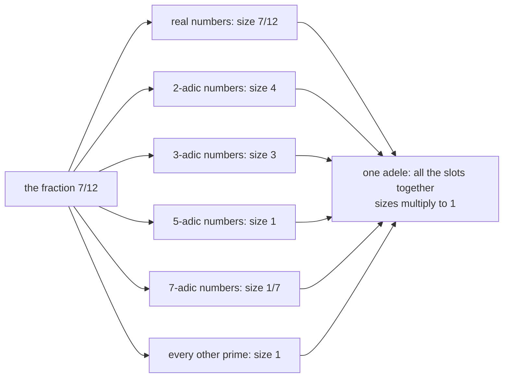
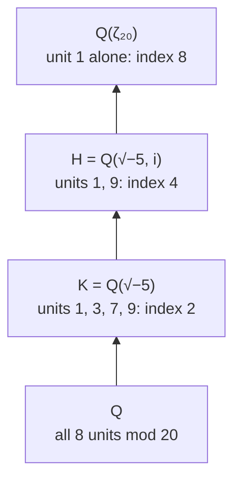

# Adeles and ideles: every completion of Q at once, and class field theory in a single group

[Syllabus](../../../SYLLABUS.md) → [Algebraic and analytic number theory](../README.md) → [Local Fields and Class Field Theory](../README.md#s09) → Adeles and ideles

---

## General Overview

Take the fraction 7/12 and measure it in every way the fractions allow. By ordinary size it is 7/12. By 2-adic size it is 4, because 12 holds two 2s in the denominator. By 3-adic size it is 3. By 7-adic size it is 1/7. At every other prime it has size 1.

Multiply the four sizes that are not 1:

```math
4 \times 3 \times \tfrac{1}{7} \times \tfrac{7}{12} = 1
```

That is no accident. Every nonzero fraction gives 1 this way. This is the **product formula**, and it says the sizes of a fraction at all its places are tied together: one size can only grow if others shrink.

The product formula suggests looking at all the sizes together. The **adeles** do exactly that. An adele is one entry for each way of measuring: a real number, a 2-adic number, a 3-adic number, a 5-adic number, and so on, with a rule that keeps the list tame. A fraction such as 7/12 becomes the adele with 7/12 in every slot.

Two facts make this space useful.

- **The fractions sit in it like the integers sit in the line.** They are spread out, with gaps (**discrete**). Every adele is one fraction plus a small remainder.
- **The units of the adeles, the ideles, hold class field theory.** Divide them by the nonzero fractions and the result is one group, the **idele class group**. Its quotients by open subgroups of finite index are exactly the Galois groups of the finite abelian extensions. For the fractions they are the quotients of the groups $`(\mathbb{Z} \bmod m)^\times`$ of the cyclotomic fields.

The shelf's house example fits inside. A prime other than 5 is $`x^2 + 5y^2`$ exactly when it is 1 or 9 mod 20. On this card that rule is one open subgroup of the idele class group, of index 4.

**The adeles put every completion of Q side by side; the fractions sit inside them as a discrete set with a compact quotient, the product formula is why they sit apart, and the idele class group maps onto the Galois group of all abelian extensions, so class field theory becomes a statement about one group.**

**What kind of fact this is:** the adeles and ideles are definitions. The product formula, the discreteness of Q, the compact quotient and the shape of the idele class group of Q are theorems, proved on this card in Why it works. Global class field theory is a theorem stated here with its key idea and sourced to Artin (cited on [Artin reciprocity](05-artin-reciprocity-and-the-hilbert-class-field.md)) and Chevalley; the code checks its consequences for Q up to 10,000, which is evidence, not proof.

### The picture: one fraction, every completion



---

## The formula

Notation first, in words.

- A **place** $`v`$ of Q is one way of measuring size: the ordinary size, written $`v = \infty`$, or the p-adic size for one prime $`p`$ ([The p-adic numbers](../06-Algebraic%20Numbers/10-p-adic-numbers-and-hensels-lemma.md)). Ostrowski's theorem says there are no others, up to powers.
- $`|x|_v`$ is the size of $`x`$ at $`v`$. For a prime, $`|x|_p = p^{-v_p(x)}`$, where $`v_p(x)`$ counts the factors $`p`$ in $`x`$.
- $`\mathbb{Q}_v`$ is the **completion** at $`v`$: $`\mathbb{Q}_\infty = \mathbb{R}`$, and $`\mathbb{Q}_p`$ the p-adic numbers. $`\mathbb{Z}_p`$ is the p-adic integers (size at most 1), and $`\mathbb{Z}_p^\times`$ the p-adic units (size exactly 1).
- $`\widehat{\mathbb{Z}}`$ is the profinite integers from [Infinite Galois theory](../05-Fields%20and%20Galois%20Theory/12-infinite-galois-theory-and-the-krull-topology.md). By the Chinese remainder theorem it is the product of all the $`\mathbb{Z}_p`$: one p-adic integer for each prime.

**The product formula.** For every nonzero fraction $`x`$,

```math
\prod_{v} |x|_v = |x|_\infty \cdot |x|_2 \cdot |x|_3 \cdot |x|_5 \cdots = 1
```

**Read it aloud:** the sizes of a nonzero fraction at all the places, ordinary and p-adic, multiply to exactly 1.

For 7/12: $`\tfrac{7}{12} \times 4 \times 3 \times \tfrac{1}{7} = 1`$, and every other factor is 1.

**The adele ring.** It is a **restricted product**: a product where all but finitely many entries must be integers.

```math
\mathbb{A}_\mathbb{Q} = \{\, (a_\infty, a_2, a_3, a_5, \ldots) : a_\infty \in \mathbb{R},\ a_p \in \mathbb{Q}_p,\ a_p \in \mathbb{Z}_p \text{ for all but finitely many } p \,\}
```

**Read it aloud:** an adele is a real number and one p-adic number for each prime, and only finitely many of the p-adic entries may have a denominator.

Adeles add and multiply slot by slot. A fraction $`x`$ becomes the adele $`(x, x, x, \ldots)`$: it has only finitely many primes in its denominator, so it obeys the rule.

**The fractions inside the adeles.** Every adele splits in exactly one way:

```math
\mathbb{A}_\mathbb{Q} = \mathbb{Q} + \big([0, 1) \times \widehat{\mathbb{Z}}\big)
```

**Read it aloud:** every adele is one fraction plus a remainder whose real entry lies in [0, 1) and whose p-adic entries are all p-adic integers.

So Q is discrete in the adeles, and the quotient $`\mathbb{A}_\mathbb{Q}/\mathbb{Q}`$ is compact: it is the image of $`[0, 1] \times \widehat{\mathbb{Z}}`$.

**The ideles.** The **ideles** $`\mathbb{A}_\mathbb{Q}^\times`$ are the adeles with a multiplicative inverse: every entry nonzero, and all but finitely many p-adic entries units. The **idele norm** is $`|a| = \prod_v |a_v|_v`$, a finite product. The **idele class group** is the ideles divided by the nonzero fractions:

```math
C_\mathbb{Q} = \mathbb{A}_\mathbb{Q}^\times / \mathbb{Q}^\times \cong \widehat{\mathbb{Z}}^\times \times (0, \infty)
```

**Read it aloud:** up to a fraction, an idele is a unit at every prime together with one positive real number, and that real number is its norm.

**Global class field theory.** For a number field $`K`$ with idele class group $`C_K`$ there is a continuous map onto the Galois group of $`K^{\mathrm{ab}}`$, the largest abelian extension of $`K`$:

```math
\mathrm{Art}_K : C_K \twoheadrightarrow \mathrm{Gal}(K^{\mathrm{ab}}/K), \qquad C_K / N \cong \mathrm{Gal}(L/K)
```

**Read it aloud:** the Artin map sends the idele class group onto the abelian Galois group; each finite abelian extension $`L`$ matches one open subgroup $`N`$ of finite index, and dividing by $`N`$ gives the Galois group of $`L`$.

For Q the map is $`\widehat{\mathbb{Z}}^\times \times (0, \infty) \to \widehat{\mathbb{Z}}^\times`$: it forgets the real number. Divide $`\widehat{\mathbb{Z}}^\times`$ by the units that are 1 mod $`m`$, and $`(\mathbb{Z} \bmod m)^\times`$ is left: the Galois group of the cyclotomic field $`\mathbb{Q}(\zeta_m)`$ ([Cyclotomic fields](../05-Fields%20and%20Galois%20Theory/08-cyclotomic-extensions-and-roots-of-unity.md)).

| Symbol | Plain meaning | In our example | Push it up and the answer… |
| --- | --- | --- | --- |
| $`v`$, $`\lvert x\rvert_v`$ | a place; the size of $`x`$ there | $`\lvert 7/12\rvert_2 = 4`$ | — |
| $`p`$, $`v_p(x)`$ | a prime; the count of its factors in $`x`$ | $`v_2(7/12) = -2`$ | more factors: smaller p-adic size |
| $`\mathbb{Q}_v`$, $`\mathbb{Z}_p`$, $`\mathbb{Z}_p^\times`$ | completion; p-adic integers; p-adic units | $`\mathbb{Q}_\infty = \mathbb{R}`$ | — |
| $`\widehat{\mathbb{Z}}`$, $`\widehat{\mathbb{Z}}^\times`$ | one p-adic integer per prime; one unit per prime | the remainder's finite entries | — |
| $`\mathbb{A}_\mathbb{Q}`$, $`a = (a_v)`$ | the adele ring; one adele, entry by entry | $`a_\infty = 53/10`$, $`a_2 = 1/4`$, $`a_3 = 2/3`$ | — |
| $`S`$ | the finite set of primes where an adele is not a p-adic integer | $`\{2, 3\}`$ | bigger $`S`$: more principal parts to add |
| $`q`$, $`b`$, $`r`$, $`n`$ | the fraction and the remainder in $`a = q + b`$; the sum of principal parts; the whole-number shift | $`q = 59/12`$, $`b_\infty = 23/60`$, $`r = 11/12`$, $`n = 4`$ | — |
| $`\mathbb{A}_\mathbb{Q}^\times`$, $`\lvert a\rvert`$ | the ideles; the idele norm | $`\lvert \pi_7\rvert = 1/7`$ | — |
| $`C_\mathbb{Q}`$, $`C_K`$ | idele class group of Q, of $`K`$ | $`\widehat{\mathbb{Z}}^\times \times (0, \infty)`$ | — |
| $`\pi_p`$ | the idele with $`p`$ in the p-slot and 1 elsewhere | $`\pi_7`$ | — |
| $`m`$, $`\zeta_m`$ | a modulus; a primitive $`m`$-th root of one | $`m = 20`$ | bigger $`m`$: a smaller open subgroup, a bigger field |
| $`K`$, $`K^{\mathrm{ab}}`$, $`H`$, $`L`$, $`N`$, $`\mathrm{Art}_K`$ | a number field; its largest abelian extension; the house class field; an abelian extension; its open subgroup; the Artin map | $`\mathbb{Q}(\sqrt{-5})`$; $`\mathbb{Q}(\sqrt{-5}, i)`$ | bigger $`L`$: smaller $`N`$ |

### When it holds

- **Only finitely many denominators.** With a full product, the list with $`1/p`$ in every p-slot would be allowed. No single fraction is close to it: matching it at the primes up to 29 already needs denominator 6,469,693,230, and the need grows without end.
- **All the places, the real one included.** Leave out the real place and the product of the p-adic sizes of 7/12 is 12/7, not 1. Leave it out of the adeles and Q stops being discrete: every multiple of 10!, infinitely many, lies in one small p-adic box, 551 of them within real size $`10^9`$ alone.
- **The finite places too.** In the real line alone Q is not discrete: the window (−1/2, 1/2) holds 3,043 fractions with denominator at most 100. Adding "a p-adic integer at every p" leaves only 0.
- **The idele topology is its own.** The ideles carry the restricted-product topology built from the $`\mathbb{Z}_p^\times`$, not the one inherited from the adeles. In the inherited one, taking inverses is not continuous.
- **Class field theory sees only abelian extensions.** The Artin map reaches $`\mathrm{Gal}(K^{\mathrm{ab}}/K)`$, the largest abelian quotient. Extensions with a non-abelian Galois group, such as the splitting field of $`x^4 - 2`$, need more than this group.

---

## Why it works

### Step 0: a fraction is a p-adic integer at almost every prime

A fraction has finitely many primes in its denominator. So at all but finitely many primes it is a p-adic integer, and at all but finitely many it is a p-adic unit.

That one fact does three jobs. It puts every fraction inside the restricted product. It makes the product formula a finite product. And it lets a fraction cancel the few bad entries of any adele.

### Step 1: the product formula

Both sides of the formula multiply: $`|xy|_v = |x|_v \, |y|_v`$ at every place. Every nonzero fraction is $`\pm`$ a product of primes and their inverses. So it is enough to check $`-1`$ and each prime $`\ell`$.

- $`-1`$ has size 1 at every place.
- A prime $`\ell`$ has ordinary size $`\ell`$, $`\ell`$-adic size $`1/\ell`$, and size 1 at every other prime. The product is $`\ell \times 1/\ell = 1`$.

For 7/12 the factors are $`7 \cdot 2^{-2} \cdot 3^{-1}`$, and the four sizes on the overview come from those three primes. The code checks all 4,406 fractions $`a/b`$ in lowest terms with $`1 \le |a|, b \le 60`$ at every place: the product is 1 each time.

### Step 2: the adeles are locally compact

The open sets of $`\mathbb{A}_\mathbb{Q}`$ are built from boxes: an open set in each $`\mathbb{Q}_v`$ for $`v`$ in a finite set, and $`\mathbb{Z}_p`$ at every other prime. Each $`\mathbb{Z}_p`$ is compact, so their product $`\widehat{\mathbb{Z}}`$ is compact by Tychonoff's theorem ([Compactness with no distances, and Tychonoff](../../17-Topology/02-Topological%20Spaces/06-compactness-and-tychonoff.md)).

So $`[-1, 1] \times \widehat{\mathbb{Z}}`$ is a compact box around 0. The full product of all the $`\mathbb{Q}_p`$ has none. Every open set around 0 there holds all of $`\mathbb{Q}_p`$ in all but finitely many slots, and $`\mathbb{Q}_p`$ is not compact. The restriction is what makes the adeles **locally compact** (every point has a compact box around it), and so gives them a Haar measure: a fair notion of volume ([Haar measure](../../20-Harmonic%20analysis/08-Harmonic%20Analysis%20on%20Groups/02-haar-measure.md)).

### Step 3: every adele is one fraction plus a remainder

Take an adele $`a`$, and let $`S`$ be the finite set of primes where $`a_p`$ is not a p-adic integer.

1. **Clear the denominator at each bad prime.** For $`p`$ in $`S`$, choose $`r_p`$ with only powers of $`p`$ in its denominator and $`a_p - r_p`$ in $`\mathbb{Z}_p`$: the **principal part** of $`a_p`$. It exists because $`a_p`$ times a power of $`p`$ is a p-adic integer, which is congruent to an ordinary integer mod that power.
2. **Add them.** Put $`r = \sum_{p \in S} r_p`$. At a prime $`p`$, every $`r_\ell`$ with $`\ell \ne p`$ is a p-adic integer. So $`a_p - r`$ is a p-adic integer at every prime.
3. **Fix the real entry.** Let $`n`$ be the whole number with $`0 \le a_\infty - r - n < 1`$. A whole number is a p-adic integer everywhere, so step 2 survives.

Then $`q = r + n`$ and $`b = a - q`$ lies in $`[0, 1) \times \widehat{\mathbb{Z}}`$.

**Only one $`q`$ works.** If $`q`$ and $`q'`$ both work, then $`q - q'`$ is a p-adic integer at every prime, so it is a whole number. Its real size is below 1, so it is 0.

### Step 4: Q is discrete, and the quotient is compact

The open set $`(-1/2, 1/2) \times \widehat{\mathbb{Z}}`$ contains only one fraction. A fraction that is a p-adic integer at every prime has no denominator, so it is a whole number, and the only whole number in $`(-1/2, 1/2)`$ is 0. Sliding this set by a fraction shows that every fraction is alone in an open set: Q is **discrete**.

By Step 3, every point of $`\mathbb{A}_\mathbb{Q}/\mathbb{Q}`$ comes from $`[0, 1) \times \widehat{\mathbb{Z}}`$. That set lies in the compact $`[0, 1] \times \widehat{\mathbb{Z}}`$, whose image is the whole quotient. A continuous image of a compact set is compact. So $`\mathbb{A}_\mathbb{Q}/\mathbb{Q}`$ is **compact**: the fractions are a lattice in the adeles, as $`\mathbb{Z}`$ is in $`\mathbb{R}`$. Its Haar volume is 1, the volume of the box $`[0, 1) \times \widehat{\mathbb{Z}}`$; the sources build that measure.

### Step 5: the product formula is why Q sits there

The two facts are linked. Suppose a nonzero fraction $`x`$ lay in $`(-1/2, 1/2) \times \widehat{\mathbb{Z}}`$. Its sizes would be below 1/2 at the real place and at most 1 at every prime. Their product would be below 1/2. The product formula says it is 1. So no such $`x`$ exists: the product formula proves discreteness again, without denominators.

### Step 6: the idele class group of Q

Take an idele $`a`$. Let $`q`$ be the sign of $`a_\infty`$ times $`\prod_p p^{v_p(a_p)}`$, a finite product of primes since almost every $`a_p`$ is a unit. Divide $`a`$ by $`q`$.

- At each prime, $`a_p / q`$ has size 1: a p-adic unit.
- At the real place, $`a_\infty / q`$ is positive.

So every idele is a fraction times an element of $`\widehat{\mathbb{Z}}^\times \times (0, \infty)`$. The fraction is unique: a positive fraction that is a p-adic unit at every prime has no prime factor, so it is 1. That gives $`C_\mathbb{Q} \cong \widehat{\mathbb{Z}}^\times \times (0, \infty)`$.

The positive real part is the idele norm, by the product formula. The code checks this on the idele with 5 at the real place, 12 at 2, 1/3 at 3 and 1 elsewhere. Its fraction is $`q = 4/3`$, its real part is 15/4, and its norm, $`5 \times \tfrac{1}{4} \times 3`$, is also 15/4.

### Step 7: global class field theory

**For Q it is a theorem with a short road.** [Kronecker-Weber](04-kronecker-weber-theorem.md) says every abelian extension of Q lies in some $`\mathbb{Q}(\zeta_m)`$. Its Galois group is $`(\mathbb{Z} \bmod m)^\times`$, with $`a`$ acting as $`\zeta_m \mapsto \zeta_m^a`$. Over all $`m`$ at once these groups assemble into $`\widehat{\mathbb{Z}}^\times`$, so $`\mathrm{Gal}(\mathbb{Q}^{\mathrm{ab}}/\mathbb{Q}) \cong \widehat{\mathbb{Z}}^\times`$, and Step 6 supplies the map from $`C_\mathbb{Q}`$.

**Where Frobenius goes.** The idele $`\pi_p`$, with $`p`$ in the p-slot and 1 elsewhere, must map to the Frobenius at $`p`$, which raises roots of one to the power $`p`$. Divide $`\pi_p`$ by the fraction $`p`$: its unit part is $`1/p`$ at every prime other than $`p`$. Mod 20, the class of $`\pi_3`$ is $`3^{-1} = 7`$. So the Artin map sends a unit $`u`$ to $`\zeta \mapsto \zeta^{u^{-1}}`$: the inverse is part of the statement.

**For any number field it is stated, not proved.** Artin's reciprocity law of 1927, in Chevalley's idelic form of 1940, gives the map $`\mathrm{Art}_K`$ of The formula. It is onto, its kernel is the connected part of $`C_K`$ through 1, and the finite abelian extensions $`L`$ match the open subgroups of finite index. The fold has the shape of the proof.

<details>
<summary>The key idea of the proof of global class field theory, and where to read it</summary>

The proof has three parts, each a chapter in the sources.

1. **Local class field theory.** At each completion $`K_v`$ there is a local Artin map from $`K_v^\times`$ to the abelian Galois group of $`K_v`$. It sends a uniformiser (an element of size just below 1) to Frobenius at unramified places. [Local fields](03-local-fields-and-the-different.md) builds the completions.
2. **Glue the local maps.** Define the global map on an idele as the product of the local maps on its entries. Almost every entry is a unit at an unramified place, where the local map is trivial, so the product is finite.
3. **Show nonzero elements of K map to 1.** This is the reciprocity law itself, and the hard part. For $`K = \mathbb{Q}`$ it can be checked by hand from the explicit cyclotomic local maps at every place, ramified ones included; Step 7 shows only where $`\pi_p`$ goes. In general it rests on two inequalities about the norms $`N_{L/K} C_L`$ from a finite abelian $`L`$: the first says their index in $`C_K`$ is at least $`[L : K]`$ for cyclic $`L`$, and the second says it is at most $`[L : K]`$, first proved with L-functions.

$`\displaystyle [\,C_K : N_{L/K} C_L\,] = [\,L : K\,] \quad \text{for every finite abelian } L/K`$

That equality is what makes the map onto and identifies the kernel. Neukirch, chapter VI, and Cassels and Fröhlich, chapter VII, carry it out.

</details>

### Step 8: the house example in one group

Let $`K = \mathbb{Q}(\sqrt{-5})`$, with class group of order 2, and $`H = \mathbb{Q}(\sqrt{-5}, i)`$, its Hilbert class field: the largest abelian extension of $`K`$ with no ramification anywhere ([Artin reciprocity](05-artin-reciprocity-and-the-hilbert-class-field.md)).

$`H`$ lies in $`\mathbb{Q}(\zeta_{20})`$, since $`i = \zeta_{20}^5`$ and $`\sqrt 5`$ lies in $`\mathbb{Q}(\zeta_5)`$. So, over Q, it matches an open subgroup of $`C_\mathbb{Q}`$: the units that are 1 or 9 mod 20, times $`(0, \infty)`$. The subgroup $`\{1, 9\}`$ has index 4 in the 8 units mod 20, and $`[H : \mathbb{Q}] = 4`$.

A prime $`p`$ not dividing 20 splits completely in $`H`$ exactly when its Frobenius is trivial on $`H`$, that is, when $`p \bmod 20`$ lies in $`\{1, 9\}`$. The set $`\{1, 9\}`$ is closed under inverses, so the inverse of Step 7 does not move it. Splitting completely in $`H`$ means $`p`$ is the norm of a principal ideal of $`K`$: $`p = x^2 + 5y^2`$.

Over $`K`$ itself, dividing $`C_K`$ by the units at every prime and by all the complex numbers at the infinite place gives exactly the class group of $`K`$, and the Artin map turns it into $`\mathrm{Gal}(H/K)`$, of order 2. The other class is the form $`2x^2 + 2xy + 3y^2`$, which takes the primes that are 3 or 7 mod 20.



Each arrow means "sits inside". Each label is the open subgroup of $`C_\mathbb{Q}`$, read mod 20, that fixes the field.

---

## Worked numbers, by hand

The adele $`a`$ with $`a_\infty = 53/10`$, $`a_2 = 1/4`$, $`a_3 = 2/3`$ and 0 at every other prime, split as fraction plus remainder.

| Step | Arithmetic | Value |
| --- | --- | --- |
| bad primes | 1/4 has a 2 below, 2/3 a 3 | $`S = \{2, 3\}`$ |
| principal parts | 1/4 at 2; 2/3 at 3 | 1/4 and 2/3 |
| their sum | 3/12 + 8/12 | $`r = 11/12`$ |
| real gap | 53/10 − 11/12 = 263/60 ≈ 4.38 | $`n = 4`$ |
| the fraction | 11/12 + 4 | $`q = 59/12`$ |
| real remainder | 53/10 − 59/12 = (318 − 295)/60 | 23/60, inside [0, 1) |
| at 2 | 1/4 − 59/12 = −56/12 | −14/3: no 2 below |
| at 3 | 2/3 − 59/12 = −51/12 | −17/4: no 3 below |
| at $`p \ge 5`$ | 0 − 59/12 | −59/12: only 2 and 3 below |

**$`a = 59/12 + b`$, with $`b`$ in $`[0, 1) \times \widehat{\mathbb{Z}}`$.**

So this adele lies in the translate of the fundamental box by the fraction 59/12, and by no other fraction. A brute-force search over every $`k/d`$ with $`d \le 72`$ finds 59/12 alone.

### What breaks if you drop a piece

| Mistake | Comes out at | What went wrong |
| --- | --- | --- |
| Product formula without the real place | $`4 \times 3 \times \tfrac{1}{7} = 12/7`$ | the real size is a place like the others |
| Adeles without the real place | every multiple of 10! in one small p-adic box; 551 of them within real size $`10^9`$ | Q is no longer discrete: big whole numbers are p-adically tiny |
| The real line without the primes | 3,043 fractions in (−1/2, 1/2) with denominator at most 100 | Q is dense in R; only "integer at every p" isolates 0 |
| Full product, no restriction | $`1/p`$ at every $`p`$ needs denominator 6,469,693,230 by $`p = 29`$ | no fraction cancels infinitely many bad entries |

The code prints all four.

---

## Code, from first principles, and it actually runs

Everything is an exact fraction. Python uses `fractions.Fraction` and `pow(a, k, n)` as tools; Rust builds its own fraction type on `i128` with checked products. Nothing imported knows a p-adic size or a class field. The code takes four roads.

1. **The product formula** for 7/12, then for all 4,406 fractions with numerator and denominator up to 60, at every place.
2. **The split $`a = q + b`$** by principal parts and a floor, against a brute-force search over all fractions $`k/d`$ with $`d \le 72`$.
3. **The idele class** of three kinds of idele, with the real part checked against the idele norm, and the class of $`\pi_p`$ mod 20 checked against $`p^{-1}`$.
4. **The house rule** for the 1,227 odd primes below 10,000 other than 5: $`x^2 + 5y^2`$ by search, against Euler's test for $`-1`$ and $`-5`$, against the open subgroup $`\{1, 9\}`$ mod 20.

### Python

```python
# Adeles and ideles of Q: the product formula, A = Q + ([0,1) x Z-hat), and the idele class group.
# Every number is an exact fraction; nothing imported knows the answer.
from fractions import Fraction as F

def primes_upto(n):
    s = [True] * (n + 1)
    s[0] = s[1] = False
    for i in range(2, int(n ** 0.5) + 1):
        if s[i]:
            s[i * i::i] = [False] * len(s[i * i::i])
    return [i for i in range(n + 1) if s[i]]

def vp(x, p):                       # how many times p divides the nonzero fraction x
    n, d, v = x.numerator, x.denominator, 0
    while n % p == 0: n, v = n // p, v + 1
    while d % p == 0: d, v = d // p, v - 1
    return v

def size(x, v):                     # |x|_v, with v = 0 standing for the real place
    return abs(x) if v == 0 else F(v) ** (-vp(x, v))

def mod_of(x, pk):                  # a fraction with no p in its denominator, read mod p^k
    return x.numerator * pow(x.denominator, -1, pk) % pk

def principal_part(a, p):           # r in Z[1/p] with a - r a p-adic integer
    k = -vp(a, p)
    if k <= 0: return F(0)
    return F(mod_of(a * p ** k, p ** k), p ** k)

PR = primes_upto(10000)
print("== product formula ==")
x = F(7, 12)
sz = {v: size(x, v) for v in [2, 3, 7, 0]}
print("7/12:", ", ".join(f"|x|_{'inf' if v == 0 else v} = {s}" for v, s in sz.items()))
prod = sz[2] * sz[3] * sz[7] * sz[0]
fin = sz[2] * sz[3] * sz[7]
print(f"product over all places = {prod}; finite places only = {fin}")
assert prod == 1 and fin == 1 / x and sz[2] == 4 and sz[3] == 3
count, bad = 0, 0
for a in range(-60, 61):
    for b in range(1, 61):
        y = F(a, b)
        if a == 0 or y.denominator != b: continue
        count += 1
        pr = size(y, 0)
        for p in [p for p in PR if p <= 60]: pr *= size(y, p)
        bad += pr != 1
print(f"fractions a/b with 1 <= |a|, b <= 60 in lowest terms: {count}, product not 1: {bad}")
assert count > 2000 and bad == 0

print("== an adele split as rational + ([0,1) x Z-hat) ==")
a_inf, a_fin = F(53, 10), {2: F(1, 4), 3: F(2, 3)}       # every other entry is 0
r = sum(principal_part(a_fin[p], p) for p in a_fin)
n = (a_inf - r).numerator // (a_inf - r).denominator
q = r + n
b_inf = a_inf - q
b = {p: a_fin[p] - q for p in a_fin}
print(f"principal parts sum r = {r}; floor(a_inf - r) = {n}; rational q = {q}")
print(f"remainder: real {b_inf}, at 2 {b[2]}, at 3 {b[3]}, at p >= 5 {-q}")
assert 0 <= b_inf < 1 and all(vp(b[p], p) >= 0 for p in b) and vp(-q, 5) >= 0
found = set()
for d in range(1, 73):
    for k in range(-1000, 1000):
        c = F(k, d)
        ok = 0 <= a_inf - c < 1
        ok = ok and all(v == 0 or vp(v, p) >= 0 for p in PR[:20] for v in [a_fin.get(p, F(0)) - c])
        if ok: found.add(c)
print(f"brute force over k/d, d <= 72, |k| < 1000: rationals that work: {", ".join(str(c) for c in sorted(found))}")
assert found == {q}

print("== Q is discrete in the adeles ==")
real_only = [F(a, b) for b in range(1, 101) for a in range(-50, 51) if F(a, b).denominator == b and abs(F(a, b)) < F(1, 2)]
adelic = [y for y in real_only if y.denominator == 1]
print(f"fractions with denominator <= 100 in (-1/2, 1/2): {len(real_only)}; also in Z_p for every p: {", ".join(str(y) for y in adelic)}")
assert len(adelic) == 1 and adelic[0] == 0 and len(real_only) > 1000
L = 2 ** 8 * 3 ** 4 * 5 ** 2 * 7
near0 = [k * L for k in range(-300, 301) if abs(k * L) <= 10 ** 9]
print(f"no real place: multiples of 10! = {L} within real size 10^9, all p-adically as small as 10!: {len(near0)}")
assert L == 3628800 and len(near0) == 551
pp = sum(principal_part(F(1, p), p) for p in PR if p <= 29)
print(f"full product: 1/p at every p needs sum of 1/p; by p = 29 its denominator is {pp.denominator}")
assert pp.denominator == 2 * 3 * 5 * 7 * 11 * 13 * 17 * 19 * 23 * 29

print("== ideles: rational times (positive real, unit at every prime) ==")
def idele_class(a_inf, listed, other, m):
    q = F(1 if a_inf > 0 else -1)
    for p, y in listed.items(): q *= F(p) ** vp(y, p)
    unit = lambda p: listed.get(p, other) / q
    assert all(vp(unit(p), p) == 0 for p in list(listed) + [5])
    res = {pk: mod_of(unit(p), pk) for p, pk in [(2, 4), (5, 5)]}     # m = 20 = 4 x 5
    u = [z for z in range(m) if z % 4 == res[4] and z % 5 == res[5]][0]
    norm = abs(a_inf)
    for p, y in listed.items(): norm *= size(y, p)
    return q, a_inf / q, norm, u
for name, idl in [("principal 7/12", (F(7, 12), {2: F(7, 12), 3: F(7, 12), 7: F(7, 12)}, F(7, 12))),
                  ("(5; 12 at 2, 1/3 at 3)", (F(5), {2: F(12), 3: F(1, 3)}, F(1)))]:
    q, real, norm, u = idele_class(*idl, 20)
    print(f"{name}: q = {q}, real part {real}, idele norm {norm}, unit part mod 20 = {u}")
    assert real == norm and real > 0
fro = []
for p in [3, 7, 11, 13, 17, 19]:
    q, real, norm, u = idele_class(F(1), {p: F(p)}, F(1), 20)
    assert u * p % 20 == 1 and real == F(1, p)
    fro.append(f"{p}->{u}")
print("p in the p-slot, class mod 20 (Frob_p raises roots of one to the p):", ", ".join(fro))

print("== house: p = x^2 + 5y^2 and the open subgroup {1, 9} of (Z/20)^x ==")
N = 10000
f1 = {x * x + 5 * y * y for x in range(101) for y in range(46)}
f2 = {2 * x * x + 2 * x * y + 3 * y * y for x in range(-100, 101) for y in range(-100, 101)}
ps = [p for p in PR if p not in (2, 5)]
euler = lambda a, p: pow(a % p, (p - 1) // 2, p) == 1
A = [p for p in ps if p in f1]
B = [p for p in ps if euler(-1, p) and euler(-5, p)]
C = [p for p in ps if p % 20 in (1, 9)]
D = [p for p in ps if p in f2]
splitK = sorted({p % 20 for p in ps if euler(-5, p)})
print(f"odd primes below {N} other than 5: {len(ps)}")
print(f"x^2 + 5y^2: {len(A)}; -1 and -5 both squares: {len(B)}; p = 1 or 9 mod 20: {len(C)}")
print(f"2x^2 + 2xy + 3y^2: {len(D)}, residues {sorted({p % 20 for p in D})}; -5 a square: residues {splitK}")
units = [u for u in range(1, 20) if u % 2 and u % 5]
resA = sorted({p % 20 for p in A})
print(f"units mod 20: {len(units)}; residues of x^2 + 5y^2 primes {resA}, index {len(units) // len(resA)}; share {len(A) / len(ps):.4f}")
assert A == B == C and resA == [1, 9] and len(units) // len(resA) == 4 and splitK == [1, 3, 7, 9] and sorted({p % 20 for p in D}) == [3, 7]
print("ALL CHECKS PASS")
```

**Ran 2026-11-24 on macOS, Python 3.14.10, standard library only. All checks passed. Output, pasted from the run:**

```
== product formula ==
7/12: |x|_2 = 4, |x|_3 = 3, |x|_7 = 1/7, |x|_inf = 7/12
product over all places = 1; finite places only = 12/7
fractions a/b with 1 <= |a|, b <= 60 in lowest terms: 4406, product not 1: 0
== an adele split as rational + ([0,1) x Z-hat) ==
principal parts sum r = 11/12; floor(a_inf - r) = 4; rational q = 59/12
remainder: real 23/60, at 2 -14/3, at 3 -17/4, at p >= 5 -59/12
brute force over k/d, d <= 72, |k| < 1000: rationals that work: 59/12
== Q is discrete in the adeles ==
fractions with denominator <= 100 in (-1/2, 1/2): 3043; also in Z_p for every p: 0
no real place: multiples of 10! = 3628800 within real size 10^9, all p-adically as small as 10!: 551
full product: 1/p at every p needs sum of 1/p; by p = 29 its denominator is 6469693230
== ideles: rational times (positive real, unit at every prime) ==
principal 7/12: q = 7/12, real part 1, idele norm 1, unit part mod 20 = 1
(5; 12 at 2, 1/3 at 3): q = 4/3, real part 15/4, idele norm 15/4, unit part mod 20 = 17
p in the p-slot, class mod 20 (Frob_p raises roots of one to the p): 3->7, 7->3, 11->11, 13->17, 17->13, 19->19
== house: p = x^2 + 5y^2 and the open subgroup {1, 9} of (Z/20)^x ==
odd primes below 10000 other than 5: 1227
x^2 + 5y^2: 302; -1 and -5 both squares: 302; p = 1 or 9 mod 20: 302
2x^2 + 2xy + 3y^2: 312, residues [3, 7]; -5 a square: residues [1, 3, 7, 9]
units mod 20: 8; residues of x^2 + 5y^2 primes [1, 9], index 4; share 0.2461
ALL CHECKS PASS
```

### Rust

```rust
// Adeles and ideles of Q: the product formula, A = Q + ([0,1) x Z-hat), and the idele class group.
// Every number is an exact fraction (i128 with checked products); std only.
use std::collections::BTreeSet;
use std::fmt;

fn gcd(a: i128, b: i128) -> i128 { if b == 0 { a.abs() } else { gcd(b, a % b) } }
#[derive(Clone, Copy, PartialEq, Eq, PartialOrd, Ord)]
struct Q { n: i128, d: i128 }
fn q(n: i128, d: i128) -> Q {
    let g = gcd(n, d) * if d < 0 { -1 } else { 1 };
    Q { n: n / g, d: d / g }
}
fn mul(a: i128, b: i128) -> i128 { a.checked_mul(b).expect("overflow") }
impl Q {
    fn add(self, o: Q) -> Q { q(mul(self.n, o.d) + mul(o.n, self.d), mul(self.d, o.d)) }
    fn sub(self, o: Q) -> Q { self.add(Q { n: -o.n, d: o.d }) }
    fn times(self, o: Q) -> Q { q(mul(self.n, o.n), mul(self.d, o.d)) }
    fn div(self, o: Q) -> Q { q(mul(self.n, o.d), mul(self.d, o.n)) }
    fn abs(self) -> Q { Q { n: self.n.abs(), d: self.d } }
    fn lt(self, o: Q) -> bool { mul(self.n, o.d) < mul(o.n, self.d) }
}
impl fmt::Display for Q {
    fn fmt(&self, f: &mut fmt::Formatter) -> fmt::Result {
        if self.d == 1 { write!(f, "{}", self.n) } else { write!(f, "{}/{}", self.n, self.d) }
    }
}
fn primes_upto(n: usize) -> Vec<i128> {
    let mut s = vec![true; n + 1]; s[0] = false; s[1] = false;
    let mut i = 2;
    while i * i <= n { if s[i] { let mut j = i * i; while j <= n { s[j] = false; j += i; } } i += 1; }
    (0..=n).filter(|&i| s[i]).map(|i| i as i128).collect()
}
fn vp(x: Q, p: i128) -> i32 {
    let (mut n, mut d, mut v) = (x.n, x.d, 0);
    while n % p == 0 { n /= p; v += 1; }
    while d % p == 0 { d /= p; v -= 1; }
    v
}
fn ppow(p: i128, k: i32) -> Q { let m = p.pow(k.unsigned_abs()); if k >= 0 { q(m, 1) } else { q(1, m) } }
fn size(x: Q, v: i128) -> Q { if v == 0 { x.abs() } else { ppow(v, -vp(x, v)) } }
fn inv_mod(a: i128, m: i128) -> i128 {
    let (mut r0, mut r1, mut s0, mut s1) = (a.rem_euclid(m), m, 1i128, 0i128);
    while r1 != 0 { let t = r0 / r1; (r0, r1) = (r1, r0 - t * r1); (s0, s1) = (s1, s0 - t * s1); }
    assert!(r0 == 1); s0.rem_euclid(m)
}
fn mod_of(x: Q, pk: i128) -> i128 { (x.n.rem_euclid(pk) * inv_mod(x.d, pk)).rem_euclid(pk) }
fn principal_part(a: Q, p: i128) -> Q {
    let k = -vp(a, p);
    if k <= 0 { return q(0, 1); }
    let pk = p.pow(k as u32);
    q(mod_of(a.times(q(pk, 1)), pk), pk)
}
fn idele_class(a_inf: Q, listed: &[(i128, Q)], other: Q) -> (Q, Q, Q, i128) {
    let mut qq = q(if a_inf.n > 0 { 1 } else { -1 }, 1);
    for &(p, y) in listed { qq = qq.times(ppow(p, vp(y, p))); }
    let unit = |p: i128| listed.iter().find(|t| t.0 == p).map(|t| t.1).unwrap_or(other).div(qq);
    for p in listed.iter().map(|t| t.0).chain([5]) { assert!(vp(unit(p), p) == 0); }
    let (r4, r5) = (mod_of(unit(2), 4), mod_of(unit(5), 5));
    let u = (0..20).find(|z| z % 4 == r4 && z % 5 == r5).unwrap();
    let mut norm = a_inf.abs();
    for &(p, y) in listed { norm = norm.times(size(y, p)); }
    (qq, a_inf.div(qq), norm, u)
}
fn main() {
    let pr = primes_upto(10000);
    println!("== product formula ==");
    let x = q(7, 12);
    let sz: Vec<(i128, Q)> = [2, 3, 7, 0].iter().map(|&v| (v, size(x, v))).collect();
    let parts: Vec<String> = sz.iter().map(|(v, s)| format!("|x|_{} = {}", if *v == 0 { "inf".to_string() } else { v.to_string() }, s)).collect();
    println!("7/12: {}", parts.join(", "));
    let fin = sz[0].1.times(sz[1].1).times(sz[2].1);
    let prod = fin.times(sz[3].1);
    println!("product over all places = {}; finite places only = {}", prod, fin);
    assert!(prod == q(1, 1) && fin == q(1, 1).div(x) && sz[0].1 == q(4, 1) && sz[1].1 == q(3, 1));
    let (mut count, mut bad) = (0, 0);
    for a in -60i128..=60 {
        for b in 1i128..=60 {
            if a == 0 || gcd(a, b) != 1 { continue; }
            count += 1;
            let y = q(a, b);
            let mut p_ = size(y, 0);
            for &p in pr.iter().filter(|&&p| p <= 60) { p_ = p_.times(size(y, p)); }
            if p_ != q(1, 1) { bad += 1; }
        }
    }
    println!("fractions a/b with 1 <= |a|, b <= 60 in lowest terms: {}, product not 1: {}", count, bad);
    assert!(count > 2000 && bad == 0);

    println!("== an adele split as rational + ([0,1) x Z-hat) ==");
    let a_inf = q(53, 10);
    let a_fin = [(2i128, q(1, 4)), (3, q(2, 3))];
    let mut r = q(0, 1); for &(p, a) in &a_fin { r = r.add(principal_part(a, p)); }
    let t = a_inf.sub(r); let n = t.n.div_euclid(t.d);
    let qq = r.add(q(n, 1));
    let b_inf = a_inf.sub(qq); let b: Vec<Q> = a_fin.iter().map(|&(_, a)| a.sub(qq)).collect();
    let mq = q(-qq.n, qq.d);
    println!("principal parts sum r = {}; floor(a_inf - r) = {}; rational q = {}", r, n, qq);
    println!("remainder: real {}, at 2 {}, at 3 {}, at p >= 5 {}", b_inf, b[0], b[1], mq);
    assert!(!b_inf.lt(q(0, 1)) && b_inf.lt(q(1, 1)) && vp(b[0], 2) >= 0 && vp(b[1], 3) >= 0 && vp(mq, 5) >= 0);
    let mut found = BTreeSet::new(); for d in 1i128..73 {
        for k in -1000i128..1000 {
            let c = q(k, d);
            let gap = a_inf.sub(c);
            let mut ok = !gap.lt(q(0, 1)) && gap.lt(q(1, 1));
            for &p in &pr[..20] {
                let ap = a_fin.iter().find(|t| t.0 == p).map(|t| t.1).unwrap_or(q(0, 1));
                let v = ap.sub(c);
                if v.n != 0 && vp(v, p) < 0 { ok = false; }
            }
            if ok { found.insert(c); }
        }
    }
    let fs: Vec<String> = found.iter().map(|c| c.to_string()).collect();
    println!("brute force over k/d, d <= 72, |k| < 1000: rationals that work: {}", fs.join(", "));
    assert!(found.len() == 1 && found.contains(&qq));

    println!("== Q is discrete in the adeles ==");
    let mut real_only = vec![]; for b in 1i128..=100 { for a in -50i128..=50 { if gcd(a, b) == 1 && q(a, b).abs().lt(q(1, 2)) { real_only.push(q(a, b)); } } }
    let adelic: Vec<Q> = real_only.iter().cloned().filter(|y| y.d == 1).collect();
    let ad: Vec<String> = adelic.iter().map(|y| y.to_string()).collect();
    println!("fractions with denominator <= 100 in (-1/2, 1/2): {}; also in Z_p for every p: {}", real_only.len(), ad.join(", "));
    assert!(adelic.len() == 1 && adelic[0] == q(0, 1) && real_only.len() > 1000);
    let l: i128 = 2i128.pow(8) * 3i128.pow(4) * 25 * 7;
    let near0 = (-300i128..=300).filter(|k| (k * l).abs() <= 1_000_000_000).count();
    println!("no real place: multiples of 10! = {} within real size 10^9, all p-adically as small as 10!: {}", l, near0);
    assert!(l == 3628800 && near0 == 551);
    let mut pp = q(0, 1); for &p in pr.iter().filter(|&&p| p <= 29) { pp = pp.add(principal_part(q(1, p), p)); }
    println!("full product: 1/p at every p needs sum of 1/p; by p = 29 its denominator is {}", pp.d);
    assert!(pp.d == 2 * 3 * 5 * 7 * 11 * 13 * 17 * 19 * 23 * 29);

    println!("== ideles: rational times (positive real, unit at every prime) ==");
    let s = q(7, 12);
    let cases = [("principal 7/12", s, vec![(2i128, s), (3, s), (7, s)], s),
                 ("(5; 12 at 2, 1/3 at 3)", q(5, 1), vec![(2, q(12, 1)), (3, q(1, 3))], q(1, 1))];
    for (name, ai, listed, other) in cases.iter() {
        let (qq, real, norm, u) = idele_class(*ai, listed, *other);
        println!("{}: q = {}, real part {}, idele norm {}, unit part mod 20 = {}", name, qq, real, norm, u);
        assert!(real == norm && q(0, 1).lt(real));
    }
    let mut fro = vec![]; for p in [3i128, 7, 11, 13, 17, 19] {
        let (_, real, _, u) = idele_class(q(1, 1), &[(p, q(p, 1))], q(1, 1));
        assert!(u * p % 20 == 1 && real == q(1, p));
        fro.push(format!("{}->{}", p, u));
    }
    println!("p in the p-slot, class mod 20 (Frob_p raises roots of one to the p): {}", fro.join(", "));

    println!("== house: p = x^2 + 5y^2 and the open subgroup {{1, 9}} of (Z/20)^x ==");
    let nn = 10000; let mut f1 = BTreeSet::new(); for x in 0i128..101 { for y in 0i128..46 { f1.insert(x * x + 5 * y * y); } }
    let mut f2 = BTreeSet::new(); for x in -100i128..101 { for y in -100i128..101 { f2.insert(2 * x * x + 2 * x * y + 3 * y * y); } }
    let ps: Vec<i128> = pr.iter().cloned().filter(|&p| p != 2 && p != 5).collect();
    let powm = |mut b: i128, mut e: i128, m: i128| { let mut r = 1; b = b.rem_euclid(m); while e > 0 { if e & 1 == 1 { r = r * b % m; } b = b * b % m; e >>= 1; } r };
    let euler = |a: i128, p: i128| powm(a, (p - 1) / 2, p) == 1;
    let a_: Vec<i128> = ps.iter().cloned().filter(|p| f1.contains(p)).collect();
    let b_: Vec<i128> = ps.iter().cloned().filter(|&p| euler(-1, p) && euler(-5, p)).collect();
    let c_: Vec<i128> = ps.iter().cloned().filter(|p| p % 20 == 1 || p % 20 == 9).collect();
    let d_: Vec<i128> = ps.iter().cloned().filter(|p| f2.contains(p)).collect();
    let split_k: Vec<i128> = ps.iter().filter(|&&p| euler(-5, p)).map(|p| p % 20).collect::<BTreeSet<_>>().into_iter().collect();
    let res_d: Vec<i128> = d_.iter().map(|p| p % 20).collect::<BTreeSet<_>>().into_iter().collect();
    println!("odd primes below {} other than 5: {}", nn, ps.len());
    println!("x^2 + 5y^2: {}; -1 and -5 both squares: {}; p = 1 or 9 mod 20: {}", a_.len(), b_.len(), c_.len());
    println!("2x^2 + 2xy + 3y^2: {}, residues {:?}; -5 a square: residues {:?}", d_.len(), res_d, split_k);
    let units = (1..20).filter(|u| u % 2 != 0 && u % 5 != 0).count();
    let res_a: Vec<i128> = a_.iter().map(|p| p % 20).collect::<BTreeSet<_>>().into_iter().collect();
    println!("units mod 20: {}; residues of x^2 + 5y^2 primes {:?}, index {}; share {:.4}", units, res_a, units / res_a.len(), a_.len() as f64 / ps.len() as f64);
    assert!(a_ == b_ && b_ == c_ && res_a == vec![1, 9] && units / res_a.len() == 4 && split_k == vec![1, 3, 7, 9] && res_d == vec![3, 7]);
    println!("ALL CHECKS PASS");
}
```

**Ran 2026-11-24 on macOS, rustc 1.98.1, no crates. All checks passed. Output, pasted from the run:**

```
== product formula ==
7/12: |x|_2 = 4, |x|_3 = 3, |x|_7 = 1/7, |x|_inf = 7/12
product over all places = 1; finite places only = 12/7
fractions a/b with 1 <= |a|, b <= 60 in lowest terms: 4406, product not 1: 0
== an adele split as rational + ([0,1) x Z-hat) ==
principal parts sum r = 11/12; floor(a_inf - r) = 4; rational q = 59/12
remainder: real 23/60, at 2 -14/3, at 3 -17/4, at p >= 5 -59/12
brute force over k/d, d <= 72, |k| < 1000: rationals that work: 59/12
== Q is discrete in the adeles ==
fractions with denominator <= 100 in (-1/2, 1/2): 3043; also in Z_p for every p: 0
no real place: multiples of 10! = 3628800 within real size 10^9, all p-adically as small as 10!: 551
full product: 1/p at every p needs sum of 1/p; by p = 29 its denominator is 6469693230
== ideles: rational times (positive real, unit at every prime) ==
principal 7/12: q = 7/12, real part 1, idele norm 1, unit part mod 20 = 1
(5; 12 at 2, 1/3 at 3): q = 4/3, real part 15/4, idele norm 15/4, unit part mod 20 = 17
p in the p-slot, class mod 20 (Frob_p raises roots of one to the p): 3->7, 7->3, 11->11, 13->17, 17->13, 19->19
== house: p = x^2 + 5y^2 and the open subgroup {1, 9} of (Z/20)^x ==
odd primes below 10000 other than 5: 1227
x^2 + 5y^2: 302; -1 and -5 both squares: 302; p = 1 or 9 mod 20: 302
2x^2 + 2xy + 3y^2: 312, residues [3, 7]; -5 a square: residues [1, 3, 7, 9]
units mod 20: 8; residues of x^2 + 5y^2 primes [1, 9], index 4; share 0.2461
ALL CHECKS PASS
```

### Lean

Lean proves the card's three theorems about the adeles of Q in full, and checks its worked numbers.

- Take a nonzero fraction $`x`$. Then its ordinary size times its p-adic sizes at all primes is exactly 1.
- Take any adele of Q. Then it is one fraction plus a remainder in $`[0, 1) \times \widehat{\mathbb{Z}}`$, and only one fraction works.
- Q is discrete in the adeles, and the quotient $`\mathbb{A}_\mathbb{Q}/\mathbb{Q}`$ is compact.
- The sizes of 7/12 are 4 at 2, 3 at 3, 1/7 at 7 and 1 at 5. Without the real place they multiply to 12/7.
- The worked split gives the fraction 59/12. Its remainder is 23/60 at the real place, −14/3 at 2 and −17/4 at 3.
- The product of the primes up to 29 is 6,469,693,230, and 10! is $`2^8 \cdot 3^4 \cdot 5^2 \cdot 7`$.
- The idele with 5 at the real place, 12 at 2 and 1/3 at 3 has real part 15/4 and idele norm 15/4.
- Mod 20, 3 times 7 is 1, so the class of $`\pi_3`$ is 7. There are 8 units, and 9 times 9 is 1.

The idele class group, class field theory and every count the code makes are left to the Python and Rust checks.

```lean
-- Adeles and ideles: the sizes of a nonzero fraction at all places multiply to 1, every adele of Q is exactly one fraction plus a remainder in [0, 1) times Z-hat, and Q is discrete in the adeles with compact quotient.
import Mathlib.NumberTheory.NumberField.AdeleRing
import Mathlib.NumberTheory.NumberField.Completion.InfinitePlace
import Mathlib.NumberTheory.Padics.PadicNorm
import Mathlib.Algebra.BigOperators.Finprod
import Mathlib.Topology.Algebra.Group.Quotient
import Mathlib.NumberTheory.Padics.HeightOneSpectrum
import Mathlib.NumberTheory.Padics.ProperSpace
import Mathlib.Tactic.NormNum.Prime

open NumberField IsDedekindDomain
open scoped AdeleRing

/-- The real entry of an adele of Q, read as a real number through the real place. -/
noncomputable def realEntry (a : 𝔸[ℤ, ℚ]) : ℝ :=
  InfinitePlace.Completion.extensionEmbeddingOfIsReal Rat.isReal_infinitePlace
    (a.1 Rat.infinitePlace)

theorem finite_mulSupport_padicNorm_nat {n : ℕ} (hn : n ≠ 0) :
    (Function.mulSupport fun p : Nat.Primes => padicNorm (p : ℕ) (n : ℚ)).Finite := by
  refine ((Set.finite_Iic n).preimage Subtype.val_injective.injOn).subset ?_
  intro p hp
  have : (p : ℕ) ∣ n := by
    by_contra h
    have : Fact (p : ℕ).Prime := ⟨p.2⟩
    exact hp ((padicNorm.nat_eq_one_iff n).2 h)
  exact Nat.le_of_dvd (Nat.pos_of_ne_zero hn) this
#print axioms finite_mulSupport_padicNorm_nat

theorem finprod_padicNorm_nat {n : ℕ} (hn : n ≠ 0) :
    ∏ᶠ p : Nat.Primes, padicNorm (p : ℕ) (n : ℚ) = (n : ℚ)⁻¹ := by
  induction n using Nat.recOnMul with
  | zero => exact absurd rfl hn
  | one => simp
  | prime q hq =>
    have : Fact q.Prime := ⟨hq⟩
    rw [finprod_eq_single (fun p : Nat.Primes => padicNorm (p : ℕ) (q : ℚ)) (⟨q, hq⟩ : Nat.Primes)]
    · exact padicNorm.padicNorm_p_of_prime
    · intro p hp
      have : Fact (p : ℕ).Prime := ⟨p.2⟩
      exact padicNorm.padicNorm_of_prime_of_ne (fun h => hp (Subtype.ext h))
  | mul a b ha hb =>
    have ha0 : a ≠ 0 := by rintro rfl; simp at hn
    have hb0 : b ≠ 0 := by rintro rfl; simp at hn
    have key : (fun p : Nat.Primes => padicNorm (p : ℕ) ((a * b : ℕ) : ℚ)) =
        fun p : Nat.Primes => padicNorm (p : ℕ) (a : ℚ) * padicNorm (p : ℕ) (b : ℚ) := by
      funext p; have : Fact (p : ℕ).Prime := ⟨p.2⟩; push_cast; exact padicNorm.mul _ _
    rw [key, finprod_mul_distrib (finite_mulSupport_padicNorm_nat ha0)
      (finite_mulSupport_padicNorm_nat hb0), ha ha0, hb hb0]
    push_cast; rw [mul_inv]
#print axioms finprod_padicNorm_nat

theorem padicNorm_prime_of_ne {p q : ℕ} (hp : p.Prime) (hq : q.Prime) (h : p ≠ q) :
    padicNorm p (q : ℚ) = 1 := by
  have : Fact p.Prime := ⟨hp⟩
  have : Fact q.Prime := ⟨hq⟩
  exact padicNorm.padicNorm_of_prime_of_ne h
#print axioms padicNorm_prime_of_ne

theorem padicNorm_prime_self {p : ℕ} (hp : p.Prime) : padicNorm p (p : ℚ) = (p : ℚ)⁻¹ := by
  have : Fact p.Prime := ⟨hp⟩
  exact padicNorm.padicNorm_p_of_prime
#print axioms padicNorm_prime_self

theorem snd_algebraMap (q : ℚ) (v : HeightOneSpectrum ℤ) :
    (algebraMap ℚ 𝔸[ℤ, ℚ] q).2 v = (q : v.adicCompletion ℚ) := by
  rw [AdeleRing.algebraMap_snd_apply, ← eq_ratCast (algebraMap ℚ (v.adicCompletion ℚ)) q,
    HeightOneSpectrum.algebraMap_adicCompletion, Function.comp_apply, Algebra.algebraMap_self_apply]
#print axioms snd_algebraMap

theorem valued_ratCast (v : HeightOneSpectrum ℤ) (q : ℚ) :
    Valued.v (q : v.adicCompletion ℚ) = v.valuation ℚ q := by
  rw [← snd_algebraMap q v, AdeleRing.algebraMap_snd_apply, HeightOneSpectrum.adicCompletion.valued_coe]
#print axioms valued_ratCast

theorem ratCast_mem_iff (v : HeightOneSpectrum ℤ) (r : ℚ) :
    (r : v.adicCompletion ℚ) ∈ v.adicCompletionIntegers ℚ ↔ ((r.den : ℤ)) ∉ v.asIdeal := by
  rw [HeightOneSpectrum.mem_adicCompletionIntegers, valued_ratCast, Rat.valuation_le_one_iff_den]
#print axioms ratCast_mem_iff

theorem intCast_mem_integers (v : HeightOneSpectrum ℤ) (n : ℤ) :
    (n : v.adicCompletion ℚ) ∈ v.adicCompletionIntegers ℚ := by
  have := (ratCast_mem_iff v (n : ℚ)).2
    (by simpa using fun h => v.isPrime.ne_top ((Ideal.eq_top_iff_one _).2 h))
  simp
#print axioms intCast_mem_integers

theorem compactSpace_integers (v : HeightOneSpectrum ℤ) : CompactSpace (v.adicCompletionIntegers ℚ) := by
  have : Fact (Rat.HeightOneSpectrum.primesEquiv v).1.Prime := ⟨(Rat.HeightOneSpectrum.primesEquiv v).2⟩
  let _ : Algebra ℤ (v.adicCompletionIntegers ℚ) := Ring.toIntAlgebra _
  exact (Rat.HeightOneSpectrum.adicCompletionIntegers.padicIntEquiv v).toHomeomorph.symm.compactSpace
#print axioms compactSpace_integers

instance charZero_adicCompletion (v : HeightOneSpectrum ℤ) : CharZero (v.adicCompletion ℚ) :=
  charZero_of_injective_algebraMap (algebraMap ℚ (v.adicCompletion ℚ)).injective

theorem realEntry_algebraMap (q : ℚ) : realEntry (algebraMap ℚ 𝔸[ℤ, ℚ] q) = q := by
  simp [realEntry]
#print axioms realEntry_algebraMap

theorem realEntry_sub (a b : 𝔸[ℤ, ℚ]) : realEntry (a - b) = realEntry a - realEntry b := by
  rw [realEntry, realEntry, realEntry, ← map_sub]; rfl
#print axioms realEntry_sub

/-- A height-one prime of `ℤ` is generated by a prime number. -/

theorem exists_prime_asIdeal (v : HeightOneSpectrum ℤ) :
    ∃ p : ℕ, p.Prime ∧ v.asIdeal = Ideal.span {(p : ℤ)} := by
  set g := Submodule.IsPrincipal.generator v.asIdeal
  have hg : v.asIdeal = Ideal.span {g} :=
    (Submodule.IsPrincipal.span_singleton_generator v.asIdeal).symm
  have hg0 : g ≠ 0 := by
    intro h; apply v.ne_bot; rw [hg, h, Ideal.span_singleton_eq_bot]
  have hprime : Prime g := by
    have := v.isPrime; rw [hg] at this
    exact (Ideal.span_singleton_prime hg0).1 this
  refine ⟨g.natAbs, Int.prime_iff_natAbs_prime.1 hprime, ?_⟩
  rw [Int.span_natAbs, hg]
#print axioms exists_prime_asIdeal

theorem alg_aux (s N A B P E : ℚ) (hP : P ≠ 0) (hE : E ≠ 0) (hs : N = s * (P * E))
    (h : A * E + B * P = 1) : s - N * A / P = N * B / E := by
  field_simp
  linear_combination -hs - N * h
#print axioms alg_aux

/-- Approximation at one prime: every local number is a fraction plus a local integer, where the
fraction is integral at every other prime. -/

theorem exists_rat_local (v : HeightOneSpectrum ℤ) (x : v.adicCompletion ℚ) :
    ∃ r : ℚ, x - (r : v.adicCompletion ℚ) ∈ v.adicCompletionIntegers ℚ ∧
      ∀ w : HeightOneSpectrum ℤ, w ≠ v → (r : w.adicCompletion ℚ) ∈ w.adicCompletionIntegers ℚ := by
  -- a nearby fraction `s`
  have hopen : IsOpen {y : v.adicCompletion ℚ | x - y ∈ v.adicCompletionIntegers ℚ} :=
    (Valued.isOpen_valuationSubring _).preimage (continuous_const.sub continuous_id)
  obtain ⟨s, hs⟩ := (HeightOneSpectrum.denseRange_algebraMap (R := ℤ) ℚ v).exists_mem_open hopen
    ⟨x, by simp⟩
  simp only [Set.mem_ofPred_eq, eq_ratCast] at hs
  obtain ⟨p, hp, hv⟩ := exists_prime_asIdeal v
  obtain ⟨k, e, hpe, hden⟩ := Nat.exists_eq_pow_mul_and_not_dvd s.den_nz p hp.one_lt.ne'
  have hcop : IsCoprime (e : ℤ) ((p ^ k : ℕ) : ℤ) :=
    Nat.isCoprime_iff_coprime.2
      (Nat.Coprime.pow_right k ((Nat.Prime.coprime_iff_not_dvd hp).2 hpe).symm)
  obtain ⟨α, β, hαβ⟩ := hcop
  have he0 : (e : ℚ) ≠ 0 := by
    have : e ≠ 0 := by rintro rfl; simp at hden
    exact_mod_cast this
  have hpk0 : ((p ^ k : ℕ) : ℚ) ≠ 0 := by
    have := hp.pos
    positivity
  set r : ℚ := ((s.num * α : ℤ) : ℚ) / ((p ^ k : ℕ) : ℚ) with hr
  have hsr : s - r = ((s.num * β : ℤ) : ℚ) / ((e : ℤ) : ℚ) := by
    have hs' : (s.num : ℚ) = s * (((p ^ k : ℕ) : ℚ) * (e : ℚ)) := by
      rw [← Nat.cast_mul, ← hden]; exact (Rat.mul_den_eq_num s).symm
    have hαβ' : (α : ℚ) * e + β * ((p ^ k : ℕ) : ℚ) = 1 := by exact_mod_cast hαβ
    rw [hr, Int.cast_mul, Int.cast_mul, Int.cast_natCast]
    exact alg_aux _ _ _ _ _ _ hpk0 he0 hs' hαβ'
  refine ⟨r, ?_, ?_⟩
  · have hmem : ((s - r : ℚ) : v.adicCompletion ℚ) ∈ v.adicCompletionIntegers ℚ := by
      rw [ratCast_mem_iff, hv, Ideal.mem_span_singleton]
      intro hdvd
      have h1 : ((s - r).den : ℤ) ∣ (e : ℤ) := by
        rw [hsr, ← Rat.divInt_eq_div]; exact Rat.den_dvd _ _
      exact hpe (Int.natCast_dvd_natCast.1 (hdvd.trans h1))
    have : x - (r : v.adicCompletion ℚ) = (x - s) + ((s - r : ℚ) : v.adicCompletion ℚ) := by
      push_cast; ring
    rw [this]
    exact add_mem hs hmem
  · intro w hw
    rw [ratCast_mem_iff]
    intro hmem
    have h1 : (r.den : ℤ) ∣ ((p ^ k : ℕ) : ℤ) := by
      have : r = ((s.num * α : ℤ) : ℚ) / (((p ^ k : ℕ) : ℤ) : ℚ) := by rw [hr]; push_cast; rfl
      rw [this, ← Rat.divInt_eq_div]; exact Rat.den_dvd _ _
    have h2 : ((p : ℤ)) ^ k ∈ w.asIdeal := by
      have := w.asIdeal.mem_of_dvd h1 hmem
      simpa using this
    have h3 : (p : ℤ) ∈ w.asIdeal := w.isPrime.mem_of_pow_mem k h2
    have h4 : v.asIdeal ≤ w.asIdeal := by
      rw [hv, Ideal.span_le, Set.singleton_subset_iff]; exact h3
    have h5 : v.asIdeal = w.asIdeal := v.isMaximal.eq_of_le w.isPrime.ne_top h4
    exact hw (HeightOneSpectrum.ext h5).symm
#print axioms exists_rat_local

/-- A family of local numbers, integral at all primes outside a finite set, is a single fraction
plus a family of local integers. -/

theorem exists_rat_sub_mem_of_finset (S : Finset (HeightOneSpectrum ℤ)) :
    ∀ f : (v : HeightOneSpectrum ℤ) → v.adicCompletion ℚ,
      (∀ v, v ∉ S → f v ∈ v.adicCompletionIntegers ℚ) →
      ∃ q : ℚ, ∀ v, f v - (q : v.adicCompletion ℚ) ∈ v.adicCompletionIntegers ℚ := by
  classical
  induction S using Finset.induction_on with
  | empty =>
    intro f hf
    exact ⟨0, fun v => by simpa using hf v (Finset.notMem_empty v)⟩
  | insert v S hvS ih =>
    intro f hf
    obtain ⟨r, hrv, hrw⟩ := exists_rat_local v (f v)
    obtain ⟨q, hq⟩ := ih (fun w => f w - (r : w.adicCompletion ℚ)) (by
      intro w hw
      by_cases hwv : w = v
      · subst hwv; exact hrv
      · exact sub_mem (hf w (by simp [hwv, hw])) (hrw w hwv))
    refine ⟨r + q, fun w => ?_⟩
    have := hq w
    push_cast
    rwa [← sub_sub]
#print axioms exists_rat_sub_mem_of_finset

theorem exists_rat_sub_mem_finite (b : FiniteAdeleRing ℤ ℚ) :
    ∃ q : ℚ, ∀ v, b v - (q : v.adicCompletion ℚ) ∈ v.adicCompletionIntegers ℚ := by
  have hfin := Filter.eventually_cofinite.1 (FiniteAdeleRing.cofinite_mem_adicCompletionIntegers b)
  exact exists_rat_sub_mem_of_finset hfin.toFinset (fun v => b v) (fun v hv => by
    by_contra h; exact hv (hfin.mem_toFinset.2 h))
#print axioms exists_rat_sub_mem_finite

/-- A fraction that is a local integer at every prime and has size below 1 is zero. -/

theorem rat_eq_zero_of_integral (d : ℚ)
    (hint : ∀ v : HeightOneSpectrum ℤ, (d : v.adicCompletion ℚ) ∈ v.adicCompletionIntegers ℚ)
    (hreal : |(d : ℝ)| < 1) : d = 0 := by
  have hden : d.den = 1 := by
    by_contra h
    obtain ⟨p, hp, hpd⟩ := Nat.exists_prime_and_dvd h
    let w : HeightOneSpectrum ℤ :=
      ⟨Ideal.span {(p : ℤ)}, (Ideal.span_singleton_prime (by exact_mod_cast hp.ne_zero)).2
        (Nat.prime_iff_prime_int.1 hp), by simp [hp.ne_zero]⟩
    have := (ratCast_mem_iff w d).1 (hint w)
    exact this (Ideal.mem_span_singleton.2 (Int.natCast_dvd_natCast.2 hpd))
  have hd : d = (d.num : ℚ) := (Rat.den_eq_one_iff d).1 hden |>.symm
  rw [hd] at hreal ⊢
  have : |d.num| < 1 := by
    have : ((|d.num| : ℤ) : ℝ) < 1 := by push_cast; exact_mod_cast hreal
    exact_mod_cast this
  have : d.num = 0 := Int.abs_lt_one_iff.1 this
  simp [this]
#print axioms rat_eq_zero_of_integral

theorem snd_sub_algebraMap (a : 𝔸[ℤ, ℚ]) (q : ℚ) (v : HeightOneSpectrum ℤ) :
    (a - algebraMap ℚ 𝔸[ℤ, ℚ] q).2 v = a.2 v - (q : v.adicCompletion ℚ) := by
  rw [← snd_algebraMap]; rfl
#print axioms snd_sub_algebraMap

/-- The box condition: real entry in [0, 1) and every p-adic entry a p-adic integer. -/

def InBox (b : 𝔸[ℤ, ℚ]) : Prop :=
  0 ≤ realEntry b ∧ realEntry b < 1 ∧ ∀ v : HeightOneSpectrum ℤ, b.2 v ∈ v.adicCompletionIntegers ℚ

theorem exists_inBox (a : 𝔸[ℤ, ℚ]) : ∃ q : ℚ, InBox (a - algebraMap ℚ 𝔸[ℤ, ℚ] q) := by
  obtain ⟨q0, hq0⟩ := exists_rat_sub_mem_finite a.2
  set n : ℤ := ⌊realEntry a - q0⌋
  refine ⟨q0 + n, ?_, ?_, ?_⟩
  · rw [realEntry_sub, realEntry_algebraMap]; push_cast
    have := Int.fract_nonneg (realEntry a - q0)
    rw [Int.fract] at this; linarith
  · rw [realEntry_sub, realEntry_algebraMap]; push_cast
    have := Int.fract_lt_one (realEntry a - q0)
    rw [Int.fract] at this; linarith
  · intro v
    rw [snd_sub_algebraMap]
    have : a.2 v - ((q0 + n : ℚ) : v.adicCompletion ℚ) =
        (a.2 v - (q0 : v.adicCompletion ℚ)) - (n : v.adicCompletion ℚ) := by
      push_cast; ring
    rw [this]
    exact sub_mem (hq0 v) (intCast_mem_integers v n)
#print axioms exists_inBox

theorem inBox_unique (a : 𝔸[ℤ, ℚ]) (q1 q2 : ℚ) (h1 : InBox (a - algebraMap ℚ 𝔸[ℤ, ℚ] q1))
    (h2 : InBox (a - algebraMap ℚ 𝔸[ℤ, ℚ] q2)) : q1 = q2 := by
  obtain ⟨a0, a1, af⟩ := h1
  obtain ⟨b0, b1, bf⟩ := h2
  have h := rat_eq_zero_of_integral (q1 - q2) ?_ ?_
  · exact sub_eq_zero.1 h
  · intro v
    have e1 := af v
    have e2 := bf v
    rw [snd_sub_algebraMap] at e1 e2
    have : ((q1 - q2 : ℚ) : v.adicCompletion ℚ) =
        (a.2 v - (q2 : v.adicCompletion ℚ)) - (a.2 v - (q1 : v.adicCompletion ℚ)) := by
      push_cast; ring
    rw [this]
    exact sub_mem e2 e1
  · rw [realEntry_sub, realEntry_algebraMap] at a0 a1 b0 b1
    push_cast
    rw [abs_lt]
    constructor <;> linarith
#print axioms inBox_unique

theorem isReal_rat (w : InfinitePlace ℚ) : w.IsReal := by
  rw [Subsingleton.elim w Rat.infinitePlace]; exact Rat.isReal_infinitePlace
#print axioms isReal_rat

/-- From a real number back to the infinite part of an adele of Q. -/

noncomputable def realToInf (t : ℝ) : InfiniteAdeleRing ℚ :=
  fun v => (InfinitePlace.Completion.isometryEquivRealOfIsReal (isReal_rat v)).symm t

theorem continuous_realToInf : Continuous realToInf :=
  continuous_pi fun v => (InfinitePlace.Completion.isometryEquivRealOfIsReal (isReal_rat v)).symm.continuous
#print axioms continuous_realToInf

theorem realToInf_realEntry (a : 𝔸[ℤ, ℚ]) : realToInf (realEntry a) = a.1 := by
  funext v
  obtain rfl : v = Rat.infinitePlace := Subsingleton.elim _ _
  exact (InfinitePlace.Completion.isometryEquivRealOfIsReal (isReal_rat _)).symm_apply_apply _
#print axioms realToInf_realEntry

theorem continuous_realEntry : Continuous realEntry :=
  (InfinitePlace.Completion.isometry_extensionEmbeddingOfIsReal _).continuous.comp
    ((continuous_apply _).comp continuous_fst)
#print axioms continuous_realEntry

theorem isOpen_integral_finite :
    IsOpen {b : FiniteAdeleRing ℤ ℚ | ∀ v, b v ∈ v.adicCompletionIntegers ℚ} :=
  RestrictedProduct.isOpen_forall_mem (fun _ => Valued.isOpen_valuationSubring _)
#print axioms isOpen_integral_finite

theorem isCompact_integral_finite :
    IsCompact {b : FiniteAdeleRing ℤ ℚ | ∀ v, b v ∈ v.adicCompletionIntegers ℚ} := by
  have : ∀ v : HeightOneSpectrum ℤ, CompactSpace (v.adicCompletionIntegers ℚ) :=
    compactSpace_integers
  have heq : {b : FiniteAdeleRing ℤ ℚ | ∀ v, b v ∈ v.adicCompletionIntegers ℚ} =
      (Set.range (RestrictedProduct.structureMap (fun v : HeightOneSpectrum ℤ => v.adicCompletion ℚ)
        (fun v => (v.adicCompletionIntegers ℚ : Set (v.adicCompletion ℚ))) Filter.cofinite) :
        Set (FiniteAdeleRing ℤ ℚ)) := by
    ext b
    constructor
    · intro hb
      exact ⟨fun v => ⟨b v, hb v⟩, rfl⟩
    · rintro ⟨x, rfl⟩ v
      exact (x v).2
  rw [heq]
  exact isCompact_range RestrictedProduct.isEmbedding_structureMap.continuous
#print axioms isCompact_integral_finite

/-- The product formula: for every nonzero fraction `x`, its ordinary size times its p-adic
sizes at all primes `p` multiply to exactly 1. -/
theorem prod_abs_mul_prod_padicNorm_eq_one {x : ℚ} (hx : x ≠ 0) :
    |x| * ∏ᶠ p : Nat.Primes, padicNorm (p : ℕ) x = 1 := by
  have hnum : x.num.natAbs ≠ 0 := by simpa using hx
  have key : (fun p : Nat.Primes => padicNorm (p : ℕ) x) =
      fun p : Nat.Primes => padicNorm (p : ℕ) ((x.num.natAbs : ℕ) : ℚ) / padicNorm (p : ℕ) ((x.den : ℕ) : ℚ) := by
    funext p
    have : Fact (p : ℕ).Prime := ⟨p.2⟩
    conv_lhs => rw [← Rat.num_div_den x]
    rw [padicNorm.div]
    congr 1
    rw [Nat.cast_natAbs, Int.cast_abs]
    rcases abs_choice ((x.num : ℚ)) with h | h <;> rw [h]
    rw [padicNorm.neg]
  rw [key, finprod_div_distrib (finite_mulSupport_padicNorm_nat hnum)
    (finite_mulSupport_padicNorm_nat x.den_nz), finprod_padicNorm_nat hnum,
    finprod_padicNorm_nat x.den_nz]
  have hxa : |x| = |(x.num : ℚ)| / (x.den : ℚ) := by
    conv_lhs => rw [← Rat.num_div_den x]
    rw [abs_div, abs_of_pos (by positivity : (0:ℚ) < x.den)]
  rw [hxa, Nat.cast_natAbs, Int.cast_abs]
  have h1 : |(x.num : ℚ)| ≠ 0 := by simpa using x.num_ne_zero.2 hx
  have h2 : ((x.den : ℕ) : ℚ) ≠ 0 := by simp
  field_simp

/-- Every adele of Q splits in exactly one way as a fraction plus a remainder whose real entry
lies in [0, 1) and whose p-adic entries are all p-adic integers: `𝔸_Q = Q + ([0, 1) × Ẑ)`. -/
theorem adele_eq_unique_rat_add_fundamental_box (a : 𝔸[ℤ, ℚ]) :
    ∃! q : ℚ,
      0 ≤ realEntry (a - algebraMap ℚ 𝔸[ℤ, ℚ] q) ∧
      realEntry (a - algebraMap ℚ 𝔸[ℤ, ℚ] q) < 1 ∧
      ∀ v : HeightOneSpectrum ℤ,
        (a - algebraMap ℚ 𝔸[ℤ, ℚ] q).2 v ∈ v.adicCompletionIntegers ℚ := by
  obtain ⟨q, hq⟩ := exists_inBox a
  exact ⟨q, hq, fun q' hq' => inBox_unique a q' q hq' hq⟩

/-- The fractions sit in the adeles of Q as a discrete subgroup, and the quotient `𝔸_Q / Q`
is compact. -/
theorem rat_discrete_in_adeles_and_compact_quotient :
    DiscreteTopology (AdeleRing.principalSubgroup ℤ ℚ) ∧
      CompactSpace (𝔸[ℤ, ℚ] ⧸ AdeleRing.principalSubgroup ℤ ℚ) := by
  constructor
  · rw [discreteTopology_iff_isOpen_singleton_zero, isOpen_induced_iff]
    refine ⟨{b | |realEntry b| < 1 ∧ ∀ v, b.2 v ∈ v.adicCompletionIntegers ℚ}, ?_, ?_⟩
    · exact (isOpen_lt (continuous_abs.comp continuous_realEntry) continuous_const).inter
        (isOpen_integral_finite.preimage continuous_snd)
    · ext ⟨x, hx⟩
      obtain ⟨q, rfl⟩ := RingHom.mem_range.1 hx
      simp only [Set.mem_preimage, Set.mem_ofPred_eq, Set.mem_singleton_iff, realEntry_algebraMap,
        snd_algebraMap]
      constructor
      · rintro ⟨h1, h2⟩
        have := rat_eq_zero_of_integral q h2 h1
        subst this
        ext; simp
      · intro h
        have hq : q = 0 := by
          have := congrArg Subtype.val h
          exact AdeleRing.algebraMap_injective ℤ ℚ (by simpa using this)
        subst hq
        simp
  · have hC : IsCompact ((realToInf '' Set.Icc 0 1) ×ˢ
        {b : FiniteAdeleRing ℤ ℚ | ∀ v, b v ∈ v.adicCompletionIntegers ℚ} : Set 𝔸[ℤ, ℚ]) :=
      (isCompact_Icc.image continuous_realToInf).prod isCompact_integral_finite
    refine ⟨?_⟩
    have hsurj : (QuotientAddGroup.mk '' ((realToInf '' Set.Icc 0 1) ×ˢ
        {b : FiniteAdeleRing ℤ ℚ | ∀ v, b v ∈ v.adicCompletionIntegers ℚ} : Set 𝔸[ℤ, ℚ]) :
        Set (𝔸[ℤ, ℚ] ⧸ AdeleRing.principalSubgroup ℤ ℚ)) = Set.univ := by
      refine Set.eq_univ_of_forall fun z => ?_
      obtain ⟨a, rfl⟩ := QuotientAddGroup.mk_surjective z
      obtain ⟨q, h0, h1, hf⟩ := exists_inBox a
      refine ⟨a - algebraMap ℚ 𝔸[ℤ, ℚ] q,
        ⟨⟨realEntry (a - algebraMap ℚ 𝔸[ℤ, ℚ] q), ⟨h0, h1.le⟩, realToInf_realEntry _⟩, hf⟩, ?_⟩
      rw [QuotientAddGroup.eq]
      exact ⟨q, by simp⟩
    rw [← hsurj]
    exact hC.image QuotientAddGroup.continuous_mk

-- The card's 7/12: sizes 4 at 2, 3 at 3, 1/7 at 7, and the four sizes multiply to 1.
example : padicNorm 2 (7 / 12 : ℚ) = 4 := by
  rw [show (7 / 12 : ℚ) = ((7 : ℕ) : ℚ) / ((2 : ℕ) * (2 : ℕ) * (3 : ℕ)) by norm_num,
    padicNorm.div, padicNorm.mul, padicNorm.mul,
    padicNorm_prime_of_ne Nat.prime_two (by norm_num) (by norm_num),
    padicNorm_prime_self Nat.prime_two,
    padicNorm_prime_of_ne Nat.prime_two Nat.prime_three (by norm_num)]
  norm_num
example : padicNorm 3 (7 / 12 : ℚ) = 3 := by
  rw [show (7 / 12 : ℚ) = ((7 : ℕ) : ℚ) / ((2 : ℕ) * (2 : ℕ) * (3 : ℕ)) by norm_num,
    padicNorm.div, padicNorm.mul, padicNorm.mul,
    padicNorm_prime_of_ne Nat.prime_three (by norm_num) (by norm_num),
    padicNorm_prime_self Nat.prime_three,
    padicNorm_prime_of_ne Nat.prime_three Nat.prime_two (by norm_num)]
  norm_num
example : padicNorm 7 (7 / 12 : ℚ) = 1 / 7 := by
  have : Fact (Nat.Prime 7) := ⟨by norm_num⟩
  rw [show (7 / 12 : ℚ) = ((7 : ℕ) : ℚ) / ((2 : ℕ) * (2 : ℕ) * (3 : ℕ)) by norm_num,
    padicNorm.div, padicNorm.mul, padicNorm.mul,
    padicNorm_prime_self (by norm_num : Nat.Prime 7),
    padicNorm_prime_of_ne (by norm_num : Nat.Prime 7) Nat.prime_two (by norm_num),
    padicNorm_prime_of_ne (by norm_num : Nat.Prime 7) Nat.prime_three (by norm_num)]
  norm_num
example : padicNorm 5 (7 / 12 : ℚ) = 1 := by
  have : Fact (Nat.Prime 5) := ⟨by norm_num⟩
  rw [show (7 / 12 : ℚ) = ((7 : ℕ) : ℚ) / ((2 : ℕ) * (2 : ℕ) * (3 : ℕ)) by norm_num,
    padicNorm.div, padicNorm.mul, padicNorm.mul,
    padicNorm_prime_of_ne (by norm_num : Nat.Prime 5) (by norm_num) (by norm_num),
    padicNorm_prime_of_ne (by norm_num : Nat.Prime 5) Nat.prime_two (by norm_num),
    padicNorm_prime_of_ne (by norm_num : Nat.Prime 5) Nat.prime_three (by norm_num)]
  norm_num
example : (4 : ℚ) * 3 * (1 / 7) * (7 / 12) = 1 := by norm_num
-- Without the real place the p-adic sizes of 7/12 multiply to 12/7, not 1.
example : (4 : ℚ) * 3 * (1 / 7) = 12 / 7 := by norm_num

-- The worked split: principal parts 1/4 and 2/3 sum to 11/12, the shift is 4, the fraction
-- is 59/12, and the remainder is 23/60 at the real place, -14/3 at 2 and -17/4 at 3.
example : (1 / 4 : ℚ) + 2 / 3 = 11 / 12 := by norm_num
example : (11 / 12 : ℚ) + 4 = 59 / 12 := by norm_num
example : (53 / 10 : ℚ) - 59 / 12 = 23 / 60 ∧ (0 : ℚ) ≤ 23 / 60 ∧ (23 / 60 : ℚ) < 1 := by norm_num
example : (1 / 4 : ℚ) - 59 / 12 = -14 / 3 ∧ (2 / 3 : ℚ) - 59 / 12 = -17 / 4 := by norm_num

-- What breaks: 10! = 2^8 * 3^4 * 5^2 * 7, and 1/p at every p up to 29 needs denominator
-- 6,469,693,230.
example : Nat.factorial 10 = 2 ^ 8 * 3 ^ 4 * 5 ^ 2 * 7 ∧ Nat.factorial 10 = 3628800 := by
  constructor <;> decide
example : 2 * 3 * 5 * 7 * 11 * 13 * 17 * 19 * 23 * 29 = 6469693230 := by norm_num

-- The idele with 5 at the real place, 12 at 2 and 1/3 at 3: fraction 4/3, real part 15/4,
-- and idele norm 5 * (1/4) * 3 = 15/4.
example : padicNorm 2 (12 : ℚ) = 1 / 4 ∧ padicNorm 3 (1 / 3 : ℚ) = 3 := by
  constructor
  · rw [show (12 : ℚ) = (2 : ℕ) * (2 : ℕ) * (3 : ℕ) by norm_num, padicNorm.mul, padicNorm.mul,
      padicNorm_prime_self Nat.prime_two,
      padicNorm_prime_of_ne Nat.prime_two Nat.prime_three (by norm_num)]
    norm_num
  · rw [show (1 / 3 : ℚ) = 1 / ((3 : ℕ) : ℚ) by norm_num, padicNorm.div, padicNorm.one,
      padicNorm_prime_self Nat.prime_three]
    norm_num
example : (5 : ℚ) / (4 / 3) = 15 / 4 ∧ (5 : ℚ) * (1 / 4) * 3 = 15 / 4 := by norm_num

-- Mod 20: the class of the idele with 3 in the 3-slot is 3⁻¹ = 7; there are 8 units mod 20,
-- and the subgroup {1, 9} has index 4.
example : (3 * 7 : ZMod 20) = 1 := by decide
example : Fintype.card (ZMod 20)ˣ = 8 := by
  rw [ZMod.card_units_eq_totient]; decide
example : (9 * 9 : ZMod 20) = 1 := by decide

#print axioms prod_abs_mul_prod_padicNorm_eq_one
#print axioms adele_eq_unique_rat_add_fundamental_box
#print axioms rat_discrete_in_adeles_and_compact_quotient
```

**Checked 2026-11-24 on macOS, Lean 4.36.0-rc2, Mathlib v4.36.0-rc2. Every proof is complete and uses only Lean's standard axioms. Output, pasted from the run:**

```
'finite_mulSupport_padicNorm_nat' depends on axioms: [propext, Classical.choice, Quot.sound]
'finprod_padicNorm_nat' depends on axioms: [propext, Classical.choice, Quot.sound]
'padicNorm_prime_of_ne' depends on axioms: [propext, Classical.choice, Quot.sound]
'padicNorm_prime_self' depends on axioms: [propext, Classical.choice, Quot.sound]
'snd_algebraMap' depends on axioms: [propext, Classical.choice, Quot.sound]
'valued_ratCast' depends on axioms: [propext, Classical.choice, Quot.sound]
'ratCast_mem_iff' depends on axioms: [propext, Classical.choice, Quot.sound]
'intCast_mem_integers' depends on axioms: [propext, Classical.choice, Quot.sound]
'compactSpace_integers' depends on axioms: [propext, Classical.choice, Quot.sound]
'realEntry_algebraMap' depends on axioms: [propext, Classical.choice, Quot.sound]
'realEntry_sub' depends on axioms: [propext, Classical.choice, Quot.sound]
'exists_prime_asIdeal' depends on axioms: [propext, Classical.choice, Quot.sound]
'alg_aux' depends on axioms: [propext, Classical.choice, Quot.sound]
'exists_rat_local' depends on axioms: [propext, Classical.choice, Quot.sound]
'exists_rat_sub_mem_of_finset' depends on axioms: [propext, Classical.choice, Quot.sound]
'exists_rat_sub_mem_finite' depends on axioms: [propext, Classical.choice, Quot.sound]
'rat_eq_zero_of_integral' depends on axioms: [propext, Classical.choice, Quot.sound]
'snd_sub_algebraMap' depends on axioms: [propext, Classical.choice, Quot.sound]
'exists_inBox' depends on axioms: [propext, Classical.choice, Quot.sound]
'inBox_unique' depends on axioms: [propext, Classical.choice, Quot.sound]
'isReal_rat' depends on axioms: [propext, Classical.choice, Quot.sound]
'continuous_realToInf' depends on axioms: [propext, Classical.choice, Quot.sound]
'realToInf_realEntry' depends on axioms: [propext, Classical.choice, Quot.sound]
'continuous_realEntry' depends on axioms: [propext, Classical.choice, Quot.sound]
'isOpen_integral_finite' depends on axioms: [propext, Classical.choice, Quot.sound]
'isCompact_integral_finite' depends on axioms: [propext, Classical.choice, Quot.sound]
'prod_abs_mul_prod_padicNorm_eq_one' depends on axioms: [propext, Classical.choice, Quot.sound]
'adele_eq_unique_rat_add_fundamental_box' depends on axioms: [propext, Classical.choice, Quot.sound]
'rat_discrete_in_adeles_and_compact_quotient' depends on axioms: [propext, Classical.choice, Quot.sound]
```

> [!TIP]
> **Try changing**
> Guess first, then run it.
> - **A negative real entry.** Set `a_inf = F(-53, 10)` in Python and `let a_inf = q(-53, 10)` in Rust. Guess the fraction. It is −73/12, with real remainder 47/60; the brute force agrees.
> - **A deeper denominator at 3.** In the adele, change `F(2, 3)` to `F(2, 9)` in Python and `q(2, 3)` to `q(2, 9)` in Rust. Guess the fraction. It is 161/36, with real remainder 149/180 and −38/9 at 2; the brute force finds 161/36 alone.
> - **Flip the sign of an idele.** In the second idele, change `F(5)` to `F(-5)` in Python and `q(5, 1)` to `q(-5, 1)` in Rust. The fraction becomes −4/3, the real part stays 15/4, and the unit part mod 20 moves from 17 to 3.
> - **One more Frobenius.** Add 23 to the list `[3, 7, 11, 13, 17, 19]` in both programs. Guess its class mod 20. It is 7, the same as for 3, since 23 and 3 are equal mod 20.

---

## The usual mistake

> [!warning]
> **Taking the full product of the completions.** Without "a p-adic integer at almost every prime", the space is not locally compact, Q is no longer a lattice in it, and the idele norm becomes an infinite product that need not converge. The list $`1/p`$ at every $`p`$ already needs denominator 6,469,693,230 by $`p = 29`$ to be matched by a fraction.
>
> - **Dropping the real place.** The p-adic sizes of 7/12 multiply to 12/7, not 1. The real place is as much a place as any prime.
> - **Giving the ideles the adele topology.** Inverses are then not continuous; the ideles need the restricted product of the $`\mathbb{Z}_p^\times`$.
> - **Reading the idele class of $`\pi_p`$ as Frobenius.** The class of $`\pi_3`$ mod 20 is 7, but Frobenius at 3 raises roots of one to the power 3. The Artin map inverts the unit.
> - **Expecting non-abelian extensions in $`C_K`$.** The idele class group sees only the abelian quotient of the Galois group; $`x^4 - 2`$ has a Galois group of order 8 that is not abelian.

---

## Where you meet it in real life

- **Deciding which primes a quadratic form takes.** The rule "for $`p`$ other than 5, $`p = x^2 + 5y^2`$ exactly when $`p`$ is 1 or 9 mod 20" is an open subgroup of $`C_\mathbb{Q}`$. Of the 1,227 odd primes below 10,000 other than 5, the code finds 302 of that form, a share of 0.2461 against the 1/4 that the index predicts. The form $`2x^2 + 2xy + 3y^2`$ takes 312 more, those that are 3 or 7 mod 20.
- **Tate's thesis.** Fourier analysis on the adeles, with the fractions as a lattice and volume 1 for the quotient, gives the functional equation of zeta and of Hecke L-functions in one argument ([Pontryagin duality](../../20-Harmonic%20analysis/08-Harmonic%20Analysis%20on%20Groups/03-pontryagin-duality.md)).
- **Local-to-global problems.** [Hasse-Minkowski](01-hasse-minkowski-and-the-hilbert-symbol.md) asks whether a quadratic form with a solution at every place has one in Q. In adelic language: whether a point of the adeles comes from the fractions. The product formula for the Hilbert symbol is the same pattern as the product formula here.

> **Say it back**
> An adele is a real number and one p-adic number for each prime, with only finitely many denominators. A fraction is an adele with the same entry everywhere, and its sizes at all places multiply to 1. Every adele is exactly one fraction plus a remainder in $`[0, 1) \times \widehat{\mathbb{Z}}`$, so the fractions are discrete with a compact quotient. The ideles divided by the fractions give the idele class group, for Q the units of $`\widehat{\mathbb{Z}}`$ times the positive reals. Class field theory says this one group, through the Artin map, describes every abelian extension, such as the class field behind $`p = x^2 + 5y^2`$.

---

## What this builds on

- [Local fields](03-local-fields-and-the-different.md): the completions of a number field, one entry of an adele each.
- [Artin reciprocity](05-artin-reciprocity-and-the-hilbert-class-field.md): the Artin map on ideals and the Hilbert class field; this card restates it on ideles.
- [The p-adic numbers](../06-Algebraic%20Numbers/10-p-adic-numbers-and-hensels-lemma.md): $`|x|_p`$, $`\mathbb{Q}_p`$, $`\mathbb{Z}_p`$ and Ostrowski's list of places.
- [Infinite Galois theory](../05-Fields%20and%20Galois%20Theory/12-infinite-galois-theory-and-the-krull-topology.md): $`\widehat{\mathbb{Z}}`$ and infinite Galois groups such as $`\mathrm{Gal}(\mathbb{Q}^{\mathrm{ab}}/\mathbb{Q})`$, with their topology.
- [Compactness with no distances, and Tychonoff](../../17-Topology/02-Topological%20Spaces/06-compactness-and-tychonoff.md): the product of the $`\mathbb{Z}_p`$ is compact, which makes the adeles locally compact and their quotient compact.
- [Kronecker-Weber](04-kronecker-weber-theorem.md): every abelian extension of Q is cyclotomic, the fact that makes Step 7 a theorem for Q.

## Where this goes next

- [The inverse Galois problem](../../25-Frontier/06-Algebra%2C%20Logic%20and%20Computation/01-inverse-galois-problem.md): the non-abelian part of $`\mathrm{Gal}(\overline{\mathbb{Q}}/\mathbb{Q})`$, which the idele class group cannot see.
- Tate's thesis and Hecke characters (planned): Fourier analysis on the adeles, giving the functional equations of L-functions.
- [The Langlands program](../../25-Frontier/06-Algebra%2C%20Logic%20and%20Computation/06-langlands-program-and-geometric-langlands.md): matching Galois representations with automorphic forms, and the 2024 geometric proof.

The card describes every abelian extension through one group; how to describe the non-abelian extensions the same way, which the Langlands programme conjectures through automorphic forms on adelic groups, is open as of 2026-11-24.

---

## Sources

Verified 2026-11-24: every link below resolves to the publisher's page.

- Chevalley, C. "La théorie du corps de classes." *Annals of Mathematics* 41, no. 2 (1940): 394–418. [doi:10.2307/1969013](https://doi.org/10.2307/1969013). Names the ideles and states class field theory in terms of the idele class group.
- Neukirch, Jürgen. *Algebraic Number Theory*. Springer, Grundlehren 322, 1999. [doi:10.1007/978-3-662-03983-0](https://doi.org/10.1007/978-3-662-03983-0). Chapter VI builds the ideles and the idele class group in sections 1 and 2, and proves global class field theory in the sections after.
- Cassels, J. W. S., and A. Fröhlich, eds. *Algebraic Number Theory*, 2nd ed. London Mathematical Society, 2010. [Publisher page](https://www.lms.ac.uk/publications/algebraic-number-theory). Chapter II, Cassels's "Global fields", proves the product formula, discreteness and compactness of the quotient; chapter VII is Tate's global class field theory.
- Ramakrishnan, Dinakar, and Robert J. Valenza. *Fourier Analysis on Number Fields*. Springer, Graduate Texts in Mathematics 186, 1999. [doi:10.1007/978-1-4757-3085-2](https://doi.org/10.1007/978-1-4757-3085-2). Haar measure on the adeles, the fundamental domain of volume 1, and Tate's thesis.
