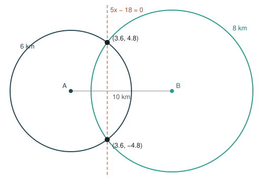

# Ideals and varieties: the equations you may add, and the points that survive them

[Syllabus](../../../SYLLABUS.md) → [Algebraic geometry](../README.md) → [Polynomial Systems](../README.md#s01) → Ideals and varieties

---

## General Overview

A ship is somewhere off a straight coast. Two radio beacons stand on the shore, 10 km apart: A, and B due east of it. Timing each beacon's signal gives a range. A reads 6 km; B reads 8 km. Where is the ship?

Each range is an equation. Put A at the origin and measure x km east and y km north, out to sea. Being 6 km from A means $`x^2 + y^2 = 36`$. Being 8 km from B means $`(x - 10)^2 + y^2 = 64`$. The ship's position satisfies both.

Now subtract the second equation from the first. The squares cancel and leave $`20x - 72 = 0`$, so x = 3.6. No instrument measured that line, yet the ship must lie on it. Put x = 3.6 back into the first circle: $`y^2 = 23.04`$, so y = 4.8 or y = −4.8. The point (3.6, −4.8) is inland, so the ship is at (3.6, 4.8): 3.6 km east of A and 4.8 km out to sea.

Which new equations can be derived like that? Those built as "a polynomial times the first, plus a polynomial times the second". Each one is zero wherever both ranges are right. That whole collection is the **ideal** generated by the system. The points where all of its members are zero form the **variety**.

**A system's ideal is every sum of its equations times any polynomials; each such sum is zero wherever the system is, so simpler members of the ideal find the same points.**

**What kind of fact this is:** two definitions, the generated ideal and the variety, and one theorem, proved in Why it works: a system and its ideal have the same variety.

### The picture: two ranges, two fixes, one derived line

<p align="center"></p>

Drawn to scale, 20 px per km, showing real points only. The dashed line is the subtracted equation divided by 4, $`5x - 18 = 0`$. It is a member of the ideal: it passes through both fixes, though no beacon measured it.

---

## The formula

First the words. A **field** is a number system where you can add, subtract, multiply, and divide by anything except zero. Write $`k`$ for the field in use. Here the coefficients are fractions (the field ℚ) and the points are real (the field ℝ). The checks also count points on the 101-clock, $`\mathbb{F}_{101}`$: the whole numbers 0 to 100 with arithmetic wrapped at 101 ([Finite fields](../../03-Algebra/09-Rings%20and%20Fields/05-finite-fields.md)).

$`k[x_1, \dots, x_n]`$ is every polynomial in the n letters $`x_1`$ to $`x_n`$, with coefficients from $`k`$. [Polynomials](../../03-Algebra/02-Polynomials/01-polynomials.md) used one letter. With several, each term is a coefficient times a product of powers, such as $`3x^2y`$. For the ship, n = 2 and the letters are x and y. $`k^n`$ is every list of n numbers from $`k`$: the points.

An ideal of a ring is a set closed under subtraction that absorbs multiplication by anything in the ring. The multiples of 9 are the model ([Ideals and quotient rings](../../03-Algebra/09-Rings%20and%20Fields/04-ideals-and-quotient-rings.md)). The ideal generated by a system is the polynomial version of "the multiples of 9", with several generators instead of one:

```math
\langle f_1, \dots, f_s \rangle = \{\, h_1 f_1 + h_2 f_2 + \dots + h_s f_s \;:\; h_1, \dots, h_s \text{ any polynomials in } k[x_1, \dots, x_n] \,\}
```

**Read it aloud:** the ideal generated by $`f_1`$ to $`f_s`$ is every sum you get by multiplying each equation by any polynomial you like and adding the results.

The variety is the set of points where every equation of the system is zero:

```math
V(f_1, \dots, f_s) = \{\, p \in k^n \;:\; f_1(p) = f_2(p) = \dots = f_s(p) = 0 \,\}
```

The theorem joins them. A point is a common zero of the system exactly when it is a common zero of the whole ideal:

```math
V(\langle f_1, \dots, f_s \rangle) = V(f_1, \dots, f_s)
```

For the ship, every equation is first written as "something = 0": $`f_1 = x^2 + y^2 - 36`$ and $`f_2 = x^2 - 20x + y^2 + 36`$, the second being $`(x - 10)^2 + y^2 - 64`$ multiplied out. The choice $`h_1 = 1`$, $`h_2 = -1`$ gives $`f_1 - f_2 = 20x - 72`$, a member of the ideal. The variety is the two fixes, $`(18/5, 24/5)`$ and $`(18/5, -24/5)`$: 3.6 and ±4.8 km.

| Symbol | Plain meaning | In our example | Push it up and the answer… |
| --- | --- | --- | --- |
| $`k`$ | the field: the numbers allowed | ℚ for coefficients, ℝ for points; the 101-clock $`\mathbb{F}_{101}`$ for counts | a bigger field can hold more points |
| $`x`$, $`y`$ | the unknowns: km east of A, km out to sea | 3.6 and 4.8 at the fix | — |
| $`n`$, $`s`$ | number of unknowns, number of equations | 2 and 2 | more equations, usually fewer points |
| $`k[x_1, \dots, x_n]`$ | every polynomial in the n unknowns | every polynomial in x and y | — |
| $`f_1`$, $`f_2`$ | the system, each written as "= 0" | $`x^2 + y^2 - 36`$; $`x^2 - 20x + y^2 + 36`$ | — |
| $`h_1`$, $`h_2`$ | multipliers: any polynomials | 1 and −1 give $`20x - 72`$ | — |
| $`\langle f_1, f_2 \rangle`$, $`I`$ | the ideal: all $`h_1 f_1 + h_2 f_2`$ | holds $`5x - 18`$ and $`25y^2 - 576`$ | a bigger ideal, fewer points |
| $`p`$, $`k^n`$ | a point; all lists of n numbers | (3.6, 4.8) in the plane | — |
| $`V(\cdot)`$ | the variety: common zeros | the two fixes | — |
| $`g_1`$, $`g_2`$ | simpler generators of the same ideal | $`5x - 18`$ and $`25y^2 - 576`$ | — |
| $`a + by`$ | the remainder: what is left after replacing x by 18/5 and $`y^2`$ by 576/25 | $`-3y + 72/5`$ for the bearing $`4x - 3y`$ | — |
| $`r_A`$, $`r_B`$, $`d`$ | the two ranges and the beacon spacing | 6, 8 and 10 km | a longer $`r_B`$ moves the fixes west |

### When it holds

- **A named field.** The field decides which points count. $`x^2 + 1 = 0`$ has no real point, since $`x^2 + 1`$ is at least 1. It has two points on the 101-clock (10 and 91, since $`10^2 = 100`$, which is −1 there) and two complex ones, i and −i.
- **Polynomial multipliers, not only numbers.** With numbers alone, $`f_1`$ and $`f_2`$ give only $`a f_1 + b f_2`$, and no such sum is $`25y^2 - 576`$. Building that equation takes the multiplier $`5x + 18`$. Without it the system never splits into one equation per unknown.
- **Every equation written as "= 0".** The ideal is built from left-hand sides with zero on the right. Leave the 36 on the right and use $`x^2 + y^2`$ as a generator, and that generator reads 36 at the fix, not 0, so Step 0 fails.
- **Zero on the points does not make a member.** Every member of the ideal is zero on the variety. A polynomial that is zero on the variety need not be a member; Why it works, Step 5, shows one.
- **Points counted in the plane.** The two fixes are every point over ℝ, and over ℂ too, since $`y^2 = 576/25`$ has only two roots. Points at infinity and multiplicities are not counted on this card.

---

## Why it works

### Step 0: zero times anything is zero

At a point where both ranges are right, $`f_1`$ and $`f_2`$ both read 0. Then $`h_1 f_1 + h_2 f_2`$ reads $`h_1 \cdot 0 + h_2 \cdot 0 = 0`$, whatever the multipliers read there. That is the whole reason the derived equations are safe.

### Step 1: the combinations form an ideal, the smallest one holding the system

Two checks make $`\langle f_1, \dots, f_s \rangle`$ an ideal.

1. **Closed under subtraction.** The difference of two combinations is a combination: subtract the multipliers term by term.
2. **Absorbs multiplication.** A combination times any polynomial is a combination: multiply each multiplier by that polynomial.

It is also the smallest ideal holding the system. Any ideal that holds every $`f_i`$ absorbs, so it holds every $`h_i f_i`$, and it is closed under addition, so it holds their sum. "The equations you may add" are therefore exactly the members of the smallest ideal holding the system.

### Step 2: a system and its ideal have the same points

There are two directions.

1. Each $`f_i`$ is a member: take $`h_i = 1`$ and every other multiplier 0. So a point where every member is zero has every $`f_i`$ zero.
2. Step 0 gives the other direction: a point where every $`f_i`$ is zero makes every combination zero.

So $`V(\langle f_1, \dots, f_s \rangle) = V(f_1, \dots, f_s)`$. The variety depends only on the ideal, not on how the system was written.

### Step 3: new generators, same ideal, same points

If every $`g`$ is a combination of the $`f`$'s, and every $`f`$ is a combination of the $`g`$'s, then each ideal sits inside the other, so they are equal. By Step 2 the varieties are equal too. For the ship:

```math
g_1 = \tfrac{1}{4}(f_1 - f_2) = 5x - 18, \qquad g_2 = 25 f_1 - (5x + 18)\, g_1 = 25y^2 - 576
```

And back again: $`f_1 = \tfrac{1}{25}\bigl(g_2 + (5x + 18)\, g_1\bigr)`$ and $`f_2 = f_1 - 4 g_1`$. So $`\langle f_1, f_2 \rangle = \langle g_1, g_2 \rangle`$.

The new system has one unknown per equation. $`g_1 = 0`$ gives x = 18/5, and $`g_2 = 0`$ gives $`y = \pm 24/5`$. Finding such generators for any system, by a fixed procedure, is the job of [Grobner bases](03-grobner-bases-and-buchberger.md).

A second road reaches the same x without any ideal. The triangle with sides 10, 6 and 8 km gives, by the law of cosines, $`x = (10^2 + 6^2 - 8^2)/(2 \times 10) = 18/5`$.

### Step 4: deciding membership, for this ideal

Dividing $`g_1`$ by 5 and $`g_2`$ by 25 puts $`x - 18/5`$ and $`y^2 - 576/25`$ in the ideal. So inside any polynomial, x may be replaced by 18/5 and $`y^2`$ by 576/25 without changing whether it is a member, since each swap adds or removes a multiple of a member. What is left is $`a + by`$ for two fractions a and b: the **remainder**.

- Remainder 0: the polynomial is a member.
- Remainder not 0: $`a + by`$ cannot be zero at both y = 4.8 and y = −4.8, so the polynomial misses a fix and is not a member.

So for this ideal, "member" and "zero at both fixes" agree. A third beacon reading shows why that matters. A bearing from A says the ship lies on $`4x - 3y = 0`$. Its remainder is $`-3y + 72/5`$, not 0, so it is not a member. Adding it is new information: it keeps only (3.6, 4.8). Adding a member, such as $`x f_1 + y f_2`$, changes nothing.

<details>
<summary>Detailed proof: the remainder is 0 exactly for members</summary>

Write $`I = \langle g_1, g_2 \rangle`$. Since 5 and 25 are nonzero in ℚ, $`I`$ also equals $`\langle x - 18/5,\, y^2 - 576/25 \rangle`$.

Any monomial $`x^i y^j`$ differs from $`(18/5)^i (576/25)^{\lfloor j/2 \rfloor} y^{\,j \bmod 2}`$ by a member of $`I`$, because $`x^i - c^i`$ is a multiple of $`x - c`$ and $`y^{2m} - e^m`$ is a multiple of $`y^2 - e`$, with c = 18/5 and e = 576/25. Summing over the terms, every polynomial h equals its remainder $`a + by`$ plus a member of $`I`$.

If $`a + by`$ is 0, h is a member. If h is a member, Step 0 makes it zero at both fixes, and so is $`a + by`$, since the member part is zero there too:

$`\displaystyle a + \tfrac{24}{5} b = 0 \quad\text{and}\quad a - \tfrac{24}{5} b = 0`$

Adding and subtracting gives a = b = 0. This shortcut needs generators with one unknown each; [Normal forms](04-reduced-grobner-bases-and-ideal-membership.md) does the same for any ideal.

</details>

### Step 5: where the points forget something the ideal remembers

Let B read 4 km instead. Then $`f_1 - f_2 = 20x - 120`$, so x = 6, and the first circle gives $`y^2 = 0`$. The ideal is $`\langle x - 6, y^2 \rangle`$, and the variety is the single point (6, 0): the circles just touch.

Now take the polynomial y. It is zero at (6, 0), the only point. Yet its remainder is y itself, not 0, so it is not a member. The ideal holds $`y^2`$ but not y: it records that the touch is a double point. A slightly longer range from B would split it into two fixes; a slightly shorter one would leave none. Which polynomials that vanish on a variety are members is the question of [The Nullstellensatz](09-nullstellensatz.md).

---

## Worked numbers, by hand

| Step | Arithmetic | Value |
| --- | --- | --- |
| range from A | $`x^2 + y^2 - 36`$ | $`f_1`$ |
| range from B | $`(x - 10)^2 + y^2 - 64`$, multiplied out | $`f_2 = x^2 - 20x + y^2 + 36`$ |
| subtract: $`h_1 = 1`$, $`h_2 = -1`$ | $`f_1 - f_2`$ | $`20x - 72`$ |
| divide by 4 | $`g_1 = 5x - 18 = 0`$ | x = 18/5 = 3.6 km |
| remove $`x^2`$ | $`25 f_1 - (5x + 18)\, g_1`$ | $`g_2 = 25y^2 - 576`$ |
| solve $`g_2 = 0`$ | $`y^2 = 576/25 = 23.04`$ | y = ±24/5 = ±4.8 km |
| a polynomial multiplier | $`x f_1 - x f_2 = 20x^2 - 72x`$ at x = 18/5 | 1296/5 − 1296/5 = 0 |
| choose the sea | (3.6, −4.8) is inland | **(3.6, 4.8)** |

The ship is 3.6 km east of beacon A and 4.8 km out to sea, the one point of the variety on the water.

### What breaks if you drop a piece

Over ℝ the wrong systems below have infinitely many points, so the checks count them on the 101-clock $`\mathbb{F}_{101}`$ instead, trying every pair (x, y). The right system has 2 points there, (44, 25) and (44, 76), the two fixes reduced mod 101.

| Mistake | Comes out at | What went wrong |
| --- | --- | --- |
| One beacon only, $`f_1`$ | a whole circle: 100 points mod 101 | one equation leaves one unknown free |
| $`f_1 f_2 = 0`$ instead of both | both circles: 198 points mod 101 | a product is zero when either factor is: "or", not "and" |
| Keep the line $`g_1`$, drop both circles | a whole line: 101 points mod 101 | $`\langle g_1 \rangle`$ is a smaller ideal than $`\langle g_1, g_2 \rangle`$ |
| "Zero on every point, so a member" | tangent ranges: y is zero at (6, 0), remainder y | $`\langle x - 6, y^2 \rangle`$ holds $`y^2`$ but not y |

The code prints all four.

---

## Code, from first principles, and it actually runs

Each script stores a polynomial as a table of exact fractions, one per term. It builds $`g_1`$ and $`g_2`$ from $`f_1`$ and $`f_2`$ and back again. It reaches the fixes by four roads that must agree exactly:

1. the new generators, read off;
2. the triangle formula;
3. putting both fixes back into $`f_1`$, $`f_2`$, $`g_1`$ and $`g_2`$;
4. trying every pair on the 101-clock.

Then 1,000 random combinations $`h_1 f_1 + h_2 f_2`$ are tested two ways, by value at the fixes and by remainder. The random numbers come from SplitMix64 with seed 2026, written out in both languages. Nothing imported solves equations.

### Python

```python
# Ideals and varieties -- the check behind the card.  Standard library only.
# Beacon A at (0, 0) reads 6 km; beacon B at (10, 0) reads 8 km.  A polynomial
# is a dict {(i, j): coefficient of x^i y^j}, every coefficient an exact fraction.
from fractions import Fraction as Q
P = 101                                       # the clock for brute-force counts

def add(*ps):
    out = {}
    for p in ps:
        for m, c in p.items():
            out[m] = out.get(m, 0) + c
    return {m: Q(c) for m, c in out.items() if c != 0}

def mul(p, q):
    out = {}
    for (a, b), c in p.items():
        for (d, e), k in q.items():
            out[(a + d, b + e)] = out.get((a + d, b + e), 0) + c * k
    return add(out)

def sc(k, p): return add({m: k * c for m, c in p.items()})
def at(p, x, y): return sum(c * x**i * y**j for (i, j), c in p.items())

def show(p):                                  # leading term first, x before y
    s = ""
    for (i, j) in sorted(p, reverse=True):
        c = p[(i, j)]
        mono = ("x" if i else "") + (f"^{i}" if i > 1 else "") + ("y" if j else "") + (f"^{j}" if j > 1 else "")
        txt = (str(abs(c)) if abs(c) != 1 or not mono else "") + mono
        s += (("-" if c < 0 else "") if not s else (" - " if c < 0 else " + ")) + txt
    return s or "0"

def rem(p, X, Y2):                            # divide by x - X and y^2 - Y2: a + b y is left
    return add(*[{(0, j % 2): c * X**i * Y2**(j // 2)} for (i, j), c in p.items()])

def circle(cx, r): return add({(2, 0): 1, (0, 2): 1, (1, 0): -2 * cx, (0, 0): cx * cx - r * r})
def modp(c): return c.numerator * pow(c.denominator, P - 2, P) % P
def count(*ps):                               # every (x, y) on the 101-clock, tried
    qs = [{m: modp(c) for m, c in p.items()} for p in ps]
    return [(x, y) for x in range(P) for y in range(P)
            if all(sum(c * x**i * y**j for (i, j), c in q.items()) % P == 0 for q in qs)]

def fix(ra, d, rb):                           # two roads to x and y^2 for two range circles
    line = add(circle(0, ra), sc(-1, circle(d, rb)))       # f1 - f2, a line
    X = -line.get((0, 0), 0) / line[(1, 0)]
    Y2 = -at(circle(0, ra), X, 0)
    assert X == Q(d * d + ra * ra - rb * rb, 2 * d) and Y2 == ra * ra - X * X   # the triangle
    return line, X, Y2

seed = 2026
state = seed
def rnd(n):                                   # SplitMix64, started from the seed
    global state
    state = (state + 0x9E3779B97F4A7C15) % 2**64
    z = (state ^ (state >> 30)) * 0xBF58476D1CE4E5B9 % 2**64
    z = (z ^ (z >> 27)) * 0x94D049BB133111EB % 2**64
    return (z ^ (z >> 31)) % n
def rpoly(deg): return add({(i, j): rnd(19) - 9 for i in range(deg + 1) for j in range(deg + 1 - i)})

x, y = {(1, 0): Q(1)}, {(0, 1): Q(1)}
f1, f2 = circle(0, 6), circle(10, 8)
line, X, Y2 = fix(6, 10, 8)
g1 = sc(Q(1, 4), line)
g2 = add(sc(25, f1), sc(-1, mul(add(sc(5, x), {(0, 0): 18}), g1)))
fixes = [(X, Q(24, 5)), (X, Q(-24, 5))]
print("field: rational coefficients, real points; terms in lex order, x before y")
print(f"f1 = {show(f1)}  (beacon A at (0, 0) reads 6 km)")
print(f"f2 = {show(f2)}  (beacon B at (10, 0) reads 8 km)")
print(f"g1 = (f1 - f2)/4 = {show(g1)}")
print(f"g2 = 25 f1 - (5x + 18) g1 = {show(g2)}")
back1 = sc(Q(1, 25), add(g2, mul(add(sc(5, x), {(0, 0): 18}), g1))) == f1
back2 = add(f1, sc(-4, g1)) == f2
print(f"back again: (g2 + (5x + 18) g1)/25 = f1: {'yes' if back1 else 'no'}; f1 - 4 g1 = f2: {'yes' if back2 else 'no'}")
print(f"fixes from g1 = 0 and g2 = 0: ({X}, 24/5) and ({X}, -24/5); y^2 = {Y2}")
print(f"in decimals: x = {float(X):.1f} km, y^2 = {float(Y2):.2f}, y = +/-{24 / 5:.1f} km")
print(f"by the triangle: x = (10^2 + 6^2 - 8^2)/(2 x 10) = {Q(72, 20)}; y^2 = 6^2 - x^2 = {36 - Q(72, 20)**2}")
vals = [[at(p, *pt) for p in (f1, f2, g1, g2)] for pt in fixes]
print(f"f1, f2, g1, g2 at the north fix: {', '.join(map(str, vals[0]))}; at the south fix: {', '.join(map(str, vals[1]))}")
xx = add(mul(x, f1), sc(-1, mul(x, f2)))
print(f"by hand: x f1 - x f2 = {show(xx)}; at x = 18/5: {20 * X * X} - {72 * X} = {at(xx, X, 0)}")
combos = [add(mul(rpoly(2), f1), mul(rpoly(2), f2)) for _ in range(1000)]
others = [rpoly(4) for _ in range(1000)]
tally = lambda ps: (sum(all(at(p, *pt) == 0 for pt in fixes) for p in ps), sum(rem(p, X, Y2) == {} for p in ps))
(cz, cr), (oz, orr) = tally(combos), tally(others)
print(f"1000 random h1 f1 + h2 f2 (SplitMix64, seed {seed}): zero at both fixes {cz}, remainder 0 in {cr}")
print(f"1000 random polynomials not built that way: zero at both fixes {oz}, remainder 0 in {orr}")
brute = count(f1, f2)
reduced = [(modp(a), modp(b)) for a, b in fixes]
print(f"over the 101-clock, every (x, y) tried: V(f1, f2) = {brute}")
print(f"the two fixes reduced mod 101: {reduced[0]} and {reduced[1]}")
bear = add(sc(4, x), sc(-3, y))
left = [pt for pt in fixes if at(bear, *pt) == 0]
print(f"add a bearing 4x - 3y: remainder {show(rem(bear, X, Y2))}, not in the ideal; "
      f"fixes left [({left[0][0]}, {left[0][1]})]; mod 101 points {len(count(f1, f2, bear))}")
inside = add(mul(x, f1), mul(y, f2))
print(f"add x f1 + y f2: remainder {show(rem(inside, X, Y2))}, in the ideal; mod 101 points {len(count(f1, f2, inside))}")
tl, tX, tY2 = fix(6, 10, 4)
print(f"tangent, B reads 4 km: f1 - f2 = {show(tl)}; x = {tX}, y^2 = {tY2}; ideal <x - 6, y^2>; point ({tX}, 0)")
print(f"  y is zero at ({tX}, 0), yet its remainder is {show(rem(y, tX, tY2))}: not in the ideal; "
      f"mod 101 points {len(count(circle(0, 6), circle(10, 4)))}")
print(f"x^2 + 1: no real point, since x^2 + 1 >= 1; mod 101 roots {[t for t in range(P) if (t * t + 1) % P == 0]}")
print(f"mistake 1, one beacon only (f1): mod 101 points {len(count(f1))}")
print(f"mistake 2, f1 f2 = 0 instead of both: mod 101 points {len(count(mul(f1, f2)))}")
print(f"mistake 3, the line g1 kept, both circles dropped: mod 101 points {len(count(g1))}")
for t in (4, 6):
    _, aX, aY2 = fix(3, t, 2)
    print(f"arm, links 3 m and 2 m, target {t} m: elbow x = {aX}, y^2 = {aY2}, real places {(aY2 > 0) + (aY2 >= 0)}")
px = lambda u: 20 * (u + 7)
py = lambda v: 20 * (9 - v)
print(f"figure, 20 px per km: A ({px(0)}, {py(0)}) r 120; B ({px(10)}, {py(0)}) r 160; "
      f"fixes ({px(X)}, {py(Q(24, 5))}) and ({px(X)}, {py(Q(-24, 5))})")
assert back1 and back2 and g1 == {(1, 0): 5, (0, 0): -18} and g2 == {(0, 2): 25, (0, 0): -576}
assert all(v == 0 for row in vals for v in row) and Y2 == Q(24, 5) ** 2
assert cz == cr == 1000 and oz == orr == 0                    # vanishing agrees with remainder
assert brute == sorted(reduced) and len(left) == 1            # brute force agrees with algebra
assert tY2 == 0 and rem(y, tX, tY2) == y and len(count(f1)) == 100 and len(count(mul(f1, f2))) == 198
print("ALL CHECKS PASS")
```

**Ran 2026-11-17 on macOS, Python 3.14.10, standard library only. All checks passed. Output, pasted from the run:**

```
field: rational coefficients, real points; terms in lex order, x before y
f1 = x^2 + y^2 - 36  (beacon A at (0, 0) reads 6 km)
f2 = x^2 - 20x + y^2 + 36  (beacon B at (10, 0) reads 8 km)
g1 = (f1 - f2)/4 = 5x - 18
g2 = 25 f1 - (5x + 18) g1 = 25y^2 - 576
back again: (g2 + (5x + 18) g1)/25 = f1: yes; f1 - 4 g1 = f2: yes
fixes from g1 = 0 and g2 = 0: (18/5, 24/5) and (18/5, -24/5); y^2 = 576/25
in decimals: x = 3.6 km, y^2 = 23.04, y = +/-4.8 km
by the triangle: x = (10^2 + 6^2 - 8^2)/(2 x 10) = 18/5; y^2 = 6^2 - x^2 = 576/25
f1, f2, g1, g2 at the north fix: 0, 0, 0, 0; at the south fix: 0, 0, 0, 0
by hand: x f1 - x f2 = 20x^2 - 72x; at x = 18/5: 1296/5 - 1296/5 = 0
1000 random h1 f1 + h2 f2 (SplitMix64, seed 2026): zero at both fixes 1000, remainder 0 in 1000
1000 random polynomials not built that way: zero at both fixes 0, remainder 0 in 0
over the 101-clock, every (x, y) tried: V(f1, f2) = [(44, 25), (44, 76)]
the two fixes reduced mod 101: (44, 25) and (44, 76)
add a bearing 4x - 3y: remainder -3y + 72/5, not in the ideal; fixes left [(18/5, 24/5)]; mod 101 points 1
add x f1 + y f2: remainder 0, in the ideal; mod 101 points 2
tangent, B reads 4 km: f1 - f2 = 20x - 120; x = 6, y^2 = 0; ideal <x - 6, y^2>; point (6, 0)
  y is zero at (6, 0), yet its remainder is y: not in the ideal; mod 101 points 1
x^2 + 1: no real point, since x^2 + 1 >= 1; mod 101 roots [10, 91]
mistake 1, one beacon only (f1): mod 101 points 100
mistake 2, f1 f2 = 0 instead of both: mod 101 points 198
mistake 3, the line g1 kept, both circles dropped: mod 101 points 101
arm, links 3 m and 2 m, target 4 m: elbow x = 21/8, y^2 = 135/64, real places 2
arm, links 3 m and 2 m, target 6 m: elbow x = 41/12, y^2 = -385/144, real places 0
figure, 20 px per km: A (140, 180) r 120; B (340, 180) r 160; fixes (212, 84) and (212, 276)
ALL CHECKS PASS
```

### Rust

The same numbers and labels, built with `rustc --edition 2021 -O`. Fractions are a pair of i128 integers, and every multiplication is checked, so an overflow stops the run.

```rust
// Ideals and varieties -- the same check as the Python, in Rust.  No crates.
// Beacon A at (0, 0) reads 6 km; beacon B at (10, 0) reads 8 km.  A polynomial
// is a map {(i, j): coefficient of x^i y^j}, every coefficient an exact fraction.
use std::collections::BTreeMap;
use std::fmt;
const P: i128 = 101;                                // the clock for brute-force counts

#[derive(Clone, Copy, PartialEq, PartialOrd)]
struct Q { n: i128, d: i128 }
fn gcd(a: i128, b: i128) -> i128 { if b == 0 { a.abs() } else { gcd(b, a % b) } }
fn q(n: i128, d: i128) -> Q {
    let g = gcd(n, d).max(1) * d.signum();
    Q { n: n / g, d: d / g }
}
fn m(a: i128, b: i128) -> i128 { a.checked_mul(b).expect("overflow") }
impl Q {
    fn add(self, o: Q) -> Q { q(m(self.n, o.d).checked_add(m(o.n, self.d)).expect("overflow"), m(self.d, o.d)) }
    fn mul(self, o: Q) -> Q { q(m(self.n, o.n), m(self.d, o.d)) }
    fn pow(self, k: u32) -> Q { (0..k).fold(q(1, 1), |a, _| a.mul(self)) }
}
impl fmt::Display for Q {
    fn fmt(&self, f: &mut fmt::Formatter) -> fmt::Result {
        if self.d == 1 { write!(f, "{}", self.n) } else { write!(f, "{}/{}", self.n, self.d) }
    }
}
type Poly = BTreeMap<(u32, u32), Q>;
fn add(ps: &[&Poly]) -> Poly {
    let mut out = Poly::new();
    for p in ps { for (k, c) in p.iter() { let e = out.entry(*k).or_insert(q(0, 1)); *e = e.add(*c); } }
    out.retain(|_, c| c.n != 0);
    out
}
fn mul(p: &Poly, r: &Poly) -> Poly {
    let mut out = Poly::new();
    for (&(a, b), c) in p { for (&(d, e), k) in r {
        let s = out.entry((a + d, b + e)).or_insert(q(0, 1)); *s = s.add(c.mul(*k));
    } }
    add(&[&out])
}
fn sc(k: Q, p: &Poly) -> Poly { add(&[&p.iter().map(|(t, c)| (*t, k.mul(*c))).collect()]) }
fn at(p: &Poly, x: Q, y: Q) -> Q { p.iter().fold(q(0, 1), |s, (&(i, j), c)| s.add(c.mul(x.pow(i)).mul(y.pow(j)))) }
fn mk(t: &[((u32, u32), i128)]) -> Poly { add(&[&t.iter().map(|&(k, c)| (k, q(c, 1))).collect()]) }
fn show(p: &Poly) -> String {                         // leading term first, x before y
    let mut s = String::new();
    for (&(i, j), c) in p.iter().rev() {
        let mono = format!("{}{}{}{}", if i > 0 { "x" } else { "" }, if i > 1 { format!("^{}", i) } else { String::new() },
                           if j > 0 { "y" } else { "" }, if j > 1 { format!("^{}", j) } else { String::new() });
        let a = q(c.n.abs(), c.d);
        let txt = format!("{}{}", if a != q(1, 1) || mono.is_empty() { a.to_string() } else { String::new() }, mono);
        let sign = if s.is_empty() { if c.n < 0 { "-" } else { "" } } else if c.n < 0 { " - " } else { " + " };
        s += &format!("{}{}", sign, txt);
    }
    if s.is_empty() { "0".to_string() } else { s }
}
fn rem(p: &Poly, x: Q, y2: Q) -> Poly {                // divide by x - X and y^2 - Y2: a + b y is left
    let parts: Vec<Poly> = p.iter().map(|(&(i, j), c)| [((0, j % 2), c.mul(x.pow(i)).mul(y2.pow(j / 2)))].into()).collect();
    add(&parts.iter().collect::<Vec<_>>())
}
fn circle(cx: i128, r: i128) -> Poly { mk(&[((2, 0), 1), ((0, 2), 1), ((1, 0), -2 * cx), ((0, 0), cx * cx - r * r)]) }
fn mpow(b: i128, e: i128) -> i128 { (0..e).fold(1, |a, _| a * b.rem_euclid(P) % P) }
fn modp(c: Q) -> i128 { c.n.rem_euclid(P) * mpow(c.d, P - 2) % P }
fn count(ps: &[&Poly]) -> Vec<(i128, i128)> {        // every (x, y) on the 101-clock, tried
    let qs: Vec<Vec<((u32, u32), i128)>> = ps.iter().map(|p| p.iter().map(|(k, c)| (*k, modp(*c))).collect()).collect();
    let mut out = vec![];
    for x in 0..P { for y in 0..P {
        if qs.iter().all(|r| r.iter().map(|&((i, j), c)| c * mpow(x, i as i128) * mpow(y, j as i128)).sum::<i128>() % P == 0) {
            out.push((x, y));
        }
    } }
    out
}
fn fix(ra: i128, d: i128, rb: i128) -> (Poly, Q, Q) { // two roads to x and y^2 for two range circles
    let line = add(&[&circle(0, ra), &sc(q(-1, 1), &circle(d, rb))]);
    let c0 = line.get(&(0, 0)).copied().unwrap_or(q(0, 1));
    let x = q(-c0.n * line[&(1, 0)].d, c0.d * line[&(1, 0)].n);
    let y2 = q(0, 1).add(at(&circle(0, ra), x, q(0, 1)).mul(q(-1, 1)));
    assert!(x == q(d * d + ra * ra - rb * rb, 2 * d) && y2 == q(ra * ra, 1).add(x.mul(x).mul(q(-1, 1))));
    (line, x, y2)
}
struct Rng(u64);
impl Rng {                                          // SplitMix64, started from the seed
    fn rnd(&mut self, n: u64) -> u64 {
        self.0 = self.0.wrapping_add(0x9E3779B97F4A7C15);
        let mut z = (self.0 ^ (self.0 >> 30)).wrapping_mul(0xBF58476D1CE4E5B9);
        z = (z ^ (z >> 27)).wrapping_mul(0x94D049BB133111EB);
        (z ^ (z >> 31)) % n
    }
    fn poly(&mut self, deg: u32) -> Poly {
        let mut t = vec![];
        for i in 0..=deg { for j in 0..=(deg - i) { t.push(((i, j), self.rnd(19) as i128 - 9)); } }
        mk(&t)
    }
}
fn yn(b: bool) -> &'static str { if b { "yes" } else { "no" } }

fn main() {
    let (x, y) = (mk(&[((1, 0), 1)]), mk(&[((0, 1), 1)]));
    let (f1, f2) = (circle(0, 6), circle(10, 8));
    let (line, xf, y2) = fix(6, 10, 8);
    let g1 = sc(q(1, 4), &line);
    let lin = add(&[&sc(q(5, 1), &x), &mk(&[((0, 0), 18)])]);
    let g2 = add(&[&sc(q(25, 1), &f1), &sc(q(-1, 1), &mul(&lin, &g1))]);
    let fixes = [(xf, q(24, 5)), (xf, q(-24, 5))];
    println!("field: rational coefficients, real points; terms in lex order, x before y");
    println!("f1 = {}  (beacon A at (0, 0) reads 6 km)", show(&f1));
    println!("f2 = {}  (beacon B at (10, 0) reads 8 km)", show(&f2));
    println!("g1 = (f1 - f2)/4 = {}", show(&g1));
    println!("g2 = 25 f1 - (5x + 18) g1 = {}", show(&g2));
    let back1 = sc(q(1, 25), &add(&[&g2, &mul(&lin, &g1)])) == f1;
    let back2 = add(&[&f1, &sc(q(-4, 1), &g1)]) == f2;
    println!("back again: (g2 + (5x + 18) g1)/25 = f1: {}; f1 - 4 g1 = f2: {}", yn(back1), yn(back2));
    println!("fixes from g1 = 0 and g2 = 0: ({}, 24/5) and ({}, -24/5); y^2 = {}", xf, xf, y2);
    println!("in decimals: x = {:.1} km, y^2 = {:.2}, y = +/-{:.1} km", xf.n as f64 / xf.d as f64, y2.n as f64 / y2.d as f64, 24.0 / 5.0);
    let tx = q(72, 20);
    println!("by the triangle: x = (10^2 + 6^2 - 8^2)/(2 x 10) = {}; y^2 = 6^2 - x^2 = {}", tx, q(36, 1).add(tx.mul(tx).mul(q(-1, 1))));
    let vals: Vec<Vec<Q>> = fixes.iter().map(|&(a, b)| [&f1, &f2, &g1, &g2].iter().map(|p| at(p, a, b)).collect()).collect();
    let j = |v: &Vec<Q>| v.iter().map(|c| c.to_string()).collect::<Vec<_>>().join(", ");
    println!("f1, f2, g1, g2 at the north fix: {}; at the south fix: {}", j(&vals[0]), j(&vals[1]));
    let xx = add(&[&mul(&x, &f1), &sc(q(-1, 1), &mul(&x, &f2))]);
    println!("by hand: x f1 - x f2 = {}; at x = 18/5: {} - {} = {}", show(&xx), q(20, 1).mul(xf).mul(xf), q(72, 1).mul(xf), at(&xx, xf, q(0, 1)));
    let seed = 2026;
    let mut g = Rng(seed);
    let combos: Vec<Poly> = (0..1000).map(|_| { let h1 = g.poly(2); let h2 = g.poly(2); add(&[&mul(&h1, &f1), &mul(&h2, &f2)]) }).collect();
    let others: Vec<Poly> = (0..1000).map(|_| g.poly(4)).collect();
    let tally = |ps: &Vec<Poly>| (ps.iter().filter(|p| fixes.iter().all(|&(a, b)| at(p, a, b).n == 0)).count(),
                                  ps.iter().filter(|p| rem(p, xf, y2).is_empty()).count());
    let ((cz, cr), (oz, orr)) = (tally(&combos), tally(&others));
    println!("1000 random h1 f1 + h2 f2 (SplitMix64, seed {}): zero at both fixes {}, remainder 0 in {}", seed, cz, cr);
    println!("1000 random polynomials not built that way: zero at both fixes {}, remainder 0 in {}", oz, orr);
    let brute = count(&[&f1, &f2]);
    let reduced: Vec<(i128, i128)> = fixes.iter().map(|&(a, b)| (modp(a), modp(b))).collect();
    println!("over the 101-clock, every (x, y) tried: V(f1, f2) = {:?}", brute);
    println!("the two fixes reduced mod 101: {:?} and {:?}", reduced[0], reduced[1]);
    let bear = add(&[&sc(q(4, 1), &x), &sc(q(-3, 1), &y)]);
    let left: Vec<(Q, Q)> = fixes.iter().copied().filter(|&(a, b)| at(&bear, a, b).n == 0).collect();
    println!("add a bearing 4x - 3y: remainder {}, not in the ideal; fixes left [({}, {})]; mod 101 points {}",
             show(&rem(&bear, xf, y2)), left[0].0, left[0].1, count(&[&f1, &f2, &bear]).len());
    let inside = add(&[&mul(&x, &f1), &mul(&y, &f2)]);
    println!("add x f1 + y f2: remainder {}, in the ideal; mod 101 points {}", show(&rem(&inside, xf, y2)), count(&[&f1, &f2, &inside]).len());
    let (tl, t_x, t_y2) = fix(6, 10, 4);
    println!("tangent, B reads 4 km: f1 - f2 = {}; x = {}, y^2 = {}; ideal <x - 6, y^2>; point ({}, 0)", show(&tl), t_x, t_y2, t_x);
    println!("  y is zero at ({}, 0), yet its remainder is {}: not in the ideal; mod 101 points {}",
             t_x, show(&rem(&y, t_x, t_y2)), count(&[&circle(0, 6), &circle(10, 4)]).len());
    println!("x^2 + 1: no real point, since x^2 + 1 >= 1; mod 101 roots {:?}", (0..P).filter(|t| (t * t + 1) % P == 0).collect::<Vec<_>>());
    println!("mistake 1, one beacon only (f1): mod 101 points {}", count(&[&f1]).len());
    println!("mistake 2, f1 f2 = 0 instead of both: mod 101 points {}", count(&[&mul(&f1, &f2)]).len());
    println!("mistake 3, the line g1 kept, both circles dropped: mod 101 points {}", count(&[&g1]).len());
    for t in [4, 6] {
        let (_, ax, ay2) = fix(3, t, 2);
        println!("arm, links 3 m and 2 m, target {} m: elbow x = {}, y^2 = {}, real places {}", t, ax, ay2, (ay2.n > 0) as i32 + (ay2.n >= 0) as i32);
    }
    let px = |u: Q| q(20, 1).mul(u.add(q(7, 1)));
    let py = |v: Q| q(20, 1).mul(q(9, 1).add(v.mul(q(-1, 1))));
    println!("figure, 20 px per km: A ({}, {}) r 120; B ({}, {}) r 160; fixes ({}, {}) and ({}, {})",
             px(q(0, 1)), py(q(0, 1)), px(q(10, 1)), py(q(0, 1)), px(xf), py(q(24, 5)), px(xf), py(q(-24, 5)));
    let mut sorted = reduced.clone();
    sorted.sort();
    assert!(back1 && back2 && g1 == mk(&[((1, 0), 5), ((0, 0), -18)]) && g2 == mk(&[((0, 2), 25), ((0, 0), -576)]));
    assert!(vals.iter().flatten().all(|v| v.n == 0) && y2 == q(24, 5).pow(2));
    assert!(cz == 1000 && cr == 1000 && oz == 0 && orr == 0);  // vanishing agrees with remainder
    assert!(brute == sorted && left.len() == 1);               // brute force agrees with algebra
    assert!(t_y2.n == 0 && rem(&y, t_x, t_y2) == y && count(&[&f1]).len() == 100 && count(&[&mul(&f1, &f2)]).len() == 198);
    println!("ALL CHECKS PASS");
}
```

**Ran 2026-11-17 on macOS, rustc 1.98.1, no crates. All checks passed. Output, pasted from the run:**

```
field: rational coefficients, real points; terms in lex order, x before y
f1 = x^2 + y^2 - 36  (beacon A at (0, 0) reads 6 km)
f2 = x^2 - 20x + y^2 + 36  (beacon B at (10, 0) reads 8 km)
g1 = (f1 - f2)/4 = 5x - 18
g2 = 25 f1 - (5x + 18) g1 = 25y^2 - 576
back again: (g2 + (5x + 18) g1)/25 = f1: yes; f1 - 4 g1 = f2: yes
fixes from g1 = 0 and g2 = 0: (18/5, 24/5) and (18/5, -24/5); y^2 = 576/25
in decimals: x = 3.6 km, y^2 = 23.04, y = +/-4.8 km
by the triangle: x = (10^2 + 6^2 - 8^2)/(2 x 10) = 18/5; y^2 = 6^2 - x^2 = 576/25
f1, f2, g1, g2 at the north fix: 0, 0, 0, 0; at the south fix: 0, 0, 0, 0
by hand: x f1 - x f2 = 20x^2 - 72x; at x = 18/5: 1296/5 - 1296/5 = 0
1000 random h1 f1 + h2 f2 (SplitMix64, seed 2026): zero at both fixes 1000, remainder 0 in 1000
1000 random polynomials not built that way: zero at both fixes 0, remainder 0 in 0
over the 101-clock, every (x, y) tried: V(f1, f2) = [(44, 25), (44, 76)]
the two fixes reduced mod 101: (44, 25) and (44, 76)
add a bearing 4x - 3y: remainder -3y + 72/5, not in the ideal; fixes left [(18/5, 24/5)]; mod 101 points 1
add x f1 + y f2: remainder 0, in the ideal; mod 101 points 2
tangent, B reads 4 km: f1 - f2 = 20x - 120; x = 6, y^2 = 0; ideal <x - 6, y^2>; point (6, 0)
  y is zero at (6, 0), yet its remainder is y: not in the ideal; mod 101 points 1
x^2 + 1: no real point, since x^2 + 1 >= 1; mod 101 roots [10, 91]
mistake 1, one beacon only (f1): mod 101 points 100
mistake 2, f1 f2 = 0 instead of both: mod 101 points 198
mistake 3, the line g1 kept, both circles dropped: mod 101 points 101
arm, links 3 m and 2 m, target 4 m: elbow x = 21/8, y^2 = 135/64, real places 2
arm, links 3 m and 2 m, target 6 m: elbow x = 41/12, y^2 = -385/144, real places 0
figure, 20 px per km: A (140, 180) r 120; B (340, 180) r 160; fixes (212, 84) and (212, 276)
ALL CHECKS PASS
```

The two outputs match line for line.

### Lean

Lean proves the theorem and the meaning of the ideal over any field, the ship's new generators over ℚ, and the hand arithmetic.

- Take polynomials $`f_1, \dots, f_s`$ over any field k, and points with coordinates in k or a bigger field. Then $`V(\langle f_1, \dots, f_s \rangle) = V(f_1, \dots, f_s)`$.
- Take polynomials $`f_1, \dots, f_s`$ and g over any field k. Then g is in the ideal exactly when $`g = h_1 f_1 + \dots + h_s f_s`$ for some multipliers.
- Take the ship's $`f_1`$ and $`f_2`$, with coefficients in ℚ. Then $`\langle f_1, f_2 \rangle = \langle g_1, g_2 \rangle`$, the simpler generators of Step 3.
- Multiplied out, $`(x - 10)^2 + y^2 - 64`$ is $`f_2`$.
- The triangle gives x = 18/5 and $`y^2 = 576/25`$.
- $`f_1`$, $`g_1`$ and $`g_2`$ read 0 at the fix (18/5, 24/5). $`f_2`$ reads 0 at (18/5, −24/5).
- At x = 18/5, both $`20x^2`$ and $`72x`$ equal 1296/5.
- The bearing $`4x - 3y`$ reads 0 at (18/5, 24/5), and not at (18/5, −24/5).
- With B reading 4 km, the triangle gives x = 6 and $`y^2 = 0`$.
- On the 101-clock, $`x^2 + 1`$ is zero at 10 and 91.
- On the 101-clock, (44, 25) and (44, 76) make all four of $`f_1`$, $`f_2`$, $`g_1`$ and $`g_2`$ zero.

Remainders, y outside the tangent ideal, the random combinations, the mistake counts and the arm are left to the Python and Rust checks.

```lean
-- Ideals and varieties: a system of polynomial equations and the ideal it generates have exactly the same common zeros.
import Mathlib.RingTheory.Nullstellensatz
import Mathlib.RingTheory.Ideal.Span
import Mathlib.Data.ZMod.Basic
import Mathlib.Tactic.NormNum

open MvPolynomial

/-- A system and its ideal have the same points: for polynomials f₁, …, fₛ in n unknowns with
coefficients in a field k, a point with coordinates in a field K containing k is a common zero of
every member of the ideal ⟨f₁, …, fₛ⟩ exactly when it is a common zero of f₁, …, fₛ themselves,
that is V(⟨f₁, …, fₛ⟩) = V(f₁, …, fₛ). -/
theorem variety_of_ideal_eq_variety_of_system {k K : Type*} [Field k] [Field K] [Algebra k K]
    {n s : ℕ} (f : Fin s → MvPolynomial (Fin n) k) :
    zeroLocus K (Ideal.span (Set.range f)) = {p : Fin n → K | ∀ i, aeval p (f i) = 0} := by
  rw [zeroLocus_span]
  ext p
  simp only [Set.forall_mem_range]

/-- The ideal generated by a system is every sum h₁f₁ + ⋯ + hₛfₛ, with h₁, …, hₛ any
polynomials in k[x₁, …, xₙ]. -/
theorem mem_ideal_span_iff_sum_mul {k : Type*} [Field k] {n s : ℕ}
    (f : Fin s → MvPolynomial (Fin n) k) (g : MvPolynomial (Fin n) k) :
    g ∈ Ideal.span (Set.range f) ↔ ∃ h : Fin s → MvPolynomial (Fin n) k, g = ∑ i, h i * f i := by
  rw [Ideal.mem_span_range_iff_exists_fun]
  exact ⟨fun ⟨c, hc⟩ => ⟨c, hc.symm⟩, fun ⟨c, hc⟩ => ⟨c, hc.symm⟩⟩

/-- The ship's two range circles, f₁ = x² + y² − 36 (6 km from beacon A) and
f₂ = x² − 20x + y² + 36 (8 km from beacon B, 10 km east), generate the same ideal over ℚ as the
simpler pair g₁ = 5x − 18 and g₂ = 25y² − 576. Here x is X 0 and y is X 1. -/
theorem beacon_ideal_eq :
    Ideal.span ({X 0 ^ 2 + X 1 ^ 2 - 36, X 0 ^ 2 - 20 * X 0 + X 1 ^ 2 + 36} :
        Set (MvPolynomial (Fin 2) ℚ)) =
      Ideal.span {5 * X 0 - 18, 25 * X 1 ^ 2 - 576} := by
  have ht : (C (1 / 25 : ℚ) : MvPolynomial (Fin 2) ℚ) * 25 = 1 := by
    rw [show (25 : MvPolynomial (Fin 2) ℚ) = C 25 from (map_ofNat C 25).symm, ← map_mul]
    norm_num
  have hu : (C (1 / 4 : ℚ) : MvPolynomial (Fin 2) ℚ) * 4 = 1 := by
    rw [show (4 : MvPolynomial (Fin 2) ℚ) = C 4 from (map_ofNat C 4).symm, ← map_mul]
    norm_num
  apply le_antisymm
  · rw [Ideal.span_le]
    intro q hq
    simp only [Set.mem_insert_iff, Set.mem_singleton_iff] at hq
    rw [SetLike.mem_coe, Ideal.mem_span_pair]
    rcases hq with rfl | rfl
    · refine ⟨C (1 / 25) * (5 * X 0 + 18), C (1 / 25), ?_⟩
      linear_combination (X 0 ^ 2 + X 1 ^ 2 - 36 : MvPolynomial (Fin 2) ℚ) * ht
    · refine ⟨C (1 / 25) * (5 * X 0 + 18) - 4, C (1 / 25), ?_⟩
      linear_combination (X 0 ^ 2 + X 1 ^ 2 - 36 : MvPolynomial (Fin 2) ℚ) * ht
  · rw [Ideal.span_le]
    intro q hq
    simp only [Set.mem_insert_iff, Set.mem_singleton_iff] at hq
    rw [SetLike.mem_coe, Ideal.mem_span_pair]
    rcases hq with rfl | rfl
    · refine ⟨C (1 / 4), -C (1 / 4), ?_⟩
      linear_combination (5 * X 0 - 18 : MvPolynomial (Fin 2) ℚ) * hu
    · refine ⟨25 - C (1 / 4) * (5 * X 0 + 18), C (1 / 4) * (5 * X 0 + 18), ?_⟩
      linear_combination (-(25 * X 0 ^ 2 - 324) : MvPolynomial (Fin 2) ℚ) * hu

-- The second range circle multiplied out: (x − 10)² + y² − 64 = x² − 20x + y² + 36.
example (x y : ℚ) : (x - 10) ^ 2 + y ^ 2 - 64 = x ^ 2 - 20 * x + y ^ 2 + 36 := by ring

-- By the triangle: x = (10² + 6² − 8²)/(2 × 10) = 18/5, and y² = 6² − x² = 576/25.
example : ((10 : ℚ) ^ 2 + 6 ^ 2 - 8 ^ 2) / (2 * 10) = 18 / 5 := by norm_num
example : (6 : ℚ) ^ 2 - (18 / 5) ^ 2 = 576 / 25 := by norm_num

-- Both fixes (18/5, ±24/5) lie on both circles and on g₁ = 0 and g₂ = 0.
example : (18 / 5 : ℚ) ^ 2 + (24 / 5) ^ 2 - 36 = 0 := by norm_num
example : (18 / 5 : ℚ) ^ 2 - 20 * (18 / 5) + (-24 / 5) ^ 2 + 36 = 0 := by norm_num
example : (5 : ℚ) * (18 / 5) - 18 = 0 := by norm_num
example : (25 : ℚ) * (24 / 5) ^ 2 - 576 = 0 := by norm_num

-- A polynomial multiplier: x f₁ − x f₂ = 20x² − 72x reads 1296/5 − 1296/5 = 0 at x = 18/5.
example : (20 : ℚ) * (18 / 5) ^ 2 = 1296 / 5 ∧ (72 : ℚ) * (18 / 5) = 1296 / 5 := by norm_num

-- The bearing 4x − 3y = 0 keeps the north fix (18/5, 24/5) and not the south one.
example : (4 : ℚ) * (18 / 5) - 3 * (24 / 5) = 0 ∧ (4 : ℚ) * (18 / 5) - 3 * (-24 / 5) ≠ 0 := by
  norm_num

-- Tangent ranges (B reads 4 km): x = 6 and y² = 36 − 36 = 0.
example : ((10 : ℚ) ^ 2 + 6 ^ 2 - 4 ^ 2) / (2 * 10) = 6 ∧ (6 : ℚ) ^ 2 - 6 ^ 2 = 0 := by norm_num

-- On the 101-clock: 10² = 100 = −1 and 91² = −1, so x² + 1 has the points 10 and 91.
example : (10 : ZMod 101) ^ 2 + 1 = 0 ∧ (91 : ZMod 101) ^ 2 + 1 = 0 := by decide

-- The fixes reduced mod 101 are (44, 25) and (44, 76): they lie on f₁, f₂, g₁ and g₂.
example : (44 : ZMod 101) ^ 2 + 25 ^ 2 - 36 = 0 ∧ (44 : ZMod 101) ^ 2 + 76 ^ 2 - 36 = 0 := by decide
example : (44 : ZMod 101) ^ 2 - 20 * 44 + 25 ^ 2 + 36 = 0 ∧
    (44 : ZMod 101) ^ 2 - 20 * 44 + 76 ^ 2 + 36 = 0 := by decide
example : (5 : ZMod 101) * 44 - 18 = 0 ∧ (25 : ZMod 101) * 25 ^ 2 - 576 = 0 ∧
    (25 : ZMod 101) * 76 ^ 2 - 576 = 0 := by decide

#print axioms variety_of_ideal_eq_variety_of_system
#print axioms mem_ideal_span_iff_sum_mul
#print axioms beacon_ideal_eq
```

**Checked 2026-11-17 on macOS, Lean 4.36.0-rc2, Mathlib v4.36.0-rc2. Every proof is complete and uses only Lean's standard axioms. Output, pasted from the run:**

```
'variety_of_ideal_eq_variety_of_system' depends on axioms: [propext, Classical.choice, Quot.sound]
'mem_ideal_span_iff_sum_mul' depends on axioms: [propext, Classical.choice, Quot.sound]
'beacon_ideal_eq' depends on axioms: [propext, Classical.choice, Quot.sound]
```

> [!TIP]
> **Try changing**
> Guess first, then run the Python.
> - **Another seed.** Change `seed = 2026` to `seed = 7`. Guess the two counts first. They stay 1000 and 0: every combination vanishes at both fixes, whatever the multipliers, and random polynomials almost never do.
> - **The other bearing.** Change `sc(-3, y)` to `sc(3, y)`, so the bearing is $`4x + 3y`$. Which fix survives? The south one, (18/5, −24/5), with remainder $`3y + 72/5`$.
> - **The arm at full stretch.** Change `for t in (4, 6)` to `for t in (4, 5, 6)`. At 5 m the elbow has x = 3 and $`y^2 = 0`$: one real place, the arm straight.
> - **A different clock.** Change `P = 101` to `P = 103`. Now $`x^2 + 1`$ has no roots, since 103 leaves 3 on division by 4, and one circle has 104 points. An assert stops the run at the count of 100.

---

## The usual mistake

> [!warning]
> **Treating the ideal as no more than its points.** Two systems can share every point and still differ. Tangent ranges give the ideal $`\langle x - 6, y^2 \rangle`$ with the one point (6, 0). The polynomial y is zero there, yet its remainder is y, so it is not a member. Only the ideal remembers that the circles touch rather than cross.
>
> - **Multiplying the equations instead of keeping both.** $`f_1 f_2 = 0`$ holds on either circle: 198 points on the 101-clock, not 2.
> - **Keeping the derived line and dropping the circles.** $`5x - 18 = 0`$ alone is a whole line, 101 points on the 101-clock. A derived equation adds to the system; it does not replace it.
> - **Forgetting the field.** $`x^2 + 1`$ has no real point, but the roots 10 and 91 on the 101-clock. "No points" always means "no points in this field".

---

## Where you meet it in real life

- **Aircraft and ship navigation.** Distance-measuring beacons give an aircraft its range to each station. Two ranges give two fixes, the pair of circles on this card, and a third reading picks one.
- **Satellite positioning.** A receiver's distance to each satellite is a sphere equation. Subtracting one sphere's equation from another cancels the squares and leaves a plane: the move from $`f_1, f_2`$ to $`g_1`$, one dimension up. Bancroft's 1985 closed-form solution uses the same cancellation.
- **Robot arms.** A shoulder at the origin carries links of 3 m and 2 m. The elbow lies 3 m from the shoulder and 2 m from the target: two circles again. A target 4 m away gives x = 21/8 and $`y^2 = 135/64`$, so the elbow has two places. A target 6 m away gives $`y^2 = -385/144`$: no real place, out of reach. [Elimination](05-elimination-and-implicitisation.md) treats the whole arm.
- **Computer-aided design.** Where two curves or surfaces in a part model meet is a variety. One exact way to find those points replaces the defining equations with simpler members of the same ideal.

> **Say it back**
> A system of polynomial equations, each written as "something = 0", generates an ideal: every sum of the equations multiplied by any polynomials. Each such sum is zero wherever the whole system is zero, so a system and its ideal have the same common zeros, the variety. Two range circles from beacons 10 km apart give $`x^2 + y^2 - 36`$ and $`x^2 - 20x + y^2 + 36`$. Their ideal also holds $`5x - 18`$ and $`25y^2 - 576`$, which give the fixes (3.6, ±4.8) directly. Points do not tell the whole story: tangent circles have the point (6, 0), yet the ideal holds $`y^2`$ and not y.

---

## What this builds on

- [Ideals and quotient rings](../../03-Algebra/09-Rings%20and%20Fields/04-ideals-and-quotient-rings.md): the ideal test, closed under subtraction and absorbing, with the multiples of 9 as the model.
- [Polynomials](../../03-Algebra/02-Polynomials/01-polynomials.md): terms, coefficients, degree and roots, in one letter.

## Where this goes next

- [Monomial orders](02-monomial-orders-and-division.md): ranking terms so that dividing by several polynomials at once has a definite meaning.
- [Affine varieties](../02-Affine%20and%20Projective%20Varieties/01-affine-varieties-and-coordinate-rings.md): a variety as a shape, and the polynomial functions on it.
- [Domains, principal ideals and unique factorisation](../06-Schemes%20and%20Modern%20Language/01-integral-domains-pids-and-unique-factorisation.md): when one generator is always enough, as with the multiples of 9.
- [Sums of squares and the Positivstellensatz](11-sums-of-squares-and-the-positivstellensatz.md): certificates that a polynomial is never negative, or that a system has no real point.

The ship's ideal split into one equation per unknown by hand. For a general system, how do you find generators that simple, and decide membership when no such shape is in sight?

---

## Sources

Verified 2026-11-17: every link below resolves to the publisher's page.

- Cox, David A., John Little, and Donal O'Shea. *Ideals, Varieties, and Algorithms*, 4th ed. Springer, 2015. [doi:10.1007/978-3-319-16721-3](https://doi.org/10.1007/978-3-319-16721-3). Chapter 1: the generated ideal, affine varieties, and the proof that a system and its ideal share their points.
- Reid, Miles. *Undergraduate Algebraic Geometry*. Cambridge University Press, 1988. [doi:10.1017/CBO9781139163699](https://doi.org/10.1017/CBO9781139163699). The dictionary between ideals and point sets, and where it fails over ℝ.
- Hilbert, David. "Ueber die Theorie der algebraischen Formen." *Mathematische Annalen* 36 (1890): 473–534. [doi:10.1007/BF01208503](https://doi.org/10.1007/BF01208503). The basis theorem: every ideal of polynomials is generated by finitely many of them, building on Kronecker's module systems of polynomial combinations.
- Bancroft, Stephen. "An Algebraic Solution of the GPS Equations." *IEEE Transactions on Aerospace and Electronic Systems* 21 (1985): 56–59. [doi:10.1109/TAES.1985.310538](https://doi.org/10.1109/TAES.1985.310538). Solves the range equations in closed form by cancelling their shared squared terms, as this card's ship does.
