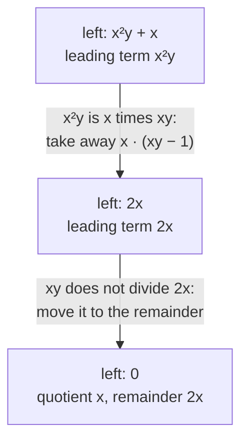
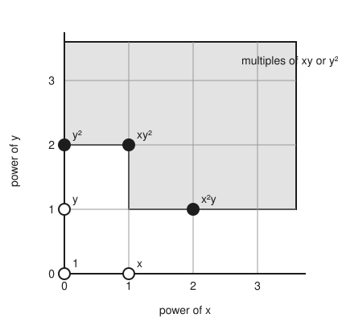

# Monomial orders: ranking terms so that division in several variables has an answer

[Syllabus](../../../SYLLABUS.md) → [Algebraic geometry](../README.md) → [Polynomial Systems](../README.md#s01) → Monomial orders

---

## General Overview

A currency desk stores two rates: x, the euros one dollar buys, and y, the dollars one euro buys. Today x is 4/5 and y is 5/4. Whatever the day, the two rates multiply to 1, so every pair of rates sits on the curve xy = 1.

A sheet on the desk prices two dollars in euros. The first dollar converts straight to x euros. The second is booked through the accounts first: to euros, back to dollars, then to euros again, which is x times y times x, or x²y euros. So the sheet's formula is x²y + x. On the curve it is really 2x, because x²y is x times xy, and xy is 1. At today's rates both give 8/5.

A computer finds that shortcut by division. It divides x²y + x by xy − 1 and keeps the remainder, 2x. Whatever is left after taking out multiples of xy − 1 has the same value at every point of the curve, since xy − 1 is zero there.

Division of one-variable polynomials already works ([Polynomial long division](../../03-Algebra/02-Polynomials/04-polynomial-division.md)): cancel the highest power, repeat, stop when the leftover has lower degree than the divisor. With several variables, "highest" has no single meaning. Is x bigger than y²? Is xz bigger than y²? Division needs an answer before it can start.

A **monomial order** gives that answer. A **monomial** is a product of variables with no number in front, such as x²y or 1. The order ranks every pair of monomials, and it obeys two extra rules that make division stop. This card compares the three standard orders, lex, graded lex and grevlex, then divides one polynomial by a list.

**A monomial order ranks all monomials so that multiplying keeps the ranking and 1 comes last; with it, division by a list of polynomials always stops, and leaves a remainder with no term the divisors' leading terms can cancel.**

**What kind of fact this is:** the orders are definitions; that division with such an order always stops and leaves a correct remainder is a theorem, proved on this card in Why it works.

### The picture: the division, step by step



Each arrow looks only at the leading term, the top-ranked term still left. The order decides which term that is.

---

## The formula

Notation first, in words. The field is $`\mathbb{Q}`$, the fractions, so any coefficient can be divided by any nonzero one. $`k[x, y, z]`$ is the set of polynomials in x, y and z with coefficients in the field $`k`$ ([Ideals and varieties](01-ideals-and-varieties.md)); here $`k = \mathbb{Q}`$.

A monomial $`x^a y^b z^c`$ is written $`x^\alpha`$, where $`\alpha = (a, b, c)`$ is its list of exponents. Its **total degree** $`|\alpha| = a + b + c`$ is the sum of the exponents. So $`x^2y`$ has $`\alpha = (2, 1, 0)`$ and total degree 3.

A **monomial order** $`>`$ is a ranking of all monomials with three rules:

```math
\text{(1) of two different monomials, one is bigger;} \quad \text{(2) } x^\alpha > x^\beta \Rightarrow x^{\alpha+\gamma} > x^{\beta+\gamma}; \quad \text{(3) } x^\alpha > 1 \text{ for every } x^\alpha \neq 1
```

**Read it aloud:** every two monomials compare; multiplying both by the same monomial keeps the winner; and 1 loses to everything else.

Rule (1) makes it a total order ([Orders](../../01-Foundations/08-Relations%20and%20Functions/07-partial-and-total-orders.md)). Rules (2) and (3) are what division needs.

The three standard orders, all with $`x > y > z`$:

| Order | How it compares two monomials | Leader of $`y^3 + xz^2 + x^2`$ |
| --- | --- | --- |
| **lex** (lexicographic) | more x wins; on a tie, more y; then more z | $`x^2`$ |
| **grlex** (graded lex) | higher total degree wins; on a tie, use lex | $`xz^2`$ |
| **grevlex** (graded reverse lex) | higher total degree wins; on a tie, *less* z wins, then less y | $`y^3`$ |

The **leading term** $`\mathrm{LT}(f)`$ of a polynomial $`f`$ is its top-ranked monomial with its coefficient. For $`f = x^2y + x`$ it is $`x^2y`$ in all three orders.

Dividing $`f`$ by a list $`f_1, \dots, f_s`$ gives quotients $`a_1, \dots, a_s`$ and a remainder $`r`$:

```math
f = a_1 f_1 + a_2 f_2 + \cdots + a_s f_s + r, \qquad \text{no term of } r \text{ is divisible by any } \mathrm{LT}(f_i)
```

**Read it aloud:** the polynomial is a sum of multiples of the divisors plus a leftover, and nothing in the leftover can be cancelled by any divisor's leading term.

On the desk's formula, with one divisor:

```math
x^2y + x = x \cdot (xy - 1) + 2x
```

The **ideal** $`\langle f_1, \dots, f_s\rangle`$ is every sum $`h_1 f_1 + \cdots + h_s f_s`$ with polynomial multipliers $`h_i`$ ([Ideals and varieties](01-ideals-and-varieties.md)). The formula says $`f - r`$ lies in that ideal, so $`f`$ and $`r`$ agree at every common zero of the $`f_i`$.

| Symbol | Plain meaning | In our example | Push it up and the answer… |
| --- | --- | --- | --- |
| $`x, y, z`$ | the variables, ranked $`x > y > z`$ | x euros per dollar, y dollars per euro; z only in the order comparisons | — |
| $`k = \mathbb{Q}`$ | the field: the numbers allowed as coefficients | fractions such as 4/5 | — |
| $`x^\alpha`$, $`\alpha`$; $`m_1, m_2, \dots`$ | a monomial, and its list of exponents; $`\beta, \gamma, \mu, \nu`$ name other lists, and $`m_1, m_2, \dots`$ a chain of monomials in Step 3 | $`x^2y`$, $`(2, 1, 0)`$ | a bigger exponent ranks higher in every order |
| $`\lvert\alpha\rvert`$ | total degree: the exponents added | 3 for $`x^2y`$ | graded orders rank it higher |
| $`>`$ | the monomial order in use | lex, grlex or grevlex | — |
| $`\mathrm{LT}(f)`$; $`c`$, $`d`$ | leading term: the top-ranked term, with its coefficient; c and d name such coefficients in Step 2 | $`x^2y`$, coefficient 1 | — |
| $`f`$ | the polynomial being divided | $`x^2y + x`$ | more terms, more steps |
| $`f_1, \dots, f_s`$ | the divisors, in a list of length $`s`$ | $`xy - 1`$, so $`s = 1`$; later $`s = 2`$ | a longer list cancels more, leaves less |
| $`p`$ | the part of $`f`$ still left during the division | $`2x`$ after one step | — |
| $`a_i`$ | the quotient for divisor $`f_i`$ | $`x`$ | — |
| $`r`$ | the remainder | $`2x`$ | — |
| $`\langle f_1, \dots, f_s\rangle`$ | the ideal: all sums of multiples of the divisors | multiples of $`xy - 1`$ | — |

### When it holds

- **Coefficients from a field.** Each step divides by a leading coefficient. Over the whole numbers, dividing $`x`$ by $`2x - 1`$ needs a fraction in the quotient, and none is allowed.
- **Rule (2), multiplying keeps the ranking.** Without it, multiplying $`f_i`$ by a monomial can bring in a term ranked above the one being cancelled, so the leading term can rise and division can run forever. Rank by total degree, except that degree 2 sits between degrees 3 and 4: 1 is still last, yet $`x^2 > x^3`$ and, after multiplying both by $`x^2`$, $`x^5 > x^4`$. Dividing $`x^4`$ by $`x^2 + x^3`$ leaves $`-x^5`$, then $`x^6`$, and so on without end.
- **Rule (3), 1 comes last.** Rank lower degree higher and 1 by $`1 - x`$ never stops: after 10 steps the quotient is $`1 + x + \cdots + x^9`$ and $`x^{10}`$ is still left.
- **A fixed list and a fixed order.** Change either and the remainder can change: $`x + y + 1`$ against $`2x + 1`$ below. The remainder is a correct rewrite, not a unique one.

---

## Why it works

### Step 0: one-variable division leans on two facts

In one variable, "highest power" is a ranking. Multiplying by $`x`$ moves every power up by one, so the ranking survives multiplication. And powers cannot fall forever: below $`x^0 = 1`$ there is nothing. Those are rules (2) and (3). A monomial order is exactly a ranking of several-variable monomials with the same two facts.

### Step 1: lex, grlex and grevlex obey the rules

Multiplying by $`x^\gamma`$ adds $`\gamma`$ to every exponent list. Lex compares exponent differences, and adding the same $`\gamma`$ to both lists leaves their difference alone. Total degree goes up by $`\lvert\gamma\rvert`$ on both sides, so graded orders keep their verdict too. And 1 has all exponents 0, so every other monomial beats it: on total degree in the graded orders, on the first nonzero exponent in lex.

The checks confirm this by brute force: all 20 monomials of total degree at most 3 in x, y and z, every triple tested for rule (2), every pair for rule (3).

### Step 2: each step removes the leading term and adds only smaller ones

Say $`\mathrm{LT}(p) = c\,x^\mu`$ for the part $`p`$ still left, and $`\mathrm{LT}(f_i) = d\,x^\nu`$ divides it. The step subtracts $`(c/d)\,x^{\mu - \nu} f_i`$.

By rule (2), multiplying $`f_i`$ by $`x^{\mu - \nu}`$ keeps its terms in the same ranking. So the product's top term is $`c\,x^\mu`$, which cancels, and every other term it brings is below $`x^\mu`$. When no divisor fits, the step moves $`c\,x^\mu`$ to the remainder instead. Either way the new leading term of $`p`$ is strictly smaller.

### Step 3: a falling chain of monomials stops

Each step gives a smaller leading monomial than the last. Rules (2) and (3) together forbid an endless falling chain, so division stops.

<details>
<summary>Detailed proof: rules (2) and (3) forbid an endless falling chain</summary>

First, if $`x^\beta`$ divides $`x^\alpha`$ then $`x^\alpha \geq x^\beta`$. Write $`x^\alpha = x^\beta x^\gamma`$. Rule (3) gives $`x^\gamma \geq 1`$, and rule (2), multiplying by $`x^\beta`$, gives $`x^\alpha \geq x^\beta`$.

Now take a falling chain $`m_1 > m_2 > m_3 > \cdots`$. Dickson's lemma says that in any infinite list of monomials, some term divides a later one. In two variables: let $`m_1 = x^a y^b`$; any later monomial not divisible by $`m_1`$ has x-exponent below $`a`$ or y-exponent below $`b`$, so one exponent is pinned to finitely many values, and the claim reduces to one variable, where it is plain. Three variables repeat the same squeeze; [Hilbert's basis theorem](08-hilbert-basis-theorem.md) proves it in any number of variables.

So some $`m_i`$ divides a later $`m_j`$. The first fact gives $`m_j \geq m_i`$. But the chain falls, so $`m_j < m_i`$. The contradiction shows no chain falls forever.

</details>

### Step 4: the sum stays correct and the remainder cannot be cancelled

At the start $`f = 0 \cdot f_1 + \cdots + 0 \cdot f_s + 0 + p`$ with $`p = f`$. A division step moves a multiple of $`f_i`$ from $`p`$ into $`a_i f_i`$; a stuck step moves one term from $`p`$ into $`r`$. Neither changes the total, so the identity holds at every step, and at the end $`p = 0`$.

A term enters $`r`$ only when no $`\mathrm{LT}(f_i)`$ divides it. That is the remainder condition.

### Step 5: the picture of the remainder

Draw each monomial $`x^a y^b`$ as the point $`(a, b)`$. The multiples of $`xy`$ fill the quarter-plane from $`(1, 1)`$, and the multiples of $`y^2`$ fill everything from $`(0, 2)`$ up. Together they make a **staircase**. Every term of a remainder sits outside it.

<p align="center"></p>

Drawn to scale, one grid square per exponent. Filled dots are the terms of $`x^2y + xy^2 + y^2`$, all inside the staircase. Open dots are its remainder $`x + y + 1`$, all outside.

### What division does not promise

The remainder depends on the order and on the list. It is a correct rewrite on the curve, but not the only one. Fixing that needs a better list of divisors: [Grobner bases](03-grobner-bases-and-buchberger.md).

---

## Worked numbers, by hand

The desk's formula, in lex, divided by $`xy - 1`$:

| Step | Arithmetic | Value |
| --- | --- | --- |
| leading term of $`f`$ | $`x^2y`$ ranks above $`x`$ in every order | $`x^2y`$ |
| does $`xy`$ divide it? | $`x^2y = x \cdot xy`$ | yes, quotient gets $`x`$ |
| subtract $`x \cdot (xy - 1)`$ | $`x^2y + x - x^2y + x`$ | $`2x`$ |
| does $`xy`$ divide $`2x`$? | no y in $`2x`$ | moves to the remainder |
| result | quotient and remainder | **$`x`$ and $`2x`$** |
| rebuild | $`x(xy - 1) + 2x`$ | $`x^2y + x`$ |
| today's rates | $`x = 4/5`$, $`y = 5/4`$, $`xy = 1`$; f and $`2x`$ | **8/5 and 8/5** |

On the curve xy = 1 the formula is 2x, and grlex and grevlex give the same quotient and remainder here.

Now a list. The desk has only one equation, so this part uses the standard textbook pair, which has no currency meaning. Divide $`f = x^2y + xy^2 + y^2`$ by $`(xy - 1,\, y^2 - 1)`$ in lex. At each step try the divisors in list order:

| Step | Arithmetic | Left after the step |
| --- | --- | --- |
| 1 | $`x^2y = x \cdot xy`$: quotient 1 gets $`x`$ | $`xy^2 + x + y^2`$ |
| 2 | $`xy^2 = y \cdot xy`$: quotient 1 gets $`y`$ | $`x + y^2 + y`$ |
| 3 | $`x`$: neither $`xy`$ nor $`y^2`$ divides it, to the remainder | $`y^2 + y`$ |
| 4 | $`y^2 = 1 \cdot y^2`$: quotient 2 gets 1 | $`y + 1`$ |
| 5 and 6 | $`y`$ and $`1`$: to the remainder | 0 |
| result | quotients $`x + y`$ and 1 | **remainder $`x + y + 1`$** |

Step 3 is where several variables differ from one. The leading term $`x`$ is stuck, but $`y^2`$ behind it is not, so the division sets $`x`$ aside and carries on.

The two curves $`xy = 1`$ and $`y^2 = 1`$ meet at $`(1, 1)`$ and $`(-1, -1)`$. There $`f`$ is 3 and −1, and so is $`x + y + 1`$.

The three orders on the same terms:

| Terms | lex | grlex | grevlex |
| --- | --- | --- | --- |
| x and y, degree up to 2 | $`x^2 > xy > x > y^2 > y > 1`$ | $`x^2 > xy > y^2 > x > y > 1`$ | same as grlex |
| x, y, z, degree exactly 2 | $`x^2 > xy > xz > y^2 > yz > z^2`$ | same as lex | $`x^2 > xy > y^2 > xz > yz > z^2`$ |
| leader of $`y^3 + xz^2 + x^2`$ | $`x^2`$ | $`xz^2`$ | $`y^3`$ |

Lex puts any x above any amount of y. Graded orders look at size first. Grevlex parts from grlex only with three or more variables: it ranks $`y^2`$ above $`xz`$ because $`y^2`$ has less z.

### What breaks if you drop a piece

| Mistake | Comes out at | What went wrong |
| --- | --- | --- |
| Divide by the list in the other order, $`(y^2 - 1,\, xy - 1)`$ | remainder $`2x + 1`$, not $`x + y + 1`$ | the remainder depends on the list; both are 3 at (1, 1) and −1 at (−1, −1) |
| Stop at the first stuck term, as in one variable | $`x + y^2 + y`$ | $`y^2`$ was still divisible by $`y^2 - 1`$ |
| Divide $`x^2`$ by $`x - y^2`$ in grlex instead of lex | remainder $`x^2`$, not $`y^4`$ | the leading term of $`x - y^2`$ flips from $`x`$ to $`-y^2`$; both are 81 at x = 9, y = 3 |
| Rank lower degree higher, so 1 comes first | after 10 steps of 1 by $`1 - x`$, $`x^{10}`$ still left | rule (3) fails, so in this ranking the leading terms $`1 > x > x^2 > \cdots`$ fall forever |

The code prints all four.

---

## Code, from first principles, and it actually runs

The code writes polynomials as maps from exponent lists to exact fractions, and writes the division loop itself. Three independent roads check it. First, every quotient and remainder is multiplied back and must rebuild the polynomial exactly. Second, the polynomial and its remainder are evaluated at points on the curves: today's rates, $`(1, 1)`$ and $`(-1, -1)`$, and $`(9, 3)`$ on $`x = y^2`$. Third, each order is coded twice, once by its rules in words and once as a sort key. The two agree on every pair of the 20 monomials, and rules (2) and (3) are tested by brute force.

### Python

```python
# Monomial orders and division -- the check behind the card.  Standard library
# only; Fraction is exact arithmetic, nothing more.  Field: Q, the rationals.
# A monomial x^a y^b z^c is the exponent triple (a, b, c); a polynomial is a
# dict from triples to coefficients.  The division is written out below.
from fractions import Fraction as Q

KEYS = {"lex": lambda m: (m[0], m[1], m[2]),                 # road one: sort keys
        "grlex": lambda m: (sum(m), m[0], m[1], m[2]),
        "grevlex": lambda m: (sum(m), -m[2], -m[1], -m[0]),
        "bad": lambda m: (-sum(m), m[0], m[1], m[2]),       # 1 ranks highest
        "skew": lambda m: (2 * sum(m) + 3 * (sum(m) == 2), m[0], m[1], m[2])}  # degree 2 between 3 and 4

def bigger(order, p, q):                    # road two: the rules, read in words
    d = [p[i] - q[i] for i in range(3)]
    if order != "lex" and sum(d) != 0:
        return sum(d) > 0                   # graded: total degree decides first
    nz = [v for v in d if v != 0]
    if not nz:
        return False
    return nz[0] > 0 if order != "grevlex" else nz[-1] < 0

def mono(m): return "".join(v + ("^" + str(e) if e > 1 else "") for v, e in zip("xyz", m) if e) or "1"

def show(f, order="lex"):
    out = ""
    for m in sorted(f, key=KEYS[order], reverse=True):
        c, t = f[m], mono(m)
        a = abs(c)
        body = (str(a) if a != 1 or t == "1" else "") + ("" if t == "1" else t)
        out += ("-" if c < 0 else "") + body if not out else (" - " if c < 0 else " + ") + body
    return out or "0"

def P(*terms):                              # P((coef, (a, b, c)), ...)
    f = {}
    for c, m in terms:
        f[m] = f.get(m, 0) + Q(c)
    return {m: c for m, c in f.items() if c != 0}

def add(f, g, s=1):
    return P(*[(c, m) for m, c in f.items()], *[(s * c, m) for m, c in g.items()])

def mul(f, g):
    return P(*[(c * d, tuple(i + j for i, j in zip(m, n))) for m, c in f.items() for n, d in g.items()])

def lt(f, order): return max(f, key=KEYS[order])

def divide(f, fs, order, max_steps=10**6, trace=None):
    qs, r, p, steps = [{} for _ in fs], {}, dict(f), 0
    while p and steps < max_steps:
        steps += 1
        m = lt(p, order)
        for i, g in enumerate(fs):
            n = lt(g, order)
            if all(a >= b for a, b in zip(m, n)):          # LT(g) divides LT(p)
                t = {tuple(a - b for a, b in zip(m, n)): p[m] / g[n]}
                s = f"{show({m: p[m]})} = {show(t)} * {show({n: g[n]})}"
                qs[i], p = add(qs[i], t), add(p, mul(t, g), -1)
                if trace is not None:
                    trace.append(f"{s}, left {show(p, order)}")
                break
        else:                                              # stuck: move it to r
            if trace is not None:
                trace.append(f"{show({m: p[m]})} fits no divisor: to the remainder")
            r, p = add(r, {m: p[m]}), add(p, {m: p[m]}, -1)
    return qs, r, p

def at(f, x, y):
    return sum(c * Q(x) ** m[0] * Q(y) ** m[1] for m, c in f.items())

def yn(b): return "yes" if b else "no"
def ranked(ms, order):
    return " > ".join(mono(m) for m in sorted(ms, key=KEYS[order], reverse=True))

X, Y, ONE = (1, 0, 0), (0, 1, 0), (0, 0, 0)
box = [(a, b, c) for a in range(4) for b in range(4) for c in range(4) if a + b + c <= 3]
tri = [(0, 3, 0), (1, 0, 2), (2, 0, 0)]
deg2 = [m for m in box if sum(m) == 2]
two = [m for m in box if m[2] == 0 and sum(m) <= 2]
def rules(o):                               # brute force on the 20 monomials
    mult = all(KEYS[o](tuple(i + k for i, k in zip(p, g))) > KEYS[o](tuple(j + k for j, k in zip(q, g)))
               for p in box for q in box for g in box if KEYS[o](p) > KEYS[o](q))
    return mult, all(KEYS[o](m) > KEYS[o](ONE) for m in box if m != ONE)
print(f"field Q; {len(box)} monomials of degree <= 3 in x > y > z")
for o in ("lex", "grlex", "grevlex"):
    agree = all(bigger(o, p, q) == (KEYS[o](p) > KEYS[o](q)) for p in box for q in box)
    mult, least = rules(o)
    print(f"{o}: rules = sort key {yn(agree)}; respects multiplying {yn(mult)}; 1 smallest {yn(least)}")
    assert agree and mult and least
    print(f"  {' + '.join(map(mono, tri))} leads with {mono(lt(P(*[(1, m) for m in tri]), o))}; degree 2: {ranked(deg2, o)}")
    print(f"  in x, y up to degree 2: {ranked(two, o)}")
for o, why in (("bad", "lower degree ranks higher"), ("skew", "degree 2 ranked between 3 and 4")):
    print(f"{o} order ({why}): respects multiplying {yn(rules(o)[0])}; 1 smallest {yn(rules(o)[1])}")
f, g = P((1, (2, 1, 0)), (1, X)), P((1, (1, 1, 0)), (-1, ONE))
(q,), r, _ = divide(f, [g], "lex", trace=(tr := []))
print(f"divide {show(f)} by {show(g)}, lex:")
for i, s in enumerate(tr):
    print(f"  step {i + 1}: {s}")
same = all(divide(f, [g], o)[:2] == ([q], r) for o in ("grlex", "grevlex"))
print(f"  quotient {show(q)}, remainder {show(r)}; same in grlex and grevlex: {yn(same)}")
print(f"  rebuilt {show(q)}*({show(g)}) + {show(r)} = {show(add(mul(q, g), r))}")
print(f"  at x = 4/5, y = 5/4: xy = {at(g, '4/5', '5/4') + 1}, f = {at(f, '4/5', '5/4')}, remainder = {at(r, '4/5', '5/4')}")
assert add(mul(q, g), r) == f and at(f, "4/5", "5/4") == at(r, "4/5", "5/4") == Q(8, 5)
h, f1, f2 = P((1, (2, 1, 0)), (1, (1, 2, 0)), (1, (0, 2, 0))), g, P((1, (0, 2, 0)), (-1, ONE))
rems = []
for name, fs in (("(xy - 1, y^2 - 1)", [f1, f2]), ("(y^2 - 1, xy - 1)", [f2, f1])):
    qs, r, _ = divide(h, fs, "lex", trace=(tr := []))
    print(f"divide {show(h)} by {name}, lex:")
    for i, s in enumerate(tr):
        print(f"  step {i + 1}: {s}")
    back = add(add(mul(qs[0], fs[0]), mul(qs[1], fs[1])), r)
    vals = [(at(h, *pt), at(r, *pt)) for pt in ((1, 1), (-1, -1))]
    print(f"  quotients {show(qs[0])} and {show(qs[1])}, remainder {show(r)}; rebuilt: {yn(back == h)}")
    print(f"  f and remainder at (1, 1): {vals[0][0]}, {vals[0][1]}; at (-1, -1): {vals[1][0]}, {vals[1][1]}")
    assert back == h and all(a == b for a, b in vals)
    assert all(not all(a >= b for a, b in zip(m, lt(d, "lex"))) for m in r for d in fs)
    rems.append(r)
diff = add(rems[0], rems[1], -1)
combo = add(mul(P((1, X)), f2), mul(P((1, Y)), f1), -1)
print(f"remainders differ by {show(diff)} = x(y^2 - 1) - y(xy - 1): {yn(diff == combo)}")
assert rems[0] == P((1, X), (1, Y), (1, ONE)) and rems[1] == P((2, X), (1, ONE)) and diff == combo
qs, r, _ = divide(combo, [f1, f2], "lex")
print(f"mistake, -x + y is in the ideal yet its remainder is {show(r)}")
assert r == combo != {}
print(f"mistake, stopping at the first stuck term leaves {show(add(h, mul(P((1, X), (1, Y)), f1), -1))}")
par, x2 = P((1, X), (-1, (0, 2, 0))), P((1, (2, 0, 0)))
for o in ("lex", "grlex"):
    qs, r, _ = divide(x2, [par], o)
    print(f"mistake, x^2 by x - y^2 in {o}: leading term {show({lt(par, o): par[lt(par, o)]})}, "
          f"remainder {show(r, o)}, at x = 9, y = 3: {at(r, 9, 3)}")
    assert add(mul(qs[0], par), r) == x2 and at(r, 9, 3) == 81
qs, r, p = divide(P((1, ONE)), [P((1, ONE), (-1, X))], "bad", max_steps=10)
print(f"mistake, 1 by 1 - x with 1 ranked highest, 10 steps: quotient {show(qs[0], 'bad')}, left {show(p)}")
assert p == P((1, (10, 0, 0))) and len(qs[0]) == 10 and rules("bad") == (True, False)
left = [divide(P((1, (4, 0, 0))), [P((1, (2, 0, 0)), (1, (3, 0, 0)))], "skew", max_steps=k)[2] for k in range(1, 6)]
print(f"mistake, x^4 by x^2 + x^3 in the skew order, steps 1 to 5 leave {', '.join(show(p) for p in left)}")
assert left[4] == P((-1, (9, 0, 0))) and rules("skew") == (False, True)
pts = lambda ms: " ".join(f"({m[0]},{m[1]})" for m in sorted(ms, key=KEYS["lex"], reverse=True))
print(f"figure, staircase corners {pts([lt(f1, 'lex'), lt(f2, 'lex')])}; f terms {pts(h)}; remainder terms {pts(rems[0])}")
print("ALL CHECKS PASS")
```

**Ran 2026-11-17 on macOS, Python 3.14.10, standard library only. All checks passed. Output, pasted from the run:**

```
field Q; 20 monomials of degree <= 3 in x > y > z
lex: rules = sort key yes; respects multiplying yes; 1 smallest yes
  y^3 + xz^2 + x^2 leads with x^2; degree 2: x^2 > xy > xz > y^2 > yz > z^2
  in x, y up to degree 2: x^2 > xy > x > y^2 > y > 1
grlex: rules = sort key yes; respects multiplying yes; 1 smallest yes
  y^3 + xz^2 + x^2 leads with xz^2; degree 2: x^2 > xy > xz > y^2 > yz > z^2
  in x, y up to degree 2: x^2 > xy > y^2 > x > y > 1
grevlex: rules = sort key yes; respects multiplying yes; 1 smallest yes
  y^3 + xz^2 + x^2 leads with y^3; degree 2: x^2 > xy > y^2 > xz > yz > z^2
  in x, y up to degree 2: x^2 > xy > y^2 > x > y > 1
bad order (lower degree ranks higher): respects multiplying yes; 1 smallest no
skew order (degree 2 ranked between 3 and 4): respects multiplying no; 1 smallest yes
divide x^2y + x by xy - 1, lex:
  step 1: x^2y = x * xy, left 2x
  step 2: 2x fits no divisor: to the remainder
  quotient x, remainder 2x; same in grlex and grevlex: yes
  rebuilt x*(xy - 1) + 2x = x^2y + x
  at x = 4/5, y = 5/4: xy = 1, f = 8/5, remainder = 8/5
divide x^2y + xy^2 + y^2 by (xy - 1, y^2 - 1), lex:
  step 1: x^2y = x * xy, left xy^2 + x + y^2
  step 2: xy^2 = y * xy, left x + y^2 + y
  step 3: x fits no divisor: to the remainder
  step 4: y^2 = 1 * y^2, left y + 1
  step 5: y fits no divisor: to the remainder
  step 6: 1 fits no divisor: to the remainder
  quotients x + y and 1, remainder x + y + 1; rebuilt: yes
  f and remainder at (1, 1): 3, 3; at (-1, -1): -1, -1
divide x^2y + xy^2 + y^2 by (y^2 - 1, xy - 1), lex:
  step 1: x^2y = x * xy, left xy^2 + x + y^2
  step 2: xy^2 = x * y^2, left 2x + y^2
  step 3: 2x fits no divisor: to the remainder
  step 4: y^2 = 1 * y^2, left 1
  step 5: 1 fits no divisor: to the remainder
  quotients x + 1 and x, remainder 2x + 1; rebuilt: yes
  f and remainder at (1, 1): 3, 3; at (-1, -1): -1, -1
remainders differ by -x + y = x(y^2 - 1) - y(xy - 1): yes
mistake, -x + y is in the ideal yet its remainder is -x + y
mistake, stopping at the first stuck term leaves x + y^2 + y
mistake, x^2 by x - y^2 in lex: leading term x, remainder y^4, at x = 9, y = 3: 81
mistake, x^2 by x - y^2 in grlex: leading term -y^2, remainder x^2, at x = 9, y = 3: 81
mistake, 1 by 1 - x with 1 ranked highest, 10 steps: quotient 1 + x + x^2 + x^3 + x^4 + x^5 + x^6 + x^7 + x^8 + x^9, left x^10
mistake, x^4 by x^2 + x^3 in the skew order, steps 1 to 5 leave -x^5, x^6, -x^7, x^8, -x^9
figure, staircase corners (1,1) (0,2); f terms (2,1) (1,2) (0,2); remainder terms (1,0) (0,1) (0,0)
ALL CHECKS PASS
```

### Rust

Same numbers, same labels, built with `rustc --edition 2021 -O`.

```rust
// Monomial orders and division -- the same check as the Python, in Rust.  No
// crates.  Field: Q, the rationals, as an i128 fraction whose checked_mul stops
// the run on overflow.  A monomial x^a y^b z^c is the triple [a, b, c]; a
// polynomial is a map from triples to coefficients.  Division is written out.
use std::collections::BTreeMap;

#[derive(Clone, Copy, PartialEq, Debug)]
struct Q { n: i128, d: i128 }
fn gcd(a: i128, b: i128) -> i128 { if b == 0 { a.abs() } else { gcd(b, a % b) } }
fn q(n: i128, d: i128) -> Q { let g = gcd(n, d).max(1) * d.signum(); Q { n: n / g, d: d / g } }
fn qadd(a: Q, b: Q) -> Q {
    q(a.n.checked_mul(b.d).unwrap().checked_add(b.n.checked_mul(a.d).unwrap()).unwrap(), a.d.checked_mul(b.d).unwrap())
}
fn qmul(a: Q, b: Q) -> Q { q(a.n.checked_mul(b.n).unwrap(), a.d.checked_mul(b.d).unwrap()) }
impl std::fmt::Display for Q { fn fmt(&self, f: &mut std::fmt::Formatter) -> std::fmt::Result {
    if self.d == 1 { write!(f, "{}", self.n) } else { write!(f, "{}/{}", self.n, self.d) } } }

type M = [i64; 3];
type P = BTreeMap<M, Q>;

fn key(o: &str, m: M) -> [i64; 4] {                   // road one: sort keys
    let s = m[0] + m[1] + m[2];
    match o { "lex" => [m[0], m[1], m[2], 0], "grlex" => [s, m[0], m[1], m[2]],
              "grevlex" => [s, -m[2], -m[1], -m[0]], "bad" => [-s, m[0], m[1], m[2]],   // "bad": 1 ranks highest
              _ => [2 * s + 3 * (s == 2) as i64, m[0], m[1], m[2]] }                      // "skew": degree 2 between 3 and 4
}
fn bigger(o: &str, p: M, r: M) -> bool {              // road two: the rules, read in words
    let d: Vec<i64> = (0..3).map(|i| p[i] - r[i]).collect();
    let s: i64 = d.iter().sum();
    if o != "lex" && s != 0 { return s > 0 }          // graded: total degree decides first
    let nz: Vec<i64> = d.into_iter().filter(|&v| v != 0).collect();
    if nz.is_empty() { return false }
    if o != "grevlex" { nz[0] > 0 } else { nz[nz.len() - 1] < 0 }
}
fn mono(m: M) -> String {
    let s: String = (0..3).filter(|&i| m[i] > 0).map(|i| format!("{}{}", ["x", "y", "z"][i], if m[i] > 1 { format!("^{}", m[i]) } else { String::new() })).collect();
    if s.is_empty() { "1".to_string() } else { s }
}
fn sorted(ms: &[M], o: &str) -> Vec<M> { let mut v = ms.to_vec(); v.sort_by_key(|&m| std::cmp::Reverse(key(o, m))); v }
fn show(f: &P, o: &str) -> String {
    let mut out = String::new();
    for m in sorted(&f.keys().copied().collect::<Vec<M>>(), o) {
        let (c, t) = (f[&m], mono(m));
        let a = Q { n: c.n.abs(), d: c.d };
        let body = format!("{}{}", if a != q(1, 1) || t == "1" { a.to_string() } else { String::new() },
                           if t == "1" { String::new() } else { t });
        out += &if out.is_empty() { format!("{}{}", if c.n < 0 { "-" } else { "" }, body) }
                else { format!("{}{}", if c.n < 0 { " - " } else { " + " }, body) };
    }
    if out.is_empty() { "0".to_string() } else { out }
}
fn poly(terms: &[(i128, M)]) -> P { add(&P::new(), &terms.iter().map(|&(c, m)| (m, q(c, 1))).collect(), 1) }
fn term(m: M, c: Q) -> P { let mut p = P::new(); p.insert(m, c); p }
fn add(f: &P, g: &P, s: i128) -> P {
    let mut out = f.clone();
    for (&m, &c) in g {
        let v = qadd(*out.get(&m).unwrap_or(&q(0, 1)), qmul(c, q(s, 1)));
        if v.n == 0 { out.remove(&m); } else { out.insert(m, v); }
    }
    out
}
fn mul(f: &P, g: &P) -> P {
    f.iter().flat_map(|(m, &c)| g.iter().map(move |(n, &d)| term([m[0] + n[0], m[1] + n[1], m[2] + n[2]], qmul(c, d))))
        .fold(P::new(), |a, t| add(&a, &t, 1))
}
fn lt(f: &P, o: &str) -> M { *f.keys().max_by_key(|&&m| key(o, m)).unwrap() }
fn divides(n: M, m: M) -> bool { (0..3).all(|i| m[i] >= n[i]) }
fn divide(f: &P, fs: &[P], o: &str, max_steps: usize, trace: &mut Vec<String>) -> (Vec<P>, P, P) {
    let (mut qs, mut r, mut p, mut steps) = (vec![P::new(); fs.len()], P::new(), f.clone(), 0);
    while !p.is_empty() && steps < max_steps {
        steps += 1;
        let m = lt(&p, o);
        if let Some(i) = fs.iter().position(|g| divides(lt(g, o), m)) {   // LT(g) divides LT(p)
            let (g, n) = (&fs[i], lt(&fs[i], o));
            let t = term([m[0] - n[0], m[1] - n[1], m[2] - n[2]], qmul(p[&m], q(g[&n].d, g[&n].n)));
            let s = format!("{} = {} * {}", show(&term(m, p[&m]), "lex"), show(&t, "lex"), show(&term(n, g[&n]), "lex"));
            (qs[i], p) = (add(&qs[i], &t, 1), add(&p, &mul(&t, g), -1));
            trace.push(format!("{}, left {}", s, show(&p, o)));
        } else {                                       // stuck: move it to r
            let t = term(m, p[&m]);
            trace.push(format!("{} fits no divisor: to the remainder", show(&t, "lex")));
            (r, p) = (add(&r, &t, 1), add(&p, &t, -1));
        }
    }
    (qs, r, p)
}
fn pw(b: Q, e: i64) -> Q { (0..e).fold(q(1, 1), |a, _| qmul(a, b)) }
fn at(f: &P, x: Q, y: Q) -> Q { f.iter().fold(q(0, 1), |s, (m, &c)| qadd(s, qmul(c, qmul(pw(x, m[0]), pw(y, m[1]))))) }
fn yn(b: bool) -> &'static str { if b { "yes" } else { "no" } }
fn ranked(ms: &[M], o: &str) -> String { sorted(ms, o).iter().map(|&m| mono(m)).collect::<Vec<_>>().join(" > ") }
fn pts(ms: &[M]) -> String { sorted(ms, "lex").iter().map(|m| format!("({},{})", m[0], m[1])).collect::<Vec<_>>().join(" ") }
fn rules(o: &str, bx: &[M]) -> (bool, bool) {          // brute force on the 20 monomials
    let k = |m: M| key(o, m);
    let sum = |a: M, b: M| [a[0] + b[0], a[1] + b[1], a[2] + b[2]];
    let mult = bx.iter().all(|&p| bx.iter().all(|&r| bx.iter().all(|&g| k(p) <= k(r) || k(sum(p, g)) > k(sum(r, g)))));
    (mult, bx.iter().all(|&m| m == [0, 0, 0] || k(m) > k([0, 0, 0])))
}

fn main() {
    let (x, y, one): (M, M, M) = ([1, 0, 0], [0, 1, 0], [0, 0, 0]);
    let bx: Vec<M> = (0..64).map(|i| [i / 16, i / 4 % 4, i % 4]).filter(|m| m[0] + m[1] + m[2] <= 3).collect();
    let tri: Vec<M> = vec![[0, 3, 0], [1, 0, 2], [2, 0, 0]];
    let deg2: Vec<M> = bx.iter().copied().filter(|m| m.iter().sum::<i64>() == 2).collect();
    let two: Vec<M> = bx.iter().copied().filter(|m| m[2] == 0 && m.iter().sum::<i64>() <= 2).collect();
    println!("field Q; {} monomials of degree <= 3 in x > y > z", bx.len());
    for o in ["lex", "grlex", "grevlex"] {
        let agree = bx.iter().all(|&p| bx.iter().all(|&r| bigger(o, p, r) == (key(o, p) > key(o, r))));
        let (mult, least) = rules(o, &bx);
        println!("{}: rules = sort key {}; respects multiplying {}; 1 smallest {}", o, yn(agree), yn(mult), yn(least));
        assert!(agree && mult && least);
        let t = poly(&tri.iter().map(|&m| (1, m)).collect::<Vec<_>>());
        println!("  {} leads with {}; degree 2: {}", tri.iter().map(|&m| mono(m)).collect::<Vec<_>>().join(" + "), mono(lt(&t, o)), ranked(&deg2, o));
        println!("  in x, y up to degree 2: {}", ranked(&two, o));
    }
    for (o, why) in [("bad", "lower degree ranks higher"), ("skew", "degree 2 ranked between 3 and 4")] {
        println!("{} order ({}): respects multiplying {}; 1 smallest {}", o, why, yn(rules(o, &bx).0), yn(rules(o, &bx).1)) }
    let (f, g) = (poly(&[(1, [2, 1, 0]), (1, x)]), poly(&[(1, [1, 1, 0]), (-1, one)]));
    let mut tr = Vec::new();
    let (qs, r, _) = divide(&f, &[g.clone()], "lex", usize::MAX, &mut tr);
    let qq = &qs[0];
    println!("divide {} by {}, lex:", show(&f, "lex"), show(&g, "lex"));
    for (i, s) in tr.iter().enumerate() { println!("  step {}: {}", i + 1, s) }
    let same = ["grlex", "grevlex"].iter().all(|o| { let d = divide(&f, &[g.clone()], o, usize::MAX, &mut Vec::new()); d.0 == qs && d.1 == r });
    println!("  quotient {}, remainder {}; same in grlex and grevlex: {}", show(qq, "lex"), show(&r, "lex"), yn(same));
    println!("  rebuilt {}*({}) + {} = {}", show(qq, "lex"), show(&g, "lex"), show(&r, "lex"), show(&add(&mul(qq, &g), &r, 1), "lex"));
    let (px, py) = (q(4, 5), q(5, 4));
    println!("  at x = 4/5, y = 5/4: xy = {}, f = {}, remainder = {}", qadd(at(&g, px, py), q(1, 1)), at(&f, px, py), at(&r, px, py));
    assert!(add(&mul(qq, &g), &r, 1) == f && at(&f, px, py) == at(&r, px, py) && at(&r, px, py) == q(8, 5));
    let (h, f1, f2) = (poly(&[(1, [2, 1, 0]), (1, [1, 2, 0]), (1, [0, 2, 0])]), g.clone(), poly(&[(1, [0, 2, 0]), (-1, one)]));
    let mut rems: Vec<P> = Vec::new();
    for (name, fs) in [("(xy - 1, y^2 - 1)", vec![f1.clone(), f2.clone()]), ("(y^2 - 1, xy - 1)", vec![f2.clone(), f1.clone()])] {
        let mut tr = Vec::new();
        let (qs, r, _) = divide(&h, &fs, "lex", usize::MAX, &mut tr);
        println!("divide {} by {}, lex:", show(&h, "lex"), name);
        for (i, s) in tr.iter().enumerate() { println!("  step {}: {}", i + 1, s) }
        let back = add(&add(&mul(&qs[0], &fs[0]), &mul(&qs[1], &fs[1]), 1), &r, 1);
        let vals: Vec<(Q, Q)> = [(q(1, 1), q(1, 1)), (q(-1, 1), q(-1, 1))].iter().map(|&(a, b)| (at(&h, a, b), at(&r, a, b))).collect();
        println!("  quotients {} and {}, remainder {}; rebuilt: {}", show(&qs[0], "lex"), show(&qs[1], "lex"), show(&r, "lex"), yn(back == h));
        println!("  f and remainder at (1, 1): {}, {}; at (-1, -1): {}, {}", vals[0].0, vals[0].1, vals[1].0, vals[1].1);
        assert!(back == h && vals.iter().all(|(a, b)| a == b));
        assert!(r.keys().all(|&m| fs.iter().all(|d| !divides(lt(d, "lex"), m))));
        rems.push(r);
    }
    let diff = add(&rems[0], &rems[1], -1);
    let combo = add(&mul(&poly(&[(1, x)]), &f2), &mul(&poly(&[(1, y)]), &f1), -1);
    println!("remainders differ by {} = x(y^2 - 1) - y(xy - 1): {}", show(&diff, "lex"), yn(diff == combo));
    assert!(rems[0] == poly(&[(1, x), (1, y), (1, one)]) && rems[1] == poly(&[(2, x), (1, one)]) && diff == combo);
    let (_, r, _) = divide(&combo, &[f1.clone(), f2.clone()], "lex", usize::MAX, &mut Vec::new());
    println!("mistake, -x + y is in the ideal yet its remainder is {}", show(&r, "lex"));
    assert!(r == combo && !r.is_empty());
    println!("mistake, stopping at the first stuck term leaves {}", show(&add(&h, &mul(&poly(&[(1, x), (1, y)]), &f1), -1), "lex"));
    let (par, x2) = (poly(&[(1, x), (-1, [0, 2, 0])]), poly(&[(1, [2, 0, 0])]));
    for o in ["lex", "grlex"] {
        let (qs, r, _) = divide(&x2, &[par.clone()], o, usize::MAX, &mut Vec::new());
        let l = lt(&par, o);
        println!("mistake, x^2 by x - y^2 in {}: leading term {}, remainder {}, at x = 9, y = 3: {}",
                 o, show(&term(l, par[&l]), "lex"), show(&r, o), at(&r, q(9, 1), q(3, 1)));
        assert!(add(&mul(&qs[0], &par), &r, 1) == x2 && at(&r, q(9, 1), q(3, 1)) == q(81, 1));
    }
    let (qs, _, p) = divide(&poly(&[(1, one)]), &[poly(&[(1, one), (-1, x)])], "bad", 10, &mut Vec::new());
    println!("mistake, 1 by 1 - x with 1 ranked highest, 10 steps: quotient {}, left {}", show(&qs[0], "bad"), show(&p, "lex"));
    assert!(p == poly(&[(1, [10, 0, 0])]) && qs[0].len() == 10 && rules("bad", &bx) == (true, false));
    let left: Vec<P> = (1..6).map(|k| divide(&poly(&[(1, [4, 0, 0])]), &[poly(&[(1, [2, 0, 0]), (1, [3, 0, 0])])], "skew", k, &mut Vec::new()).2).collect();
    println!("mistake, x^4 by x^2 + x^3 in the skew order, steps 1 to 5 leave {}", left.iter().map(|p| show(p, "lex")).collect::<Vec<_>>().join(", "));
    assert!(left[4] == poly(&[(-1, [9, 0, 0])]) && rules("skew", &bx) == (false, true));
    println!("figure, staircase corners {}; f terms {}; remainder terms {}",
             pts(&[lt(&f1, "lex"), lt(&f2, "lex")]), pts(&h.keys().copied().collect::<Vec<M>>()), pts(&rems[0].keys().copied().collect::<Vec<M>>()));
    println!("ALL CHECKS PASS");
}
```

**Ran 2026-11-17 on macOS, rustc 1.98.1, no crates. All checks passed. Output, pasted from the run:**

```
field Q; 20 monomials of degree <= 3 in x > y > z
lex: rules = sort key yes; respects multiplying yes; 1 smallest yes
  y^3 + xz^2 + x^2 leads with x^2; degree 2: x^2 > xy > xz > y^2 > yz > z^2
  in x, y up to degree 2: x^2 > xy > x > y^2 > y > 1
grlex: rules = sort key yes; respects multiplying yes; 1 smallest yes
  y^3 + xz^2 + x^2 leads with xz^2; degree 2: x^2 > xy > xz > y^2 > yz > z^2
  in x, y up to degree 2: x^2 > xy > y^2 > x > y > 1
grevlex: rules = sort key yes; respects multiplying yes; 1 smallest yes
  y^3 + xz^2 + x^2 leads with y^3; degree 2: x^2 > xy > y^2 > xz > yz > z^2
  in x, y up to degree 2: x^2 > xy > y^2 > x > y > 1
bad order (lower degree ranks higher): respects multiplying yes; 1 smallest no
skew order (degree 2 ranked between 3 and 4): respects multiplying no; 1 smallest yes
divide x^2y + x by xy - 1, lex:
  step 1: x^2y = x * xy, left 2x
  step 2: 2x fits no divisor: to the remainder
  quotient x, remainder 2x; same in grlex and grevlex: yes
  rebuilt x*(xy - 1) + 2x = x^2y + x
  at x = 4/5, y = 5/4: xy = 1, f = 8/5, remainder = 8/5
divide x^2y + xy^2 + y^2 by (xy - 1, y^2 - 1), lex:
  step 1: x^2y = x * xy, left xy^2 + x + y^2
  step 2: xy^2 = y * xy, left x + y^2 + y
  step 3: x fits no divisor: to the remainder
  step 4: y^2 = 1 * y^2, left y + 1
  step 5: y fits no divisor: to the remainder
  step 6: 1 fits no divisor: to the remainder
  quotients x + y and 1, remainder x + y + 1; rebuilt: yes
  f and remainder at (1, 1): 3, 3; at (-1, -1): -1, -1
divide x^2y + xy^2 + y^2 by (y^2 - 1, xy - 1), lex:
  step 1: x^2y = x * xy, left xy^2 + x + y^2
  step 2: xy^2 = x * y^2, left 2x + y^2
  step 3: 2x fits no divisor: to the remainder
  step 4: y^2 = 1 * y^2, left 1
  step 5: 1 fits no divisor: to the remainder
  quotients x + 1 and x, remainder 2x + 1; rebuilt: yes
  f and remainder at (1, 1): 3, 3; at (-1, -1): -1, -1
remainders differ by -x + y = x(y^2 - 1) - y(xy - 1): yes
mistake, -x + y is in the ideal yet its remainder is -x + y
mistake, stopping at the first stuck term leaves x + y^2 + y
mistake, x^2 by x - y^2 in lex: leading term x, remainder y^4, at x = 9, y = 3: 81
mistake, x^2 by x - y^2 in grlex: leading term -y^2, remainder x^2, at x = 9, y = 3: 81
mistake, 1 by 1 - x with 1 ranked highest, 10 steps: quotient 1 + x + x^2 + x^3 + x^4 + x^5 + x^6 + x^7 + x^8 + x^9, left x^10
mistake, x^4 by x^2 + x^3 in the skew order, steps 1 to 5 leave -x^5, x^6, -x^7, x^8, -x^9
figure, staircase corners (1,1) (0,2); f terms (2,1) (1,2) (0,2); remainder terms (1,0) (0,1) (0,0)
ALL CHECKS PASS
```

The two outputs match line for line.

### Lean

Lean proves division by a list for any monomial order, over any field, in finitely many variables, and checks the card's hand arithmetic.

- Take coefficients from a field, finitely many variables and any monomial order. Then any f and any list of divisors have quotients and a remainder r.
- The quotients times their divisors, plus r, add up to f. No term of r is divisible by any divisor's leading term.
- Take finitely many variables and a ranking that obeys rules (1), (2) and (3). Then no falling chain of monomials goes on forever.
- Take f equal to a sum of multiples of the divisors plus r. Then f and r agree at every common zero of the divisors.
- Take the desk's formula $`x^2y + x`$. Then it equals $`x(xy - 1) + 2x`$.
- Take today's rates x = 4/5 and y = 5/4. Then xy = 1, and the formula and 2x both give 8/5.
- Take $`x^2y + xy^2 + y^2`$ divided by $`(xy - 1,\, y^2 - 1)`$ in lex. Then quotients x + y and 1, with remainder x + y + 1, rebuild it exactly.
- Take the list in the other order, $`(y^2 - 1,\, xy - 1)`$. Then quotients x + 1 and x, with remainder 2x + 1, rebuild it too.
- Take the two remainders' difference, $`-x + y`$. Then it equals $`x(y^2 - 1) - y(xy - 1)`$.
- Take the common zeros (1, 1) and (−1, −1). Then f is 3 and −1 there, and so are both remainders.
- Take $`x^2`$ divided by $`x - y^2`$ in lex. Then $`x^2 = (x + y^2)(x - y^2) + y^4`$.
- Take x = 9 and y = 3. Then $`x^2`$ and $`y^4`$ are both 81.
- Take 10 steps of 1 divided by $`1 - x`$, with 1 ranked highest. Then $`1 = (1 + x + \cdots + x^9)(1 - x) + x^{10}`$.

Comparing lex, grlex and grevlex, and running each division step by step, is left to the Python and Rust checks.

```lean
-- Monomial orders: with a ranking of monomials that respects multiplication and puts 1 last, division by a list of polynomials over a field always ends with a remainder that no divisor's leading term divides.
import Mathlib.Algebra.MvPolynomial.CommRing
import Mathlib.Algebra.MvPolynomial.Eval
import Mathlib.Algebra.Field.Basic
import Mathlib.Order.WellFounded
import Mathlib.Tactic.Ring
import Mathlib.Tactic.NormNum
import Mathlib.RingTheory.MvPolynomial.Groebner
import Mathlib.Data.Finsupp.PWO
import Mathlib.Order.OrderIsoNat

open MvPolynomial

/-! A monomial `x^α` in the variables `σ` is its exponent list `α : σ →₀ ℕ`; multiplying
monomials adds exponent lists, `1` is the list `0`, and `x^β` divides `x^α` exactly when
`β ≤ α` (exponent by exponent). A ranking of monomials is a relation `lt`, where `lt β α`
means `x^β` ranks below `x^α`. -/

/-- `d` is the leading monomial of `p` for the ranking `lt`: a monomial of `p` that ranks above
every other monomial of `p`. Its term `coeff d p * x^d` is the leading term `LT(p)`. -/
def IsLeadingMonomial {σ k : Type*} [CommSemiring k] (lt : (σ →₀ ℕ) → (σ →₀ ℕ) → Prop)
    (p : MvPolynomial σ k) (d : σ →₀ ℕ) : Prop :=
  d ∈ p.support ∧ ∀ e ∈ p.support, e ≠ d → lt e d

/-- A monomial never ranks below a monomial that divides it. -/
theorem helper_not_lt_of_le {σ : Type*}
    (lt : (σ →₀ ℕ) → (σ →₀ ℕ) → Prop) [IsStrictTotalOrder (σ →₀ ℕ) lt]
    (mul_keeps : ∀ α β γ : σ →₀ ℕ, lt β α → lt (β + γ) (α + γ))
    (one_last : ∀ α : σ →₀ ℕ, α ≠ 0 → lt 0 α) {α β : σ →₀ ℕ} (h : β ≤ α) : ¬ lt α β := by
  intro hab
  obtain ⟨γ, rfl⟩ : ∃ γ, α = β + γ := ⟨α - β, (add_tsub_cancel_of_le h).symm⟩
  by_cases hγ : γ = 0
  · subst hγ
    rw [add_zero] at hab
    exact irrefl _ hab
  · have h1 := mul_keeps γ 0 β (one_last γ hγ)
    rw [zero_add, add_comm] at h1
    exact asymm hab h1

/-- Dickson's lemma turns the three rules into well-foundedness. -/
theorem helper_wf {σ : Type*} [Finite σ]
    (lt : (σ →₀ ℕ) → (σ →₀ ℕ) → Prop) [IsStrictTotalOrder (σ →₀ ℕ) lt]
    (mul_keeps : ∀ α β γ : σ →₀ ℕ, lt β α → lt (β + γ) (α + γ))
    (one_last : ∀ α : σ →₀ ℕ, α ≠ 0 → lt 0 α) :
    WellFounded lt := by
  rw [RelEmbedding.wellFounded_iff_isEmpty]
  refine ⟨fun f => ?_⟩
  obtain ⟨m, n, hmn, hle⟩ := wellQuasiOrdered_le (fun k => f k)
  exact helper_not_lt_of_le lt mul_keeps one_last hle (f.map_rel_iff.2 hmn)

/-- The monomials, renamed so that they carry the ranking `lt` as their order. -/
def LtSyn {σ : Type*} (_lt : (σ →₀ ℕ) → (σ →₀ ℕ) → Prop) : Type _ := σ →₀ ℕ

noncomputable instance {σ : Type*} (lt : (σ →₀ ℕ) → (σ →₀ ℕ) → Prop) :
    AddCommMonoid (LtSyn lt) := inferInstanceAs (AddCommMonoid (σ →₀ ℕ))

noncomputable instance {σ : Type*} (lt : (σ →₀ ℕ) → (σ →₀ ℕ) → Prop)
    [IsStrictTotalOrder (σ →₀ ℕ) lt] : LinearOrder (LtSyn lt) :=
  @linearOrderOfSTO (σ →₀ ℕ) lt _ (Classical.decRel _)

theorem helper_wf_syn {σ : Type*} [Finite σ]
    (lt : (σ →₀ ℕ) → (σ →₀ ℕ) → Prop) [IsStrictTotalOrder (σ →₀ ℕ) lt]
    (mul_keeps : ∀ α β γ : σ →₀ ℕ, lt β α → lt (β + γ) (α + γ))
    (one_last : ∀ α : σ →₀ ℕ, α ≠ 0 → lt 0 α) : WellFoundedLT (LtSyn lt) := by
  have e : (fun x y : LtSyn lt => x < y) = lt := rfl
  unfold WellFoundedLT
  rw [e]
  exact helper_wf lt mul_keeps one_last

/-- The ranking packaged as a Mathlib monomial order. -/
noncomputable def toMonomialOrder {σ : Type*} [Finite σ]
    (lt : (σ →₀ ℕ) → (σ →₀ ℕ) → Prop) [IsStrictTotalOrder (σ →₀ ℕ) lt]
    (mul_keeps : ∀ α β γ : σ →₀ ℕ, lt β α → lt (β + γ) (α + γ))
    (one_last : ∀ α : σ →₀ ℕ, α ≠ 0 → lt 0 α) : MonomialOrder σ :=
  { syn := LtSyn lt
    toSyn := { Equiv.refl _ with map_add' := fun _ _ => rfl }
    isOrderedAddMonoid_syn :=
      { add_le_add_left := fun a b h c => by
          rcases h with h | h
          · exact Or.inl (by rw [h])
          · exact Or.inr (mul_keeps b a c h) }
    toSyn_monotone := fun a b h => by
      rcases trichotomous_of lt a b with h' | h' | h'
      · exact Or.inr h'
      · exact Or.inl h'
      · exact absurd h' (helper_not_lt_of_le lt mul_keeps one_last h)
    wellFoundedLT_syn := helper_wf_syn lt mul_keeps one_last }

theorem helper_toSyn_lt {σ : Type*} [Finite σ]
    (lt : (σ →₀ ℕ) → (σ →₀ ℕ) → Prop) [IsStrictTotalOrder (σ →₀ ℕ) lt]
    (mul_keeps : ∀ α β γ : σ →₀ ℕ, lt β α → lt (β + γ) (α + γ))
    (one_last : ∀ α : σ →₀ ℕ, α ≠ 0 → lt 0 α) (a b : σ →₀ ℕ) :
    (toMonomialOrder lt mul_keeps one_last).toSyn a < (toMonomialOrder lt mul_keeps one_last).toSyn b
      ↔ lt a b := Iff.rfl

theorem helper_degree_eq {σ k : Type*} [Finite σ] [Field k]
    (lt : (σ →₀ ℕ) → (σ →₀ ℕ) → Prop) [IsStrictTotalOrder (σ →₀ ℕ) lt]
    (mul_keeps : ∀ α β γ : σ →₀ ℕ, lt β α → lt (β + γ) (α + γ))
    (one_last : ∀ α : σ →₀ ℕ, α ≠ 0 → lt 0 α) {p : MvPolynomial σ k} {d : σ →₀ ℕ}
    (hd : IsLeadingMonomial lt p d) : (toMonomialOrder lt mul_keeps one_last).degree p = d := by
  set m := toMonomialOrder lt mul_keeps one_last
  have hp : p ≠ 0 := by
    rintro rfl
    have h0 := hd.1
    simp at h0
  by_contra hne
  have h1 := hd.2 _ (m.degree_mem_support hp) hne
  have h2 := m.le_degree (f := p) hd.1
  exact absurd ((helper_toSyn_lt lt mul_keeps one_last _ _).2 h1) (not_lt.2 h2)

/-- Division by a list. Take finitely many variables, a field `k`, and a monomial order: a ranking
of all monomials in which (1) of two different monomials one is bigger, (2) multiplying both by
the same monomial keeps the winner, and (3) `1` ranks below every other monomial. Then any
polynomial `f` divided by any list `f_1, ..., f_s` gives quotients `a_1, ..., a_s` and a remainder
`r` with `f = a_1 f_1 + ... + a_s f_s + r`, where no term of `r` is divisible by the leading term
of any `f_i`. -/
theorem division_by_list_has_remainder {σ k : Type*} [Fintype σ] [Field k]
    (lt : (σ →₀ ℕ) → (σ →₀ ℕ) → Prop) [IsStrictTotalOrder (σ →₀ ℕ) lt]
    (mul_keeps : ∀ α β γ : σ →₀ ℕ, lt β α → lt (β + γ) (α + γ))
    (one_last : ∀ α : σ →₀ ℕ, α ≠ 0 → lt 0 α)
    {s : ℕ} (fs : Fin s → MvPolynomial σ k) (f : MvPolynomial σ k) :
    ∃ (a : Fin s → MvPolynomial σ k) (r : MvPolynomial σ k),
      f = (∑ i, a i * fs i) + r ∧
      ∀ c ∈ r.support, ∀ i, ∀ d, IsLeadingMonomial lt (fs i) d → ¬ d ≤ c := by
  classical
  set m := toMonomialOrder lt mul_keeps one_last
  obtain ⟨g, r, hf, -, hr⟩ := m.div (b := fun i : {i : Fin s // fs i ≠ 0} => fs i)
    (fun i => (m.leadingCoeff_ne_zero_iff.2 i.2).isUnit) f
  refine ⟨fun i => if h : fs i ≠ 0 then g ⟨i, h⟩ else 0, r, ?_, ?_⟩
  · rw [hf, Finsupp.linearCombination_apply, Finsupp.sum_fintype _ _ (by simp)]
    congr 1
    rw [← Finset.sum_filter_of_ne (p := fun i => fs i ≠ 0) (s := Finset.univ)
      (fun i _ h hi => h (by rw [hi, mul_zero]))]
    rw [Finset.sum_subtype (p := fun i => fs i ≠ 0) _ (by simp)]
    refine Finset.sum_congr rfl fun i _ => ?_
    simp [i.2, smul_eq_mul, mul_comm]
  · intro c hc i d hd
    have hne : fs i ≠ 0 := by
      rintro h
      have h0 := hd.1
      rw [h] at h0
      simp at h0
    have := hr c hc ⟨i, hne⟩
    rwa [helper_degree_eq lt mul_keeps one_last hd] at this

/-- Division stops. In finitely many variables, a ranking that obeys rules (1), (2) and (3) has
no endless falling chain of monomials: every nonempty set of monomials has a lowest one. Each
division step lowers the leading monomial, so division always ends. -/
theorem monomial_order_no_endless_fall {σ : Type*} [Fintype σ]
    (lt : (σ →₀ ℕ) → (σ →₀ ℕ) → Prop) [IsStrictTotalOrder (σ →₀ ℕ) lt]
    (mul_keeps : ∀ α β γ : σ →₀ ℕ, lt β α → lt (β + γ) (α + γ))
    (one_last : ∀ α : σ →₀ ℕ, α ≠ 0 → lt 0 α) :
    WellFounded lt := by
  exact helper_wf lt mul_keeps one_last

/-- The remainder is a correct rewrite. If `f = a_1 f_1 + ... + a_s f_s + r`, then `f` and `r`
take the same value at every point where all the divisors `f_i` are zero. -/
theorem remainder_agrees_on_common_zeros {σ k : Type*} [Field k] {s : ℕ}
    (fs : Fin s → MvPolynomial σ k) (a : Fin s → MvPolynomial σ k) (f r : MvPolynomial σ k)
    (hdiv : f = (∑ i, a i * fs i) + r) (pt : σ → k) (hzero : ∀ i, eval pt (fs i) = 0) :
    eval pt f = eval pt r := by
  simp [hdiv, hzero]

/-! The card's worked examples, with `x = X 0` and `y = X 1` in `ℚ[x, y]`. -/

-- The desk's formula: x²y + x = x · (xy − 1) + 2x.
example : (X 0 ^ 2 * X 1 + X 0 : MvPolynomial (Fin 2) ℚ) = X 0 * (X 0 * X 1 - 1) + 2 * X 0 := by
  ring

-- At today's rates x = 4/5, y = 5/4 (so xy = 1), the formula and its remainder 2x are both 8/5.
example : ((4 : ℚ) / 5) * (5 / 4) = 1 ∧ ((4 : ℚ) / 5) ^ 2 * (5 / 4) + 4 / 5 = 8 / 5 ∧
    2 * ((4 : ℚ) / 5) = 8 / 5 := by
  norm_num

-- x²y + xy² + y² by (xy − 1, y² − 1) in lex: quotients x + y and 1, remainder x + y + 1.
example : (X 0 ^ 2 * X 1 + X 0 * X 1 ^ 2 + X 1 ^ 2 : MvPolynomial (Fin 2) ℚ) =
    (X 0 + X 1) * (X 0 * X 1 - 1) + 1 * (X 1 ^ 2 - 1) + (X 0 + X 1 + 1) := by
  ring

-- The same f by (y² − 1, xy − 1) in lex: quotients x + 1 and x, remainder 2x + 1.
example : (X 0 ^ 2 * X 1 + X 0 * X 1 ^ 2 + X 1 ^ 2 : MvPolynomial (Fin 2) ℚ) =
    (X 0 + 1) * (X 1 ^ 2 - 1) + X 0 * (X 0 * X 1 - 1) + (2 * X 0 + 1) := by
  ring

-- The two remainders differ by −x + y = x(y² − 1) − y(xy − 1).
example : ((X 0 + X 1 + 1) - (2 * X 0 + 1) : MvPolynomial (Fin 2) ℚ) =
    X 0 * (X 1 ^ 2 - 1) - X 1 * (X 0 * X 1 - 1) := by
  ring

-- At the common zeros (1, 1) and (−1, −1), f and x + y + 1 are 3 and −1, and so is 2x + 1.
example : (1 : ℤ) ^ 2 * 1 + 1 * 1 ^ 2 + 1 ^ 2 = 3 ∧ (1 : ℤ) + 1 + 1 = 3 ∧ 2 * (1 : ℤ) + 1 = 3 ∧
    (-1 : ℤ) ^ 2 * (-1) + (-1) * (-1) ^ 2 + (-1) ^ 2 = -1 ∧ (-1 : ℤ) + (-1) + 1 = -1 ∧
    2 * (-1 : ℤ) + 1 = -1 := by
  decide

-- x² by x − y² in lex leaves y⁴: x² = (x + y²)(x − y²) + y⁴; at x = 9, y = 3 both are 81.
example : (X 0 ^ 2 : MvPolynomial (Fin 2) ℚ) = (X 0 + X 1 ^ 2) * (X 0 - X 1 ^ 2) + X 1 ^ 4 := by
  ring

example : (9 : ℕ) ^ 2 = 81 ∧ (3 : ℕ) ^ 4 = 81 := by decide

-- With 1 ranked highest, 10 steps of 1 by 1 − x leave x¹⁰: 1 = (1 + x + ... + x⁹)(1 − x) + x¹⁰.
example : (1 : MvPolynomial (Fin 2) ℚ) =
    (∑ j ∈ Finset.range 10, X 0 ^ j) * (1 - X 0) + X 0 ^ 10 := by
  simp only [Finset.sum_range_succ, Finset.sum_range_zero]
  ring

#print axioms helper_not_lt_of_le
#print axioms helper_wf
#print axioms helper_wf_syn
#print axioms helper_toSyn_lt
#print axioms helper_degree_eq
#print axioms division_by_list_has_remainder
#print axioms monomial_order_no_endless_fall
#print axioms remainder_agrees_on_common_zeros
```

**Checked 2026-11-17 on macOS, Lean 4.36.0-rc2, Mathlib v4.36.0-rc2. Every proof is complete and uses only Lean's standard axioms. Output, pasted from the run:**

```
'helper_not_lt_of_le' depends on axioms: [propext, Classical.choice, Quot.sound]
'helper_wf' depends on axioms: [propext, Classical.choice, Quot.sound]
'helper_wf_syn' depends on axioms: [propext, Classical.choice, Quot.sound]
'helper_toSyn_lt' depends on axioms: [propext, Classical.choice, Quot.sound]
'helper_degree_eq' depends on axioms: [propext, Classical.choice, Quot.sound]
'division_by_list_has_remainder' depends on axioms: [propext, Classical.choice, Quot.sound]
'monomial_order_no_endless_fall' depends on axioms: [propext, Classical.choice, Quot.sound]
'remainder_agrees_on_common_zeros' depends on axioms: [propext, Classical.choice, Quot.sound]
```

> [!TIP]
> **Try changing**
> Guess first, then run the Python.
> - **Divide the list in grevlex.** In the loop over the two lists, change `"lex"` to `"grevlex"`. Guess first: do the remainders change? They stay $`x + y + 1`$ and $`2x + 1`$, but $`y^2`$ is now cancelled before $`x`$ is set aside, because grevlex ranks $`y^2`$ above $`x`$.
> - **Swap one term.** In `tri`, change `(1, 0, 2)`, which is $`xz^2`$, to `(1, 1, 1)`, which is $`xyz`$. Guess first: which order changes its leader? Only grlex: it now leads with $`xyz`$. Lex still picks $`x^2`$ and grevlex still picks $`y^3`$.
> - **Let the bad order run longer.** Change `max_steps=10` to `max_steps=20`. Guess first: does it ever finish? No: $`x^{20}`$ is left, the quotient grows to $`x^{19}`$, and the assert pinned to 10 steps stops the run.

---

## The usual mistake

> [!warning]
> **Reading a nonzero remainder as "not a consequence".** The difference of the two remainders, $`-x + y`$, equals $`x(y^2 - 1) - y(xy - 1)`$, so it lies in the ideal $`\langle xy - 1,\, y^2 - 1\rangle`$ and is zero at both common points. Yet dividing it by $`(xy - 1,\, y^2 - 1)`$ in lex leaves $`-x + y`$, not 0: neither $`xy`$ nor $`y^2`$ divides $`x`$ or $`y`$. A zero remainder proves membership; a nonzero one proves nothing until the divisors form a Grobner basis.
>
> - **Ranking by coefficient.** $`2x`$ does not outrank $`x^2y`$: only the monomial counts, never the number in front.
> - **Grevlex as lex with the variables reversed.** Lex with $`z > y > x`$ puts $`xz`$ above $`y^2`$. Grevlex puts $`y^2`$ above $`xz`$: it looks at total degree first, then gives the win to *less* of the last variable.
> - **Stopping at a stuck leading term.** That gives $`x + y^2 + y`$ instead of $`x + y + 1`$. A stuck term goes to the remainder and the division continues.
> - **Forgetting to say the order.** $`x^2`$ divided by $`x - y^2`$ leaves $`y^4`$ in lex and $`x^2`$ in grlex. A remainder without its order is half an answer.

---

## Where you meet it in real life

- **Computer algebra systems.** Every program that simplifies a polynomial under constraints divides by a list in a stated order. Grevlex is the usual default, because its bases tend to stay small.
- **Robot arms.** A two-link arm with 3 m and 2 m links reaching a point on a table is a system of polynomial equations in the joint positions. Solving it starts by choosing an order: lex to remove variables one at a time ([Elimination](05-elimination-and-implicitisation.md)), grevlex for speed.
- **Rewriting on a curve.** Lex divides $`x^2`$ by $`x - y^2`$ down to $`y^4`$, writing everything in y alone. That is the first glimpse of elimination: lex pushes the top variable out.
- **Deciding consequences.** Whether one equation follows from others is decided by a remainder of 0, once the divisors are a Grobner basis ([Normal forms](04-reduced-grobner-bases-and-ideal-membership.md)).

> **Say it back**
> With several variables, division needs a rule for which term is "highest". A monomial order supplies it: it ranks every pair, multiplying keeps the ranking, and 1 comes last. Lex looks at x first; graded lex looks at total degree first; grevlex, on a tie in degree, prefers less of the last variable. Division by a list cancels the leading term with the first divisor that fits, sets aside terms nothing fits, and always stops. The remainder is correct on the curve, but it can change with the order and the list.

---

## What this builds on

- [Ideals and varieties](01-ideals-and-varieties.md): the field $`k`$, the polynomials $`k[x_1, \dots, x_n]`$, and the ideal whose members division tries to detect.
- [Polynomial long division](../../03-Algebra/02-Polynomials/04-polynomial-division.md): the one-variable loop, cancel the top power and repeat, that this card extends.
- [Orders](../../01-Foundations/08-Relations%20and%20Functions/07-partial-and-total-orders.md): what a total order is; this card adds the two rules about multiplying and about 1.

## Where this goes next

- [Grobner bases](03-grobner-bases-and-buchberger.md): a list of divisors for which the remainder no longer depends on the list order, built by Buchberger's algorithm.

Division gives a remainder, but two lists for the same ideal can give different ones; which list makes the remainder unique, and how to find it, is the question left open.

---

## Sources

Verified 2026-11-17: every link below resolves to the publisher's page.

- Cox, David A., John Little, and Donal O'Shea. *Ideals, Varieties, and Algorithms*, 4th ed. Springer, 2015. [doi:10.1007/978-3-319-16721-3](https://doi.org/10.1007/978-3-319-16721-3). Chapter 2 defines monomial orders, the three standard ones and division by a list.
- Buchberger, Bruno. "Bruno Buchberger's PhD thesis 1965: An algorithm for finding the basis elements of the residue class ring of a zero dimensional polynomial ideal." *Journal of Symbolic Computation* 41, no. 3–4 (2006): 475–511. [doi:10.1016/j.jsc.2005.09.007](https://doi.org/10.1016/j.jsc.2005.09.007). The translated thesis where reduction by a list of polynomials began.
- Dickson, Leonard Eugene. "Finiteness of the Odd Perfect and Primitive Abundant Numbers with n Distinct Prime Factors." *American Journal of Mathematics* 35, no. 4 (1913): 413. [doi:10.2307/2370405](https://doi.org/10.2307/2370405). The lemma behind Step 3: no endless list of monomials avoids divisibility.
- Robbiano, Lorenzo. "Term orderings on the polynomial ring." *EUROCAL '85*, Lecture Notes in Computer Science 204. Springer, 1985. [doi:10.1007/3-540-15984-3_321](https://doi.org/10.1007/3-540-15984-3_321). Describes every monomial order, by weights.
- Bayer, David, and Michael Stillman. "A criterion for detecting m-regularity." *Inventiones Mathematicae* 87 (1987): 1–11. [doi:10.1007/BF01389151](https://doi.org/10.1007/BF01389151). Why grevlex is the fast default.
