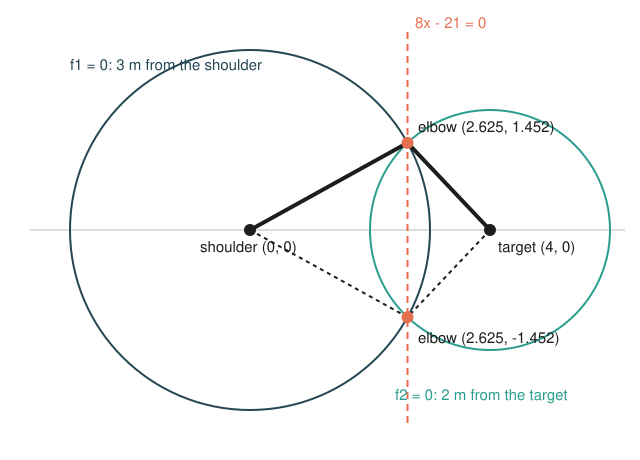
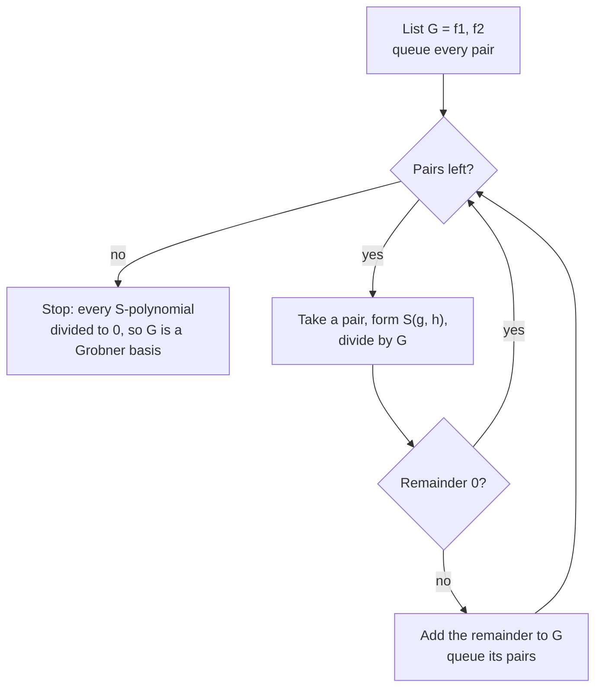

# Grobner bases: the generating set that makes division give a definite answer

[Syllabus](../../../SYLLABUS.md) → [Algebraic geometry](../README.md) → [Polynomial Systems](../README.md#s01) → Grobner bases

---

## General Overview

A robot arm sits on a table. Its upper link is 3 m long and turns about a shoulder. Its forearm is 2 m long and hangs from an elbow. The hand must touch a target 4 m from the shoulder. Where can the elbow go?

Turn the table so the target lies on the x-axis, at (4, 0). Call the elbow (x, y). The elbow is 3 m from the shoulder and 2 m from the target, so two equations hold:

- $`f_1 = x^2 + y^2 - 9 = 0`$, the 3 m circle round the shoulder.
- $`f_2 = (x - 4)^2 + y^2 - 4 = x^2 - 8x + y^2 + 12 = 0`$, the 2 m circle round the target.

The two equations already contain the answer, but not in a usable form. Each one mixes x and y. Dividing one polynomial by the pair, as on the [Monomial orders](02-monomial-orders-and-division.md) card, can even give a wrong verdict: $`8x - 21`$ equals $`f_1 - f_2`$, so it is a consequence of the system, yet division by the pair leaves it untouched as a nonzero remainder.

Buchberger's algorithm repairs the list. It cancels the leading terms of two equations against each other, divides what is left by the list, and adds any nonzero remainder as a new equation. For the arm it adds two: $`8x - 21`$ and $`64y^2 - 135`$. Read from the bottom, these say the elbow sits at x = 21/8 = 2.625 m and y = ±√135/8, about ±1.452369 m: two places, elbow up or elbow down.

**A Grobner basis is a list of equations for the same system, chosen so that every consequence of the system has a leading term that some member's leading term divides; Buchberger's algorithm builds one by adding the remainders of S-polynomials until every S-polynomial divides to zero.**

**What kind of fact this is:** a method with two theorems behind it, proved in Why it works: Buchberger's criterion (all S-polynomials divide to zero exactly when the list is a Grobner basis), and the fact that the loop stops, which rests on Dickson's lemma from the Hilbert's basis theorem card.

<p align="center"></p>

The picture is drawn to scale and shows real points only. The first new equation, $`8x - 21 = 0`$, is the straight line through both elbows: subtracting the two circles cancels every squared term.

---

## The formula

Notation from the earlier cards, in one line each. The field k is where the coefficients live; here it is ℚ, the fractions, so every step is exact. $`k[x, y]`$ is the set of all polynomials in x and y. The ideal $`I = \langle f_1, f_2 \rangle`$ is every combination $`h_1 f_1 + h_2 f_2`$ with polynomial multipliers ([Ideals and varieties](01-ideals-and-varieties.md)): exactly the consequences of the system. The order is lex with x > y: compare powers of x first, and powers of y only to break a tie. $`\mathrm{LT}(f)`$ is the leading term of f in that order, coefficient included.

This card introduces two things. The **S-polynomial** of f and g multiplies each by just enough to make their leading terms equal, then subtracts:

```math
S(f, g) = \frac{L}{\mathrm{LT}(f)}\, f - \frac{L}{\mathrm{LT}(g)}\, g, \qquad L = \mathrm{lcm}\big(\text{leading monomials of } f \text{ and } g\big)
```

**Read it aloud:** scale f and g up to their smallest common leading monomial, with leading coefficient 1, and take one from the other, so the leading terms cancel.

For the arm, $`\mathrm{LT}(f_1) = x^2`$ and $`\mathrm{LT}(f_3) = 8x`$, so L is $`x^2`$ and $`S(f_1, f_3) = f_1 - \tfrac{1}{8}x\, f_3 = \tfrac{21}{8}x + y^2 - 9`$.

A **Grobner basis** of the ideal I is a list G of members of I such that every nonzero h in I has a leading term divisible by the leading term of some member of G. **Buchberger's criterion** says how to test that with a finite amount of work:

```math
G = \{g_1, \dots, g_t\} \text{ is a Grobner basis} \iff \mathrm{rem}\big(S(g_i, g_j),\, G\big) = 0 \text{ for every pair } i < j
```

**Read it aloud:** a list is a Grobner basis exactly when, for every pair of its members, the S-polynomial divides by the list with remainder zero.

| Symbol | Plain meaning | In our example | Push it up and the answer… |
| --- | --- | --- | --- |
| $`k`$ | the field the coefficients come from | ℚ, the fractions | over ℝ some complex answers are lost |
| $`x, y`$ | the elbow's coordinates, in metres | 2.625 and ±1.452369 | — |
| $`f_1, f_2`$ | the starting equations: the two circles | $`x^2 + y^2 - 9`$, $`x^2 - 8x + y^2 + 12`$ | — |
| $`f_3, f_4`$ | equations Buchberger adds | $`8x - 21`$, $`64y^2 - 135`$ | — |
| $`I = \langle f_1, f_2 \rangle`$ | the ideal: all consequences of the system | contains $`8x - 21`$ | more generators, fewer points |
| $`\mathrm{LT}(f)`$; $`\mathrm{LM}`$, $`\mathrm{LC}`$ | leading term of f in lex, x > y; its monomial and its coefficient | $`\mathrm{LT}(f_2) = x^2`$; $`f_3`$ has LM x and LC 8 | — |
| $`L`$, $`x^{\gamma_{ij}}`$ | least common multiple of two leading monomials | $`x^2`$ for $`f_1, f_3`$ | larger L, longer S-polynomial |
| $`S(f, g)`$ | the S-polynomial: leading terms cancelled | $`S(f_1, f_2) = 8x - 21`$ | — |
| $`\mathrm{rem}(h, G)`$ | remainder when h is divided by the list G | $`\mathrm{rem}(S(f_2, f_3), G) = 0`$ | — |
| $`G`$, $`g_i`$, $`t`$ | the list being built, finally a Grobner basis; its members and their number | $`f_1, f_2, f_3, f_4`$ | — |
| $`h`$, $`q_i`$ or $`a_k`$, $`r`$; $`\delta`$, $`c_i x^{\alpha_i}`$, $`p_i`$ | a member of I, its multipliers in a combination, a remainder; in the proof, the top monomial among the parts $`q_i g_i`$, the leading term of $`q_i`$, and $`x^{\alpha_i} g_i`$ scaled to lead with 1 | $`h = 8x - 21`$, $`r = 0`$ by G | — |
| target distance | shoulder to target, in metres | 4 | past 5 m, no real elbow |

### When it holds

- **Exact arithmetic in a field.** Each step divides by a leading coefficient, here by 8 and 64. With decimals, rounding leaves tiny terms where zeros belong, and the criterion never sees an exact zero.
- **One order, fixed for the whole run.** The basis depends on the order, so every Grobner basis states its order: lex with x > y gives $`8x - 21`$ and $`64y^2 - 135`$. Switch orders halfway and the proof of Step 3, which ranks every leading term by one order, no longer applies.
- **Every pair, including pairs with new members.** Each new member brings new pairs. Stop early and the list is not a Grobner basis: $`64y^2 - 135`$ then divides by $`f_1, f_2, f_3`$ with remainder $`64y^2 - 135`$, not zero.
- **Answers are complex until checked.** The basis describes solutions over ℂ. A target 6 m away gives $`y^2 = -385/144`$: two complex elbows, no real one.

---

## Why it works

### Step 0: division fails only where leading terms cancel

Division by a list removes leading terms one at a time, so it can only clear a polynomial whose leading term some divisor's leading term divides. A consequence $`h_1 f_1 + h_2 f_2`$ usually has the leading term of one of its parts. Trouble comes when the leading terms of the parts cancel each other. Then a smaller term leads, and no divisor may reach it.

$`f_1 - f_2 = 8x - 21`$ is that trouble in its simplest form. Both circles lead with $`x^2`$, the $`x^2`$ terms cancel, and $`8x`$ is left, which neither $`x^2`$ divides. The S-polynomial is this cancellation, made on purpose for each pair.

### Step 1: a Grobner basis gives one remainder

Suppose G is a Grobner basis and h divides by G with remainders r and r′, by two different routes. Both differ from h by a combination of members of G, so $`r - r'`$ is in I. No term of r or r′ is divisible by any leading term in G; that is what "remainder" means. If $`r - r'`$ were nonzero, its leading term would be divisible by a leading term in G, since G is a Grobner basis. So $`r = r'`$: the answer is definite. And h is in I exactly when its remainder is zero. A zero remainder writes h as a combination of members of G. If h is in I, so is its remainder r, and a nonzero r would have a leading term that some $`\mathrm{LT}(g)`$ divides, which a remainder cannot have.

### Step 2: the loop only adds consequences

Buchberger's loop takes each pair, forms the S-polynomial and divides it by the current list. A nonzero remainder joins the list; its new pairs join the queue.



Every new member is a combination of $`f_1`$ and $`f_2`$, so the ideal never changes; only its list of generators grows. For the arm, the combinations are written out and multiplied back by the checks:

```math
f_3 = 8x - 21 = f_1 - f_2, \qquad f_4 = 64y^2 - 135 = (43 - 8x)\, f_1 + (8x + 21)\, f_2
```

### Step 3: the criterion, in words

If every S-polynomial divides to zero, take any h in I and write it as $`\sum q_i g_i`$, choosing the expression whose largest part leads as low as possible. If no cancellation happens at the top, the leading term of h is the leading term of some $`q_i g_i`$, divisible by $`\mathrm{LT}(g_i)`$, as required. If the tops cancel, the cancelling part is a sum of multiples of S-polynomials. Each divides to zero, so it can be rewritten with lower tops, which contradicts the choice of expression.

<details>
<summary>Detailed proof: Buchberger's criterion</summary>

The forward direction is Step 1: each $`S(g_i, g_j)`$ is in I, and a member of I has remainder zero.

For the reverse, take h in I and among all expressions $`h = \sum_i q_i g_i`$ pick one whose top monomial δ (the largest leading monomial among the products $`q_i g_i`$) is smallest. A monomial order is a well-order, so a smallest one exists.

If the leading monomial of h equals δ, it is the leading monomial of some $`q_i g_i`$ and is divisible by the leading monomial of $`g_i`$. Done.

Otherwise the degree-δ parts cancel. Write LM for the leading monomial (the leading term without its coefficient). Collect the indices i whose product reaches δ, and let $`c_i x^{\alpha_i}`$ be the leading term of $`q_i`$, so the cancelling sum is

$`\displaystyle P = \sum_i c_i\, x^{\alpha_i} g_i, \qquad \sum_i c_i \,\mathrm{LC}(g_i) = 0,`$

where LC is the leading coefficient. Put $`p_i = x^{\alpha_i} g_i / \mathrm{LC}(g_i)`$, each with leading coefficient 1 and leading monomial δ. Because the weights $`c_i \mathrm{LC}(g_i)`$ add to zero, a telescoping sum rewrites P as a combination of differences $`p_i - p_j`$. Each difference is a monomial times an S-polynomial:

$`\displaystyle p_i - p_j = x^{\delta - \gamma_{ij}}\, S(g_i, g_j), \qquad x^{\gamma_{ij}} = \mathrm{lcm}\big(\mathrm{LM}(g_i), \mathrm{LM}(g_j)\big).`$

Since $`S(g_i, g_j)`$ divides by G to zero, division writes it as $`\sum_k a_k g_k`$ with every $`a_k g_k`$ leading below $`\gamma_{ij}`$. Multiplying by $`x^{\delta - \gamma_{ij}}`$ keeps every part below δ. Substituting all of this into the expression for h gives a new expression whose top is below δ, which contradicts the choice of δ. So the first case always holds, and G is a Grobner basis.

</details>

### Step 4: the loop stops

A new member is a remainder, so its leading term is divisible by no leading term already in G. The set of monomials divisible by some leading term therefore grows strictly with each addition. Dickson's lemma says such a growing chain of monomial sets must stop after finitely many steps; the proof is on the [Hilbert's basis theorem](08-hilbert-basis-theorem.md) card. When nothing more is added, every pair has divided to zero, and Step 3 applies.

### Step 5: on linear equations it is Gaussian elimination

For linear equations, an S-polynomial of two equations with the same leading variable subtracts a multiple of one from the other to clear that variable: a row operation of [Gaussian elimination](../../03-Algebra/05-Solving%20Systems/02-gaussian-elimination.md). Two equations with different leading variables have leading terms that share no variable, so the shortcut below skips them. With those pairs skipped, Buchberger's algorithm on linear equations is exactly elimination to a staircase. What has no linear counterpart is the multiplier $`\tfrac{1}{8}x`$ in $`S(f_1, f_3)`$: a polynomial, not a number, and the reason the arm needs a second new equation.

### A shortcut the run confirms

When two leading terms share no variable, as $`x^2`$ and $`y^2`$ do, the pair can be skipped. This is Buchberger's first criterion. Such an S-polynomial is always a combination of its own two polynomials whose parts all lead below L, and that is all the proof of Step 3 needs from a pair. Divided by those two alone, it leaves 0. Divided by a longer list it can leave a remainder, so the loop drawn above, which divides every pair, can add a member that skipping avoids; the list is a Grobner basis either way. In the arm, three of the six pairs, (f1, f4), (f2, f4) and (f3, f4), are of this kind; the code divides them anyway, and here each leaves 0.

---

## Worked numbers, by hand

Order lex, x > y, over ℚ.

| Step | Arithmetic | Value |
| --- | --- | --- |
| start | the two circles | $`f_1 = x^2 + y^2 - 9`$, $`f_2 = x^2 - 8x + y^2 + 12`$ |
| pair (f1, f2) | both lead with $`x^2`$, so $`S = f_1 - f_2`$ | $`8x - 21`$ |
| divide by $`f_1, f_2`$ | $`x^2`$ does not divide $`8x`$: nothing to take away | remainder $`8x - 21`$, new $`f_3`$ |
| pair (f1, f3) | $`L = x^2`$, so $`S = f_1 - \tfrac{1}{8}x\, f_3`$ | $`\tfrac{21}{8}x + y^2 - 9`$ |
| divide by $`f_3`$ | take away $`\tfrac{21}{64} f_3`$ to clear the x term | $`y^2 - \tfrac{135}{64}`$, so new $`f_4 = 64y^2 - 135`$ |
| pair (f2, f3) | $`S = f_2 - \tfrac{1}{8}x\, f_3 = -\tfrac{43}{8}x + y^2 + 12`$; clear x with $`f_3`$ | $`y^2 - \tfrac{135}{64} = \tfrac{1}{64} f_4`$, remainder 0 |
| pairs with $`f_4`$ | leading terms $`x^2, x^2, x`$ against $`y^2`$ share no variable | remainder 0, three times |
| criterion | 6 pairs, all remainders 0 | **G = f1, f2, 8x − 21, 64y² − 135** |
| read off | $`x = 21/8`$; $`y^2 = 135/64`$ | **elbow at (2.625, ±1.452369) m** |

The arm has two elbow positions for a 4 m target, mirror images across the line from shoulder to target, and the basis finds both without any guessing.

### What breaks if you drop a piece

| Mistake | Comes out at | What went wrong |
| --- | --- | --- |
| Divide by the original pair | $`8x - 21`$ leaves remainder $`8x - 21`$ | it is $`f_1 - f_2`$, a consequence, but the pair is no Grobner basis |
| Stop after adding $`f_3`$ | $`64y^2 - 135`$ leaves $`64y^2 - 135`$ | pair (f1, f3) was never checked |
| Divide $`x^2y + xy^2 + y^2`$ by $`xy - 1, y^2 - 1`$ in two orders | $`x + y + 1`$ one way, $`2x + 1`$ the other | not a Grobner basis; Buchberger adds $`x - y`$, and then all 6 orders give $`2y + 1`$ |
| Target 6 m away, basis read as real | $`12x - 41`$, $`144y^2 + 385`$, so $`y^2 = -385/144`$ | the field: two complex elbows, no real one |

The third row is the standard textbook pair, met first on the [Monomial orders](02-monomial-orders-and-division.md) card. The gap between its two remainders is $`x - y = y(xy - 1) - x(y^2 - 1)`$, a consequence the pair could not see, and exactly the S-polynomial Buchberger adds.

---

## Code, from first principles, and it actually runs

The code builds polynomials as maps from exponent pairs to exact fractions, writes out division by a list, the S-polynomial and Buchberger's loop, and runs the loop on the arm. It reaches the basis by two independent roads: the loop itself, and the law of cosines, which gives the elbow's x directly as (9 + 16 − 4)/(2 × 4). Two checks back them: explicit combinations of $`f_1`$ and $`f_2`$, multiplied out term by term, show that the new members belong to the ideal; and the count of monomials no leading term divides must equal the two elbows over ℂ. It then puts the elbows back into both circles exactly and prints every row of the breakage table.

### Python

```python
# Grobner bases and Buchberger's algorithm -- the check behind the card.
# Standard library only.  A polynomial in x and y is a dict {(i, j): c} for the
# term c x^i y^j, with exact Fraction coefficients.  The order is lex, x > y, so
# the leading term has the largest pair (i, j).  Nothing imported knows a basis.
from fractions import Fraction as F
from math import sqrt

def lead(f): return max(f)

def add(f, g, c, m):                          # f + c * x^m0 y^m1 * g
    out = dict(f)
    for (i, j), a in g.items():
        k = (i + m[0], j + m[1])
        out[k] = out.get(k, 0) + c * a
        if out[k] == 0: del out[k]
    return out

def mul(f, g):                                # plain product, term by term
    out = {}
    for m, a in f.items(): out = add(out, g, a, m)
    return out

def divide(f, divs):                          # division by a list: the remainder
    p, r = dict(f), {}
    while p:
        m = lead(p)
        for g in divs:
            n = lead(g)
            if n[0] <= m[0] and n[1] <= m[1]:
                p = add(p, g, -p[m] / g[n], (m[0] - n[0], m[1] - n[1])); break
        else: r[m] = p.pop(m)
    return r

def spoly(f, g):                              # cancel the two leading terms
    a, b = lead(f), lead(g)
    L = (max(a[0], b[0]), max(a[1], b[1]))
    s = add({}, f, 1 / f[a], (L[0] - a[0], L[1] - a[1]))
    return add(s, g, -1 / g[b], (L[0] - b[0], L[1] - b[1]))

def gcd(a, b):
    while b: a, b = b, a % b
    return abs(a)

def tidy(f):                                  # whole coefficients, no common factor
    d, n = 1, 0
    for c in f.values(): d = d * c.denominator // gcd(d, c.denominator)
    for c in f.values(): n = gcd(n, c.numerator * (d // c.denominator))
    s = F(d, n) if f[lead(f)] > 0 else F(-d, n)
    return {m: c * s for m, c in f.items()}

def show(f):
    out = ""
    for (i, j) in sorted(f, reverse=True):
        c = f[(i, j)]; a = abs(c)
        mono = ("x" if i else "") + (f"^{i}" if i > 1 else "") + ("y" if j else "") + (f"^{j}" if j > 1 else "")
        coef = "" if a == 1 and mono else (f"({a})" if a.denominator > 1 and mono else str(a))
        out += ("-" if c < 0 else "") if not out else (" - " if c < 0 else " + ")
        out += coef + mono
    return out or "0"

def buchberger(G, talk):                      # add remainders until every pair gives 0
    G, zero = [tidy(g) for g in G], 0
    pairs = [(i, j) for j in range(len(G)) for i in range(j)]
    while pairs:
        i, j = pairs.pop(0)
        s = spoly(G[i], G[j]); r = divide(s, G)
        if r:
            G.append(tidy(r)); pairs += [(k, len(G) - 1) for k in range(len(G) - 1)]
        else: zero += 1
        if talk: print(f"pair (f{i+1}, f{j+1}): S = {show(s)}; remainder {show(r)}"
                       + (f" -> new f{len(G)} = {show(G[-1])}" if r else ""))
    return G, zero

def P(*terms): return {(i, j): F(c) for c, i, j in terms}     # c x^i y^j, ...
def arm(A): return [P((1, 2, 0), (1, 0, 2), (-9, 0, 0)),     # elbow 3 m from shoulder
                    P((1, 2, 0), (-2 * A, 1, 0), (1, 0, 2), (A * A - 4, 0, 0))]  # 2 m from target

A = F(4)
f1, f2 = arm(A)
print(f"arm: links 3 m and 2 m, shoulder (0, 0), target ({A}, 0); order lex x > y")
print(f"f1 = {show(f1)}   f2 = {show(f2)}")
G, zero = buchberger([f1, f2], True)
s13, s23 = spoly(G[0], G[2]), spoly(G[1], G[2])
print(f"by hand: S(f1, f3) = f1 - ({1 / G[2][(1, 0)]})x f3, then take away {s13[(1, 0)] / G[2][(1, 0)]} f3;"
      f" S(f2, f3) leaves {show(divide(s23, G[:3]))} = ({1 / G[3][(0, 2)]}) f4")
print(f"pairs checked {len(G) * (len(G) - 1) // 2}, new members {len(G) - 2}, remainders 0: {zero}")
crit = all(not divide(spoly(G[i], G[j]), G) for j in range(len(G)) for i in range(j))
print(f"criterion on the final basis: all {len(G) * (len(G) - 1) // 2} S-polynomials divide to 0: {'yes' if crit else 'no'}")
coprime = [(i + 1, j + 1) for j in range(len(G)) for i in range(j)
           if min(lead(G[i])[0], lead(G[j])[0]) == 0 and min(lead(G[i])[1], lead(G[j])[1]) == 0]
print(f"pairs with leading terms sharing no variable (can be skipped; here they also divide to 0): {coprime}")
xb = (9 + A * A - 4) / (2 * A); yy = 9 - xb * xb                # road two: the law of cosines
print(f"law of cosines: elbow x = (9 + {A * A} - 4)/(2*{A}) = {xb}, y^2 = 9 - x^2 = {yy}")
g3, g4 = tidy(P((1, 1, 0), (-xb, 0, 0))), tidy(P((1, 0, 2), (-yy, 0, 0)))
print(f"as polynomials: {show(g3)} and {show(g4)}; same as f3, f4: {'yes' if [g3, g4] == G[2:] else 'no'}")
print(f"tidy basis (Normal forms card): x - {xb}, y^2 - {yy}")
c1 = add(f1, f2, F(-1), (0, 0))                                 # road three: certificates
c2 = add(mul(P((43, 0, 0), (-8, 1, 0)), f1), mul(P((8, 1, 0), (21, 0, 0)), f2), F(1), (0, 0))
print(f"certificates: f1 - f2 = {show(c1)};  (43 - 8x)f1 + (8x + 21)f2 = {show(c2)}")
elbows = [(xb, s) for s in (1, -1)]
print("elbows " + " and ".join(f"({float(x):.6f}, {s * sqrt(yy):.6f})" for x, s in elbows)
      + f" put back exactly: f1 = {xb * xb + yy - 9}, f2 = {(xb - A) ** 2 + yy - 4}")
std = [(i, j) for i in range(3) for j in range(3) if not any(i >= lead(g)[0] and j >= lead(g)[1] for g in G)]
print(f"monomials no leading term divides: {[show(P((1, i, j))) for i, j in std]} -> {len(std)} elbows over the complex numbers")
print(f"figure, shoulder (0, 0) r 3; target ({A}, 0) r 2; line x = {float(xb):.3f}; elbows y = +-{sqrt(yy):.6f}")
r1 = divide(G[2], [f1, f2]); r2 = divide(G[3], G[:3])
print(f"mistake 1, f3 = {show(G[2])} divided by [f1, f2] leaves {show(r1)}; by the basis, {show(divide(G[2], G))}")
print(f"mistake 2, stopping after f3: {show(G[3])} divided by [f1, f2, f3] leaves {show(r2)}")
h, u, v = P((1, 2, 1), (1, 1, 2), (1, 0, 2)), P((1, 1, 1), (-1, 0, 0)), P((1, 0, 2), (-1, 0, 0))
ra, rb = divide(h, [u, v]), divide(h, [v, u])
print(f"mistake 3, {show(h)} divided by [{show(u)}, {show(v)}] leaves {show(ra)}; in the other order, {show(rb)}")
H, _ = buchberger([u, v], False)
orders = [[0, 1, 2], [0, 2, 1], [1, 0, 2], [1, 2, 0], [2, 0, 1], [2, 1, 0]]
rs = [show(divide(h, [H[k] for k in o])) for o in orders]
print(f"after Buchberger adds {show(H[2])}: the 6 orders of the 3 divisors leave {sorted(set(rs))}")
print(f"the gap {show(add(rb, ra, F(-1), (0, 0)))} = y(xy - 1) - x(y^2 - 1) = {show(add(mul(P((1, 0, 1)), u), mul(P((1, 1, 0)), v), F(-1), (0, 0)))}")
G6, _ = buchberger(arm(F(6)), False)
y6 = -G6[3][(0, 0)] / G6[3][(0, 2)]
print(f"mistake 4, target 6 m away: new members {show(G6[2])} and {show(G6[3])}, so y^2 = {y6}: no real elbow")
assert [show(g) for g in G[2:]] == ["8x - 21", "64y^2 - 135"]        # the hand computation
assert spoly(G[0], G[2]) == P((F(21, 8), 1, 0), (1, 0, 2), (-9, 0, 0))   # S(f1, f3) by hand
assert crit and [g3, g4] == G[2:] and len(std) == 2                  # criterion, cosines, count
assert c1 == G[2] and c2 == G[3]                                     # members of <f1, f2>
assert xb * xb + yy == 9 and (xb - A) ** 2 + yy == 4                 # elbows on both circles
assert ra != rb and len(set(rs)) == 1 and not divide(add(ra, rb, F(-1), (0, 0)), H)
assert r1 and r2 and not divide(G[3], G) and y6 < 0
print("ALL CHECKS PASS")
```

**Ran 2026-11-17 on macOS, Python 3.14.10, standard library only. All checks passed. Output, pasted from the run:**

```
arm: links 3 m and 2 m, shoulder (0, 0), target (4, 0); order lex x > y
f1 = x^2 + y^2 - 9   f2 = x^2 - 8x + y^2 + 12
pair (f1, f2): S = 8x - 21; remainder 8x - 21 -> new f3 = 8x - 21
pair (f1, f3): S = (21/8)x + y^2 - 9; remainder y^2 - 135/64 -> new f4 = 64y^2 - 135
pair (f2, f3): S = -(43/8)x + y^2 + 12; remainder 0
pair (f1, f4): S = (135/64)x^2 + y^4 - 9y^2; remainder 0
pair (f2, f4): S = (135/64)x^2 - 8xy^2 + y^4 + 12y^2; remainder 0
pair (f3, f4): S = (135/64)x - (21/8)y^2; remainder 0
by hand: S(f1, f3) = f1 - (1/8)x f3, then take away 21/64 f3; S(f2, f3) leaves y^2 - 135/64 = (1/64) f4
pairs checked 6, new members 2, remainders 0: 4
criterion on the final basis: all 6 S-polynomials divide to 0: yes
pairs with leading terms sharing no variable (can be skipped; here they also divide to 0): [(1, 4), (2, 4), (3, 4)]
law of cosines: elbow x = (9 + 16 - 4)/(2*4) = 21/8, y^2 = 9 - x^2 = 135/64
as polynomials: 8x - 21 and 64y^2 - 135; same as f3, f4: yes
tidy basis (Normal forms card): x - 21/8, y^2 - 135/64
certificates: f1 - f2 = 8x - 21;  (43 - 8x)f1 + (8x + 21)f2 = 64y^2 - 135
elbows (2.625000, 1.452369) and (2.625000, -1.452369) put back exactly: f1 = 0, f2 = 0
monomials no leading term divides: ['1', 'y'] -> 2 elbows over the complex numbers
figure, shoulder (0, 0) r 3; target (4, 0) r 2; line x = 2.625; elbows y = +-1.452369
mistake 1, f3 = 8x - 21 divided by [f1, f2] leaves 8x - 21; by the basis, 0
mistake 2, stopping after f3: 64y^2 - 135 divided by [f1, f2, f3] leaves 64y^2 - 135
mistake 3, x^2y + xy^2 + y^2 divided by [xy - 1, y^2 - 1] leaves x + y + 1; in the other order, 2x + 1
after Buchberger adds x - y: the 6 orders of the 3 divisors leave ['2y + 1']
the gap x - y = y(xy - 1) - x(y^2 - 1) = x - y
mistake 4, target 6 m away: new members 12x - 41 and 144y^2 + 385, so y^2 = -385/144: no real elbow
ALL CHECKS PASS
```

### Rust

Same numbers, same labels, built with `rustc --edition 2021 -O`. Fractions are i128 pairs with checked multiplication, so an overflow stops the run instead of printing a wrong number.

```rust
// Grobner bases and Buchberger's algorithm -- the same check as the Python, in
// Rust.  No crates.  Fractions are i128 pairs in lowest terms, multiplied with
// checked_mul so an overflow stops the run.  A polynomial maps (i, j) to the
// coefficient of x^i y^j; the order is lex, x > y, so the leading key is the last.
use std::collections::BTreeMap;
type Poly = BTreeMap<(u32, u32), Fr>;

#[derive(Clone, Copy, PartialEq, Debug)]
struct Fr { n: i128, d: i128 }
fn gcd(a: i128, b: i128) -> i128 { if b == 0 { a.abs() } else { gcd(b, a % b) } }
fn fr(n: i128, d: i128) -> Fr { let g = gcd(n, d) * d.signum(); Fr { n: n / g, d: d / g } }
fn m(a: i128, b: i128) -> i128 { a.checked_mul(b).expect("overflow") }
impl Fr {
    fn add(self, o: Fr) -> Fr { fr(m(self.n, o.d) + m(o.n, self.d), m(self.d, o.d)) }
    fn mul(self, o: Fr) -> Fr { fr(m(self.n, o.n), m(self.d, o.d)) }
    fn div(self, o: Fr) -> Fr { fr(m(self.n, o.d), m(self.d, o.n)) }
    fn neg(self) -> Fr { fr(-self.n, self.d) }
    fn f(self) -> f64 { self.n as f64 / self.d as f64 }
}
impl std::fmt::Display for Fr {
    fn fmt(&self, w: &mut std::fmt::Formatter) -> std::fmt::Result {
        if self.d == 1 { write!(w, "{}", self.n) } else { write!(w, "{}/{}", self.n, self.d) }
    }
}
fn int(n: i128) -> Fr { fr(n, 1) }
fn quoted(v: &[String]) -> String { format!("[{}]", v.iter().map(|t| format!("'{}'", t)).collect::<Vec<_>>().join(", ")) }
fn lead(f: &Poly) -> (u32, u32) { *f.keys().next_back().unwrap() }

fn add(f: &Poly, g: &Poly, c: Fr, s: (u32, u32)) -> Poly {   // f + c * x^s0 y^s1 * g
    let mut out = f.clone();
    for (&(i, j), &a) in g {
        let k = (i + s.0, j + s.1);
        let v = out.get(&k).copied().unwrap_or(int(0)).add(c.mul(a));
        if v.n == 0 { out.remove(&k); } else { out.insert(k, v); }
    }
    out
}
fn mul(f: &Poly, g: &Poly) -> Poly {                          // plain product
    let mut out = Poly::new();
    for (&s, &a) in f { out = add(&out, g, a, s) }
    out
}
fn divide(f: &Poly, divs: &[Poly]) -> Poly {                  // division by a list
    let (mut p, mut r) = (f.clone(), Poly::new());
    while !p.is_empty() {
        let k = lead(&p);
        match divs.iter().find(|g| { let n = lead(g); n.0 <= k.0 && n.1 <= k.1 }) {
            Some(g) => { let n = lead(g); p = add(&p, g, p[&k].div(g[&n]).neg(), (k.0 - n.0, k.1 - n.1)) }
            None => { r.insert(k, p.remove(&k).unwrap()); }
        }
    }
    r
}
fn spoly(f: &Poly, g: &Poly) -> Poly {                        // cancel the leading terms
    let (a, b) = (lead(f), lead(g));
    let l = (a.0.max(b.0), a.1.max(b.1));
    let s = add(&Poly::new(), f, int(1).div(f[&a]), (l.0 - a.0, l.1 - a.1));
    add(&s, g, int(-1).div(g[&b]), (l.0 - b.0, l.1 - b.1))
}
fn tidy(f: &Poly) -> Poly {                                   // whole coefficients, no common factor
    let (mut d, mut n) = (1i128, 0i128);
    for c in f.values() { d = m(d, c.d) / gcd(d, c.d) }
    for c in f.values() { n = gcd(n, m(c.n, d / c.d)) }
    let s = if f[&lead(f)].n > 0 { fr(d, n) } else { fr(-d, n) };
    f.iter().map(|(&k, &c)| (k, c.mul(s))).collect()
}
fn show(f: &Poly) -> String {
    let mut out = String::new();
    for (&(i, j), &c) in f.iter().rev() {
        let a = if c.n < 0 { c.neg() } else { c };
        let mut mono = String::new();
        if i > 0 { mono += "x" } if i > 1 { mono += &format!("^{}", i) }
        if j > 0 { mono += "y" } if j > 1 { mono += &format!("^{}", j) }
        let coef = if a == int(1) && !mono.is_empty() { String::new() }
                   else if a.d > 1 && !mono.is_empty() { format!("({})", a) } else { a.to_string() };
        out += if out.is_empty() { if c.n < 0 { "-" } else { "" } } else if c.n < 0 { " - " } else { " + " };
        out += &(coef + &mono);
    }
    if out.is_empty() { "0".to_string() } else { out }
}
fn buchberger(start: &[Poly], talk: bool) -> (Vec<Poly>, usize) {
    let mut g: Vec<Poly> = start.iter().map(tidy).collect();
    let mut zero = 0;
    let mut pairs: Vec<(usize, usize)> = vec![(0, 1)];
    while !pairs.is_empty() {
        let (i, j) = pairs.remove(0);
        let s = spoly(&g[i], &g[j]);
        let r = divide(&s, &g);
        if !r.is_empty() {
            g.push(tidy(&r));
            for k in 0..g.len() - 1 { pairs.push((k, g.len() - 1)) }
        } else { zero += 1 }
        if talk {
            let new = if r.is_empty() { String::new() } else { format!(" -> new f{} = {}", g.len(), show(&g[g.len() - 1])) };
            println!("pair (f{}, f{}): S = {}; remainder {}{}", i + 1, j + 1, show(&s), show(&r), new);
        }
    }
    (g, zero)
}
fn p(terms: &[(Fr, u32, u32)]) -> Poly { terms.iter().map(|&(c, i, j)| ((i, j), c)).collect() }
fn arm(a: Fr) -> Vec<Poly> {
    vec![p(&[(int(1), 2, 0), (int(1), 0, 2), (int(-9), 0, 0)]),
         p(&[(int(1), 2, 0), (a.mul(int(-2)), 1, 0), (int(1), 0, 2), (a.mul(a).add(int(-4)), 0, 0)])]
}

fn main() {
    let (a, fs) = (int(4), arm(int(4)));
    let (f1, f2) = (&fs[0], &fs[1]);
    println!("arm: links 3 m and 2 m, shoulder (0, 0), target ({}, 0); order lex x > y", a);
    println!("f1 = {}   f2 = {}", show(f1), show(f2));
    let (g, zero) = buchberger(&fs, true);
    let (s13, s23) = (spoly(&g[0], &g[2]), spoly(&g[1], &g[2]));
    println!("by hand: S(f1, f3) = f1 - ({})x f3, then take away {} f3; S(f2, f3) leaves {} = ({}) f4", int(1).div(g[2][&(1, 0)]),
             s13[&(1, 0)].div(g[2][&(1, 0)]), show(&divide(&s23, &g[..3])), int(1).div(g[3][&(0, 2)]));
    let np = g.len() * (g.len() - 1) / 2;
    println!("pairs checked {}, new members {}, remainders 0: {}", np, g.len() - 2, zero);
    let crit = (0..g.len()).all(|j| (0..j).all(|i| divide(&spoly(&g[i], &g[j]), &g).is_empty()));
    println!("criterion on the final basis: all {} S-polynomials divide to 0: {}", np, if crit { "yes" } else { "no" });
    let mut coprime = vec![];
    for j in 0..g.len() { for i in 0..j {
        let (u, v) = (lead(&g[i]), lead(&g[j]));
        if u.0.min(v.0) == 0 && u.1.min(v.1) == 0 { coprime.push((i + 1, j + 1)) }
    } }
    println!("pairs with leading terms sharing no variable (can be skipped; here they also divide to 0): {:?}", coprime);
    let xb = int(9).add(a.mul(a)).add(int(-4)).div(a.mul(int(2)));     // road two: law of cosines
    let yy = int(9).add(xb.mul(xb).neg());
    println!("law of cosines: elbow x = (9 + {} - 4)/(2*{}) = {}, y^2 = 9 - x^2 = {}", a.mul(a), a, xb, yy);
    let g3 = tidy(&p(&[(int(1), 1, 0), (xb.neg(), 0, 0)]));
    let g4 = tidy(&p(&[(int(1), 0, 2), (yy.neg(), 0, 0)]));
    let same = g3 == g[2] && g4 == g[3];
    println!("as polynomials: {} and {}; same as f3, f4: {}", show(&g3), show(&g4), if same { "yes" } else { "no" });
    println!("tidy basis (Normal forms card): x - {}, y^2 - {}", xb, yy);
    let c1 = add(f1, f2, int(-1), (0, 0));                              // road three: certificates
    let c2 = add(&mul(&p(&[(int(43), 0, 0), (int(-8), 1, 0)]), f1),
                 &mul(&p(&[(int(8), 1, 0), (int(21), 0, 0)]), f2), int(1), (0, 0));
    println!("certificates: f1 - f2 = {};  (43 - 8x)f1 + (8x + 21)f2 = {}", show(&c1), show(&c2));
    let (e1, e2) = (xb.mul(xb).add(yy).add(int(-9)), xb.add(a.neg()).mul(xb.add(a.neg())).add(yy).add(int(-4)));
    let ys = yy.f().sqrt();
    println!("elbows ({:.6}, {:.6}) and ({:.6}, {:.6}) put back exactly: f1 = {}, f2 = {}", xb.f(), ys, xb.f(), -ys, e1, e2);
    let std: Vec<String> = (0..9u32).map(|t| (t / 3, t % 3)).filter(|&(i, j)| !g.iter().any(|q| { let l = lead(q); i >= l.0 && j >= l.1 }))
        .map(|(i, j)| show(&p(&[(int(1), i, j)]))).collect();
    println!("monomials no leading term divides: {} -> {} elbows over the complex numbers", quoted(&std), std.len());
    println!("figure, shoulder (0, 0) r 3; target ({}, 0) r 2; line x = {:.3}; elbows y = +-{:.6}", a, xb.f(), ys);
    let (r1, r2) = (divide(&g[2], &fs), divide(&g[3], &g[..3]));
    println!("mistake 1, f3 = {} divided by [f1, f2] leaves {}; by the basis, {}", show(&g[2]), show(&r1), show(&divide(&g[2], &g)));
    println!("mistake 2, stopping after f3: {} divided by [f1, f2, f3] leaves {}", show(&g[3]), show(&r2));
    let h = p(&[(int(1), 2, 1), (int(1), 1, 2), (int(1), 0, 2)]);
    let (u, v) = (p(&[(int(1), 1, 1), (int(-1), 0, 0)]), p(&[(int(1), 0, 2), (int(-1), 0, 0)]));
    let (ra, rb) = (divide(&h, &[u.clone(), v.clone()]), divide(&h, &[v.clone(), u.clone()]));
    println!("mistake 3, {} divided by [{}, {}] leaves {}; in the other order, {}", show(&h), show(&u), show(&v), show(&ra), show(&rb));
    let (hb, _) = buchberger(&[u.clone(), v.clone()], false);
    let orders = [[0, 1, 2], [0, 2, 1], [1, 0, 2], [1, 2, 0], [2, 0, 1], [2, 1, 0]];
    let mut rs: Vec<String> = orders.iter().map(|o| show(&divide(&h, &o.map(|k| hb[k].clone())))).collect();
    rs.sort(); rs.dedup();
    println!("after Buchberger adds {}: the 6 orders of the 3 divisors leave {}", show(&hb[2]), quoted(&rs));
    let gap = add(&rb, &ra, int(-1), (0, 0));
    let cert = add(&mul(&p(&[(int(1), 0, 1)]), &u), &mul(&p(&[(int(1), 1, 0)]), &v), int(-1), (0, 0));
    println!("the gap {} = y(xy - 1) - x(y^2 - 1) = {}", show(&gap), show(&cert));
    let (g6, _) = buchberger(&arm(int(6)), false);
    let y6 = g6[3][&(0, 0)].neg().div(g6[3][&(0, 2)]);
    println!("mistake 4, target 6 m away: new members {} and {}, so y^2 = {}: no real elbow", show(&g6[2]), show(&g6[3]), y6);
    assert!(show(&g[2]) == "8x - 21" && show(&g[3]) == "64y^2 - 135");   // the hand computation
    assert!(spoly(&g[0], &g[2]) == p(&[(fr(21, 8), 1, 0), (int(1), 0, 2), (int(-9), 0, 0)]));  // S(f1, f3) by hand
    assert!(crit && same && std.len() == 2);                             // criterion, cosines, count
    assert!(c1 == g[2] && c2 == g[3]);                                   // members of <f1, f2>
    assert!(e1 == int(0) && e2 == int(0));                               // elbows on both circles
    assert!(ra != rb && rs.len() == 1 && divide(&gap, &hb).is_empty());
    assert!(!r1.is_empty() && !r2.is_empty() && divide(&g[3], &g).is_empty() && y6.n < 0);
    println!("ALL CHECKS PASS");
}
```

**Ran 2026-11-17 on macOS, rustc 1.98.1, no crates. All checks passed. Output, pasted from the run:**

```
arm: links 3 m and 2 m, shoulder (0, 0), target (4, 0); order lex x > y
f1 = x^2 + y^2 - 9   f2 = x^2 - 8x + y^2 + 12
pair (f1, f2): S = 8x - 21; remainder 8x - 21 -> new f3 = 8x - 21
pair (f1, f3): S = (21/8)x + y^2 - 9; remainder y^2 - 135/64 -> new f4 = 64y^2 - 135
pair (f2, f3): S = -(43/8)x + y^2 + 12; remainder 0
pair (f1, f4): S = (135/64)x^2 + y^4 - 9y^2; remainder 0
pair (f2, f4): S = (135/64)x^2 - 8xy^2 + y^4 + 12y^2; remainder 0
pair (f3, f4): S = (135/64)x - (21/8)y^2; remainder 0
by hand: S(f1, f3) = f1 - (1/8)x f3, then take away 21/64 f3; S(f2, f3) leaves y^2 - 135/64 = (1/64) f4
pairs checked 6, new members 2, remainders 0: 4
criterion on the final basis: all 6 S-polynomials divide to 0: yes
pairs with leading terms sharing no variable (can be skipped; here they also divide to 0): [(1, 4), (2, 4), (3, 4)]
law of cosines: elbow x = (9 + 16 - 4)/(2*4) = 21/8, y^2 = 9 - x^2 = 135/64
as polynomials: 8x - 21 and 64y^2 - 135; same as f3, f4: yes
tidy basis (Normal forms card): x - 21/8, y^2 - 135/64
certificates: f1 - f2 = 8x - 21;  (43 - 8x)f1 + (8x + 21)f2 = 64y^2 - 135
elbows (2.625000, 1.452369) and (2.625000, -1.452369) put back exactly: f1 = 0, f2 = 0
monomials no leading term divides: ['1', 'y'] -> 2 elbows over the complex numbers
figure, shoulder (0, 0) r 3; target (4, 0) r 2; line x = 2.625; elbows y = +-1.452369
mistake 1, f3 = 8x - 21 divided by [f1, f2] leaves 8x - 21; by the basis, 0
mistake 2, stopping after f3: 64y^2 - 135 divided by [f1, f2, f3] leaves 64y^2 - 135
mistake 3, x^2y + xy^2 + y^2 divided by [xy - 1, y^2 - 1] leaves x + y + 1; in the other order, 2x + 1
after Buchberger adds x - y: the 6 orders of the 3 divisors leave ['2y + 1']
the gap x - y = y(xy - 1) - x(y^2 - 1) = x - y
mistake 4, target 6 m away: new members 12x - 41 and 144y^2 + 385, so y^2 = -385/144: no real elbow
ALL CHECKS PASS
```

The two outputs match line for line.

### Lean

Lean proves Buchberger's criterion and Step 1 for any field and any monomial order, and checks the arm's hand arithmetic over ℚ.

- Take a list $`g_1, \dots, g_t`$ over any field k, with one monomial order fixed. Then it is a Grobner basis of its ideal exactly when every $`S(g_i, g_j)`$ divides to zero. Here "divides to zero" means S is a sum of parts $`a_k g_k`$, none leading above S. Division with remainder zero gives exactly such a sum. Lean's S-polynomial is the card's times $`\mathrm{LC}(g_i)\,\mathrm{LC}(g_j)`$, which changes nothing here.
- Suppose the list is a Grobner basis and h divides by it with remainders r and r′. Then $`r = r'`$.
- Suppose the list is a Grobner basis and h leaves remainder r. Then h is in the ideal exactly when $`r = 0`$.
- Multiplied out, $`(x - 4)^2 + y^2 - 4`$ is $`f_2`$.
- In the arm, $`f_1 - f_2 = 8x - 21`$.
- In the arm, $`(43 - 8x) f_1 + (8x + 21) f_2 = 64y^2 - 135`$.
- Cleared of fractions, the pairs (f1, f3) and (f2, f3) each reduce to $`64y^2 - 135`$.
- The elbow (21/8, y) with $`y^2 = 135/64`$ lies on both circles.
- The law of cosines, as in the code, gives the same x: $`(9 + 16 - 4)/(2 \cdot 4) = 21/8`$.
- Take the textbook pair $`xy - 1, y^2 - 1`$. Then the gap between its two remainders is $`x - y = y(xy - 1) - x(y^2 - 1)`$.
- Take a target 6 m away. Then the two circles differ by $`12x - 41`$, and $`y^2 = -385/144`$, so no real elbow exists.

That the loop stops, the actual divisions, the pairs with $`f_4`$ and the decimal elbows are left to the Python and Rust checks.

```lean
-- Grobner bases: a list is a Grobner basis exactly when every S-polynomial of two members divides by the list with remainder zero, and then remainders are unique and decide ideal membership.
import Mathlib.RingTheory.MvPolynomial.MonomialOrder
import Mathlib.RingTheory.MvPolynomial.Groebner
import Mathlib.Algebra.MvPolynomial.Division
import Mathlib.RingTheory.Ideal.Span
import Mathlib.Basic.Real.Basic
import Mathlib.Tactic.Ring
import Mathlib.Tactic.LinearCombination
import Mathlib.Tactic.NormNum
import Mathlib.Tactic.Linarith

open MvPolynomial
open scoped MonomialOrder

/-- Helper: the leading term of a nonzero p divides any monomial of degree at least deg p. -/
theorem gb_lt_dvd_monomial_of_le {σ k : Type*} [Field k] (m : MonomialOrder σ)
    {p : MvPolynomial σ k} (hp : p ≠ 0) {d : σ →₀ ℕ} (hd : m.degree p ≤ d) (a : k) :
    m.leadingTerm p ∣ monomial d a := by
  rw [MonomialOrder.leadingTerm, monomial_dvd_monomial]
  exact ⟨Or.inr hd, (isUnit_iff_ne_zero.mpr (m.leadingCoeff_ne_zero_iff.mpr hp)).dvd⟩

/-- Helper: if LT(p) divides a monomial with nonzero coefficient, then p ≠ 0 and its degree is
below the monomial's exponent. -/
theorem gb_le_of_lt_dvd_monomial {σ k : Type*} [Field k] (m : MonomialOrder σ)
    {p : MvPolynomial σ k} {d : σ →₀ ℕ} {a : k} (ha : a ≠ 0)
    (h : m.leadingTerm p ∣ monomial d a) : p ≠ 0 ∧ m.degree p ≤ d := by
  rw [MonomialOrder.leadingTerm, monomial_dvd_monomial] at h
  obtain ⟨h1, h2⟩ := h
  refine ⟨?_, h1.resolve_left ha⟩
  rintro rfl
  rw [MonomialOrder.leadingCoeff_zero, zero_dvd_iff] at h2
  exact ha h2

/-- Helper: under the Grobner property, an ideal member with no term divisible by any LT(g i)
is zero. -/
theorem gb_eq_zero_of_mem {σ k : Type*} [Field k] (m : MonomialOrder σ) {t : ℕ}
    (g : Fin t → MvPolynomial σ k)
    (hG : ∀ h ∈ Ideal.span (Set.range g), h ≠ 0 → ∃ i, m.leadingTerm (g i) ∣ m.leadingTerm h)
    (r : MvPolynomial σ k) (hrI : r ∈ Ideal.span (Set.range g))
    (hr : ∀ c ∈ r.support, ∀ i, ¬ m.leadingTerm (g i) ∣ monomial c (r.coeff c)) : r = 0 := by
  by_contra h0
  obtain ⟨i, hi⟩ := hG r hrI h0
  exact hr _ (m.degree_mem_support h0) i hi

/-- Helper: the main induction of Buchberger's criterion. If every S-polynomial has a standard
representation, then any representation h = sum c_l g_l with all parts of order at most δ
can be pushed down until the leading term of h is visibly divisible by some LT(g i). -/
theorem gb_main {σ k : Type*} [Field k] (m : MonomialOrder σ) {t : ℕ}
    (g : Fin t → MvPolynomial σ k)
    (hS : ∀ i j, ∃ q : Fin t → MvPolynomial σ k,
        m.sPolynomial (g i) (g j) = ∑ l, q l * g l ∧
          ∀ l, m.degree (q l * g l) ≼[m] m.degree (m.sPolynomial (g i) (g j)))
    (h : MvPolynomial σ k) (hh : h ≠ 0) :
    ∀ δ : m.syn, ∀ c : Fin t → MvPolynomial σ k, h = ∑ l, c l * g l →
      (∀ l, m.toSyn (m.degree (c l * g l)) ≤ δ) →
        ∃ i, m.leadingTerm (g i) ∣ m.leadingTerm h := by
  classical
  have hQ : ∀ a b, ∃ Q : Fin t → MvPolynomial σ k,
      m.sPolynomial (g a) (g b) = ∑ l, Q l * g l ∧
      ∀ l, Q l = 0 ∨
        m.toSyn (m.degree (Q l * g l)) < m.toSyn (m.degree (g a) ⊔ m.degree (g b)) := by
    intro a b
    by_cases hs : m.sPolynomial (g a) (g b) = 0
    · exact ⟨0, by simp [hs], fun l => Or.inl rfl⟩
    · obtain ⟨Q, hQ1, hQ2⟩ := hS a b
      exact ⟨Q, hQ1, fun l =>
        Or.inr (lt_of_le_of_lt (hQ2 l) (m.degree_sPolynomial_lt_sup_degree hs))⟩
  choose Q hQsum hQdeg using hQ
  intro δ
  induction δ using WellFoundedLT.induction with
  | _ δ ih =>
  intro c hc hδ
  by_cases hEq : m.toSyn (m.degree h) = δ
  · have hcoef : h.coeff (m.degree h) ≠ 0 := m.coeff_degree_ne_zero_iff.mpr hh
    have hsum : ∑ l, (c l * g l).coeff (m.degree h) ≠ 0 := by
      rw [← coeff_sum, ← hc]; exact hcoef
    obtain ⟨l, -, hl⟩ := Finset.exists_ne_zero_of_sum_ne_zero hsum
    have hle1 := m.le_degree (mem_support_iff.mpr hl)
    have hdeg : m.degree (c l * g l) = m.degree h := by
      apply m.toSyn.injective
      exact le_antisymm (hEq ▸ hδ l) hle1
    have hne : c l * g l ≠ 0 := by
      intro h0; rw [h0] at hl; simp at hl
    have hcl : c l ≠ 0 := left_ne_zero_of_mul hne
    have hgl : g l ≠ 0 := right_ne_zero_of_mul hne
    rw [m.degree_mul hcl hgl] at hdeg
    refine ⟨l, ?_⟩
    show _ ∣ monomial (m.degree h) (m.leadingCoeff h)
    exact gb_lt_dvd_monomial_of_le m hgl (hdeg ▸ le_add_self) _
  · have hle : m.toSyn (m.degree h) ≤ δ := by
      have : m.toSyn (m.degree (∑ l, c l * g l)) ≤ δ :=
        le_trans m.degree_sum_le (Finset.sup_le fun l _ => hδ l)
      rwa [← hc] at this
    have hδh : m.toSyn (m.degree h) < δ := lt_of_le_of_ne hle hEq
    have hbot : (⊥ : m.syn) < δ := lt_of_le_of_lt bot_le hδh
    have hzero : m.toSyn (m.degree (0 : MvPolynomial σ k)) < δ := by
      rw [MonomialOrder.degree_zero, map_zero, ← MonomialOrder.bot_eq_zero]; exact hbot
    obtain ⟨coef, hcoef⟩ : ∃ coef : Fin t → k, ∀ l, coef l =
        if m.toSyn (m.degree (c l * g l)) = δ then m.leadingCoeff (c l) else 0 :=
      ⟨_, fun _ => rfl⟩
    obtain ⟨a, ha⟩ : ∃ a : Fin t → MvPolynomial σ k, ∀ l,
        a l = monomial (m.degree (c l)) (coef l) := ⟨_, fun _ => rfl⟩
    obtain ⟨p, hp⟩ : ∃ p : Fin t → MvPolynomial σ k, ∀ l, p l = a l * g l := ⟨_, fun _ => rfl⟩
    obtain ⟨r, hr⟩ : ∃ r : Fin t → MvPolynomial σ k, ∀ l, r l = c l - a l := ⟨_, fun _ => rfl⟩
    have F1 : ∀ l, m.toSyn (m.degree (c l * g l)) = δ →
        c l ≠ 0 ∧ g l ≠ 0 ∧ a l = m.leadingTerm (c l) ∧
          m.degree (p l) = m.degree (c l) + m.degree (g l) ∧ m.toSyn (m.degree (p l)) = δ := by
      intro l hl
      have hne : c l * g l ≠ 0 := by
        intro h0; rw [h0] at hl; rw [← hl] at hzero; exact lt_irrefl _ hzero
      have hcl : c l ≠ 0 := left_ne_zero_of_mul hne
      have hgl : g l ≠ 0 := right_ne_zero_of_mul hne
      have hal : a l = m.leadingTerm (c l) := by
        rw [ha, hcoef]; simp only [hl, ↓reduceIte, MonomialOrder.leadingTerm]
      have hpd : m.degree (p l) = m.degree (c l * g l) := by
        rw [hp, hal, MonomialOrder.degree_leadingTerm_mul]
      refine ⟨hcl, hgl, hal, ?_, ?_⟩
      · rw [hpd, m.degree_mul hcl hgl]
      · rw [hpd, hl]
    have hcoef0 : ∀ l, ¬ m.toSyn (m.degree (c l * g l)) = δ → coef l = 0 := by
      intro l hl; rw [hcoef]; simp only [hl, ↓reduceIte]
    have ha0 : ∀ l, ¬ m.toSyn (m.degree (c l * g l)) = δ → a l = 0 := by
      intro l hl; rw [ha, hcoef0 l hl, monomial_zero]
    have F1' : ∀ l, ¬ m.toSyn (m.degree (c l * g l)) = δ → p l = 0 := by
      intro l hl
      rw [hp, ha0 l hl, zero_mul]
    have F2 : ∀ l, m.toSyn (m.degree (r l * g l)) < δ := by
      intro l
      by_cases hl : m.toSyn (m.degree (c l * g l)) = δ
      · obtain ⟨hcl, hgl, hal, -, -⟩ := F1 l hl
        have hrl : r l = c l - m.leadingTerm (c l) := by rw [hr, hal]
        by_cases hr0 : r l = 0
        · rw [hr0, zero_mul]; exact hzero
        · rw [hrl] at hr0 ⊢
          have hd0 := m.degree_ne_zero_of_sub_leadingTerm_ne_zero hr0
          have hlt := m.degree_sub_leadingTerm_lt_degree hd0
          rw [← m.degree_mul_lt_iff_left_lt_of_ne_zero hr0 hgl] at hlt
          rw [← hl]; exact hlt
      · have hrl : r l = c l := by rw [hr, ha0 l hl, sub_zero]
        rw [hrl]; exact lt_of_le_of_ne (hδ l) hl
    have hdecomp : ∑ l, p l = h - ∑ l, r l * g l := by
      rw [hc, ← Finset.sum_sub_distrib]
      refine Finset.sum_congr rfl fun l _ => ?_
      rw [hp, hr]; ring
    have F3 : m.toSyn (m.degree (∑ l ∈ Finset.univ, p l)) < δ := by
      rw [hdecomp]
      refine lt_of_le_of_lt m.degree_sub_le (max_lt hδh ?_)
      exact lt_of_le_of_lt m.degree_sum_le ((Finset.sup_lt_iff hbot).mpr fun l _ => F2 l)
    obtain ⟨κ, hκ⟩ := m.sPolynomial_decomposition' (B := Finset.univ) p (fun l _ => by
      by_cases hl : m.toSyn (m.degree (c l * g l)) = δ
      · exact Or.inl (F1 l hl).2.2.2.2
      · exact Or.inr (F1' l hl)) F3
    obtain ⟨E, hE⟩ : ∃ E : Fin t → Fin t → (σ →₀ ℕ), ∀ a' b', E a' b' =
        m.degree (p a') ⊔ m.degree (p b') - m.degree (g a') ⊔ m.degree (g b') :=
      ⟨_, fun _ _ => rfl⟩
    obtain ⟨μ, hμ⟩ : ∃ μ : Fin t → Fin t → MvPolynomial σ k, ∀ a' b', μ a' b' =
        monomial (E a' b') (coef a' * coef b') := ⟨_, fun _ _ => rfl⟩
    have F4 : ∀ a' b', m.sPolynomial (p a') (p b') = μ a' b' * m.sPolynomial (g a') (g b') := by
      intro a' b'
      rw [hμ, hE, hp a', hp b', ha a', ha b']
      exact m.sPolynomial_monomial_mul' _ _ _ _ _ _
    obtain ⟨c', hc'⟩ : ∃ c' : Fin t → MvPolynomial σ k, ∀ l, c' l =
        r l + ∑ a', ∑ b', C (κ a' b') * μ a' b' * Q a' b' l := ⟨_, fun _ => rfl⟩
    have hsum' : h = ∑ l, c' l * g l := by
      have e1 : ∑ l, c' l * g l = ∑ l, r l * g l +
          ∑ a', ∑ b', C (κ a' b') * μ a' b' * ∑ l, Q a' b' l * g l := by
        have s1 : ∀ l, c' l * g l = r l * g l +
            ∑ a', ∑ b', C (κ a' b') * μ a' b' * (Q a' b' l * g l) := by
          intro l
          rw [hc', add_mul, Finset.sum_mul]
          refine congrArg (fun x => r l * g l + x) (Finset.sum_congr rfl fun a' _ => ?_)
          rw [Finset.sum_mul]
          refine Finset.sum_congr rfl fun b' _ => ?_
          rw [mul_assoc]
        have s2 : ∑ l, ∑ a', ∑ b', C (κ a' b') * μ a' b' * (Q a' b' l * g l) =
            ∑ a', ∑ b', C (κ a' b') * μ a' b' * ∑ l, Q a' b' l * g l := by
          rw [Finset.sum_comm]
          refine Finset.sum_congr rfl fun a' _ => ?_
          rw [Finset.sum_comm]
          refine Finset.sum_congr rfl fun b' _ => ?_
          rw [Finset.mul_sum]
        rw [Finset.sum_congr rfl fun l _ => s1 l, Finset.sum_add_distrib, s2]
      have e2 : ∑ a', ∑ b', C (κ a' b') * μ a' b' * ∑ l, Q a' b' l * g l = ∑ l, p l := by
        rw [hκ]
        refine Finset.sum_congr rfl fun a' _ => Finset.sum_congr rfl fun b' _ => ?_
        rw [← hQsum, F4, smul_eq_C_mul, mul_assoc]
      rw [e1, e2, hdecomp, add_sub_cancel]
    have F5 : ∀ l, m.toSyn (m.degree (c' l * g l)) < δ := by
      intro l
      have e : c' l * g l = r l * g l +
          ∑ a', ∑ b', (C (κ a' b') * μ a' b') * (Q a' b' l * g l) := by
        rw [hc', add_mul, Finset.sum_mul]
        refine congrArg (fun x => r l * g l + x) (Finset.sum_congr rfl fun a' _ => ?_)
        rw [Finset.sum_mul]
        refine Finset.sum_congr rfl fun b' _ => ?_
        rw [mul_assoc]
      rw [e]
      refine lt_of_le_of_lt m.degree_add_le (max_lt (F2 l) ?_)
      refine lt_of_le_of_lt m.degree_sum_le ((Finset.sup_lt_iff hbot).mpr fun a' _ => ?_)
      refine lt_of_le_of_lt m.degree_sum_le ((Finset.sup_lt_iff hbot).mpr fun b' _ => ?_)
      by_cases hQ0 : Q a' b' l = 0
      · rw [hQ0, zero_mul, mul_zero]; exact hzero
      by_cases hca : m.toSyn (m.degree (c a' * g a')) = δ
      swap
      · rw [hμ, hcoef0 a' hca, zero_mul, monomial_zero, mul_zero, zero_mul]; exact hzero
      by_cases hcb : m.toSyn (m.degree (c b' * g b')) = δ
      swap
      · rw [hμ, hcoef0 b' hcb, mul_zero, monomial_zero, mul_zero, zero_mul]; exact hzero
      have hQlt := (hQdeg a' b' l).resolve_left hQ0
      obtain ⟨-, -, -, hpa, hpaδ⟩ := F1 a' hca
      obtain ⟨-, -, -, hpb, hpbδ⟩ := F1 b' hcb
      have hpab : m.degree (p a') = m.degree (p b') :=
        m.toSyn.injective (hpaδ.trans hpbδ.symm)
      have hsup : m.degree (g a') ⊔ m.degree (g b') ≤ m.degree (p a') ⊔ m.degree (p b') := by
        apply sup_le_sup
        · rw [hpa]; exact le_add_self
        · rw [hpb]; exact le_add_self
      have hμdeg : m.toSyn (m.degree (C (κ a' b') * μ a' b')) ≤ m.toSyn (E a' b') := by
        rw [hμ, C_mul_monomial]
        exact m.degree_monomial_le _
      calc m.toSyn (m.degree (C (κ a' b') * μ a' b' * (Q a' b' l * g l)))
          ≤ m.toSyn (m.degree (C (κ a' b') * μ a' b')) +
              m.toSyn (m.degree (Q a' b' l * g l)) := m.toSyn_degree_mul_le
        _ < m.toSyn (E a' b') + m.toSyn (m.degree (g a') ⊔ m.degree (g b')) :=
            add_lt_add_of_le_of_lt hμdeg hQlt
        _ = m.toSyn (m.degree (p a') ⊔ m.degree (p b')) := by
            rw [← map_add, hE, tsub_add_cancel_of_le hsup]
        _ = δ := by rw [← hpab, sup_idem, hpaδ]
    have hlt : (Finset.univ.sup fun l => m.toSyn (m.degree (c' l * g l))) < δ :=
      (Finset.sup_lt_iff hbot).mpr fun l _ => F5 l
    have hle' : ∀ l, m.toSyn (m.degree (c' l * g l)) ≤
        Finset.univ.sup fun l => m.toSyn (m.degree (c' l * g l)) := fun l =>
      Finset.le_sup (f := fun l => m.toSyn (m.degree (c' l * g l))) (Finset.mem_univ l)
    exact ih _ hlt c' hsum' hle'

/-- Buchberger's criterion. Over a field k, with one monomial order m fixed throughout, a finite
list g_1, ..., g_t is a Grobner basis of the ideal it generates (every nonzero h in the ideal has a
leading term divisible by the leading term of some g_i) exactly when, for every pair i, j, the
S-polynomial S(g_i, g_j) divides by the list with remainder zero: it equals a combination
q_1 g_1 + ... + q_t g_t in which no part q_l g_l leads above S(g_i, g_j), which is what division
with remainder 0 produces. Mathlib's `sPolynomial` is the card's S(f, g) multiplied by the nonzero
constant LC(f) LC(g), which does not change whether the remainder is zero. -/
theorem buchberger_criterion {σ k : Type*} [Field k] (m : MonomialOrder σ) {t : ℕ}
    (g : Fin t → MvPolynomial σ k) :
    (∀ h ∈ Ideal.span (Set.range g), h ≠ 0 → ∃ i, m.leadingTerm (g i) ∣ m.leadingTerm h) ↔
      ∀ i j, ∃ q : Fin t → MvPolynomial σ k,
        m.sPolynomial (g i) (g j) = ∑ l, q l * g l ∧
          ∀ l, m.degree (q l * g l) ≼[m] m.degree (m.sPolynomial (g i) (g j)) := by
  classical
  constructor
  · intro hG i j
    set S := m.sPolynomial (g i) (g j) with hS_def
    have hSmem : S ∈ Ideal.span (Set.range g) := by
      rw [hS_def, MonomialOrder.sPolynomial]
      apply Ideal.sub_mem <;> apply Ideal.mul_mem_left <;> exact Ideal.subset_span ⟨_, rfl⟩
    let b : {l : Fin t // g l ≠ 0} → MvPolynomial σ k := fun l => g l
    have hb : ∀ l, IsUnit (m.leadingCoeff (b l)) := fun l => m.isUnit_leadingCoeff.mpr l.2
    obtain ⟨G, r, hSG, hdeg, hr⟩ := m.div hb S
    set G' : Fin t → MvPolynomial σ k := fun l => if h : g l ≠ 0 then G ⟨l, h⟩ else 0
      with hG'_def
    have hlc : Finsupp.linearCombination (MvPolynomial σ k) b G = ∑ l, G' l * g l := by
      rw [Finsupp.linearCombination_apply, Finsupp.sum_fintype _ _ (by simp)]
      have e1 : ∀ x : {l : Fin t // g l ≠ 0}, G x • b x = G' x.1 * g x.1 := by
        intro x
        simp only [hG'_def, x.2, ne_eq, not_false_eq_true, dite_true, smul_eq_mul, b]
      simp only [e1]
      rw [← Finset.sum_subtype (Finset.univ.filter fun l => g l ≠ 0) (by simp)
        (fun l => G' l * g l)]
      apply Finset.sum_filter_of_ne
      intro l _ hl h0
      exact hl (by rw [h0, mul_zero])
    have hr0 : r = 0 := by
      by_contra h0
      have hrI : r ∈ Ideal.span (Set.range g) := by
        have : r = S - Finsupp.linearCombination (MvPolynomial σ k) b G := by
          rw [hSG]; ring
        rw [this, hlc]
        exact Ideal.sub_mem _ hSmem (Ideal.mem_span_range_iff_exists_fun.mpr ⟨_, rfl⟩)
      obtain ⟨l, hl⟩ := hG r hrI h0
      have hc := m.coeff_degree_ne_zero_iff.mpr h0
      obtain ⟨hgl, hle⟩ := gb_le_of_lt_dvd_monomial m hc hl
      exact hr _ (m.degree_mem_support h0) ⟨l, hgl⟩ hle
    refine ⟨G', ?_, ?_⟩
    · rw [hr0, add_zero] at hSG
      rw [← hlc]; exact hSG
    · intro l
      by_cases h : g l ≠ 0
      · have e : G' l = G ⟨l, h⟩ := by simp only [hG'_def, h, ne_eq, not_false_eq_true, dite_true]
        rw [e, mul_comm]
        exact hdeg ⟨l, h⟩
      · push Not at h
        rw [h, mul_zero, MonomialOrder.degree_zero, map_zero]
        exact bot_le
  · intro hS h hmem hh
    obtain ⟨c, hc⟩ := Ideal.mem_span_range_iff_exists_fun.mp hmem
    exact gb_main m g hS h hh _ c hc.symm
      (fun l => Finset.le_sup (f := fun l => m.toSyn (m.degree (c l * g l))) (Finset.mem_univ l))

/-- Step 1: a Grobner basis gives one remainder. If g_1, ..., g_t is a Grobner basis of the ideal it
generates and f divides by the list in two ways, f = sum q_i g_i + r and f = sum q'_i g_i + r',
where no term of r or of r' is divisible by any leading term LT(g_i), then r = r'. -/
theorem remainder_unique_of_grobner {σ k : Type*} [Field k] (m : MonomialOrder σ) {t : ℕ}
    (g : Fin t → MvPolynomial σ k)
    (hG : ∀ h ∈ Ideal.span (Set.range g), h ≠ 0 → ∃ i, m.leadingTerm (g i) ∣ m.leadingTerm h)
    (f r r' : MvPolynomial σ k) (q q' : Fin t → MvPolynomial σ k)
    (hf : f = ∑ i, q i * g i + r) (hf' : f = ∑ i, q' i * g i + r')
    (hr : ∀ c ∈ r.support, ∀ i, ¬ m.leadingTerm (g i) ∣ monomial c (r.coeff c))
    (hr' : ∀ c ∈ r'.support, ∀ i, ¬ m.leadingTerm (g i) ∣ monomial c (r'.coeff c)) :
    r = r' := by
  classical
  by_contra hne
  have h0 : r - r' ≠ 0 := sub_ne_zero.mpr hne
  have hmem : r - r' ∈ Ideal.span (Set.range g) := by
    have : r - r' = ∑ i, q' i * g i - ∑ i, q i * g i := by
      have := hf.symm.trans hf'
      linear_combination this
    rw [this]
    exact Ideal.sub_mem _ (Ideal.mem_span_range_iff_exists_fun.mpr ⟨q', rfl⟩)
      (Ideal.mem_span_range_iff_exists_fun.mpr ⟨q, rfl⟩)
  obtain ⟨i, hi⟩ := hG _ hmem h0
  have hc : (r - r').coeff (m.degree (r - r')) ≠ 0 := m.coeff_degree_ne_zero_iff.mpr h0
  have hi' : m.leadingTerm (g i) ∣
      monomial (m.degree (r - r')) ((r - r').coeff (m.degree (r - r'))) := hi
  obtain ⟨hgi, hle⟩ := gb_le_of_lt_dvd_monomial m hc hi'
  rw [coeff_sub] at hc
  by_cases hrd : r.coeff (m.degree (r - r')) = 0
  · have h2 : r'.coeff (m.degree (r - r')) ≠ 0 := by
      rw [hrd, zero_sub, neg_ne_zero] at hc; exact hc
    exact hr' _ (mem_support_iff.mpr h2) i (gb_lt_dvd_monomial_of_le m hgi hle _)
  · exact hr _ (mem_support_iff.mpr hrd) i (gb_lt_dvd_monomial_of_le m hgi hle _)

/-- Step 1, membership: if g_1, ..., g_t is a Grobner basis of the ideal I it generates and
f = sum q_i g_i + r with no term of r divisible by any LT(g_i), then f is in I exactly when r = 0. -/
theorem mem_ideal_iff_remainder_eq_zero {σ k : Type*} [Field k] (m : MonomialOrder σ) {t : ℕ}
    (g : Fin t → MvPolynomial σ k)
    (hG : ∀ h ∈ Ideal.span (Set.range g), h ≠ 0 → ∃ i, m.leadingTerm (g i) ∣ m.leadingTerm h)
    (f r : MvPolynomial σ k) (q : Fin t → MvPolynomial σ k)
    (hf : f = ∑ i, q i * g i + r)
    (hr : ∀ c ∈ r.support, ∀ i, ¬ m.leadingTerm (g i) ∣ monomial c (r.coeff c)) :
    f ∈ Ideal.span (Set.range g) ↔ r = 0 := by
  have hsum : ∑ i, q i * g i ∈ Ideal.span (Set.range g) :=
    Ideal.mem_span_range_iff_exists_fun.mpr ⟨q, rfl⟩
  constructor
  · intro hf'
    apply gb_eq_zero_of_mem m g hG r _ hr
    have : r = f - ∑ i, q i * g i := by rw [hf]; ring
    rw [this]
    exact Ideal.sub_mem _ hf' hsum
  · rintro rfl
    rw [hf, add_zero]
    exact hsum

-- The robot arm over ℚ, with x = X 0 and y = X 1: the shoulder circle f1, the target circle f2,
-- and the two members Buchberger adds, f3 = 8x - 21 and f4 = 64y^2 - 135.
-- f3 = f1 - f2, the S-polynomial of the first pair.
example : (8 * X 0 - 21 : MvPolynomial (Fin 2) ℚ) =
    (X 0 ^ 2 + X 1 ^ 2 - 9) - (X 0 ^ 2 - 8 * X 0 + X 1 ^ 2 + 12) := by ring
-- The target circle (x - 4)^2 + y^2 - 4 written out.
example : ((X 0 - 4) ^ 2 + X 1 ^ 2 - 4 : MvPolynomial (Fin 2) ℚ) =
    X 0 ^ 2 - 8 * X 0 + X 1 ^ 2 + 12 := by ring
-- f4 = (43 - 8x) f1 + (8x + 21) f2, so f4 lies in the ideal.
example : (64 * X 1 ^ 2 - 135 : MvPolynomial (Fin 2) ℚ) =
    (43 - 8 * X 0) * (X 0 ^ 2 + X 1 ^ 2 - 9) + (8 * X 0 + 21) * (X 0 ^ 2 - 8 * X 0 + X 1 ^ 2 + 12) := by
  ring
-- S(f1, f3) cleared of fractions: 8 f1 - x f3 = 21x + 8y^2 - 72, which is 8 times
-- f1 - (1/8) x f3 = (21/8) x + y^2 - 9.
example : (8 * (X 0 ^ 2 + X 1 ^ 2 - 9) - X 0 * (8 * X 0 - 21) : MvPolynomial (Fin 2) ℚ) =
    21 * X 0 + 8 * X 1 ^ 2 - 72 := by ring
-- Dividing by f3 clears the x term and leaves f4 = 64y^2 - 135, the new member.
example : (8 * (21 * X 0 + 8 * X 1 ^ 2 - 72) - 21 * (8 * X 0 - 21) : MvPolynomial (Fin 2) ℚ) =
    64 * X 1 ^ 2 - 135 := by ring
-- Pair (f2, f3): 8 f2 - x f3 = -43x + 8y^2 + 96; clearing x with f3 leaves exactly f4, so once
-- f4 is in the list the remainder is 0.
example : (8 * (X 0 ^ 2 - 8 * X 0 + X 1 ^ 2 + 12) - X 0 * (8 * X 0 - 21) : MvPolynomial (Fin 2) ℚ) =
    -43 * X 0 + 8 * X 1 ^ 2 + 96 := by ring
example : (8 * (-43 * X 0 + 8 * X 1 ^ 2 + 96) + 43 * (8 * X 0 - 21) : MvPolynomial (Fin 2) ℚ) =
    64 * X 1 ^ 2 - 135 := by ring
-- The elbow (21/8, y) with y^2 = 135/64 lies on both circles.
example : (21 / 8 : ℚ) ^ 2 + 135 / 64 = 9 ∧ (21 / 8 - 4 : ℚ) ^ 2 + 135 / 64 = 4 := by norm_num
-- Law of cosines gives the same x: (9 + 16 - 4) / (2 * 4) = 21/8.
example : ((9 + 16 - 4) / (2 * 4) : ℚ) = 21 / 8 := by norm_num
-- The textbook pair: the gap x - y between the two remainders is y(xy - 1) - x(y^2 - 1).
example : (X 0 - X 1 : MvPolynomial (Fin 2) ℚ) =
    X 1 * (X 0 * X 1 - 1) - X 0 * (X 1 ^ 2 - 1) := by ring
example : ((X 0 + X 1 + 1) - (2 * X 0 + 1) : MvPolynomial (Fin 2) ℚ) = -(X 0 - X 1) := by ring
-- Target 6 m away: f1 - f2 = 12x - 41, so x = 41/12 and y^2 = 9 - (41/12)^2 = -385/144.
example : ((X 0 ^ 2 + X 1 ^ 2 - 9) - ((X 0 - 6) ^ 2 + X 1 ^ 2 - 4) : MvPolynomial (Fin 2) ℚ) =
    12 * X 0 - 41 := by ring
example : (9 : ℚ) - (41 / 12) ^ 2 = -385 / 144 := by norm_num
-- No real elbow: no real y has y^2 = -385/144.
example : ¬ ∃ y : ℝ, y ^ 2 = -385 / 144 := by
  rintro ⟨y, hy⟩
  nlinarith [sq_nonneg y]

#print axioms gb_lt_dvd_monomial_of_le
#print axioms gb_le_of_lt_dvd_monomial
#print axioms gb_eq_zero_of_mem
#print axioms gb_main
#print axioms buchberger_criterion
#print axioms remainder_unique_of_grobner
#print axioms mem_ideal_iff_remainder_eq_zero
```

**Checked 2026-11-17 on macOS, Lean 4.36.0-rc2, Mathlib v4.36.0-rc2. Every proof is complete and uses only Lean's standard axioms. Output, pasted from the run:**

```
'gb_lt_dvd_monomial_of_le' depends on axioms: [propext, Classical.choice, Quot.sound]
'gb_le_of_lt_dvd_monomial' depends on axioms: [propext, Classical.choice, Quot.sound]
'gb_eq_zero_of_mem' depends on axioms: [propext, Classical.choice, Quot.sound]
'gb_main' depends on axioms: [propext, Classical.choice, Quot.sound]
'buchberger_criterion' depends on axioms: [propext, Classical.choice, Quot.sound]
'remainder_unique_of_grobner' depends on axioms: [propext, Classical.choice, Quot.sound]
'mem_ideal_iff_remainder_eq_zero' depends on axioms: [propext, Classical.choice, Quot.sound]
```

> [!TIP]
> **Try changing**
> Guess first, then run it. The first assert is pinned to the 4 m target, so expect it to stop the program after the printout.
> - **Arm straight out.** Set `A = F(5)` (in Rust, both `int(4)` on the first line of `main` to `int(5)`). Guess first: how many elbows? Buchberger adds $`x - 3`$ and $`y^2`$: one elbow, (3, 0), counted twice, since $`y^2 = 0`$ has a double root.
> - **A near target.** Set the target to 2 m. Guess first: is the elbow higher or lower than for 4 m? The new members are $`4x - 9`$ and $`16y^2 - 63`$, so the elbow is at (2.25, ±1.984313), higher.
> - **Target on the shoulder.** Set the target to 0. The first S-polynomial is the constant −5, so the basis contains 1: no elbow anywhere, not even over ℂ, since a 3 m circle and a 2 m circle with one centre never meet. The run then stops at the by-hand line, which looks for the x term of $`f_3`$, and a constant has none.

---

## The usual mistake

> [!warning]
> **Reading a nonzero remainder as "not a consequence" when the list is not a Grobner basis.** Divided by the two circles, $`8x - 21`$ leaves itself, yet it is $`f_1 - f_2`$. Division only decides membership after Buchberger's loop has finished; by the full basis, $`8x - 21`$ leaves 0.
>
> - **Stopping when the first new member appears.** After $`f_3`$ alone, $`64y^2 - 135`$ still leaves $`64y^2 - 135`$; the pair (f1, f3) had not been checked.
> - **Trusting the order of the divisors.** With the pair $`xy - 1, y^2 - 1`$, the same polynomial leaves $`x + y + 1`$ or $`2x + 1`$ depending on which divisor comes first. Only a Grobner basis makes the remainder, $`2y + 1`$, independent of the order.
> - **Reading complex answers as real.** For a 6 m target the basis is perfectly good, but $`y^2 = -385/144`$: the arm, 5 m at full stretch, cannot reach.

---

## Where you meet it in real life

- **Robot arms.** Inverse kinematics (finding joint positions from where the hand must be) is a polynomial system, and Grobner bases solve the small ones exactly, as here, listing every elbow configuration.
- **Computer algebra systems.** Solving, simplifying and eliminating in every major system runs on Buchberger's algorithm or its faster descendants, which batch many S-polynomials into one large sparse elimination.
- **Cryptanalysis.** Algebraic attacks write a cipher as polynomial equations over a finite field and compute a Grobner basis to recover the key; the size of that computation is one way designers measure a cipher's strength.
- **Proving geometry theorems.** A geometric hypothesis becomes a list of equations, and the conclusion is a consequence exactly when its remainder by a Grobner basis is zero.

> **Say it back**
> Dividing by a list of polynomials can leave a nonzero remainder even for a consequence of the list, because leading terms can cancel inside a combination. The S-polynomial makes each such cancellation on purpose, for each pair. Buchberger's algorithm divides every S-polynomial by the list and adds any nonzero remainder, and it must stop. When every S-polynomial divides to zero, the list is a Grobner basis, and division then gives one definite remainder. For the 3 m and 2 m arm reaching 4 m, the basis adds 8x − 21 and 64y² − 135: the elbow sits at 2.625 m out and about 1.452 m up or down.

---

## What this builds on

- [Monomial orders](02-monomial-orders-and-division.md): lex order, the leading term, and division by a list, whose order-dependent remainder this card repairs.
- [Gaussian elimination](../../03-Algebra/05-Solving%20Systems/02-gaussian-elimination.md): the linear case, where every S-polynomial the shortcut keeps is a row operation.

The ideal and its points come from [Ideals and varieties](01-ideals-and-varieties.md).

## Where this goes next

- [Normal forms](04-reduced-grobner-bases-and-ideal-membership.md): trims the basis to its unique reduced form, here $`x - 21/8`$ and $`y^2 - 135/64`$, and uses the definite remainder to test membership.
- [Hilbert's basis theorem](08-hilbert-basis-theorem.md): proves Dickson's lemma, the reason Buchberger's loop always stops.
- [Tropical geometry and computation](../06-Schemes%20and%20Modern%20Language/09-tropical-and-computational-geometry-in-outline.md): how hard these computations get, and the piecewise-linear shadow of a polynomial system.

The basis here still carries $`f_1`$ and $`f_2`$, which the new members make redundant; which list is the tidy one, and is it unique for each order?

---

## Sources

Verified 2026-11-17: every link below resolves to the publisher's page.

- Cox, David A., John Little, and Donal O'Shea. *Ideals, Varieties, and Algorithms*, 4th ed. Springer, 2015. [doi:10.1007/978-3-319-16721-3](https://doi.org/10.1007/978-3-319-16721-3). Chapter 2 defines S-polynomials, proves Buchberger's criterion and termination, and gives the pair $`xy - 1, y^2 - 1`$.
- Buchberger, Bruno. "Bruno Buchberger's PhD thesis 1965: An algorithm for finding the basis elements of the residue class ring of a zero dimensional polynomial ideal." *Journal of Symbolic Computation* 41 (2006): 475–511. [doi:10.1016/j.jsc.2005.09.007](https://doi.org/10.1016/j.jsc.2005.09.007). The original algorithm and criterion.
- Buchberger, Bruno. "A criterion for detecting unnecessary reductions in the construction of Gröbner-bases." In *Symbolic and Algebraic Computation (EUROSAM '79)*, Lecture Notes in Computer Science 72. Springer, 1979, 3–21. [doi:10.1007/3-540-09519-5_52](https://doi.org/10.1007/3-540-09519-5_52). Criteria for skipping S-polynomials that cannot add a new member.
- Becker, Thomas, and Volker Weispfenning. *Gröbner Bases*. Springer, 1993. [doi:10.1007/978-1-4612-0913-3](https://doi.org/10.1007/978-1-4612-0913-3). Full proofs, including the S-polynomial rewriting used in the detailed proof.
