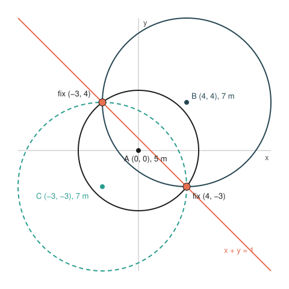

# Normal forms: deciding whether one equation is a consequence of the others

[Syllabus](../../../SYLLABUS.md) → [Algebraic geometry](../README.md) → [Polynomial Systems](../README.md#s01) → Normal forms

---

## General Overview

A warehouse robot finds itself by radio. Beacon A sits at the origin (0, 0) and reads a range of 5 m. Beacon B sits at (4, 4), in metres, and reads 7 m. So the robot is somewhere on two circles at once:

```math
f_1 = x^2 + y^2 - 25 = 0, \qquad f_2 = x^2 + y^2 - 8x - 8y - 17 = 0
```

A painted lane runs along the line $`x + y = 1`$. The question: **is the equation $`x + y - 1 = 0`$ a consequence of the two circle equations?** "Consequence" means it can be built from them by the moves algebra allows: multiply each equation by any polynomial and add the results. If it can, every position the beacons allow lies on the lane, and the combination is an exact proof.

Here the answer is yes, and short: $`x + y - 1 = \tfrac18 f_1 - \tfrac18 f_2`$. But that combination had to be found. In general nobody hands it over. This card gives a test that settles the question by plain division, with no searching. It also puts any system of equations into one tidy form, so two different systems can be compared line by line.

The tool is the **normal form**: the remainder after dividing by a Grobner basis (a list of equations with the same consequences as the system, rewritten so that division by it gives a definite answer; [Grobner bases](03-grobner-bases-and-buchberger.md)). Two facts make it work. The remainder is the same whichever way the division is done. And it is zero exactly when the polynomial is a consequence.

**Divide by a reduced Grobner basis: the remainder, called the normal form, is unique, it is zero exactly for the consequences of the system, and the reduced basis itself is unique, so two systems are equivalent exactly when their reduced bases match.**

**What kind of fact this is:** three theorems, proved on this card in Why it works; the reduced basis and the normal form are definitions.

### The picture: three beacons, one lane

<p align="center"></p>

Drawn to scale, real points only. The solid circles are beacons A and B. The dashed circle is a third beacon, C at (−3, −3), also reading 7 m. All three circles pass through the same two fixes, (4, −3) and (−3, 4). Both fixes sit on the lane. The card shows the lane equation follows from the circles, and that the pair A, C carries exactly the same equations as the pair A, B.

---

## The formula

Notation first, in words. The field is $`k = \mathbb{Q}`$, the rational numbers: every coefficient on this card is an exact fraction. $`I = \langle f_1, f_2 \rangle`$ is the **ideal** of the system: every combination $`a f_1 + b f_2`$ with polynomial multipliers $`a`$ and $`b`$ ([Ideals and varieties](01-ideals-and-varieties.md)). Its members are the consequences. $`\mathrm{LT}(g)`$ is the **leading term** of $`g`$: its largest term under the chosen monomial order ([Monomial orders](02-monomial-orders-and-division.md)). Here the order is lex with $`x > y`$: compare the power of $`x`$ first, then of $`y`$. A **Grobner basis** $`G`$ of $`I`$ is a generating set whose leading terms divide the leading term of every member of $`I`$ ([Grobner bases](03-grobner-bases-and-buchberger.md)).

This card introduces $`\mathrm{NF}_G(f)`$, the **normal form** of $`f`$: the remainder when $`f`$ is divided by the list $`G`$. The membership test is one line:

```math
f \in I \iff \mathrm{NF}_G(f) = 0
```

**Read it aloud:** a polynomial is a consequence of the system exactly when dividing it by a Grobner basis leaves nothing over.

A Grobner basis is **reduced** when it is tidied in two ways:

```math
\text{each } g \in G \text{ has leading coefficient } 1, \quad\text{and no term of any } g \text{ is divisible by } \mathrm{LT}(h) \text{ for another } h \in G
```

**Read it aloud:** every member starts with a plain 1, and no member contains anything another member could still divide away.

For the beacons, the reduced basis under lex $`x > y`$ is

```math
G = \{\, x + y - 1,\; y^2 - y - 12 \,\}
```

The first line is the lane. The second, $`(y - 4)(y + 3) = 0`$, gives the two fixes' $`y`$ values. Dividing $`x + y - 1`$ by $`G`$ leaves 0, so the lane is a consequence.

| Symbol | Plain meaning | In our example | Push it up and the answer… |
| --- | --- | --- | --- |
| $`k`$ | the field the coefficients live in | $`\mathbb{Q}`$, exact fractions | a bigger field gives the same basis |
| $`x, y`$ | the robot's position on the floor, in metres | the fixes $`(4, -3)`$ and $`(-3, 4)`$ | — |
| $`f_1, f_2, f_3`$ | the given equations, each set to 0 | circles of beacons A, B and C | more equations: a smaller set of fixes |
| $`I`$ | the ideal: all combinations of the given equations | $`\langle f_1, f_2 \rangle`$ | — |
| $`m`$, $`\mathrm{LT}(g)`$, $`\langle \mathrm{LT}(I) \rangle`$ | a monomial (a product of powers of $`x`$ and $`y`$); the largest term of $`g`$ in the order; everything built from the leading terms of members of $`I`$ | $`\mathrm{LT}(y^2 - y - 12) = y^2`$ | — |
| $`G`$, $`G'`$ | reduced Grobner bases of $`I`$ | $`x + y - 1`$, $`y^2 - y - 12`$ | — |
| $`g`$, $`h`$, $`g'`$, $`g_i`$ | single members of a basis | $`y^2 - y - 12`$ | — |
| $`f`$ | the polynomial being tested | $`x + y - 1`$ | — |
| $`\mathrm{NF}_G(f)`$ | the normal form: the remainder after dividing by $`G`$ | 0 for the lane | nonzero means "not a consequence" |
| $`q_1, \dots, q_t`$ | the multipliers the division finds, one per basis member | 1 and 0 for the lane | — |
| $`r`$, $`r_1`$, $`r_2`$ | remainders from a division | $`-2y - 6`$ for $`x - y - 7`$ | — |

### When it holds

- **Divide by a Grobner basis, not by the raw equations.** Divide $`x + y - 1`$ by $`f_1, f_2`$ as given: neither leading term $`x^2`$ divides $`x`$, so the remainder is $`x + y - 1`$ itself, and the test wrongly says "no".
- **Fix one monomial order.** The reduced basis is unique for each order, not across orders. Lex $`y > x`$ gives $`y + x - 1`$, $`x^2 - x - 12`$: a different list for the same ideal.
- **Coefficients in a field.** Division needs to divide one leading coefficient by another. Over the integers, $`2x`$ cannot be divided by $`3x`$ and the method changes.
- **Membership is not "vanishes at every fix".** The two agree only when the ideal is radical (whenever it holds a power of a polynomial, it holds the polynomial itself), and over $`\mathbb{Q}`$ only when complex fixes count too: $`x^2 + 1`$ has no rational point, yet 1 is not a consequence of it. The doubled system $`f_1`$, $`(x + y - 1)^2`$ has the same two fixes, yet $`x + y - 1`$ is not a member.
- **Finitely many variables and equations.** Every system here is finite; [Hilbert's basis theorem](08-hilbert-basis-theorem.md) shows nothing is lost by that.

---

## Why it works

### Step 0: a remainder cannot hide a member

The idea in words. Dividing by a list removes every term some leading term divides. What is left, the remainder, has no term any leading term divides. A Grobner basis has a leading term dividing the leading term of *every* nonzero member of the ideal. So a nonzero remainder cannot be a member: its leading term would have to be divisible, and none of its terms is.

The rest is careful bookkeeping around that one clash.

### Step 1: the remainder does not depend on how you divide

Division in several variables has choices: which basis member to use when two leading terms both divide. Different choices give different multipliers. The remainder is still the same.

Suppose two divisions of $`f`$ by $`G`$ leave $`r_1`$ and $`r_2`$. Both equal $`f`$ minus a combination of $`G`$, so $`r_1 - r_2`$ is in $`I`$. Every term of $`r_1 - r_2`$ comes from $`r_1`$ or $`r_2`$, so no leading term of $`G`$ divides any of them. By Step 0, $`r_1 - r_2 = 0`$.

The check confirms it: $`x^2`$ divided by the four-member Buchberger output and by the two-member reduced basis both leave $`-y + 13`$.

### Step 2: zero remainder means member, and nothing else does

Division writes $`f = q_1 g_1 + \dots + q_t g_t + r`$, where the $`q_i`$ are the multipliers the division found and $`t`$ is the number of basis members.

- If $`r = 0`$, then $`f`$ is a combination of $`G`$, and $`G`$ lies in $`I`$, so $`f`$ is a consequence. The $`q_i`$ are a certificate anyone can multiply out.
- If $`f`$ is in $`I`$, then $`r = f - \sum q_i g_i`$ is in $`I`$ too. By Step 0 it is 0.

So $`\mathrm{NF}_G(f) = 0`$ exactly for the members. For the lane, the division takes one step: $`x + y - 1`$ minus $`1 \cdot (x + y - 1)`$ leaves 0.

### Step 3: tidy any Grobner basis into the reduced one

Buchberger's algorithm stops with a correct but untidy list. For the beacons it returns four polynomials: $`f_1`$, $`f_2`$, $`8x + 8y - 8`$ and $`2y^2 - 2y - 24`$. Buchberger's first criterion ([Grobner bases](03-grobner-bases-and-buchberger.md)) would let the loop skip the last pair, whose leading terms $`8x`$ and $`2y^2`$ share no variable; the check computes every pair anyway. Three moves tidy the list:

1. **Drop the redundant members.** Go through the members one at a time. Drop $`g`$ when the leading term of a member still kept divides $`\mathrm{LT}(g)`$. Of two members with the same leading term, this keeps one. Here $`x`$ divides $`x^2`$, so $`f_1`$ and $`f_2`$ go.
2. **Make each leading coefficient 1.** Divide $`8x + 8y - 8`$ by 8 and $`2y^2 - 2y - 24`$ by 2.
3. **Clean the tails.** Replace everything after each leading term by its normal form modulo the other members.

Move 3 changed nothing above, so the check also tidies a messier basis of the same ideal: $`2x + 2y^2 - 26`$, $`2y^2 - 2y - 24`$, $`xy + 12`$. Move 1 drops $`xy + 12`$, since $`x`$ divides $`xy`$. Move 2 gives $`x + y^2 - 13`$ and $`y^2 - y - 12`$. Move 3 reduces the tail $`y^2 - 13`$ by $`y^2 - y - 12`$ to $`y - 1`$, and $`x + y - 1`$ appears again.

None of the moves changes the ideal, and the result is still a Grobner basis: the leading terms that remain divide the same monomials as before.

### Step 4: the reduced basis is unique

Take two reduced Grobner bases $`G`$ and $`G'`$ of one ideal, under one order.

- **Same leading terms.** In each, the leading terms are the smallest monomials that lead some member of $`I`$, none dividing another. That set is fixed by $`I`$ alone, so both bases have the same leading terms.
- **Same members.** Take $`g`$ in $`G`$ and $`g'`$ in $`G'`$ with the same leading term. Then $`g - g'`$ is in $`I`$ and its leading terms cancel. Its remaining terms are tail terms of $`g`$ or $`g'`$, which reducedness keeps clear of every leading term. So $`g - g'`$ is its own remainder, and Step 2 makes it 0.

<details>
<summary>Detailed proof: why the leading terms are fixed by the ideal</summary>

Write $`\langle \mathrm{LT}(I) \rangle`$ for the set of all polynomials built from leading terms of members of $`I`$. A Grobner basis means the leading terms $`\mathrm{LT}(g_1), \dots, \mathrm{LT}(g_t)`$ generate it.

A monomial lies in an ideal generated by monomials exactly when one of the generators divides it. So the monomials of $`\langle \mathrm{LT}(I) \rangle`$ form an "upward closed" set. Its minimal elements, those divisible by no other member, are determined by the set alone.

In a reduced basis no leading term divides another (move 1). Each leading term is a minimal element. Suppose a monomial $`m`$ of the set divides $`\mathrm{LT}(g)`$. Some $`\mathrm{LT}(h)`$ divides $`m`$, so $`\mathrm{LT}(h)`$ divides $`\mathrm{LT}(g)`$, and move 1 forces $`h = g`$. Then $`\mathrm{LT}(g)`$ divides $`m`$ and $`m`$ divides $`\mathrm{LT}(g)`$, so $`m = \mathrm{LT}(g)`$.

Each minimal element also appears. Take a minimal element $`m`$. Some $`\mathrm{LT}(g)`$ divides it, and $`\mathrm{LT}(g)`$ is in the set, so by minimality $`\mathrm{LT}(g) = m`$. So the leading terms of any reduced basis are exactly the minimal elements of $`\langle \mathrm{LT}(I) \rangle`$.

For the beacons that set is all monomials divisible by $`x`$ or by $`y^2`$; its minimal elements are $`x`$ and $`y^2`$.

</details>

### Step 5: two systems, one test

Two systems carry the same consequences exactly when their ideals are equal. Under one order, equal ideals have one reduced basis (Step 4), and different ideals cannot share one, since a basis generates its ideal. So compare reduced bases.

Beacon pair A, C gives $`f_1`$ and $`f_3 = x^2 + y^2 + 6x + 6y - 31`$. Buchberger returns $`f_1`$, $`f_3`$, $`-6x - 6y + 6`$, $`2y^2 - 2y - 24`$. That list differs from pair A, B's list, yet both tidy to $`x + y - 1`$, $`y^2 - y - 12`$. The two beacon pairs pin down exactly the same equations.

A second road confirms it with no reduced basis at all: each system's equations divide to 0 by the other's basis, so each ideal holds the other.

### Step 6: the normal form is the function on the fixes

The remainder of $`f`$ agrees with $`f`$ at every fix, since the two differ by a member, which vanishes there. The remainders use only **standard monomials**: those no leading term divides. Here they are 1 and $`y`$, two of them, one per fix. So $`\mathrm{NF}_G(x^2) = -y + 13`$ is the cheapest formula for $`x^2`$ on the fixes: 16 at $`y = -3`$ and 9 at $`y = 4`$. Counting standard monomials to count solutions is [Finitely many solutions](07-solving-zero-dimensional-systems.md).

---

## Worked numbers, by hand

The basis $`G = \{x + y - 1,\; y^2 - y - 12\}`$, lex $`x > y`$.

| Step | Arithmetic | Value |
| --- | --- | --- |
| S-polynomial of $`f_1, f_2`$ | $`f_1 - f_2`$ | $`8x + 8y - 8`$ |
| it reduces? | neither $`x^2`$ divides $`8x`$ | kept |
| next S-polynomial, reduced | $`f_1 - \tfrac{x}{8}(8x + 8y - 8)`$, then divide | $`2y^2 - 2y - 24`$ |
| Buchberger output | four members | $`f_1, f_2, 8x + 8y - 8, 2y^2 - 2y - 24`$ |
| drop, make monic, clean | $`x \mid x^2`$; divide by 8 and 2 | $`x + y - 1,\; y^2 - y - 12`$ |
| $`\mathrm{NF}(x + y - 1)`$ | subtract $`1 \cdot (x + y - 1)`$ | **0: a consequence** |
| certificate | $`\tfrac18 f_1 - \tfrac18 f_2`$ | $`x + y - 1`$ |
| $`\mathrm{NF}(xy + 12)`$ | subtract $`y(x + y - 1)`$: $`-y^2 + y + 12`$; add $`y^2 - y - 12`$ | 0 |
| $`\mathrm{NF}(x - y - 7)`$ | subtract $`x + y - 1`$ | $`-2y - 6`$, not 0 |
| $`x - y - 7`$ at the fix $`(-3, 4)`$ | $`-3 - 4 - 7`$, and $`-2 \cdot 4 - 6`$ | $`-14`$ both ways |
| $`\mathrm{NF}(x^2)`$ | $`x^2 \to -xy + x \to x + y^2 - y \to y^2 - 2y + 1 \to -y + 13`$ | $`-y + 13`$ |
| pair A, C, tidied | same three moves | $`x + y - 1,\; y^2 - y - 12`$: **same system** |

So the lane is a consequence of the two range circles: any position consistent with both beacons is on the lane, and $`\tfrac18 f_1 - \tfrac18 f_2`$ proves it. The test also answers "no" with a witness: $`x - y - 7`$ leaves $`-2y - 6`$, which is $`-14`$ at the fix $`(-3, 4)`$.

### What breaks if you drop a piece

| Mistake | Comes out at | What went wrong |
| --- | --- | --- |
| Divide by $`f_1, f_2`$ as given | remainder $`x + y - 1`$: "not a consequence" | the raw list is no Grobner basis; $`x^2`$ never divides $`x`$ |
| Compare the raw Buchberger lists | four members each, unequal: "different systems" | only the reduced basis is unique |
| Switch to lex $`y > x`$ for one system | $`y + x - 1,\; x^2 - x - 12`$: "different" | uniqueness holds for one fixed order |
| Test $`f_1, (x + y - 1)^2`$ by the fixes | $`x + y - 1`$ is 0 at both fixes, yet $`\mathrm{NF} = \tfrac{1}{12}y^3 - \tfrac{1}{12}y^2 - y`$ | the doubled ideal is not radical; points miss multiplicity |

The doubled system's reduced basis is $`x - \tfrac{1}{12}y^3 + \tfrac{1}{12}y^2 + 2y - 1`$, $`y^4 - 2y^3 - 23y^2 + 24y + 144`$. The second member is $`(y^2 - y - 12)^2`$: each fix counted twice. The code prints all four rows.

---

## Code, from first principles, and it actually runs

Both programs build polynomials as maps from exponent pairs to exact fractions, then write out division, S-polynomials, Buchberger's loop and the three tidying moves. Nothing imported knows any of it. Five roads must agree. The normal form says member or not. A hand-written certificate is multiplied out and must give the target back. Every remainder must equal its polynomial at both fixes, which lie on all three circles. And the two beacon pairs must give one reduced basis, while each pair's equations also reduce to 0 by the other's basis. The number of standard monomials must equal the number of fixes. The same code also tidies the house arm's basis.

### Python

```python
# Normal forms and ideal membership -- the check behind the card.  Standard library
# only; fractions does exact rational arithmetic and nothing more.  Polynomials in x, y
# over the rationals are dicts {(i, j): coefficient of x^i y^j}; order lex, x > y unless
# said.  Division, S-polynomials, Buchberger and reduction are all written out here.
from fractions import Fraction as F

XY = lambda m: m                 # lex, x > y: compare the x power first
YX = lambda m: (m[1], m[0])      # lex, y > x: compare the y power first

def P(*terms):                   # P((c, i, j), ...) builds c x^i y^j + ...
    p = {}
    for c, i, j in terms:
        p[(i, j)] = p.get((i, j), 0) + F(c)
    return {m: c for m, c in p.items() if c != 0}

def add(p, q, s=1):              # p + s q
    r = dict(p)
    for m, c in q.items():
        r[m] = r.get(m, 0) + s * c
    return {m: c for m, c in r.items() if c != 0}

def mul(p, q):
    r = {}
    for (a, b), c in p.items():
        for (d, e), k in q.items():
            r[(a + d, b + e)] = r.get((a + d, b + e), 0) + c * k
    return {m: c for m, c in r.items() if c != 0}

def lt(p, o): return max(p, key=o)
def divides(m, n): return m[0] <= n[0] and m[1] <= n[1]

def nf(f, G, o=XY):              # divide f by the list G; return the remainder r
    p, r = dict(f), {}
    while p:
        m = lt(p, o)
        for g in G:
            n = lt(g, o)
            if divides(n, m):
                p = add(p, mul({(m[0] - n[0], m[1] - n[1]): p[m] / g[n]}, g), -1)
                break
        else:
            r[m] = p.pop(m)
    return r

def spoly(f, g, o):              # cancel the two leading terms against each other
    a, b = lt(f, o), lt(g, o)
    L = (max(a[0], b[0]), max(a[1], b[1]))
    return add(mul({(L[0] - a[0], L[1] - a[1]): 1 / f[a]}, f),
               mul({(L[0] - b[0], L[1] - b[1]): 1 / g[b]}, g), -1)

def buchberger(F_, o=XY):        # add remainders of S-polynomials until all reduce to 0
    G = [dict(f) for f in F_]
    pairs = [(i, j) for j in range(len(G)) for i in range(j)]
    while pairs:
        i, j = pairs.pop(0)
        r = nf(spoly(G[i], G[j], o), G, o)
        if r:
            pairs += [(k, len(G)) for k in range(len(G))]
            G.append(r)
    return G

def reduce_basis(G, o=XY):       # the unique tidy form: drop, make monic, clean the tails
    keep = [g for i, g in enumerate(G)
            if not any(divides(lt(h, o), lt(g, o)) and (lt(h, o) != lt(g, o) or j < i)
                       for j, h in enumerate(G) if j != i)]
    keep = [{m: c / g[lt(g, o)] for m, c in g.items()} for g in keep]
    out = []
    for i, g in enumerate(keep):
        head = lt(g, o)
        tail = nf({m: c for m, c in g.items() if m != head}, keep[:i] + keep[i + 1:], o)
        out.append(add({head: F(1)}, tail))
    return sorted(out, key=lambda g: o(lt(g, o)), reverse=True)

def fmt(p, o=XY):
    if not p: return "0"
    s = ""
    for k, m in enumerate(sorted(p, key=o, reverse=True)):
        c = p[m]
        mono = ("x" if m[0] else "") + (f"^{m[0]}" if m[0] > 1 else "") + \
               ("y" if m[1] else "") + (f"^{m[1]}" if m[1] > 1 else "")
        a = abs(c)
        cs = "" if (a == 1 and mono) else (str(a) if a.denominator == 1 or not mono else f"({a})")
        s += ("-" if c < 0 else "") if k == 0 else (" - " if c < 0 else " + ")
        s += cs + mono
    return s

def ev(p, pt): return sum(c * F(pt[0]) ** i * F(pt[1]) ** j for (i, j), c in p.items())
def L(G, o=XY): return "[" + ", ".join(fmt(g, o) for g in G) + "]"
def yn(b): return "yes" if b else "no"

f1 = P((1, 2, 0), (1, 0, 2), (-25, 0, 0))                          # beacon A (0, 0), 5 m
f2 = P((1, 2, 0), (1, 0, 2), (-8, 1, 0), (-8, 0, 1), (-17, 0, 0))  # beacon B (4, 4), 7 m
f3 = P((1, 2, 0), (1, 0, 2), (6, 1, 0), (6, 0, 1), (-31, 0, 0))    # beacon C (-3, -3), 7 m
lane = P((1, 1, 0), (1, 0, 1), (-1, 0, 0))                         # x + y - 1
pts = [(4, -3), (-3, 4)]
print("figure, beacon A (0, 0) r 5; beacon B (4, 4) r 7; beacon C (-3, -3) r 7; fixes (4, -3) (-3, 4); lane x + y = 1")
print("system 1: f1 =", fmt(f1), "; f2 =", fmt(f2))
raw1 = buchberger([f1, f2]);  G = reduce_basis(raw1)
print("Buchberger output, system 1:", L(raw1))
print("reduced basis, lex x > y:", L(G))
std = [(i, j) for i in range(4) for j in range(4) if not any(divides(lt(g, XY), (i, j)) for g in G)]
print("standard monomials (no leading term divides them):", ", ".join(fmt({m: F(1)}) for m in sorted(std)), "->", len(std), "; fixes:", len(pts))
tests = [("x + y - 1", lane), ("xy + 12", P((1, 1, 1), (12, 0, 0))), ("x - y - 7", P((1, 1, 0), (-1, 0, 1), (-7, 0, 0))), ("x^2", P((1, 2, 0)))]
for name, p in tests:
    r = nf(p, G)
    print(f"NF({name}) = {fmt(r)}; member: {yn(not r)}; values at fixes {[str(ev(p, q)) for q in pts]}, remainder there {[str(ev(r, q)) for q in pts]}")
    assert all(ev(p, q) == ev(r, q) for q in pts)                  # remainder agrees at every fix
cert1 = add(mul(P((F(1, 8), 0, 0)), f1), mul(P((F(-1, 8), 0, 0)), f2))
c = P((F(1, 16), 1, 0), (F(1, 16), 0, 1), (F(1, 16), 0, 0))         # (x + y + 1)/16
cert2 = add(mul(c, add(f1, f2, -1)), mul(P((F(-1, 2), 0, 0)), f1))
print("certificate (1/8)f1 - (1/8)f2 =", fmt(cert1))
print("certificate ((x + y + 1)/16)(f1 - f2) - (1/2)f1 =", fmt(cert2))
print("NF(x^2) by the raw Buchberger list =", fmt(nf(tests[3][1], raw1)), "; by the reduced basis =", fmt(nf(tests[3][1], G)))
H = [P((2, 1, 0), (2, 0, 2), (-26, 0, 0)), P((2, 0, 2), (-2, 0, 1), (-24, 0, 0)), P((1, 1, 1), (12, 0, 0))]
print("messy basis H:", L(H), "; tail y^2 - 13 reduced by y^2 - y - 12:", fmt(nf(P((1, 0, 2), (-13, 0, 0)), [G[1]])), "; tidied:", L(reduce_basis(H)))
raw2 = buchberger([f1, f3]);  G2 = reduce_basis(raw2)
print("system 2: f1 =", fmt(f1), "; f3 =", fmt(f3))
print("Buchberger output, system 2:", L(raw2))
print("reduced basis, system 2:", L(G2), "; same as system 1:", yn(G2 == G))
both = all(not nf(g, G) for g in [f1, f3]) and all(not nf(g, G2) for g in [f1, f2])
print("each system's equations reduce to 0 by the other's basis:", yn(both))
arm = reduce_basis(buchberger([P((1, 2, 0), (1, 0, 2), (-9, 0, 0)), P((1, 2, 0), (-8, 1, 0), (1, 0, 2), (12, 0, 0))]))
print("house arm, elbow (x, y), links 3 m and 2 m, hand at (4, 0) m: reduced basis", L(arm), "; NF(8x - 21) =", fmt(nf(P((8, 1, 0), (-21, 0, 0)), arm)))
print("mistake 1, divide x + y - 1 by [f1, f2] as given: remainder", fmt(nf(lane, [f1, f2])))
print("mistake 2, compare the raw Buchberger lists: equal:", yn(raw1 == raw2), f"({len(raw1)} and {len(raw2)} polynomials)")
Gy = reduce_basis(buchberger([f1, f2], YX), YX)
print("mistake 3, reduced basis in lex y > x:", L(Gy, YX), "; equal to the x > y basis:", yn(Gy == G))
GJ = reduce_basis(buchberger([f1, mul(lane, lane)]))
print("mistake 4, doubled system [f1, (x + y - 1)^2], reduced basis:", L(GJ))
print("  x + y - 1 at the fixes:", [str(ev(lane, q)) for q in pts], "; NF =", fmt(nf(lane, GJ)))
assert G == [lane, P((1, 0, 2), (-1, 0, 1), (-12, 0, 0))]          # x + y - 1, y^2 - y - 12
assert cert1 == lane and cert2 == tests[1][1]                      # certificates expand back
assert len(std) == len(pts)                                        # count matches the points
assert all(ev(f, q) == 0 for f in (f1, f2, f3) for q in pts)       # fixes lie on all three circles
assert nf(tests[1][1], G) == {} and nf(tests[2][1], G) != {}       # member and non-member
assert G2 == G and both and nf(tests[3][1], raw1) == nf(tests[3][1], G) and reduce_basis(H) == G
assert nf(lane, [f1, f2]) == lane and nf(lane, GJ) != {}           # the two traps
assert raw1 == [f1, f2, P((8, 1, 0), (8, 0, 1), (-8, 0, 0)), H[1]] and raw2 == [f1, f3, P((-6, 1, 0), (-6, 0, 1), (6, 0, 0)), H[1]]
assert arm == [P((1, 1, 0), (F(-21, 8), 0, 0)), P((1, 0, 2), (F(-135, 64), 0, 0))] and nf(P((8, 1, 0), (-21, 0, 0)), arm) == {}
print("ALL CHECKS PASS")
```

**Ran 2026-11-17 on macOS, Python 3.14.10, standard library only. All checks passed. Output, pasted from the run:**

```
figure, beacon A (0, 0) r 5; beacon B (4, 4) r 7; beacon C (-3, -3) r 7; fixes (4, -3) (-3, 4); lane x + y = 1
system 1: f1 = x^2 + y^2 - 25 ; f2 = x^2 - 8x + y^2 - 8y - 17
Buchberger output, system 1: [x^2 + y^2 - 25, x^2 - 8x + y^2 - 8y - 17, 8x + 8y - 8, 2y^2 - 2y - 24]
reduced basis, lex x > y: [x + y - 1, y^2 - y - 12]
standard monomials (no leading term divides them): 1, y -> 2 ; fixes: 2
NF(x + y - 1) = 0; member: yes; values at fixes ['0', '0'], remainder there ['0', '0']
NF(xy + 12) = 0; member: yes; values at fixes ['0', '0'], remainder there ['0', '0']
NF(x - y - 7) = -2y - 6; member: no; values at fixes ['0', '-14'], remainder there ['0', '-14']
NF(x^2) = -y + 13; member: no; values at fixes ['16', '9'], remainder there ['16', '9']
certificate (1/8)f1 - (1/8)f2 = x + y - 1
certificate ((x + y + 1)/16)(f1 - f2) - (1/2)f1 = xy + 12
NF(x^2) by the raw Buchberger list = -y + 13 ; by the reduced basis = -y + 13
messy basis H: [2x + 2y^2 - 26, 2y^2 - 2y - 24, xy + 12] ; tail y^2 - 13 reduced by y^2 - y - 12: y - 1 ; tidied: [x + y - 1, y^2 - y - 12]
system 2: f1 = x^2 + y^2 - 25 ; f3 = x^2 + 6x + y^2 + 6y - 31
Buchberger output, system 2: [x^2 + y^2 - 25, x^2 + 6x + y^2 + 6y - 31, -6x - 6y + 6, 2y^2 - 2y - 24]
reduced basis, system 2: [x + y - 1, y^2 - y - 12] ; same as system 1: yes
each system's equations reduce to 0 by the other's basis: yes
house arm, elbow (x, y), links 3 m and 2 m, hand at (4, 0) m: reduced basis [x - 21/8, y^2 - 135/64] ; NF(8x - 21) = 0
mistake 1, divide x + y - 1 by [f1, f2] as given: remainder x + y - 1
mistake 2, compare the raw Buchberger lists: equal: no (4 and 4 polynomials)
mistake 3, reduced basis in lex y > x: [y + x - 1, x^2 - x - 12] ; equal to the x > y basis: no
mistake 4, doubled system [f1, (x + y - 1)^2], reduced basis: [x - (1/12)y^3 + (1/12)y^2 + 2y - 1, y^4 - 2y^3 - 23y^2 + 24y + 144]
  x + y - 1 at the fixes: ['0', '0'] ; NF = (1/12)y^3 - (1/12)y^2 - y
ALL CHECKS PASS
```

### Rust

Same numbers, same labels, built with `rustc --edition 2021 -O`.

```rust
// Normal forms and ideal membership -- the same check as the Python, in Rust.  No crates.
// Fractions are an i128 struct whose checked_mul stops the run on overflow.  Polynomials
// in x, y over the rationals map (i, j) to the coefficient of x^i y^j; lex, x > y unless said.
use std::collections::BTreeMap;

#[derive(Clone, Copy, PartialEq, Debug)]
struct Q { n: i128, d: i128 }
fn gcd(a: i128, b: i128) -> i128 { if b == 0 { a.abs() } else { gcd(b, a % b) } }
fn q(n: i128, d: i128) -> Q { let g = gcd(n, d).max(1) * d.signum(); Q { n: n / g, d: d / g } }
fn qmul(a: Q, b: Q) -> Q { q(a.n.checked_mul(b.n).unwrap(), a.d.checked_mul(b.d).unwrap()) }
fn qadd(a: Q, b: Q) -> Q { q(a.n.checked_mul(b.d).unwrap().checked_add(b.n.checked_mul(a.d).unwrap()).unwrap(), a.d.checked_mul(b.d).unwrap()) }
fn qdiv(a: Q, b: Q) -> Q { qmul(a, q(b.d, b.n)) }
fn qs(a: Q) -> String { if a.d == 1 { format!("{}", a.n) } else { format!("{}/{}", a.n, a.d) } }

type M = (u32, u32);
type P = BTreeMap<M, Q>;
fn key(m: M, yx: bool) -> M { if yx { (m.1, m.0) } else { m } }
fn poly(t: &[(i128, i128, u32, u32)]) -> P {               // (num, den, i, j) terms
    let mut p = P::new();
    for &(n, d, i, j) in t { p = add(&p, &P::from([((i, j), q(n, d))]), q(1, 1)) }
    p
}
fn add(p: &P, r: &P, s: Q) -> P {                           // p + s r
    let mut o = p.clone();
    for (m, c) in r { let v = qadd(*o.get(m).unwrap_or(&q(0, 1)), qmul(s, *c)); o.insert(*m, v); }
    o.retain(|_, c| c.n != 0);
    o
}
fn mul(p: &P, r: &P) -> P {
    let mut o = P::new();
    for (a, c) in p { for (b, k) in r { o = add(&o, &P::from([((a.0 + b.0, a.1 + b.1), qmul(*c, *k))]), q(1, 1)) } }
    o
}
fn lt(p: &P, yx: bool) -> M { *p.keys().max_by_key(|m| key(**m, yx)).unwrap() }
fn divides(m: M, n: M) -> bool { m.0 <= n.0 && m.1 <= n.1 }
fn nf(f: &P, g: &[P], yx: bool) -> P {                      // divide f by the list g
    let (mut p, mut r) = (f.clone(), P::new());
    while !p.is_empty() {
        let m = lt(&p, yx);
        match g.iter().find(|h| divides(lt(h, yx), m)) {
            Some(h) => {
                let n = lt(h, yx);
                let t = P::from([((m.0 - n.0, m.1 - n.1), qdiv(p[&m], h[&n]))]);
                p = add(&p, &mul(&t, h), q(-1, 1));
            }
            None => { r.insert(m, p.remove(&m).unwrap()); }
        }
    }
    r
}
fn spoly(f: &P, g: &P, yx: bool) -> P {
    let (a, b) = (lt(f, yx), lt(g, yx));
    let l = (a.0.max(b.0), a.1.max(b.1));
    let tf = P::from([((l.0 - a.0, l.1 - a.1), qdiv(q(1, 1), f[&a]))]);
    let tg = P::from([((l.0 - b.0, l.1 - b.1), qdiv(q(1, 1), g[&b]))]);
    add(&mul(&tf, f), &mul(&tg, g), q(-1, 1))
}
fn buchberger(f: &[P], yx: bool) -> Vec<P> {
    let mut g: Vec<P> = f.to_vec();
    let mut pairs: Vec<(usize, usize)> = Vec::new();
    for j in 0..g.len() { for i in 0..j { pairs.push((i, j)) } }
    while !pairs.is_empty() {
        let (i, j) = pairs.remove(0);
        let r = nf(&spoly(&g[i], &g[j], yx), &g, yx);
        if !r.is_empty() { for k in 0..g.len() { pairs.push((k, g.len())) } g.push(r); }
    }
    g
}
fn reduce_basis(g: &[P], yx: bool) -> Vec<P> {              // drop, make monic, clean the tails
    let keep: Vec<P> = g.iter().enumerate().filter(|(i, h)| !g.iter().enumerate().any(|(j, k)|
        j != *i && divides(lt(k, yx), lt(h, yx)) && (lt(k, yx) != lt(h, yx) || j < *i)))
        .map(|(_, h)| { let c = h[&lt(h, yx)]; h.iter().map(|(m, v)| (*m, qdiv(*v, c))).collect() })
        .collect();
    let mut out: Vec<P> = Vec::new();
    for (i, h) in keep.iter().enumerate() {
        let head = lt(h, yx);
        let mut tail = h.clone();
        tail.remove(&head);
        let others: Vec<P> = keep.iter().enumerate().filter(|(j, _)| *j != i).map(|(_, k)| k.clone()).collect();
        out.push(add(&nf(&tail, &others, yx), &P::from([(head, q(1, 1))]), q(1, 1)));
    }
    out.sort_by_key(|h| std::cmp::Reverse(key(lt(h, yx), yx)));
    out
}
fn fmt(p: &P, yx: bool) -> String {
    if p.is_empty() { return "0".to_string() }
    let mut ms: Vec<M> = p.keys().copied().collect();
    ms.sort_by_key(|m| std::cmp::Reverse(key(*m, yx)));
    let mut s = String::new();
    for (k, m) in ms.iter().enumerate() {
        let c = p[m];
        let pw = |v: &str, e: u32| if e == 0 { String::new() } else if e == 1 { v.to_string() } else { format!("{}^{}", v, e) };
        let mono = pw("x", m.0) + &pw("y", m.1);
        let a = q(c.n.abs(), c.d);
        let cs = if a == q(1, 1) && !mono.is_empty() { String::new() }
                 else if a.d == 1 || mono.is_empty() { qs(a) } else { format!("({})", qs(a)) };
        s += if k == 0 { if c.n < 0 { "-" } else { "" } } else if c.n < 0 { " - " } else { " + " };
        s += &(cs + &mono);
    }
    s
}
fn ev(p: &P, pt: (i128, i128)) -> Q { p.iter().fold(q(0, 1), |s, (m, c)| qadd(s, qmul(*c, q(pt.0.pow(m.0) * pt.1.pow(m.1), 1)))) }
fn vals(p: &P, pts: &[(i128, i128)]) -> String {
    format!("[{}]", pts.iter().map(|t| format!("'{}'", qs(ev(p, *t)))).collect::<Vec<_>>().join(", "))
}
fn l(g: &[P], yx: bool) -> String { format!("[{}]", g.iter().map(|h| fmt(h, yx)).collect::<Vec<_>>().join(", ")) }
fn yn(b: bool) -> &'static str { if b { "yes" } else { "no" } }

fn main() {
    let f1 = poly(&[(1, 1, 2, 0), (1, 1, 0, 2), (-25, 1, 0, 0)]);                    // beacon A
    let f2 = poly(&[(1, 1, 2, 0), (1, 1, 0, 2), (-8, 1, 1, 0), (-8, 1, 0, 1), (-17, 1, 0, 0)]);
    let f3 = poly(&[(1, 1, 2, 0), (1, 1, 0, 2), (6, 1, 1, 0), (6, 1, 0, 1), (-31, 1, 0, 0)]);
    let lane = poly(&[(1, 1, 1, 0), (1, 1, 0, 1), (-1, 1, 0, 0)]);
    let pts = [(4, -3), (-3, 4)];
    println!("figure, beacon A (0, 0) r 5; beacon B (4, 4) r 7; beacon C (-3, -3) r 7; fixes (4, -3) (-3, 4); lane x + y = 1");
    println!("system 1: f1 = {} ; f2 = {}", fmt(&f1, false), fmt(&f2, false));
    let raw1 = buchberger(&[f1.clone(), f2.clone()], false);  let g = reduce_basis(&raw1, false);
    println!("Buchberger output, system 1: {}", l(&raw1, false));
    println!("reduced basis, lex x > y: {}", l(&g, false));
    let std: Vec<M> = (0..4u32).flat_map(|i| (0..4u32).map(move |j| (i, j)))
        .filter(|m| !g.iter().any(|h| divides(lt(h, false), *m))).collect();
    let sn: Vec<String> = std.iter().map(|m| fmt(&P::from([(*m, q(1, 1))]), false)).collect();
    println!("standard monomials (no leading term divides them): {} -> {} ; fixes: {}", sn.join(", "), std.len(), pts.len());
    let tests = [("x + y - 1", lane.clone()), ("xy + 12", poly(&[(1, 1, 1, 1), (12, 1, 0, 0)])),
                 ("x - y - 7", poly(&[(1, 1, 1, 0), (-1, 1, 0, 1), (-7, 1, 0, 0)])), ("x^2", poly(&[(1, 1, 2, 0)]))];
    for (name, p) in &tests {
        let r = nf(p, &g, false);
        println!("NF({}) = {}; member: {}; values at fixes {}, remainder there {}",
                 name, fmt(&r, false), yn(r.is_empty()), vals(p, &pts), vals(&r, &pts));
        assert!(pts.iter().all(|t| ev(p, *t) == ev(&r, *t)));
    }
    let cert1 = add(&mul(&poly(&[(1, 8, 0, 0)]), &f1), &mul(&poly(&[(-1, 8, 0, 0)]), &f2), q(1, 1));
    let c = poly(&[(1, 16, 1, 0), (1, 16, 0, 1), (1, 16, 0, 0)]);
    let cert2 = add(&mul(&c, &add(&f1, &f2, q(-1, 1))), &mul(&poly(&[(-1, 2, 0, 0)]), &f1), q(1, 1));
    println!("certificate (1/8)f1 - (1/8)f2 = {}", fmt(&cert1, false));
    println!("certificate ((x + y + 1)/16)(f1 - f2) - (1/2)f1 = {}", fmt(&cert2, false));
    let (x2a, x2b) = (nf(&tests[3].1, &raw1, false), nf(&tests[3].1, &g, false));
    println!("NF(x^2) by the raw Buchberger list = {} ; by the reduced basis = {}", fmt(&x2a, false), fmt(&x2b, false));
    let h = [poly(&[(2, 1, 1, 0), (2, 1, 0, 2), (-26, 1, 0, 0)]), poly(&[(2, 1, 0, 2), (-2, 1, 0, 1), (-24, 1, 0, 0)]), poly(&[(1, 1, 1, 1), (12, 1, 0, 0)])];
    println!("messy basis H: {} ; tail y^2 - 13 reduced by y^2 - y - 12: {} ; tidied: {}", l(&h, false), fmt(&nf(&poly(&[(1, 1, 0, 2), (-13, 1, 0, 0)]), &[g[1].clone()], false), false), l(&reduce_basis(&h, false), false));
    let raw2 = buchberger(&[f1.clone(), f3.clone()], false);
    let g2 = reduce_basis(&raw2, false);
    println!("system 2: f1 = {} ; f3 = {}", fmt(&f1, false), fmt(&f3, false));
    println!("Buchberger output, system 2: {}", l(&raw2, false));
    println!("reduced basis, system 2: {} ; same as system 1: {}", l(&g2, false), yn(g2 == g));
    let both = [&f1, &f3].iter().all(|h| nf(h, &g, false).is_empty())
            && [&f1, &f2].iter().all(|h| nf(h, &g2, false).is_empty());
    println!("each system's equations reduce to 0 by the other's basis: {}", yn(both));
    let arm = reduce_basis(&buchberger(&[poly(&[(1, 1, 2, 0), (1, 1, 0, 2), (-9, 1, 0, 0)]), poly(&[(1, 1, 2, 0), (-8, 1, 1, 0), (1, 1, 0, 2), (12, 1, 0, 0)])], false), false);
    println!("house arm, elbow (x, y), links 3 m and 2 m, hand at (4, 0) m: reduced basis {} ; NF(8x - 21) = {}", l(&arm, false), fmt(&nf(&poly(&[(8, 1, 1, 0), (-21, 1, 0, 0)]), &arm, false), false));
    let m1 = nf(&lane, &[f1.clone(), f2.clone()], false);
    println!("mistake 1, divide x + y - 1 by [f1, f2] as given: remainder {}", fmt(&m1, false));
    println!("mistake 2, compare the raw Buchberger lists: equal: {} ({} and {} polynomials)", yn(raw1 == raw2), raw1.len(), raw2.len());
    let gy = reduce_basis(&buchberger(&[f1.clone(), f2.clone()], true), true);
    println!("mistake 3, reduced basis in lex y > x: {} ; equal to the x > y basis: {}", l(&gy, true), yn(gy == g));
    let gj = reduce_basis(&buchberger(&[f1.clone(), mul(&lane, &lane)], false), false);
    let nj = nf(&lane, &gj, false);
    println!("mistake 4, doubled system [f1, (x + y - 1)^2], reduced basis: {}", l(&gj, false));
    println!("  x + y - 1 at the fixes: {} ; NF = {}", vals(&lane, &pts), fmt(&nj, false));
    assert!(g == vec![lane.clone(), poly(&[(1, 1, 0, 2), (-1, 1, 0, 1), (-12, 1, 0, 0)])]);
    assert!(cert1 == lane && cert2 == tests[1].1);
    assert!(std.len() == pts.len());
    assert!([&f1, &f2, &f3].iter().all(|h| pts.iter().all(|t| ev(h, *t) == q(0, 1))));
    assert!(nf(&tests[1].1, &g, false).is_empty() && !nf(&tests[2].1, &g, false).is_empty());
    assert!(g2 == g && both && x2a == x2b && reduce_basis(&h, false) == g);
    assert!(m1 == lane && !nj.is_empty());
    assert!(raw1 == [f1.clone(), f2, poly(&[(8, 1, 1, 0), (8, 1, 0, 1), (-8, 1, 0, 0)]), h[1].clone()] && raw2 == [f1, f3, poly(&[(-6, 1, 1, 0), (-6, 1, 0, 1), (6, 1, 0, 0)]), h[1].clone()]);
    assert!(arm == [poly(&[(1, 1, 1, 0), (-21, 8, 0, 0)]), poly(&[(1, 1, 0, 2), (-135, 64, 0, 0)])] && nf(&poly(&[(8, 1, 1, 0), (-21, 1, 0, 0)]), &arm, false).is_empty());
    println!("ALL CHECKS PASS");
}
```

**Ran 2026-11-17 on macOS, rustc 1.98.1, no crates. All checks passed. Output, pasted from the run:**

```
figure, beacon A (0, 0) r 5; beacon B (4, 4) r 7; beacon C (-3, -3) r 7; fixes (4, -3) (-3, 4); lane x + y = 1
system 1: f1 = x^2 + y^2 - 25 ; f2 = x^2 - 8x + y^2 - 8y - 17
Buchberger output, system 1: [x^2 + y^2 - 25, x^2 - 8x + y^2 - 8y - 17, 8x + 8y - 8, 2y^2 - 2y - 24]
reduced basis, lex x > y: [x + y - 1, y^2 - y - 12]
standard monomials (no leading term divides them): 1, y -> 2 ; fixes: 2
NF(x + y - 1) = 0; member: yes; values at fixes ['0', '0'], remainder there ['0', '0']
NF(xy + 12) = 0; member: yes; values at fixes ['0', '0'], remainder there ['0', '0']
NF(x - y - 7) = -2y - 6; member: no; values at fixes ['0', '-14'], remainder there ['0', '-14']
NF(x^2) = -y + 13; member: no; values at fixes ['16', '9'], remainder there ['16', '9']
certificate (1/8)f1 - (1/8)f2 = x + y - 1
certificate ((x + y + 1)/16)(f1 - f2) - (1/2)f1 = xy + 12
NF(x^2) by the raw Buchberger list = -y + 13 ; by the reduced basis = -y + 13
messy basis H: [2x + 2y^2 - 26, 2y^2 - 2y - 24, xy + 12] ; tail y^2 - 13 reduced by y^2 - y - 12: y - 1 ; tidied: [x + y - 1, y^2 - y - 12]
system 2: f1 = x^2 + y^2 - 25 ; f3 = x^2 + 6x + y^2 + 6y - 31
Buchberger output, system 2: [x^2 + y^2 - 25, x^2 + 6x + y^2 + 6y - 31, -6x - 6y + 6, 2y^2 - 2y - 24]
reduced basis, system 2: [x + y - 1, y^2 - y - 12] ; same as system 1: yes
each system's equations reduce to 0 by the other's basis: yes
house arm, elbow (x, y), links 3 m and 2 m, hand at (4, 0) m: reduced basis [x - 21/8, y^2 - 135/64] ; NF(8x - 21) = 0
mistake 1, divide x + y - 1 by [f1, f2] as given: remainder x + y - 1
mistake 2, compare the raw Buchberger lists: equal: no (4 and 4 polynomials)
mistake 3, reduced basis in lex y > x: [y + x - 1, x^2 - x - 12] ; equal to the x > y basis: no
mistake 4, doubled system [f1, (x + y - 1)^2], reduced basis: [x - (1/12)y^3 + (1/12)y^2 + 2y - 1, y^4 - 2y^3 - 23y^2 + 24y + 144]
  x + y - 1 at the fixes: ['0', '0'] ; NF = (1/12)y^3 - (1/12)y^2 - y
ALL CHECKS PASS
```

The two outputs match line for line.

### Lean

Lean proves the card's three theorems for any field, any finite set of variables and any monomial order, and checks the beacon numbers.

- Take a Grobner basis $`G`$ of an ideal $`I`$, and divide a polynomial $`f`$ by $`G`$. Then $`f`$ is in $`I`$ exactly when the remainder is 0.
- Divide one polynomial by a Grobner basis in two different ways. Then both divisions leave the same remainder.
- Take reduced Grobner bases $`G`$ and $`G'`$ of two systems, under one order. Then the systems have the same ideal exactly when $`G = G'`$. So each ideal has only one reduced basis per order.
- The certificates for $`x + y - 1`$ and $`xy + 12`$ multiply out to those polynomials.
- Both beacon circles, and beacon C's too, are combinations of $`x + y - 1`$ and $`y^2 - y - 12`$.
- The worked divisions of $`x^2`$, $`xy + 12`$ and $`x - y - 7`$ add back up exactly.
- The fixes $`(4, -3)`$ and $`(-3, 4)`$ lie on all three circles and on the lane.
- $`x^2`$ and $`-y + 13`$ agree at both fixes: 16 and 9. $`x - y - 7`$ and $`-2y - 6`$ are both $`-14`$ at $`(-3, 4)`$.
- The robot arm's elbow point $`x = 21/8`$, $`y^2 = 135/64`$ lies on the 3 m circle.

Lean does not run division or Buchberger's loop; finding and tidying these bases is left to the Python and Rust checks.

```lean
-- Normal forms: dividing by a Grobner basis leaves one remainder however the division runs, that remainder is zero exactly for the members of the ideal, and two systems have the same ideal exactly when their reduced Grobner bases match.
import Mathlib.RingTheory.MvPolynomial.Groebner
import Mathlib.Data.Finsupp.MonomialOrder
import Mathlib.Tactic.Ring
import Mathlib.Tactic.NormNum

open MvPolynomial


variable {σ k : Type*} [Field k]

/-- `G` is a Grobner basis of the ideal `I` for the monomial order `m`: the finite list `G`
generates `I`, and every nonzero member `f` of `I` has its leading monomial divisible by the
leading monomial of some nonzero `g` in `G`. (On exponent vectors, `≤` is entrywise, which is
divisibility of monomials.) -/
def IsGrobnerBasis (m : MonomialOrder σ) (G : Finset (MvPolynomial σ k))
    (I : Ideal (MvPolynomial σ k)) : Prop :=
  Ideal.span (G : Set (MvPolynomial σ k)) = I ∧
    ∀ f ∈ I, f ≠ 0 → ∃ g ∈ G, g ≠ 0 ∧ m.degree g ≤ m.degree f

/-- `G` is a reduced Grobner basis of `I`: a Grobner basis in which every member has leading
coefficient 1, and no term of any member is divisible by the leading monomial of another member. -/
def IsReducedGrobnerBasis (m : MonomialOrder σ) (G : Finset (MvPolynomial σ k))
    (I : Ideal (MvPolynomial σ k)) : Prop :=
  IsGrobnerBasis m G I ∧ (∀ g ∈ G, m.Monic g) ∧
    ∀ g ∈ G, ∀ h ∈ G, h ≠ g → ∀ c ∈ g.support, ¬ m.degree h ≤ c

/-- `r` is a remainder of `f` on division by the list `G`: division writes
`f = ∑ q_g · g + r` with polynomial multipliers `q_g`, and no term of `r` is divisible by the
leading monomial of any nonzero `g` in `G`. The normal form `NF_G(f)` is such a remainder. -/
def IsRemainder (m : MonomialOrder σ) (G : Finset (MvPolynomial σ k))
    (f r : MvPolynomial σ k) : Prop :=
  (∃ q : MvPolynomial σ k → MvPolynomial σ k, f = ∑ g ∈ G, q g * g + r) ∧
    ∀ c ∈ r.support, ∀ g ∈ G, g ≠ 0 → ¬ m.degree g ≤ c

/-- Helper: a member of `I` with no term divisible by a leading monomial of `G` is zero. -/
theorem grobner_eq_zero_of_mem_of_reduced (m : MonomialOrder σ)
    {G : Finset (MvPolynomial σ k)} {I : Ideal (MvPolynomial σ k)} (hG : IsGrobnerBasis m G I)
    {r : MvPolynomial σ k} (hrI : r ∈ I)
    (hr : ∀ c ∈ r.support, ∀ g ∈ G, g ≠ 0 → ¬ m.degree g ≤ c) : r = 0 := by
  by_contra hne
  obtain ⟨g, hgG, hg0, hgle⟩ := hG.2 r hrI hne
  exact hr _ ((m.degree_mem_support_iff r).mpr hne) g hgG hg0 hgle

/-- Helper: `f - r` lies in the span of `G` when `r` is a remainder of `f`. -/
theorem grobner_sub_remainder_mem (m : MonomialOrder σ)
    {G : Finset (MvPolynomial σ k)} {I : Ideal (MvPolynomial σ k)} (hG : IsGrobnerBasis m G I)
    {f r : MvPolynomial σ k} (hr : IsRemainder m G f r) : f - r ∈ I := by
  obtain ⟨⟨q, hq⟩, -⟩ := hr
  rw [← hG.1, hq, add_sub_cancel_right]
  exact Ideal.sum_mem _ fun g hg => Ideal.mul_mem_left _ _ (Ideal.subset_span hg)

/-- Helper: pointwise `≤` of exponents implies `≼[m]`. -/
theorem grobner_toSyn_le_of_le (m : MonomialOrder σ) {a b : σ →₀ ℕ} (h : a ≤ b) :
    m.toSyn a ≤ m.toSyn b := m.toSyn_monotone h

/-- Helper: in a reduced Grobner basis, a member `g` of `G₁` lies in any reduced Grobner basis
`G₂` of the same ideal. -/
theorem grobner_reduced_subset (m : MonomialOrder σ)
    {G₁ G₂ : Finset (MvPolynomial σ k)} {I : Ideal (MvPolynomial σ k)}
    (h₁ : IsReducedGrobnerBasis m G₁ I) (h₂ : IsReducedGrobnerBasis m G₂ I) : G₁ ⊆ G₂ := by
  classical
  intro g hg
  have hgI : g ∈ I := h₁.1.1 ▸ Ideal.subset_span hg
  have hg0 : g ≠ 0 := (h₁.2.1 g hg).ne_zero
  obtain ⟨g', hg'G, hg'0, hg'le⟩ := h₂.1.2 g hgI hg0
  have hg'I : g' ∈ I := h₂.1.1 ▸ Ideal.subset_span hg'G
  obtain ⟨g'', hg''G, hg''0, hg''le⟩ := h₁.1.2 g' hg'I hg'0
  have hgg'' : g'' = g := by
    by_contra hne
    exact h₁.2.2 g hg g'' hg''G hne _ ((m.degree_mem_support_iff g).mpr hg0)
      (hg''le.trans hg'le)
  subst hgg''
  have hdeg : m.degree g' = m.degree g'' := le_antisymm hg'le hg''le
  have hcoef : (g'' - g').coeff (m.degree g'') = 0 := by
    have a1 : g''.coeff (m.degree g'') = 1 := h₁.2.1 _ hg
    have a2 : g'.coeff (m.degree g') = 1 := h₂.2.1 _ hg'G
    rw [coeff_sub, a1, ← hdeg, a2, sub_self]
  have key : g'' - g' = 0 := by
    by_contra hne
    set c := m.degree (g'' - g') with hc
    have hcs : c ∈ (g'' - g').support := (m.degree_mem_support_iff _).mpr hne
    have hcne : c ≠ m.degree g'' := by
      intro h
      rw [mem_support_iff, h] at hcs
      exact hcs hcoef
    have hsubI : g'' - g' ∈ I := I.sub_mem hgI hg'I
    have hcs' : c ∈ g''.support ∨ c ∈ g'.support := by
      rw [← Finset.mem_union]
      exact MvPolynomial.support_sub σ g'' g' hcs
    rcases hcs' with hc1 | hc2
    · obtain ⟨h, hhG, hh0, hhle⟩ := h₁.1.2 _ hsubI hne
      by_cases hh : h = g''
      · subst hh
        apply hcne
        apply m.toSyn.injective
        exact le_antisymm (m.le_degree hc1) (grobner_toSyn_le_of_le m hhle)
      · exact h₁.2.2 g'' hg h hhG hh c hc1 hhle
    · obtain ⟨h, hhG, hh0, hhle⟩ := h₂.1.2 _ hsubI hne
      by_cases hh : h = g'
      · subst hh
        apply hcne
        rw [← hdeg]
        apply m.toSyn.injective
        exact le_antisymm (m.le_degree hc2) (grobner_toSyn_le_of_le m hhle)
      · exact h₂.2.2 g' hg'G h hhG hh c hc2 hhle
  rw [sub_eq_zero] at key
  exact key ▸ hg'G

/-- The membership test. Over a field, with finitely many variables, one fixed monomial order
and a Grobner basis `G` of the ideal `I`: a polynomial `f` is a consequence of the system
(a member of `I`) exactly when its remainder on division by `G` is zero, `f ∈ I ↔ NF_G(f) = 0`. -/
theorem mem_ideal_iff_normal_form_eq_zero [Finite σ] (m : MonomialOrder σ)
    {G : Finset (MvPolynomial σ k)} {I : Ideal (MvPolynomial σ k)} (hG : IsGrobnerBasis m G I)
    {f r : MvPolynomial σ k} (hr : IsRemainder m G f r) :
    f ∈ I ↔ r = 0 := by
  have hsub := grobner_sub_remainder_mem m hG hr
  constructor
  · intro hf
    exact grobner_eq_zero_of_mem_of_reduced m hG (by simpa using I.sub_mem hf hsub) hr.2
  · rintro rfl
    simpa using hsub

/-- The remainder does not depend on how the division is done: two remainders of the same
polynomial on division by a Grobner basis are equal, so the normal form `NF_G(f)` is well
defined. -/
theorem normal_form_unique [Finite σ] (m : MonomialOrder σ)
    {G : Finset (MvPolynomial σ k)} {I : Ideal (MvPolynomial σ k)} (hG : IsGrobnerBasis m G I)
    {f r₁ r₂ : MvPolynomial σ k} (h₁ : IsRemainder m G f r₁) (h₂ : IsRemainder m G f r₂) :
    r₁ = r₂ := by
  classical
  have hd : r₁ - r₂ ∈ I := by
    have := I.sub_mem (grobner_sub_remainder_mem m hG h₂) (grobner_sub_remainder_mem m hG h₁)
    simpa using this
  have := grobner_eq_zero_of_mem_of_reduced m hG hd (by
    intro c hc g hg hg0
    rcases Finset.mem_union.mp (MvPolynomial.support_sub σ r₁ r₂ hc) with h | h
    · exact h₁.2 c h g hg hg0
    · exact h₂.2 c h g hg hg0)
  exact sub_eq_zero.mp this

/-- Two systems, one test. Under one fixed monomial order, let `G₁` be a reduced Grobner basis
of the system `F₁` and `G₂` one of the system `F₂`. The two systems have the same consequences
(equal ideals) exactly when their reduced Grobner bases are equal. In particular the reduced
Grobner basis of an ideal is unique. -/
theorem same_ideal_iff_reduced_bases_eq [Finite σ] (m : MonomialOrder σ)
    {F₁ F₂ G₁ G₂ : Finset (MvPolynomial σ k)}
    (h₁ : IsReducedGrobnerBasis m G₁ (Ideal.span (F₁ : Set (MvPolynomial σ k))))
    (h₂ : IsReducedGrobnerBasis m G₂ (Ideal.span (F₂ : Set (MvPolynomial σ k)))) :
    Ideal.span (F₁ : Set (MvPolynomial σ k)) = Ideal.span (F₂ : Set (MvPolynomial σ k)) ↔
      G₁ = G₂ := by
  constructor
  · intro hI
    rw [hI] at h₁
    exact Finset.Subset.antisymm (grobner_reduced_subset m h₁ h₂) (grobner_reduced_subset m h₂ h₁)
  · rintro rfl
    rw [← h₁.1.1, h₂.1.1]


/-! The beacon example over ℚ, with `x = X 0` and `y = X 1` (lex order, `x > y`):
`f₁ = x² + y² − 25` (beacon A), `f₂ = x² + y² − 8x − 8y − 17` (beacon B),
`f₃ = x² + y² + 6x + 6y − 31` (beacon C), reduced basis `x + y − 1`, `y² − y − 12`. -/

section Beacons

open MvPolynomial

-- Certificate for the lane: x + y − 1 = (1/8) f₁ − (1/8) f₂, cleared of the 8.
example : (8 : MvPolynomial (Fin 2) ℚ) * (X 0 + X 1 - 1) =
    (X 0 ^ 2 + X 1 ^ 2 - 25) - (X 0 ^ 2 + X 1 ^ 2 - 8 * X 0 - 8 * X 1 - 17) := by
  ring

-- Certificate for xy + 12 = ((x + y + 1)/16)(f₁ − f₂) − (1/2) f₁, cleared of the 16.
example : (16 : MvPolynomial (Fin 2) ℚ) * (X 0 * X 1 + 12) =
    (X 0 + X 1 + 1) * ((X 0 ^ 2 + X 1 ^ 2 - 25) - (X 0 ^ 2 + X 1 ^ 2 - 8 * X 0 - 8 * X 1 - 17))
      - 8 * (X 0 ^ 2 + X 1 ^ 2 - 25) := by
  ring

-- The reduced basis lies in the beacons' ideal and generates it:
-- f₁ = (x − y + 1)(x + y − 1) + 2(y² − y − 12) and f₂ = f₁ − 8(x + y − 1).
example : (X 0 ^ 2 + X 1 ^ 2 - 25 : MvPolynomial (Fin 2) ℚ) =
    (X 0 - X 1 + 1) * (X 0 + X 1 - 1) + 2 * (X 1 ^ 2 - X 1 - 12) := by
  ring
example : (X 0 ^ 2 + X 1 ^ 2 - 8 * X 0 - 8 * X 1 - 17 : MvPolynomial (Fin 2) ℚ) =
    (X 0 ^ 2 + X 1 ^ 2 - 25) - 8 * (X 0 + X 1 - 1) := by
  ring
-- Beacon C's circle is in the same ideal: f₃ = f₁ + 6(x + y − 1).
example : (X 0 ^ 2 + X 1 ^ 2 + 6 * X 0 + 6 * X 1 - 31 : MvPolynomial (Fin 2) ℚ) =
    (X 0 ^ 2 + X 1 ^ 2 - 25) + 6 * (X 0 + X 1 - 1) := by
  ring

-- The divisions on the card: NF(x²) = −y + 13, NF(xy + 12) = 0, NF(x − y − 7) = −2y − 6.
example : (X 0 ^ 2 : MvPolynomial (Fin 2) ℚ) =
    (X 0 - X 1 + 1) * (X 0 + X 1 - 1) + 1 * (X 1 ^ 2 - X 1 - 12) + (-X 1 + 13) := by
  ring
example : (X 0 * X 1 + 12 : MvPolynomial (Fin 2) ℚ) =
    X 1 * (X 0 + X 1 - 1) + (-1) * (X 1 ^ 2 - X 1 - 12) := by
  ring
example : (X 0 - X 1 - 7 : MvPolynomial (Fin 2) ℚ) =
    1 * (X 0 + X 1 - 1) + (-2 * X 1 - 6) := by
  ring

-- The two fixes (4, −3) and (−3, 4) lie on all three circles and on the lane.
example : (4 : ℤ) ^ 2 + (-3) ^ 2 - 25 = 0 ∧ (-3 : ℤ) ^ 2 + 4 ^ 2 - 25 = 0 := by norm_num
example : (4 : ℤ) ^ 2 + (-3) ^ 2 - 8 * 4 - 8 * (-3) - 17 = 0 ∧
    (-3 : ℤ) ^ 2 + 4 ^ 2 - 8 * (-3) - 8 * 4 - 17 = 0 := by norm_num
example : (4 : ℤ) ^ 2 + (-3) ^ 2 + 6 * 4 + 6 * (-3) - 31 = 0 ∧
    (-3 : ℤ) ^ 2 + 4 ^ 2 + 6 * (-3) + 6 * 4 - 31 = 0 := by norm_num
example : (4 : ℤ) + (-3) - 1 = 0 ∧ (-3 : ℤ) + 4 - 1 = 0 := by norm_num

-- The remainder agrees with the polynomial at each fix: x² is 16 and 9, and −y + 13 is 16 and 9;
-- x − y − 7 is −14 at (−3, 4), and so is −2y − 6.
example : (4 : ℤ) ^ 2 = -(-3) + 13 ∧ (-3 : ℤ) ^ 2 = -4 + 13 := by norm_num
example : (-3 : ℤ) - 4 - 7 = -14 ∧ -2 * (4 : ℤ) - 6 = -14 := by norm_num

-- The house arm's reduced basis x − 21/8, y² − 135/64 lies on the 3 m circle: (21/8)² + 135/64 = 9.
example : (21 / 8 : ℚ) ^ 2 + 135 / 64 = 9 := by norm_num

end Beacons

#print axioms grobner_eq_zero_of_mem_of_reduced
#print axioms grobner_sub_remainder_mem
#print axioms grobner_toSyn_le_of_le
#print axioms grobner_reduced_subset
#print axioms mem_ideal_iff_normal_form_eq_zero
#print axioms normal_form_unique
#print axioms same_ideal_iff_reduced_bases_eq
```

**Checked 2026-11-17 on macOS, Lean 4.36.0-rc2, Mathlib v4.36.0-rc2. Every proof is complete and uses only Lean's standard axioms. Output, pasted from the run:**

```
'grobner_eq_zero_of_mem_of_reduced' depends on axioms: [propext, Classical.choice, Quot.sound]
'grobner_sub_remainder_mem' depends on axioms: [propext, Classical.choice, Quot.sound]
'grobner_toSyn_le_of_le' depends on axioms: [propext, Classical.choice, Quot.sound]
'grobner_reduced_subset' depends on axioms: [propext, Classical.choice, Quot.sound]
'mem_ideal_iff_normal_form_eq_zero' depends on axioms: [propext, Classical.choice, Quot.sound]
'normal_form_unique' depends on axioms: [propext, Classical.choice, Quot.sound]
'same_ideal_iff_reduced_bases_eq' depends on axioms: [propext, Classical.choice, Quot.sound]
```

> [!TIP]
> **Try changing**
> Guess first, then run it. The asserts are pinned to the beacons, so a change may stop the program.
> - **Move beacon B.** Guess first: does the lane survive if B reads 6 m? Change `-17` in `f2` to `-4`. The reduced basis becomes $`x + y - \tfrac{21}{8}`$, $`y^2 - \tfrac{21}{8}y - \tfrac{1159}{128}`$: the lane shifts. The assert inside the test loop stops the run, because the old fixes are no longer on circle B.
> - **Test another line.** Guess first: is $`x - y + 7`$ a consequence? Add it to `tests` as `P((1, 1, 0), (-1, 0, 1), (7, 0, 0))`. Its normal form is $`-2y + 8`$: zero at the fix $`(-3, 4)`$ only, so not a member.
> - **Skip the tidying.** Guess first: do the two beacon pairs still match without reduction? In the assert line that starts `assert G2 == G`, change `G2 == G` to `raw2 == raw1`. The raw lists differ, so that assert stops the run.

---

## The usual mistake

> [!warning]
> **Dividing by the equations as given.** Division by the original circles leaves $`x + y - 1`$ untouched, because neither leading term $`x^2`$ divides $`x`$. A nonzero remainder by a list that is not a Grobner basis proves nothing. Only a Grobner basis turns "remainder zero" into "member", by Step 0.
>
> - **Comparing untidy bases.** Pair A, B and pair A, C give different Buchberger lists, four members each, for one ideal. Only reduced bases compare.
> - **Mixing orders.** Lex $`y > x`$ gives $`y + x - 1`$, $`x^2 - x - 12`$ for the same ideal. Uniqueness is per order.
> - **Testing by points alone.** $`x + y - 1`$ is 0 at both fixes of $`f_1`$, $`(x + y - 1)^2`$, yet its normal form is $`\tfrac{1}{12}y^3 - \tfrac{1}{12}y^2 - y`$. Points see where equations vanish, not how many times. The full story is [The Nullstellensatz](09-nullstellensatz.md).
> - **Reading "not a member" as "no common point".** $`x - y - 7`$ is no consequence, yet it is 0 at the fix $`(4, -3)`$.

---

## Where you meet it in real life

- **Robot and sensor checks.** A design constraint, such as "the elbow stays on this line", is a consequence of the linkage equations exactly when its normal form is 0. For the house robot arm, links of 3 m and 2 m with the hand at (4, 0) m, the elbow's two circle equations ([Grobner bases](03-grobner-bases-and-buchberger.md)) have the reduced basis $`x - 21/8`$, $`y^2 - 135/64`$. So "the elbow stays on the line $`x = 21/8`$ m" is a consequence: $`8x - 21`$ has normal form 0.
- **Automated geometry proofs.** A theorem such as "the three altitudes of a triangle meet" becomes "the conclusion polynomial, or a power of it, is in the ideal of the hypotheses", usually with extra conditions that rule out flat triangles. Computer algebra systems prove it by a normal form, with the certificate as a checkable proof.
- **Simplifying under side relations.** Computer algebra systems simplify an expression modulo known relations, such as $`\sin^2 t + \cos^2 t = 1`$, by taking its normal form. The answer is canonical, so two expressions are equal exactly when their normal forms match.
- **Comparing models.** Two descriptions of one system, from different sensors or different engineers, are the same exactly when their reduced bases match. The two beacon pairs here are an instance.

> **Say it back**
> A consequence of a system is a combination of its equations with polynomial multipliers. Dividing by a Grobner basis leaves a remainder that does not depend on how the division ran, and it is zero exactly for the consequences. Dropping, scaling and cleaning any Grobner basis gives the reduced basis, which is unique for each order. For the beacons it is $`x + y - 1`$, $`y^2 - y - 12`$, so the lane is a consequence and two different beacon pairs carry the same equations.

---

## What this builds on

- [Grobner bases](03-grobner-bases-and-buchberger.md): S-polynomials and Buchberger's algorithm, which produce the untidy basis this card tidies.
- [Monomial orders](02-monomial-orders-and-division.md): lex order and division by a list, the two tools every normal form uses.
- [Ideals and varieties](01-ideals-and-varieties.md): the ideal of a system, whose members are the consequences tested here.

## Where this goes next

- [Elimination](05-elimination-and-implicitisation.md): the lex reduced basis has a member in $`y`$ alone, $`y^2 - y - 12`$; elimination reads such members off to solve a system variable by variable.

The test decides membership in an ideal, but when does "zero at every common point" force membership after all? That is [The Nullstellensatz](09-nullstellensatz.md).

---

## Sources

Verified 2026-11-17: every link below resolves to the publisher's page.

- Cox, David A., John Little and Donal O'Shea. *Ideals, Varieties, and Algorithms*, 4th ed. Springer, 2015. [DOI 10.1007/978-3-319-16721-3](https://doi.org/10.1007/978-3-319-16721-3). Chapter 2: unique remainders, the membership test and the uniqueness of the reduced basis.
- Adams, William W., and Philippe Loustaunau. *An Introduction to Gröbner Bases*. American Mathematical Society, Graduate Studies in Mathematics 3, 1994. [DOI 10.1090/gsm/003](https://doi.org/10.1090/gsm/003). Reduced bases and the test for equal ideals, with worked exercises.
- Buchberger, Bruno. "Bruno Buchberger's PhD thesis 1965: An algorithm for finding the basis elements of the residue class ring of a zero dimensional polynomial ideal." *Journal of Symbolic Computation* 41 (2006). [DOI 10.1016/j.jsc.2005.09.007](https://doi.org/10.1016/j.jsc.2005.09.007). The original algorithm and the normal form as a computation in the quotient ring.
- Buchberger, Bruno. "A criterion for detecting unnecessary reductions in the construction of Gröbner-bases." *Symbolic and Algebraic Computation (EUROSAM '79)*, Springer, 1979. [DOI 10.1007/3-540-09519-5_52](https://doi.org/10.1007/3-540-09519-5_52). The criteria that skip pairs whose S-polynomials must reduce to 0.
