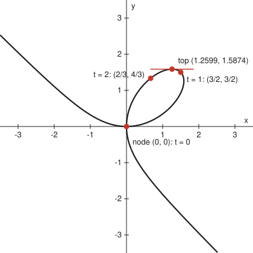

# Elimination: removing variables to solve a system or to find a curve's equation

[Syllabus](../../../SYLLABUS.md) → [Algebraic geometry](../README.md) → [Polynomial Systems](../README.md#s01) → Elimination

---

## General Overview

In 1638 René Descartes studied a curve now called the folium of Descartes ("folium" is Latin for leaf). The easy way to draw it is with a moving point. Pick a number $`t`$, the **parameter**, and plot this point:

```math
x = \frac{3t}{1 + t^3}, \qquad y = \frac{3t^2}{1 + t^3}
```

At $`t = 1`$ the point is $`(3/2,\ 3/2)`$. At $`t = 2`$ it is $`(2/3,\ 4/3)`$. As $`t`$ grows from 0, the point leaves the origin, runs round a leaf-shaped loop and comes back. Negative values of $`t`$ draw two arms that run off to infinity.

These formulas answer "where is the point when the parameter is $`t`$?". They cannot answer "is this point on the curve?" until someone finds its $`t`$. For that question the curve needs one equation in $`x`$ and $`y`$ alone. Removing a variable from a system is **elimination**. Finding a curve's equation from its parametrisation this way is **implicitisation**.

[Parametric curves](../../05-Geometry%20and%20trig/04-Coordinates%20and%20Curves/06-parametric-curves.md) removed a parameter by hand: solve one formula for the parameter, then substitute into the other. That needs luck with the algebra. This card gives the method that works for every polynomial or rational parametrisation:

1. Clear the denominators, so the parametrisation becomes polynomial equations in $`t`$, $`x`$ and $`y`$.
2. Compute a Grobner basis in lex order with $`t`$ ranked highest.
3. Keep the basis polynomials that contain no $`t`$.

For the folium, step 3 leaves one polynomial, the cubic $`x^3 - 3xy + y^3`$. The same method also solves systems. Given the folium and the condition "the tangent is flat", it finds the top of the loop one variable at a time: height 1.5874 at $`x = 1.2599`$.

**A Grobner basis in lex order, with the unwanted variables ranked highest, contains a complete set of the system's consequences that are free of those variables; so its last polynomials are the eliminated equations, and solving runs backwards from them one variable at a time.**

**What kind of fact this is:** two theorems. The elimination theorem is proved on this card in Why it works. The extension theorem is stated with the idea of its proof; the full proof uses resultants and is in Cox, Little and O'Shea, chapter 3.

### The picture: the folium and the points this card works

<p align="center"></p>

Drawn to scale from the parametrisation, 1 unit = 60 px, real points only. The red dots are the node at the origin, where the curve crosses itself ($`t = 0`$), the points for $`t = 1`$ and $`t = 2`$, and the top of the loop with its flat tangent. The two arms go on past the frame.

---

## The formula

Notation first, in words. Most of it comes from earlier cards on this shelf.

- $`k`$ is the **field** the coefficients come from: a number system where every nonzero number has an inverse. Here it is the rationals $`\mathbb{Q}`$, and the complex numbers $`\mathbb{C}`$ for the extension step.
- $`k[t, x, y]`$ is the set of polynomials in $`t`$, $`x`$ and $`y`$ with coefficients in $`k`$.
- The **ideal** $`I = \langle f_1, \dots, f_s \rangle`$ is every combination $`h_1 f_1 + \dots + h_s f_s`$, where the multipliers $`h_i`$ are polynomials. It is the set of every equation that follows from $`f_1 = 0, \dots, f_s = 0`$ by multiplying and adding ([Ideals and varieties](01-ideals-and-varieties.md)).
- $`V(\cdot)`$ is the **variety**: the set of points where the given polynomials are all zero.
- **Lex order** with $`t > x > y`$ ranks terms by their power of $`t`$ first, then of $`x`$, then of $`y`$. $`\mathrm{LT}(f)`$ is the leading term of $`f`$: its highest-ranked term ([Monomial orders](02-monomial-orders-and-division.md)).
- A **Grobner basis** $`G`$ of $`I`$ is a set of generators whose leading terms divide the leading term of every member of $`I`$ ([Grobner bases](03-grobner-bases-and-buchberger.md)). The **reduced** basis is the unique tidy one: each member starts with coefficient 1, and no term of a member is divisible by another member's leading term.

This card adds one new symbol. With variables $`x_1 > x_2 > \dots > x_n`$, the **$`\ell`$-th elimination ideal** $`I_\ell`$ is the part of $`I`$ that does not mention the first $`\ell`$ variables:

```math
I_\ell = I \cap k[x_{\ell+1}, \dots, x_n]
```

**The elimination theorem.** If $`G`$ is a Grobner basis of $`I`$ for lex order with $`x_1 > x_2 > \dots > x_n`$, then for every $`\ell`$ from 0 to $`n`$:

```math
G_\ell = G \cap k[x_{\ell+1}, \dots, x_n] \ \text{ is a Grobner basis of } \ I_\ell
```

**Read it aloud:** the basis polynomials that happen to avoid the first ℓ variables already generate every consequence that avoids them.

For the folium the variables are $`t > x > y`$, and only $`t`$ goes, so $`\ell = 1`$. The system and its answer:

```math
I = \langle (1 + t^3)\,x - 3t,\ \ (1 + t^3)\,y - 3t^2 \rangle, \qquad I_1 = \langle x^3 - 3xy + y^3 \rangle
```

**The extension theorem.** Work over $`\mathbb{C}`$. Write each generator as $`f_i = c_i\, x_1^{N_i} + (\text{terms with lower powers of } x_1)`$. Here $`c_i`$, the **leading coefficient** in $`x_1`$, is a polynomial in the other variables only.

```math
(a_2, \dots, a_n) \in V(I_1) \ \text{ and } \ c_i(a_2, \dots, a_n) \ne 0 \text{ for some } i \ \Longrightarrow \ (a_1, a_2, \dots, a_n) \in V(I) \text{ for some } a_1 \in \mathbb{C}
```

**Read it aloud:** a solution of the shorter system extends back by one variable, unless every leading coefficient is zero there.

| Symbol | Plain meaning | In our example | Push it up and the answer… |
| --- | --- | --- | --- |
| $`k`$ | the field the coefficients come from | $`\mathbb{Q}`$; $`\mathbb{C}`$ to extend | a bigger field gives more partial solutions room to extend |
| $`t`$ | the parameter: the variable to remove | $`t = 2`$ gives $`(2/3,\ 4/3)`$ | the point runs on round the curve |
| $`x`$, $`y`$ | the plane's two coordinates | $`(2/3,\ 4/3)`$ | — |
| $`x_1, \dots, x_n`$; $`n`$; $`\ell`$ | the variables, highest ranked first; how many there are; how many are removed | $`t, x, y`$; $`n = 3`$; $`\ell = 1`$ | larger ℓ removes more variables |
| $`F(x, y)`$ | the folium's polynomial, $`x^3 - 3xy + y^3`$ | 0 at every point of the curve | — |
| $`I`$; $`f_i`$; $`h_i`$ | the ideal of every consequence; its generators; the multipliers in a combination | $`f_1 = (1 + t^3)x - 3t`$, $`f_2 = (1 + t^3)y - 3t^2`$ | more generators, fewer common zeros |
| lex $`t > x > y`$; $`\mathrm{LT}`$ | the term order, $`t`$ ranked highest; the leading term in it | $`\mathrm{LT}(tx - y) = tx`$ | — |
| $`G`$; $`I_\ell`$; $`G_\ell`$ | the reduced lex Grobner basis; the consequences free of the first ℓ variables; the basis members that are | four polynomials (Step 3); $`I_1 = \langle F \rangle`$; $`G_1 = \{F\}`$ | — |
| $`c_i`$; $`N_i`$; $`a_i`$ | the leading coefficient in the variable being restored; its power; coordinates of a solution | $`c = x`$ and $`N = 1`$ in $`tx - y`$; $`(a_2, a_3) = (2/3,\ 4/3)`$ | where every $`c_i`$ is 0, extension may fail |
| $`V(\cdot)`$ | the variety: the common zeros | the folium is $`V(F)`$ | — |
| $`D`$; $`w`$ | the denominator $`1 + t^3`$; an extra variable that keeps it away from 0, through $`Dw = 1`$ | $`D = 9`$ at $`t = 2`$; $`w`$ changes nothing here | — |
| $`\partial F / \partial x`$ | the rate of change of $`F`$ in $`x`$; 0 where the tangent is flat or the curve is singular (has no single tangent, as at the node) | $`3x^2 - 3y`$ | — |

### When it holds

- **Lex order, with the variables to remove ranked highest.** Rank $`t`$ last instead (lex $`x > y > t`$) and the basis holds 0 polynomials free of $`t`$. It removes $`x`$ instead and restates $`y`$ in terms of $`t`$.
- **Any field to eliminate; the complex numbers to extend.** The elimination theorem holds over every field. The extension theorem needs every one-variable polynomial to have a root, which is true over $`\mathbb{C}`$ but not over $`\mathbb{R}`$: there, a real value of $`y`$ can need a complex $`x`$.
- **Some leading coefficient nonzero at the partial solution.** Take the single equation $`xy - 1 = 0`$. Eliminating $`x`$ leaves nothing, so every $`y`$ passes, including $`y = 0`$. The leading coefficient of $`x`$ is $`y`$, which is 0 there, and $`0 \cdot x - 1 = 0`$ has no solution.
- **Denominators cleared, and kept away from 0.** The general recipe adds a variable $`w`$ with $`(1 + t^3)w = 1`$, so no solution has a zero denominator. For the folium this changes nothing, because $`1 + t^3 = 0`$ would force $`3t = 0`$; the code checks it. Dropping the denominators instead gives a different curve, the parabola $`x^2 = 3y`$.
- **The answer is the smallest curve that holds every reached point.** Over $`\mathbb{C}`$ the parametrisation of the folium reaches every point of the cubic (Step 4). Other parametrisations can miss a few points of their eliminated curve.

---

## Why it works

### Step 0: in lex order, a term with $`t`$ beats every term without it

With $`t`$ ranked highest, even $`t`$ alone outranks $`x^{100}y^{100}`$. So if a polynomial's leading term has no $`t`$, then none of its terms has $`t`$.

A Grobner basis has a member whose leading term divides the leading term of any polynomial in the ideal. If that leading term has no $`t`$, the dividing member's leading term has no $`t`$ either, and by the first paragraph the whole member is free of $`t`$.

### Step 1: the elimination theorem

Let $`f`$ be in $`I_1`$: a consequence of the system with no $`t`$ in it. Some $`g`$ in $`G`$ has $`\mathrm{LT}(g)`$ dividing $`\mathrm{LT}(f)`$, and by Step 0 that $`g`$ is free of $`t`$, so $`g`$ is in $`G_1`$. So the members of $`G_1`$ catch the leading term of every member of $`I_1`$. That is the definition of a Grobner basis of $`I_1`$.

The same argument with "free of the first ℓ variables" in place of "free of $`t`$" proves the theorem for every ℓ.

<details>
<summary>Detailed proof: the elimination theorem for every ℓ</summary>

Fix ℓ and write $`k[x_{\ell+1}, \dots, x_n]`$ for the polynomials in the last $`n - \ell`$ variables.

First, $`G_\ell`$ lies in $`I_\ell`$: its members are in $`G`$, so in $`I`$, and they avoid the first ℓ variables by definition.

Second, take any nonzero $`f`$ in $`I_\ell`$. Since $`f`$ is in $`I`$ and $`G`$ is a Grobner basis, some $`g`$ in $`G`$ has $`\mathrm{LT}(g)`$ dividing $`\mathrm{LT}(f)`$. Since $`\mathrm{LT}(f)`$ has no $`x_1, \dots, x_\ell`$, neither has $`\mathrm{LT}(g)`$.

In lex order, any monomial containing one of $`x_1, \dots, x_\ell`$ ranks above every monomial in the last variables alone. The leading term of $`g`$ is its highest term and contains none of $`x_1, \dots, x_\ell`$, so no other term of $`g`$ does either. So $`g`$ is in $`G_\ell`$.

So the leading terms of $`G_\ell`$ divide the leading term of every member of $`I_\ell`$, which makes $`G_\ell`$ a Grobner basis of $`I_\ell`$. In particular $`G_\ell`$ generates $`I_\ell`$, by the division argument on [Normal forms](04-reduced-grobner-bases-and-ideal-membership.md): every member of $`I_\ell`$ leaves remainder 0.

</details>

### Step 2: turn the curve into polynomial equations

Multiply each formula by its denominator:

```math
(1 + t^3)\,x - 3t = 0, \qquad (1 + t^3)\,y - 3t^2 = 0
```

Every point of the curve, together with its value of $`t`$, solves both. Any equation in $`x`$ and $`y`$ alone that follows from them is a member of $`I_1`$.

### Step 3: compute the lex basis and keep what has no $`t`$

Buchberger's algorithm ([Grobner bases](03-grobner-bases-and-buchberger.md)) with lex $`t > x > y`$ gives this reduced basis:

```math
G = \{\ t^2y - 3t + x,\ \ tx - y,\ \ ty^2 + x^2 - 3y,\ \ x^3 - 3xy + y^3\ \}
```

Only the last member is free of $`t`$. By Step 1, $`I_1 = \langle x^3 - 3xy + y^3 \rangle`$. Every equation in $`x`$ and $`y`$ that follows from the parametrisation is a multiple of this cubic.

A check by substitution, with $`D = 1 + t^3`$ for the denominator:

```math
x^3 + y^3 = \frac{27t^3 + 27t^6}{D^3} = \frac{27t^3 (1 + t^3)}{D^3} = \frac{27t^3}{D^2} = 3 \cdot \frac{3t}{D} \cdot \frac{3t^2}{D} = 3xy
```

The code also confirms that no curve of lower degree fits. It asks for every polynomial of degree at most 2 through 12 points of the folium and finds none. At degree 3 it finds exactly one, the cubic.

### Step 4: extend back to $`t`$

The basis members that contain $`t`$, with their leading coefficients in $`t`$:

| Basis member | Leading coefficient in $`t`$ |
| --- | --- |
| $`t^2y - 3t + x`$ | $`y`$ |
| $`tx - y`$ | $`x`$ |
| $`ty^2 + x^2 - 3y`$ | $`y^2`$ |

At $`(2/3,\ 4/3)`$ the coefficient $`x`$ is not 0, so the extension theorem promises a $`t`$. The basis hands it over: $`tx - y = 0`$ gives $`t = y/x = 2`$.

Every point of the cubic gets a parameter, over $`\mathbb{C}`$ and over $`\mathbb{R}`$. If $`x \ne 0`$, set $`t = y/x`$; then $`F = 0`$ reads $`x^3(1 + t^3) = 3t\,x^2`$, which divides by $`x^2`$ into the first equation of Step 2, and $`y = tx`$ gives the second. If $`x = 0`$, then $`F = 0`$ forces $`y = 0`$: the node, reached at $`t = 0`$.

At the node all three leading coefficients are 0, so the theorem promises nothing. The point still extends: with $`x = y = 0`$ the basis reads $`-3t = 0`$, so $`t = 0`$. The theorem's condition is enough for extension, not required for it.

### Step 5: solve a system the same way

The top of the loop is where the tangent is flat. Differentiating $`F(x, y) = 0`$ along the curve gives the slope $`-(\partial F/\partial x) / (\partial F/\partial y)`$, so a flat tangent needs $`\partial F/\partial x = 0`$. The system is:

```math
F = x^3 - 3xy + y^3 = 0, \qquad \tfrac{1}{3}\,\frac{\partial F}{\partial x} = x^2 - y = 0
```

Lex order $`x > y`$ removes $`x`$. The reduced basis is $`\{x^2 - y,\ \ xy - \tfrac{1}{2}y^3,\ \ y^5 - 4y^2\}`$.

1. **Eliminate.** The last member has only $`y`$: $`y^5 - 4y^2 = y^2(y^3 - 4)`$. A one-variable polynomial left by elimination is called the **eliminant**. Its real roots are $`y = 0`$ and $`y = \sqrt[3]{4} = 1.5874`$.
2. **Extend.** The member $`x^2 - y`$ has leading coefficient 1 in $`x`$, which is never 0, so every root extends over $`\mathbb{C}`$.
3. **Read off.** For $`y = 1.5874`$, the member $`xy - \tfrac{1}{2}y^3`$ gives $`x = y^2/2 = 1.2599`$. For $`y = 0`$, $`x^2 = 0`$ gives $`x = 0`$: the node, which is not a top (see The usual mistake).

A second road agrees. Scanning $`y(t)`$ for $`t`$ from 0 to 4 finds the highest point, 1.587401, at $`t = 1.25992`$, which is $`\sqrt[3]{2}`$. The scan's point has $`x = 1.25992`$ as well, which matches $`x = 1.2599`$.

Step 5 is the shortest case of a general pattern: two variables, so one step down to the eliminant and one step back up. With more variables the same steps repeat, for any system with finitely many solutions: the last basis member has one variable; solve it; then climb back up, one variable per step, checking the leading coefficients at each step ([Finitely many solutions](07-solving-zero-dimensional-systems.md)).

<details>
<summary>Why the extension theorem holds: the idea of the proof</summary>

Substitute the partial solution $`(a_2, \dots, a_n)`$ into the generators. Each becomes a polynomial in $`x_1`$ alone, and a common root of them is the missing $`a_1`$.

For two polynomials in $`x_1`$, a common root exists exactly when a certain determinant built from their coefficients, the resultant, is 0. That resultant is a combination of the generators with no $`x_1`$ in it, so it lies in $`I_1`$ and vanishes at the partial solution.

The leading-coefficient condition is what makes this work. If every $`c_i`$ vanished, substituting could lower the degrees, and a zero resultant would then say nothing about common roots. The full argument, for any number of generators, is in Cox, Little and O'Shea, chapter 3; the resultant itself is the subject of [The resultant](06-resultants-and-common-roots.md).

</details>

---

## Worked numbers, by hand

| Step | Arithmetic | Value |
| --- | --- | --- |
| point at $`t = 2`$ | $`x = 6/9`$, $`y = 12/9`$ | $`(2/3,\ 4/3)`$ |
| left side of the cubic | $`x^3 + y^3 = 8/27 + 64/27`$ | 8/3 |
| right side of the cubic | $`3xy = 3 \times 2/3 \times 4/3`$ | 8/3 |
| $`t`$ back from $`tx - y = 0`$ | $`(4/3) \div (2/3)`$ | 2 |
| point at $`t = 1`$, both sides | $`27/8 + 27/8`$ and $`3 \times 3/2 \times 3/2`$ | 27/4 and 27/4 |
| a point off the curve, $`(1, 1)`$ | $`F(1, 1) = 1 + 1 - 3`$ | −1, not 0: not on the folium |
| top of the loop: eliminate $`x`$ | $`y^5 - 4y^2 = y^2(y^3 - 4) = 0`$ | $`y = 0`$ or $`y^3 = 4`$ |
| height of the top | $`\sqrt[3]{4}`$ | 1.5874 |
| extend to $`x`$ | $`x = y^2/2`$ | **1.2599** |

The point $`(2/3,\ 4/3)`$ passes the cubic's test, its parameter comes back as 2, the point $`(1, 1)`$ fails the test, and the loop's highest point is $`(1.2599,\ 1.5874)`$.

### What breaks if you drop a piece

| Mistake | Comes out at | What went wrong |
| --- | --- | --- |
| Lex $`x > y > t`$, with $`t`$ ranked last | 0 basis polynomials free of $`t`$ | the variable to remove must be ranked highest |
| Denominators dropped: $`x = 3t`$, $`y = 3t^2`$ | $`x^2 - 3y`$, which gives −32/9 at $`(2/3,\ 4/3)`$ | that is a parabola, not the folium |
| Root $`y = 0`$ read as a top | $`(0, 0)`$, where $`\tfrac{1}{3}\partial F/\partial y = y^2 - x = 0`$ too | both slopes vanish at the node, where the curve crosses itself |
| Extension without its condition, on $`xy - 1`$ | 0 polynomials free of $`x`$, yet $`y = 0`$ has no $`x`$ | the leading coefficient $`y`$ is 0 there |

The code prints all four.

---

## Code, from first principles, and it actually runs

The code writes out Buchberger's algorithm over exact fractions and uses it for every basis on the card: the folium, the top of the loop, the mistakes and the robot arm in Where you meet it. Python uses `fractions.Fraction`; Rust uses its own `i128` fraction type, whose checked products stop the run on overflow. The folium's equation comes by **three independent roads**: the lex basis (also rerun with the extra variable $`w`$); a curve fitted through 12 exact points by row reduction, which finds no conic and exactly one cubic; and exact substitution of 14 parameter values. The top of the loop comes by elimination and by a numerical scan of $`y(t)`$.

### Python

```python
# Elimination and implicitisation -- the check behind the card.  Standard
# library only: Buchberger's algorithm, row reduction and the scan are written
# out here.  A polynomial is a dict {exponent tuple: Fraction}; comparing the
# tuples is the lex order, first variable biggest.  The folium is
# x = 3t/(1 + t^3), y = 3t^2/(1 + t^3), and its equation is found three ways.
from fractions import Fraction as Q
from math import prod, sqrt

def P(*terms): return {tuple(e): Q(c) for c, *e in terms}   # P((coef, exps...), ...)
def shift(p, c, m): return {tuple(a + b for a, b in zip(e, m)): c * v for e, v in p.items()}
def add(p, q):
    r = dict(p)
    for e, v in q.items():
        r[e] = r.get(e, 0) + v
        if r[e] == 0: del r[e]
    return r
def divides(a, b): return all(x <= y for x, y in zip(a, b))
def gap(a, b): return tuple(x - y for x, y in zip(a, b))

def reduce(p, G):                      # divide p by G; return the remainder
    r, p = {}, dict(p)
    while p:
        e = max(p)
        g = next((g for g in G if divides(max(g), e)), None)
        if g is None: r[e] = p.pop(e)
        else: p = add(p, shift(g, -p[e] / g[max(g)], gap(e, max(g))))
    return r

def groebner(F):                       # Buchberger, then the reduced basis
    G = [dict(f) for f in F]
    pairs = [(i, j) for j in range(len(G)) for i in range(j)]
    while pairs:
        f, g = (G[k] for k in pairs.pop(0))
        L = tuple(map(max, max(f), max(g)))
        s = add(shift(f, 1 / f[max(f)], gap(L, max(f))), shift(g, -1 / g[max(g)], gap(L, max(g))))
        r = reduce(s, G)
        if r:
            pairs += [(k, len(G)) for k in range(len(G))]
            G.append(r)
    G = [g for k, g in enumerate(G) if not any(divides(max(h), max(g)) and
         (max(h) != max(g) or m < k) for m, h in enumerate(G) if m != k)]
    G = [reduce(g, [h for h in G if h is not g]) for g in G]
    return sorted(({e: v / g[max(g)] for e, v in g.items()} for g in G), key=max, reverse=True)

def show(p, names):
    out = ""
    for e in sorted(p, reverse=True):
        c, m = p[e], "*".join(n + (f"^{k}" if k > 1 else "") for n, k in zip(names, e) if k)
        body = (m if abs(c) == 1 else f"{abs(c)}*{m}") if m else f"{abs(c)}"
        out += ("-" if c < 0 else "") + body if not out else (" - " if c < 0 else " + ") + body
    return out or "0"

def free_of(G, k): return [g for g in G if all(e[k] == 0 for e in g)]
def nullspace(rows):                   # row-reduce; return the null vectors
    M, piv, r = [row[:] for row in rows], [], 0
    for c in range(len(M[0])):
        k = next((i for i in range(r, len(M)) if M[i][c] != 0), None)
        if k is None: continue
        M[r], M[k] = [v / M[k][c] for v in M[k]], M[r]
        for i in range(len(M)):
            if i != r and M[i][c] != 0: M[i] = [a - M[i][c] * b for a, b in zip(M[i], M[r])]
        piv.append(c); r += 1
    free = [c for c in range(len(M[0])) if c not in piv]
    return [[Q(c == f) - (M[piv.index(c)][f] if c in piv else 0) for c in range(len(M[0]))] for f in free]

def ev(p, pt): return sum(c * prod(v ** k for v, k in zip(pt, e)) for e, c in p.items())
def lead_coef(g):                      # the coefficient of the top power of the first variable
    n = max(e[0] for e in g)
    return {(0,) + e[1:]: c for e, c in g.items() if e[0] == n}
def point(t): return 3 * t / (1 + t * t * t), 3 * t * t / (1 + t * t * t)
def F(x, y): return x ** 3 + y ** 3 - 3 * x * y
yn = lambda b: "yes" if b else "no"

# ---- road 1: lex basis with t > x > y; keep what is free of t ----
fol = [P((1, 3, 1, 0), (1, 0, 1, 0), (-3, 1, 0, 0)), P((1, 3, 0, 1), (1, 0, 0, 1), (-3, 2, 0, 0))]
G = groebner(fol)
print("lex basis, t > x > y, of (1 + t^3)x - 3t and (1 + t^3)y - 3t^2:")
for g in G: print("  " + show(g, "txy"))
cubic = free_of(G, 0)
print(f"basis polynomials free of t: {len(cubic)}, namely {show(cubic[0], 'txy')}")
lift = [{(0,) + e: c for e, c in f.items()} for f in fol]
GW = groebner(lift + [P((1, 1, 3, 0, 0), (1, 1, 0, 0, 0), (-1, 0, 0, 0, 0))])
cubic_w = free_of(free_of(GW, 0), 1)
print(f"with w and (1 + t^3)w = 1 added, free of w and t: {show(cubic_w[0], 'wtxy')}")
# ---- road 2: the lowest-degree curve through 12 points of the folium ----
ts = [Q(p, q) for p, q in [(0, 1), (1, 1), (2, 1), (-2, 1), (3, 1), (1, 2), (-1, 2),
                           (1, 3), (2, 3), (3, 2), (-3, 1), (-1, 3)]]
for deg in (2, 3):
    mons = [(a, b) for a in range(deg, -1, -1) for b in range(deg - a, -1, -1)]
    ns = nullspace([[x ** a * y ** b for a, b in mons] for x, y in map(point, ts)])
    print(f"curves of degree <= {deg} through the {len(ts)} points: {len(ns)}")
v = ns[0]; fit = {(0, a, b): c / v[0] for (a, b), c in zip(mons, v) if c}
print(f"the one of degree 3: {show(fit, 'txy')}")
# ---- road 3: put points back in exactly ----
back = [F(*point(Q(t, 2))) for t in range(-7, 8) if t != -2]
print(f"F(x(t), y(t)) at 14 values of t from -7/2 to 7/2: all zero: {yn(back == [0] * 14)}; off the curve, F(1, 1) = {F(Q(1), Q(1))}")
for t in (1, 2):
    x, y = point(Q(t))
    print(f"t = {t}: 3t = {3 * t}, 3t^2 = {3 * t * t}, D = 1 + t^3 = {1 + t ** 3}, (x, y) = ({x}, {y}), x^3 + y^3 = {x ** 3 + y ** 3}, 3xy = {3 * x * y},"
          f" t back from t*x - y = 0: {y / x}")
witht = [g for g in G if any(e[0] for e in g)]
lcs = [lead_coef(g) for g in witht]
print(f"leading coefficients in t: {', '.join(show(c, 'txy') for c in lcs)}; at the node (0, 0): "
      f"{', '.join(str(ev(c, (0, 0, 0))) for c in lcs)}")
at_node = [{e: c for e, c in g.items() if e[1] == e[2] == 0} for g in witht]
print(f"the basis at x = y = 0: {', '.join(show(g, 'txy') for g in at_node)}; so t = 0, and"
      f" (t, x, y) = (0, 0, 0) satisfies all four: {yn(all(ev(g, (0, 0, 0)) == 0 for g in G))}")
# ---- solving: the top of the loop, where F = 0 and dF/dx = 0 ----
GT = groebner([P((1, 3, 0), (1, 0, 3), (-3, 1, 1)), P((1, 2, 0), (-1, 0, 1))])
print("lex basis, x > y, of F and (dF/dx)/3 = x^2 - y:")
for g in GT: print("  " + show(g, "xy"))
ytop = 4 ** (1 / 3); xtop = ytop * ytop / 2
print(f"eliminant y^2*(y^3 - 4): real roots 0 and {ytop:.6f}; extend: x = y^2/2 = {xtop:.6f}")
best = max((point(i / 100000)[1], i / 100000) for i in range(400001))
print(f"scan of y(t), t = 0 to 4 in steps of 0.00001: highest y {best[0]:.6f} at t = {best[1]:.5f}, where x = {point(best[1])[0]:.5f}")
# ---- what breaks ----
Gbad = groebner([P((1, 1, 0, 3), (1, 1, 0, 0), (-3, 0, 0, 1)), P((1, 0, 1, 3), (1, 0, 1, 0), (-3, 0, 0, 2))])
print(f"mistake 1, lex x > y > t: basis polynomials free of t: {len(free_of(Gbad, 2))}")
Gnod = groebner([P((1, 0, 1, 0), (-3, 1, 0, 0)), P((1, 0, 0, 1), (-3, 2, 0, 0))])
x, y = point(Q(2))
print(f"mistake 2, denominator dropped: {show(free_of(Gnod, 0)[0], 'txy')}; "
      f"at (2/3, 4/3) it gives {x * x - 3 * y}")
print(f"mistake 3, root y = 0 taken as a top: x = 0, (dF/dy)/3 = y^2 - x = "
      f"{ev(P((1, 0, 2), (-1, 1, 0)), (0, 0, 0))} there too: both slopes vanish, a node")
Ghyp = groebner([P((1, 1, 1), (-1, 0, 0))])
print(f"mistake 4, x*y - 1 with x > y: free of x: {len(free_of(Ghyp, 0))}; leading coefficient "
      f"{show(lead_coef(Ghyp[0]), 'xy')} is {ev(lead_coef(Ghyp[0]), (0, 0))} at y = 0, so 0*x - 1 = 0 has no x")
# ---- the house example: elbow (a, b), links 3 m and 2 m, hand at (4, 0) ----
GA = groebner([P((1, 2, 0), (1, 0, 2), (-9, 0, 0)), P((1, 2, 0), (-8, 1, 0), (1, 0, 2), (12, 0, 0))])
print(f"arm, lex a > b: {show(GA[0], 'ab')} and {show(GA[1], 'ab')}; b = +-{sqrt(-GA[1].get((0, 0), 0)):.6f} m")
x, y = map(float, point(Q(2)))
print(f"figure, node (0, 0), t=1 (1.5, 1.5), t=2 ({x:.4f}, {y:.4f}), top ({xtop:.4f}, {ytop:.4f})")
want = P((1, 0, 3, 0), (-3, 0, 1, 1), (1, 0, 0, 3))
assert cubic == [want] and fit == want and cubic_w[0] == {(0,) + e: c for e, c in want.items()}
assert back == [0] * 14 and F(*point(Q(2))) == 0 and all(ev(g, (0, 0, 0)) == 0 for g in G)
assert free_of(GT, 0) == [P((1, 0, 5), (-4, 0, 2))] and abs(best[0] - ytop) < 1e-9
assert abs(best[1] - 2 ** (1 / 3)) < 1e-5 and len(free_of(Gbad, 2)) == 0
assert GA == [P((1, 1, 0), (Q(-21, 8), 0, 0)), P((1, 0, 2), (Q(-135, 64), 0, 0))]
assert G == [P((1, 2, 0, 1), (-3, 1, 0, 0), (1, 0, 1, 0)), P((1, 1, 1, 0), (-1, 0, 0, 1)), P((1, 1, 0, 2), (1, 0, 2, 0), (-3, 0, 0, 1)), want]
print("ALL CHECKS PASS")
```

**Ran 2026-11-17 on macOS, Python 3.14.10, standard library only. All checks passed. Output, pasted from the run:**

```
lex basis, t > x > y, of (1 + t^3)x - 3t and (1 + t^3)y - 3t^2:
  t^2*y - 3*t + x
  t*x - y
  t*y^2 + x^2 - 3*y
  x^3 - 3*x*y + y^3
basis polynomials free of t: 1, namely x^3 - 3*x*y + y^3
with w and (1 + t^3)w = 1 added, free of w and t: x^3 - 3*x*y + y^3
curves of degree <= 2 through the 12 points: 0
curves of degree <= 3 through the 12 points: 1
the one of degree 3: x^3 - 3*x*y + y^3
F(x(t), y(t)) at 14 values of t from -7/2 to 7/2: all zero: yes; off the curve, F(1, 1) = -1
t = 1: 3t = 3, 3t^2 = 3, D = 1 + t^3 = 2, (x, y) = (3/2, 3/2), x^3 + y^3 = 27/4, 3xy = 27/4, t back from t*x - y = 0: 1
t = 2: 3t = 6, 3t^2 = 12, D = 1 + t^3 = 9, (x, y) = (2/3, 4/3), x^3 + y^3 = 8/3, 3xy = 8/3, t back from t*x - y = 0: 2
leading coefficients in t: y, x, y^2; at the node (0, 0): 0, 0, 0
the basis at x = y = 0: -3*t, 0, 0; so t = 0, and (t, x, y) = (0, 0, 0) satisfies all four: yes
lex basis, x > y, of F and (dF/dx)/3 = x^2 - y:
  x^2 - y
  x*y - 1/2*y^3
  y^5 - 4*y^2
eliminant y^2*(y^3 - 4): real roots 0 and 1.587401; extend: x = y^2/2 = 1.259921
scan of y(t), t = 0 to 4 in steps of 0.00001: highest y 1.587401 at t = 1.25992, where x = 1.25992
mistake 1, lex x > y > t: basis polynomials free of t: 0
mistake 2, denominator dropped: x^2 - 3*y; at (2/3, 4/3) it gives -32/9
mistake 3, root y = 0 taken as a top: x = 0, (dF/dy)/3 = y^2 - x = 0 there too: both slopes vanish, a node
mistake 4, x*y - 1 with x > y: free of x: 0; leading coefficient y is 0 at y = 0, so 0*x - 1 = 0 has no x
arm, lex a > b: a - 21/8 and b^2 - 135/64; b = +-1.452369 m
figure, node (0, 0), t=1 (1.5, 1.5), t=2 (0.6667, 1.3333), top (1.2599, 1.5874)
ALL CHECKS PASS
```

### Rust

Same numbers, same labels, built with `rustc --edition 2021 -O`.

```rust
// Elimination and implicitisation -- the same check as the Python, in Rust.
// No crates.  Fractions are i128 pairs and every product is checked, so an
// overflow stops the run.  A polynomial is a map from exponent lists to
// fractions; the map's own key order is the lex order, first variable biggest.
use std::collections::BTreeMap;
#[derive(Clone, Copy, PartialEq, Debug)]
struct Q { n: i128, d: i128 }
fn gcd(a: i128, b: i128) -> i128 { if b == 0 { a.abs() } else { gcd(b, a % b) } }
fn q(n: i128, d: i128) -> Q { let g = gcd(n, d) * d.signum(); Q { n: n / g, d: d / g } }
fn m(a: i128, b: i128) -> i128 { a.checked_mul(b).expect("i128 overflow") }
impl Q {
    fn add(self, o: Q) -> Q { q(m(self.n, o.d).checked_add(m(o.n, self.d)).expect("overflow"), m(self.d, o.d)) }
    fn mul(self, o: Q) -> Q { q(m(self.n, o.n), m(self.d, o.d)) }
    fn div(self, o: Q) -> Q { q(m(self.n, o.d), m(self.d, o.n)) }
    fn neg(self) -> Q { Q { n: -self.n, d: self.d } }
}
impl std::fmt::Display for Q { fn fmt(&self, f: &mut std::fmt::Formatter) -> std::fmt::Result { if self.d == 1 { write!(f, "{}", self.n) } else { write!(f, "{}/{}", self.n, self.d) } } }
type P = BTreeMap<Vec<u32>, Q>;
fn poly(nv: usize, flat: &[i128]) -> P {               // (coef, exps...) repeated
    flat.chunks(nv + 1).map(|c| (c[1..].iter().map(|&k| k as u32).collect(), q(c[0], 1))).collect() }
fn lead(p: &P) -> Vec<u32> { p.keys().next_back().unwrap().clone() }
fn shift(p: &P, c: Q, mo: &[u32]) -> P {
    p.iter().map(|(e, &v)| (e.iter().zip(mo).map(|(a, b)| a + b).collect(), c.mul(v))).collect() }
fn add(p: &P, r: &P) -> P {
    let mut out = p.clone();
    for (e, &v) in r { let s = out.get(e).copied().unwrap_or(q(0, 1)).add(v);
        if s.n == 0 { out.remove(e); } else { out.insert(e.clone(), s); } }
    out
}
fn divides(a: &[u32], b: &[u32]) -> bool { a.iter().zip(b).all(|(x, y)| x <= y) }
fn gap(a: &[u32], b: &[u32]) -> Vec<u32> { a.iter().zip(b).map(|(x, y)| x - y).collect() }
fn reduce(p: &P, g: &[P]) -> P {                         // divide p by g; return the remainder
    let (mut r, mut p) = (P::new(), p.clone());
    while let Some((e, c)) = p.iter().next_back().map(|(e, &c)| (e.clone(), c)) {
        match g.iter().find(|h| divides(&lead(h), &e)) {
            None => { p.remove(&e); r.insert(e, c); }
            Some(h) => { let l = lead(h); p = add(&p, &shift(h, c.div(h[&l]).neg(), &gap(&e, &l))); } } }
    r
}
fn groebner(f: &[P]) -> Vec<P> {                         // Buchberger, then the reduced basis
    let mut g: Vec<P> = f.to_vec();
    let mut pairs: Vec<(usize, usize)> = (0..g.len()).flat_map(|j| (0..j).map(move |i| (i, j))).collect();
    while !pairs.is_empty() {
        let (i, j) = pairs.remove(0); let (lf, lg) = (lead(&g[i]), lead(&g[j]));
        let l: Vec<u32> = lf.iter().zip(&lg).map(|(a, b)| *a.max(b)).collect();
        let s = add(&shift(&g[i], q(1, 1).div(g[i][&lf]), &gap(&l, &lf)),
                    &shift(&g[j], q(-1, 1).div(g[j][&lg]), &gap(&l, &lg)));
        let r = reduce(&s, &g);
        if !r.is_empty() { for k in 0..g.len() { pairs.push((k, g.len())); } g.push(r); }
    }
    let n = g.len();
    let keep: Vec<P> = (0..n).filter(|&k| !(0..n).any(|j| j != k && divides(&lead(&g[j]), &lead(&g[k]))
        && (lead(&g[j]) != lead(&g[k]) || j < k))).map(|k| g[k].clone()).collect();
    let mut out: Vec<P> = (0..keep.len()).map(|k| {
        let others: Vec<P> = keep.iter().enumerate().filter(|&(j, _)| j != k).map(|(_, h)| h.clone()).collect();
        let r = reduce(&keep[k], &others); let c = r[&lead(&r)];
        r.iter().map(|(e, &v)| (e.clone(), v.div(c))).collect()
    }).collect();
    out.sort_by(|a, b| lead(b).cmp(&lead(a))); out
}
fn show(p: &P, names: &str) -> String {
    let mut out = String::new();
    for (e, &c) in p.iter().rev() {
        let mo: Vec<String> = names.chars().zip(e).filter(|(_, &k)| k > 0)
            .map(|(n, &k)| if k > 1 { format!("{}^{}", n, k) } else { n.to_string() }).collect();
        let (mo, a) = (mo.join("*"), Q { n: c.n.abs(), d: c.d });
        let body = if mo.is_empty() { a.to_string() } else if a == q(1, 1) { mo } else { format!("{}*{}", a, mo) };
        let sign = if out.is_empty() { if c.n < 0 { "-" } else { "" } } else if c.n < 0 { " - " } else { " + " };
        out += &format!("{}{}", sign, body); }
    if out.is_empty() { "0".to_string() } else { out }
}
fn free_of(g: &[P], k: usize) -> Vec<P> { g.iter().filter(|p| p.keys().all(|e| e[k] == 0)).cloned().collect() }
fn nullspace(mut a: Vec<Vec<Q>>) -> Vec<Vec<Q>> {       // row-reduce; return the null vectors
    let (cols, mut piv, mut r) = (a[0].len(), Vec::new(), 0);
    for c in 0..cols {
        let Some(k) = (r..a.len()).find(|&i| a[i][c].n != 0) else { continue };
        let row: Vec<Q> = a[k].iter().map(|v| v.div(a[k][c])).collect();
        a[k] = a[r].clone(); a[r] = row;
        for i in 0..a.len() { let f = a[i][c];
            if i != r && f.n != 0 { a[i] = (0..cols).map(|j| a[i][j].add(f.mul(a[r][j]).neg())).collect(); } }
        piv.push(c); r += 1; }
    (0..cols).filter(|c| !piv.contains(c)).map(|f| (0..cols).map(|c| {
        let one = q((c == f) as i128, 1);
        match piv.iter().position(|&p| p == c) { Some(i) => one.add(a[i][f].neg()), None => one }
    }).collect()).collect()
}
fn ev(p: &P, pt: &[Q]) -> Q {
    p.iter().fold(q(0, 1), |s, (e, &c)| s.add(e.iter().zip(pt).fold(c, |a, (&k, &v)| (0..k).fold(a, |b, _| b.mul(v))))) }
fn lead_coef(g: &P) -> P {                               // the coefficient of the top power of the first variable
    let n = g.keys().map(|e| e[0]).max().unwrap();
    g.iter().filter(|(e, _)| e[0] == n).map(|(e, &c)| ([vec![0], e[1..].to_vec()].concat(), c)).collect()
}
fn lift(p: &P) -> P { p.iter().map(|(e, &c)| ([vec![0], e.clone()].concat(), c)).collect() }   // add a new first variable
fn point(t: Q) -> (Q, Q) { let d = q(1, 1).add(t.mul(t).mul(t)); (q(3, 1).mul(t).div(d), q(3, 1).mul(t).mul(t).div(d)) }
fn ff(x: Q, y: Q) -> Q { x.mul(x).mul(x).add(y.mul(y).mul(y)).add(q(-3, 1).mul(x).mul(y)) }
fn yn(b: bool) -> &'static str { if b { "yes" } else { "no" } }
fn join(v: &[String]) -> String { v.join(", ") }
fn main() {
    let z = q(0, 1); // ---- road 1: lex basis with t > x > y; keep what is free of t ----
    let fol = vec![poly(3, &[1, 3, 1, 0, 1, 0, 1, 0, -3, 1, 0, 0]), poly(3, &[1, 3, 0, 1, 1, 0, 0, 1, -3, 2, 0, 0])];
    let g = groebner(&fol);
    println!("lex basis, t > x > y, of (1 + t^3)x - 3t and (1 + t^3)y - 3t^2:");
    for p in &g { println!("  {}", show(p, "txy")); }
    let cubic = free_of(&g, 0); println!("basis polynomials free of t: {}, namely {}", cubic.len(), show(&cubic[0], "txy"));
    let mut lifted: Vec<P> = fol.iter().map(lift).collect();
    lifted.push(poly(4, &[1, 1, 3, 0, 0, 1, 1, 0, 0, 0, -1, 0, 0, 0, 0]));
    let cubic_w = free_of(&free_of(&groebner(&lifted), 0), 1);
    println!("with w and (1 + t^3)w = 1 added, free of w and t: {}", show(&cubic_w[0], "wtxy"));
    // ---- road 2: the lowest-degree curve through 12 points of the folium ----
    let ts: Vec<Q> = [(0, 1), (1, 1), (2, 1), (-2, 1), (3, 1), (1, 2), (-1, 2), (1, 3), (2, 3), (3, 2), (-3, 1), (-1, 3)]
        .iter().map(|&(a, b)| q(a, b)).collect();
    let (mut ns, mut mons) = (Vec::new(), Vec::new());
    for deg in [2u32, 3] {
        mons = (0..=deg).rev().flat_map(|a| (0..=deg - a).rev().map(move |b| (a, b))).collect::<Vec<_>>();
        let rows = ts.iter().map(|&t| { let (x, y) = point(t);
            mons.iter().map(|&(a, b)| ev(&poly(2, &[1, a as i128, b as i128]), &[x, y])).collect() }).collect();
        ns = nullspace(rows); println!("curves of degree <= {} through the {} points: {}", deg, ts.len(), ns.len());
    }
    let v = &ns[0]; let fit: P = mons.iter().zip(v).filter(|(_, c)| c.n != 0).map(|(&(a, b), &c)| (vec![0, a, b], c.div(v[0]))).collect();
    println!("the one of degree 3: {}", show(&fit, "txy"));
    // ---- road 3: put points back in exactly ----
    let back: Vec<Q> = (-7..8).filter(|&t| t != -2).map(|t| { let (x, y) = point(q(t, 2)); ff(x, y) }).collect();
    println!("F(x(t), y(t)) at 14 values of t from -7/2 to 7/2: all zero: {}; off the curve, F(1, 1) = {}", yn(back.iter().all(|c| c.n == 0)), ff(q(1, 1), q(1, 1)));
    for t in [1, 2] { let (x, y) = point(q(t, 1));
        println!("t = {}: 3t = {}, 3t^2 = {}, D = 1 + t^3 = {}, (x, y) = ({}, {}), x^3 + y^3 = {}, 3xy = {}, t back from t*x - y = 0: {}", t, 3 * t, 3 * t * t, 1 + t * t * t, x, y,
                 x.mul(x).mul(x).add(y.mul(y).mul(y)), q(3, 1).mul(x).mul(y), y.div(x)); }
    let witht: Vec<&P> = g.iter().filter(|p| p.keys().any(|e| e[0] > 0)).collect();
    let lcs: Vec<P> = witht.iter().map(|p| lead_coef(p)).collect();
    println!("leading coefficients in t: {}; at the node (0, 0): {}",
             join(&lcs.iter().map(|c| show(c, "txy")).collect::<Vec<_>>()),
             join(&lcs.iter().map(|c| ev(c, &[z, z, z]).to_string()).collect::<Vec<_>>()));
    let at_node: Vec<String> = witht.iter().map(|p| show(&p.iter().filter(|(e, _)| e[1] == 0 && e[2] == 0)
        .map(|(e, &c)| (e.clone(), c)).collect(), "txy")).collect();
    let node_ok = g.iter().all(|p| ev(p, &[z, z, z]).n == 0);
    println!("the basis at x = y = 0: {}; so t = 0, and (t, x, y) = (0, 0, 0) satisfies all four: {}", join(&at_node), yn(node_ok));
    // ---- solving: the top of the loop, where F = 0 and dF/dx = 0 ----
    let gt = groebner(&[poly(2, &[1, 3, 0, 1, 0, 3, -3, 1, 1]), poly(2, &[1, 2, 0, -1, 0, 1])]);
    println!("lex basis, x > y, of F and (dF/dx)/3 = x^2 - y:");
    for p in &gt { println!("  {}", show(p, "xy")); }
    let ytop = 4f64.powf(1.0 / 3.0); let xtop = ytop * ytop / 2.0;
    println!("eliminant y^2*(y^3 - 4): real roots 0 and {:.6}; extend: x = y^2/2 = {:.6}", ytop, xtop);
    let mut best = (f64::MIN, 0.0);
    for i in 0..=400000 { let t = i as f64 / 100000.0; let y = 3.0 * t * t / (1.0 + t * t * t); if y >= best.0 { best = (y, t); } }
    println!("scan of y(t), t = 0 to 4 in steps of 0.00001: highest y {:.6} at t = {:.5}, where x = {:.5}", best.0, best.1, 3.0 * best.1 / (1.0 + best.1 * best.1 * best.1));
    // ---- what breaks ----
    let gbad = groebner(&[poly(3, &[1, 1, 0, 3, 1, 1, 0, 0, -3, 0, 0, 1]), poly(3, &[1, 0, 1, 3, 1, 0, 1, 0, -3, 0, 0, 2])]);
    println!("mistake 1, lex x > y > t: basis polynomials free of t: {}", free_of(&gbad, 2).len());
    let gnod = groebner(&[poly(3, &[1, 0, 1, 0, -3, 1, 0, 0]), poly(3, &[1, 0, 0, 1, -3, 2, 0, 0])]);
    let (x, y) = point(q(2, 1)); println!("mistake 2, denominator dropped: {}; at (2/3, 4/3) it gives {}",
             show(&free_of(&gnod, 0)[0], "txy"), x.mul(x).add(q(-3, 1).mul(y)));
    println!("mistake 3, root y = 0 taken as a top: x = 0, (dF/dy)/3 = y^2 - x = {} there too: both slopes vanish, a node",
             ev(&poly(2, &[1, 0, 2, -1, 1, 0]), &[z, z]));
    let ghyp = groebner(&[poly(2, &[1, 1, 1, -1, 0, 0])]);
    println!("mistake 4, x*y - 1 with x > y: free of x: {}; leading coefficient {} is {} at y = 0, so 0*x - 1 = 0 has no x",
             free_of(&ghyp, 0).len(), show(&lead_coef(&ghyp[0]), "xy"), ev(&lead_coef(&ghyp[0]), &[z, z]));
    // ---- the house example: elbow (a, b), links 3 m and 2 m, hand at (4, 0) ----
    let ga = groebner(&[poly(2, &[1, 2, 0, 1, 0, 2, -9, 0, 0]), poly(2, &[1, 2, 0, -8, 1, 0, 1, 0, 2, 12, 0, 0])]);
    let b2 = ga[1].get(&vec![0, 0]).copied().unwrap_or(q(0, 1)).neg();
    println!("arm, lex a > b: {} and {}; b = +-{:.6} m", show(&ga[0], "ab"), show(&ga[1], "ab"), (b2.n as f64 / b2.d as f64).sqrt());
    println!("figure, node (0, 0), t=1 (1.5, 1.5), t=2 ({:.4}, {:.4}), top ({:.4}, {:.4})",
             x.n as f64 / x.d as f64, y.n as f64 / y.d as f64, xtop, ytop);
    let want = poly(3, &[1, 0, 3, 0, -3, 0, 1, 1, 1, 0, 0, 3]);
    assert!(cubic == vec![want.clone()] && fit == want && cubic_w[0] == lift(&want));
    assert!(g == vec![poly(3, &[1, 2, 0, 1, -3, 1, 0, 0, 1, 0, 1, 0]), poly(3, &[1, 1, 1, 0, -1, 0, 0, 1]), poly(3, &[1, 1, 0, 2, 1, 0, 2, 0, -3, 0, 0, 1]), want.clone()]);
    assert!(back.iter().all(|c| c.n == 0) && ff(x, y).n == 0 && node_ok);
    assert!(free_of(&gt, 0) == vec![poly(2, &[1, 0, 5, -4, 0, 2])] && (best.0 - ytop).abs() < 1e-9);
    assert!((best.1 - 2f64.powf(1.0 / 3.0)).abs() < 1e-5 && free_of(&gbad, 2).is_empty());
    assert!(ga == [shift(&poly(2, &[8, 1, 0, -21, 0, 0]), q(1, 8), &[0, 0]), shift(&poly(2, &[64, 0, 2, -135, 0, 0]), q(1, 64), &[0, 0])]);
    println!("ALL CHECKS PASS");
}
```

**Ran 2026-11-17 on macOS, rustc 1.98.1, no crates. All checks passed. Output, pasted from the run:**

```
lex basis, t > x > y, of (1 + t^3)x - 3t and (1 + t^3)y - 3t^2:
  t^2*y - 3*t + x
  t*x - y
  t*y^2 + x^2 - 3*y
  x^3 - 3*x*y + y^3
basis polynomials free of t: 1, namely x^3 - 3*x*y + y^3
with w and (1 + t^3)w = 1 added, free of w and t: x^3 - 3*x*y + y^3
curves of degree <= 2 through the 12 points: 0
curves of degree <= 3 through the 12 points: 1
the one of degree 3: x^3 - 3*x*y + y^3
F(x(t), y(t)) at 14 values of t from -7/2 to 7/2: all zero: yes; off the curve, F(1, 1) = -1
t = 1: 3t = 3, 3t^2 = 3, D = 1 + t^3 = 2, (x, y) = (3/2, 3/2), x^3 + y^3 = 27/4, 3xy = 27/4, t back from t*x - y = 0: 1
t = 2: 3t = 6, 3t^2 = 12, D = 1 + t^3 = 9, (x, y) = (2/3, 4/3), x^3 + y^3 = 8/3, 3xy = 8/3, t back from t*x - y = 0: 2
leading coefficients in t: y, x, y^2; at the node (0, 0): 0, 0, 0
the basis at x = y = 0: -3*t, 0, 0; so t = 0, and (t, x, y) = (0, 0, 0) satisfies all four: yes
lex basis, x > y, of F and (dF/dx)/3 = x^2 - y:
  x^2 - y
  x*y - 1/2*y^3
  y^5 - 4*y^2
eliminant y^2*(y^3 - 4): real roots 0 and 1.587401; extend: x = y^2/2 = 1.259921
scan of y(t), t = 0 to 4 in steps of 0.00001: highest y 1.587401 at t = 1.25992, where x = 1.25992
mistake 1, lex x > y > t: basis polynomials free of t: 0
mistake 2, denominator dropped: x^2 - 3*y; at (2/3, 4/3) it gives -32/9
mistake 3, root y = 0 taken as a top: x = 0, (dF/dy)/3 = y^2 - x = 0 there too: both slopes vanish, a node
mistake 4, x*y - 1 with x > y: free of x: 0; leading coefficient y is 0 at y = 0, so 0*x - 1 = 0 has no x
arm, lex a > b: a - 21/8 and b^2 - 135/64; b = +-1.452369 m
figure, node (0, 0), t=1 (1.5, 1.5), t=2 (0.6667, 1.3333), top (1.2599, 1.5874)
ALL CHECKS PASS
```

The two outputs match line for line.

### Lean

Lean proves both theorems for any number of variables, Step 4 for the folium, and the card's hand arithmetic.

- Take a lex Grobner basis $`G`$ of $`I`$, over any field, with $`x_1 > \dots > x_n`$. Then $`G_\ell`$ is a Grobner basis of $`I_\ell`$, for every ℓ from 0 to $`n`$.
- Take any member of $`I_\ell`$. Then it is a combination of the members of $`G_\ell`$, with multipliers free of the first ℓ variables.
- Work over $`\mathbb{C}`$, with a partial solution in $`V(I_1)`$ where some leading coefficient $`c_i`$ is not 0. Then some $`a_1`$ in $`\mathbb{C}`$ extends it to a point of $`V(I)`$.
- Take a point $`(x, y)`$ with coordinates in $`\mathbb{R}`$ or $`\mathbb{C}`$. Then $`F(x, y) = 0`$ exactly when some $`t`$ with $`1 + t^3 \ne 0`$ gives that point.
- Take $`t = 2`$. Then the point is $`(2/3,\ 4/3)`$, both sides of the cubic are 8/3, and $`t`$ comes back as 2.
- Take $`t = 1`$. Then the point is $`(3/2,\ 3/2)`$, and both sides of the cubic are 27/4.
- Take the point $`(1, 1)`$. Then $`F(1, 1) = -1`$, so it is off the folium.
- Suppose the denominators are dropped. Then $`x^2 - 3y`$ gives −32/9 at $`(2/3,\ 4/3)`$, not 0.
- Take the eliminant at the top of the loop. Then $`y^5 - 4y^2 = y^2(y^3 - 4)`$.
- Take the arm's elbow at $`a = 21/8`$ m with $`b^2 = 135/64`$. Then it is 3 m from the shoulder and 2 m from the hand.

The lex bases, the 12-point curve fit, the scan and the four mistakes are left to the Python and Rust checks.

```lean
-- Elimination: the basis members of a lex Grobner basis that avoid the first ℓ variables form a Grobner basis of the ideal's ℓ-th elimination ideal, a partial solution extends back one variable over ℂ when some leading coefficient is nonzero there, and every point of the folium's cubic has a parameter.
import Mathlib.RingTheory.MvPolynomial.MonomialOrder
import Mathlib.Data.Finsupp.MonomialOrder
import Mathlib.Algebra.MvPolynomial.Supported
import Mathlib.Algebra.MvPolynomial.Equiv
import Mathlib.Analysis.Complex.Basic
import Mathlib.Tactic.Ring
import Mathlib.Tactic.NormNum
import Mathlib.Algebra.MvPolynomial.Division
import Mathlib.RingTheory.MvPolynomial.Groebner
import Mathlib.RingTheory.Polynomial.Resultant.Basic
import Mathlib.FieldTheory.IsAlgClosed.Basic
import Mathlib.Analysis.Complex.Polynomial.Basic
import Mathlib.Tactic.FieldSimp
import Mathlib.Tactic.LinearCombination

open MvPolynomial
open scoped MonomialOrder

theorem elim_mem_supported_iff {k : Type*} [CommSemiring k] {n ℓ : ℕ}
    (p : MvPolynomial (Fin n) k) :
    p ∈ supported k {i : Fin n | ℓ ≤ (i : ℕ)} ↔
      ∀ d ∈ p.support, ∀ i : Fin n, (i : ℕ) < ℓ → d i = 0 := by
  classical
  rw [mem_supported]
  constructor
  · intro h d hd i hi
    by_contra hne
    have hv : i ∈ p.vars := (mem_vars_iff_mem_support i).2 ⟨d, hd, Finsupp.mem_support_iff.2 hne⟩
    have := h (Finset.mem_coe.2 hv)
    simp only [Set.mem_ofPred_eq] at this
    omega
  · intro h i hi
    obtain ⟨d, hd, hid⟩ := (mem_vars_iff_mem_support i).1 (Finset.mem_coe.1 hi)
    simp only [Set.mem_ofPred_eq]
    by_contra hlt
    rw [not_le] at hlt
    exact Finsupp.mem_support_iff.1 hid (h d hd i hlt)

#print axioms elim_mem_supported_iff

theorem elim_lex_zero_of_le {n ℓ : ℕ} {d e : Fin n →₀ ℕ} (h : d ≼[MonomialOrder.lex] e)
    (he : ∀ i : Fin n, (i : ℕ) < ℓ → e i = 0) : ∀ i : Fin n, (i : ℕ) < ℓ → d i = 0 := by
  rw [MonomialOrder.lex_le_iff] at h
  rcases h.lt_or_eq with h | h
  · rw [Finsupp.Lex.lt_iff] at h
    obtain ⟨j, hj, hlt⟩ := h
    intro i hi
    have hj' : ℓ ≤ (j : ℕ) := by
      by_contra hc
      rw [not_le] at hc
      have h0 := he j hc
      change d j < e j at hlt
      omega
    have hij : i < j := by rw [Fin.lt_def]; omega
    have := hj i hij
    change d i = e i at this
    rw [this]
    exact he i hi
  · have : d = e := toLex.injective h
    subst this
    exact he

#print axioms elim_lex_zero_of_le

theorem elim_aeval_fix {k : Type*} [CommSemiring k] {n ℓ : ℕ} :
    let φ : MvPolynomial (Fin n) k →ₐ[k] MvPolynomial (Fin n) k :=
      aeval (fun i : Fin n => if ℓ ≤ (i : ℕ) then X i else 0)
    (∀ p ∈ supported k {i : Fin n | ℓ ≤ (i : ℕ)}, φ p = p) ∧
      (∀ p, φ p ∈ supported k {i : Fin n | ℓ ≤ (i : ℕ)}) := by
  intro φ
  constructor
  · intro p hp
    have hle : supported k {i : Fin n | ℓ ≤ (i : ℕ)} ≤ AlgHom.equalizer φ (AlgHom.id k _) := by
      rw [supported_eq_adjoin_X]
      apply Algebra.adjoin_le
      rintro _ ⟨i, hi, rfl⟩
      simp only [Set.mem_ofPred_eq] at hi
      simp [φ, hi]
    exact hle hp
  · intro p
    have hle : (aeval (fun i : Fin n => if ℓ ≤ (i : ℕ) then (X i : MvPolynomial (Fin n) k)
        else 0)).range ≤ supported k {i : Fin n | ℓ ≤ (i : ℕ)} := by
      rw [← Algebra.adjoin_range_eq_range_aeval]
      apply Algebra.adjoin_le
      rintro _ ⟨i, rfl⟩
      by_cases hi : ℓ ≤ (i : ℕ)
      · simp only [hi, ite_true]
        rw [supported_eq_adjoin_X]
        exact Algebra.subset_adjoin ⟨i, hi, rfl⟩
      · simp only [hi, ite_false]
        exact Subalgebra.zero_mem _
    exact hle ⟨p, rfl⟩

#print axioms elim_aeval_fix

theorem ext_finSuccEquiv_rename_succ {n : ℕ} (r : MvPolynomial (Fin n) ℂ) :
    finSuccEquiv ℂ n (rename Fin.succ r) = Polynomial.C r := by
  induction r using MvPolynomial.induction_on with
  | C a =>
    rw [rename_C, finSuccEquiv_apply, eval₂Hom_C]
    rfl
  | add p q hp hq => rw [map_add, map_add, hp, hq, Polynomial.C_add]
  | mul_X p i hp => rw [map_mul, map_mul, hp, rename_X, finSuccEquiv_X_succ, Polynomial.C_mul]

#print axioms ext_finSuccEquiv_rename_succ

theorem ext_ideal_eq_top {s : ℕ} (g : Fin s → Polynomial ℂ)
    (H : ∀ z : ℂ, ∃ i, (g i).eval z ≠ 0) : (1 : Polynomial ℂ) ∈ Ideal.span (Set.range g) := by
  set J := Ideal.span (Set.range g)
  set h := Submodule.IsPrincipal.generator J
  have hJ : J = Ideal.span {h} := (Ideal.span_singleton_generator J).symm
  by_cases hdeg : h.degree = 0
  · have hu : IsUnit h := Polynomial.isUnit_iff_degree_eq_zero.2 hdeg
    rw [hJ, Ideal.span_singleton_eq_top.2 hu]
    exact Submodule.mem_top
  · obtain ⟨z, hz⟩ := IsAlgClosed.exists_root h hdeg
    obtain ⟨i, hi⟩ := H z
    exfalso
    apply hi
    have hgi : g i ∈ Ideal.span {h} := hJ ▸ Ideal.subset_span ⟨i, rfl⟩
    obtain ⟨c, hc⟩ := Ideal.mem_span_singleton.1 hgi
    rw [hc, Polynomial.eval_mul, hz.eq_zero, zero_mul]

#print axioms ext_ideal_eq_top

open Classical in
/-- The elimination theorem. Over any field k, with variables x_1 > x_2 > ... > x_n (here
`X 0 > X 1 > ... > X (n-1)`, which is Mathlib's lex order `MonomialOrder.lex` on `Fin n`), let G be
a Grobner basis of the ideal I for lex order: G lies in I, and the leading term of every nonzero
member of I is divisible by the leading term of some member of G. Then for every ℓ from 0 to n,
the members of G that avoid the first ℓ variables, G_ℓ = G ∩ k[x_{ℓ+1}, ..., x_n], form a Grobner
basis of the ℓ-th elimination ideal I_ℓ = I ∩ k[x_{ℓ+1}, ..., x_n]: they lie in I_ℓ, their leading
terms catch the leading term of every nonzero member of I_ℓ, and every member of I_ℓ is a
combination of them with multipliers in k[x_{ℓ+1}, ..., x_n]. -/
theorem elimination_theorem {k : Type*} [Field k] {n : ℕ} (I : Ideal (MvPolynomial (Fin n) k))
    (G : Finset (MvPolynomial (Fin n) k))
    (hGI : ∀ g ∈ G, g ∈ I)
    (hG : ∀ f ∈ I, f ≠ 0 →
      ∃ g ∈ G, MonomialOrder.lex.leadingTerm g ∣ MonomialOrder.lex.leadingTerm f)
    (ℓ : ℕ) (hℓ : ℓ ≤ n) :
    let A := supported k {i : Fin n | ℓ ≤ (i : ℕ)}
    let Gℓ := G.filter (· ∈ A)
    (∀ g ∈ Gℓ, g ∈ I ∧ g ∈ A) ∧
    (∀ f ∈ I, f ∈ A → f ≠ 0 →
      ∃ g ∈ Gℓ, MonomialOrder.lex.leadingTerm g ∣ MonomialOrder.lex.leadingTerm f) ∧
    (∀ f ∈ I, f ∈ A →
      ∃ h : MvPolynomial (Fin n) k → MvPolynomial (Fin n) k,
        (∀ g ∈ Gℓ, h g ∈ A) ∧ f = ∑ g ∈ Gℓ, h g * g) := by
  intro A Gℓ
  set m := (MonomialOrder.lex : MonomialOrder (Fin n)) with hm
  have part1 : ∀ g ∈ Gℓ, g ∈ I ∧ g ∈ A := by
    intro g hg
    rw [Finset.mem_filter] at hg
    exact ⟨hGI g hg.1, hg.2⟩
  -- key step: a divisor's leading term pins the divisor into `A`
  have part2' : ∀ f ∈ I, f ∈ A → f ≠ 0 →
      ∃ g ∈ Gℓ, g ≠ 0 ∧ m.degree g ≤ m.degree f ∧
        m.leadingTerm g ∣ m.leadingTerm f := by
    intro f hfI hfA hf0
    obtain ⟨g, hgG, hdvd⟩ := hG f hfI hf0
    have hlcf : m.leadingCoeff f ≠ 0 := m.leadingCoeff_ne_zero_iff.2 hf0
    have hdvd' := hdvd
    unfold MonomialOrder.leadingTerm at hdvd'
    rw [monomial_dvd_monomial] at hdvd'
    have hdeg : m.degree g ≤ m.degree f := hdvd'.1.resolve_left hlcf
    have hg0 : g ≠ 0 := by
      rintro rfl
      rw [MonomialOrder.leadingCoeff_zero, zero_dvd_iff] at hdvd'
      exact hlcf hdvd'.2
    have hfdeg : ∀ i : Fin n, (i : ℕ) < ℓ → m.degree f i = 0 :=
      (elim_mem_supported_iff f).1 hfA _ (m.degree_mem_support hf0)
    have hgdeg : ∀ i : Fin n, (i : ℕ) < ℓ → m.degree g i = 0 := by
      intro i hi
      have := hdeg i
      rw [hfdeg i hi] at this
      omega
    have hgA : g ∈ A := by
      rw [elim_mem_supported_iff]
      intro d hd
      exact elim_lex_zero_of_le (m.le_degree hd) hgdeg
    exact ⟨g, Finset.mem_filter.2 ⟨hgG, hgA⟩, hg0, hdeg, hdvd⟩
  have part2 : ∀ f ∈ I, f ∈ A → f ≠ 0 →
      ∃ g ∈ Gℓ, m.leadingTerm g ∣ m.leadingTerm f := by
    intro f hfI hfA hf0
    obtain ⟨g, hg, -, -, hdvd⟩ := part2' f hfI hfA hf0
    exact ⟨g, hg, hdvd⟩
  -- every member of `I ∩ A` lies in the ideal spanned by `Gℓ`
  have hspan : ∀ f, f ∈ I → f ∈ A → f ∈ Ideal.span (Gℓ : Set (MvPolynomial (Fin n) k)) := by
    intro f
    induction hd : m.toSyn (m.degree f) using WellFoundedLT.induction generalizing f with
    | ind d IH =>
      intro hfI hfA
      by_cases hf0 : f = 0
      · rw [hf0]; exact Ideal.zero_mem _
      obtain ⟨g, hg, hg0, hdeg, -⟩ := part2' f hfI hfA hf0
      have hgspan : g ∈ Ideal.span (Gℓ : Set (MvPolynomial (Fin n) k)) :=
        Ideal.subset_span (Finset.mem_coe.2 hg)
      have hlcg : IsUnit (m.leadingCoeff g) :=
        (m.leadingCoeff_ne_zero_iff.2 hg0).isUnit
      by_cases hdf : m.degree f = 0
      · have hdg : m.degree g = 0 := by
          ext i
          have := hdeg i
          rw [hdf] at this
          simp only [Finsupp.coe_zero, Pi.zero_apply] at this ⊢
          omega
        have hgC := m.eq_C_of_degree_eq_zero hdg
        have hunit : IsUnit g := by
          rw [hgC]
          exact (hlcg.map C)
        rw [Ideal.eq_top_of_isUnit_mem _ hgspan hunit]
        exact Submodule.mem_top
      · set q := monomial (m.degree f - m.degree g) (hlcg.unit⁻¹ * m.leadingCoeff f) with hq
        have hred : m.reduce hlcg f = f - q * g := rfl
        have hlt := MonomialOrder.degree_reduce_lt hlcg hdeg hdf
        have hqA : q ∈ A := by
          rw [elim_mem_supported_iff]
          intro e he i hi
          have hfdeg : ∀ i : Fin n, (i : ℕ) < ℓ → m.degree f i = 0 :=
            (elim_mem_supported_iff f).1 hfA _ (m.degree_mem_support hf0)
          rw [hq] at he
          have := Finset.mem_singleton.1 (support_monomial_subset he)
          rw [this, Finsupp.tsub_apply, hfdeg i hi]
          simp
        have hgA : g ∈ A := (Finset.mem_filter.1 hg).2
        have hf'I : f - q * g ∈ I :=
          I.sub_mem hfI (I.mul_mem_left q (hGI g (Finset.mem_filter.1 hg).1))
        have hf'A : f - q * g ∈ A := A.sub_mem hfA (A.mul_mem hqA hgA)
        have IH' := IH (m.toSyn (m.degree (f - q * g))) (by rw [← hd, ← hred]; exact hlt)
          (f - q * g) rfl hf'I hf'A
        have : f = (f - q * g) + q * g := by ring
        rw [this]
        exact Ideal.add_mem _ IH' (Ideal.mul_mem_left _ q hgspan)
  refine ⟨part1, part2, ?_⟩
  intro f hfI hfA
  obtain ⟨φfix, φmem⟩ := elim_aeval_fix (k := k) (n := n) (ℓ := ℓ)
  have hf := hspan f hfI hfA
  rw [Ideal.span, Submodule.mem_span_finset] at hf
  obtain ⟨c, -, hc⟩ := hf
  refine ⟨fun g => aeval (fun i : Fin n => if ℓ ≤ (i : ℕ) then X i else 0) (c g),
    fun g _ => φmem _, ?_⟩
  have := congrArg (aeval (fun i : Fin n => if ℓ ≤ (i : ℕ) then
    (X i : MvPolynomial (Fin n) k) else 0)) hc
  rw [φfix f hfA, map_sum] at this
  rw [← this]
  refine Finset.sum_congr rfl fun g hg => ?_
  rw [smul_eq_mul, map_mul, φfix g (Finset.mem_filter.1 hg).2]

/-- The extension theorem. Work over ℂ with variables x_1, x_2, ..., x_{n+1} (here `X 0` is x_1,
the variable being restored, and `X i.succ` is x_{i+2}). Let I = ⟨f_1, ..., f_s⟩ and write each
f_i = c_i x_1^{N_i} + (terms with lower powers of x_1), where the leading coefficient c_i is a
polynomial in the other variables (Mathlib's `finSuccEquiv` rewrites f_i as a polynomial in x_1
with coefficients in those variables). The first elimination ideal I_1 is the set of members of I
with no x_1, read as polynomials in the other variables. If the partial solution
(a_2, ..., a_{n+1}) is a common zero of I_1 and some c_i is nonzero there, then some a_1 in ℂ
makes (a_1, a_2, ..., a_{n+1}) a common zero of every f_i, so a point of V(I). -/
theorem extension_theorem {n s : ℕ} (f : Fin s → MvPolynomial (Fin (n + 1)) ℂ)
    (a : Fin n → ℂ)
    (ha : ∀ p ∈ (Ideal.span (Set.range f)).comap (rename Fin.succ : MvPolynomial (Fin n) ℂ →ₐ[ℂ]
        MvPolynomial (Fin (n + 1)) ℂ), eval a p = 0)
    (hc : ∃ i, eval a (finSuccEquiv ℂ n (f i)).leadingCoeff ≠ 0) :
    ∃ a₁ : ℂ, ∀ i, eval (Fin.cons a₁ a) (f i) = 0 := by
  set e := finSuccEquiv ℂ n
  set ψ : MvPolynomial (Fin n) ℂ →+* ℂ := eval a
  set K := Ideal.span (Set.range fun i => e (f i))
  -- membership in `K` comes back to the original ideal
  have hback : ∀ r : MvPolynomial (Fin n) ℂ, Polynomial.C r ∈ K → ψ r = 0 := by
    intro r hr
    apply ha
    rw [Ideal.mem_comap]
    obtain ⟨w, hw⟩ := Ideal.mem_span_range_iff_exists_fun.1 hr
    have : (rename Fin.succ r : MvPolynomial (Fin (n + 1)) ℂ) =
        ∑ i, e.symm (w i) * f i := by
      apply e.injective
      rw [ext_finSuccEquiv_rename_succ, ← hw, map_sum]
      simp
    rw [this]
    exact Ideal.sum_mem _ fun i _ => Ideal.mul_mem_left _ _ (Ideal.subset_span ⟨i, rfl⟩)
  by_contra Hno
  push Not at Hno
  have H : ∀ z : ℂ, ∃ i, ((e (f i)).map ψ).eval z ≠ 0 := by
    intro z
    obtain ⟨i, hi⟩ := Hno z
    refine ⟨i, ?_⟩
    rwa [eval_eq_eval_mv_eval'] at hi
  have h1 := ext_ideal_eq_top _ H
  obtain ⟨u, hu⟩ := Ideal.mem_span_range_iff_exists_fun.1 h1
  have hψs : Function.Surjective ψ := fun z => ⟨C z, eval_C z⟩
  choose U hU using fun i => Polynomial.map_surjective ψ hψs (u i)
  set P := ∑ i, U i * e (f i)
  have hPK : P ∈ K := Ideal.sum_mem _ fun i _ => Ideal.mul_mem_left _ _ (Ideal.subset_span ⟨i, rfl⟩)
  have hP1 : P.map ψ = Polynomial.C 1 := by
    rw [Polynomial.C_1, ← hu]
    simp only [P, Polynomial.map_sum, Polynomial.map_mul, hU]
  obtain ⟨i0, hi0⟩ := hc
  set F := e (f i0)
  have hFK : F ∈ K := Ideal.subset_span ⟨i0, rfl⟩
  have hN : F.natDegree ≠ 0 := by
    intro hN
    apply hi0
    apply hback
    rw [Polynomial.leadingCoeff, hN, ← Polynomial.eq_C_of_natDegree_eq_zero hN]
    exact hFK
  obtain ⟨p, q, -, -, hpq⟩ := Polynomial.exists_mul_add_mul_eq_C_resultant F P
    (m := F.natDegree) (n := P.natDegree) le_rfl le_rfl (Or.inl hN)
  have hres : ψ (F.resultant P F.natDegree P.natDegree) = 0 := by
    apply hback
    rw [← hpq]
    exact K.add_mem (K.mul_mem_right _ hFK) (K.mul_mem_right _ hPK)
  rw [← Polynomial.resultant_map_map, hP1, Polynomial.resultant_C_right, Polynomial.coeff_map,
    one_pow, mul_one] at hres
  exact pow_ne_zero _ hi0 hres

/-- Step 4: the folium's parametrisation reaches every point of its cubic. Over a field of
characteristic zero (the card uses ℝ and ℂ), a point (x, y) satisfies x^3 - 3xy + y^3 = 0 exactly
when x = 3t/(1 + t^3) and y = 3t^2/(1 + t^3) for some t with 1 + t^3 ≠ 0; the node (0, 0) comes
from t = 0. -/
theorem folium_cubic_iff_parametrised {K : Type*} [Field K] [CharZero K] (x y : K) :
    x ^ 3 - 3 * x * y + y ^ 3 = 0 ↔
      ∃ t : K, 1 + t ^ 3 ≠ 0 ∧ x = 3 * t / (1 + t ^ 3) ∧ y = 3 * t ^ 2 / (1 + t ^ 3) := by
  constructor
  · intro h
    by_cases hx : x = 0
    · have hy : y = 0 := by
        subst hx
        have : y ^ 3 = 0 := by linear_combination h
        exact pow_eq_zero_iff (by norm_num) |>.1 this
      refine ⟨0, by norm_num, ?_, ?_⟩ <;> simp [hx, hy]
    · have hy : y ≠ 0 := by
        rintro rfl
        have : x ^ 3 = 0 := by linear_combination h
        exact hx (pow_eq_zero_iff (by norm_num) |>.1 this)
      have key : 1 + (y / x) ^ 3 = 3 * y / x ^ 2 := by
        field_simp
        linear_combination h
      have h3 : (3 : K) ≠ 0 := by norm_num
      refine ⟨y / x, ?_, ?_, ?_⟩
      · rw [key]
        exact div_ne_zero (mul_ne_zero h3 hy) (pow_ne_zero _ hx)
      · rw [key]
        field_simp
      · rw [key]
        field_simp
  · rintro ⟨t, ht, rfl, rfl⟩
    field_simp
    ring

-- t = 2: 3t = 6, 3t^2 = 12, D = 1 + t^3 = 9, so (x, y) = (6/9, 12/9) = (2/3, 4/3).
example : (3 * 2 / (1 + 2 ^ 3) : ℚ) = 2 / 3 ∧ (3 * 2 ^ 2 / (1 + 2 ^ 3) : ℚ) = 4 / 3 := by norm_num
-- (2/3, 4/3) is on the folium: x^3 + y^3 = 8/27 + 64/27 = 8/3 and 3xy = 8/3.
example : ((2 : ℚ) / 3) ^ 3 + (4 / 3) ^ 3 = 8 / 3 ∧ 3 * ((2 : ℚ) / 3) * (4 / 3) = 8 / 3 := by
  norm_num
-- t comes back from t*x - y = 0: (4/3) / (2/3) = 2.
example : ((4 : ℚ) / 3) / (2 / 3) = 2 := by norm_num
-- t = 1: (x, y) = (3/2, 3/2), and both sides of the cubic are 27/4.
example : (3 * 1 / (1 + 1 ^ 3) : ℚ) = 3 / 2 ∧ ((3 : ℚ) / 2) ^ 3 + (3 / 2) ^ 3 = 27 / 4 ∧
    3 * ((3 : ℚ) / 2) * (3 / 2) = 27 / 4 := by norm_num
-- A point off the curve: F(1, 1) = 1 + 1 - 3 = -1.
example : (1 : ℤ) ^ 3 - 3 * 1 * 1 + 1 ^ 3 = -1 := by norm_num
-- Denominators dropped: x^2 - 3y at (2/3, 4/3) is -32/9, not 0.
example : ((2 : ℚ) / 3) ^ 2 - 3 * (4 / 3) = -32 / 9 := by norm_num
-- Top of the loop: the eliminant factors as y^5 - 4y^2 = y^2 (y^3 - 4).
example : (X 0 ^ 5 - 4 * X 0 ^ 2 : MvPolynomial (Fin 1) ℚ) = X 0 ^ 2 * (X 0 ^ 3 - 4) := by ring
-- The robot arm, elbow (a, b) with links 3 m and 2 m and hand at (4, 0): a = 21/8 and
-- b^2 = 135/64 put the elbow on both circles.
example : (21 / 8 : ℚ) ^ 2 + 135 / 64 = 9 ∧ (21 / 8 - 4 : ℚ) ^ 2 + 135 / 64 = 4 := by norm_num

#print axioms elimination_theorem
#print axioms extension_theorem
#print axioms folium_cubic_iff_parametrised
```

**Checked 2026-11-17 on macOS, Lean 4.36.0-rc2, Mathlib v4.36.0-rc2. Every proof is complete and uses only Lean's standard axioms. Output, pasted from the run:**

```
'elim_mem_supported_iff' depends on axioms: [propext, Classical.choice, Quot.sound]
'elim_lex_zero_of_le' depends on axioms: [propext, Classical.choice, Quot.sound]
'elim_aeval_fix' depends on axioms: [propext, Classical.choice, Quot.sound]
'ext_finSuccEquiv_rename_succ' depends on axioms: [propext, Classical.choice, Quot.sound]
'ext_ideal_eq_top' depends on axioms: [propext, Classical.choice, Quot.sound]
'elimination_theorem' depends on axioms: [propext, Classical.choice, Quot.sound]
'extension_theorem' depends on axioms: [propext, Classical.choice, Quot.sound]
'folium_cubic_iff_parametrised' depends on axioms: [propext, Classical.choice, Quot.sound]
```

> [!TIP]
> **Try changing**
> Guess first, then run the Python. The asserts are pinned to the card's numbers, so some changes stop the run on purpose.
> - **Guess first: how many cubics pass through seven points?** Delete the last five pairs from `ts`, keeping seven. The run prints 3 curves of degree 3, not 1: a cubic has ten coefficients, and in general nine points are needed to pin it down. The line "the one of degree 3" then shows only the first of the three.
> - **Guess first: where is the loop's rightmost point?** In the line that builds `GT`, change `P((1, 2, 0), (-1, 0, 1))` to `P((1, 0, 2), (-1, 1, 0))`, the condition $`\partial F/\partial y = 0`$. The basis becomes `x - y^2` and `y^6 - 2*y^3`, so $`y = \sqrt[3]{2}`$ and $`x = y^2`$: the point $`(1.5874,\ 1.2599)`$, the top reflected in the line $`y = x`$. The third assert stops the run.
> - **Guess first: what happens when the target is 5 m away?** In the line that builds `GA`, change `(-8, 1, 0)` to `(-10, 1, 0)` and `(12, 0, 0)` to `(21, 0, 0)`. The basis becomes `a - 3` and `b^2`, so $`b = 0`$: one elbow position, with the arm held straight. The last assert stops the run.

---

## The usual mistake

> [!warning]
> **Ranking the variable to remove last.** Elimination works only when the variables to remove are ranked highest in lex order. With lex $`x > y > t`$, the folium's basis holds 0 polynomials free of $`t`$: the algorithm is correct, but it has removed $`x`$ instead. Other orders, such as grevlex, may happen to produce the cubic, but nothing guarantees it.
>
> - **Dropping the denominators.** Treating $`x = 3t`$, $`y = 3t^2`$ as the parametrisation gives $`x^2 - 3y`$, a parabola. At the folium's point $`(2/3,\ 4/3)`$ it gives −32/9, not 0.
> - **Taking every root of the eliminant as an answer.** The eliminant $`y^2(y^3 - 4)`$ has the root $`y = 0`$, which extends to $`(0, 0)`$. There $`\tfrac{1}{3}\partial F/\partial y = y^2 - x`$ is 0 too: both slopes vanish, so the point is the node, not a top.
> - **Extending without checking the leading coefficient.** For $`xy - 1`$, the elimination ideal is 0, so $`y = 0`$ passes. Its leading coefficient $`y`$ is 0 there, and no $`x`$ exists.

---

## Where you meet it in real life

- **Robot arms.** This shelf's house example has an upper arm of 3 m and a forearm of 2 m, with the shoulder at the origin and the hand on a table point 4 m away, at $`(4, 0)`$. The elbow $`(a, b)`$ satisfies $`a^2 + b^2 = 9`$ and $`(a - 4)^2 + b^2 = 4`$. Lex $`a > b`$ gives the basis $`a - 21/8`$ and $`b^2 - 135/64`$: the elbow sits at $`a = 21/8`$ m and $`b = \pm 1.452369`$ m, two positions, one above and one below.
- **Computer-aided design.** Design software stores curves by parameter, because that makes them easy to draw. An implicit equation turns "is this point inside?" into a sign check, and turns two crossing parametrised curves into one polynomial in one parameter. Sederberg, Anderson and Goldman set out this use in 1984.
- **Computer algebra.** The "solve" command of a computer algebra system often computes a lex basis or a similar triangular form (the last polynomial has one variable, the one before it two, and so on), then climbs back up one variable at a time, as in Step 5.
- **Statistics.** A statistical model given by parameters is a parametrised shape. Its implicit equations test whether data could fit the model at all, which is the subject of [Algebraic statistics](../06-Schemes%20and%20Modern%20Language/08-algebraic-statistics-and-identifiability.md).

> **Say it back**
> Elimination removes chosen variables from a polynomial system by computing a Grobner basis in lex order, with those variables ranked highest. The basis members free of them generate every consequence free of them. For the folium $`x = 3t/(1 + t^3)`$, $`y = 3t^2/(1 + t^3)`$, removing $`t`$ leaves the cubic $`x^3 - 3xy + y^3 = 0`$. Going back, a partial solution extends whenever some leading coefficient is nonzero there, over the complex numbers. The same steps find the top of the loop, at height 1.5874 above $`x = 1.2599`$.

---

## What this builds on

- [Normal forms](04-reduced-grobner-bases-and-ideal-membership.md): the reduced Grobner basis and division by it, which make every member of an ideal leave remainder 0.
- [Parametric curves](../../05-Geometry%20and%20trig/04-Coordinates%20and%20Curves/06-parametric-curves.md): curves given by a moving point, and removing the parameter by hand when the algebra allows.
- [Grobner bases](03-grobner-bases-and-buchberger.md): Buchberger's algorithm, which computes every basis on this card.
- [Monomial orders](02-monomial-orders-and-division.md): lex order, whose ranking is the whole reason elimination works.

## Where this goes next

- [The resultant](06-resultants-and-common-roots.md): removes one variable from two polynomials with a single determinant, the shared-root test on which the extension theorem's proof rests.
- [Finitely many solutions](07-solving-zero-dimensional-systems.md): counts the solutions of a system first, then finds them all.
- [Algebraic statistics](../06-Schemes%20and%20Modern%20Language/08-algebraic-statistics-and-identifiability.md): implicit equations of statistical models, found by the same elimination.

Lex bases can grow very large; the question this card leaves open is whether a single variable can be removed more directly, without computing a whole basis.

---

## Sources

Verified 2026-11-17: every link below resolves to the publisher's page.

- Cox, David A., John Little, and Donal O'Shea. *Ideals, Varieties, and Algorithms*, 4th ed. Springer, 2015. [doi:10.1007/978-3-319-16721-3](https://doi.org/10.1007/978-3-319-16721-3). Chapter 3: the elimination and extension theorems with proofs, and implicitisation with the extra variable for denominators.
- Buchberger, Bruno. "Bruno Buchberger's PhD thesis 1965: An algorithm for finding the basis elements of the residue class ring of a zero dimensional polynomial ideal." *Journal of Symbolic Computation* 41, no. 3–4 (2006): 475–511. [doi:10.1016/j.jsc.2005.09.007](https://doi.org/10.1016/j.jsc.2005.09.007). The algorithm the code writes out, in English translation.
- Sederberg, Thomas W., David C. Anderson, and Ronald N. Goldman. "Implicit representation of parametric curves and surfaces." *Computer Vision, Graphics, and Image Processing* 28, no. 1 (1984): 72–84. [doi:10.1016/0734-189X(84)90140-3](https://doi.org/10.1016/0734-189X(84)90140-3). Implicitisation as a working tool in computer-aided design.
- O'Connor, J. J., and E. F. Robertson. "Folium of Descartes." MacTutor History of Mathematics, University of St Andrews. [Curve page](https://mathshistory.st-andrews.ac.uk/Curves/Foliumd/). The curve's equation, its parametrisation, and Descartes's 1638 study of it.
