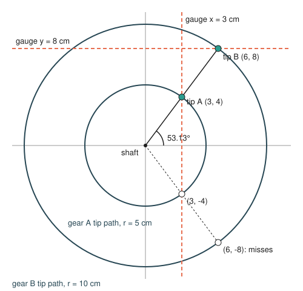

# The resultant: one determinant that says when two polynomials share a root

[Syllabus](../../../SYLLABUS.md) → [Algebraic geometry](../README.md) → [Polynomial Systems](../README.md#s01) → The resultant

---

## General Overview

A gearbox shaft carries two gears fixed together, so they turn as one. Gear A's tooth tips sweep a circle of radius 5 cm. Gear B's sweep a circle of radius 10 cm. One marked tooth on each points the same way.

Two contact gauges stand beside the shaft. A gauge is a fixed stop that a tooth tip touches. Gauge A is a vertical edge at x = 3 cm. Gauge B is a horizontal edge at height y = 8 cm. A timing mechanism needs both tips to touch their gauges at the same shaft angle. Do they?

Each gauge gives one polynomial in one letter, t, which stands for the shaft angle. Here t is $`\tan(\theta/2)`$, the tangent of half the shaft angle θ. It turns sine and cosine into fractions of polynomials, $`\cos\theta = (1 - t^2)/(1 + t^2)`$ and $`\sin\theta = 2t/(1 + t^2)`$, the substitution that [Conics](../03-Plane%20Curves/01-conics-and-rational-parametrisation.md) reads off a circle. Tip A touches gauge A when $`5\cos\theta = 3`$; clearing the fraction gives $`f(t) = 4t^2 - 1 = 0`$. Tip B touches gauge B when $`10\sin\theta = 8`$, which gives $`g(t) = 8t^2 - 20t + 8 = 0`$. Worked numbers shows both steps. The question becomes: do f and g have a root in common?

The **resultant** answers that without solving either equation. Write the two lists of coefficients into a square grid, shifted one step per row. That grid is the **Sylvester matrix**. Take its determinant. Zero means a shared root; anything else means none. Here the determinant is 0, and the shared root is t = 1/2: the shaft angle 53.13°, with tip A at (3, 4) and tip B at (6, 8). Move gauge B to 9 cm and the determinant becomes 425: the two tips never touch together.

Round gears also allow a shortcut. Tip A needs $`\cos\theta = 3/5`$, tip B needs $`\sin\theta = 4/5`$, and the identity $`\cos^2\theta + \sin^2\theta = 1`$ shows one angle does both. The resultant needs no such identity: it works from the coefficients alone, so it still answers for profiles that are not circles. Step 4 shows it rebuilds the identity here.

The same determinant does a second job. When the coefficients contain another letter, the determinant is a polynomial in that letter, and the first letter is gone. That removes a variable in one step, with no Grobner basis.

The field is ℚ, the fractions: every coefficient here is a fraction. "Shared root" means a shared root among the complex numbers ℂ. Whether that root is a real angle is a separate question, answered below.

[Polynomials behave like integers](../../03-Algebra/09-Rings%20and%20Fields/03-polynomials-behave-like-integers.md) already finds a shared factor by Euclid's algorithm, the repeated division with remainder: its tank example gives x − 1. This card spends its time on what Euclid does not give: one determinant that answers yes or no, and that still works when the coefficients contain other letters.

**Two polynomials share a root exactly when the determinant of their Sylvester matrix is zero, and because that determinant is a polynomial in any other letters present, it eliminates a variable in one step.**

**What kind of fact this is:** the resultant is a definition; that it is zero exactly when the polynomials share a root, and that it lies in their ideal, are theorems proved on this card in Why it works.

### The picture: one shaft angle, two contacts

<p align="center"></p>

Drawn to scale, real points only. The filled dots are the shared angle. The open dots are f's other root, t = −1/2: tip A touches at (3, −4), but tip B sits at (6, −8), far from its gauge.

---

## The formula

Write the two polynomials with their top coefficients first:

```math
f = a_m t^m + \dots + a_1 t + a_0, \qquad g = b_n t^n + \dots + b_1 t + b_0
```

The Sylvester matrix has m + n rows and m + n columns. Its first n rows hold f's coefficients, each row shifted one column right of the one above. Its last m rows hold g's coefficients, shifted the same way. Empty places are 0. The resultant is its determinant. For the gears, with m = n = 2:

```math
\mathrm{Res}_t(f, g) = \det \begin{pmatrix} 4 & 0 & -1 & 0 \\ 0 & 4 & 0 & -1 \\ 8 & -20 & 8 & 0 \\ 0 & 8 & -20 & 8 \end{pmatrix} = 0
```

**Read it aloud:** the resultant of f and g in the letter t is the determinant of the grid of their shifted coefficients, and it is zero here.

The theorem it carries, for top coefficients that are not both zero:

```math
\mathrm{Res}_t(f, g) = 0 \iff f \text{ and } g \text{ share a root in } \mathbb{C} \iff \gcd(f, g) \text{ has degree at least } 1
```

**Read it aloud:** the resultant is zero exactly when the two polynomials have a common complex root, which is exactly when they have a common factor.

A second form computes the same number from f's roots:

```math
\mathrm{Res}_t(f, g) = a_m^{\,n} \prod_{f(\alpha) = 0} g(\alpha)
```

**Read it aloud:** take f's top coefficient to the power n, and multiply it by g's value at each root of f, each root counted as often as it repeats.

For the gears: $`4^2 \times g(1/2) \times g(-1/2) = 16 \times 0 \times 20 = 0`$.

| Symbol | Plain meaning | In our example | Push it up and the answer… |
| --- | --- | --- | --- |
| $`k`$, $`\mathbb{Q}`$, $`\mathbb{C}`$ | the field of coefficients (here the fractions $`\mathbb{Q}`$), and the complex numbers where roots are sought | fractions such as 1/2 | — |
| $`\theta`$; x, y | the shaft angle, from the positive x direction; plane coordinates in cm | 53.13°; gauges at x = 3, y = 8 | moves both tips round |
| $`t`$ | $`\tan(\theta/2)`$, the tangent of half the angle | 1/2 at contact | a larger angle, up to 180° |
| $`f`$, $`g`$ | the two polynomials: contact conditions for gear A and gear B | $`4t^2 - 1`$, $`8t^2 - 20t + 8`$ | — |
| $`m`$, $`n`$; $`a_m`$, $`b_n`$ | the degrees of f and g, and their top coefficients | 2 and 2; 4 and 8 | a larger matrix |
| $`\mathrm{Res}_t(f, g)`$ | the resultant: the Sylvester determinant, with t removed | 0 | — |
| $`\alpha`$, $`\beta`$ | a root of f, a root of g | 1/2 and −1/2; 1/2 and 2 | — |
| $`h`$ | a shared factor of f and g | $`2t - 1`$ | — |
| $`A`$, $`B`$ | the cancelling pair: $`Af + Bg = 0`$, with A of lower degree than g and B lower than f | $`4t - 8`$ and $`-2t - 1`$ | — |
| $`c`$ | gauge B's height, left as a letter | 8 cm | contact needs c = 8 or −8 |
| $`u`$, $`v`$ | the robot arm's elbow position, in metres | 21/8 and ±1.4524 | — |
| $`\langle f, g\rangle`$, $`I_1`$ | the ideal: every $`Uf + Vg`$, with U and V any polynomials; and its part free of the eliminated letter | contains $`25c^2 - 1600`$ | — |

### When it holds

- **The top coefficients are not both zero.** If both vanish, the matrix has a zero first column, so the determinant is 0 whether or not a root is shared. The pair $`ct - 1`$, $`ct - 2`$ has resultant $`-c`$, zero at c = 0, where the two read −1 and −2.
- **Roots are counted in ℂ.** A zero resultant promises a complex root, not a real angle. Gauges at x = 6 cm and x = 12 cm give resultant 0, but the shared factor is $`t^2 + 1/11`$: no real t.
- **The substitution misses one angle.** $`t = \tan(\theta/2)`$ has no value at θ = 180°. Check that angle by hand: there tip A sits at x = −5 cm, nowhere near its gauge.
- **Exact arithmetic.** In floating point a determinant prints as a tiny number, not 0, and cannot say "shared root". The checks use exact fractions.

---

## Why it works

### Step 0: a shared root is a linear-algebra question in disguise

Two polynomials share a root exactly when they share a factor. They share a factor exactly when some small multiple of one cancels a small multiple of the other. Finding those multiples means solving linear equations for unknown coefficients. A square set of linear equations with zero on the right has a nonzero answer exactly when its determinant is zero ([Determinants](../../03-Algebra/05-Solving%20Systems/04-determinants.md)). That determinant is the resultant.

### Step 1: a shared root means a shared factor

If $`f(\alpha) = 0`$, then $`t - \alpha`$ divides f, by the factor theorem: a root gives a factor. So a shared root α gives the shared factor $`t - \alpha`$. Conversely, a shared factor of degree at least 1 has a root in ℂ, and that root is shared.

For the gears, Euclid's algorithm gives $`\gcd(f, g) = t - 1/2`$. In factored form $`f = (2t - 1)(2t + 1)`$ and $`g = 4(2t - 1)(t - 2)`$.

### Step 2: a shared factor means a cancelling pair

Call h a shared factor of degree at least 1. Take $`A = g/h`$ and $`B = -f/h`$. Then $`Af + Bg = (fg - fg)/h = 0`$, and A has lower degree than g, B lower than f.

For the gears, $`h = 2t - 1`$ gives $`A = 4t - 8`$ and $`B = -2t - 1`$. Multiplying out, $`Af + Bg = 0`$.

The converse uses unique factorisation. Suppose $`Af = -Bg`$ with B not zero and no shared factor. Then f divides $`Bg`$ and shares nothing with g, so f divides B. But B has lower degree than f, so B would have to be 0. That contradicts the assumption, so a cancelling pair forces a shared factor.

### Step 3: the cancelling pair is a square linear system, and its matrix is Sylvester's

A has n unknown coefficients and B has m. The product $`Af + Bg`$ has degree below m + n, so asking it to vanish gives m + n equations, one per power of t. That is m + n equations in m + n unknowns.

Each unknown multiplies one shifted copy of f or g. The coefficient of A's $`t^i`$ multiplies $`t^i f`$; the coefficient of B's $`t^j`$ multiplies $`t^j g`$. Write those shifted copies as rows and the system is "a combination of the rows is zero". The rows are exactly the Sylvester matrix.

A nonzero combination of rows gives zero exactly when the determinant is 0. So: shared root, then shared factor, then cancelling pair, then zero determinant, and each step runs backwards too.

<details>
<summary>The gears' system, written out</summary>

The rows of the Sylvester matrix are, top to bottom, $`t f`$, $`f`$, $`t g`$, $`g`$, with coefficients listed from $`t^3`$ down to the constant. The pair $`A = 4t - 8`$, $`B = -2t - 1`$ is the combination

$`\displaystyle 4\,(t f) - 8\,(f) - 2\,(t g) - 1\,(g) = 0.`$

In coordinates, the row vector of multipliers $`(4, -8, -2, -1)`$ times the matrix is the zero row. A nonzero vector sent to zero means the matrix flattens some direction, so its determinant is 0.

</details>

### Step 4: the resultant lies in the ideal, so it eliminates

To the last column, add t times the column before it, $`t^2`$ times the one before that, and so on to the first. The determinant does not change, and the last column now holds the row polynomials $`t^{n-1}f, \dots, f, t^{m-1}g, \dots, g`$. Expand along that column: $`\mathrm{Res}_t(f, g) = Uf + Vg`$ for polynomials U and V. The resultant is in the ideal $`\langle f, g\rangle`$, the set of all such combinations ([Ideals and varieties](01-ideals-and-varieties.md)).

Now let the coefficients contain another letter. Leave gauge B's height as c, so $`g = ct^2 - 20t + c`$. The Sylvester determinant is a polynomial in c alone:

```math
\mathrm{Res}_t(4t^2 - 1,\; ct^2 - 20t + c) = 25c^2 - 1600 = 25(c - 8)(c + 8)
```

Every common solution makes $`Uf + Vg`$ zero, so its c must be a root. The variable t is gone: this polynomial lies in the elimination ideal $`I_1`$, the part of the ideal free of t ([Elimination](05-elimination-and-implicitisation.md)). Only gauge heights of 8 cm and −8 cm let the two tips touch together.

This eliminant is an old identity in disguise. Tip A touches at $`\cos\theta = 3/5`$ and tip B at $`\sin\theta = c/10`$, so by $`\cos^2\theta + \sin^2\theta = 1`$ a shared angle needs $`(3/5)^2 + (c/10)^2 = 1`$. Moved to one side and multiplied by 2500, that condition is exactly the resultant:

```math
2500\left((3/5)^2 + (c/10)^2 - 1\right) = 25c^2 - 1600
```

The determinant reached it with no solving and no trigonometry, from the coefficients alone. That is what the resultant adds: for gear profiles that are not circles no such identity is at hand, and the same determinant still works.

The converse needs the top-coefficient condition from When it holds. If the top coefficients do not both vanish at a root of the eliminant, a shared t exists over ℂ. This is the extension theorem in one variable; the Elimination card states it and Cox, Little and O'Shea prove it.

### Step 5: the house example, the robot arm

A two-link robot arm has links of 3 m and 2 m, its shoulder at the origin. To reach the target (4, 0) m, the elbow at (u, v) must satisfy $`u^2 + v^2 = 9`$ and $`(u - 4)^2 + v^2 = 4`$. Eliminate v with one resultant:

```math
\mathrm{Res}_v = 64u^2 - 336u + 441 = (8u - 21)^2
```

So u = 21/8 m, and putting it back gives $`v^2 = 135/64`$: v = ±1.4524 m. The square in the eliminant records the two elbow places over one u. A target 6 m away gives u = 41/12 m and $`v^2 = -385/144`$: no real elbow, since the arm reaches at most 5 m.

### Step 6: the product formula

<details>
<summary>Why the resultant equals the top coefficient times g at f's roots</summary>

Treat the roots of f and g as letters, numbered by i and j: $`f = a_m \prod (t - \alpha_i)`$ and $`g = b_n \prod (t - \beta_j)`$. Each coefficient is a top coefficient times a symmetric combination of roots, so the Sylvester determinant is a polynomial in the α's and β's.

It vanishes whenever some $`\alpha_i = \beta_j`$, by Step 3, so it is divisible by every difference $`\alpha_i - \beta_j`$. Counting degrees shows nothing else fits but a constant, and comparing one term fixes that constant:

$`\displaystyle \mathrm{Res}_t(f, g) = a_m^{\,n}\, b_n^{\,m} \prod_{i,j} (\alpha_i - \beta_j) = a_m^{\,n} \prod_i g(\alpha_i).`$

The full degree count is in Cox, Little and O'Shea, chapter 3, and in Gelfand, Kapranov and Zelevinsky.

</details>

The formula explains the size of a nonzero resultant. Gauge B at 9 cm gives $`g = 9t^2 - 20t + 9`$, with $`g(1/2) = 5/4`$ and $`g(-1/2) = 85/4`$. The resultant is $`16 \times 5/4 \times 85/4 = 425`$: the product of how badly g misses at each of f's roots.

A polynomial and its own derivative share a root exactly when the polynomial has a repeated root. Their resultant is, up to a constant factor, the discriminant, which [The quadratic formula](../../03-Algebra/02-Polynomials/03-quadratic-formula.md) meets as the number under its square root.

---

## Worked numbers, by hand

| Step | Arithmetic | Value |
| --- | --- | --- |
| gear A's contact | $`5\cos\theta = 3`$: $`5(1 - t^2) = 3(1 + t^2)`$, so $`8t^2 - 2 = 0`$, halved | $`f = 4t^2 - 1`$ |
| gear B's contact | $`10\sin\theta = 8`$: $`10 \times 2t = 8(1 + t^2)`$ | $`g = 8t^2 - 20t + 8`$ |
| f's roots | $`t^2 = 1/4`$ | 1/2 and −1/2 |
| g at the first | $`8/4 - 10 + 8`$ | 0 |
| g at the second | $`8/4 + 10 + 8`$ | 20 |
| resultant | $`4^2 \times 0 \times 20`$ | **0** |
| the angle | $`\cos\theta = (1 - 1/4)/(1 + 1/4)`$, $`\sin\theta = 1/(1 + 1/4)`$ | 3/5 and 4/5, so 53.13° |
| the tips | $`5 \times (3/5, 4/5)`$ and $`10 \times (3/5, 4/5)`$ | (3, 4) and (6, 8) |
| gauge B at 9 cm | $`16 \times (9/4 - 10 + 9) \times (9/4 + 10 + 9)`$ | $`16 \times 5/4 \times 85/4 = 425`$ |

A resultant of 0 says the gauges are set for one shared angle; 425 says that a 1 cm shift of gauge B breaks the timing completely.

### What breaks if you drop a piece

| Mistake | Comes out at | What went wrong |
| --- | --- | --- |
| Both top coefficients vanish: $`ct - 1`$, $`ct - 2`$ | resultant $`-c`$, zero at c = 0 | At c = 0 the pair reads −1 and −2: no t at all |
| A zero over ℂ read as a real angle: gauges at x = 6 and x = 12 | resultant 0 | The shared factor is $`t^2 + 1/11`$, so $`t^2 = -1/11`$: no real angle |
| Searching whole numbers only, t from −9 to 9 | f none; g 2; shared none | The shared root is 1/2, not a whole number |
| Reading the arm's double root as one elbow | u = 21/8 only | The square $`(8u - 21)^2`$ hides v = ±1.4524: two elbows |

The code prints all four.

---

## Code, from first principles, and it actually runs

The code builds the Sylvester matrix and reaches the gears' answer by four roads. Roads one and two take the determinant of that one matrix in two different ways. Road one is row reduction over exact fractions. Road two is the permutation sum, which adds 24 signed products and also handles polynomial entries, so it computes the eliminants in c and u. Road three is Euclid's algorithm, whose gcd must have degree at least 1 exactly when the resultant is 0. Road four is the product formula, fed with f's top coefficient and the roots the rational root test finds. The contact point is read off the gcd's root and put back into both polynomials exactly. The identity $`\cos^2\theta + \sin^2\theta = 1`$ checks the eliminant in c.

### Python

```python
# The resultant -- the check behind the card.  Imports: fractions, for exact
# rationals, and math, for one square root and one angle; neither knows any
# resultant.  A polynomial is a list of coefficients, constant term first.
from fractions import Fraction as Q
from math import atan2, degrees, sqrt

def trim(p):
    p = list(p)
    while p and p[-1] == 0: p.pop()
    return p

def show(p, v="t"):                       # leading term first, as the card writes it
    terms = []
    for k in range(len(p) - 1, -1, -1):
        if p[k] == 0: continue
        a = abs(p[k])
        body = ("" if a == 1 and k else str(a)) + (v if k else "") + (f"^{k}" if k > 1 else "")
        terms.append(("-" if p[k] < 0 else "+", body))
    if not terms: return "0"
    return ("-" if terms[0][0] == "-" else "") + terms[0][1] + "".join(f" {s} {b}" for s, b in terms[1:])

def add(p, q):
    return trim([(p[i] if i < len(p) else 0) + (q[i] if i < len(q) else 0) for i in range(max(len(p), len(q)))])

def mul(p, q):
    r = [0] * (len(p) + len(q) - 1) if p and q else []
    for i, a in enumerate(p):
        for j, b in enumerate(q): r[i + j] += a * b
    return trim(r)

def ev(p, x):                             # Horner: exact value at x
    s = 0
    for c in reversed(p): s = s * x + c
    return s

def sylvester(f, g, zero):                # deg g shifted rows of f, deg f shifted rows of g
    m, n = len(f) - 1, len(g) - 1
    rows = [[zero] * i + f[::-1] + [zero] * (n - 1 - i) for i in range(n)]
    return rows + [[zero] * i + g[::-1] + [zero] * (m - 1 - i) for i in range(m)]

def det_rows(M):                          # road one: row reduction over the rationals
    M, d, N = [[Q(x) for x in r] for r in M], Q(1), len(M)
    for c in range(N):
        p = next((r for r in range(c, N) if M[r][c] != 0), None)
        if p is None: return Q(0)
        if p != c: M[c], M[p], d = M[p], M[c], -d
        d *= M[c][c]
        for r in range(c + 1, N):
            k = M[r][c] / M[c][c]
            M[r] = [M[r][j] - k * M[c][j] for j in range(N)]
    return d

def perms(n):                             # every ordering of 0..n-1, with its sign
    if n == 1: return [([0], 1)]
    return [(p[:i] + [n - 1] + p[i:], s * (-1) ** (n - 1 - i)) for p, s in perms(n - 1) for i in range(n)]

def det_perm(M):                          # road two: the permutation sum; entries are polynomials
    total = []
    for p, s in perms(len(M)):
        term = [s]
        for r in range(len(M)): term = mul(term, M[r][p[r]])
        total = add(total, term)
    return total

def gcd(a, b):                            # road three: Euclid, made monic
    a, b = trim([Q(x) for x in a]), trim([Q(x) for x in b])
    while b:
        r = a
        while len(r) >= len(b):
            k, s = r[-1] / b[-1], len(r) - len(b)
            r = trim([r[i] - (k * b[i - s] if i >= s else 0) for i in range(len(r))])
        a, b = b, r
    return [c / a[-1] for c in a]

def rat_roots(p):                         # rational root test: plus or minus u/v, u | constant, v | top
    dv = lambda n: [d for d in range(1, abs(n) + 1) if n % d == 0]
    c = sorted({Q(s * u, v) for u in dv(p[0]) for v in dv(p[-1]) for s in (1, -1)})
    return [x for x in c if ev(p, x) == 0]

def lst(xs): return ", ".join(str(x) for x in xs) or "none"
def num(M): return [[[x] if x else [] for x in r] for r in M]
def gear_b(c): return [c, -20, c]         # 10 x 2t = c(1 + t^2): gear B's tip at height c
fA = add([3, 0, 3], [-5, 0, 5])           # 5 cos = 3, cleared: 3(1 + t^2) - 5(1 - t^2) = 0
f, g, g9 = [c // 2 for c in fA], gear_b(8), gear_b(9)   # f is fA halved
S = sylvester(f, g, 0)
print(f"gear A, tip radius 5 cm, gauge x = 3 cm: 3(1 + t^2) - 5(1 - t^2) = {show(fA)}, halved f = {show(f)}")
print(f"gear B, tip radius 10 cm, gauge y = 8 cm: g = {show(g)}")
print("Sylvester rows:", " ".join(str(r) for r in S))
print(f"Res_t(f, g): row reduction {det_rows(S)}, 24-term permutation sum {show(det_perm(num(S)))}")
h = gcd(f, g)
print(f"Euclid: gcd(f, g) = {show(h)}, degree {len(h) - 1}")
assert len(h) == 2                        # a shared root exists: the gcd has degree 1
(lo, hi), a2, t0 = rat_roots(f), f[-1] ** (len(g) - 1), -h[0]   # road four: f's roots and 4^2; t0: the gcd's root
print(f"rational roots: f {lst(rat_roots(f))}; g {lst(rat_roots(g))}")
print(f"product formula: 4^2 x g({hi}) x g({lo}) = {a2} x {ev(g, hi)} x {ev(g, lo)} = {a2 * ev(g, hi) * ev(g, lo)}")
co, si = (1 - t0 ** 2) / (1 + t0 ** 2), 2 * t0 / (1 + t0 ** 2)
print(f"contact: t = {t0}, cos = {co}, sin = {si}, angle {degrees(atan2(si, co)):.3f} degrees")
print(f"substitution: f({t0}) = {ev(f, t0)}, g({t0}) = {ev(g, t0)}; tip A at ({5 * co}, {5 * si}), tip B at ({10 * co}, {10 * si})")
A, B = [-8, 4], [-1, -2]
print(f"certificate: A = {show(A)}, B = {show(B)}, A f + B g = {show(add(mul(A, f), mul(B, g)))}")
p9 = a2 * ev(g9, hi) * ev(g9, lo)
print(f"gauge y = 9 cm: g = {show(g9)}, Res = {det_rows(sylvester(f, g9, 0))}, product {a2} x {ev(g9, hi)} x {ev(g9, lo)} = {p9}, "
      f"gcd {show(gcd(f, g9))}, Res(f, 2g) = {det_rows(sylvester(f, [2 * c for c in g9], 0))}")
E = det_perm(sylvester([[-1], [], [4]], [[0, 1], [-20], [0, 1]], []))
fam = all(det_rows(sylvester(f, gear_b(c), 0)) == ev(E, c) for c in range(-10, 11))
print(f"eliminate t: Res_t(f, c t^2 - 20t + c) = {show(E, 'c')}, roots c = {lst(rat_roots(E))}")
print(f"same as row reduction at c = -10..10: {'yes' if fam else 'no'}")
pyth = [2500 * (Q(3, 5) ** 2 - 1), 0, Q(2500, 10 ** 2)]   # cos^2 + sin^2 - 1 at cos = 3/5, sin = c/10, times 2500
print(f"Pythagoras: 2500((3/5)^2 + (c/10)^2 - 1) = {show(pyth, 'c')}; same as the eliminant: {'yes' if pyth == E else 'no'}")
print(f"figure, centre (0, 0), circle A r 5, circle B r 10, gauge x = 3, gauge y = 8, tip A ({5 * co}, {5 * si}), tip B ({10 * co}, {10 * si})")

def arm(d):                               # elbow (u, v): u^2 + v^2 = 9, (u - d)^2 + v^2 = 4; eliminate v
    E = det_perm(sylvester([[-9, 0, 1], [], [1]], [[d * d - 4, -2 * d, 1], [], [1]], []))
    a = next(iter(rat_roots(E)), Q(0))      # its rational root, 0 if none
    return E, a, 9 - a * a

for d in (4, 6):
    Ea, a, b2 = arm(d)
    tail = f"v = +-{sqrt(b2):.4f} m, two elbows" if b2 > 0 else "one elbow, arm straight" if b2 == 0 else "no real elbow"
    print(f"arm, target ({d}, 0) m: Res_v = {show(Ea, 'u')}, u = {a} m, v^2 = {b2}, {tail}")
print(f"arm eliminant at target 4 m is (8u - 21)^2: {'yes' if arm(4)[0] == mul([-21, 8], [-21, 8]) else 'no'}")
fx, gx = [1, 0, 11], [2, 0, 22]           # gauges x = 6 and x = 12, past both tips
t2 = -gcd(fx, gx)[0]                      # the shared value of t^2
print(f"gauges x = 6, x = 12: f = {show(fx)}, g = {show(gx)}, Res = {det_rows(sylvester(fx, gx, 0))}, "
      f"gcd {show(gcd(fx, gx))}, so t^2 = {t2}, cos = {(1 - t2) / (1 + t2)}: no real angle")
fy, gy = [[-1], [0, 1]], [[-2], [0, 1]]
Exy, at0 = det_perm(sylvester(fy, gy, [])), [show(trim([ev(c, 0) for c in p])) for p in (fy, gy)]
print(f"ct - 1 and ct - 2: Res_t = {show(Exy, 'c')}, zero at c = "
      f"{lst([x for x in range(-9, 10) if ev(Exy, x) == 0])}, where they read {at0[0]} and {at0[1]}")
wf, wg = [t for t in range(-9, 10) if ev(f, t) == 0], [t for t in range(-9, 10) if ev(g, t) == 0]
print(f"whole-number search t = -9..9: f {lst(wf)}; g {lst(wg)}; shared {lst([t for t in wf if t in wg])}")
assert det_rows(S) == 0 and fam                                    # two determinant roads agree
assert all((len(gcd(f, gear_b(c))) > 1) == (det_rows(sylvester(f, gear_b(c), 0)) == 0) for c in range(-10, 11))  # Euclid agrees
assert p9 == det_rows(sylvester(f, g9, 0)) == 425                  # product formula vs determinant
assert ev(f, t0) == 0 == ev(g, t0) and (5 * co, 10 * si) == (3, 8)
assert add(mul(A, f), mul(B, g)) == [] and rat_roots(E) == [-8, 8] and pyth == E   # Pythagoras vs the determinant
Ea, a, b2 = arm(4)
assert Ea == mul([-21, 8], [-21, 8]) and a * a + b2 == 9 and (a - 4) ** 2 + b2 == 4
assert Exy == [0, -1]
print("ALL CHECKS PASS")
```

**Ran 2026-11-17 on macOS, Python 3.14.10, standard library only. All checks passed. Output, pasted from the run:**

```
gear A, tip radius 5 cm, gauge x = 3 cm: 3(1 + t^2) - 5(1 - t^2) = 8t^2 - 2, halved f = 4t^2 - 1
gear B, tip radius 10 cm, gauge y = 8 cm: g = 8t^2 - 20t + 8
Sylvester rows: [4, 0, -1, 0] [0, 4, 0, -1] [8, -20, 8, 0] [0, 8, -20, 8]
Res_t(f, g): row reduction 0, 24-term permutation sum 0
Euclid: gcd(f, g) = t - 1/2, degree 1
rational roots: f -1/2, 1/2; g 1/2, 2
product formula: 4^2 x g(1/2) x g(-1/2) = 16 x 0 x 20 = 0
contact: t = 1/2, cos = 3/5, sin = 4/5, angle 53.130 degrees
substitution: f(1/2) = 0, g(1/2) = 0; tip A at (3, 4), tip B at (6, 8)
certificate: A = 4t - 8, B = -2t - 1, A f + B g = 0
gauge y = 9 cm: g = 9t^2 - 20t + 9, Res = 425, product 16 x 5/4 x 85/4 = 425, gcd 1, Res(f, 2g) = 1700
eliminate t: Res_t(f, c t^2 - 20t + c) = 25c^2 - 1600, roots c = -8, 8
same as row reduction at c = -10..10: yes
Pythagoras: 2500((3/5)^2 + (c/10)^2 - 1) = 25c^2 - 1600; same as the eliminant: yes
figure, centre (0, 0), circle A r 5, circle B r 10, gauge x = 3, gauge y = 8, tip A (3, 4), tip B (6, 8)
arm, target (4, 0) m: Res_v = 64u^2 - 336u + 441, u = 21/8 m, v^2 = 135/64, v = +-1.4524 m, two elbows
arm, target (6, 0) m: Res_v = 144u^2 - 984u + 1681, u = 41/12 m, v^2 = -385/144, no real elbow
arm eliminant at target 4 m is (8u - 21)^2: yes
gauges x = 6, x = 12: f = 11t^2 + 1, g = 22t^2 + 2, Res = 0, gcd t^2 + 1/11, so t^2 = -1/11, cos = 6/5: no real angle
ct - 1 and ct - 2: Res_t = -c, zero at c = 0, where they read -1 and -2
whole-number search t = -9..9: f none; g 2; shared none
ALL CHECKS PASS
```

### Rust

Same numbers, same labels, built with `rustc --edition 2021 -O`.

```rust
// The resultant -- the same check as the Python, in Rust.  No crates.  Exact
// rationals are an i128 pair with checked multiplication, so overflow stops the
// run.  A polynomial is a list of coefficients, constant term first.
use std::cmp::Ordering;
use std::fmt;
use std::ops::{Add, Div, Mul, Neg, Sub};

#[derive(Clone, Copy, PartialEq, Debug)]
struct Fr { n: i128, d: i128 }
fn gi(a: i128, b: i128) -> i128 { if b == 0 { a.abs() } else { gi(b, a % b) } }
fn fr(n: i128, d: i128) -> Fr { let g = gi(n, d) * d.signum(); Fr { n: n / g, d: d / g } }
fn z(n: i128) -> Fr { Fr { n, d: 1 } }
fn cm(a: i128, b: i128) -> i128 { a.checked_mul(b).expect("overflow") }
impl Add for Fr { type Output = Fr; fn add(self, o: Fr) -> Fr { fr(cm(self.n, o.d).checked_add(cm(o.n, self.d)).expect("overflow"), cm(self.d, o.d)) } }
impl Neg for Fr { type Output = Fr; fn neg(self) -> Fr { Fr { n: -self.n, d: self.d } } }
impl Sub for Fr { type Output = Fr; fn sub(self, o: Fr) -> Fr { self + (-o) } }
impl Mul for Fr { type Output = Fr; fn mul(self, o: Fr) -> Fr { fr(cm(self.n, o.n), cm(self.d, o.d)) } }
impl Div for Fr { type Output = Fr; fn div(self, o: Fr) -> Fr { fr(cm(self.n, o.d), cm(self.d, o.n)) } }
impl PartialOrd for Fr { fn partial_cmp(&self, o: &Fr) -> Option<Ordering> { cm(self.n, o.d).partial_cmp(&cm(o.n, self.d)) } }
impl fmt::Display for Fr { fn fmt(&self, f: &mut fmt::Formatter) -> fmt::Result { if self.d == 1 { write!(f, "{}", self.n) } else { write!(f, "{}/{}", self.n, self.d) } } }
fn fl(x: Fr) -> f64 { x.n as f64 / x.d as f64 }   type P = Vec<Fr>;
fn ip(v: &[i128]) -> P { v.iter().map(|&x| z(x)).collect() }

fn trim(mut p: P) -> P { while p.last() == Some(&z(0)) { p.pop(); } p }
fn show(p: &P, v: &str) -> String {                  // leading term first, as the card writes it
    let mut terms: Vec<(bool, String)> = Vec::new();
    for k in (0..p.len()).rev() {
        if p[k] == z(0) { continue }
        let a = if p[k].n < 0 { -p[k] } else { p[k] };
        let body = format!("{}{}{}", if a == z(1) && k > 0 { String::new() } else { a.to_string() },
                           if k > 0 { v } else { "" }, if k > 1 { format!("^{}", k) } else { String::new() });
        terms.push((p[k].n < 0, body));
    }
    if terms.is_empty() { return "0".to_string() }
    let mut s = format!("{}{}", if terms[0].0 { "-" } else { "" }, terms[0].1);
    for (neg, b) in &terms[1..] { s += &format!(" {} {}", if *neg { "-" } else { "+" }, b) }
    s
}
fn add(p: &P, q: &P) -> P {
    trim((0..p.len().max(q.len())).map(|i| *p.get(i).unwrap_or(&z(0)) + *q.get(i).unwrap_or(&z(0))).collect())
}
fn mul(p: &P, q: &P) -> P {
    if p.is_empty() || q.is_empty() { return vec![] }
    let mut r = vec![z(0); p.len() + q.len() - 1];
    for (i, &a) in p.iter().enumerate() { for (j, &b) in q.iter().enumerate() { r[i + j] = r[i + j] + a * b } }
    trim(r)
}
fn ev(p: &P, x: Fr) -> Fr { p.iter().rev().fold(z(0), |s, &c| s * x + c) }   // Horner

fn sylvester<T: Clone>(f: &[T], g: &[T], zero: T) -> Vec<Vec<T>> {   // deg g rows of f, deg f rows of g
    let (m, n) = (f.len() - 1, g.len() - 1);
    let row = |p: &[T], i: usize, k: usize| -> Vec<T> {
        let mut r = vec![zero.clone(); i]; r.extend(p.iter().rev().cloned()); r.extend(vec![zero.clone(); k - 1 - i]); r };
    let mut rows: Vec<Vec<T>> = (0..n).map(|i| row(f, i, n)).collect();
    rows.extend((0..m).map(|i| row(g, i, m)));
    rows
}
fn det_rows(mut m: Vec<Vec<Fr>>) -> Fr {             // road one: row reduction over the rationals
    let (nn, mut d) = (m.len(), z(1));
    for c in 0..nn {
        let p = match (c..nn).find(|&r| m[r][c] != z(0)) { Some(p) => p, None => return z(0) };
        if p != c { m.swap(c, p); d = -d }
        d = d * m[c][c];
        for r in c + 1..nn { let k = m[r][c] / m[c][c]; for j in 0..nn { m[r][j] = m[r][j] - k * m[c][j] } }
    }
    d
}
fn perms(n: usize) -> Vec<(Vec<usize>, i128)> {     // every ordering of 0..n-1, with its sign
    if n == 1 { return vec![(vec![0], 1)] }
    let mut out = Vec::new();
    for (p, s) in perms(n - 1) { for i in 0..n {
        let mut q = p.clone(); q.insert(i, n - 1);
        out.push((q, if (n - 1 - i) % 2 == 0 { s } else { -s }));
    } }
    out
}
fn det_perm(m: &Vec<Vec<P>>) -> P {                  // road two: the permutation sum; entries are polynomials
    let mut total: P = vec![];
    for (p, s) in perms(m.len()) {
        let term = (0..m.len()).fold(vec![z(s)], |t, r| mul(&t, &m[r][p[r]])); total = add(&total, &term);
    }
    total
}
fn gcd(a: &P, b: &P) -> P {                          // road three: Euclid, made monic
    let (mut a, mut b) = (trim(a.clone()), trim(b.clone()));
    while !b.is_empty() {
        let mut r = a.clone();
        while r.len() >= b.len() {
            let (k, s) = (r[r.len() - 1] / b[b.len() - 1], r.len() - b.len());
            r = trim((0..r.len()).map(|i| r[i] - if i >= s { k * b[i - s] } else { z(0) }).collect());
        }
        (a, b) = (b, r);
    }
    let top = a[a.len() - 1]; a.iter().map(|&c| c / top).collect()
}
fn rat_roots(p: &P) -> Vec<Fr> {                     // rational root test: plus or minus u/v
    let dv = |n: i128| -> Vec<i128> { (1..=n.abs()).filter(|d| n % d == 0).collect() };
    let mut c: Vec<Fr> = Vec::new();
    for u in dv(p[0].n) { for v in dv(p[p.len() - 1].n) { for s in [1, -1] {
        let x = fr(s * u, v); if !c.contains(&x) { c.push(x) } } } }
    c.sort_by(|a, b| a.partial_cmp(b).unwrap());
    c.into_iter().filter(|&x| ev(p, x) == z(0)).collect()
}
fn lst(xs: &[Fr]) -> String { if xs.is_empty() { "none".into() } else { xs.iter().map(|x| x.to_string()).collect::<Vec<_>>().join(", ") } }
fn num(m: &Vec<Vec<Fr>>) -> Vec<Vec<P>> { m.iter().map(|r| r.iter().map(|&x| trim(vec![x])).collect()).collect() }
fn gear_b(c: i128) -> P { ip(&[c, -20, c]) }         // 10 x 2t = c(1 + t^2): gear B's tip at height c
fn pp(v: &[&[i128]]) -> Vec<P> { v.iter().map(|c| trim(ip(c))).collect() }
fn arm(d: i128) -> (P, Fr, Fr) {                     // elbow (u, v): u^2 + v^2 = 9, (u - d)^2 + v^2 = 4
    let e = det_perm(&sylvester(&pp(&[&[-9, 0, 1], &[], &[1]]), &pp(&[&[d * d - 4, -2 * d, 1], &[], &[1]]), vec![]));
    let a = rat_roots(&e).first().copied().unwrap_or(z(0));   // its rational root, 0 if none
    (e, a, z(9) - a * a)
}

fn main() {
    let fa = add(&ip(&[3, 0, 3]), &ip(&[-5, 0, 5]));             // 5 cos = 3, cleared: 3(1 + t^2) - 5(1 - t^2) = 0
    let (f, g, g9): (P, P, P) = (fa.iter().map(|&c| c / z(2)).collect(), gear_b(8), gear_b(9));   // f is fa halved
    let s = sylvester(&f, &g, z(0));
    println!("gear A, tip radius 5 cm, gauge x = 3 cm: 3(1 + t^2) - 5(1 - t^2) = {}, halved f = {}", show(&fa, "t"), show(&f, "t"));
    println!("gear B, tip radius 10 cm, gauge y = 8 cm: g = {}", show(&g, "t"));
    let rows: Vec<String> = s.iter().map(|r| format!("[{}]", lst(r))).collect();
    println!("Sylvester rows: {}", rows.join(" "));
    println!("Res_t(f, g): row reduction {}, 24-term permutation sum {}", det_rows(s.clone()), show(&det_perm(&num(&s)), "t"));
    let h = gcd(&f, &g); println!("Euclid: gcd(f, g) = {}, degree {}", show(&h, "t"), h.len() - 1);
    assert!(h.len() == 2);                                                        // a shared root exists: the gcd has degree 1
    let ([lo, hi], a2, t0): ([Fr; 2], Fr, Fr) = (rat_roots(&f).try_into().unwrap(), (1..g.len()).fold(z(1), |a, _| a * f[f.len() - 1]), -h[0]);
    println!("rational roots: f {}; g {}", lst(&rat_roots(&f)), lst(&rat_roots(&g)));
    println!("product formula: 4^2 x g({}) x g({}) = {} x {} x {} = {}", hi, lo, a2, ev(&g, hi), ev(&g, lo), a2 * ev(&g, hi) * ev(&g, lo));
    let (co, si) = ((z(1) - t0 * t0) / (z(1) + t0 * t0), z(2) * t0 / (z(1) + t0 * t0));
    println!("contact: t = {}, cos = {}, sin = {}, angle {:.3} degrees", t0, co, si, fl(si).atan2(fl(co)).to_degrees());
    println!("substitution: f({}) = {}, g({}) = {}; tip A at ({}, {}), tip B at ({}, {})", t0, ev(&f, t0), t0, ev(&g, t0), z(5) * co, z(5) * si, z(10) * co, z(10) * si);
    let (a_m, b_m) = (ip(&[-8, 4]), ip(&[-1, -2])); let cert = add(&mul(&a_m, &f), &mul(&b_m, &g));
    println!("certificate: A = {}, B = {}, A f + B g = {}", show(&a_m, "t"), show(&b_m, "t"), show(&cert, "t"));
    let (p9, r9) = (a2 * ev(&g9, hi) * ev(&g9, lo), det_rows(sylvester(&f, &g9, z(0))));
    println!("gauge y = 9 cm: g = {}, Res = {}, product {} x {} x {} = {}, gcd {}, Res(f, 2g) = {}", show(&g9, "t"), r9, a2, ev(&g9, hi), ev(&g9, lo), p9,
             show(&gcd(&f, &g9), "t"), det_rows(sylvester(&f, &g9.iter().map(|&c| z(2) * c).collect::<P>(), z(0))));
    let e = det_perm(&sylvester(&pp(&[&[-1], &[], &[4]]), &pp(&[&[0, 1], &[-20], &[0, 1]]), vec![]));
    let fam = (-10..=10).all(|c| det_rows(sylvester(&f, &gear_b(c), z(0))) == ev(&e, z(c)));
    println!("eliminate t: Res_t(f, c t^2 - 20t + c) = {}, roots c = {}", show(&e, "c"), lst(&rat_roots(&e)));
    println!("same as row reduction at c = -10..10: {}", if fam { "yes" } else { "no" });
    let pyth: P = vec![z(2500) * (fr(3, 5) * fr(3, 5) - z(1)), z(0), fr(2500, 100)];   // 2500(cos^2 + sin^2 - 1), cos = 3/5, sin = c/10
    println!("Pythagoras: 2500((3/5)^2 + (c/10)^2 - 1) = {}; same as the eliminant: {}", show(&pyth, "c"), if pyth == e { "yes" } else { "no" });
    println!("figure, centre (0, 0), circle A r 5, circle B r 10, gauge x = 3, gauge y = 8, tip A ({}, {}), tip B ({}, {})", z(5) * co, z(5) * si, z(10) * co, z(10) * si);
    for d in [4, 6] {
        let (ea, a, b2) = arm(d);
        let tail = if b2 > z(0) { format!("v = +-{:.4} m, two elbows", fl(b2).sqrt()) }
                   else if b2 == z(0) { "one elbow, arm straight".to_string() } else { "no real elbow".to_string() };
        println!("arm, target ({}, 0) m: Res_v = {}, u = {} m, v^2 = {}, {}", d, show(&ea, "u"), a, b2, tail);
    }
    let sq = arm(4).0 == mul(&ip(&[-21, 8]), &ip(&[-21, 8])); println!("arm eliminant at target 4 m is (8u - 21)^2: {}", if sq { "yes" } else { "no" });
    let (fx, gx) = (ip(&[1, 0, 11]), ip(&[2, 0, 22])); let hx = gcd(&fx, &gx); let t2 = -hx[0];   // gauges x = 6, x = 12
    println!("gauges x = 6, x = 12: f = {}, g = {}, Res = {}, gcd {}, so t^2 = {}, cos = {}: no real angle",
             show(&fx, "t"), show(&gx, "t"), det_rows(sylvester(&fx, &gx, z(0))), show(&hx, "t"), t2, (z(1) - t2) / (z(1) + t2));
    let (fy, gy) = (pp(&[&[-1], &[0, 1]]), pp(&[&[-2], &[0, 1]])); let exy = det_perm(&sylvester(&fy, &gy, vec![]));
    let at0: Vec<String> = [&fy, &gy].iter().map(|p| show(&trim(p.iter().map(|c| ev(c, z(0))).collect()), "t")).collect();
    let zx: Vec<Fr> = (-9..=9).map(z).filter(|&x| ev(&exy, x) == z(0)).collect();
    println!("ct - 1 and ct - 2: Res_t = {}, zero at c = {}, where they read {} and {}", show(&exy, "c"), lst(&zx), at0[0], at0[1]);
    let wf: Vec<Fr> = (-9..=9).map(z).filter(|&t| ev(&f, t) == z(0)).collect();
    let wg: Vec<Fr> = (-9..=9).map(z).filter(|&t| ev(&g, t) == z(0)).collect();
    let shared: Vec<Fr> = wf.iter().copied().filter(|t| wg.contains(t)).collect();
    println!("whole-number search t = -9..9: f {}; g {}; shared {}", lst(&wf), lst(&wg), lst(&shared));
    assert!(det_rows(s.clone()) == z(0) && fam);                                  // two determinant roads agree
    assert!((-10..=10).all(|c| (gcd(&f, &gear_b(c)).len() > 1) == (det_rows(sylvester(&f, &gear_b(c), z(0))) == z(0))));
    assert!(p9 == r9 && r9 == z(425));                                            // product formula vs determinant
    assert!(ev(&f, t0) == z(0) && ev(&g, t0) == z(0) && z(5) * co == z(3) && z(10) * si == z(8));
    assert!(cert.is_empty() && rat_roots(&e) == vec![z(-8), z(8)] && pyth == e);   // Pythagoras vs the determinant
    let (ea, a, b2) = arm(4);
    assert!(ea == mul(&ip(&[-21, 8]), &ip(&[-21, 8])) && a * a + b2 == z(9) && (a - z(4)) * (a - z(4)) + b2 == z(4));
    assert!(exy == ip(&[0, -1]));
    println!("ALL CHECKS PASS");
}
```

**Ran 2026-11-17 on macOS, rustc 1.98.1, no crates. All checks passed. Output, pasted from the run:**

```
gear A, tip radius 5 cm, gauge x = 3 cm: 3(1 + t^2) - 5(1 - t^2) = 8t^2 - 2, halved f = 4t^2 - 1
gear B, tip radius 10 cm, gauge y = 8 cm: g = 8t^2 - 20t + 8
Sylvester rows: [4, 0, -1, 0] [0, 4, 0, -1] [8, -20, 8, 0] [0, 8, -20, 8]
Res_t(f, g): row reduction 0, 24-term permutation sum 0
Euclid: gcd(f, g) = t - 1/2, degree 1
rational roots: f -1/2, 1/2; g 1/2, 2
product formula: 4^2 x g(1/2) x g(-1/2) = 16 x 0 x 20 = 0
contact: t = 1/2, cos = 3/5, sin = 4/5, angle 53.130 degrees
substitution: f(1/2) = 0, g(1/2) = 0; tip A at (3, 4), tip B at (6, 8)
certificate: A = 4t - 8, B = -2t - 1, A f + B g = 0
gauge y = 9 cm: g = 9t^2 - 20t + 9, Res = 425, product 16 x 5/4 x 85/4 = 425, gcd 1, Res(f, 2g) = 1700
eliminate t: Res_t(f, c t^2 - 20t + c) = 25c^2 - 1600, roots c = -8, 8
same as row reduction at c = -10..10: yes
Pythagoras: 2500((3/5)^2 + (c/10)^2 - 1) = 25c^2 - 1600; same as the eliminant: yes
figure, centre (0, 0), circle A r 5, circle B r 10, gauge x = 3, gauge y = 8, tip A (3, 4), tip B (6, 8)
arm, target (4, 0) m: Res_v = 64u^2 - 336u + 441, u = 21/8 m, v^2 = 135/64, v = +-1.4524 m, two elbows
arm, target (6, 0) m: Res_v = 144u^2 - 984u + 1681, u = 41/12 m, v^2 = -385/144, no real elbow
arm eliminant at target 4 m is (8u - 21)^2: yes
gauges x = 6, x = 12: f = 11t^2 + 1, g = 22t^2 + 2, Res = 0, gcd t^2 + 1/11, so t^2 = -1/11, cos = 6/5: no real angle
ct - 1 and ct - 2: Res_t = -c, zero at c = 0, where they read -1 and -2
whole-number search t = -9..9: f none; g 2; shared none
ALL CHECKS PASS
```

The two outputs match line for line.

### Lean

Lean proves the card's three theorems for every pair of polynomials, and checks the gears' and the arm's numbers exactly.

- Suppose f and g have top coefficients $`a_m`$ and $`b_n`$, not both zero. Then the resultant is zero exactly when f and g share a root in ℂ.
- In the same case, the resultant is zero exactly when $`\gcd(f, g)`$ has degree at least 1.
- Take any f and g, even with letters such as c in the coefficients, and at least one row in the grid. Then $`\mathrm{Res}_t(f, g) = Uf + Vg`$ for some polynomials U and V.
- Take f and g over ℚ, with m and n their degrees. Then $`\mathrm{Res}_t(f, g) = a_m^{\,n} \prod g(\alpha)`$, over f's roots in ℂ, each counted as often as it repeats.
- The gears' Sylvester determinant is 0, and gauge B at 9 cm gives $`425 = 16 \times 5/4 \times 85/4`$.
- Both f and g are zero at t = 1/2, and $`g(-1/2) = 20`$.
- The cancelling pair $`A = 4t - 8`$, $`B = -2t - 1`$ gives $`Af + Bg = 0`$.
- At t = 1/2, cos θ = 3/5 and sin θ = 4/5, so the tips sit at (3, 4) and (6, 8).
- Take gauge B's height as the letter c. Then the determinant is $`25c^2 - 1600 = 25(c - 8)(c + 8)`$.
- Take the same c. Then $`2500((3/5)^2 + (c/10)^2 - 1) = 25c^2 - 1600`$.
- Take the arm's target (4, 0) m. Then the determinant in v is $`64u^2 - 336u + 441 = (8u - 21)^2`$.
- Take u = 21/8 m. Then $`v^2 = 9 - u^2 = 135/64`$.
- Take a target 6 m away. Then $`144u^2 - 984u + 1681`$ is zero at u = 41/12, where $`v^2 = -385/144`$.
- Take the pair $`ct - 1`$, $`ct - 2`$. Then the resultant is $`-c`$, zero at c = 0, where both top coefficients vanish.
- The gauges at x = 6 cm and x = 12 cm give determinant 0.

Euclid's algorithm, the root searches, the 6 m determinant, the angle 53.13° and the decimal elbows are left to the Python and Rust checks.

```lean
-- The resultant: two polynomials over ℚ whose top coefficients are not both zero share a complex root exactly when the determinant of their Sylvester matrix is zero, and that determinant always lies in the ideal they generate, so it eliminates a variable.
import Mathlib.RingTheory.Polynomial.Resultant.Basic
import Mathlib.Analysis.Complex.Polynomial.Basic
import Mathlib.Algebra.Polynomial.FieldDivision
import Mathlib.LinearAlgebra.Matrix.Determinant.Basic
import Mathlib.LinearAlgebra.Matrix.Notation
import Mathlib.Tactic.NormNum
import Mathlib.Tactic.Ring

/-! The field is ℚ and roots are sought in ℂ. A polynomial f in the letter t is `f : ℚ[X]`.
The card writes f = a_m t^m + … + a_0 and g = b_n t^n + … + b_0 with stated sizes m and n, so
`f.natDegree ≤ m`, `g.natDegree ≤ n`, and the top coefficients are `f.coeff m` and `g.coeff n`.
Res_t(f, g) is Mathlib's `resultant f g m n`, the determinant of the (m + n) × (m + n)
Sylvester matrix `sylvester f g m n`. (Mathlib lays the shifted coefficient lists out as columns,
lowest power first; reversing both orders and transposing gives the card's grid, with the same
determinant, as the product formula `a_m^n ∏ g(α)` confirms.) `aeval z f` is f's value at a complex
number z. The ideal ⟨f, g⟩ is `Ideal.span {f, g}`, and a constant r sits in it as `C r`. -/

open Polynomial

namespace ResultantsCard

/-- Helper: when f's top coefficient at size m is nonzero, padding g's size does not change
whether the resultant vanishes. -/
theorem resultant_eq_zero_iff_default_of_coeff_left {K : Type*} [Field K]
    (f g : K[X]) (m n : ℕ) (hf : f.natDegree ≤ m) (hg : g.natDegree ≤ n)
    (h : f.coeff m ≠ 0) : resultant f g m n = 0 ↔ resultant f g = 0 := by
  have hm : f.natDegree = m := le_antisymm hf (le_natDegree_of_ne_zero h)
  subst hm
  have hf0 : f ≠ 0 := by rintro rfl; simp at h
  obtain ⟨k, rfl⟩ := Nat.exists_eq_add_of_le hg
  rw [resultant_add_right_deg f g f.natDegree g.natDegree k le_rfl]
  simp [hf0]

/-- Helper: with one top coefficient nonzero, the resultant at sizes m, n vanishes exactly when
the resultant at the true degrees does. -/
theorem resultant_eq_zero_iff_default {K : Type*} [Field K]
    (f g : K[X]) (m n : ℕ) (hf : f.natDegree ≤ m) (hg : g.natDegree ≤ n)
    (htop : f.coeff m ≠ 0 ∨ g.coeff n ≠ 0) : resultant f g m n = 0 ↔ resultant f g = 0 := by
  rcases htop with h | h
  · exact resultant_eq_zero_iff_default_of_coeff_left f g m n hf hg h
  · rw [resultant_comm f g m n, resultant_comm f g f.natDegree g.natDegree]
    have := resultant_eq_zero_iff_default_of_coeff_left g f n m hg hf h
    simp [this]

/-- The card's main claim. Let f and g be polynomials over ℚ written with sizes m and n, whose
top coefficients a_m and b_n are not both zero. Then their resultant, the determinant of the
Sylvester matrix, is zero exactly when f and g share a root in ℂ, and exactly when gcd(f, g)
has degree at least 1. -/
theorem resultant_eq_zero_iff_common_complex_root
    (f g : ℚ[X]) (m n : ℕ) (hf : f.natDegree ≤ m) (hg : g.natDegree ≤ n)
    (htop : f.coeff m ≠ 0 ∨ g.coeff n ≠ 0) :
    (resultant f g m n = 0 ↔ ∃ z : ℂ, aeval z f = 0 ∧ aeval z g = 0) ∧
    (resultant f g m n = 0 ↔ 1 ≤ (gcd f g).natDegree) := by
  have hne : f ≠ 0 ∨ g ≠ 0 := by
    rcases htop with h | h
    · left; rintro rfl; simp at h
    · right; rintro rfl; simp at h
  have h1 : resultant f g m n = 0 ↔ ¬ IsCoprime f g := by
    rw [resultant_eq_zero_iff_default f g m n hf hg htop, resultant_eq_zero_iff]
    simp [hne]
  have hgcd : gcd f g ≠ 0 := by
    intro h
    rw [gcd_eq_zero_iff] at h
    tauto
  refine ⟨?_, ?_⟩
  · rw [h1, isCoprime_iff_aeval_ne_zero_of_isAlgClosed ℚ ℂ f g]
    push Not
    rfl
  · rw [h1, ← gcd_isUnit_iff, isUnit_iff_degree_eq_zero, degree_eq_natDegree hgcd]
    norm_cast
    omega

/-- Step 4 of the card: the resultant lies in the ideal ⟨f, g⟩. Whatever the coefficients are
(fractions, or polynomials in another letter such as the gauge height c), there are polynomials
U and V with U f + V g = Res_t(f, g), so the resultant is free of t and vanishes at every common
solution: it eliminates t. The Sylvester matrix must have at least one row, m + n ≥ 1. -/
theorem resultant_mem_ideal_span {R : Type*} [CommRing R]
    (f g : R[X]) (m n : ℕ) (hf : f.natDegree ≤ m) (hg : g.natDegree ≤ n) (hmn : 1 ≤ m + n) :
    C (resultant f g m n) ∈ Ideal.span ({f, g} : Set R[X]) := by
  obtain ⟨p, q, -, -, e⟩ := exists_mul_add_mul_eq_C_resultant f g hf hg (by omega)
  rw [← e, Ideal.mem_span_pair]
  exact ⟨p, q, by ring⟩

/-- The product formula: the resultant equals f's top coefficient to the power n = deg g, times
the product of g's values at the complex roots of f, each root counted as often as it repeats. -/
theorem resultant_eq_leadingCoeff_pow_mul_prod_eval_roots (f g : ℚ[X]) :
    ((resultant f g : ℚ) : ℂ) =
      (f.leadingCoeff : ℂ) ^ g.natDegree *
        ((f.map (algebraMap ℚ ℂ)).roots.map (fun α => aeval α g)).prod := by
  have hs : (f.map (algebraMap ℚ ℂ)).Splits := IsAlgClosed.splits _
  have := resultant_eq_prod_eval (f.map (algebraMap ℚ ℂ)) (g.map (algebraMap ℚ ℂ)) g.natDegree
    (by rw [natDegree_map]) hs
  rw [resultant_map_map, natDegree_map, leadingCoeff_map] at this
  simp only [eq_ratCast] at this
  rw [this]
  congr 2
  refine Multiset.map_congr rfl fun α _ => ?_
  simp [eval_map_algebraMap]

/-! Worked numbers from the card, checked exactly. -/

/-- The gears: f = 4t² − 1 and g = 8t² − 20t + 8; the card's Sylvester grid has determinant 0. -/
example : Matrix.det !![(4 : ℚ), 0, -1, 0; 0, 4, 0, -1; 8, -20, 8, 0; 0, 8, -20, 8] = 0 := by
  simp [Matrix.det_succ_row_zero, Fin.sum_univ_succ, Fin.succAbove]
  ring

/-- The shared root t = 1/2: f(1/2) = 0 and g(1/2) = 0, while g(−1/2) = 20. -/
example : (4 * (1/2 : ℚ) ^ 2 - 1 = 0) ∧ (8 * (1/2 : ℚ) ^ 2 - 20 * (1/2) + 8 = 0) ∧
    (8 * (-1/2 : ℚ) ^ 2 - 20 * (-1/2) + 8 = 20) := by
  norm_num

/-- The product formula for the gears: 4² × g(1/2) × g(−1/2) = 16 × 0 × 20 = 0. -/
example : (4 : ℚ) ^ 2 * 0 * 20 = 0 := by
  norm_num

/-- The cancelling pair: A = 4t − 8 and B = −2t − 1 give A f + B g = 0. -/
example : ((4 * X - 8) * (4 * X ^ 2 - 1) + (-2 * X - 1) * (8 * X ^ 2 - 20 * X + 8) : ℚ[X]) = 0 := by
  ring

/-- The tips at t = 1/2: cos θ = 3/5 and sin θ = 4/5, so tip A is at (3, 4) and tip B at (6, 8). -/
example : (1 - (1/2 : ℚ) ^ 2) / (1 + (1/2) ^ 2) = 3/5 ∧ 2 * (1/2 : ℚ) / (1 + (1/2) ^ 2) = 4/5 ∧
    5 * (3/5 : ℚ) = 3 ∧ 5 * (4/5 : ℚ) = 4 ∧ 10 * (3/5 : ℚ) = 6 ∧ 10 * (4/5 : ℚ) = 8 := by
  norm_num

/-- Gauge B at 9 cm: g = 9t² − 20t + 9 and the determinant is 425 = 16 × 5/4 × 85/4. -/
example : Matrix.det !![(4 : ℚ), 0, -1, 0; 0, 4, 0, -1; 9, -20, 9, 0; 0, 9, -20, 9] = 425 ∧
    (16 : ℚ) * (5/4) * (85/4) = 425 := by
  refine ⟨?_, by norm_num⟩
  simp [Matrix.det_succ_row_zero, Fin.sum_univ_succ, Fin.succAbove]
  ring

/-- Eliminating t: with gauge height c, Res_t(4t² − 1, ct² − 20t + c) = 25c² − 1600
= 25(c − 8)(c + 8), which is also 2500((3/5)² + (c/10)² − 1). -/
example (c : ℚ) :
    Matrix.det !![(4 : ℚ), 0, -1, 0; 0, 4, 0, -1; c, -20, c, 0; 0, c, -20, c] = 25 * c ^ 2 - 1600 ∧
    25 * c ^ 2 - 1600 = 25 * (c - 8) * (c + 8) ∧
    2500 * ((3/5) ^ 2 + (c/10) ^ 2 - 1) = 25 * c ^ 2 - 1600 := by
  refine ⟨?_, by ring, by ring⟩
  simp [Matrix.det_succ_row_zero, Fin.sum_univ_succ, Fin.succAbove]
  ring

/-- The robot arm, target (4, 0) m: eliminating v from v² + u² − 9 and v² + (u − 4)² − 4 gives
64u² − 336u + 441 = (8u − 21)², so u = 21/8 m and v² = 135/64. -/
example (u : ℚ) :
    Matrix.det !![(1 : ℚ), 0, u ^ 2 - 9, 0; 0, 1, 0, u ^ 2 - 9;
      1, 0, (u - 4) ^ 2 - 4, 0; 0, 1, 0, (u - 4) ^ 2 - 4] = 64 * u ^ 2 - 336 * u + 441 ∧
    64 * u ^ 2 - 336 * u + 441 = (8 * u - 21) ^ 2 ∧
    9 - (21/8 : ℚ) ^ 2 = 135/64 := by
  refine ⟨?_, by ring, by norm_num⟩
  simp [Matrix.det_succ_row_zero, Fin.sum_univ_succ, Fin.succAbove]
  ring

/-- Target (6, 0) m: the eliminant 144u² − 984u + 1681 vanishes at u = 41/12, where
v² = 9 − u² = −385/144 < 0, so there is no real elbow. -/
example : 144 * (41/12 : ℚ) ^ 2 - 984 * (41/12) + 1681 = 0 ∧ 9 - (41/12 : ℚ) ^ 2 = -385/144 := by
  norm_num

/-- What breaks: ct − 1 and ct − 2 have resultant −c, zero at c = 0 where both top
coefficients vanish and the pair reads −1 and −2. -/
example (c : ℚ) : Matrix.det !![c, -1; c, -2] = -c := by
  simp [Matrix.det_fin_two]
  ring

/-- Gauges at x = 6 cm and x = 12 cm: f = 11t² + 1 and g = 22t² + 2 = 2f, determinant 0. -/
example : Matrix.det !![(11 : ℚ), 0, 1, 0; 0, 11, 0, 1; 22, 0, 2, 0; 0, 22, 0, 2] = 0 := by
  simp [Matrix.det_succ_row_zero, Fin.sum_univ_succ, Fin.succAbove]
  ring

end ResultantsCard

open ResultantsCard

#print axioms resultant_eq_zero_iff_common_complex_root
#print axioms resultant_mem_ideal_span
#print axioms resultant_eq_leadingCoeff_pow_mul_prod_eval_roots
#print axioms resultant_eq_zero_iff_default_of_coeff_left
#print axioms resultant_eq_zero_iff_default
```

**Checked 2026-11-17 on macOS, Lean 4.36.0-rc2, Mathlib v4.36.0-rc2. Every proof is complete and uses only Lean's standard axioms. Output, pasted from the run:**

```
'ResultantsCard.resultant_eq_zero_iff_common_complex_root' depends on axioms: [propext, Classical.choice, Quot.sound]
'ResultantsCard.resultant_mem_ideal_span' depends on axioms: [propext, Classical.choice, Quot.sound]
'ResultantsCard.resultant_eq_leadingCoeff_pow_mul_prod_eval_roots' depends on axioms: [propext, Classical.choice, Quot.sound]
'ResultantsCard.resultant_eq_zero_iff_default_of_coeff_left' depends on axioms: [propext, Classical.choice, Quot.sound]
'ResultantsCard.resultant_eq_zero_iff_default' depends on axioms: [propext, Classical.choice, Quot.sound]
```

> [!TIP]
> **Try changing**
> Guess first, then run it. The asserts are pinned to the printed gears, so a change to `g` stops the program at an assert; the arm change runs to the end.
> - **Gauge B at 10 cm.** Set `g` to `gear_b(10)`. Guess: does the tip at radius 10 touching height 10 ever meet gauge A? Answer: resultant $`25 \times 100 - 1600 = 900`$, not zero, and gcd 1, so the run stops right after the Euclid line. Tip B reaches 10 cm only at 90°, where tip A sits at x = 0.
> - **Gauge B at −8 cm.** Set `g` to `gear_b(-8)`. Guess the shared root. Answer: resultant 0 and gcd $`t + 1/2`$, so the contact is t = −1/2: the mirror angle, tips at (3, −4) and (6, −8).
> - **Arm target 5 m.** Change `(4, 6)` to `(4, 5, 6)`. Guess how many elbows. Answer: $`100u^2 - 600u + 900 = (10u - 30)^2`$, u = 3 m, $`v^2 = 0`$: one elbow, the arm straight.

---

## The usual mistake

> [!warning]
> **Reading a zero resultant as a real solution.** The resultant counts roots over ℂ. Gauges at x = 6 cm and x = 12 cm give resultant 0, yet both ask for a cosine of 6/5, which no real angle has; the shared factor is $`t^2 + 1/11`$. After a zero, find the shared root and check that it is real.
>
> - **Both top coefficients zero.** The pair $`ct - 1`$, $`ct - 2`$ gives resultant $`-c`$, zero at c = 0, where the pair reads −1 and −2 and has no root at all.
> - **Only whole numbers tried.** A search over t from −9 to 9 finds no root of f and the root 2 of g, so it reports "no contact"; the contact is at t = 1/2.
> - **A nonzero resultant read as "nearly touching".** Gauge B at 9 cm gives 425. Its size depends on scaling: doubling g multiplies it by 4, to 1700. Only zero against nonzero carries meaning.
> - **A squared eliminant read as one answer.** $`(8u - 21)^2`$ gives u = 21/8 once, but the arm has two elbows, v = ±1.4524 m.

---

## Where you meet it in real life

- **Robot arms.** Inverse kinematics, finding joint positions that reach a target, reduces a polynomial system to one eliminant. The arm here reaches (4, 0) m with two elbow places.
- **Computer-aided design.** A curve given by a parameter, such as a Bezier curve in a drawing program, gets its implicit equation by eliminating the parameter with a resultant. Sederberg and Goldman set out this use for geometric design.
- **Gear and cam design.** Contact conditions written in $`\tan(\theta/2)`$ become polynomials; a resultant says whether two contacts can happen at once, and an eliminant gives the settings that make them.
- **Computer algebra.** Programs that find polynomial gcds and solve systems use resultants and their refinements, subresultants, to keep the arithmetic exact.

> **Say it back**
> Two polynomials share a root exactly when they share a factor, and that happens exactly when a small multiple of one cancels a small multiple of the other. Finding that pair is a square linear system whose matrix is the Sylvester matrix of shifted coefficients, so its determinant, the resultant, is zero exactly then. The gears give 0, so both tips touch at t = 1/2, the angle 53.13°. When the coefficients hold another letter, the resultant is a polynomial in that letter alone: gauge heights ±8 cm, or the arm's elbow at u = 21/8 m. A zero promises a complex root, so a real answer needs checking, and both top coefficients must not vanish.

---

## What this builds on

- [Elimination](05-elimination-and-implicitisation.md): the elimination ideal $`I_1`$ and the extension theorem, which the resultant reaches without a Grobner basis.
- [Determinants](../../03-Algebra/05-Solving%20Systems/04-determinants.md): a determinant of zero means a nonzero vector is sent to zero, the fact behind Step 3.
- [Polynomials behave like integers](../../03-Algebra/09-Rings%20and%20Fields/03-polynomials-behave-like-integers.md): Euclid's algorithm and unique factorisation, used in Steps 1 and 2.

## Where this goes next

- [Finitely many solutions](07-solving-zero-dimensional-systems.md): the next card counts and finds every solution of a finite system, with eliminants like these as one road.
- [Bezout's theorem](../03-Plane%20Curves/03-bezouts-theorem.md): two curves with no shared piece meet in the product of their degrees, counted projectively, with multiplicity, over ℂ, proved by taking a resultant.
- [Intersection multiplicity](../03-Plane%20Curves/02-intersection-multiplicity-and-tangency.md): how tightly two curves touch, read from the order of a root of the resultant.

The question this card leaves open: with three equations in three letters, resultants taken two at a time bring in extra factors, so how can every solution be found cleanly?

---

## Sources

Verified 2026-11-17: every link below resolves to the publisher's page.

- Cox, David A., John Little and Donal O'Shea. *Ideals, Varieties, and Algorithms*, 4th ed. Springer, 2015. [doi:10.1007/978-3-319-16721-3](https://doi.org/10.1007/978-3-319-16721-3). Chapter 3 builds the Sylvester matrix, proves the shared-factor theorem and puts the resultant in the elimination ideal.
- Sylvester, J. J. "A method of determining by mere inspection the derivatives from two equations of any degree." *Philosophical Magazine* 16 (1840). [doi:10.1080/14786444008649995](https://doi.org/10.1080/14786444008649995). The original grid of shifted coefficients.
- Gelfand, Israel M., Mikhail M. Kapranov and Andrei V. Zelevinsky. *Discriminants, Resultants, and Multidimensional Determinants*. Birkhäuser, 1994. [doi:10.1007/978-0-8176-4771-1](https://doi.org/10.1007/978-0-8176-4771-1). The product formula over roots and the link to discriminants.
- Sederberg, Thomas, and Ronald Goldman. "Algebraic Geometry for Computer-Aided Geometric Design." *IEEE Computer Graphics and Applications* 6, no. 6 (1986). [doi:10.1109/MCG.1986.276742](https://doi.org/10.1109/MCG.1986.276742). Resultants turning parametric curves into implicit equations in design software.
