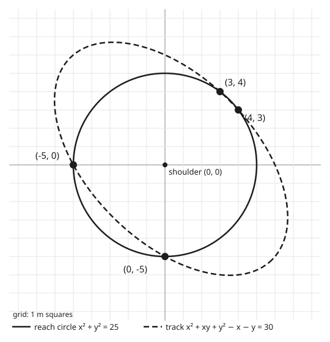

# Finitely many solutions: counting them first, then finding them all

[Syllabus](../../../SYLLABUS.md) → [Algebraic geometry](../README.md) → [Polynomial Systems](../README.md#s01) → Finitely many solutions

---

## General Overview

A robot arm has a 3 m upper link and a 2 m forearm. With the arm held straight, the hand sweeps a circle of radius 5 m around the shoulder: the edge of its reach. Put the shoulder at the origin, measure in metres, and that edge is the circle $`x^2 + y^2 = 25`$.

An oval conveyor track runs past the arm. Its centre line is $`x^2 + xy + y^2 - x - y = 30`$, an ellipse 15.578 m long and 8.994 m wide, centred at (1/3, 1/3). The question is where the track crosses the edge of reach. Those crossings are where parts come into reach and where they leave it.

The answer is four points: (4, 3), (3, 4), (0, −5) and (−5, 0). Between (3, 4) and (4, 3) the track dips inside the reach circle, coming to 4.968 m from the shoulder. Between (−5, 0) and (0, −5) it dips to 4.026 m. Elsewhere it is out of reach.

This card finds those four points in a way that works for any system with finitely many solutions, in any number of variables:

1. Rewrite the equations as a Gröbner basis: a tidied set of equations with the same solutions, where each polynomial has a clear leading term (its biggest term in a fixed ranking). Check that it allows only finitely many solutions.
2. Count the solutions before finding any. A monomial is one product of powers, such as $`x^2 y`$. The count is the number of **standard monomials**: the monomials that no leading term divides. Here there are 4.
3. Build the 4 × 4 matrix that multiplies by $`x`$. Its eigenvalues are the $`x`$-coordinates of the points, and its eigenvectors carry the $`y`$-coordinates too.

**A system with finitely many solutions turns into a finite matrix problem: the leftover monomials count the solutions, and the matrix "multiply by x" has the solutions' x-coordinates as its eigenvalues, with each point written out in full in an eigenvector.**

**What kind of fact this is:** two theorems. The eigenvalue theorem and both halves of the "pure power" test are proved on this card in Why it works, taking the Nullstellensatz from its own card. The fact that the count equals the number of points with multiplicity over the complex numbers is stated with its key steps and a named source.

### The picture: the reach circle and the track

<p align="center"></p>

The solid circle is the edge of reach. The dashed oval is the track, its long axis along the line $`y = -x`$. The dots are the four crossings. The drawing shows real points only, to scale. Here all four solutions are real; in general some can be complex and would not appear.

---

## The formula

Notation first. The field is $`k = \mathbb{Q}`$, the rational numbers. The polynomials in $`x`$ and $`y`$ with coefficients in $`k`$ are written $`k[x, y]`$. The two equations are $`f_1 = x^2 + y^2 - 25`$ and $`f_2 = x^2 + xy + y^2 - x - y - 30`$. Their ideal $`I = \langle f_1, f_2 \rangle`$ is every combination $`a f_1 + b f_2`$ with polynomial multipliers. Its variety $`V(I)`$ is the set of common solutions ([Ideals and varieties](01-ideals-and-varieties.md)).

This card introduces two terms, in words first:

- A system is **zero-dimensional** when it has only finitely many solutions, even counting complex ones.
- The **multiplication matrix** $`M_f`$ records what multiplying by a polynomial $`f`$ does to remainders.

Take a Gröbner basis $`G`$ of $`I`$ in a stated order ([Grobner bases](03-grobner-bases-and-buchberger.md)). Write $`\mathrm{NF}_G(g)`$ for the remainder of $`g`$ on division by $`G`$ ([Normal forms](04-reduced-grobner-bases-and-ideal-membership.md)). The standard monomials $`b_1, \dots, b_n`$ are the monomials that no leading term $`\mathrm{LT}(g)`$, $`g \in G`$, divides. Then:

```math
\#V(I) = n \;\text{(over } \mathbb{C}\text{, with multiplicity)}, \qquad M_f[r, s] = \text{coefficient of } b_r \text{ in } \mathrm{NF}_G(f\,b_s), \qquad v_p\,M_f = f(p)\,v_p
```

**Read it aloud:** "The number of solutions is the number of standard monomials. Column $`s`$ of the matrix for $`f`$ is the remainder of $`f`$ times the $`s`$-th standard monomial. At each solution $`p`$, the row of standard monomials' values is a left eigenvector, with eigenvalue $`f(p)`$."

With $`f = x`$ the eigenvalues are the $`x`$-coordinates. The eigenvector $`v_p = (b_1(p), \dots, b_n(p))`$ contains the monomials $`x`$ and $`y`$ themselves, so the whole point can be read off it.

| Symbol | Plain meaning | In our example | Push it up and the answer… |
| --- | --- | --- | --- |
| $`k`$, $`k[x, y]`$ | the field of coefficients; polynomials in $`x`$, $`y`$ over it | $`\mathbb{Q}`$ | — |
| $`f_1`$, $`f_2`$ | the two equations | reach circle; track | — |
| $`I`$, $`V(I)`$, $`\#V(I)`$ | the ideal they generate; its common solutions; how many there are | four points | more equations, fewer points |
| $`G`$, $`\mathrm{LT}`$ | a Gröbner basis, here in grevlex order with $`x > y`$; the leading term of a polynomial | leading terms $`xy`$, $`x^2`$, $`y^3`$ | — |
| $`\mathrm{NF}_G(g)`$ | the remainder of $`g`$ on division by $`G`$ | $`\mathrm{NF}_G(x^2) = -y^2 + 25`$ | — |
| $`b_1, \dots, b_n`$, $`n`$ | standard monomials; how many there are | 1, $`y`$, $`x`$, $`y^2`$; $`n = 4`$ | more solutions |
| $`A`$ | the quotient ring $`k[x, y]/I`$: polynomials, with members of $`I`$ counted as zero | dimension 4 | — |
| $`M_f`$, $`M_x`$, $`M_y`$, $`[r, s]`$ | the matrix of "multiply by $`f`$" on remainders; the ones for $`x`$ and $`y`$; the entry in row $`r`$, column $`s`$ | $`M_x`$ below | — |
| $`p`$, $`(x_p, y_p)`$ | a solution and its coordinates | (3, 4) | — |
| $`v_p`$ | the row of values $`(b_1(p), \dots, b_n(p))`$: a left eigenvector | (1, 4, 3, 16) at (3, 4) | — |
| $`\lambda`$, $`\chi(t)`$, $`t`$ | an eigenvalue; the characteristic polynomial $`\det(tI - M_x)`$; its variable | $`t^4 - 2t^3 - 23t^2 + 60t`$ | — |
| $`\mathbb{C}`$, $`\mathbb{F}_{101}`$, $`I_4`$, $`a, b, c`$ | the complex numbers; the integers mod 101; the 4 × 4 identity matrix; multipliers in the proof of Step 5 | 4 points over $`\mathbb{F}_{101}`$ | — |

### When it holds

- **Finitely many solutions.** The method needs a pure power of every variable among the leading terms. Two conics sharing the line $`y = x`$ have none for $`y`$: the standard monomials never stop, 4, 6 and 10 up to degrees 2, 4 and 8.
- **Counting over $`\mathbb{C}`$, with multiplicity.** The count 4 includes complex solutions and counts a tangency twice. A track tangent to the circle at (5, 0) still gives 4, but only 3 distinct points.
- **Distinct x-coordinates, for reading points off $`M_x`$.** If two solutions share $`x`$, that eigenvalue repeats and its eigenvectors are not unique. Use $`M_{x + 2y}`$ or another combination that separates the points.
- **Left eigenvectors.** The rows $`v_p`$ satisfy $`v_p M_x = x_p v_p`$. The ordinary (right) eigenvectors of $`M_x`$ give the wrong point, (1/5, −3/10).
- **Exact arithmetic or a stated tolerance.** Here every number is rational and every point substitutes back to exactly 0. With irrational points the eigenvalues come out in floating point, to a tolerance.

---

## Why it works

### Step 0: turn a curved problem into a linear one

Polynomials form an infinite list of monomials, so there is no matrix to work with. But on the solution set, many polynomials are the same function. For example, $`x^2`$ and $`25 - y^2`$ agree at every point of the reach circle.

So work with remainders. Every polynomial has a unique remainder modulo the Gröbner basis, and that remainder is a combination of standard monomials. If there are only finitely many standard monomials, the remainders form a finite-dimensional vector space, the quotient ring $`A`$. Multiplying by $`x`$ is then a linear map on that space, which is a matrix. The [Eigenvalues and eigenvectors](../../03-Algebra/07-Eigenvalues%20and%20Symmetric%20Matrices/02-eigenvalues-and-eigenvectors.md) of that matrix hold the solutions.

### Step 1: a Gröbner basis decides "finitely many"

Subtract the circle from the track: $`f_2 - f_1 = xy - x - y - 5`$. Grevlex order ranks monomials by total degree first, then breaks ties with $`x > y`$. Buchberger's algorithm in this order finishes with three polynomials:

```math
G = \{\, xy - x - y - 5,\;\; x^2 + y^2 - 25,\;\; y^3 - y^2 + 6x - 24y + 30 \,\}
```

The leading terms are $`xy`$, $`x^2`$ and $`y^3`$. That list contains a pure power of $`x`$ ($`x^2`$) and a pure power of $`y`$ ($`y^3`$).

**The test.** A system is zero-dimensional exactly when, for each variable, some leading term of a Gröbner basis is a pure power of that variable.

Why the pure powers give finiteness: every standard monomial $`x^i y^j`$ has $`i < 2`$ and $`j < 3`$, so there are finitely many of them, and $`A`$ has finite dimension $`n`$. Now take the $`n + 1`$ remainders of $`1, x, x^2, \dots, x^n`$. They live in a space of dimension $`n`$, so some combination of them is zero. That combination is a nonzero polynomial in $`x`$ alone that lies in $`I`$. It vanishes at every solution, so the $`x`$-coordinates are among its finitely many roots. The same holds for $`y`$. Finitely many $`x`$-values and finitely many $`y`$-values allow only finitely many points.

The converse, that finitely many points force the pure powers, uses the strong form of [The Nullstellensatz](09-nullstellensatz.md): over $`\mathbb{C}`$, a polynomial that vanishes at every solution has some power in $`I`$. Suppose the solutions are finitely many, with $`x`$-coordinates $`x_p`$. The product of the factors $`x - x_p`$ vanishes at every solution, so some power of it lies in $`I`$. That power is a polynomial in $`x`$ alone, so its leading term is a power of $`x`$. A Gröbner basis catches every leading term in $`I`$, so some $`\mathrm{LT}(g)`$ divides that power, and it is itself a pure power of $`x`$. The same holds for $`y`$. (The basis $`G`$, found over $`\mathbb{Q}`$, is still a Gröbner basis over $`\mathbb{C}`$: Buchberger's test runs the same divisions.)

### Step 2: the standard monomials are a basis of the quotient

The monomials not divisible by $`xy`$, $`x^2`$ or $`y^3`$ are 1, $`y`$, $`x`$ and $`y^2`$. Every remainder is a unique combination of these four. So $`A`$ has dimension 4, and the reduction rules are:

| Monomial | Rule from $`G`$ | Its remainder |
| --- | --- | --- |
| $`xy`$ | first basis element | $`x + y + 5`$ |
| $`x^2`$ | second basis element | $`-y^2 + 25`$ |
| $`y^3`$ | third basis element | $`y^2 - 6x + 24y - 30`$ |

### Step 3: the multiplication matrix

Multiply each basis monomial by $`x`$ and reduce:

- $`x \cdot 1 = x`$.
- $`x \cdot y = xy`$, which reduces to $`x + y + 5`$.
- $`x \cdot x = x^2`$, which reduces to $`-y^2 + 25`$.
- $`x \cdot y^2 = y \cdot xy`$, which reduces to $`y(x + y + 5) = xy + y^2 + 5y`$, and then to $`y^2 + x + 6y + 5`$.

Write each result as a column, with rows in the basis order 1, $`y`$, $`x`$, $`y^2`$:

```math
M_x = \begin{pmatrix} 0 & 5 & 25 & 5 \\ 0 & 1 & 0 & 6 \\ 1 & 1 & 0 & 1 \\ 0 & 0 & -1 & 1 \end{pmatrix}
```

In one variable this is a familiar matrix. For $`k[x]/\langle p(x) \rangle`$, with basis $`1, x, \dots, x^{n-1}`$, the matrix "multiply by $`x`$" is the companion matrix of $`p`$. Its eigenvalues are the roots of $`p`$, as [Every root at once](../../16-Numerical%20analysis/02-Root%20Finding%20and%20Fixed%20Points/08-polynomial-roots-and-companion-matrices.md) shows. $`M_x`$ carries that idea to two variables.

### Step 4: every solution gives a left eigenvector

Fix a solution $`p`$. Evaluation at $`p`$ is well defined on remainders: two polynomials with the same remainder differ by a member of $`I`$, which is 0 at $`p`$.

Now evaluate both sides of "$`x \cdot b_s`$ has remainder $`\sum_r M_x[r, s]\, b_r`$" at $`p`$. The left side is $`x_p\, b_s(p)`$. The right side is $`\sum_r b_r(p)\, M_x[r, s]`$, which is entry $`s`$ of the row $`v_p M_x`$. So

```math
v_p\, M_x = x_p\, v_p, \qquad v_p = (b_1(p), \dots, b_n(p))
```

Since $`b_1 = 1`$, the row $`v_p`$ is never zero, so it is a genuine eigenvector. Every $`x`$-coordinate of a solution is an eigenvalue of $`M_x`$. The same argument works for any $`f`$, giving $`v_p M_f = f(p)\, v_p`$. This is Stickelberger's theorem, the easy half.

### Step 5: no eigenvalue is spurious

<details>
<summary>Detailed proof: every eigenvalue of M_x is the x-coordinate of some solution (over the complex numbers)</summary>

Polynomials in $`M_x`$ are multiplication matrices: $`M_x M_x = M_{x^2}`$, because multiplying by $`x`$ twice is multiplying by $`x^2`$. So for any polynomial $`g(t)`$, $`g(M_x) = M_{g(x)}`$.

Now let $`\lambda`$ be an eigenvalue, and suppose no solution has $`x = \lambda`$. Then the system $`f_1 = f_2 = x - \lambda = 0`$ has no solution over $`\mathbb{C}`$. The weak Nullstellensatz (a system with no complex solution has 1 in its ideal) then gives polynomials $`a, b, c`$ with

$`\displaystyle a f_1 + b f_2 + c\,(x - \lambda) = 1.`$

Take remainders: $`(x - \lambda)\, c \equiv 1`$ modulo $`I`$. So $`(M_x - \lambda I_4)\, M_c = M_1`$, the identity matrix. Then $`M_x - \lambda I_4`$ is invertible, and $`\lambda`$ is not an eigenvalue after all. $`\blacksquare`$

</details>

### Step 6: why the count is the number of points

Step 4 gives one eigenvector $`v_p`$ per solution. Distinct solutions give independent rows $`v_p`$: some remainder takes the value 1 at one point and 0 at the others, so no row is a combination of the rest. So the number of distinct solutions is at most $`n`$.

Equality, when every solution is counted with its multiplicity over $`\mathbb{C}`$, is proved in Cox, Little and O'Shea's *Using Algebraic Geometry*, chapter 4. The key step is to split $`A`$ into one piece per solution, whose dimension is that solution's multiplicity. Here the four solutions are distinct, real and rational, so $`n = 4`$ is also the number of real points. Bezout's bound for two conics, 2 × 2 = 4, counts projective points with multiplicity over $`\mathbb{C}`$, so it agrees.

### Step 7: a second road, the eliminant and the shape lemma

Elimination gives the $`x`$-coordinates another way ([Elimination](05-elimination-and-implicitisation.md)). A Gröbner basis in lex order with $`y > x`$ comes out as

```math
\{\; x^4 - 2x^3 - 23x^2 + 60x,\;\; y + \tfrac16 x^3 - \tfrac16 x^2 - 4x + 5 \;\}
```

The first polynomial, the **eliminant**, is exactly the characteristic polynomial of $`M_x`$. The second says $`y`$ is a cubic in $`x`$ at every solution.

Why the two agree. Polynomials in $`M_x`$ are multiplication matrices (Step 5). By the Cayley–Hamilton theorem (every square matrix satisfies its own characteristic polynomial), $`\chi(M_x) = 0`$, so $`M_{\chi(x)} = 0`$. Applied to the basis monomial 1, this says $`\chi(x)`$ has remainder 0, so $`\chi(x) \in I`$. The eliminant divides every polynomial in $`x`$ alone that lies in $`I`$, so it divides $`\chi(t)`$. Here both have degree 4 and leading coefficient 1, so they are equal.

This two-piece form is the **shape lemma**: when the $`x`$-coordinates are all different and no solution is repeated, the lex basis is one polynomial in $`x`$ plus $`y`$ written as a polynomial in $`x`$. The FGLM algorithm (named for Faugère, Gianni, Lazard and Mora) computes that lex basis from the grevlex one using the multiplication matrices, which is usually much cheaper than running Buchberger in lex order. [The resultant](06-resultants-and-common-roots.md) gives the eliminant a third way, as a determinant.

---

## Worked numbers, by hand

The reach circle and the track, with the basis 1, $`y`$, $`x`$, $`y^2`$ from Step 2.

| Step | Arithmetic | Value |
| --- | --- | --- |
| Remove $`x^2`$ | track minus circle | $`xy - x - y - 5`$ |
| Leading terms | $`xy`$, $`x^2`$, and $`y^3`$ from Buchberger | pure powers $`x^2`$, $`y^3`$: finitely many |
| Count | monomials below the leading terms: 1, $`y`$, $`x`$, $`y^2`$ | 4 solutions |
| Column for $`x \cdot y^2`$ | $`y(x + y + 5) = xy + y^2 + 5y \to (x + y + 5) + y^2 + 5y`$ | $`5 + 6y + x + y^2`$ |
| Trace of $`M_x`$ | $`0 + 1 + 0 + 1`$ | 2 |
| Sum of the x-coordinates | must equal the trace | 2 |
| $`\chi(t)`$ | $`\det(tI - M_x)`$ | $`t^4 - 2t^3 - 23t^2 + 60t`$ |
| Row $`v_p`$ at $`x = 3`$ | read from the eigenvector, scaled so its entry for 1 is 1 | (1, 4, 3, 16) |
| $`v_p M_x`$ | $`(3,\; 5 + 4 + 3,\; 25 - 16,\; 5 + 24 + 3 + 16)`$ | (3, 12, 9, 48) = 3 × (1, 4, 3, 16) |
| Point | the entries for $`x`$ and $`y`$ | **(3, 4)** |

The eigenvalue 3 is the crossing (3, 4), and the same eigenvector says $`y = 4`$ with no back-substitution. Eigenvalues 4, 0 and −5 give (4, 3), (0, −5) and (−5, 0) the same way.

### What breaks if you drop a piece

| Mistake | Comes out at | What went wrong |
| --- | --- | --- |
| A track that shares $`x`$-values: $`16x^2 + 9y^2 = 288`$ | eigenvalues 3, 3, −3, −3; 2 independent eigenvectors at 3 | Two points share each $`x`$, so $`M_x`$ cannot tell them apart; $`M_{x+2y}`$ gives 11, 5, −5, −11 |
| A track tangent at (5, 0): $`x^2 + xy + y^2 - 4x - 5y = 5`$ | dimension 4; eigenvalues 5, 5, 3, −3; 3 distinct points | The count includes multiplicity: the tangency counts twice |
| Two line pairs sharing $`y = x`$ | basis $`xy - y^2 + 2x - 2y`$, $`x^2 - y^2`$; 4, 6, 10 standard monomials up to degree 2, 4, 8 | No pure power of $`y`$: infinitely many solutions, no finite matrix |
| Right eigenvector of $`M_x`$ at 3 | (1, −3/10, 1/5, −1/10), read as the point (1/5, −3/10) | The evaluation rows are left eigenvectors; the right ones are not point values |

---

## Code, from first principles, and it actually runs

The code runs Buchberger's algorithm in exact fractions, lists the standard monomials, builds $`M_x`$ and $`M_y`$, and finds the eigenvalues as rational roots of the characteristic polynomial. The eigenvectors come from exact row reduction. Three independent roads must agree: each eigenvector's point substitutes into both equations to exactly 0; the lex Gröbner basis's eliminant equals the characteristic polynomial; and brute force over the integers mod 101 finds exactly 4 solutions. The code also checks that $`M_x`$ and $`M_y`$ commute, and prints every failure case in the tables.

### Python

```python
# Finitely many solutions -- the check behind the card.  Standard library only:
# fractions gives exact rationals, math gives sqrt.  Two conics, the arm's 5 m reach
# circle and an oval track, meet in four points, found as eigenvalues of
# multiplication matrices on the quotient ring, then checked by other roads.
from fractions import Fraction as Q
import math
GREVLEX = lambda m: (m[0] + m[1], m[0])          # x^i y^j as (i, j); x > y
LEX_YX = lambda m: (m[1], m[0])                  # lex with y > x: eliminates y

def P(*terms): return {(i, j): Q(c) for c, i, j in terms if c}
def add(f, g, s=1):
    h = dict(f)
    for m, c in g.items():
        h[m] = h.get(m, 0) + s * c
        if h[m] == 0: del h[m]
    return h
def mono(f, c, i, j): return {(a + i, b + j): c * v for (a, b), v in f.items()}
def lt(f, o): return max(f, key=o)
def show(f, o):
    out = ""
    for m in sorted(f, key=o, reverse=True):
        c, name = f[m], ("x" + ("^%d" % m[0] if m[0] > 1 else "")) * (m[0] > 0) + ("y" + ("^%d" % m[1] if m[1] > 1 else "")) * (m[1] > 0)
        s = ("(%s)" % abs(c) if c.denominator > 1 and name else str(abs(c))) if abs(c) != 1 or not name else ""
        out += (" - " if c < 0 else " + ") + s + name
    return out[3:] if out[1] == "+" else "-" + out[3:]
def nf(f, G, o):                                 # remainder of f on division by the list G
    f, r = dict(f), {}
    while f:
        m = lt(f, o)
        for g in G:
            n = lt(g, o)
            if m[0] >= n[0] and m[1] >= n[1]:
                f = add(f, mono(g, f[m] / g[n], m[0] - n[0], m[1] - n[1]), -1); break
        else:
            r[m] = f.pop(m)
    return r
def groebner(F, o):                              # Buchberger, then the reduced basis
    G, pairs = list(F), [(i, j) for j in range(len(F)) for i in range(j)]
    while pairs:
        i, j = pairs.pop()
        a, b = lt(G[i], o), lt(G[j], o)
        L = (max(a[0], b[0]), max(a[1], b[1]))
        s = add(mono(G[i], 1 / G[i][a], L[0] - a[0], L[1] - a[1]), mono(G[j], 1 / G[j][b], L[0] - b[0], L[1] - b[1]), -1)
        r = nf(s, G, o)
        if r: pairs += [(k, len(G)) for k in range(len(G))]; G.append(r)
    L = [lt(g, o) for g in G]                    # keep g unless another leading term divides its own
    G = [g for k, g in enumerate(G) if not any(h != k and a[0] <= L[k][0] and a[1] <= L[k][1] and (a != L[k] or h < k) for h, a in enumerate(L))]
    G = [nf(g, G[:k] + G[k + 1:], o) for k, g in enumerate(G)]
    return sorted([mono(g, 1 / g[lt(g, o)], 0, 0) for g in G], key=lambda g: o(lt(g, o)))
def standard(G, o, deg):                         # monomials no leading term divides
    L = [lt(g, o) for g in G]
    return sorted([(i, d - i) for d in range(deg + 1) for i in range(d + 1) if not any(i >= a and d - i >= b for a, b in L)], key=o)
def mult(f, G, B, o):                            # column k is NF(f * B[k]) in the basis B
    cols = [nf({(m[0] + b[0], m[1] + b[1]): c for m, c in f.items()}, G, o) for b in B]
    return [[cols[k].get(B[r], Q(0)) for k in range(len(B))] for r in range(len(B))]
def matmul(A, B): return [[sum(A[i][k] * B[k][j] for k in range(len(B))) for j in range(len(B[0]))] for i in range(len(A))]
def charpoly(A):                                 # Faddeev-LeVerrier, exact: t^n + c t^(n-1) + ...
    n, c, M = len(A), [Q(1)], [[Q(0)] * len(A) for _ in A]
    for k in range(1, n + 1):
        M = matmul(A, M)
        for i in range(n): M[i][i] += c[-1]
        c.append(-sum(matmul(A, M)[i][i] for i in range(n)) / k)
    return {(n - k, 0): v for k, v in enumerate(c) if v}
def roots(p):                                    # rational roots with multiplicity, our own search
    a, out = [p.get((k, 0), Q(0)) for k in range(max(m[0] for m in p) + 1)], []
    while len(a) > 1:
        if a[0] == 0: out.append(Q(0)); a = a[1:]; continue
        lead, cand = a[-1], set()
        for u in range(1, int(abs(a[0] * lead.denominator * a[0].denominator)) + 1):
            for v in range(1, int(abs(lead * a[0].denominator * lead.denominator)) + 1):
                cand |= {Q(u, v), Q(-u, v)}
        hit = next((r for r in sorted(cand) if sum(c * r ** k for k, c in enumerate(a)) == 0), None)
        if hit is None: break
        out.append(hit); b = [Q(0)] * (len(a) - 1); b[-1] = a[-1]
        for k in range(len(a) - 2, 0, -1): b[k - 1] = a[k] + hit * b[k]
        a = b
    return sorted(out, reverse=True)
def null(A):                                     # exact null space by row reduction
    A, piv, n = [r[:] for r in A], [], len(A[0])
    for col in range(n):
        r = next((i for i in range(len(piv), len(A)) if A[i][col] != 0), None)
        if r is None: continue
        A[len(piv)], A[r] = A[r], A[len(piv)]; row = A[len(piv)]; row[:] = [v / row[col] for v in row]
        for i in range(len(A)):
            if i != len(piv) and A[i][col] != 0: A[i] = [a - A[i][col] * b for a, b in zip(A[i], row)]
        piv.append(col)
    free = [c for c in range(n) if c not in piv]
    return [[Q(1) if c == f else -A[piv.index(c)][f] if c in piv else Q(0) for c in range(n)] for f in free]
def eigvec(M, lam, left=True):
    A = [[(M[j][i] if left else M[i][j]) - (lam if i == j else 0) for j in range(len(M))] for i in range(len(M))]
    return null(A)
def solve(F):                                    # the card's method, start to finish
    G = groebner(F, GREVLEX); B = standard(G, GREVLEX, 6)
    Mx, My = mult(P((1, 1, 0)), G, B, GREVLEX), mult(P((1, 0, 1)), G, B, GREVLEX)
    return G, B, Mx, My, roots(charpoly(Mx))
fmt = lambda B: "[" + ", ".join("1" if b == (0, 0) else show({b: Q(1)}, GREVLEX) for b in B) + "]"
circle, track = P((1, 2, 0), (1, 0, 2), (-25, 0, 0)), P((1, 2, 0), (1, 1, 1), (1, 0, 2), (-1, 1, 0), (-1, 0, 1), (-30, 0, 0))
G, B, Mx, My, ex = solve([circle, track])
print("reach circle:", show(circle, GREVLEX), "= 0;  track:", show(track, GREVLEX), "= 0")
print("Groebner basis, grevlex x > y:", " | ".join(show(g, GREVLEX) for g in G))
print("leading terms:", fmt([lt(g, GREVLEX) for g in G]), " pure power of x and of y: yes, so zero-dimensional")
print("standard monomials:", fmt(B), " dimension of the quotient:", len(B))
for name, M in (("M_x", Mx), ("M_y", My)):
    print(name, "rows:", "  ".join("[" + " ".join(str(v) for v in r) + "]" for r in M))
print("char poly of M_x:", show(charpoly(Mx), GREVLEX).replace("x", "t"), "  eigenvalues:", ", ".join(map(str, ex)))
print("char poly of M_y:", show(charpoly(My), GREVLEX).replace("x", "t"), "  eigenvalues:", ", ".join(map(str, roots(charpoly(My)))))
pts = []
for lam in ex:
    v = eigvec(Mx, lam)[0]; v = [c / v[B.index((0, 0))] for c in v]
    p = (v[B.index((1, 0))], v[B.index((0, 1))]); pts.append(p)
    res = [sum(c * p[0] ** m[0] * p[1] ** m[1] for m, c in f.items()) for f in (circle, track)]; vm = [sum(v[r] * Mx[r][k] for r in range(4)) for k in range(4)]
    print(f"eigenvalue {lam}: left eigenvector {fmt(B)} = ({', '.join(map(str, v))}) -> point ({p[0]}, {p[1]}); v M_x = ({', '.join(map(str, vm))}); residuals {res[0]}, {res[1]}")
L = groebner([circle, track], LEX_YX)
print("lex y > x basis:", " | ".join(show(g, LEX_YX) for g in L))
print("eliminant equals char poly of M_x:", L[0] == charpoly(Mx), "  M_x M_y = M_y M_x:", matmul(Mx, My) == matmul(My, Mx))
p101 = sum(1 for x in range(101) for y in range(101) if (x * x + y * y - 25) % 101 == 0 and (x * x + x * y + y * y - x - y - 30) % 101 == 0)
print("count over F_101 by trying all 10201 pairs:", p101, "  Bezout 2 x 2 =", 4)
d = [math.sqrt(2 * t * t) for t in ((2 + math.sqrt(364)) / 6, (2 - math.sqrt(364)) / 6)]
print(f"track on the line y = x: {d[0]:.3f} m and {d[1]:.3f} m from the shoulder;  track size {2 * math.sqrt(182 / 3):.3f} m by {2 * math.sqrt(182 / 9):.3f} m, centre (1/3, 1/3)")
w = eigvec(Mx, Q(3), left=False)[0]; w = [c / w[0] for c in w]
print(f"wrong: right eigenvector of M_x at 3, read as (1, y, x, y^2): {', '.join(map(str, w))} -> point ({w[2]}, {w[1]})")
G2, B2, Mx2, My2, ex2 = solve([circle, P((16, 2, 0), (9, 0, 2), (-288, 0, 0))])
Mc = [[a + 2 * b for a, b in zip(r, s)] for r, s in zip(Mx2, My2)]
print("shared x, 16x^2 + 9y^2 = 288: M_x eigenvalues", ", ".join(map(str, ex2)), "; eigenvectors at 3:", len(eigvec(Mx2, Q(3))), "; M_(x+2y) eigenvalues", ", ".join(map(str, roots(charpoly(Mc)))))
G3, B3, Mx3, My3, ex3 = solve([circle, P((1, 2, 0), (1, 1, 1), (1, 0, 2), (-4, 1, 0), (-5, 0, 1), (-5, 0, 0))])
print("tangent at (5, 0): dimension", len(B3), " eigenvalues", ", ".join(map(str, ex3)), " distinct points", len(set(ex3)))
G4 = groebner([P((1, 2, 0), (-1, 0, 2)), P((1, 2, 0), (-1, 1, 1), (-2, 1, 0), (2, 0, 1))], GREVLEX)
print("shared line y = x:", " | ".join(show(g, GREVLEX) for g in G4), "; standard monomials up to degree 2, 4, 8:", [len(standard(G4, GREVLEX, k)) for k in (2, 4, 8)])
G5, B5, Mx5, My5, ex5 = solve([circle, P((1, 1, 0), (1, 0, 1), (-1, 0, 0))])
print("try: line x + y = 1: dimension", len(B5), " M_x eigenvalues", ", ".join(map(str, ex5)))
print("try: M_(x+2y) on the track:", ", ".join(map(str, roots(charpoly([[a + 2 * b for a, b in zip(r, s)] for r, s in zip(Mx, My)])))), "  trace of M_x:", sum(Mx[i][i] for i in range(4)))
print("figure, points", " ".join(f"({x},{y})" for x, y in pts), f"circle r 5, track centre (1/3,1/3) semi-axes {math.sqrt(182 / 3):.3f} along y=-x, {math.sqrt(182 / 9):.3f} along y=x")
assert len(B) == 4 == len(ex) == len(set(pts)) == p101          # quotient size = eigenvalues = points = mod-p count
assert sorted(pts) == sorted([(Q(4), Q(3)), (Q(3), Q(4)), (Q(0), Q(-5)), (Q(-5), Q(0))])
assert all(sum(c * x ** m[0] * y ** m[1] for m, c in f.items()) == 0 for f in (circle, track) for x, y in pts)
assert L[0] == charpoly(Mx)                                     # elimination road = eigenvalue road
assert matmul(Mx, My) == matmul(My, Mx)
assert [p[0] for p in pts] == ex                                # eigenvector's x entry = its eigenvalue
assert len(eigvec(Mx2, Q(3))) == 2 and len(set(ex3)) == 3 and len(B3) == 4
print("ALL CHECKS PASS")
```

**Ran 2026-11-17 on macOS, Python 3.14.10, standard library only. All checks passed. Output, pasted from the run:**

```
reach circle: x^2 + y^2 - 25 = 0;  track: x^2 + xy + y^2 - x - y - 30 = 0
Groebner basis, grevlex x > y: xy - x - y - 5 | x^2 + y^2 - 25 | y^3 - y^2 + 6x - 24y + 30
leading terms: [xy, x^2, y^3]  pure power of x and of y: yes, so zero-dimensional
standard monomials: [1, y, x, y^2]  dimension of the quotient: 4
M_x rows: [0 5 25 5]  [0 1 0 6]  [1 1 0 1]  [0 0 -1 1]
M_y rows: [0 0 5 -30]  [1 0 1 24]  [0 0 1 -6]  [0 1 0 1]
char poly of M_x: t^4 - 2t^3 - 23t^2 + 60t   eigenvalues: 4, 3, 0, -5
char poly of M_y: t^4 - 2t^3 - 23t^2 + 60t   eigenvalues: 4, 3, 0, -5
eigenvalue 4: left eigenvector [1, y, x, y^2] = (1, 3, 4, 9) -> point (4, 3); v M_x = (4, 12, 16, 36); residuals 0, 0
eigenvalue 3: left eigenvector [1, y, x, y^2] = (1, 4, 3, 16) -> point (3, 4); v M_x = (3, 12, 9, 48); residuals 0, 0
eigenvalue 0: left eigenvector [1, y, x, y^2] = (1, -5, 0, 25) -> point (0, -5); v M_x = (0, 0, 0, 0); residuals 0, 0
eigenvalue -5: left eigenvector [1, y, x, y^2] = (1, 0, -5, 0) -> point (-5, 0); v M_x = (-5, 0, 25, 0); residuals 0, 0
lex y > x basis: x^4 - 2x^3 - 23x^2 + 60x | y + (1/6)x^3 - (1/6)x^2 - 4x + 5
eliminant equals char poly of M_x: True   M_x M_y = M_y M_x: True
count over F_101 by trying all 10201 pairs: 4   Bezout 2 x 2 = 4
track on the line y = x: 4.968 m and 4.026 m from the shoulder;  track size 15.578 m by 8.994 m, centre (1/3, 1/3)
wrong: right eigenvector of M_x at 3, read as (1, y, x, y^2): 1, -3/10, 1/5, -1/10 -> point (1/5, -3/10)
shared x, 16x^2 + 9y^2 = 288: M_x eigenvalues 3, 3, -3, -3 ; eigenvectors at 3: 2 ; M_(x+2y) eigenvalues 11, 5, -5, -11
tangent at (5, 0): dimension 4  eigenvalues 5, 5, 3, -3  distinct points 3
shared line y = x: xy - y^2 + 2x - 2y | x^2 - y^2 ; standard monomials up to degree 2, 4, 8: [4, 6, 10]
try: line x + y = 1: dimension 2  M_x eigenvalues 4, -3
try: M_(x+2y) on the track: 11, 10, -5, -10   trace of M_x: 2
figure, points (4,3) (3,4) (0,-5) (-5,0) circle r 5, track centre (1/3,1/3) semi-axes 7.789 along y=-x, 4.497 along y=x
ALL CHECKS PASS
```

### Rust

```rust
// Finitely many solutions -- the check behind the card.  std only; fractions are an i128 struct with
// checked arithmetic, so an overflow stops the run.  Two conics, the arm's 5 m reach circle and an oval
// track, meet in four points, found as eigenvalues of multiplication matrices, then checked other ways.
use std::{collections::BTreeMap, ops::{Add, Div, Mul, Neg, Sub}};
#[derive(Clone, Copy, PartialEq, Eq, Debug)] struct Q { n: i128, d: i128 }
fn gcd(a: i128, b: i128) -> i128 { if b == 0 { a.abs() } else { gcd(b, a % b) } }
fn q(n: i128, d: i128) -> Q { let g = gcd(n, d).max(1) * d.signum(); Q { n: n / g, d: d / g } }
fn z(n: i128) -> Q { q(n, 1) }
impl Add for Q { type Output = Q; fn add(self, o: Q) -> Q { q(self.n.checked_mul(o.d).unwrap().checked_add(o.n.checked_mul(self.d).unwrap()).unwrap(), self.d.checked_mul(o.d).unwrap()) } }
impl Neg for Q { type Output = Q; fn neg(self) -> Q { Q { n: -self.n, d: self.d } } }
impl Sub for Q { type Output = Q; fn sub(self, o: Q) -> Q { self + (-o) } }
impl Mul for Q { type Output = Q; fn mul(self, o: Q) -> Q { q(self.n.checked_mul(o.n).unwrap(), self.d.checked_mul(o.d).unwrap()) } }
impl Div for Q { type Output = Q; fn div(self, o: Q) -> Q { q(self.n.checked_mul(o.d).unwrap(), self.d.checked_mul(o.n).unwrap()) } }
impl std::fmt::Display for Q { fn fmt(&self, f: &mut std::fmt::Formatter) -> std::fmt::Result { if self.d == 1 { write!(f, "{}", self.n) } else { write!(f, "{}/{}", self.n, self.d) } } }
type M2 = (u32, u32); type Poly = BTreeMap<M2, Q>;      // x^i y^j as (i, j)
type Mat = Vec<Vec<Q>>; type O = fn(M2) -> M2;
fn grevlex(m: M2) -> M2 { (m.0 + m.1, m.0) }            // x > y
fn lex_yx(m: M2) -> M2 { (m.1, m.0) }                   // lex with y > x: eliminates y
fn p(t: &[(i128, u32, u32)]) -> Poly { t.iter().filter(|t| t.0 != 0).map(|&(c, i, j)| ((i, j), z(c))).collect() }
fn add(f: &Poly, g: &Poly, s: Q) -> Poly {
    let mut h = f.clone(); for (m, c) in g { let v = *h.get(m).unwrap_or(&z(0)) + s * *c; if v.n == 0 { h.remove(m); } else { h.insert(*m, v); } } h
}
fn mono(f: &Poly, c: Q, i: u32, j: u32) -> Poly { f.iter().map(|(m, v)| ((m.0 + i, m.1 + j), c * *v)).collect() }
fn lt(f: &Poly, o: O) -> M2 { *f.keys().max_by_key(|m| o(**m)).unwrap() }
fn show(f: &Poly, o: O) -> String {
    let (mut ms, mut out): (Vec<M2>, String) = (f.keys().cloned().collect(), String::new());
    ms.sort_by_key(|m| std::cmp::Reverse(o(*m)));
    let pw = |v: &str, e: u32| if e == 0 { String::new() } else if e == 1 { v.to_string() } else { format!("{}^{}", v, e) };
    for m in ms {
        let (c, name) = (f[&m], pw("x", m.0) + &pw("y", m.1));
        let a = Q { n: c.n.abs(), d: c.d };
        let s = if a != z(1) || name.is_empty() { if a.d > 1 && !name.is_empty() { format!("({})", a) } else { a.to_string() } } else { String::new() };
        out += &format!("{}{}{}", if c.n < 0 { " - " } else { " + " }, s, name);
    }
    if &out[1..2] == "+" { out[3..].to_string() } else { format!("-{}", &out[3..]) }
}
fn nf(f: &Poly, g: &[Poly], o: O) -> Poly {             // remainder of f on division by the list G
    let (mut f, mut r) = (f.clone(), Poly::new());
    while !f.is_empty() {
        let m = lt(&f, o);
        match g.iter().find(|g| { let n = lt(g, o); m.0 >= n.0 && m.1 >= n.1 }) {
            Some(h) => { let n = lt(h, o); f = add(&f, &mono(h, f[&m] / h[&n], m.0 - n.0, m.1 - n.1), z(-1)); }
            None => { r.insert(m, f.remove(&m).unwrap()); } }
    } r
}
fn groebner(f: &[Poly], o: O) -> Vec<Poly> {            // Buchberger, then the reduced basis
    let mut g: Vec<Poly> = f.to_vec();
    let mut pairs: Vec<(usize, usize)> = (0..g.len()).flat_map(|j| (0..j).map(move |i| (i, j))).collect();
    while let Some((i, j)) = pairs.pop() {
        let (a, b) = (lt(&g[i], o), lt(&g[j], o));
        let l = (a.0.max(b.0), a.1.max(b.1));
        let s = add(&mono(&g[i], z(1) / g[i][&a], l.0 - a.0, l.1 - a.1), &mono(&g[j], z(1) / g[j][&b], l.0 - b.0, l.1 - b.1), z(-1));
        let r = nf(&s, &g, o);
        if !r.is_empty() { pairs.extend((0..g.len()).map(|k| (k, g.len()))); g.push(r); }
    }
    let l: Vec<M2> = g.iter().map(|h| lt(h, o)).collect();   // keep g unless another leading term divides its own
    let g: Vec<Poly> = (0..g.len()).filter(|&k| !l.iter().enumerate().any(|(h, a)| h != k && a.0 <= l[k].0 && a.1 <= l[k].1 && (*a != l[k] || h < k))).map(|k| g[k].clone()).collect();
    let mut out: Vec<Poly> = (0..g.len()).map(|k| { let rest: Vec<Poly> = g.iter().enumerate().filter(|e| e.0 != k).map(|e| e.1.clone()).collect(); nf(&g[k], &rest, o) }).collect();
    out = out.iter().map(|h| mono(h, z(1) / h[&lt(h, o)], 0, 0)).collect();
    out.sort_by_key(|h| o(lt(h, o)));
    out
}
fn standard(g: &[Poly], o: O, deg: u32) -> Vec<M2> {     // monomials no leading term divides
    let l: Vec<M2> = g.iter().map(|h| lt(h, o)).collect();
    let mut b: Vec<M2> = (0..=deg).flat_map(|d| (0..=d).map(move |i| (i, d - i))).filter(|m| !l.iter().any(|a| m.0 >= a.0 && m.1 >= a.1)).collect();
    b.sort_by_key(|m| o(*m)); b
}
fn mult(f: &Poly, g: &[Poly], b: &[M2], o: O) -> Mat {  // column k is NF(f * B[k]) in the basis B
    let cols: Vec<Poly> = b.iter().map(|m| nf(&mono(f, z(1), m.0, m.1), g, o)).collect();
    (0..b.len()).map(|r| (0..b.len()).map(|k| *cols[k].get(&b[r]).unwrap_or(&z(0))).collect()).collect()
}
fn matmul(a: &Mat, b: &Mat) -> Mat { (0..a.len()).map(|i| (0..b[0].len()).map(|j| (0..b.len()).fold(z(0), |s, k| s + a[i][k] * b[k][j])).collect()).collect() }
fn charpoly(a: &Mat) -> Poly {                          // Faddeev-LeVerrier, exact
    let n = a.len(); let (mut c, mut m) = (vec![z(1)], vec![vec![z(0); n]; n]);
    for k in 1..=n {
        m = matmul(a, &m); for i in 0..n { m[i][i] = m[i][i] + c[k - 1]; }
        let am = matmul(a, &m); c.push(-(0..n).fold(z(0), |s, i| s + am[i][i]) / z(k as i128));
    }
    c.iter().enumerate().filter(|e| e.1.n != 0).map(|(k, v)| (((n - k) as u32, 0), *v)).collect()
}
fn roots(p: &Poly) -> Vec<Q> {                          // rational roots with multiplicity, our own search
    let mut a: Vec<Q> = (0..=p.keys().map(|m| m.0).max().unwrap()).map(|k| *p.get(&(k, 0)).unwrap_or(&z(0))).collect();
    let mut out = vec![];
    while a.len() > 1 {
        if a[0].n == 0 { out.push(z(0)); a.remove(0); continue; }
        let (lead, a0) = (a[a.len() - 1], a[0]);
        let ev = |r: Q| a.iter().rev().fold(z(0), |s, c| s * r + *c);
        let hit = (1..=(a0.n * lead.d).abs()).flat_map(|u| (1..=(lead.n * a0.d).abs()).flat_map(move |v| [q(u, v), q(-u, v)]))
            .filter(|r| ev(*r).n == 0).min_by(|x, y| (x.n * y.d).cmp(&(y.n * x.d)));
        let Some(h) = hit else { break }; out.push(h);
        let mut b = vec![lead; a.len() - 1];              // divide out (t - h), Horner style
        for k in (1..a.len() - 1).rev() { b[k - 1] = a[k] + h * b[k]; }
        a = b;
    }
    out.sort_by(|x, y| (y.n * x.d).cmp(&(x.n * y.d))); out
}
fn null(a: &Mat) -> Mat {                               // exact null space by row reduction
    let (mut a, mut piv, n) = (a.clone(), vec![], a[0].len());
    for col in 0..n {
        let Some(r) = (piv.len()..a.len()).find(|&i| a[i][col].n != 0) else { continue };
        let k = piv.len(); a.swap(k, r);
        let pv = a[k][col]; a[k] = a[k].iter().map(|v| *v / pv).collect();
        for i in 0..a.len() { if i != k && a[i][col].n != 0 { let f = a[i][col]; a[i] = (0..n).map(|j| a[i][j] - f * a[k][j]).collect(); } }
        piv.push(col);
    }
    (0..n).filter(|c| !piv.contains(c)).map(|f| (0..n).map(|c| if c == f { z(1) } else if let Some(r) = piv.iter().position(|&x| x == c) { -a[r][f] } else { z(0) }).collect()).collect()
}
fn eigvec(m: &Mat, lam: Q, left: bool) -> Mat {
    let n = m.len();
    null(&(0..n).map(|i| (0..n).map(|j| (if left { m[j][i] } else { m[i][j] }) - if i == j { lam } else { z(0) }).collect()).collect())
}
fn solve(f: &[Poly]) -> (Vec<Poly>, Vec<M2>, Mat, Mat, Vec<Q>) {  // the card's method, start to finish
    let g = groebner(f, grevlex); let b = standard(&g, grevlex, 6);
    let (mx, my) = (mult(&p(&[(1, 1, 0)]), &g, &b, grevlex), mult(&p(&[(1, 0, 1)]), &g, &b, grevlex));
    let ex = roots(&charpoly(&mx)); (g, b, mx, my, ex)
}
fn fmt(b: &[M2]) -> String { format!("[{}]", b.iter().map(|m| if *m == (0, 0) { "1".to_string() } else { show(&[(*m, z(1))].into_iter().collect(), grevlex) }).collect::<Vec<_>>().join(", ")) }
fn js(v: &[Q]) -> String { v.iter().map(|x| x.to_string()).collect::<Vec<_>>().join(", ") }
fn jp(g: &[Poly], o: O) -> String { g.iter().map(|h| show(h, o)).collect::<Vec<_>>().join(" | ") }
fn at(f: &Poly, x: Q, y: Q) -> Q { f.iter().fold(z(0), |s, (m, c)| s + (0..m.0).fold(*c, |t, _| t * x) * (0..m.1).fold(z(1), |t, _| t * y)) }
fn comb(a: &Mat, b: &Mat) -> Mat { a.iter().zip(b).map(|(r, s)| r.iter().zip(s).map(|(x, y)| *x + z(2) * *y).collect()).collect() }
fn main() {
    let circle = p(&[(1, 2, 0), (1, 0, 2), (-25, 0, 0)]);
    let track = p(&[(1, 2, 0), (1, 1, 1), (1, 0, 2), (-1, 1, 0), (-1, 0, 1), (-30, 0, 0)]);
    let (g, b, mx, my, ex) = solve(&[circle.clone(), track.clone()]);
    println!("reach circle: {} = 0;  track: {} = 0", show(&circle, grevlex), show(&track, grevlex));
    println!("Groebner basis, grevlex x > y: {}", jp(&g, grevlex));
    println!("leading terms: {}  pure power of x and of y: yes, so zero-dimensional", fmt(&g.iter().map(|h| lt(h, grevlex)).collect::<Vec<_>>()));
    println!("standard monomials: {}  dimension of the quotient: {}", fmt(&b), b.len());
    for (name, m) in [("M_x", &mx), ("M_y", &my)] { println!("{} rows: {}", name, m.iter().map(|r| format!("[{}]", r.iter().map(|v| v.to_string()).collect::<Vec<_>>().join(" "))).collect::<Vec<_>>().join("  ")); }
    println!("char poly of M_x: {}   eigenvalues: {}", show(&charpoly(&mx), grevlex).replace('x', "t"), js(&ex));
    println!("char poly of M_y: {}   eigenvalues: {}", show(&charpoly(&my), grevlex).replace('x', "t"), js(&roots(&charpoly(&my))));
    let ix = |m: M2| b.iter().position(|x| *x == m).unwrap();
    let mut pts = vec![];
    for lam in &ex {
        let v = eigvec(&mx, *lam, true)[0].clone(); let v: Vec<Q> = v.iter().map(|c| *c / v[ix((0, 0))]).collect();
        let pt = (v[ix((1, 0))], v[ix((0, 1))]); pts.push(pt); let vm: Vec<Q> = (0..4).map(|k| (0..4).fold(z(0), |s, i| s + v[i] * mx[i][k])).collect();
        println!("eigenvalue {}: left eigenvector {} = ({}) -> point ({}, {}); v M_x = ({}); residuals {}, {}", lam, fmt(&b), js(&v), pt.0, pt.1, js(&vm), at(&circle, pt.0, pt.1), at(&track, pt.0, pt.1));
    }
    let l = groebner(&[circle.clone(), track.clone()], lex_yx);
    println!("lex y > x basis: {}", jp(&l, lex_yx));
    println!("eliminant equals char poly of M_x: {}   M_x M_y = M_y M_x: {}", if l[0] == charpoly(&mx) { "True" } else { "False" }, if matmul(&mx, &my) == matmul(&my, &mx) { "True" } else { "False" });
    let p101 = (0..101i64).flat_map(|x| (0..101i64).map(move |y| (x, y))).filter(|(x, y)| (x * x + y * y - 25).rem_euclid(101) == 0 && (x * x + x * y + y * y - x - y - 30).rem_euclid(101) == 0).count();
    println!("count over F_101 by trying all 10201 pairs: {}   Bezout 2 x 2 = {}", p101, 4);
    let d: Vec<f64> = [(2.0 + 364f64.sqrt()) / 6.0, (2.0 - 364f64.sqrt()) / 6.0].iter().map(|t| (2.0 * t * t).sqrt()).collect();
    println!("track on the line y = x: {:.3} m and {:.3} m from the shoulder;  track size {:.3} m by {:.3} m, centre (1/3, 1/3)", d[0], d[1], 2.0 * (182.0f64 / 3.0).sqrt(), 2.0 * (182.0f64 / 9.0).sqrt());
    let w = eigvec(&mx, z(3), false)[0].clone(); let w: Vec<Q> = w.iter().map(|c| *c / w[0]).collect();
    println!("wrong: right eigenvector of M_x at 3, read as (1, y, x, y^2): {} -> point ({}, {})", js(&w), w[2], w[1]);
    let (_, _, mx2, my2, ex2) = solve(&[circle.clone(), p(&[(16, 2, 0), (9, 0, 2), (-288, 0, 0)])]);
    println!("shared x, 16x^2 + 9y^2 = 288: M_x eigenvalues {} ; eigenvectors at 3: {} ; M_(x+2y) eigenvalues {}", js(&ex2), eigvec(&mx2, z(3), true).len(), js(&roots(&charpoly(&comb(&mx2, &my2)))));
    let (_, b3, _, _, ex3) = solve(&[circle.clone(), p(&[(1, 2, 0), (1, 1, 1), (1, 0, 2), (-4, 1, 0), (-5, 0, 1), (-5, 0, 0)])]);
    let mut d3 = ex3.clone(); d3.dedup();
    println!("tangent at (5, 0): dimension {}  eigenvalues {}  distinct points {}", b3.len(), js(&ex3), d3.len());
    let g4 = groebner(&[p(&[(1, 2, 0), (-1, 0, 2)]), p(&[(1, 2, 0), (-1, 1, 1), (-2, 1, 0), (2, 0, 1)])], grevlex);
    println!("shared line y = x: {} ; standard monomials up to degree 2, 4, 8: {:?}", jp(&g4, grevlex), [2, 4, 8].map(|k| standard(&g4, grevlex, k).len()));
    let (_, b5, _, _, ex5) = solve(&[circle.clone(), p(&[(1, 1, 0), (1, 0, 1), (-1, 0, 0)])]);
    println!("try: line x + y = 1: dimension {}  M_x eigenvalues {}", b5.len(), js(&ex5));
    println!("try: M_(x+2y) on the track: {}   trace of M_x: {}", js(&roots(&charpoly(&comb(&mx, &my)))), (0..4).fold(z(0), |s, i| s + mx[i][i]));
    println!("figure, points {} circle r 5, track centre (1/3,1/3) semi-axes {:.3} along y=-x, {:.3} along y=x", pts.iter().map(|p| format!("({},{})", p.0, p.1)).collect::<Vec<_>>().join(" "), (182.0f64 / 3.0).sqrt(), (182.0f64 / 9.0).sqrt());
    let want = vec![(z(4), z(3)), (z(3), z(4)), (z(0), z(-5)), (z(-5), z(0))];
    assert!(b.len() == 4 && ex.len() == 4 && p101 == 4, "quotient size = eigenvalues = mod-p count");
    assert!(want.iter().all(|w| pts.contains(w)) && pts.len() == 4, "the four crossings");
    assert!(pts.iter().all(|&(x, y)| at(&circle, x, y).n == 0 && at(&track, x, y).n == 0), "every point substitutes to zero");
    assert!(l[0] == charpoly(&mx), "elimination road = eigenvalue road");
    assert!(matmul(&mx, &my) == matmul(&my, &mx), "multiplication matrices commute");
    assert!(pts.iter().map(|p| p.0).collect::<Vec<_>>() == ex, "eigenvector's x entry = its eigenvalue");
    assert!(eigvec(&mx2, z(3), true).len() == 2 && d3.len() == 3 && b3.len() == 4, "shared x and tangent cases");
    println!("ALL CHECKS PASS");
}
```

**Ran 2026-11-17 on macOS, rustc 1.98.1, no crates. All checks passed. Output, pasted from the run:**

```
reach circle: x^2 + y^2 - 25 = 0;  track: x^2 + xy + y^2 - x - y - 30 = 0
Groebner basis, grevlex x > y: xy - x - y - 5 | x^2 + y^2 - 25 | y^3 - y^2 + 6x - 24y + 30
leading terms: [xy, x^2, y^3]  pure power of x and of y: yes, so zero-dimensional
standard monomials: [1, y, x, y^2]  dimension of the quotient: 4
M_x rows: [0 5 25 5]  [0 1 0 6]  [1 1 0 1]  [0 0 -1 1]
M_y rows: [0 0 5 -30]  [1 0 1 24]  [0 0 1 -6]  [0 1 0 1]
char poly of M_x: t^4 - 2t^3 - 23t^2 + 60t   eigenvalues: 4, 3, 0, -5
char poly of M_y: t^4 - 2t^3 - 23t^2 + 60t   eigenvalues: 4, 3, 0, -5
eigenvalue 4: left eigenvector [1, y, x, y^2] = (1, 3, 4, 9) -> point (4, 3); v M_x = (4, 12, 16, 36); residuals 0, 0
eigenvalue 3: left eigenvector [1, y, x, y^2] = (1, 4, 3, 16) -> point (3, 4); v M_x = (3, 12, 9, 48); residuals 0, 0
eigenvalue 0: left eigenvector [1, y, x, y^2] = (1, -5, 0, 25) -> point (0, -5); v M_x = (0, 0, 0, 0); residuals 0, 0
eigenvalue -5: left eigenvector [1, y, x, y^2] = (1, 0, -5, 0) -> point (-5, 0); v M_x = (-5, 0, 25, 0); residuals 0, 0
lex y > x basis: x^4 - 2x^3 - 23x^2 + 60x | y + (1/6)x^3 - (1/6)x^2 - 4x + 5
eliminant equals char poly of M_x: True   M_x M_y = M_y M_x: True
count over F_101 by trying all 10201 pairs: 4   Bezout 2 x 2 = 4
track on the line y = x: 4.968 m and 4.026 m from the shoulder;  track size 15.578 m by 8.994 m, centre (1/3, 1/3)
wrong: right eigenvector of M_x at 3, read as (1, y, x, y^2): 1, -3/10, 1/5, -1/10 -> point (1/5, -3/10)
shared x, 16x^2 + 9y^2 = 288: M_x eigenvalues 3, 3, -3, -3 ; eigenvectors at 3: 2 ; M_(x+2y) eigenvalues 11, 5, -5, -11
tangent at (5, 0): dimension 4  eigenvalues 5, 5, 3, -3  distinct points 3
shared line y = x: xy - y^2 + 2x - 2y | x^2 - y^2 ; standard monomials up to degree 2, 4, 8: [4, 6, 10]
try: line x + y = 1: dimension 2  M_x eigenvalues 4, -3
try: M_(x+2y) on the track: 11, 10, -5, -10   trace of M_x: 2
figure, points (4,3) (3,4) (0,-5) (-5,0) circle r 5, track centre (1/3,1/3) semi-axes 7.789 along y=-x, 4.497 along y=x
ALL CHECKS PASS
```

### Lean

Lean proves the card's three theorems for any number of variables, counting solutions over ℂ, and checks the worked example's numbers.

- Take a system with finitely many standard monomials, and any polynomial $`f`$. Then $`t`$ is an eigenvalue of $`M_f`$ exactly when $`t = f(p)`$ for some solution $`p`$.
- Take any solution $`p`$. Then $`v_p`$ is not zero, and $`v_p M_f = f(p)\, v_p`$.
- The zero-dimensional test holds in any monomial order. These three agree: finitely many solutions over ℂ, finitely many standard monomials, and a pure power of each variable among the leading terms in $`I`$.
- Suppose there are $`n`$ standard monomials. Then the system has at most $`n`$ distinct solutions over ℂ.
- Take the reach circle and the track. Then all four crossings lie on both, and $`f_2 - f_1 = xy - x - y - 5`$.
- Take $`G`$ from Step 1. Then its third element lies in $`I`$, and the column for $`x \cdot y^2`$ is $`y^2 + x + 6y + 5`$.
- Take $`M_x`$ and $`M_y`$ as printed. Then each of the four rows $`v_p`$ is a left eigenvector of $`M_x`$, and $`M_x M_y = M_y M_x`$.
- Take $`\chi(t) = t^4 - 2t^3 - 23t^2 + 60t`$. Then its roots are 4, 3, 0 and −5, and they sum to the trace 2.
- Take the shape lemma's cubic for $`y`$. Then $`x`$ = 4, 3, 0 and −5 give $`y`$ = 3, 4, −5 and 0.
- Take $`w = (1, -3/10, 1/5, -1/10)`$. Then $`M_x w = 3w`$: this is the right eigenvector from What breaks.
- Take the track $`16x^2 + 9y^2 = 288`$. Then (3, 4) and (3, −4) both lie on it and on the circle.
- Take the tangent track $`x^2 + xy + y^2 - 4x - 5y = 5`$. Then (5, 0) lies on it and on the circle.

Finding $`G`$, building $`M_x`$ and its characteristic polynomial, and the count over $`\mathbb{F}_{101}`$ are left to the Python and Rust checks.

```lean
-- Finitely many solutions: when a polynomial system has finitely many solutions, the eigenvalues of its "multiply by f" matrix are exactly the values of f at the solutions, and the solutions number at most the standard monomials.
import Mathlib.RingTheory.Nullstellensatz
import Mathlib.RingTheory.MvPolynomial.MonomialOrder
import Mathlib.LinearAlgebra.Charpoly.Basic
import Mathlib.LinearAlgebra.Matrix.ToLin
import Mathlib.Algebra.Algebra.Bilinear
import Mathlib.Data.Set.Card
import Mathlib.Data.Matrix.Mul
import Mathlib.Data.Fin.VecNotation
import Mathlib.Data.List.TFAE
import Mathlib.Tactic.NormNum
import Mathlib.Tactic.Ring
import Mathlib.Tactic.FinCases
import Mathlib.RingTheory.MvPolynomial.Groebner
import Mathlib.RingTheory.Jacobson.Artinian
import Mathlib.RingTheory.Polynomial.Tower
import Mathlib.FieldTheory.Extension
import Mathlib.FieldTheory.IsAlgClosed.Spectrum
import Mathlib.FieldTheory.Fixed
import Mathlib.LinearAlgebra.FreeModule.Finite.Matrix
import Mathlib.LinearAlgebra.Matrix.Charpoly.Eigs
import Mathlib.Data.Finsupp.Interval

open MvPolynomial

/-! Notation. `k` is the field of coefficients (the card's `ℚ`) and `K` is an algebraically closed
field containing it (the card's `ℂ`), where the solutions are counted. `I` is an ideal of
`k[x_1, ..., x_n]` (here `MvPolynomial σ k`, with finitely many variables `σ`), `A = k[x]/I` is the
quotient ring of remainders, and `zeroLocus K I = V(I)` is the set of common solutions in `K^n`.
A basis `b_1, ..., b_n` of `A` plays the part of the standard monomials. The multiplication matrix
`M_f` is `LinearMap.toMatrix b b` of "multiply by `f`" on `A`: its entry `[r, s]` is the coefficient
of `b_r` in the remainder of `f * b_s`. -/

/-- The point of `K^σ` read off a `k`-algebra map out of `k[x]/I`. -/
theorem zd_aeval_point {k K : Type*} [Field k] [Field K] [Algebra k K] {σ : Type*}
    (I : Ideal (MvPolynomial σ k)) (ψ : (MvPolynomial σ k ⧸ I) →ₐ[k] K) (g : MvPolynomial σ k) :
    aeval (fun i => ψ (Ideal.Quotient.mk I (X i))) g = ψ (Ideal.Quotient.mk I g) := by
  have : aeval (fun i => ψ (Ideal.Quotient.mk I (X i))) = ψ.comp (Ideal.Quotient.mkₐ k I) :=
    MvPolynomial.algHom_ext (fun i => by simp)
  rw [this]; rfl

theorem zd_point_mem {k K : Type*} [Field k] [Field K] [Algebra k K] {σ : Type*}
    (I : Ideal (MvPolynomial σ k)) (ψ : (MvPolynomial σ k ⧸ I) →ₐ[k] K) :
    (fun i => ψ (Ideal.Quotient.mk I (X i))) ∈ zeroLocus K I := by
  intro g hg
  rw [zd_aeval_point, Ideal.Quotient.eq_zero_iff_mem.mpr hg, map_zero]

/-- Evaluation at a solution, as a `k`-algebra map out of `k[x]/I`. -/
noncomputable def zdEval {k K : Type*} [Field k] [Field K] [Algebra k K] {σ : Type*}
    (I : Ideal (MvPolynomial σ k)) (p : zeroLocus K I) : (MvPolynomial σ k ⧸ I) →ₐ[k] K :=
  Ideal.Quotient.liftₐ I (aeval p.1) (fun a ha => p.2 a ha)

theorem zdEval_mk {k K : Type*} [Field k] [Field K] [Algebra k K] {σ : Type*}
    (I : Ideal (MvPolynomial σ k)) (p : zeroLocus K I) (g : MvPolynomial σ k) :
    zdEval I p (Ideal.Quotient.mk I g) = aeval p.1 g := rfl

theorem zdEval_injective {k K : Type*} [Field k] [Field K] [Algebra k K] {σ : Type*}
    (I : Ideal (MvPolynomial σ k)) : Function.Injective (zdEval (K := K) I) := by
  intro p q h
  apply Subtype.ext; funext i
  have := congrArg (fun χ => χ (Ideal.Quotient.mk I (X i))) h
  simpa [zdEval_mk] using this

theorem zd_card_le {k K : Type*} [Field k] [Field K] [Algebra k K] {σ : Type*}
    (I : Ideal (MvPolynomial σ k)) {n : ℕ} (b : Module.Basis (Fin n) k (MvPolynomial σ k ⧸ I)) :
    (zeroLocus K I).encard ≤ n := by
  have : Module.Finite k (MvPolynomial σ k ⧸ I) := Module.Finite.of_basis b
  have hfin : Finite (zeroLocus K I) := Finite.of_injective _ (zdEval_injective (K := K) I)
  have h1 := Nat.card_le_card_of_injective _ (zdEval_injective (K := K) I)
  have h2 := card_algHom_le_finrank k (MvPolynomial σ k ⧸ I) K
  rw [Module.finrank_eq_card_basis b, Fintype.card_fin] at h2
  rw [← (Set.toFinite (zeroLocus K I)).cast_ncard_eq, ← Nat.card_coe_set_eq]
  exact_mod_cast h1.trans h2

/-- Values of an algebra map on a basis form a left eigenvector of the multiplication matrix. -/
theorem zd_vecMul {k K : Type*} [Field k] [Field K] [Algebra k K] {A : Type*} [CommRing A]
    [Algebra k A] {n : ℕ} (b : Module.Basis (Fin n) k A) (χ : A →ₐ[k] K) (a : A) :
    Matrix.vecMul (fun r => χ (b r))
      ((LinearMap.toMatrix b b (LinearMap.mulLeft k a)).map (algebraMap k K)) =
      χ a • fun r => χ (b r) := by
  funext s
  simp only [Matrix.vecMul, dotProduct, Matrix.map_apply, LinearMap.toMatrix_apply,
    LinearMap.mulLeft_apply, Pi.smul_apply, smul_eq_mul]
  have key : χ (a * b s) = ∑ r, algebraMap k K (b.repr (a * b s) r) * χ (b r) := by
    conv_lhs => rw [← b.sum_repr (a * b s)]
    rw [map_sum]
    refine Finset.sum_congr rfl fun r _ => ?_
    rw [map_smul, Algebra.smul_def]
  rw [← map_mul, key]
  exact Finset.sum_congr rfl fun r _ => mul_comm _ _

theorem zd_ne_zero {k K : Type*} [Field k] [Field K] [Algebra k K] {A : Type*} [CommRing A]
    [Algebra k A] {n : ℕ} (b : Module.Basis (Fin n) k A) (χ : A →ₐ[k] K) :
    (fun r => χ (b r)) ≠ 0 := by
  intro h
  have h1 : χ 1 = 0 := by
    rw [← b.sum_repr 1, map_sum]
    refine Finset.sum_eq_zero fun r _ => ?_
    rw [map_smul, congrFun h r, Pi.zero_apply, smul_zero]
  simp at h1

theorem zd_univariate {k σ : Type*} [Field k] (m : MonomialOrder σ) (i : σ) (q : Polynomial k)
    (hq : q ≠ 0) :
    Polynomial.aeval (X i : MvPolynomial σ k) q ≠ 0 ∧
      m.degree (Polynomial.aeval (X i : MvPolynomial σ k) q) = Finsupp.single i q.natDegree := by
  classical
  set g := Polynomial.aeval (X i : MvPolynomial σ k) q with hg
  have hcoeff : ∀ c, g.coeff c = ∑ j ∈ Finset.range (q.natDegree + 1),
      q.coeff j * (if Finsupp.single i j = c then 1 else 0) := by
    intro c
    rw [hg, Polynomial.aeval_eq_sum_range, MvPolynomial.coeff_sum]
    refine Finset.sum_congr rfl fun j _ => ?_
    rw [MvPolynomial.coeff_smul, MvPolynomial.coeff_X_pow, smul_eq_mul]
  have hlead : g.coeff (Finsupp.single i q.natDegree) = q.leadingCoeff := by
    rw [hcoeff]
    simp only [(Finsupp.single_injective i).eq_iff, mul_ite, mul_one, mul_zero]
    rw [Finset.sum_ite_eq']
    rw [ite_eq_left (Finset.mem_range.mpr (Nat.lt_succ_self _))]
    rfl
  have hmem : Finsupp.single i q.natDegree ∈ g.support := by
    rw [MvPolynomial.mem_support_iff, hlead]
    exact Polynomial.leadingCoeff_ne_zero.mpr hq
  have hsupp : ∀ c ∈ g.support, ∃ j ≤ q.natDegree, Finsupp.single i j = c := by
    intro c hc
    by_contra hne
    push Not at hne
    apply (MvPolynomial.mem_support_iff.mp hc)
    rw [hcoeff]
    refine Finset.sum_eq_zero fun j hj => ?_
    rw [ite_eq_right_iff.mpr (fun h => absurd h (hne j (Nat.lt_succ_iff.mp (Finset.mem_range.mp hj)))), mul_zero]
  refine ⟨fun h0 => by simp [h0] at hmem, ?_⟩
  apply m.toSyn.injective
  apply le_antisymm
  · rw [MonomialOrder.degree_le_iff]
    intro c hc
    obtain ⟨j, hj, rfl⟩ := hsupp c hc
    exact m.toSyn_monotone (Finsupp.single_mono hj)
  · exact m.le_degree hmem

#print axioms zd_aeval_point
#print axioms zd_point_mem
#print axioms zdEval_mk
#print axioms zdEval_injective
#print axioms zd_card_le
#print axioms zd_vecMul
#print axioms zd_ne_zero
#print axioms zd_univariate

/-- Stickelberger's theorem, the card's main claim. Take a system over a field `k` whose remainders
have a finite basis `b_1, ..., b_n` (finitely many standard monomials), and let `M_f` be the matrix
of "multiply by `f`" in that basis. Then, over an algebraically closed field `K` containing `k`:
(1) a number `t` is an eigenvalue of `M_f` (a root of its characteristic polynomial) exactly when
`t = f(p)` for some solution `p`; and (2) at each solution `p`, the row of values
`v_p = (b_1(p), ..., b_n(p))` is a nonzero left eigenvector: `v_p M_f = f(p) v_p`. With `f = x` the
eigenvalues are the solutions' `x`-coordinates, and each point can be read off its eigenvector. -/
theorem multiplication_matrix_eigenvalues_are_values_at_solutions
    {k K : Type*} [Field k] [Field K] [Algebra k K] [IsAlgClosed K] {σ : Type*} [Finite σ]
    (I : Ideal (MvPolynomial σ k)) {n : ℕ} (b : Module.Basis (Fin n) k (MvPolynomial σ k ⧸ I))
    (f : MvPolynomial σ k) :
    let M : Matrix (Fin n) (Fin n) K :=
      (LinearMap.toMatrix b b (LinearMap.mulLeft k (Ideal.Quotient.mk I f))).map (algebraMap k K)
    (∀ t : K, M.charpoly.IsRoot t ↔ ∃ p ∈ zeroLocus K I, aeval p f = t) ∧
      (∀ p ∈ zeroLocus K I, ∀ c : Fin n → MvPolynomial σ k,
        (∀ r, Ideal.Quotient.mk I (c r) = b r) →
          (fun r => aeval p (c r)) ≠ 0 ∧
            Matrix.vecMul (fun r => aeval p (c r)) M = aeval p f • fun r => aeval p (c r)) := by
  intro M
  have hpart2 : ∀ p ∈ zeroLocus K I, ∀ c : Fin n → MvPolynomial σ k,
      (∀ r, Ideal.Quotient.mk I (c r) = b r) →
        (fun r => aeval p (c r)) ≠ 0 ∧
          Matrix.vecMul (fun r => aeval p (c r)) M = aeval p f • fun r => aeval p (c r) := by
    intro p hp c hc
    have hv : (fun r => aeval p (c r)) = fun r => zdEval I ⟨p, hp⟩ (b r) :=
      funext fun r => by rw [← hc r, zdEval_mk]
    have hf : aeval p f = zdEval I ⟨p, hp⟩ (Ideal.Quotient.mk I f) := (zdEval_mk I ⟨p, hp⟩ f).symm
    rw [hv, hf]
    exact ⟨zd_ne_zero b _, zd_vecMul b _ _⟩
  refine ⟨fun t => ⟨fun ht => ?_, ?_⟩, hpart2⟩
  · have hspec : t ∈ spectrum K M := Matrix.mem_spectrum_iff_isRoot_charpoly.mpr ht
    set Mk := LinearMap.toMatrix b b (LinearMap.mulLeft k (Ideal.Quotient.mk I f)) with hMk
    have hcp : M.charpoly = Mk.charpoly.map (algebraMap k K) := Matrix.charpoly_map Mk _
    have hint : IsIntegral k t := by
      refine ⟨Mk.charpoly, Matrix.charpoly_monic Mk, ?_⟩
      rw [← Polynomial.eval_map, ← hcp]; exact ht
    set q := minpoly k t with hq
    let Φ : (MvPolynomial σ k ⧸ I) →ₐ[k] Matrix (Fin n) (Fin n) K :=
      (AlgHom.mapMatrix (Algebra.ofId k K)).comp
        ((LinearMap.toMatrixAlgEquiv b).toAlgHom.comp (Algebra.lmul k _))
    have hΦ : Φ (Ideal.Quotient.mk I f) = M := by
      ext i j
      simp [Φ, M, LinearMap.toMatrixAlgEquiv_apply, Algebra.leftMulMatrix_eq_repr_mul]
    have hnu : ¬ IsUnit (Polynomial.aeval (Ideal.Quotient.mk I f) q) := by
      intro hu
      have h1 : IsUnit (Φ (Polynomial.aeval (Ideal.Quotient.mk I f) q)) := hu.map Φ
      rw [← Polynomial.aeval_algHom_apply, hΦ, ← Polynomial.aeval_map_algebraMap K] at h1
      have h2 := spectrum.subset_polynomial_aeval M (q.map (algebraMap k K)) ⟨t, hspec, rfl⟩
      simp only [Polynomial.eval_map_algebraMap, hq, minpoly.aeval] at h2
      exact (spectrum.zero_mem_iff K).mp h2 h1
    obtain ⟨m, hm, hqm⟩ := exists_max_ideal_of_mem_nonunits hnu
    let := Ideal.Quotient.field m
    have : Module.Finite k (MvPolynomial σ k ⧸ I) := Module.Finite.of_basis b
    have : Module.Finite k ((MvPolynomial σ k ⧸ I) ⧸ m) :=
      Module.Finite.of_surjective (Ideal.Quotient.mkₐ k m).toLinearMap Ideal.Quotient.mk_surjective
    let x : (MvPolynomial σ k ⧸ I) ⧸ m := Ideal.Quotient.mk m (Ideal.Quotient.mk I f)
    have hxq : Polynomial.aeval x q = 0 := by
      have : x = Ideal.Quotient.mkₐ k m (Ideal.Quotient.mk I f) := rfl
      rw [this, Polynomial.aeval_algHom_apply, Ideal.Quotient.mkₐ_eq_mk,
        Ideal.Quotient.eq_zero_iff_mem.mpr hqm]
    have hmin : q = minpoly k x :=
      minpoly.eq_of_irreducible_of_monic (minpoly.irreducible hint) hxq (minpoly.monic hint)
    obtain ⟨φ, hφ⟩ := IntermediateField.exists_algHom_of_splits_of_aeval (F := k)
      (E := (MvPolynomial σ k ⧸ I) ⧸ m) (K := K)
      (fun s => ⟨Algebra.IsIntegral.isIntegral s, IsAlgClosed.splits _⟩) (x := x) (y := t)
      (by rw [← hmin]; exact minpoly.aeval k t)
    let ψ := φ.comp (Ideal.Quotient.mkₐ k m)
    refine ⟨_, zd_point_mem I ψ, ?_⟩
    rw [zd_aeval_point]; exact hφ
  · rintro ⟨p, hp, rfl⟩
    choose c hc using fun r => Ideal.Quotient.mk_surjective (I := I) (b r)
    obtain ⟨hv0, hv⟩ := hpart2 p hp c hc
    rw [← Matrix.mem_spectrum_iff_isRoot_charpoly, spectrum.mem_iff]
    intro hu
    obtain ⟨N, hN⟩ := hu.exists_right_inv
    apply hv0
    have h0 : Matrix.vecMul (fun r => aeval p (c r)) (algebraMap K _ (aeval p f) - M) = 0 := by
      rw [Matrix.vecMul_sub, hv, Algebra.algebraMap_eq_smul_one, Matrix.vecMul_smul,
        Matrix.vecMul_one, sub_self]
    calc (fun r => aeval p (c r))
        = Matrix.vecMul (fun r => aeval p (c r)) ((algebraMap K _ (aeval p f) - M) * N) := by
          rw [hN, Matrix.vecMul_one]
      _ = 0 := by rw [← Matrix.vecMul_vecMul, h0, Matrix.zero_vecMul]

/-- The zero-dimensional test. For a system over `k` in finitely many variables, and any monomial
order, these are the same: (a) the system has only finitely many solutions, even counting those
in an algebraically closed field `K ⊇ k`; (b) the quotient `k[x]/I` is finite-dimensional, that
is, there are finitely many standard monomials; (c) for every variable `x_i`, some nonzero member
of `I` has a pure power of `x_i` as its leading monomial (equivalently, some leading term of a
Gröbner basis of `I` is a pure power of `x_i`). -/
theorem zero_dimensional_iff_pure_power_leading_terms
    {k K : Type*} [Field k] [Field K] [Algebra k K] [IsAlgClosed K] {σ : Type*} [Finite σ]
    (m : MonomialOrder σ) (I : Ideal (MvPolynomial σ k)) :
    List.TFAE
      [(zeroLocus K I).Finite,
        Module.Finite k (MvPolynomial σ k ⧸ I),
        ∀ i : σ, ∃ g ∈ I, g ≠ 0 ∧ ∃ d : ℕ, m.degree g = Finsupp.single i d] := by
  tfae_have 2 → 1 := by
    intro h
    have : Finite (zeroLocus K I) := Finite.of_injective _ (zdEval_injective (K := K) I)
    exact Set.toFinite _
  tfae_have 2 → 3 := by
    intro h i
    have hint : IsIntegral k (Ideal.Quotient.mk I (X i)) := Algebra.IsIntegral.isIntegral _
    obtain ⟨h0, hdeg⟩ := zd_univariate (k := k) m i _ (minpoly.ne_zero hint)
    refine ⟨_, ?_, h0, _, hdeg⟩
    rw [← Ideal.Quotient.eq_zero_iff_mem]
    have := Polynomial.aeval_algHom_apply (Ideal.Quotient.mkₐ k I) (X i : MvPolynomial σ k)
      (minpoly k (Ideal.Quotient.mk I (X i)))
    rw [Ideal.Quotient.mkₐ_eq_mk, minpoly.aeval] at this
    exact this.symm
  tfae_have 3 → 2 := by
    intro h
    classical
    choose g hgI hg0 d hd using h
    have hb : ∀ i, IsUnit (m.leadingCoeff (g i)) :=
      fun i => isUnit_iff_ne_zero.mpr (m.leadingCoeff_ne_zero_iff.mpr (hg0 i))
    let D : σ →₀ ℕ := Finsupp.equivFunOnFinite.symm d
    let T : Set (σ →₀ ℕ) := Set.Icc 0 D
    have hT : T.Finite := Set.finite_Icc 0 D
    refine ⟨Submodule.fg_def.mpr ⟨(fun c => Ideal.Quotient.mk I (monomial c (1 : k))) '' T,
      hT.image _, ?_⟩⟩
    rw [eq_top_iff]
    rintro a -
    obtain ⟨f, rfl⟩ := Ideal.Quotient.mk_surjective a
    obtain ⟨c, r, hfr, -, hr⟩ := m.div hb f
    have hmem : f - r ∈ I := by
      rw [hfr, add_sub_cancel_right, Finsupp.linearCombination_apply, Finsupp.sum]
      exact Ideal.sum_mem _ fun i _ => by rw [smul_eq_mul]; exact Ideal.mul_mem_left _ _ (hgI i)
    rw [Ideal.Quotient.eq.mpr hmem, r.as_sum, map_sum]
    refine Submodule.sum_mem _ fun e he => ?_
    have heT : e ∈ T := by
      refine ⟨fun j => Nat.zero_le _, fun j => ?_⟩
      have := hr e he j
      rw [hd j, Finsupp.single_le_iff] at this
      rw [Finsupp.coe_equivFunOnFinite_symm]
      omega
    have hmono : monomial e (r.coeff e) = (r.coeff e) • monomial e (1 : k) := by
      rw [smul_monomial, smul_eq_mul, mul_one]
    rw [hmono, show Ideal.Quotient.mk I ((r.coeff e) • monomial e (1 : k)) =
      Ideal.Quotient.mkₐ k I ((r.coeff e) • monomial e (1 : k)) from rfl, map_smul]
    exact Submodule.smul_mem _ _ (Submodule.subset_span ⟨e, heT, rfl⟩)
  tfae_have 1 → 2 := by
    intro hV
    rw [Module.finite_iff_krullDimLE_zero, Ring.krullDimLE_zero_iff]
    intro P hP
    have hmaxfin : {J : Ideal (MvPolynomial σ k ⧸ I) | J.IsMaximal}.Finite := by
      have key : ∀ J : {J : Ideal (MvPolynomial σ k ⧸ I) // J.IsMaximal},
          ∃ x ∈ zeroLocus K I, J.1.comap (Ideal.Quotient.mk I) = vanishingIdeal k {x} := by
        intro J
        have := J.2
        have hJ' : (J.1.comap (Ideal.Quotient.mk I)).IsMaximal :=
          Ideal.comap_isMaximal_of_surjective _ Ideal.Quotient.mk_surjective
        obtain ⟨x, hx⟩ := eq_vanishingIdeal_singleton_of_isMaximal K hJ'
        refine ⟨x, fun g hg => ?_, hx⟩
        have hg' : g ∈ J.1.comap (Ideal.Quotient.mk I) := by
          rw [Ideal.mem_comap, Ideal.Quotient.eq_zero_iff_mem.mpr hg]; exact J.1.zero_mem
        rw [hx] at hg'
        exact (mem_vanishingIdeal_singleton_iff x g).mp hg'
      choose x hxV hx using key
      have hinj : Function.Injective (fun J => (⟨x J, hxV J⟩ : zeroLocus K I)) := by
        intro J J' h
        have h' : x J = x J' := congrArg Subtype.val h
        apply Subtype.ext
        apply Ideal.comap_injective_of_surjective (Ideal.Quotient.mk I) Ideal.Quotient.mk_surjective
        rw [hx, hx, h']
      have := hV.to_subtype
      have : Finite {J : Ideal (MvPolynomial σ k ⧸ I) // J.IsMaximal} := Finite.of_injective _ hinj
      exact Set.toFinite _
    have hjac : P.jacobson = P := IsJacobsonRing.out' P hP.isRadical
    let S := {J : Ideal (MvPolynomial σ k ⧸ I) | P ≤ J ∧ J.IsMaximal}
    have hSfin : S.Finite := hmaxfin.subset fun J hJ => hJ.2
    have hle : hSfin.toFinset.inf id ≤ P := by
      rw [Finset.inf_id_eq_sInf, Set.Finite.coe_toFinset]
      exact hjac.le
    obtain ⟨J, hJS, hJP⟩ := hP.inf_le'.mp hle
    rw [Set.Finite.mem_toFinset] at hJS
    have : P = J := le_antisymm hJS.1 hJP
    rw [this]; exact hJS.2
  tfae_finish

/-- Counting before finding. If the remainders `k[x]/I` have a basis of `n` elements (`n` standard
monomials), then the system has at most `n` distinct solutions over an algebraically closed field
`K ⊇ k`. (The card states, with a named source, that the count is exactly `n` when each solution is
counted with its multiplicity.) -/
theorem number_of_solutions_le_number_of_standard_monomials
    {k K : Type*} [Field k] [Field K] [Algebra k K] [IsAlgClosed K] {σ : Type*} [Finite σ]
    (I : Ideal (MvPolynomial σ k)) {n : ℕ} (b : Module.Basis (Fin n) k (MvPolynomial σ k ⧸ I)) :
    (zeroLocus K I).encard ≤ n := by
  exact zd_card_le I b

/-! The card's worked example over `ℚ`, with `x = X 0` and `y = X 1`: the reach circle
`f₁ = x² + y² − 25` and the track `f₂ = x² + xy + y² − x − y − 30`. The standard monomials in
grevlex with `x > y` are `1, y, x, y²`, in that order. -/

-- The four crossings (4, 3), (3, 4), (0, −5), (−5, 0) lie on the circle and on the track.
example : (4 : ℤ) ^ 2 + 3 ^ 2 - 25 = 0 ∧ (3 : ℤ) ^ 2 + 4 ^ 2 - 25 = 0 ∧
    (0 : ℤ) ^ 2 + (-5) ^ 2 - 25 = 0 ∧ (-5 : ℤ) ^ 2 + 0 ^ 2 - 25 = 0 := by
  decide

example : (4 : ℤ) ^ 2 + 4 * 3 + 3 ^ 2 - 4 - 3 - 30 = 0 ∧ (3 : ℤ) ^ 2 + 3 * 4 + 4 ^ 2 - 3 - 4 - 30 = 0 ∧
    (0 : ℤ) ^ 2 + 0 * (-5) + (-5) ^ 2 - 0 - (-5) - 30 = 0 ∧
    (-5 : ℤ) ^ 2 + (-5) * 0 + 0 ^ 2 - (-5) - 0 - 30 = 0 := by
  decide

-- Track minus circle: f₂ − f₁ = xy − x − y − 5.
example : ((X 0 ^ 2 + X 0 * X 1 + X 1 ^ 2 - X 0 - X 1 - 30) - (X 0 ^ 2 + X 1 ^ 2 - 25) :
    MvPolynomial (Fin 2) ℚ) = X 0 * X 1 - X 0 - X 1 - 5 := by
  ring

-- The third Gröbner basis element lies in I: y³ − y² + 6x − 24y + 30 = (x + y) f₁ − (x + 1) f₂.
example : (X 1 ^ 3 - X 1 ^ 2 + 6 * X 0 - 24 * X 1 + 30 : MvPolynomial (Fin 2) ℚ) =
    (X 0 + X 1) * (X 0 ^ 2 + X 1 ^ 2 - 25) -
      (X 0 + 1) * (X 0 ^ 2 + X 0 * X 1 + X 1 ^ 2 - X 0 - X 1 - 30) := by
  ring

-- The column for x · y²: xy² = (y + 1)(xy − x − y − 5) + (y² + x + 6y + 5).
example : (X 0 * X 1 ^ 2 : MvPolynomial (Fin 2) ℚ) =
    (X 1 + 1) * (X 0 * X 1 - X 0 - X 1 - 5) + (X 1 ^ 2 + X 0 + 6 * X 1 + 5) := by
  ring

-- The left eigenvectors of M_x: v_p M_x = x_p v_p at (4, 3), (3, 4), (0, −5) and (−5, 0),
-- with v_p = (1, y_p, x_p, y_p²).
example : Matrix.vecMul ![(1 : ℤ), 3, 4, 9] !![0, 5, 25, 5; 0, 1, 0, 6; 1, 1, 0, 1; 0, 0, -1, 1] =
    (4 : ℤ) • ![1, 3, 4, 9] := by
  decide

example : Matrix.vecMul ![(1 : ℤ), 4, 3, 16] !![0, 5, 25, 5; 0, 1, 0, 6; 1, 1, 0, 1; 0, 0, -1, 1] =
    ![3, 12, 9, 48] ∧ (![3, 12, 9, 48] : Fin 4 → ℤ) = (3 : ℤ) • ![1, 4, 3, 16] := by
  decide

example : Matrix.vecMul ![(1 : ℤ), -5, 0, 25] !![0, 5, 25, 5; 0, 1, 0, 6; 1, 1, 0, 1; 0, 0, -1, 1] =
    (0 : ℤ) • ![1, -5, 0, 25] := by
  decide

example : Matrix.vecMul ![(1 : ℤ), 0, -5, 0] !![0, 5, 25, 5; 0, 1, 0, 6; 1, 1, 0, 1; 0, 0, -1, 1] =
    (-5 : ℤ) • ![1, 0, -5, 0] := by
  decide

-- M_x and M_y commute.
example : !![(0 : ℤ), 5, 25, 5; 0, 1, 0, 6; 1, 1, 0, 1; 0, 0, -1, 1] *
      !![0, 0, 5, -30; 1, 0, 1, 24; 0, 0, 1, -6; 0, 1, 0, 1] =
    !![0, 0, 5, -30; 1, 0, 1, 24; 0, 0, 1, -6; 0, 1, 0, 1] *
      !![(0 : ℤ), 5, 25, 5; 0, 1, 0, 6; 1, 1, 0, 1; 0, 0, -1, 1] := by
  decide

-- The characteristic polynomial t⁴ − 2t³ − 23t² + 60t has roots 4, 3, 0, −5;
-- trace of M_x = 0 + 1 + 0 + 1 = 2 = 4 + 3 + 0 + (−5).
example (t : ℤ) : t ^ 4 - 2 * t ^ 3 - 23 * t ^ 2 + 60 * t = (t - 4) * (t - 3) * t * (t + 5) := by
  ring

example : (0 : ℤ) + 1 + 0 + 1 = 2 ∧ (4 : ℤ) + 3 + 0 + (-5) = 2 := by decide

-- The shape lemma's second piece y = −(1/6)x³ + (1/6)x² + 4x − 5 gives y = 3, 4, −5, 0
-- at x = 4, 3, 0, −5.
example : -(1 / 6 : ℚ) * 4 ^ 3 + (1 / 6) * 4 ^ 2 + 4 * 4 - 5 = 3 ∧
    -(1 / 6 : ℚ) * 3 ^ 3 + (1 / 6) * 3 ^ 2 + 4 * 3 - 5 = 4 ∧
    -(1 / 6 : ℚ) * 0 ^ 3 + (1 / 6) * 0 ^ 2 + 4 * 0 - 5 = -5 ∧
    -(1 / 6 : ℚ) * (-5) ^ 3 + (1 / 6) * (-5) ^ 2 + 4 * (-5) - 5 = 0 := by
  norm_num

-- What breaks: the right eigenvector of M_x at 3 is (1, −3/10, 1/5, −1/10), not a point's values.
example : Matrix.mulVec !![(0 : ℚ), 5, 25, 5; 0, 1, 0, 6; 1, 1, 0, 1; 0, 0, -1, 1]
      ![1, -3 / 10, 1 / 5, -1 / 10] = (3 : ℚ) • ![1, -3 / 10, 1 / 5, -1 / 10] := by
  ext i; fin_cases i <;> norm_num [Matrix.mulVec, dotProduct, Fin.sum_univ_four]

-- What breaks: the track 16x² + 9y² = 288 meets the circle at (3, ±4) and (−3, ±4), two points per x.
example : (16 : ℤ) * 3 ^ 2 + 9 * 4 ^ 2 = 288 ∧ (16 : ℤ) * 3 ^ 2 + 9 * (-4) ^ 2 = 288 ∧
    (3 : ℤ) ^ 2 + 4 ^ 2 = 25 ∧ (3 : ℤ) ^ 2 + (-4) ^ 2 = 25 := by
  decide

-- What breaks: the tangent track x² + xy + y² − 4x − 5y = 5 passes through (5, 0) on the circle.
example : (5 : ℤ) ^ 2 + 5 * 0 + 0 ^ 2 - 4 * 5 - 5 * 0 = 5 ∧ (5 : ℤ) ^ 2 + 0 ^ 2 = 25 := by decide

#print axioms multiplication_matrix_eigenvalues_are_values_at_solutions
#print axioms zero_dimensional_iff_pure_power_leading_terms
#print axioms number_of_solutions_le_number_of_standard_monomials
```

**Checked 2026-11-17 on macOS, Lean 4.36.0-rc2, Mathlib v4.36.0-rc2. Every proof is complete and uses only Lean's standard axioms. Output, pasted from the run:**

```
'zd_aeval_point' depends on axioms: [propext, Classical.choice, Quot.sound]
'zd_point_mem' depends on axioms: [propext, Classical.choice, Quot.sound]
'zdEval_mk' depends on axioms: [propext, Classical.choice, Quot.sound]
'zdEval_injective' depends on axioms: [propext, Classical.choice, Quot.sound]
'zd_card_le' depends on axioms: [propext, Classical.choice, Quot.sound]
'zd_vecMul' depends on axioms: [propext, Classical.choice, Quot.sound]
'zd_ne_zero' depends on axioms: [propext, Classical.choice, Quot.sound]
'zd_univariate' depends on axioms: [propext, Classical.choice, Quot.sound]
'multiplication_matrix_eigenvalues_are_values_at_solutions' depends on axioms: [propext, Classical.choice, Quot.sound]
'zero_dimensional_iff_pure_power_leading_terms' depends on axioms: [propext, Classical.choice, Quot.sound]
'number_of_solutions_le_number_of_standard_monomials' depends on axioms: [propext, Classical.choice, Quot.sound]
```

> [!TIP]
> **Try changing**
> - Guess first: what are the eigenvalues of $`M_y`$? Answer: 4, 3, 0, −5. They match $`M_x`$'s because the circle and the track are both unchanged when $`x`$ and $`y`$ swap, so the $`y`$-values are the same list. The matrices themselves differ.
> - Guess first: the eigenvalues of $`M_{x+2y} = M_x + 2M_y`$. Answer: 11, 10, −5, −10, the values of $`x + 2y`$ at the four crossings.
> - Guess first: replace the track by the straight rail $`x + y = 1`$. How many crossings? Answer: dimension 2, eigenvalues 4 and −3, the points (4, −3) and (−3, 4).
> - Guess first: the trace of $`M_x`$. Answer: 2, the sum of the four $`x`$-coordinates 4 + 3 + 0 − 5.

---

## The usual mistake

> [!warning]
> **The biggest trap: reading the count as "this many real, distinct points".** The dimension $`n`$ counts complex solutions too, which mark no place on the floor, and counts a tangency more than once. A track tangent at (5, 0) still gives 4, with only 3 distinct points.
>
> - **Using right eigenvectors.** The evaluation rows satisfy $`v_p M_x = x_p v_p`$. The right eigenvector at 3 reads as (1/5, −3/10), which is not on the circle.
> - **Trusting $`M_x`$ when $`x`$-values repeat.** With $`16x^2 + 9y^2 = 288`$ the eigenvalue 3 has 2 independent eigenvectors, so no single $`y`$ can be read. A combination such as $`x + 2y`$ separates the points: 11, 5, −5, −11.
> - **Counting before testing for finiteness.** With the shared line $`y = x`$ the standard monomials run 4, 6, 10 and never stop. There is no number to report.

---

## Where you meet it in real life

- **Robot arms.** For a non-redundant arm, one with as many joints as the target has coordinates, inverse kinematics is a zero-dimensional system at all but special targets, such as an arm with equal links aimed at its own shoulder. Each such target in reach leaves the elbow finitely many places, and a solver counts them before it searches. A redundant arm, with more joints than that, usually has infinitely many solutions.
- **Camera pose in computer vision.** Recovering how a camera moved from five matched points has finitely many solutions. Standard solvers build a multiplication matrix and take its eigenvectors, inside random-sample loops that repeat the solve for every sample of five points.
- **Computer-aided design.** Intersecting curves and surfaces, such as a circle and an ellipse here, is the same computation. The count tells the program how many intersections to look for.
- **Cryptanalysis.** Algebraic attacks write a cipher as polynomial equations over a finite field and solve the zero-dimensional system with Gröbner-basis methods.
- **Chemistry and power grids.** Steady states of reaction networks and the operating points of a power-flow model are solutions of polynomial systems; counting them first tells whether every one has been found.

> **Say it back**
>
> A system has finitely many solutions exactly when its Gröbner basis has a pure power of every variable among the leading terms. The number of standard monomials then counts the solutions, over the complex numbers and with multiplicity. Multiplying remainders by $`x`$ is a square matrix $`M_x`$. Each solution's row of monomial values is a left eigenvector of $`M_x`$, with the solution's $`x`$ as the eigenvalue. So the eigenvalues give the $`x`$-coordinates, and the same eigenvectors give the whole points.

---

## What this builds on

- [The resultant](06-resultants-and-common-roots.md): eliminates a variable with one determinant. This card reaches the same eliminant as a characteristic polynomial and gets the other coordinate for free.
- [Eigenvalues and eigenvectors](../../03-Algebra/07-Eigenvalues%20and%20Symmetric%20Matrices/02-eigenvalues-and-eigenvectors.md): the directions a matrix only stretches. Here the stretch factors are coordinates of solutions.
- [Every root at once](../../16-Numerical%20analysis/02-Root%20Finding%20and%20Fixed%20Points/08-polynomial-roots-and-companion-matrices.md): the companion matrix, which is $`M_x`$ for one variable, and the numerical eigenvalue solver used when the solutions are not rational.
- On this shelf: [Ideals and varieties](01-ideals-and-varieties.md) supplies the ideal $`I`$ and its variety $`V(I)`$, [Grobner bases](03-grobner-bases-and-buchberger.md) the basis $`G`$, [Normal forms](04-reduced-grobner-bases-and-ideal-membership.md) the remainders and standard monomials, [Monomial orders](02-monomial-orders-and-division.md) the grevlex and lex orders, and [Elimination](05-elimination-and-implicitisation.md) the lex road of Step 7.

## Where this goes next

- [Hilbert's basis theorem](08-hilbert-basis-theorem.md), the next card: every ideal has a finite generating set, so Buchberger's algorithm, and with it this card's whole method, always stops.
- [The Nullstellensatz](09-nullstellensatz.md): proves the two forms this card borrowed. The weak form, that a system with no complex solution has 1 in its ideal, drives Step 5. The strong form supplies the converse of the pure-power test in Step 1.

This card leaves one question open: when a system has infinitely many solutions, what number measures how big the solution set is, the way $`n`$ measured a finite one?

---

## Sources

Verified 2026-11-17: every link below resolves to the publisher's page.

- Cox, Little and O'Shea, [*Ideals, Varieties, and Algorithms*](https://doi.org/10.1007/978-3-319-16721-3), 4th ed., Springer, 2015: Gröbner bases, and the finiteness theorem with its pure-power test (chapter 5).
- Cox, Little and O'Shea, [*Using Algebraic Geometry*](https://doi.org/10.1007/b138611), 2nd ed., Springer, 2005: multiplication matrices, the eigenvalue and eigenvector method, and the count with multiplicity (chapters 2 and 4).
- Auzinger and Stetter, [An elimination algorithm for the computation of all zeros of a system of multivariate polynomial equations](https://doi.org/10.1007/978-3-0348-6303-2_2), Numerical Mathematics Singapore 1988, Birkhäuser: the original eigenvalue method for polynomial systems.
- Faugère, Gianni, Lazard and Mora, [Efficient computation of zero-dimensional Gröbner bases by change of ordering](https://doi.org/10.1006/jsco.1993.1051), Journal of Symbolic Computation 16, 1993: the FGLM algorithm, which turns a grevlex basis into the lex basis of Step 7 using multiplication matrices.
