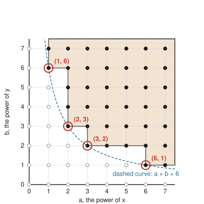

# Hilbert's basis theorem: every polynomial system, however large, is really a finite one

[Syllabus](../../../SYLLABUS.md) → [Algebraic geometry](../README.md) → [Polynomial Systems](../README.md#s01) → Hilbert's basis theorem

---

## General Overview

A fair four-sided die has its faces painted over. Call the hidden numbers x, y, z and w. A machine rolls it forever and reports averages: the average roll, the average squared roll, the average cubed roll, and so on without end.

Each report is one polynomial equation. Multiply an average by 4 and it becomes a **power sum**: the faces' n-th powers added up. The true faces are 1, 2, 3 and 4, so the reports read:

- n = 1: $`x + y + z + w = 10`$
- n = 2: $`x^2 + y^2 + z^2 + w^2 = 30`$
- n = 3: the cubes add to 100; n = 4: the fourth powers add to 354; n = 5: 1300; and on forever.

That is an infinite list of equations. Yet the first four already imply every later one. The fifth, the twelfth and the millionth add nothing: on this card the code divides the fifth to twelfth by four polynomials and gets remainder 0 every time.

Hilbert's basis theorem says this is no accident of dice. Any list of polynomial equations in finitely many unknowns, however long, follows from some finite part of it. David Hilbert proved it in 1890. The proof on this card is the modern one: it reads off a finite list from the **leading terms**, the biggest term of each polynomial in a fixed order.

**Every set of polynomial equations in finitely many unknowns over a field follows from finitely many of them, because the leading terms of the consequences form a staircase with only finitely many corners.**

**What kind of fact this is:** a theorem, proved on this card in Why it works, with Dickson's lemma (the monomial case) proved first.

### The picture: a staircase with four corners

The proof starts from **monomials**: products of powers of the unknowns, such as $`x^2y^3`$. Draw $`x^a y^b`$ as the grid point (a, b). Below, the black points are every monomial with $`a \times b \ge 6`$: infinitely many.

<p align="center"></p>

Drawn to scale. Every black point lies up and to the right of one of the four circled corners. So every one of those monomials is a multiple of $`xy^6`$, $`x^2y^3`$, $`x^3y^2`$ or $`x^6y`$. Four equations replace the infinite list $`x^a y^b = 0`$.

---

## The formula

Notation from earlier cards on this shelf, in one line each:

- $`k`$ is the **field** of coefficients: numbers that can be added, multiplied and divided. Here it is $`\mathbb{Q}`$, the fractions.
- $`k[x_1, \dots, x_n]`$ is every polynomial in the unknowns $`x_1, \dots, x_n`$ with coefficients in $`k`$.
- $`\langle f_1, \dots, f_s \rangle`$ is the **ideal** they generate: every combination $`h_1 f_1 + \dots + h_s f_s`$ with polynomial multipliers $`h_i`$. These are all the equations that follow from $`f_1 = \dots = f_s = 0`$ by multiplying and adding ([Ideals and varieties](01-ideals-and-varieties.md)).

The theorem:

```math
I \text{ an ideal of } k[x_1, \dots, x_n] \;\Longrightarrow\; I = \langle g_1, \dots, g_s \rangle \text{ for some finite list } g_1, \dots, g_s \text{ in } I
```

**Read it aloud:** every ideal of polynomials in finitely many unknowns over a field is generated by finitely many of its members.

The same fact as a chain. Add the equations one at a time, $`I_N = \langle f_1, \dots, f_N \rangle`$, and the ideals can only grow:

```math
I_1 \subseteq I_2 \subseteq I_3 \subseteq \cdots \;\Longrightarrow\; I_N = I_{N+1} = I_{N+2} = \cdots \text{ for some } N
```

**Read it aloud:** a growing chain of ideals stops growing after finitely many steps.

A ring where every ideal is finitely generated, or equivalently every growing chain stops, is called **Noetherian**, after Emmy Noether. The theorem says $`k[x_1, \dots, x_n]`$ is Noetherian. On the die, the chain stops at $`N = 4`$.

| Symbol | Plain meaning | In our example | Push it up and the answer… |
| --- | --- | --- | --- |
| $`k`$ | the field of coefficients | $`\mathbb{Q}`$, the fractions | — |
| $`n`$ | how many unknowns in $`k[x_1, \dots, x_n]`$; in $`f_n`$, $`p_n`$ and $`s_n`$ it numbers the equation instead | 4: the faces x, y, z, w | more unknowns, a longer staircase proof |
| $`f_n`$, $`p_n`$, $`s_n`$ | the n-th equation, written as one side equal to 0; the n-th power sum of the unknowns; the same sum for the true faces | $`f_n = p_n - s_n`$ with $`p_n = x^n + y^n + z^n + w^n`$; $`s_1 = 10`$, $`s_4 = 354`$ | — |
| $`e_1, \dots, e_4`$ | the faces' symmetric sums: their sum, the sums of products of two and of three, and the product of all four | 10, 35, 50, 24 | — |
| $`I`$ | the ideal of all consequences | everything that follows from all the $`f_n`$ | — |
| $`I_N`$ | the consequences of the first N equations | $`I_4 = I`$ | grows until N = 4, then stays |
| $`\langle \dots \rangle`$, $`h_i`$ | the ideal generated by a list; the polynomial multipliers in its combinations | $`\langle f_1, f_2, f_3, f_4 \rangle`$ | — |
| $`\mathrm{LT}(f)`$, $`r`$ | the leading term: the biggest term in the chosen order; the remainder left by division | $`\mathrm{LT}(f_3) = x^3`$; $`r = 0`$ for $`f_5`$ to $`f_{12}`$ | — |
| $`x^a y^b`$, $`m`$, $`S`$ | a monomial, drawn as the point (a, b); any one monomial; a set of monomials | $`x^2y^3`$ is (2, 3); S is every $`x^a y^b`$ with $`a \times b \ge 6`$ | — |
| $`g_1, \dots, g_s`$ | the finite list the theorem promises; here s counts the list, and is not the power sum $`s_n`$ | four polynomials, $`g_1`$ to $`g_4`$ | — |

### When it holds

- **Finitely many unknowns.** With endless unknowns $`x_1, x_2, x_3, \dots`$, the chain $`\langle x_1 \rangle \subsetneq \langle x_1, x_2 \rangle \subsetneq \cdots`$ grows at every step and never stops.
- **Coefficients in a field, or any Noetherian ring.** The theorem also holds over the whole numbers $`\mathbb{Z}`$. Over a ring with an endless growing chain of ideals, the polynomials inherit that chain.
- **The proof needs a monomial order with a least element.** The proof divides, and division ends only because the order has no endless descent. An order that puts lower degree first has no least element, and division of $`x^2`$ by $`x - x^2`$ runs forever. The theorem itself does not need the order: $`\langle x - x^2 \rangle`$ is still generated by one polynomial, and lex is always available. (Power series rings are Noetherian too, but they need a different proof.)
- **Existence, not a count.** The theorem promises some finite list. It does not say how long, or which. The die needed four, and only a computation, or the special argument in Step 3, showed that.

---

## Why it works

### Step 0: the idea in words

Two facts do the work.

1. Monomials are ordered by divisibility, and any set of them has finitely many minimal members. This is **Dickson's lemma**.
2. Division by a well-chosen finite list leaves remainder 0 on every member of the ideal.

The bridge between them is the leading term. Take every leading term of every polynomial in the ideal. Dickson gives finitely many corners. One polynomial per corner already generates everything.

### Step 1: Dickson's lemma, the monomial case

Take the black points of the picture: $`x^a y^b`$ with $`a \times b \ge 6`$. One monomial divides another exactly when its point is down and to the left (or equal), since $`x^a y^b`$ divides $`x^c y^d`$ when $`a \le c`$ and $`b \le d`$.

Pick any one member: (2, 3). Every point at or above and right of it is its multiple. What remains has $`a < 2`$ or $`b < 3`$. So it sits in one of five lines: the columns a = 0 and a = 1, and the rows b = 0, 1 and 2.

Along each line only one exponent changes, and every nonempty set of counting numbers has a least member ([Strong induction and the least element](../../01-Foundations/06-Proof/05-strong-induction-and-well-ordering.md)). So each line contributes at most one corner:

| Line | Members on it | Least member |
| --- | --- | --- |
| column a = 0 | none: 0 × b is never 6 | — |
| column a = 1 | b ≥ 6 | (1, 6) |
| row b = 0 | none | — |
| row b = 1 | a ≥ 6 | (6, 1) |
| row b = 2 | a ≥ 3 | (3, 2) |

With (2, 3) itself that gives four candidates, and none divides another. The code finds the same four corners by brute force over a 31 by 31 grid.

<details>
<summary>Dickson's lemma in any number of unknowns</summary>

Claim: any set S of monomials in $`x_1, \dots, x_n`$ has finitely many minimal members, and every member of S is a multiple of one of them. Induct on n.

For n = 1, a set of powers of one unknown has a least member: well-ordering.

For n unknowns, pick any member m of S, with exponents $`(a_1, \dots, a_n)`$. A member of S that is not a multiple of m has some coordinate $`i`$ with exponent below $`a_i`$. Fix that coordinate at one of its finitely many low values. The members on that slice are monomials in the other n − 1 unknowns, times a fixed power. The induction gives finitely many minimal members on each slice.

There are $`a_1 + \dots + a_n`$ slices, each with finitely many corners. Together with m they cover S. Keep only those no other one divides.

</details>

### Step 2: from leading terms to the general theorem

Fix a **monomial order**: a ranking of monomials that respects multiplication and has a least element ([Monomial orders](02-monomial-orders-and-division.md)). Here it is **lex** (alphabetical): compare powers of x first, then y, then z, then w.

Let $`I`$ be any ideal. Collect the leading monomials of all its members. By Step 1 they have finitely many corners. For each corner choose one member $`g_i`$ of $`I`$ with that leading term.

Now take any f in $`I`$ and divide it by $`g_1, \dots, g_s`$. Division cancels the leading term again and again, and each step lowers the leading monomial. It ends because a falling chain of monomials $`m_1 > m_2 > \cdots`$ must stop. By Step 1 the chain's members have finitely many corners, so all the corners appear by some point in the chain. Any later member is a multiple of an earlier corner $`m_i`$. A multiple is never smaller, since 1 is least and the order respects multiplication, so it is at least $`m_i`$: but the chain falls. ([Monomial orders](02-monomial-orders-and-division.md) gives this proof in full.) Division leaves a remainder r in which no term is divisible by any $`\mathrm{LT}(g_i)`$.

But $`r = f - (\text{multiples of the } g_i)`$, so r is in $`I`$. If r were not 0, its leading term would be a leading term of $`I`$, so a multiple of some corner $`\mathrm{LT}(g_i)`$. That contradicts how the remainder was built. So r = 0, and f is a combination of the $`g_i`$.

That proves the theorem. It proves more: the $`g_i`$ are a **Grobner basis** of $`I`$, a generating list whose leading terms catch every leading term in the ideal ([Grobner bases](03-grobner-bases-and-buchberger.md)).

On the die, the corners are $`x`$, $`y^2`$, $`z^3`$ and $`w^4`$, and the four chosen members are:

```math
\begin{aligned} g_1 &= x + y + z + w - 10 \\ g_2 &= y^2 + yz + yw - 10y + z^2 + zw - 10z + w^2 - 10w + 35 \\ g_3 &= z^3 + z^2w - 10z^2 + zw^2 - 10zw + 35z + w^3 - 10w^2 + 35w - 50 \\ g_4 &= w^4 - 10w^3 + 35w^2 - 50w + 24 \end{aligned}
```

The last one is $`(w - 1)(w - 2)(w - 3)(w - 4)`$: the face called w must be 1, 2, 3 or 4.

### Step 3: why a growing chain must stop

Let $`I_1 \subseteq I_2 \subseteq \cdots`$ grow. Their union is again an ideal: any two members sit in one $`I_N`$ together, so their combinations do too. By Step 2 the union has a finite generating list. Each generator lies in some $`I_N`$, so all of them lie in the largest of those. From there on, every $`I_N`$ is the whole union.

Applied to any infinite list of equations $`f_1, f_2, \dots`$, this says more than "some finite list works". The **first N equations of the list** work, for some N.

On the die, the code shows the chain rising three times, then stopping:

- $`f_2`$ is not a consequence of $`f_1`$: its remainder has leading term $`y^2`$.
- $`f_3`$ is not a consequence of $`f_1, f_2`$: its remainder leads with $`z^3`$.
- $`f_4`$ is not a consequence of $`f_1, f_2, f_3`$: its remainder leads with $`w^4`$.
- $`f_5`$ to $`f_{12}`$ each leave remainder 0 on division by $`g_1, \dots, g_4`$.

The theorem guarantees a stopping point. For the die, a direct proof shows it is 4 for every n, not just up to 12.

<details>
<summary>Why every later moment follows from the first four (strong induction)</summary>

Write $`p_n = x^n + y^n + z^n + w^n`$, and let $`e_1, e_2, e_3, e_4`$ be the elementary symmetric polynomials of the faces: their sum, the sum of products of two, of three, and the product of all four.

Each face v makes the product $`(v - x)(v - y)(v - z)(v - w)`$ zero. Expanded, that says

$`\displaystyle v^4 = e_1 v^3 - e_2 v^2 + e_3 v - e_4.`$

Multiply by $`v^{n-4}`$ and add over the four faces:

$`\displaystyle p_n = e_1 p_{n-1} - e_2 p_{n-2} + e_3 p_{n-3} - e_4 p_{n-4}.`$

Newton's identities write $`e_1`$ to $`e_4`$ in terms of $`p_1`$ to $`p_4`$, dividing by 2, 3 and 4 along the way. So once the first four equations hold, $`e_1 = 10`$, $`e_2 = 35`$, $`e_3 = 50`$ and $`e_4 = 24`$.

Now strong induction on n ≥ 5. Assume every earlier power sum takes its true value. Then

$`\displaystyle p_n = 10 s_{n-1} - 35 s_{n-2} + 50 s_{n-3} - 24 s_{n-4} = s_n,`$

because 1, 2, 3 and 4 are the roots of the same quartic, so their power sums obey the same rule. Every step is a polynomial combination, so $`f_n`$ lies in $`\langle f_1, f_2, f_3, f_4 \rangle`$.

The divisions by 2, 3 and 4 need a field where those are not 0. Over $`\mathbb{F}_2`$ or $`\mathbb{F}_3`$ this argument fails. Hilbert's theorem still holds there, but the stopping point may differ; the code does not test it.

</details>

### Step 4: why Buchberger's algorithm must halt

Buchberger's algorithm builds a Grobner basis ([Grobner bases](03-grobner-bases-and-buchberger.md)). It forms an **S-polynomial** for each pair, a combination that cancels both leading terms, and divides it by the current list. A nonzero remainder joins the list.

Each such remainder has a leading term that no current leading term divides. So the ideal generated by the leading terms grows strictly at every addition. By Step 3 that chain stops. So additions stop, and the algorithm halts.

On the die, Buchberger starts from $`f_1`$ to $`f_4`$, whose leading terms are $`x, x^2, x^3, x^4`$: all in $`\langle x \rangle`$. It checks 21 pairs and adds 3 remainders, with leading terms $`y^2`$, then $`z^3`$, then $`w^4`$. Then every pair reduces to 0.

---

## Worked numbers, by hand

| Step | Arithmetic | Value |
| --- | --- | --- |
| first four power sums | 1 + 2 + 3 + 4; 1 + 4 + 9 + 16; 1 + 8 + 27 + 64; 1 + 16 + 81 + 256 | 10, 30, 100, 354 |
| fifth power sum | 1 + 32 + 243 + 1024 | 1300 |
| symmetric sums of the faces | from $`(t - 1)(t - 2)(t - 3)(t - 4)`$ | 10, 35, 50, 24 |
| fifth from the first four | 10 × 354 − 35 × 100 + 50 × 30 − 24 × 10 | 1300 |
| leading terms of $`g_1`$ to $`g_4`$ | Buchberger, lex x > y > z > w | $`x, y^2, z^3, w^4`$ |
| monomials under the staircase | 1 × 2 × 3 × 4 | 24 |
| dice that satisfy every equation | orderings of 1, 2, 3, 4 | 24 |
| equations needed | the chain stops at $`I_4`$ | **4** |

The infinite list of moment equations is the four equations $`g_1 = g_2 = g_3 = g_4 = 0`$. Their solutions are exactly the 24 ways to paint 1, 2, 3 and 4 on the faces: the staircase count matches the solution count ([Finitely many solutions](07-solving-zero-dimensional-systems.md)).

### What breaks if you drop a piece

| Mistake | Comes out at | What went wrong |
| --- | --- | --- |
| Stop at three moments | a die with faces 3/2, 7/2, 1.2753, 3.7247 matches them, but its fourth powers add to 350.25, not 354 | $`f_4`$ is not a consequence of $`f_1, f_2, f_3`$ |
| Endless unknowns $`x_1, x_2, \dots`$ | each $`x_{n+1}`$ is outside $`\langle x_1, \dots, x_n \rangle`$ for n = 1 to 8, and so on forever | the theorem needs finitely many unknowns |
| Order with lowest degree first | dividing $`x^2`$ by $`x - x^2`$ gives $`x^3, x^4, \dots, x^7`$, never ending | the order has no least element, so division never ends; the theorem still holds, only this division fails |

The two irrational faces are $`(5 \pm \sqrt{6})/2`$, the roots of $`t^2 - 5t + 19/4`$. The code prints all three rows.

---

## Code, from first principles, and it actually runs

The code writes its own exact polynomial arithmetic, division, and Buchberger's algorithm, with nothing that knows the answer. It takes three independent roads to the four equations. First, Buchberger's algorithm from $`f_1`$ to $`f_4`$, checked against a closed formula for $`g_1`$ to $`g_4`$ built from the faces' symmetric sums. Second, membership: $`f_5`$ to $`f_{12}`$ divide to remainder 0, matched by the strong-induction step on the power sums. Third, substitution: all 24 orderings of 1, 2, 3, 4 are put back into every equation exactly. Dickson's corners are found twice: by brute force, and by the proof's own rows and columns.

### Python

```python
# Hilbert's basis theorem -- the check behind the card.  Only exact fractions are
# imported.  A fair four-sided die has hidden faces x, y, z, w.  Equation n says
# the faces' n-th powers add to s_n = 1 + 2^n + 3^n + 4^n, for n = 1, 2, 3, ...
# Field: the rationals.  Order: lex, x > y > z > w (Python compares tuples in lex).
from fractions import Fraction as Q
FACES, NV, TOP, NAMES = (1, 2, 3, 4), 4, 12, "xyzw"

def s(n): return sum(f ** n for f in FACES)
def unit(i, n, nv=NV): return tuple(n if j == i else 0 for j in range(nv))
def eq(n):                                    # f_n = x^n + y^n + z^n + w^n - s_n
    p = {unit(i, n): Q(1) for i in range(NV)}
    p[(0,) * NV] = Q(-s(n))
    return p
def shift(m, a, sign=1): return tuple(u + sign * v for u, v in zip(m, a))
def addm(p, q, c, m):                         # p + c * (monomial m) * q
    out = dict(p)
    for e, a in q.items():
        k = shift(e, m)
        out[k] = out.get(k, 0) + c * a
        if out[k] == 0: del out[k]
    return out
def divides(a, b): return all(u <= v for u, v in zip(a, b))
def nf(p, G):                                 # the remainder of p on division by G
    p, r = dict(p), {}
    while p:
        m = max(p)                            # leading monomial
        g = next((g for g in G if divides(max(g), m)), None)
        if g is None: r[m] = p.pop(m); continue
        p = addm(p, g, -p[m] / g[max(g)], shift(m, max(g), -1))
    return r
def spoly(f, g):
    a, b = max(f), max(g); l = tuple(map(max, a, b))
    return addm(addm({}, f, 1 / f[a], shift(l, a, -1)), g, -1 / g[b], shift(l, b, -1))
def buchberger(F):
    G, pairs, checked, added = list(F), [(i, j) for j in range(len(F)) for i in range(j)], 0, []
    while pairs:
        i, j = pairs.pop(0); checked += 1
        r = nf(spoly(G[i], G[j]), G)
        if r:                                 # a new leading term: the chain grows
            pairs += [(k, len(G)) for k in range(len(G))]; G.append(r); added.append(max(r))
    keep = []
    for g in sorted(G, key=max):              # drop any whose leading term is divisible
        if not any(divides(max(h), max(g)) for h in keep): keep.append(g)
    red = [nf(g, [h for h in keep if h is not g]) for g in keep]
    return [{m: c / r[max(r)] for m, c in r.items()} for r in red][::-1], checked, added
def mono(m): return "*".join(NAMES[i] + (f"^{k}" if k > 1 else "") for i, k in enumerate(m) if k) or "1"
def show(p):
    out = ""
    for m in sorted(p, reverse=True):
        c = p[m]; body = mono(m) if any(m) else ""
        a = abs(c); txt = (f"{a}*{body}" if a != 1 else body) if body else f"{a}"
        out += (("-" if c < 0 else "") if not out else (" - " if c < 0 else " + ")) + txt
    return out
def h(d, k):                                  # every monomial of degree d in variables k..w
    if k == NV - 1: return [unit(k, d)]
    return [shift(unit(k, j), e) for j in range(d, -1, -1) for e in h(d - j, k + 1)]
def perms(t): return [t] if len(t) < 2 else [(t[i],) + r for i in range(len(t)) for r in perms(t[:i] + t[i + 1:])]
def ev(p, pt): return sum(c * Q(pt[0]) ** m[0] * Q(pt[1]) ** m[1] * Q(pt[2]) ** m[2] * Q(pt[3]) ** m[3] for m, c in p.items())

c = [Q(1)]                                    # coefficients of (t - 1)(t - 2)(t - 3)(t - 4)
for f in FACES: c = [a - f * b for a, b in zip(c + [0], [0] + c)]
c = [abs(a) for a in c]                       # e_0 .. e_4 of the faces
formula = [{} for _ in range(NV)]             # g_k = sum_j (-1)^j e_j h_(k-j)(x_k..w)
for k in range(1, NV + 1):
    for j in range(k + 1):
        for m in h(k - j, k - 1): formula[k - 1] = addm(formula[k - 1], {(0,) * NV: Q((-1) ** j) * c[j]}, 1, m)
G, checked, added = buchberger([eq(n) for n in range(1, 5)])
print(f"field Q, lex order x > y > z > w; true faces {list(FACES)}; e_1..e_4 = {[int(a) for a in c[1:]]}")
print(f"power sums s_1..s_{TOP}: {[s(n) for n in range(1, TOP + 1)]}")
print(f"Buchberger on f_1..f_4: {checked} pairs checked, {len(added)} remainders added, leading terms {', '.join(mono(m) for m in added)}")
for k, g in enumerate(G): print(f"g_{k + 1} = {show(g)}")
print(f"the closed formula gives the same four: {'yes' if G == formula else 'no'}")
grow = []
for k in range(1, 4):
    Gk = buchberger([eq(n) for n in range(1, k + 1)])[0]
    r = nf(eq(k + 1), Gk); grow.append(len(r))
    print(f"I_{k} < I_{k + 1}: f_{k + 1} leaves a remainder of {len(r)} terms, leading {mono(max(r))}")
rest = [len(nf(eq(n), G)) for n in range(5, TOP + 1)]
print(f"f_5..f_{TOP} on division by g_1..g_4 leave remainder sizes {rest}")
rec = all(s(n) == c[1] * s(n - 1) - c[2] * s(n - 2) + c[3] * s(n - 3) - c[4] * s(n - 4) for n in range(5, TOP + 1))
print(f"the strong-induction step s_n = 10 s_(n-1) - 35 s_(n-2) + 50 s_(n-3) - 24 s_(n-4), n = 5..{TOP}: {'yes' if rec else 'no'}")
std = [m for a in range(5) for b in range(5) for cc in range(5) for d in range(5)
       if not any(divides(max(g), m := (a, b, cc, d)) for g in G)]
dice = perms(FACES)
ok = all(ev(p, t) == 0 for t in dice for p in G + [eq(n) for n in range(1, TOP + 1)])
print(f"monomials under the staircase x, y^2, z^3, w^4: {len(std)}; orderings of 1, 2, 3, 4: {len(dice)}; all satisfy every equation: {'yes' if ok else 'no'}")
S = {(a, b) for a in range(31) for b in range(31) if a * b >= 6}
corners = sorted(m for m in S if not any(n != m and divides(n, m) for n in S))
a0, b0 = 2, 3                                 # Dickson's proof: one member, then finitely many rows and columns
picked = {(a0, b0)} | {(min(a for a in range(31) if (a, b) in S), b) for b in range(b0) if any((a, b) in S for a in range(31))}
picked |= {(a, min(b for b in range(31) if (a, b) in S)) for a in range(a0) if any((a, b) in S for b in range(31))}
dickson = sorted(m for m in picked if not any(n != m and divides(n, m) for n in picked))
print(f"monomials x^a y^b with a*b >= 6: corners {corners}; Dickson's proof from (2, 3) finds {dickson}")
print(f"figure, corners {' '.join(f'{a},{b}' for a, b in corners)}; curve a*b = 6 through (1,6) (1.5,4) (2,3) (3,2) (4,1.5) (6,1)")
w = Q(3, 2); P = [None, s(1) - w, s(2) - w ** 2, s(3) - w ** 3]   # mistake 1: only three moments
e1 = P[1]; e2 = (e1 * P[1] - P[2]) / 2; e3 = (e2 * P[1] - e1 * P[2] + P[3]) / 3
p4 = e1 * P[3] - e2 * P[2] + e3 * P[1] + w ** 4
print(f"mistake 1, three moments only: faces 3/2, 7/2, (5 - 6^(1/2))/2 = {(5 - 6 ** 0.5) / 2:.4f}, "
      f"(5 + 6^(1/2))/2 = {(5 + 6 ** 0.5) / 2:.4f}; cubic t^3 - {e1} t^2 + {e2} t - {e3} = (t - 7/2)(t^2 - {e1 - Q(7, 2)} t + {e3 / Q(7, 2)}); "
      f"fourth sum {p4} = {float(p4)}, not {s(4)}")
chain = [len(nf({unit(n, 1, 9): Q(1)}, [{unit(i, 1, 9): Q(1)} for i in range(n)])) for n in range(1, 9)]
print(f"mistake 2, endless variables x_1, x_2, ...: x_(n+1) outside <x_1..x_n> for n = 1..8, remainder sizes {chain}")
r, g, steps = {2: 1}, {1: 1, 2: -1}, []       # mistake 3: lowest degree leads; divide x^2 by x - x^2
for _ in range(5):
    m = min(r); q = r.pop(m) // g[1]          # the "leading" term is the lowest power
    for e, a in g.items():
        if e > 1: r[e + m - 1] = r.get(e + m - 1, 0) - q * a
    steps.append(f"{r[min(r)]}*x^{min(r)}" if r[min(r)] != 1 else f"x^{min(r)}")
print(f"mistake 3, lowest-degree-first order, x^2 divided by x - x^2: remainders {' -> '.join(steps)} -> ... never ends")
assert G == formula and [mono(max(g)) for g in G] == ["x", "y^2", "z^3", "w^4"]   # two roads, one basis
assert min(grow) > 0 and rest == [0] * (TOP - 4) and rec                             # chain stops at 4
assert len(std) == len(dice) == 24 and ok and ev(eq(1), (1, 2, 3, 5)) == 1   # substitution
assert corners == dickson == [(1, 6), (2, 3), (3, 2), (6, 1)] and min(chain) == 1 and steps[-1] == "x^7"
assert (e1, e2, e3) == (Q(7, 2) + 5, Q(19, 4) + Q(35, 2), Q(7, 2) * Q(19, 4)) and p4 == Q(1401, 4)
print("ALL CHECKS PASS")
```

**Ran 2026-11-17 on macOS, Python 3.14.10, standard library only. All checks passed. Output, pasted from the run:**

```
field Q, lex order x > y > z > w; true faces [1, 2, 3, 4]; e_1..e_4 = [10, 35, 50, 24]
power sums s_1..s_12: [10, 30, 100, 354, 1300, 4890, 18700, 72354, 282340, 1108650, 4373500, 17312754]
Buchberger on f_1..f_4: 21 pairs checked, 3 remainders added, leading terms y^2, z^3, w^4
g_1 = x + y + z + w - 10
g_2 = y^2 + y*z + y*w - 10*y + z^2 + z*w - 10*z + w^2 - 10*w + 35
g_3 = z^3 + z^2*w - 10*z^2 + z*w^2 - 10*z*w + 35*z + w^3 - 10*w^2 + 35*w - 50
g_4 = w^4 - 10*w^3 + 35*w^2 - 50*w + 24
the closed formula gives the same four: yes
I_1 < I_2: f_2 leaves a remainder of 10 terms, leading y^2
I_2 < I_3: f_3 leaves a remainder of 10 terms, leading z^3
I_3 < I_4: f_4 leaves a remainder of 5 terms, leading w^4
f_5..f_12 on division by g_1..g_4 leave remainder sizes [0, 0, 0, 0, 0, 0, 0, 0]
the strong-induction step s_n = 10 s_(n-1) - 35 s_(n-2) + 50 s_(n-3) - 24 s_(n-4), n = 5..12: yes
monomials under the staircase x, y^2, z^3, w^4: 24; orderings of 1, 2, 3, 4: 24; all satisfy every equation: yes
monomials x^a y^b with a*b >= 6: corners [(1, 6), (2, 3), (3, 2), (6, 1)]; Dickson's proof from (2, 3) finds [(1, 6), (2, 3), (3, 2), (6, 1)]
figure, corners 1,6 2,3 3,2 6,1; curve a*b = 6 through (1,6) (1.5,4) (2,3) (3,2) (4,1.5) (6,1)
mistake 1, three moments only: faces 3/2, 7/2, (5 - 6^(1/2))/2 = 1.2753, (5 + 6^(1/2))/2 = 3.7247; cubic t^3 - 17/2 t^2 + 89/4 t - 133/8 = (t - 7/2)(t^2 - 5 t + 19/4); fourth sum 1401/4 = 350.25, not 354
mistake 2, endless variables x_1, x_2, ...: x_(n+1) outside <x_1..x_n> for n = 1..8, remainder sizes [1, 1, 1, 1, 1, 1, 1, 1]
mistake 3, lowest-degree-first order, x^2 divided by x - x^2: remainders x^3 -> x^4 -> x^5 -> x^6 -> x^7 -> ... never ends
ALL CHECKS PASS
```

### Rust

Same numbers and labels, built with `rustc --edition 2021 -O`.

```rust
// Hilbert's basis theorem -- the same check as the Python, in Rust.  No crates.
// A fair four-sided die has hidden faces x, y, z, w.  Equation n says the faces'
// n-th powers add to s_n = 1 + 2^n + 3^n + 4^n, for n = 1, 2, 3, ...  Field: the
// rationals, as an i128 fraction whose checked arithmetic stops the run on overflow.
// Order: lex, x > y > z > w (a BTreeMap of exponent vectors sorts in lex).
use std::collections::BTreeMap;
#[derive(Clone, Copy, PartialEq)]
struct Q { n: i128, d: i128 }
fn gcd(a: i128, b: i128) -> i128 { if b == 0 { a.abs() } else { gcd(b, a % b) } }
fn q(n: i128, d: i128) -> Q { let g = gcd(n, d).max(1) * d.signum(); Q { n: n / g, d: d / g } }
fn mul(a: Q, b: Q) -> Q { q(a.n.checked_mul(b.n).unwrap(), a.d.checked_mul(b.d).unwrap()) }
fn add(a: Q, b: Q) -> Q { q(a.n.checked_mul(b.d).unwrap().checked_add(b.n.checked_mul(a.d).unwrap()).unwrap(), a.d.checked_mul(b.d).unwrap()) }
fn sub(a: Q, b: Q) -> Q { add(a, Q { n: -b.n, d: b.d }) }
fn div(a: Q, b: Q) -> Q { mul(a, q(b.d, b.n)) }
fn int(n: i128) -> Q { Q { n, d: 1 } }
fn qs(a: Q) -> String { if a.d == 1 { a.n.to_string() } else { format!("{}/{}", a.n, a.d) } }
type M = Vec<u32>; type P = BTreeMap<M, Q>;
const NV: usize = 4; const TOP: u32 = 12; const FACES: [i128; 4] = [1, 2, 3, 4]; const NAMES: [char; 4] = ['x', 'y', 'z', 'w'];
fn s(n: u32) -> i128 { FACES.iter().map(|f| f.pow(n)).sum() }
fn unit(i: usize, n: u32, nv: usize) -> M { (0..nv).map(|j| if j == i { n } else { 0 }).collect() }
fn eq(n: u32) -> P { (0..NV).map(|i| (unit(i, n, NV), int(1))).chain([(vec![0; NV], int(-s(n)))]).collect() } // f_n
fn shift(m: &M, a: &M, sign: i64) -> M { m.iter().zip(a).map(|(&u, &v)| (u as i64 + sign * v as i64) as u32).collect() }
fn addm(p: &P, g: &P, c: Q, m: &M) -> P {            // p + c * (monomial m) * g
    let mut out = p.clone(); for (e, &a) in g {
        let (k, v) = (shift(e, m, 1), add(*out.get(&shift(e, m, 1)).unwrap_or(&int(0)), mul(c, a)));
        if v.n == 0 { out.remove(&k); } else { out.insert(k, v); }
    }
    out
}
fn divides(a: &M, b: &M) -> bool { a.iter().zip(b).all(|(u, v)| u <= v) }
fn lead(p: &P) -> M { p.keys().next_back().unwrap().clone() }
fn nf(p: &P, g: &[P]) -> P {                          // the remainder of p on division by g
    let (mut p, mut r) = (p.clone(), P::new());
    while let Some((m, c)) = p.last_key_value().map(|(k, &v)| (k.clone(), v)) {
        match g.iter().find(|h| divides(&lead(h), &m)) {
            None => { p.remove(&m); r.insert(m, c); }
            Some(h) => { let lh = lead(h); p = addm(&p, h, div(int(-1), div(h[&lh], p[&m])), &shift(&m, &lh, -1)); }
        }
    }
    r
}
fn spoly(f: &P, g: &P) -> P {
    let (a, b) = (lead(f), lead(g)); let l: M = a.iter().zip(&b).map(|(&u, &v)| u.max(v)).collect();
    addm(&addm(&P::new(), f, div(int(1), f[&a]), &shift(&l, &a, -1)), g, div(int(-1), g[&b]), &shift(&l, &b, -1))
}
fn buchberger(fs: Vec<P>) -> (Vec<P>, usize, Vec<M>) {
    let (mut g, mut checked, mut added) = (fs.clone(), 0, Vec::new());
    let mut pairs: Vec<(usize, usize)> = (0..fs.len()).flat_map(|j| (0..j).map(move |i| (i, j))).collect();
    while !pairs.is_empty() {
        let (i, j) = pairs.remove(0); checked += 1;
        let r = nf(&spoly(&g[i], &g[j]), &g);
        if !r.is_empty() {                            // a new leading term: the chain grows
            pairs.extend((0..g.len()).map(|k| (k, g.len())));
            added.push(lead(&r)); g.push(r);
        }
    }
    g.sort_by(|a, b| lead(a).cmp(&lead(b)));           // drop any whose leading term is divisible
    let mut keep: Vec<P> = Vec::new(); for x in g { if !keep.iter().any(|h| divides(&lead(h), &lead(&x))) { keep.push(x) } }
    let red = (0..keep.len()).rev().map(|i| {
        let r = nf(&keep[i], &[&keep[..i], &keep[i + 1..]].concat());
        r.iter().map(|(k, &v)| (k.clone(), div(v, r[&lead(&r)]))).collect()
    }).collect();
    (red, checked, added)
}
fn mono(m: &M) -> String {
    let parts: Vec<String> = m.iter().enumerate().filter(|&(_, &k)| k > 0)
        .map(|(i, &k)| if k > 1 { format!("{}^{}", NAMES[i], k) } else { NAMES[i].to_string() }).collect();
    if parts.is_empty() { "1".to_string() } else { parts.join("*") }
}
fn show(p: &P) -> String {
    let mut out = String::new();
    for (m, &c) in p.iter().rev() {
        let (a, body) = (Q { n: c.n.abs(), d: c.d }, if m.iter().any(|&k| k > 0) { mono(m) } else { String::new() });
        let txt = if body.is_empty() { qs(a) } else if a == int(1) { body } else { format!("{}*{}", qs(a), body) };
        let sign = if out.is_empty() { if c.n < 0 { "-" } else { "" } } else if c.n < 0 { " - " } else { " + " };
        out += &format!("{}{}", sign, txt);
    }
    out
}
fn h(d: u32, k: usize) -> Vec<M> {                    // every monomial of degree d in variables k..w
    if k == NV - 1 { return vec![unit(k, d, NV)] }
    (0..=d).rev().flat_map(|j| h(d - j, k + 1).into_iter().map(move |e| shift(&unit(k, j, NV), &e, 1))).collect()
}
fn perms(t: &[i128]) -> Vec<Vec<i128>> {
    if t.len() < 2 { return vec![t.to_vec()] }
    (0..t.len()).flat_map(|i| perms(&[&t[..i], &t[i + 1..]].concat()).into_iter().map(move |r| [vec![t[i]], r].concat())).collect()
}
fn ev(p: &P, pt: &[i128]) -> Q {
    p.iter().fold(int(0), |acc, (m, &c)| add(acc, mul(c, int((0..NV).map(|i| pt[i].pow(m[i])).product()))))
}
fn minimal(set: &[(i64, i64)]) -> Vec<(i64, i64)> {  // members no other member divides
    let below = |a: i64, b: i64| set.iter().any(|&(c, d)| (c, d) != (a, b) && c <= a && d <= b);
    let mut v: Vec<(i64, i64)> = set.iter().filter(|&&(a, b)| !below(a, b)).cloned().collect();
    v.sort(); v.dedup(); v
}
fn yn(b: bool) -> &'static str { if b { "yes" } else { "no" } }
fn main() {
    let mut c: Vec<i128> = vec![1];                   // coefficients of (t - 1)(t - 2)(t - 3)(t - 4)
    for f in FACES { let mut nc = c.clone(); nc.push(0); for i in 0..c.len() { nc[i + 1] -= f * c[i] } c = nc; }
    let c: Vec<i128> = c.iter().map(|a| a.abs()).collect();     // e_0 .. e_4 of the faces
    let mut formula: Vec<P> = vec![P::new(); NV];    // g_k = sum_j (-1)^j e_j h_(k-j)(x_k..w)
    for k in 1..=NV { for j in 0..=k {
        let cst: P = [(vec![0; NV], int((-1i128).pow(j as u32) * c[j]))].into_iter().collect();
        for m in h((k - j) as u32, k - 1) { formula[k - 1] = addm(&formula[k - 1], &cst, int(1), &m) }
    } }
    let (g, checked, added) = buchberger((1..=4).map(eq).collect());
    println!("field Q, lex order x > y > z > w; true faces {:?}; e_1..e_4 = {:?}", FACES, &c[1..]);
    println!("power sums s_1..s_{}: {:?}", TOP, (1..=TOP).map(s).collect::<Vec<_>>());
    println!("Buchberger on f_1..f_4: {} pairs checked, {} remainders added, leading terms {}", checked, added.len(),
             added.iter().map(mono).collect::<Vec<_>>().join(", "));
    for (k, p) in g.iter().enumerate() { println!("g_{} = {}", k + 1, show(p)) }
    println!("the closed formula gives the same four: {}", yn(g == formula));
    let mut grow = Vec::new();
    for k in 1..4u32 {
        let r = nf(&eq(k + 1), &buchberger((1..=k).map(eq).collect()).0);
        grow.push(r.len());
        println!("I_{} < I_{}: f_{} leaves a remainder of {} terms, leading {}", k, k + 1, k + 1, r.len(), mono(&lead(&r)));
    }
    let rest: Vec<usize> = (5..=TOP).map(|n| nf(&eq(n), &g).len()).collect();
    println!("f_5..f_{} on division by g_1..g_4 leave remainder sizes {:?}", TOP, rest);
    let rec = (5..=TOP).all(|n| s(n) == c[1] * s(n - 1) - c[2] * s(n - 2) + c[3] * s(n - 3) - c[4] * s(n - 4));
    println!("the strong-induction step s_n = 10 s_(n-1) - 35 s_(n-2) + 50 s_(n-3) - 24 s_(n-4), n = 5..{}: {}", TOP, yn(rec));
    let std = (0..625u32).filter(|i| !g.iter().any(|p| divides(&lead(p), &vec![i / 125, i / 25 % 5, i / 5 % 5, i % 5]))).count();
    let dice = perms(&FACES);
    let all: Vec<P> = g.iter().cloned().chain((1..=TOP).map(eq)).collect();
    let ok = dice.iter().all(|t| all.iter().all(|p| ev(p, t).n == 0));
    println!("monomials under the staircase x, y^2, z^3, w^4: {}; orderings of 1, 2, 3, 4: {}; all satisfy every equation: {}", std, dice.len(), yn(ok));
    let inside = |a: i64, b: i64| a * b >= 6;
    let corners = minimal(&(0..31).flat_map(|a| (0..31).map(move |b| (a, b))).filter(|&(a, b)| inside(a, b)).collect::<Vec<_>>());
    let (a0, b0) = (2i64, 3i64);                      // Dickson's proof: one member, then finitely many rows and columns
    let mut picked = vec![(a0, b0)];
    for b in 0..b0 { if let Some(a) = (0..31).find(|&a| inside(a, b)) { picked.push((a, b)) } }
    for a in 0..a0 { if let Some(b) = (0..31).find(|&b| inside(a, b)) { picked.push((a, b)) } }
    let dickson = minimal(&picked);
    println!("monomials x^a y^b with a*b >= 6: corners {:?}; Dickson's proof from (2, 3) finds {:?}", corners, dickson);
    let cs: Vec<String> = corners.iter().map(|(a, b)| format!("{},{}", a, b)).collect();
    println!("figure, corners {}; curve a*b = 6 through (1,6) (1.5,4) (2,3) (3,2) (4,1.5) (6,1)", cs.join(" "));
    let w = q(3, 2);                                  // mistake 1: only three moments
    let pw = [int(1), w, mul(w, w), mul(mul(w, w), w), mul(mul(w, w), mul(w, w))];
    let pp = [int(0), sub(int(s(1)), pw[1]), sub(int(s(2)), pw[2]), sub(int(s(3)), pw[3])];
    let (e1, e2) = (pp[1], div(sub(mul(pp[1], pp[1]), pp[2]), int(2)));
    let e3 = div(add(sub(mul(e2, pp[1]), mul(e1, pp[2])), pp[3]), int(3));
    let p4 = add(add(sub(mul(e1, pp[3]), mul(e2, pp[2])), mul(e3, pp[1])), pw[4]);
    println!("mistake 1, three moments only: faces 3/2, 7/2, (5 - 6^(1/2))/2 = {:.4}, (5 + 6^(1/2))/2 = {:.4}; cubic t^3 - {} t^2 + {} t - {} = (t - 7/2)(t^2 - {} t + {}); fourth sum {} = {}, not {}",
             (5.0 - 6f64.sqrt()) / 2.0, (5.0 + 6f64.sqrt()) / 2.0, qs(e1), qs(e2), qs(e3), qs(sub(e1, q(7, 2))), qs(div(e3, q(7, 2))), qs(p4), p4.n as f64 / p4.d as f64, s(4));
    let chain: Vec<usize> = (1..9).map(|n| {
        let gens: Vec<P> = (0..n).map(|i| [(unit(i, 1, 9), int(1))].into_iter().collect()).collect();
        nf(&[(unit(n, 1, 9), int(1))].into_iter().collect(), &gens).len()
    }).collect();
    println!("mistake 2, endless variables x_1, x_2, ...: x_(n+1) outside <x_1..x_n> for n = 1..8, remainder sizes {:?}", chain);
    let mut r: BTreeMap<i64, i64> = [(2, 1)].into_iter().collect();          // mistake 3: lowest degree leads;
    let gq: BTreeMap<i64, i64> = [(1, 1), (2, -1)].into_iter().collect();    // divide x^2 by x - x^2
    let mut steps: Vec<String> = Vec::new();
    for _ in 0..5 {
        let (m, cm) = r.pop_first().unwrap();         // the "leading" term is the lowest power
        for (&e, &a) in &gq { if e > 1 { *r.entry(e + m - 1).or_insert(0) -= cm / gq[&1] * a } }
        let (&lo, &cl) = r.iter().next().unwrap();
        steps.push(if cl != 1 { format!("{}*x^{}", cl, lo) } else { format!("x^{}", lo) });
    }
    println!("mistake 3, lowest-degree-first order, x^2 divided by x - x^2: remainders {} -> ... never ends", steps.join(" -> "));
    let lt: Vec<String> = g.iter().map(|p| mono(&lead(p))).collect();
    assert!(g == formula && lt == ["x", "y^2", "z^3", "w^4"]);                    // two roads, one basis
    assert!(grow.iter().all(|&n| n > 0) && rest.iter().all(|&n| n == 0) && rec);  // chain stops at 4
    assert!(std == 24 && dice.len() == 24 && ok && ev(&eq(1), &[1, 2, 3, 5]) == int(1));   // substitution
    assert!(corners == dickson && corners == vec![(1, 6), (2, 3), (3, 2), (6, 1)] && chain.iter().all(|&n| n == 1) && steps[4] == "x^7");
    assert!(e1 == add(q(7, 2), int(5)) && e2 == add(q(19, 4), q(35, 2)) && e3 == mul(q(7, 2), q(19, 4)) && p4 == q(1401, 4));
    println!("ALL CHECKS PASS");
}
```

**Ran 2026-11-17 on macOS, rustc 1.98.1, no crates. All checks passed. Output, pasted from the run:**

```
field Q, lex order x > y > z > w; true faces [1, 2, 3, 4]; e_1..e_4 = [10, 35, 50, 24]
power sums s_1..s_12: [10, 30, 100, 354, 1300, 4890, 18700, 72354, 282340, 1108650, 4373500, 17312754]
Buchberger on f_1..f_4: 21 pairs checked, 3 remainders added, leading terms y^2, z^3, w^4
g_1 = x + y + z + w - 10
g_2 = y^2 + y*z + y*w - 10*y + z^2 + z*w - 10*z + w^2 - 10*w + 35
g_3 = z^3 + z^2*w - 10*z^2 + z*w^2 - 10*z*w + 35*z + w^3 - 10*w^2 + 35*w - 50
g_4 = w^4 - 10*w^3 + 35*w^2 - 50*w + 24
the closed formula gives the same four: yes
I_1 < I_2: f_2 leaves a remainder of 10 terms, leading y^2
I_2 < I_3: f_3 leaves a remainder of 10 terms, leading z^3
I_3 < I_4: f_4 leaves a remainder of 5 terms, leading w^4
f_5..f_12 on division by g_1..g_4 leave remainder sizes [0, 0, 0, 0, 0, 0, 0, 0]
the strong-induction step s_n = 10 s_(n-1) - 35 s_(n-2) + 50 s_(n-3) - 24 s_(n-4), n = 5..12: yes
monomials under the staircase x, y^2, z^3, w^4: 24; orderings of 1, 2, 3, 4: 24; all satisfy every equation: yes
monomials x^a y^b with a*b >= 6: corners [(1, 6), (2, 3), (3, 2), (6, 1)]; Dickson's proof from (2, 3) finds [(1, 6), (2, 3), (3, 2), (6, 1)]
figure, corners 1,6 2,3 3,2 6,1; curve a*b = 6 through (1,6) (1.5,4) (2,3) (3,2) (4,1.5) (6,1)
mistake 1, three moments only: faces 3/2, 7/2, (5 - 6^(1/2))/2 = 1.2753, (5 + 6^(1/2))/2 = 3.7247; cubic t^3 - 17/2 t^2 + 89/4 t - 133/8 = (t - 7/2)(t^2 - 5 t + 19/4); fourth sum 1401/4 = 350.25, not 354
mistake 2, endless variables x_1, x_2, ...: x_(n+1) outside <x_1..x_n> for n = 1..8, remainder sizes [1, 1, 1, 1, 1, 1, 1, 1]
mistake 3, lowest-degree-first order, x^2 divided by x - x^2: remainders x^3 -> x^4 -> x^5 -> x^6 -> x^7 -> ... never ends
ALL CHECKS PASS
```

The two outputs match line for line.

### Lean

Lean proves the theorem, its chain form and Dickson's lemma, over any field with any number of unknowns, and the die's hand arithmetic.

- Take any field k and any ideal I of $`k[x_1, \dots, x_n]`$. Then $`I = \langle g_1, \dots, g_s \rangle`$ for some finite list $`g_1, \dots, g_s`$ in I.
- Take a growing chain $`I_1 \subseteq I_2 \subseteq \cdots`$ of ideals of $`k[x_1, \dots, x_n]`$. Then from some N on, every later ideal equals $`I_N`$.
- Take any set S of monomials in $`x_1, \dots, x_n`$. Then S has finitely many minimal members, and every member of S is a multiple of one of them.
- The faces 1, 2, 3 and 4 have power sums 10, 30, 100, 354 and 1300, for n = 1 to 5.
- Their symmetric sums $`e_1`$ to $`e_4`$ are 10, 35, 50 and 24.
- From the first four, 10 × 354 − 35 × 100 + 50 × 30 − 24 × 10 = 1300, the fifth power sum.
- Take n from 5 to 12. Then $`s_n = 10 s_{n-1} - 35 s_{n-2} + 50 s_{n-3} - 24 s_{n-4}`$.
- Multiplied out, $`(w - 1)(w - 2)(w - 3)(w - 4)`$ is $`g_4`$.
- The staircase count 1 × 2 × 3 × 4 is 24.
- The corners (1, 6), (2, 3), (3, 2) and (6, 1) all have a × b ≥ 6, and none divides another.
- Take a and b below 31 with a × b ≥ 6. Then (a, b) lies up and to the right of one of the four corners, or on it.
- The three-moment mistake's 1401/4 is not 354.

Buchberger's run, the remainders, the 24 dice and the three mistakes' own numbers are left to the Python and Rust checks.

```lean
-- Hilbert's basis theorem: every ideal of polynomials in finitely many unknowns over a field is generated by finitely many of its members.
import Mathlib.RingTheory.Polynomial.Basic
import Mathlib.Data.Finsupp.PWO
import Mathlib.Tactic.Ring
import Mathlib.Tactic.NormNum
import Mathlib.RingTheory.PrincipalIdealDomain

open MvPolynomial

/-- Hilbert's basis theorem: over a field `k`, every ideal `I` of `k[x_1, …, x_n]`
(finitely many unknowns) equals `⟨g_1, …, g_s⟩` for some finite list `g_1, …, g_s`
of members of `I`. -/
theorem ideal_of_polynomials_finitely_generated {k : Type*} [Field k] (n : ℕ)
    (I : Ideal (MvPolynomial (Fin n) k)) :
    ∃ g : Finset (MvPolynomial (Fin n) k), (↑g : Set (MvPolynomial (Fin n) k)) ⊆ I ∧
      Ideal.span (↑g : Set (MvPolynomial (Fin n) k)) = I := by
  obtain ⟨g, hg⟩ := (isNoetherianRing_iff_ideal_fg (MvPolynomial (Fin n) k)).mp inferInstance I
  refine ⟨g, ?_, hg⟩
  rw [← hg]
  exact Ideal.subset_span

/-- The chain form: over a field `k`, a growing chain of ideals
`I_1 ⊆ I_2 ⊆ I_3 ⊆ ⋯` of `k[x_1, …, x_n]` stops growing: from some `N` on,
every ideal in the chain equals `I_N`. -/
theorem ascending_chain_of_polynomial_ideals_stops {k : Type*} [Field k] (n : ℕ)
    (I : ℕ → Ideal (MvPolynomial (Fin n) k)) (hI : Monotone I) :
    ∃ N, ∀ m, N ≤ m → I m = I N := by
  obtain ⟨N, hN⟩ := (monotone_stabilizes_iff_noetherian (R := MvPolynomial (Fin n) k)
    (M := MvPolynomial (Fin n) k)).mpr inferInstance ⟨I, hI⟩
  exact ⟨N, fun m hm => (hN m hm).symm⟩

/-- Dickson's lemma, the monomial case: any set `S` of monomials in `x_1, …, x_n`
(a monomial is its exponent vector; one divides another when every exponent is
at most the other's) has finitely many minimal members, and every member of `S`
is a multiple of one of them. -/
theorem dickson_lemma (n : ℕ) (S : Set (Fin n →₀ ℕ)) :
    ∃ T : Finset (Fin n →₀ ℕ), (↑T : Set (Fin n →₀ ℕ)) ⊆ S ∧
      (∀ t ∈ T, ∀ m ∈ S, m ≤ t → m = t) ∧
      ∀ m ∈ S, ∃ t ∈ T, t ≤ m := by
  have hfin : {x | Minimal (· ∈ S) x}.Finite :=
    (setOfPred_minimal_antichain (· ∈ S)).finite_of_partiallyWellOrderedOn
      (Set.isPWO_of_wellQuasiOrderedLE _)
  refine ⟨hfin.toFinset, ?_, ?_, ?_⟩
  · intro t ht
    simp only [Set.Finite.coe_toFinset, Set.mem_ofPred_eq] at ht
    exact ht.1
  · intro t ht m hm hle
    simp only [Set.Finite.mem_toFinset, Set.mem_ofPred_eq] at ht
    exact le_antisymm hle (ht.2 hm hle)
  · intro m hm
    obtain ⟨b, hb, hmin⟩ := (Set.isPWO_of_wellQuasiOrderedLE S).exists_le_minimal hm
    exact ⟨b, by simpa using hmin, hb⟩

/-! Worked numbers from the card: the die with faces 1, 2, 3, 4. -/

-- power sums s_1 .. s_5 of the true faces
example : (1 + 2 + 3 + 4 : ℕ) = 10 := by norm_num
example : (1 ^ 2 + 2 ^ 2 + 3 ^ 2 + 4 ^ 2 : ℕ) = 30 := by norm_num
example : (1 ^ 3 + 2 ^ 3 + 3 ^ 3 + 4 ^ 3 : ℕ) = 100 := by norm_num
example : (1 ^ 4 + 2 ^ 4 + 3 ^ 4 + 4 ^ 4 : ℕ) = 354 := by norm_num
example : (1 ^ 5 + 2 ^ 5 + 3 ^ 5 + 4 ^ 5 : ℕ) = 1300 := by norm_num

-- the symmetric sums e_1 .. e_4 of the faces: 10, 35, 50, 24
example : (1 * 2 + 1 * 3 + 1 * 4 + 2 * 3 + 2 * 4 + 3 * 4 : ℕ) = 35 := by norm_num
example : (1 * 2 * 3 + 1 * 2 * 4 + 1 * 3 * 4 + 2 * 3 * 4 : ℕ) = 50 := by norm_num
example : (1 * 2 * 3 * 4 : ℕ) = 24 := by norm_num

-- the fifth power sum from the first four: 10 × 354 − 35 × 100 + 50 × 30 − 24 × 10 = 1300
example : (10 * 354 - 35 * 100 + 50 * 30 - 24 * 10 : ℤ) = 1300 := by norm_num

-- the recurrence s_n = 10 s_(n-1) - 35 s_(n-2) + 50 s_(n-3) - 24 s_(n-4) for n = 5 .. 12
example : ∀ n ∈ Finset.Icc 5 12,
    ((1 ^ n + 2 ^ n + 3 ^ n + 4 ^ n : ℕ) : ℤ) =
      10 * (1 ^ (n - 1) + 2 ^ (n - 1) + 3 ^ (n - 1) + 4 ^ (n - 1) : ℕ)
      - 35 * (1 ^ (n - 2) + 2 ^ (n - 2) + 3 ^ (n - 2) + 4 ^ (n - 2) : ℕ)
      + 50 * (1 ^ (n - 3) + 2 ^ (n - 3) + 3 ^ (n - 3) + 4 ^ (n - 3) : ℕ)
      - 24 * (1 ^ (n - 4) + 2 ^ (n - 4) + 3 ^ (n - 4) + 4 ^ (n - 4) : ℕ) := by
  decide

-- g_4 = w^4 - 10 w^3 + 35 w^2 - 50 w + 24 = (w - 1)(w - 2)(w - 3)(w - 4)
example (w : ℚ) :
    w ^ 4 - 10 * w ^ 3 + 35 * w ^ 2 - 50 * w + 24 = (w - 1) * (w - 2) * (w - 3) * (w - 4) := by
  ring

-- monomials under the staircase x, y^2, z^3, w^4: 1 × 2 × 3 × 4 = 24 = 4!
example : (1 * 2 * 3 * 4 : ℕ) = Nat.factorial 4 := by decide

-- the staircase a * b ≥ 6: its four corners (1, 6), (2, 3), (3, 2), (6, 1) lie in it,
-- no corner divides another, and on the 31 by 31 grid every point with a * b ≥ 6
-- is up and to the right of a corner
example : ∀ c ∈ [(1, 6), (2, 3), (3, 2), (6, 1)], 6 ≤ c.1 * c.2 := by decide
example : ∀ c ∈ [(1, 6), (2, 3), (3, 2), (6, 1)], ∀ d ∈ [(1, 6), (2, 3), (3, 2), (6, 1)],
    (d.1 ≤ c.1 ∧ d.2 ≤ c.2) → d = c := by decide
example : ∀ a < 31, ∀ b < 31, 6 ≤ a * b →
    ∃ c ∈ [(1, 6), (2, 3), (3, 2), (6, 1)], c.1 ≤ a ∧ c.2 ≤ b := by decide

-- mistake 1: the die 3/2, 7/2, (5 ± √6)/2 matches three moments; its fourth sum is 1401/4, not 354
example : (1401 / 4 : ℚ) ≠ 354 := by norm_num

#print axioms ideal_of_polynomials_finitely_generated
#print axioms ascending_chain_of_polynomial_ideals_stops
#print axioms dickson_lemma
```

**Checked 2026-11-17 on macOS, Lean 4.36.0-rc2, Mathlib v4.36.0-rc2. Every proof is complete and uses only Lean's standard axioms. Output, pasted from the run:**

```
'ideal_of_polynomials_finitely_generated' depends on axioms: [propext, Classical.choice, Quot.sound]
'ascending_chain_of_polynomial_ideals_stops' depends on axioms: [propext, Classical.choice, Quot.sound]
'dickson_lemma' depends on axioms: [propext, Classical.choice, Quot.sound]
```

> [!TIP]
> **Try changing**
> Guess first, then run it.
> - **More equations.** Set `TOP` to 20. Guess: does the chain start growing again? No: $`f_5`$ to $`f_{20}`$ all leave remainder 0, and every check passes.
> - **Start Dickson's proof elsewhere.** Set `a0, b0` to `6, 1`. Guess: different corners? No: the rows and columns from (6, 1) give the same four.
> - **Paint a 5 instead of the 4.** Set `FACES` to `(1, 2, 3, 5)`. Guess: still four equations, with leading terms $`x, y^2, z^3, w^4`$? Yes, and every later equation still reduces to 0. The substitution assert stops the run, because its test die (1, 2, 3, 5) now fits.

---

## The usual mistake

> [!warning]
> **Reading the theorem as a recipe for the list.** It proves that a finite list exists, and that the first N equations of any given list suffice. It does not say what N is. The die needed 4, and only Buchberger's algorithm or a special argument showed that. Other systems need far longer lists.
>
> - **Trusting the first few equations.** Three moments look like plenty, yet a real die with faces 3/2, 7/2 and $`(5 \pm \sqrt{6})/2`$ matches them and gets 350.25 for the fourth, not 354.
> - **Forgetting "finitely many unknowns".** With $`x_1, x_2, \dots`$, every new unknown is a new equation that nothing earlier implies.
> - **Using an order with no least element.** Division of $`x^2`$ by $`x - x^2`$ with lowest degree first runs $`x^3, x^4, x^5, \dots`$ and never stops.
> - **Dividing by 2, 3 and 4 over any field.** The die's own proof uses those divisions; over $`\mathbb{F}_2`$ or $`\mathbb{F}_3`$ it fails, though the theorem itself does not.

---

## Where you meet it in real life

- **Computer algebra.** Every Grobner basis run, from robot-arm planning to circuit verification, relies on Step 4 to know it will finish.
- **The two-link robot arm.** An arm with 3 m and 2 m links has infinitely many valid constraints on its joint positions. The theorem says a finite list describes all of them, which is what [Elimination](05-elimination-and-implicitisation.md) computes with.
- **Moments in statistics.** Four equally likely values are fixed by their first four moments, and every later moment follows: the die, read as data.
- **Invariant theory.** Hilbert's 1890 goal: polynomials unchanged by a group of symmetries are built from finitely many. This theorem was his main tool.

> **Say it back**
> An infinite list of polynomial equations in finitely many unknowns always follows from finitely many of them. The proof looks at leading terms: their exponents form a staircase, and Dickson's lemma says any staircase has finitely many corners. One polynomial per corner divides every member of the ideal to remainder 0. So growing chains of ideals stop, and Buchberger's algorithm, which grows such a chain, must halt. On the die, the infinite list of moment equations is exactly four equations, and their solutions are the 24 orderings of 1, 2, 3, 4.

---

## What this builds on

- [Grobner bases](03-grobner-bases-and-buchberger.md): leading terms, S-polynomials and Buchberger's algorithm, whose halting this card proves.
- [Strong induction and the least element](../../01-Foundations/06-Proof/05-strong-induction-and-well-ordering.md): the least member behind Dickson's lemma and the end of division, and the induction behind the die's moments.

## Where this goes next

- [The Nullstellensatz](09-nullstellensatz.md): with a finite list in hand, it asks which equations vanish on the solution points, and answers over the complex numbers.
- [Invariants of a finite group](10-invariant-theory-and-molien-series.md): the Reynolds average, Hilbert's finiteness, and Molien's count.
- [Hilbert's syzygy theorem](../07-Exact%20Sequences%2C%20Ext%20and%20Tor/06-hilbert-syzygy-theorem.md): every module over a polynomial ring has a free resolution of length at most the number of variables.

The question this card leaves open: the theorem fixes the equations, but when do the points they define determine those equations back?

---

## Sources

Verified 2026-11-17: every link below resolves to the publisher's page.

- Hilbert, David. "Ueber die Theorie der algebraischen Formen." *Mathematische Annalen* 36 (1890): 473–534. [doi:10.1007/BF01208503](https://doi.org/10.1007/BF01208503). The original theorem, proved for invariant theory.
- Dickson, Leonard Eugene. "Finiteness of the Odd Perfect and Primitive Abundant Numbers with n Distinct Prime Factors." *American Journal of Mathematics* 35, no. 4 (1913): 413. [doi:10.2307/2370405](https://doi.org/10.2307/2370405). The lemma on minimal exponent vectors used in Step 1.
- Buchberger, Bruno. "Bruno Buchberger's PhD thesis 1965: An algorithm for finding the basis elements of the residue class ring of a zero dimensional polynomial ideal." *Journal of Symbolic Computation* 41, no. 3–4 (2006): 475–511. [doi:10.1016/j.jsc.2005.09.007](https://doi.org/10.1016/j.jsc.2005.09.007). The algorithm whose halting Step 4 proves.
- Cox, David A., John Little, and Donal O'Shea. *Ideals, Varieties, and Algorithms*, 4th ed. Springer, 2015. [doi:10.1007/978-3-319-16721-3](https://doi.org/10.1007/978-3-319-16721-3). Chapter 2: Dickson's lemma, the basis theorem through leading terms, and the chain condition.
