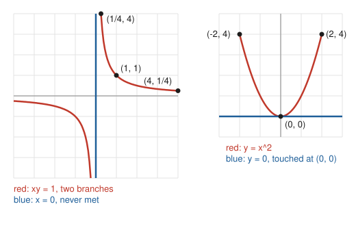

# The Nullstellensatz: over the complex numbers the points know the equations up to roots

[Syllabus](../../../SYLLABUS.md) → [Algebraic geometry](../README.md) → [Polynomial Systems](../README.md#s01) → The Nullstellensatz

---

## General Overview

Ask for a rectangle with an area of 1 square metre and a width of 0 metres. Call the width x and the height y. The request is two equations: x y = 1 and x = 0.

No such rectangle exists, and no clever number rescues it. Even a complex number, one built with i × i = −1, cannot help: once x = 0, the product x y is 0 whatever y is.

There is a one-line proof that needs no search through numbers at all. Multiply the second equation by y and subtract the first:

```math
y \cdot (x) - (xy - 1) = 1
```

The left side is built only from the two equations, so at any common solution it would equal 0. It equals 1 instead. The system has asserted 0 = 1, so it has no solution. A combination like this is a **certificate** of no solution: a short calculation anyone can check by multiplying out.

The Nullstellensatz (German for "zero-places theorem") says the converse. Over the complex numbers, *every* system with no solution has such a certificate. A second, stronger form goes further: it says exactly which polynomials vanish (equal zero) at every solution of a system. They are the polynomials that have some power that is a combination of the equations.

**Over the complex numbers, a polynomial system has no solution exactly when 1 is a combination of its equations, and a polynomial vanishes at every solution exactly when some power of it is such a combination.**

**What kind of fact this is:** a theorem, due to David Hilbert in 1893. The easy direction and the strong form are proved on this card in Why it works. The hard step, that a system with no certificate has a point, is proved here for the complex numbers and stated with a source for other fields.

### The picture: no meeting, and a meeting that touches

<p align="center"></p>

Real points only, drawn to scale. On the left, the curve x y = 1 creeps toward the line x = 0 but never meets it: system 1, no solution. On the right, the parabola y = x² touches the line y = 0 at one point, (0, 0): system 2, used below for the strong form.

---

## The formula

Notation, in words first. The field k is the number system the coefficients and the points live in; here it is the complex numbers ℂ. From [Ideals and varieties](01-ideals-and-varieties.md):

- $`k[x_1, \ldots, x_n]`$ is the set of polynomials in the variables $`x_1`$ to $`x_n`$, with coefficients in k.
- The ideal $`\langle f_1, \ldots, f_s \rangle`$ is every combination $`a_1 f_1 + \cdots + a_s f_s`$, where each multiplier $`a_i`$ is any polynomial. These are all the equations that follow from the $`f_i`$ by multiplying and adding.
- The variety $`V(f_1, \ldots, f_s)`$ is the set of points where every $`f_i`$ equals zero.

This card introduces two more. $`I(V)`$, the **ideal of a set of points** V, is every polynomial that equals zero at every point of V. The **radical** $`\sqrt{I}`$ of an ideal I is every polynomial f with some power $`f^m`$ in I.

The weak form, for any ideal I in $`\mathbb{C}[x_1, \ldots, x_n]`$:

```math
V(I) = \varnothing \iff 1 \in I
```

**Read it aloud:** the equations have no common solution exactly when 1 is a combination of them.

The strong form:

```math
I(V(I)) = \sqrt{I}
```

**Read it aloud:** the polynomials that vanish at every solution are exactly the ones with a power that is a combination of the equations.

On system 2, I = ⟨y − x², y⟩. Its only point is (0, 0), so x vanishes on V(I). And x is not in I, yet $`x^2 = (-1)(y - x^2) + (1)(y)`$ is. That is the "up to roots" in the title: the points recover the equations up to taking roots.

| Symbol | Plain meaning | In our example | Push it up and the answer… |
| --- | --- | --- | --- |
| $`k`$, $`\mathbb{C}`$, $`\mathbb{F}_p`$ | the field: where coefficients and points live; $`\mathbb{F}_p`$ is whole numbers modulo a prime p | the complex numbers; p = 2, 3, 5, 7 for counting | a field that is not algebraically closed, such as the reals or $`\mathbb{F}_p`$, loses points, and a zero count there says nothing about ℂ |
| $`x, y`$; $`x_1, \ldots, x_n`$ | the unknowns; n is how many | width and height, n = 2 | more unknowns: certificates can need higher degree |
| $`f_1, \ldots, f_s`$ | the equations, each written as "polynomial = 0"; s is how many | $`xy - 1`$ and $`x`$ | more equations: fewer points, more combinations |
| $`I = \langle f_1, \ldots, f_s \rangle`$ | the ideal: all combinations of the equations | everything $`a_1(xy - 1) + a_2 x`$ | — |
| $`a_i`$, $`h_i`$ | the multipliers in a combination; $`a_{s+1}`$ multiplies the extra equation in Step 3, and $`h_i`$ are the multipliers once Step 3 clears denominators; as a subscript, i only counts and is not the complex i | $`a_1 = -1`$, $`a_2 = y`$ | higher degree: more combinations to search |
| $`V(I)`$ | the common solutions | none for system 1; (0, 0) for system 2 | — |
| $`I(V)`$ | every polynomial zero on all of V | for (0, 0): everything with no constant term | a bigger V: fewer polynomials vanish on all of it |
| $`\sqrt{I}`$ | the radical: polynomials with a power in I | $`\langle x, y \rangle`$ for system 2 | — |
| $`m`$ | the power needed | 2, since $`x^2`$ is in I but x is not | a tighter touch needs a higher power |
| $`z`$ | the extra unknown in the proof of the strong form | stands for 1/x | — |
| $`M`$, $`L`$, $`t`$; $`c_j`$ | a maximal ideal containing I, the field left after collapsing by it, and any element of that field; complex numbers in Step 2: the values t can equal, and the point's coordinates $`c_i`$ | for system 2: ⟨x, y⟩, and L is ℂ | — |
| $`a, b`$ | the robot arm's elbow position, in metres (What breaks) | a = 41/12, b² = −385/144 for a target 6 m away | — |

### When it holds

- **The field is algebraically closed: every non-constant one-variable polynomial has a root in it.** ℂ is; the reals are not. Over the reals x² + 1 = 0 has no point, yet 1 is not in ⟨x² + 1⟩, because x = i is a complex point.
- **Not too many variables.** The proof here uses finitely many: it enlarges I to a maximal ideal and needs the field left after collapsing by it to be small. The same counting proves the weak form with countably many variables. With uncountably many it fails.
- **Points are taken in ℂ even when the coefficients are rational.** System 1 has whole-number coefficients, and so does its certificate. Finding a certificate is a linear system (Step 5), and a linear system with rational coefficients that has a solution has a rational one. The points themselves may still need ℂ.
- **The strong form is about vanishing, not membership.** It returns $`\sqrt{I}`$, not I. A doubled equation such as x² = 0 has the same points as x = 0, and the points cannot tell the two apart.

---

## Why it works

### Step 0: a certificate rules out every point, over any field

Suppose $`1 = a_1 f_1 + \cdots + a_s f_s`$. At a common solution every $`f_i`$ is 0, so the right side is 0 and the left side is 1. That is impossible, so there is no common solution.

This direction is just substitution, and it holds over any field. The content of the theorem is the other direction: when no certificate exists, a point does. One variable is already known. A non-constant polynomial f has a complex root ([The fundamental theorem of algebra](../../03-Algebra/10-For%20the%20Curious/01-fundamental-theorem-of-algebra.md)), so ⟨f⟩ has a point, and that is the weak form for n = 1.

### Step 1: from "1 is not in I" to a field

Suppose 1 is not in I. Enlarge I as far as possible without reaching 1: the result is a **maximal ideal** M, one with nothing between it and the whole ring. It exists because the polynomial ring is Noetherian: every chain of growing ideals stops ([Hilbert's basis theorem](08-hilbert-basis-theorem.md)).

Collapse the ring by M. What is left, $`L = \mathbb{C}[x_1, \ldots, x_n]/M`$, is a field, one where every non-zero element has a reciprocal ([Fields](../../03-Algebra/09-Rings%20and%20Fields/02-fields.md)). That is what collapsing by a maximal ideal gives. It contains ℂ, and the images of the variables generate it.

### Step 2: that field is ℂ itself, so the variables become numbers

**Zariski's lemma** says a field generated as a ring by finitely many elements over k is a finite-dimensional vector space over k. For k = ℂ a short count proves it, in the fold below.

So every element t of L satisfies a non-zero polynomial over ℂ. Over ℂ that polynomial splits into factors, $`(t - c_1) \cdots (t - c_r) = 0`$. In a field a product is 0 only when one factor is 0, so t equals some complex number $`c_j`$. Hence each variable $`x_i`$ becomes a complex number $`c_i`$ in L. Every polynomial in M then becomes its value at the point $`(c_1, \ldots, c_n)`$, and it becomes 0, since M collapses to 0. That point lies in V(M), and so in V(I). The weak form is proved.

<details>
<summary>Detailed proof: why the field L is no bigger than ℂ</summary>

The monomials $`x_1^{e_1} \cdots x_n^{e_n}`$ are countably many, and they span L over ℂ. So L has a countable spanning set.

Suppose some t in L were not a root of any non-zero polynomial over ℂ. Then t − c is non-zero for every complex c, so 1/(t − c) exists in L. There are uncountably many such elements. They are linearly independent: a relation

$`\displaystyle \lambda_1 \frac{1}{t - c_1} + \cdots + \lambda_r \frac{1}{t - c_r} = 0`$

with distinct $`c_j`$, multiplied by the product of all the $`t - c_j`$, gives a polynomial in t equal to 0. Since t is a root of no non-zero polynomial, that polynomial is the zero polynomial. Put t = $`c_j`$ in it: every term but one contains the factor $`c_j - c_j`$, so $`\lambda_j \prod_{l \ne j}(c_j - c_l) = 0`$ and $`\lambda_j = 0`$.

Uncountably many independent elements cannot fit in a space with a countable spanning set. So every t in L is a root of some non-zero polynomial over ℂ, and Step 2 finishes as written. For other algebraically closed fields, such as the algebraic closure of a finite field, this count does not work. Cox, Little and O'Shea prove the weak form for every algebraically closed field by a different route (chapter 4).

</details>

### Step 3: the strong form from the weak, by one extra variable

This is the **Rabinowitsch trick** (1930). Suppose f vanishes at every point of V(I). Add a new unknown z and one new equation, 1 − z f = 0. This asks for a point of V(I) where f is not zero, with z = 1/f. There is none, so by the weak form

```math
1 = a_1 f_1 + \cdots + a_s f_s + a_{s+1}\,(1 - z f)
```

Now put z = 1/f. The last term disappears. The multipliers $`a_i`$ now contain powers of 1/f, up to some highest power m. Multiply both sides by $`f^m`$ and every denominator clears:

```math
f^m = h_1 f_1 + \cdots + h_s f_s
```

So $`f^m`$ is in I, and f is in $`\sqrt{I}`$. The reverse inclusion is Step 0 again: if $`f^m`$ is in I, then $`f^m`$ is 0 at every point, so f is too.

On system 2 with f = x, the code finds $`1 = (-z^2)(y - x^2) + (z^2)(y) + (xz + 1)(1 - xz)`$. The highest power of z is 2. Put z = 1/x and multiply by x²: $`x^2 = (-1)(y - x^2) + (1)(y)`$, so m = 2.

### Step 4: the dictionary between equations and shapes

An ideal I is **radical** when $`\sqrt{I} = I`$: whenever a power of f is in I, f is too. Two facts make the dictionary:

- **Every I(V) is radical.** If $`f^m`$ is zero at every point, so is f.
- **Every radical ideal is an I(V).** By the strong form, a radical I equals $`I(V(I))`$.

So over ℂ, V and I match radical ideals with varieties one to one. Bigger ideals give smaller varieties. A single point (a, b) matches the maximal ideal ⟨x − a, y − b⟩, and the empty set matches the whole ring, ⟨1⟩. System 2 shows the cost: the ideal ⟨y − x², y⟩ records that the line touches the parabola, with x² in it. The point (0, 0) alone records only ⟨x, y⟩.

### Step 5: finding a certificate is linear algebra

Fix a degree bound for the multipliers $`a_i`$. Then $`a_1 f_1 + \cdots + a_s f_s = 1`$ is a set of linear equations in their unknown coefficients, one equation per monomial. Gaussian elimination solves it exactly or proves it has no solution. Raise the bound until a certificate appears. If the system has a complex point, none ever does, so the search needs a place to stop. Kollár's effective Nullstellensatz ([*Journal of the AMS*, 1988](https://doi.org/10.1090/S0894-0347-1988-0944576-7)) gives one: a degree bound that depends only on the number of unknowns and the degrees of the equations. Stop at that bound; no certificate there proves a complex point exists. The other road is a Gröbner basis: 1 is in I exactly when the reduced Gröbner basis is {1} ([Normal forms](04-reduced-grobner-bases-and-ideal-membership.md)).

---

## Worked numbers, by hand

System 1, x y − 1 = 0 and x = 0, over ℂ:

| Step | Arithmetic | Value |
| --- | --- | --- |
| try constant multipliers | $`a_1(xy - 1) + a_2 x = 1`$: the xy term forces $`a_1 = 0`$, then the constant term reads 0 = 1 | no certificate |
| try degree-1 multipliers | take $`a_1 = -1`$, $`a_2 = y`$ | $`-xy + 1 + xy`$ |
| multiply out | the xy terms cancel | **1** |
| count points over $`\mathbb{F}_p`$, p = 2, 3, 5, 7 | x = 0 makes x y − 1 equal −1, never 0 | 0, 0, 0, 0 |

Here $`\mathbb{F}_p`$ is the field of whole numbers modulo a prime p. A certificate rules out points over every field, and the counts agree.

System 2, y − x² = 0 and y = 0, over ℂ:

| Step | Arithmetic | Value |
| --- | --- | --- |
| the points | y = 0, then x² = 0, so x = 0 | (0, 0) only |
| is x in I? | send y to 0, then x² to 0: both equations become 0, x stays x | **no** |
| is x² in I? | $`(-1)(y - x^2) + (1)(y)`$ | **x²** |
| Rabinowitsch's highest power of z | multipliers $`-z^2`$, $`z^2`$, $`xz + 1`$ | m = 2 |

The test in the second row works because "send y to 0, then x² to 0" keeps sums and products. It sends every combination of the two equations to 0, but sends x to x, so x is no combination. The answer: the points of system 2 know x only through its square.

### What breaks if you drop a piece

| Mistake | Comes out at | What went wrong |
| --- | --- | --- |
| Use the reals: x² + 1 = 0 has no real point, so expect 1 in ⟨x² + 1⟩ | no certificate; at x = i, x² + 1 is 0 | the reals are not algebraically closed; the point is complex |
| A robot arm with 3 m and 2 m links aimed at a target 6 m away | elbow a = 41/12, b² = −385/144 | the target is unreachable in the plane, but a complex elbow exists, so no certificate exists |
| Drop the root: expect every polynomial zero on V(I) to be in I | x vanishes at (0, 0) yet is not in ⟨y − x², y⟩ | the theorem returns $`\sqrt{I}`$; here x² is in I, x is not |

The code prints all three. The first two cases have a real answer of a different shape. The **real Nullstellensatz** and the **Positivstellensatz** (Stengle, 1974) say a real system has no real point exactly when −1 equals a sum of squares plus a combination of the equations. For x² + 1 that is $`-1 = x^2 + (-1)(x^2 + 1)`$. For the arm, $`12a - 41`$ and then $`b^2 + 385/144`$ lie in the ideal, and $`-1 = (144/385)\,b^2 - (144/385)(b^2 + 385/144)`$. Such certificates are found by [Semidefinite programs](../../15-Optimization/06-Conic%2C%20Quadratic%20and%20Stochastic%20Programs/05-semidefinite-programs-and-relaxations.md) (Parrilo, 2003).

---

## Code, from first principles, and it actually runs

The code works with exact fractions throughout. It takes three roads to "system 1 has no solution". Road 1 multiplies out the certificate found by hand. Road 2 searches for a certificate by solving a linear system with its own Gaussian elimination. Road 3 counts points over four small fields $`\mathbb{F}_p`$ by trying every pair: a certificate predicts zero there, though a count alone proves nothing over ℂ. For system 2 it shows x is not in I by the test map, confirms x² is, and runs the Rabinowitsch trick. Then it prints the three breaks and the two real certificates. Nothing imported knows about polynomials.

### Python

```python
# The Nullstellensatz -- the check behind the card.  Standard library only.
# Polynomials are dicts {(ex, ey, ez): Fraction}, in x > y > z.  Certificates
# are checked by expanding them exactly, found by solving a linear system,
# and cross-checked against points counted over the small fields F_p.
from fractions import Fraction as Q
from itertools import product

def P(*terms):                          # P((c, (ex, ey, ez)), ...)
    out = {}
    for c, m in terms:
        out[m] = out.get(m, 0) + Q(c)
    return {m: c for m, c in out.items() if c != 0}

def add(f, g):
    return P(*[(c, m) for m, c in f.items()], *[(c, m) for m, c in g.items()])

def mul(f, g):
    return P(*[(a * b, tuple(i + j for i, j in zip(m, n)))
               for m, a in f.items() for n, b in g.items()])

def combo(mults, gens):                 # a1*f1 + a2*f2 + ...
    out = {}
    for a, f in zip(mults, gens):
        out = add(out, mul(a, f))
    return out

def show(f, names="xyz"):               # leading term first, fractions in lowest terms
    s = ""
    for m in sorted(f, reverse=True):
        c = f[m]
        mono = "".join(v + (f"^{e}" if e > 1 else "") for v, e in zip(names, m) if e)
        a = abs(c)
        body = str(a) if not mono else mono if a == 1 else (
            f"{a}{mono}" if a.denominator == 1 else f"({a}){mono}")
        s += ("-" if c < 0 else "") + body if not s else (" - " if c < 0 else " + ") + body
    return s or "0"

def monos(n, d):                        # exponents with total degree <= d, n variables
    return [m + (0,) * (3 - n) for m in product(range(d + 1), repeat=n) if sum(m) <= d]

def search(gens, target, n, d):         # solve target = sum a_i g_i, deg a_i <= d
    cols = [(i, m) for i in range(len(gens)) for m in monos(n, d)]
    prods = [mul({m: Q(1)}, gens[i]) for i, m in cols]
    keys = sorted(set(target).union(*prods))
    rows = [[p.get(k, Q(0)) for p in prods] + [target.get(k, Q(0))] for k in keys]
    piv, r = [], 0
    for c in range(len(cols)):          # Gauss-Jordan elimination, written out
        k = next((i for i in range(r, len(rows)) if rows[i][c] != 0), None)
        if k is None:
            continue
        rows[r], rows[k] = rows[k], rows[r]
        rows[r] = [v / rows[r][c] for v in rows[r]]
        for i in range(len(rows)):
            if i != r and rows[i][c] != 0:
                rows[i] = [a - rows[i][c] * b for a, b in zip(rows[i], rows[r])]
        piv.append(c)
        r += 1
    if any(row[-1] != 0 for row in rows[r:]):
        return None                     # inconsistent: no certificate at this degree
    mults = [{} for _ in gens]
    for i, c in enumerate(piv):
        mults[cols[c][0]] = add(mults[cols[c][0]], {cols[c][1]: rows[i][-1]})
    return mults

def none(r):
    return "no certificate at this degree" if r is None else "found"

def count(gens, p):                     # common zeros in F_p x F_p
    ev = lambda f, x, y: sum(int(c) * x**m[0] * y**m[1] for m, c in f.items()) % p
    return [(x, y) for x in range(p) for y in range(p) if all(ev(f, x, y) == 0 for f in gens)]

X, Y, Z, ONE = P((1, (1, 0, 0))), P((1, (0, 1, 0))), P((1, (0, 0, 1))), P((1, (0, 0, 0)))
primes = [2, 3, 5, 7]
F = [P((1, (1, 1, 0)), (-1, (0, 0, 0))), X]                   # x y - 1, x
print(f"system 1, over C: {show(F[0])} = 0 and {show(F[1])} = 0")
hand = combo([P((-1, (0, 0, 0))), Y], F)
print(f"road 1, the certificate by hand: (-1)({show(F[0])}) + (y)({show(F[1])}) = {show(hand)}")
print(f"road 2, search with constant multipliers: {none(search(F, ONE, 2, 0))}")
found = search(F, ONE, 2, 1)
print(f"road 2, search with degree-1 multipliers: a1 = {show(found[0])}, a2 = {show(found[1])}")
print(f"road 2, expanded: {show(combo(found, F))}")
pts1 = [len(count(F, p)) for p in primes]
print(f"road 3, common zeros over F_p for p = {primes}: {pts1}")
print(f"sign slip: (1)({show(F[0])}) + (y)({show(F[1])}) = {show(combo([ONE, Y], F))}")
G = [P((1, (0, 1, 0)), (-1, (2, 0, 0))), Y]                   # y - x^2, y
print(f"system 2, over C: {show(G[0])} = 0 and {show(G[1])} = 0")
pts2 = [count(G, p) for p in primes]
print(f"common zeros over F_p for p = {primes}: {[len(s) for s in pts2]}, all at (0, 0): "
      f"{'yes' if all(s == [(0, 0)] for s in pts2) else 'no'}")
kill = lambda f: {m: c for m, c in f.items() if m[1] == 0 and m[0] < 2}   # y -> 0, x^2 -> 0
print(f"the test map (y -> 0, then x^2 -> 0) sends the generators to {show(kill(G[0]))}, "
      f"{show(kill(G[1]))} and x to {show(kill(X))}")
print(f"search for x = a1 g1 + a2 g2, degree <= 3: {none(search(G, X, 2, 3))}")
sq = search(G, mul(X, X), 2, 0)
print(f"x^2 = ({show(sq[0])})({show(G[0])}) + ({show(sq[1])})({show(G[1])})")
R = G + [P((1, (0, 0, 0)), (-1, (1, 0, 1)))]                   # add 1 - x z
cert = search(R, ONE, 3, 2)
print(f"Rabinowitsch: 1 = sum a_i g_i with g3 = {show(R[2])}:")
for i in range(3):
    print(f"  a{i + 1} = {show(cert[i])}")
print(f"  expanded: {show(combo(cert, R))}")
m = max(k[2] for a in cert[:2] for k in a)                     # highest power of z
back = [P(*[(c, (k[0] + m - k[2], k[1], 0)) for k, c in a.items()]) for a in cert[:2]]
print(f"put z = 1/x, multiply by x^{m}: x^{m} = ({show(back[0])})({show(G[0])}) + "
      f"({show(back[1])})({show(G[1])}), expanded {show(combo(back, G))}")
H = [P((1, (2, 0, 0)), (1, (0, 0, 0)))]                       # x^2 + 1
gi = lambda f: tuple(int(sum(c * t[k[0] % 4] for k, c in f.items())) for t in ((1, 0, -1, 0), (0, 1, 0, -1)))   # f at x = i: i^e runs 1, i, -1, -i
print(f"break 1: {show(H[0])} at x = i gives {gi(H[0])}; search for 1, degree <= 4: "
      f"{none(search(H, ONE, 1, 4))}")
print(f"break 1: zeros of {show(H[0])} over F_p for p = {primes}: "
      f"{[len([x for x in range(p) if (x * x + 1) % p == 0]) for p in primes]}")
real1 = add(mul(X, X), mul(P((-1, (0, 0, 0))), H[0]))
print(f"break 1, real certificate: x^2 + (-1)({show(H[0])}) = {show(real1)}")
arm = lambda p: [P((1, (2, 0, 0)), (1, (0, 2, 0)), (-9, (0, 0, 0))),
                 P((1, (2, 0, 0)), (-2 * p, (1, 0, 0)), (1, (0, 2, 0)), (p * p - 4, (0, 0, 0)))]
A6 = arm(6)
print(f"break 2, arm aimed 6 m away: {show(A6[0], 'ab')} = 0 and {show(A6[1], 'ab')} = 0")
a6 = Q(41, 12); b6sq = 9 - a6 * a6
print(f"break 2, elbow a = {a6}, b^2 = {b6sq}; reach checks {a6 * a6 + b6sq} and "
      f"{(a6 - 6) ** 2 + b6sq}")
lin = add(A6[0], mul(P((-1, (0, 0, 0))), A6[1]))
sos = P((Q(144, 385), (0, 2, 0)))
shift = P((Q(1, 12), (1, 0, 0)), (Q(41, 144), (0, 0, 0)))      # (a + 41/12)/12
inI = add(A6[0], mul(P((-1, (0, 0, 0))), mul(shift, lin)))     # b^2 + 385/144
real2 = add(sos, mul(P((Q(-144, 385), (0, 0, 0))), inI))
print(f"break 2: {show(A6[0], 'ab')} - ({show(A6[1], 'ab')}) = {show(lin, 'ab')}; "
      f"in the ideal: {show(inI, 'ab')}")
print(f"break 2, real certificate: {show(sos, 'ab')} - (144/385)({show(inI, 'ab')}) = {show(real2, 'ab')}")
a4 = Q(21, 8); b4sq = 9 - a4 * a4
print(f"arm at 4 m: elbow a = {a4}, b^2 = {b4sq}, b = +-{float(b4sq) ** 0.5:.6f} m")
print("figure, hyperbola xy = 1 through", " ".join(f"({t}, {1 / t})" for t in map(Q, [0.25, 0.5, 1, 2, 4])))
print("figure, parabola y = x^2 through", " ".join(f"({t}, {t * t})" for t in [-2, -1, 0, 1, 2]),
      "and the line y = 0, meeting at (0, 0)")
assert hand == ONE and combo(found, F) == ONE                  # two certificates, expanded
assert search(F, ONE, 2, 0) is None and pts1 == [0, 0, 0, 0]  # no point anywhere we can count
assert kill(G[0]) == {} and kill(G[1]) == {} and kill(X) == X  # x is not in <y - x^2, y>
assert combo(cert, R) == ONE and combo(back, G) == mul(X, X) and m == 2
assert gi(H[0]) == (0, 0) and real1 == P((-1, (0, 0, 0))) and real2 == P((-1, (0, 0, 0)))
assert (a6 - 6) ** 2 + b6sq == 4 and (a4 - 4) ** 2 + b4sq == 4 and b6sq < 0 < b4sq
print("ALL CHECKS PASS")
```

**Ran 2026-11-17 on macOS, Python 3.14.10, standard library only. All checks passed. Output, pasted from the run:**

```
system 1, over C: xy - 1 = 0 and x = 0
road 1, the certificate by hand: (-1)(xy - 1) + (y)(x) = 1
road 2, search with constant multipliers: no certificate at this degree
road 2, search with degree-1 multipliers: a1 = -1, a2 = y
road 2, expanded: 1
road 3, common zeros over F_p for p = [2, 3, 5, 7]: [0, 0, 0, 0]
sign slip: (1)(xy - 1) + (y)(x) = 2xy - 1
system 2, over C: -x^2 + y = 0 and y = 0
common zeros over F_p for p = [2, 3, 5, 7]: [1, 1, 1, 1], all at (0, 0): yes
the test map (y -> 0, then x^2 -> 0) sends the generators to 0, 0 and x to x
search for x = a1 g1 + a2 g2, degree <= 3: no certificate at this degree
x^2 = (-1)(-x^2 + y) + (1)(y)
Rabinowitsch: 1 = sum a_i g_i with g3 = -xz + 1:
  a1 = -z^2
  a2 = z^2
  a3 = xz + 1
  expanded: 1
put z = 1/x, multiply by x^2: x^2 = (-1)(-x^2 + y) + (1)(y), expanded x^2
break 1: x^2 + 1 at x = i gives (0, 0); search for 1, degree <= 4: no certificate at this degree
break 1: zeros of x^2 + 1 over F_p for p = [2, 3, 5, 7]: [1, 0, 2, 0]
break 1, real certificate: x^2 + (-1)(x^2 + 1) = -1
break 2, arm aimed 6 m away: a^2 + b^2 - 9 = 0 and a^2 - 12a + b^2 + 32 = 0
break 2, elbow a = 41/12, b^2 = -385/144; reach checks 9 and 4
break 2: a^2 + b^2 - 9 - (a^2 - 12a + b^2 + 32) = 12a - 41; in the ideal: b^2 + 385/144
break 2, real certificate: (144/385)b^2 - (144/385)(b^2 + 385/144) = -1
arm at 4 m: elbow a = 21/8, b^2 = 135/64, b = +-1.452369 m
figure, hyperbola xy = 1 through (1/4, 4) (1/2, 2) (1, 1) (2, 1/2) (4, 1/4)
figure, parabola y = x^2 through (-2, 4) (-1, 1) (0, 0) (1, 1) (2, 4) and the line y = 0, meeting at (0, 0)
ALL CHECKS PASS
```

### Rust

The same numbers and labels, built with `rustc --edition 2021 -O`. Fractions use i128 with checked multiplication, so an overflow stops the run.

```rust
// The Nullstellensatz -- the same check as the Python, in Rust.  No crates.
// Polynomials are maps from exponents [ex, ey, ez] to exact fractions, in
// x > y > z.  Certificates are checked by expanding them exactly, found by
// solving a linear system, and cross-checked against points over F_p.
use std::collections::{BTreeMap, BTreeSet};

#[derive(Clone, Copy, PartialEq)] struct Fr { n: i128, d: i128 }                   // a fraction; overflow stops the run

fn gcd(a: i128, b: i128) -> i128 { if b == 0 { a.abs() } else { gcd(b, a % b) } }
fn fr(n: i128, d: i128) -> Fr {
    let g = gcd(n, d).max(1) * d.signum();
    Fr { n: n / g, d: d / g }
}
fn m(a: i128, b: i128) -> i128 { a.checked_mul(b).expect("overflow") }
fn fadd(a: Fr, b: Fr) -> Fr { fr(m(a.n, b.d).checked_add(m(b.n, a.d)).expect("overflow"), m(a.d, b.d)) }
fn fmul(a: Fr, b: Fr) -> Fr { fr(m(a.n, b.n), m(a.d, b.d)) }
fn fdiv(a: Fr, b: Fr) -> Fr { fr(m(a.n, b.d), m(a.d, b.n)) }
fn fs(a: Fr) -> String { if a.d == 1 { format!("{}", a.n) } else { format!("{}/{}", a.n, a.d) } }

type Poly = BTreeMap<[u32; 3], Fr>;
fn p(terms: &[(Fr, [u32; 3])]) -> Poly {
    let mut out = Poly::new();
    for &(c, k) in terms {
        let v = fadd(*out.get(&k).unwrap_or(&fr(0, 1)), c);
        if v.n == 0 { out.remove(&k); } else { out.insert(k, v); }
    }
    out
}
fn i(c: i128, k: [u32; 3]) -> (Fr, [u32; 3]) { (fr(c, 1), k) }
fn add(f: &Poly, g: &Poly) -> Poly {
    p(&f.iter().chain(g.iter()).map(|(&k, &c)| (c, k)).collect::<Vec<_>>())
}
fn mul(f: &Poly, g: &Poly) -> Poly {
    let mut t = Vec::new();
    for (a, &c) in f { for (b, &e) in g { t.push((fmul(c, e), [a[0] + b[0], a[1] + b[1], a[2] + b[2]])) } }
    p(&t)
}
fn combo(mults: &[Poly], gens: &[Poly]) -> Poly {
    mults.iter().zip(gens).fold(Poly::new(), |acc, (a, f)| add(&acc, &mul(a, f)))
}
fn show(f: &Poly, names: &str) -> String {         // leading term first
    let mut s = String::new();
    for (k, &c) in f.iter().rev() {
        let mono: String = names.chars().zip(k.iter()).filter(|(_, &e)| e > 0)
            .map(|(v, &e)| if e > 1 { format!("{}^{}", v, e) } else { v.to_string() }).collect();
        let a = fr(c.n.abs(), c.d);
        let body = if mono.is_empty() { fs(a) } else if a == fr(1, 1) { mono }
                   else if a.d == 1 { format!("{}{}", fs(a), mono) } else { format!("({}){}", fs(a), mono) };
        s += &if s.is_empty() { format!("{}{}", if c.n < 0 { "-" } else { "" }, body) }
              else { format!("{}{}", if c.n < 0 { " - " } else { " + " }, body) };
    }
    if s.is_empty() { "0".to_string() } else { s }
}
fn monos(n: usize, d: u32) -> Vec<[u32; 3]> {
    let lim = |j: usize| if j < n { d } else { 0 };
    let mut out = Vec::new();
    for a in 0..=lim(0) { for b in 0..=lim(1) { for c in 0..=lim(2) { if a + b + c <= d { out.push([a, b, c]) } } } }
    out
}
fn search(gens: &[Poly], target: &Poly, n: usize, d: u32) -> Option<Vec<Poly>> {
    let cols: Vec<(usize, [u32; 3])> = (0..gens.len()).flat_map(|g| monos(n, d).into_iter().map(move |k| (g, k))).collect();
    let prods: Vec<Poly> = cols.iter().map(|&(g, k)| mul(&p(&[i(1, k)]), &gens[g])).collect();
    let mut keys: BTreeSet<[u32; 3]> = target.keys().copied().collect();
    for q in &prods { keys.extend(q.keys().copied()) }
    let z = fr(0, 1);
    let mut rows: Vec<Vec<Fr>> = keys.iter().map(|k| prods.iter().chain([target])
        .map(|q| *q.get(k).unwrap_or(&z)).collect()).collect();
    let (mut piv, mut r) = (Vec::new(), 0);
    for c in 0..cols.len() {                         // Gauss-Jordan elimination, written out
        let Some(k) = (r..rows.len()).find(|&i| rows[i][c].n != 0) else { continue };
        rows.swap(r, k);
        let pv = rows[r][c]; rows[r] = rows[r].iter().map(|&v| fdiv(v, pv)).collect();
        for i in 0..rows.len() {
            let f = rows[i][c];
            if i != r && f.n != 0 {
                rows[i] = rows[i].iter().zip(&rows[r]).map(|(&a, &b)| fadd(a, fmul(fr(-1, 1), fmul(f, b)))).collect();
            }
        }
        piv.push(c); r += 1;
    }
    if rows[r..].iter().any(|row| row.last().unwrap().n != 0) { return None }
    let mut mults = vec![Poly::new(); gens.len()];
    for (i, &c) in piv.iter().enumerate() {
        let (g, k) = cols[c];
        mults[g] = add(&mults[g], &p(&[(*rows[i].last().unwrap(), k)]));
    }
    Some(mults)
}
fn none(r: &Option<Vec<Poly>>) -> &'static str { if r.is_none() { "no certificate at this degree" } else { "found" } }
fn count(gens: &[Poly], q: i128) -> Vec<(i128, i128)> {
    let ev = |f: &Poly, x: i128, y: i128| f.iter().map(|(k, c)| c.n * x.pow(k[0]) * y.pow(k[1])).sum::<i128>().rem_euclid(q);
    (0..q).flat_map(|x| (0..q).map(move |y| (x, y))).filter(|&(x, y)| gens.iter().all(|f| ev(f, x, y) == 0)).collect()
}
fn main() {
    let (x, y, one) = (p(&[i(1, [1, 0, 0])]), p(&[i(1, [0, 1, 0])]), p(&[i(1, [0, 0, 0])]));
    let neg = p(&[i(-1, [0, 0, 0])]);
    let primes: Vec<i128> = vec![2, 3, 5, 7];
    let f = vec![p(&[i(1, [1, 1, 0]), i(-1, [0, 0, 0])]), x.clone()];
    println!("system 1, over C: {} = 0 and {} = 0", show(&f[0], "xyz"), show(&f[1], "xyz"));
    let hand = combo(&[neg.clone(), y.clone()], &f);
    println!("road 1, the certificate by hand: (-1)({}) + (y)({}) = {}", show(&f[0], "xyz"), show(&f[1], "xyz"), show(&hand, "xyz"));
    let s0 = search(&f, &one, 2, 0);
    println!("road 2, search with constant multipliers: {}", none(&s0));
    let found = search(&f, &one, 2, 1).unwrap();
    println!("road 2, search with degree-1 multipliers: a1 = {}, a2 = {}", show(&found[0], "xyz"), show(&found[1], "xyz"));
    println!("road 2, expanded: {}", show(&combo(&found, &f), "xyz"));
    let pts1: Vec<usize> = primes.iter().map(|&q| count(&f, q).len()).collect();
    println!("road 3, common zeros over F_p for p = {:?}: {:?}", primes, pts1);
    println!("sign slip: (1)({}) + (y)({}) = {}", show(&f[0], "xyz"), show(&f[1], "xyz"), show(&combo(&[one.clone(), y.clone()], &f), "xyz"));
    let g = vec![p(&[i(1, [0, 1, 0]), i(-1, [2, 0, 0])]), y.clone()];
    println!("system 2, over C: {} = 0 and {} = 0", show(&g[0], "xyz"), show(&g[1], "xyz"));
    let pts2: Vec<Vec<(i128, i128)>> = primes.iter().map(|&q| count(&g, q)).collect();
    println!("common zeros over F_p for p = {:?}: {:?}, all at (0, 0): {}", primes, pts2.iter().map(|s| s.len()).collect::<Vec<_>>(),
             if pts2.iter().all(|s| *s == vec![(0, 0)]) { "yes" } else { "no" });
    let kill = |f: &Poly| -> Poly { f.iter().filter(|(k, _)| k[1] == 0 && k[0] < 2).map(|(&k, &c)| (k, c)).collect() };
    println!("the test map (y -> 0, then x^2 -> 0) sends the generators to {}, {} and x to {}",
             show(&kill(&g[0]), "xyz"), show(&kill(&g[1]), "xyz"), show(&kill(&x), "xyz"));
    println!("search for x = a1 g1 + a2 g2, degree <= 3: {}", none(&search(&g, &x, 2, 3)));
    let sq = search(&g, &mul(&x, &x), 2, 0).unwrap();
    println!("x^2 = ({})({}) + ({})({})", show(&sq[0], "xyz"), show(&g[0], "xyz"), show(&sq[1], "xyz"), show(&g[1], "xyz"));
    let rr = vec![g[0].clone(), g[1].clone(), p(&[i(1, [0, 0, 0]), i(-1, [1, 0, 1])])];
    let cert = search(&rr, &one, 3, 2).unwrap();
    println!("Rabinowitsch: 1 = sum a_i g_i with g3 = {}:", show(&rr[2], "xyz"));
    for j in 0..3 { println!("  a{} = {}", j + 1, show(&cert[j], "xyz")) }
    println!("  expanded: {}", show(&combo(&cert, &rr), "xyz"));
    let mz = cert[..2].iter().flat_map(|a| a.keys().map(|k| k[2])).max().unwrap();
    let back: Vec<Poly> = cert[..2].iter().map(|a| p(&a.iter().map(|(k, &c)| (c, [k[0] + mz - k[2], k[1], 0])).collect::<Vec<_>>())).collect();
    println!("put z = 1/x, multiply by x^{}: x^{} = ({})({}) + ({})({}), expanded {}", mz, mz, show(&back[0], "xyz"), show(&g[0], "xyz"),
             show(&back[1], "xyz"), show(&g[1], "xyz"), show(&combo(&back, &g), "xyz"));
    let h = vec![p(&[i(1, [2, 0, 0]), i(1, [0, 0, 0])])];
    let gi = |f: &Poly| { let t = [[1i128, 0, -1, 0], [0, 1, 0, -1]].map(|t| f.iter().map(|(k, c)| c.n * t[k[0] as usize % 4]).sum::<i128>()); (t[0], t[1]) };   // f at x = i
    println!("break 1: {} at x = i gives {:?}; search for 1, degree <= 4: {}", show(&h[0], "xyz"), gi(&h[0]), none(&search(&h, &one, 1, 4)));
    let zs: Vec<usize> = primes.iter().map(|&q| (0..q).filter(|&t| (t * t + 1) % q == 0).count()).collect();
    println!("break 1: zeros of {} over F_p for p = {:?}: {:?}", show(&h[0], "xyz"), primes, zs);
    let real1 = add(&mul(&x, &x), &mul(&neg, &h[0]));
    println!("break 1, real certificate: x^2 + (-1)({}) = {}", show(&h[0], "xyz"), show(&real1, "xyz"));
    let arm = |q: i128| vec![p(&[i(1, [2, 0, 0]), i(1, [0, 2, 0]), i(-9, [0, 0, 0])]),
                             p(&[i(1, [2, 0, 0]), i(-2 * q, [1, 0, 0]), i(1, [0, 2, 0]), i(q * q - 4, [0, 0, 0])])];
    let a6p = arm(6);
    println!("break 2, arm aimed 6 m away: {} = 0 and {} = 0", show(&a6p[0], "ab"), show(&a6p[1], "ab"));
    let a6 = fr(41, 12);
    let b6 = fadd(fr(9, 1), fmul(fr(-1, 1), fmul(a6, a6)));
    let d6 = fadd(a6, fr(-6, 1));
    let (r9, r4) = (fadd(fmul(a6, a6), b6), fadd(fmul(d6, d6), b6));
    println!("break 2, elbow a = {}, b^2 = {}; reach checks {} and {}", fs(a6), fs(b6), fs(r9), fs(r4));
    let lin = add(&a6p[0], &mul(&neg, &a6p[1]));
    let sos = p(&[(fr(144, 385), [0, 2, 0])]);
    let shift = p(&[(fr(1, 12), [1, 0, 0]), (fr(41, 144), [0, 0, 0])]);
    let in_i = add(&a6p[0], &mul(&neg, &mul(&shift, &lin)));
    let real2 = add(&sos, &mul(&p(&[(fr(-144, 385), [0, 0, 0])]), &in_i));
    println!("break 2: {} - ({}) = {}; in the ideal: {}", show(&a6p[0], "ab"), show(&a6p[1], "ab"), show(&lin, "ab"), show(&in_i, "ab"));
    println!("break 2, real certificate: {} - (144/385)({}) = {}", show(&sos, "ab"), show(&in_i, "ab"), show(&real2, "ab"));
    let a4 = fr(21, 8);
    let b4 = fadd(fr(9, 1), fmul(fr(-1, 1), fmul(a4, a4)));
    println!("arm at 4 m: elbow a = {}, b^2 = {}, b = +-{:.6} m", fs(a4), fs(b4), (b4.n as f64 / b4.d as f64).sqrt());
    let hyp: Vec<String> = [fr(1, 4), fr(1, 2), fr(1, 1), fr(2, 1), fr(4, 1)].iter().map(|&t| format!("({}, {})", fs(t), fs(fdiv(fr(1, 1), t)))).collect();
    println!("figure, hyperbola xy = 1 through {}", hyp.join(" "));
    let par: Vec<String> = [-2i64, -1, 0, 1, 2].iter().map(|t| format!("({}, {})", t, t * t)).collect();
    println!("figure, parabola y = x^2 through {} and the line y = 0, meeting at (0, 0)", par.join(" "));
    assert!(hand == one && combo(&found, &f) == one);                 // two certificates, expanded
    assert!(s0.is_none() && pts1 == vec![0, 0, 0, 0]);                // no point anywhere we can count
    assert!(kill(&g[0]).is_empty() && kill(&g[1]).is_empty() && kill(&x) == x);
    assert!(combo(&cert, &rr) == one && combo(&back, &g) == mul(&x, &x) && mz == 2);
    assert!(gi(&h[0]) == (0, 0) && real1 == neg && real2 == neg);
    assert!(r4 == fr(4, 1) && fadd(fmul(fadd(a4, fr(-4, 1)), fadd(a4, fr(-4, 1))), b4) == fr(4, 1) && b6.n < 0 && b4.n > 0);
    println!("ALL CHECKS PASS");
}
```

**Ran 2026-11-17 on macOS, rustc 1.98.1, no crates. All checks passed. Output, pasted from the run:**

```
system 1, over C: xy - 1 = 0 and x = 0
road 1, the certificate by hand: (-1)(xy - 1) + (y)(x) = 1
road 2, search with constant multipliers: no certificate at this degree
road 2, search with degree-1 multipliers: a1 = -1, a2 = y
road 2, expanded: 1
road 3, common zeros over F_p for p = [2, 3, 5, 7]: [0, 0, 0, 0]
sign slip: (1)(xy - 1) + (y)(x) = 2xy - 1
system 2, over C: -x^2 + y = 0 and y = 0
common zeros over F_p for p = [2, 3, 5, 7]: [1, 1, 1, 1], all at (0, 0): yes
the test map (y -> 0, then x^2 -> 0) sends the generators to 0, 0 and x to x
search for x = a1 g1 + a2 g2, degree <= 3: no certificate at this degree
x^2 = (-1)(-x^2 + y) + (1)(y)
Rabinowitsch: 1 = sum a_i g_i with g3 = -xz + 1:
  a1 = -z^2
  a2 = z^2
  a3 = xz + 1
  expanded: 1
put z = 1/x, multiply by x^2: x^2 = (-1)(-x^2 + y) + (1)(y), expanded x^2
break 1: x^2 + 1 at x = i gives (0, 0); search for 1, degree <= 4: no certificate at this degree
break 1: zeros of x^2 + 1 over F_p for p = [2, 3, 5, 7]: [1, 0, 2, 0]
break 1, real certificate: x^2 + (-1)(x^2 + 1) = -1
break 2, arm aimed 6 m away: a^2 + b^2 - 9 = 0 and a^2 - 12a + b^2 + 32 = 0
break 2, elbow a = 41/12, b^2 = -385/144; reach checks 9 and 4
break 2: a^2 + b^2 - 9 - (a^2 - 12a + b^2 + 32) = 12a - 41; in the ideal: b^2 + 385/144
break 2, real certificate: (144/385)b^2 - (144/385)(b^2 + 385/144) = -1
arm at 4 m: elbow a = 21/8, b^2 = 135/64, b = +-1.452369 m
figure, hyperbola xy = 1 through (1/4, 4) (1/2, 2) (1, 1) (2, 1/2) (4, 1/4)
figure, parabola y = x^2 through (-2, 4) (-1, 1) (0, 0) (1, 1) (2, 4) and the line y = 0, meeting at (0, 0)
ALL CHECKS PASS
```

The two outputs match line for line.

### Lean

Lean proves both forms of the theorem over any algebraically closed field, ℂ included, and checks the card's worked numbers exactly.

- Take finitely many equations in finitely many unknowns. Then they have no common solution exactly when 1 is a combination of them.
- Take the same equations and any polynomial. Then it vanishes at every solution exactly when some power of it is a combination of them.
- Take any ideal I. Then $`V(I) = \varnothing`$ exactly when $`1 \in I`$, and $`I(V(I)) = \sqrt{I}`$.
- Take system 2, I = ⟨y − x², y⟩ over ℂ. Then its only point is (0, 0), x vanishes there, x is not in I, and x² is.
- Take system 1, x y − 1 = 0 and x = 0. Then $`y \cdot (x) - (xy - 1) = 1`$.
- System 1 has no point over $`\mathbb{F}_p`$ for p = 2, 3, 5 and 7.
- Take system 2. Then $`x^2 = (-1)(y - x^2) + (1)(y)`$.
- Take Rabinowitsch's multipliers $`-z^2`$, $`z^2`$ and $`xz + 1`$ for system 2. Then the combination multiplies out to exactly 1.
- Over $`\mathbb{F}_p`$ for p = 2, 3, 5 and 7, x² + 1 has 1, 0, 2 and 0 zeros.
- Take break 1's real certificate. Then $`x^2 + (-1)(x^2 + 1) = -1`$.
- Take the arm aimed 6 m away. Then the elbow a = 41/12, b² = −385/144 satisfies both circle equations.
- Take the arm's two circle equations. Then subtracting one from the other leaves 12a − 41.
- Take the arm's real certificate. Then $`(144/385)\,b^2 - (144/385)(b^2 + 385/144) = -1`$.
- Take the arm at 4 m. Then the elbow a = 21/8, b² = 135/64 lies 3 m from the shoulder.

The certificate searches, the system 2 counts over $`\mathbb{F}_p`$ and the figure points are left to the Python and Rust checks.

```lean
-- The Nullstellensatz: over an algebraically closed field such as ℂ, a polynomial system in finitely many unknowns has no common solution exactly when 1 is a combination of its equations, and a polynomial vanishes at every solution exactly when some power of it is such a combination.
import Mathlib.RingTheory.Nullstellensatz
import Mathlib.Analysis.Complex.Polynomial.Basic
import Mathlib.Data.ZMod.Basic
import Mathlib.Tactic.NormNum
import Mathlib.Tactic.Ring
import Mathlib.Algebra.DualNumber
import Mathlib.Tactic.FinCases

/-! The field is `k`, algebraically closed (`IsAlgClosed k`); ℂ is the card's case.
The unknowns are `x₁, …, xₙ`, written `X 0, …, X (n-1)` in `MvPolynomial (Fin n) k`.
A system is `f : Fin s → MvPolynomial (Fin n) k`, read as the equations `f i = 0`;
a point is `x : Fin n → k`, and `eval x (f i)` is the value of `f i` there.
A combination of the equations is `∑ i, a i * f i` with polynomial multipliers `a i`.
Mathlib's `zeroLocus k I` is the variety V(I), `vanishingIdeal k V` is I(V), and
`I.radical` is √I, the polynomials with some power in I. -/

open MvPolynomial

namespace NullstellensatzCard

/-- Helper: over an algebraically closed field, V(I) is empty exactly when 1 ∈ I. -/
theorem zeroLocus_eq_empty_iff_one_mem_aux
    {k : Type*} [Field k] [IsAlgClosed k] {n : ℕ} (I : Ideal (MvPolynomial (Fin n) k)) :
    zeroLocus k I = ∅ ↔ (1 : MvPolynomial (Fin n) k) ∈ I := by
  constructor
  · intro h
    have h1 : (1 : MvPolynomial (Fin n) k) ∈ I.radical := by
      rw [← vanishingIdeal_zeroLocus_eq_radical (K := k) I, h, vanishingIdeal_empty]
      exact Submodule.mem_top
    obtain ⟨m, hm⟩ := h1
    simpa using hm
  · intro h
    have hI : I = ⊤ := (Ideal.eq_top_iff_one I).2 h
    rw [hI, zeroLocus_top]
    rfl

/-- The card's main claim. Over an algebraically closed field k (such as ℂ), with finitely many
unknowns: the system f₁ = 0, …, fₛ = 0 has no common solution exactly when 1 is a combination
a₁f₁ + ⋯ + aₛfₛ of its equations (weak form); and a polynomial g is zero at every common
solution exactly when some power g^m is such a combination (strong form). -/
theorem no_solution_iff_one_is_combination_and_vanishing_iff_power_is_combination
    {k : Type*} [Field k] [IsAlgClosed k] {n s : ℕ} (f : Fin s → MvPolynomial (Fin n) k) :
    ((¬ ∃ x : Fin n → k, ∀ i, eval x (f i) = 0) ↔
        ∃ a : Fin s → MvPolynomial (Fin n) k, ∑ i, a i * f i = 1) ∧
    ∀ g : MvPolynomial (Fin n) k,
      ((∀ x : Fin n → k, (∀ i, eval x (f i) = 0) → eval x g = 0) ↔
        ∃ m : ℕ, ∃ a : Fin s → MvPolynomial (Fin n) k, ∑ i, a i * f i = g ^ m) := by
  set I : Ideal (MvPolynomial (Fin n) k) := Ideal.span (Set.range f) with hI
  have hZ : ∀ x : Fin n → k, x ∈ zeroLocus k I ↔ ∀ i, eval x (f i) = 0 := by
    intro x
    rw [hI, zeroLocus_span]
    simp
  have hmem : ∀ p, p ∈ I ↔ ∃ a : Fin s → MvPolynomial (Fin n) k, ∑ i, a i * f i = p :=
    fun p => Ideal.mem_span_range_iff_exists_fun
  constructor
  · rw [← hmem, ← zeroLocus_eq_empty_iff_one_mem_aux I, Set.eq_empty_iff_forall_notMem]
    simp only [hZ, not_exists]
  · intro g
    have hrad := vanishingIdeal_zeroLocus_eq_radical (K := k) I
    have h1 : (∀ x : Fin n → k, (∀ i, eval x (f i) = 0) → eval x g = 0) ↔
        g ∈ vanishingIdeal k (zeroLocus k I) := by
      rw [mem_vanishingIdeal_iff]
      simp only [hZ]
      exact Iff.rfl
    rw [h1, hrad, Ideal.mem_radical_iff]
    simp only [hmem]

/-- The card's formula, for any ideal I of k[x₁, …, xₙ] with k algebraically closed:
V(I) is empty exactly when 1 ∈ I, and I(V(I)) = √I. -/
theorem zeroLocus_eq_empty_iff_one_mem_and_vanishingIdeal_zeroLocus_eq_radical
    {k : Type*} [Field k] [IsAlgClosed k] {n : ℕ} (I : Ideal (MvPolynomial (Fin n) k)) :
    (zeroLocus k I = ∅ ↔ (1 : MvPolynomial (Fin n) k) ∈ I) ∧
    vanishingIdeal k (zeroLocus k I) = I.radical := by
  exact ⟨zeroLocus_eq_empty_iff_one_mem_aux I, vanishingIdeal_zeroLocus_eq_radical I⟩

/-- System 2 over ℂ, I = ⟨y − x², y⟩ with x = X 0 and y = X 1: its only point is (0, 0),
so x vanishes on V(I); yet x is not in I, while x² is. The points know x only through its square. -/
theorem system_two_x_vanishes_not_in_ideal_square_in_ideal :
    let I : Ideal (MvPolynomial (Fin 2) ℂ) := Ideal.span {X 1 - X 0 ^ 2, X 1}
    zeroLocus ℂ I = {0} ∧ X 0 ∈ vanishingIdeal ℂ (zeroLocus ℂ I) ∧
      X 0 ∉ I ∧ X 0 ^ 2 ∈ I := by
  intro I
  have hZ : zeroLocus ℂ I = {0} := by
    ext x
    simp only [I, zeroLocus_span, Set.mem_insert_iff, Set.mem_singleton_iff, forall_eq_or_imp,
      forall_eq, Set.mem_ofPred_eq, map_sub, map_pow, aeval_X]
    constructor
    · rintro ⟨h1, h2⟩
      have h0 : x 0 = 0 := by
        rw [h2, zero_sub, neg_eq_zero] at h1
        exact pow_eq_zero_iff (two_ne_zero) |>.1 h1
      funext i
      fin_cases i
      · exact h0
      · exact h2
    · rintro rfl
      simp
  refine ⟨hZ, ?_, ?_, ?_⟩
  · rw [hZ, mem_vanishingIdeal_singleton_iff]
    simp
  · intro hx
    let φ : MvPolynomial (Fin 2) ℂ →ₐ[ℂ] DualNumber ℂ :=
      aeval (fun i : Fin 2 => if i = 0 then DualNumber.eps else 0)
    have hle : I ≤ RingHom.ker φ := by
      rw [Ideal.span_le]
      intro p hp
      simp only [Set.mem_insert_iff, Set.mem_singleton_iff] at hp
      rcases hp with rfl | rfl
      · simp [φ, DualNumber.eps_pow_two]
      · simp [φ]
    have h := hle hx
    rw [RingHom.mem_ker] at h
    have h2 : TrivSqZeroExt.snd (φ (X 0)) = (1 : ℂ) := by
      simp [φ, DualNumber.snd_eps]
    rw [h] at h2
    simp at h2
  · have : (X 0 ^ 2 : MvPolynomial (Fin 2) ℂ) = (-1) * (X 1 - X 0 ^ 2) + 1 * X 1 := by ring
    rw [this]
    exact Ideal.add_mem _ (Ideal.mul_mem_left _ _ (Ideal.subset_span (by simp)))
      (Ideal.mul_mem_left _ _ (Ideal.subset_span (by simp)))

/-! Worked numbers from the card, checked exactly. In `Fin 2`: x = X 0, y = X 1; in `Fin 3`, z = X 2. -/

-- System 1's certificate: y · (x) − (xy − 1) = 1, so x y = 1 and x = 0 have no common solution.
example : (X 1 * X 0 - (X 0 * X 1 - 1) : MvPolynomial (Fin 2) ℤ) = 1 := by ring

-- System 1 has no point over F_p for p = 2, 3, 5, 7.
example : (Finset.univ.filter fun q : ZMod 2 × ZMod 2 => q.1 * q.2 = 1 ∧ q.1 = 0).card = 0 := by decide
example : (Finset.univ.filter fun q : ZMod 3 × ZMod 3 => q.1 * q.2 = 1 ∧ q.1 = 0).card = 0 := by decide
example : (Finset.univ.filter fun q : ZMod 5 × ZMod 5 => q.1 * q.2 = 1 ∧ q.1 = 0).card = 0 := by decide
example : (Finset.univ.filter fun q : ZMod 7 × ZMod 7 => q.1 * q.2 = 1 ∧ q.1 = 0).card = 0 := by decide

-- System 2: x² = (−1)(y − x²) + (1)(y).
example : (X 0 ^ 2 : MvPolynomial (Fin 2) ℤ) = (-1) * (X 1 - X 0 ^ 2) + 1 * X 1 := by ring

-- Rabinowitsch's certificate for system 2 with f = x: 1 = (−z²)(y − x²) + (z²)(y) + (xz + 1)(1 − xz).
example : (-(X 2 ^ 2) * (X 1 - X 0 ^ 2) + X 2 ^ 2 * X 1 + (X 0 * X 2 + 1) * (1 - X 0 * X 2) :
    MvPolynomial (Fin 3) ℤ) = 1 := by ring

-- Break 1: zeros of x² + 1 over F_p for p = 2, 3, 5, 7 are 1, 0, 2, 0.
example : (Finset.univ.filter fun x : ZMod 2 => x ^ 2 + 1 = 0).card = 1 := by decide
example : (Finset.univ.filter fun x : ZMod 3 => x ^ 2 + 1 = 0).card = 0 := by decide
example : (Finset.univ.filter fun x : ZMod 5 => x ^ 2 + 1 = 0).card = 2 := by decide
example : (Finset.univ.filter fun x : ZMod 7 => x ^ 2 + 1 = 0).card = 0 := by decide

-- Break 1, real certificate: x² + (−1)(x² + 1) = −1.
example : (X 0 ^ 2 + (-1) * (X 0 ^ 2 + 1) : MvPolynomial (Fin 1) ℤ) = -1 := by ring

-- Break 2: the arm aimed 6 m away has elbow a = 41/12, b² = −385/144 on both circles.
example : ((41 : ℚ) / 12) ^ 2 + (-385 / 144) - 9 = 0 := by norm_num
example : ((41 : ℚ) / 12) ^ 2 - 12 * (41 / 12) + (-385 / 144) + 32 = 0 := by norm_num

-- Break 2: subtracting the two circle equations leaves 12a − 41 (a = X 0, b = X 1).
example : ((X 0 ^ 2 + X 1 ^ 2 - 9) - (X 0 ^ 2 - 12 * X 0 + X 1 ^ 2 + 32) : MvPolynomial (Fin 2) ℚ)
    = 12 * X 0 - 41 := by ring

-- Break 2, real certificate: (144/385)b² − (144/385)(b² + 385/144) = −1.
example : (C (144 / 385) * X 1 ^ 2 - C (144 / 385) * (X 1 ^ 2 + C (385 / 144)) :
    MvPolynomial (Fin 2) ℚ) = -1 := by
  rw [mul_add, ← sub_sub, sub_self, zero_sub, ← C_mul]; norm_num

-- The arm at 4 m: elbow a = 21/8, b² = 135/64 reaches 3 m from the shoulder.
example : ((21 : ℚ) / 8) ^ 2 + 135 / 64 = 9 := by norm_num

end NullstellensatzCard

open NullstellensatzCard

#print axioms zeroLocus_eq_empty_iff_one_mem_aux
#print axioms no_solution_iff_one_is_combination_and_vanishing_iff_power_is_combination
#print axioms zeroLocus_eq_empty_iff_one_mem_and_vanishingIdeal_zeroLocus_eq_radical
#print axioms system_two_x_vanishes_not_in_ideal_square_in_ideal
```

**Checked 2026-11-17 on macOS, Lean 4.36.0-rc2, Mathlib v4.36.0-rc2. Every proof is complete and uses only Lean's standard axioms. Output, pasted from the run:**

```
'NullstellensatzCard.zeroLocus_eq_empty_iff_one_mem_aux' depends on axioms: [propext, Classical.choice, Quot.sound]
'NullstellensatzCard.no_solution_iff_one_is_combination_and_vanishing_iff_power_is_combination' depends on axioms: [propext, Classical.choice, Quot.sound]
'NullstellensatzCard.zeroLocus_eq_empty_iff_one_mem_and_vanishingIdeal_zeroLocus_eq_radical' depends on axioms: [propext, Classical.choice, Quot.sound]
'NullstellensatzCard.system_two_x_vanishes_not_in_ideal_square_in_ideal' depends on axioms: [propext, Classical.choice, Quot.sound]
```

> [!TIP]
> **Try changing**
> - **Other small fields.** Guess first: how many zeros does x² + 1 have modulo 11, 13, 17 and 19? Set `primes = [11, 13, 17, 19]`. Answer: 0, 2, 2, 0, while system 1 still has none and system 2 still has only (0, 0). A zero count over one finite field proves nothing about ℂ.
> - **A weaker certificate.** Guess first: does the Rabinowitsch search succeed with multipliers of degree 1? Change `search(R, ONE, 3, 2)` to `search(R, ONE, 3, 1)`. Answer: no certificate exists at that degree, so `search` returns `None` and the run stops with a TypeError just after the Rabinowitsch line, since the trick needs z².
> - **A wrong multiplier.** Guess first: what does $`(-1)(xy - 1) + 2y \cdot x`$ multiply out to? Replace `Y` in the line `hand = ...` with `P((2, (0, 1, 0)))`. Answer: xy + 1, which is not a constant, and the first assert stops the run.

---

## The usual mistake

> [!warning]
> **Reading "no real solution" as "no solution".** The theorem speaks about complex points. x² + 1 = 0 has no real point, but 1 is not in ⟨x² + 1⟩, because x = i makes x² + 1 equal 0. The robot arm aimed 6 m away has no real elbow, yet the complex elbow a = 41/12, b² = −385/144 satisfies both equations, giving 9 and 4 exactly. For real impossibility the certificate is a sum of squares, as in the What breaks section.
>
> - **Expecting I back from its points.** x vanishes on V(y − x², y), but x is not in that ideal. The points give $`\sqrt{I}`$, here ⟨x, y⟩.
> - **A sign slip in the certificate.** $`(1)(xy - 1) + (y)(x)`$ multiplies out to 2xy − 1, not 1. A certificate counts only once it is multiplied out exactly.
> - **Counting points over one finite field.** x² + 1 has 0 zeros modulo 3 and modulo 7 but 2 modulo 5. Finite fields are not algebraically closed, so a zero count there does not decide the question over ℂ.
> - **Stopping the search too early.** Constant multipliers give no certificate for system 1; degree 1 does. A failed search at one degree is not a proof of a solution.

---

## Where you meet it in real life

- **Robot reach.** For the arm with 3 m and 2 m links, a target 4 m away leaves the elbow two places, a = 21/8 and b = ±1.452369 m. A target 6 m away is out of reach, but only in the real plane: over ℂ an elbow exists, so the Nullstellensatz gives no certificate, and a sum-of-squares certificate does.
- **Proving a system has no solution.** A computer algebra system answers "no solution" by finding 1 in the ideal, often by a Gröbner basis. The certificate can be checked by anyone, by multiplying out.
- **Graph colouring.** A graph can be properly coloured with three colours exactly when a certain polynomial system has a solution. Nullstellensatz certificates of low degree give proofs that a graph cannot be coloured.

> **Say it back**
> A certificate is a combination of the equations that multiplies out to 1; it shows the system has no solution over any field. Over ℂ the converse holds: no solution means a certificate exists. The proof grows the ideal to a maximal one, and the field left over is ℂ itself, which turns the variables into a point. One extra variable z standing for 1/f turns this into the strong form: f vanishes at every solution exactly when some power of f is a combination of the equations. So varieties and radical ideals match one to one, and over the reals the certificate needs a sum of squares instead.

---

## What this builds on

- [Hilbert's basis theorem](08-hilbert-basis-theorem.md): every ideal is finitely generated, so a maximal ideal containing I exists and a certificate is a finite combination.
- [Fields](../../03-Algebra/09-Rings%20and%20Fields/02-fields.md): a ring collapsed by a maximal ideal is a field, the object Step 2 shows is ℂ.
- [The fundamental theorem of algebra](../../03-Algebra/10-For%20the%20Curious/01-fundamental-theorem-of-algebra.md): every non-constant polynomial has a complex root, which is the weak form in one variable.

The other cards on this shelf supply the language and the tools: [Ideals and varieties](01-ideals-and-varieties.md) for I and V, [Normal forms](04-reduced-grobner-bases-and-ideal-membership.md) for deciding membership, and [Finitely many solutions](07-solving-zero-dimensional-systems.md) for counting points once they exist.

## Where this goes next

- [Affine varieties](../02-Affine%20and%20Projective%20Varieties/01-affine-varieties-and-coordinate-rings.md): the dictionary in use. A variety's ring of polynomial functions is the polynomial ring collapsed by its radical ideal.

The question this card leaves open: the dictionary matches shapes to radical ideals, so what extra geometry, such as the touching in system 2, do the non-radical ideals record?

---

## Sources

Verified 2026-11-17: every link below resolves to the publisher's page.

- Cox, David A., John Little, and Donal O'Shea. *Ideals, Varieties, and Algorithms*, 4th ed. Springer, 2015. [doi:10.1007/978-3-319-16721-3](https://doi.org/10.1007/978-3-319-16721-3). Chapter 4 states both forms, proves them, and builds the ideal-variety dictionary.
- Hilbert, David. "Ueber die vollen Invariantensysteme." *Mathematische Annalen* 42 (1893): 313–373. [doi:10.1007/BF01444162](https://doi.org/10.1007/BF01444162). The original Nullstellensatz.
- Rabinowitsch, J. L. "Zum Hilbertschen Nullstellensatz." *Mathematische Annalen* 102 (1930): 520. [doi:10.1007/BF01782361](https://doi.org/10.1007/BF01782361). The one-page extra-variable proof of the strong form.
- Stengle, Gilbert. "A Nullstellensatz and a Positivstellensatz in Semialgebraic Geometry." *Mathematische Annalen* 207 (1974): 87–97. [doi:10.1007/BF01362149](https://doi.org/10.1007/BF01362149). The real version: sums of squares replace 1.
- Parrilo, Pablo A. "Semidefinite Programming Relaxations for Semialgebraic Problems." *Mathematical Programming* 96 (2003): 293–320. [doi:10.1007/s10107-003-0387-5](https://doi.org/10.1007/s10107-003-0387-5). Finding sum-of-squares certificates by semidefinite programming.
