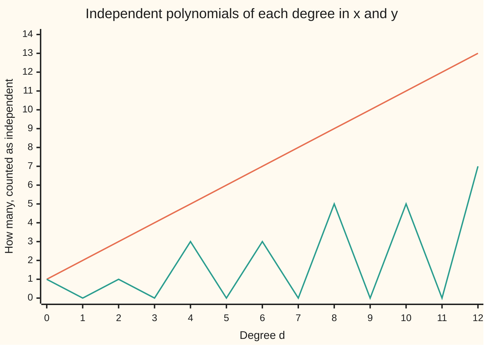

# Invariants of a finite group: the Reynolds average, Hilbert's finiteness, and Molien's count

[Syllabus](../../../SYLLABUS.md) → [Algebraic geometry](../README.md) → [Polynomial Systems](../README.md#s01) → Invariants of a finite group

---

## General Overview

A four-blade fan seen from below looks the same after a quarter turn. In a mirror it does not, because the blades are swept one way. Put the hub at the origin, and a quarter turn sends the point (x, y) to (−y, x). The point (3, 1) goes to (−1, 3), then to (−3, −1), then to (1, −3), and then back to (3, 1).

Suppose a polynomial in x and y describes something about the fan, such as the air pressure near the hub. It must give the same value at all four of those points. A polynomial with that property is an **invariant** of the quarter turn. Three examples:

- $`u = x^2 + y^2`$ is 10 at (3, 1) and 10 at (−1, 3).
- $`v = x^2y^2`$ is 9 at both.
- $`w = x^3y - xy^3`$ is 24 at both. A mirror would flip its sign, so it fits this fan and not a plain square.

This card answers three questions about invariants. How many independent ones are there in each degree? Are finitely many of them enough to build all the rest? And what equations tie those few together? For the fan the answers are 1, 0, 1, 0, 3, 0, 3, 0, 5, … in degrees 0, 1, 2, …; yes, u, v and w build every invariant; and one equation ties them, $`w^2 = v(u^2 - 4v)`$. At (3, 1) that reads 24 × 24 = 576 = 9 × 64.

Three tools do the work. The **Reynolds operator** averages a polynomial over the group and so turns any polynomial into an invariant. Hilbert's argument uses that average and [Hilbert's basis theorem](08-hilbert-basis-theorem.md) to prove that finitely many invariants generate all of them. **Molien's formula** counts the invariants in each degree from the group's matrices alone, before any invariant is found.

**For a finite group of matrices over a field in which division by the group's size is allowed, averaging over the group turns any polynomial into an invariant; this average makes the invariants a finitely generated ring, and Molien's formula counts them degree by degree as an average of one simple fraction per matrix.**

**What kind of fact this is:** three theorems, proved on this card in Why it works: the Reynolds operator's properties, Hilbert's finiteness theorem for finite groups, and Molien's formula. The relation among u, v and w is a computation, found by a Grobner basis and checked by substitution.

### The picture: how few polynomials survive the quarter turn



The upper line counts all polynomials of degree d: there are d + 1 monomials $`x^d, x^{d-1}y, \dots, y^d`$. The lower line counts the invariants of the quarter turn. Odd degrees have none, and even degrees keep about half. Over all degrees together that is about $`1/|G| = 1/4`$ of all polynomials.

---

## The formula

Notation from earlier cards, in one line each:

- $`k`$ is the **field** of coefficients. Here it is $`\mathbb{Q}`$, the fractions, so every step is exact.
- $`k[x, y]`$ is the set of all polynomials in x and y with coefficients in $`k`$ ([Ideals and varieties](01-ideals-and-varieties.md)).
- A **group** is a set of moves that can be combined and undone; $`|G|`$ is how many members it has ([Group actions](../../03-Algebra/08-Groups/08-group-actions-and-counting.md)).

This card introduces the following, in words first.

- A **matrix group** G is a finite set of 2 × 2 matrices closed under multiplication and inverses. Here G is the four powers of $`A = [[0, -1], [1, 0]]`$, the quarter turn.
- A matrix g **acts** on a polynomial by substitution: $`(g \cdot f)(x, y) = f(g(x, y))`$. For the quarter turn, x becomes −y and y becomes x.
- f is **invariant** when $`g \cdot f = f`$ for every g in G. The invariants form a ring, written $`k[x, y]^G`$: sums and products of invariants are invariant.

The Reynolds operator is the average over the group:

```math
R(f) = \frac{1}{|G|} \sum_{g \in G} g \cdot f
```

**Read it aloud:** apply every move of the group to f, add the results, and divide by how many moves there are.

Molien's formula counts the invariants of each degree d. Call that count $`a_d`$ and hang the counts on powers of a placeholder t, as a [Generating functions](../../04-Combinatorics%20and%20graphs/07-Generating%20Functions/01-ordinary-generating-functions.md) card does:

```math
\sum_{d \ge 0} a_d\, t^d = \frac{1}{|G|} \sum_{g \in G} \frac{1}{\det(I - t\, g)}
```

**Read it aloud:** the number of independent invariants of each degree is read off the average, over the group, of one over the determinant of the identity minus t times the matrix.

For the quarter turn the four determinants are $`(1 - t)^2`$, $`1 + t^2`$, $`(1 + t)^2`$ and $`1 + t^2`$. Their average simplifies to

```math
\frac{1}{4}\left(\frac{1}{(1-t)^2} + \frac{2}{1+t^2} + \frac{1}{(1+t)^2}\right) = \frac{1 + t^4}{(1 - t^2)(1 - t^4)} = 1 + t^2 + 3t^4 + 3t^6 + 5t^8 + \cdots
```

The shape of the right side is the answer's structure. $`1/((1 - t^2)(1 - t^4))`$ counts the products $`u^i v^j`$ of a degree-2 and a degree-4 generator that are free of each other. The factor $`1 + t^4`$ says each such product appears once alone and once times w. A $`w^2`$ never needs to appear, because the relation rewrites it.

| Symbol | Plain meaning | In our example | Push it up and the answer… |
| --- | --- | --- | --- |
| $`k`$ | the field of coefficients | $`\mathbb{Q}`$ | — |
| $`G`$, $`\lvert G\rvert`$ | the finite matrix group; how many matrices it holds | the 4 powers of the quarter turn | a bigger group leaves fewer invariants |
| $`A`$, $`g`$, $`h`$ | the quarter-turn matrix; any one member of G; a second member, in Step 0 | $`A = [[0, -1], [1, 0]]`$ | — |
| $`S`$; $`S_n`$, $`n`$ | the mirror swap $`(x, y) \to (y, x)`$; the group of all shuffles of n variables | $`S_2 = \{I, S\}`$; A and S together give 8 matrices | — |
| $`I`$, $`\det(I - t\,g)`$ | the identity matrix, the move that changes nothing; the determinant of I minus t times g | $`[[1, 0], [0, 1]]`$; $`1 + t^2`$ for $`g = A`$ | — |
| $`g \cdot f`$ | f with $`g(x, y)`$ put in for $`(x, y)`$ | $`A \cdot (x^3y) = -xy^3`$ | — |
| $`k[x, y]^G`$; $`u`$, $`v`$, $`w`$ | the ring of invariants; its three generators | everything built from $`x^2 + y^2`$, $`x^2y^2`$, $`x^3y - xy^3`$ | — |
| $`R(f)`$ | the Reynolds operator: the average of f over G | $`R(x^3y) = \tfrac{1}{2}(x^3y - xy^3)`$ | — |
| $`d`$, $`a_d`$, $`t`$ | a degree; the number of independent invariants of that degree; the placeholder whose power records the degree | $`a_4 = 3`$, $`a_8 = 5`$; $`3t^4`$ means 3 invariants of degree 4 | even-degree counts grow like $`d/2`$; averaged over all degrees, like $`d/\lvert G\rvert = d/4`$ |
| $`\lambda_1`$, $`\lambda_2`$ | the eigenvalues of g: in suitable complex coordinates, g multiplies one axis by $`\lambda_1`$ and the other by $`\lambda_2`$ | i and −i for A | — |
| $`J`$; $`f_1, \dots, f_s`$; $`h_i`$ | in Step 2: the ideal generated by all invariants of positive degree; a finite list of invariants generating it; the polynomials that multiply them | $`J = \langle u, v, w \rangle`$, so the list can be u, v, w | — |
| $`\mathrm{NF}_G(f)`$ | the remainder of f on division by a Grobner basis; here the subscript names that basis, not the group | $`\mathrm{NF}(x^4 + y^4) = u^2 - 2v`$ | — |

### When it holds

- **A finite group.** The average needs a finite sum. For the full circle of rotations the average becomes an integral, and the method changes.
- **A field in which the group's size is not 0.** The average divides by $`|G|`$. Over $`\mathbb{F}_2`$, the integers modulo 2, the swap $`(x, y) \to (y, x)`$ has a group of size 2, and 2 is 0 there. Summing without dividing then misses the invariant xy. The ring is still finitely generated there (Noether, 1926), but this card's proof does not show it.
- **Molien counts over a field of characteristic 0.** The proof reads eigenvalues off the matrices, so it works over the complex numbers, where division by $`|G|`$ is allowed. The count it gives holds over $`\mathbb{Q}`$, because each invariant space has a basis with rational coefficients.
- **The group acts by linear substitution.** Molien's formula uses the matrix of each move. A move that is not linear, such as $`(x, y) \to (x, x^2 - y)`$, which undoes itself when done twice, has no matrix and so no determinant of this kind to average.
- **The count is of independent invariants, not of generators.** Molien gives 5 in degree 8. Only three generators exist, and one relation removes $`w^2`$ from the six products of degree 8.

---

## Why it works

### Step 0: averaging forgets where you started

Apply one more move h to an average over the whole group. Each term $`g \cdot f`$ becomes $`(gh) \cdot f`$. As g runs over G, so does gh, so the same terms come out in a different order. The average does not change. That one fact makes every result on this card work.

### Step 1: the Reynolds operator makes invariants, and keeps them

Three properties follow from Step 0.

1. **R(f) is invariant.** Moving the average by h only reorders its terms.
2. **R(f) = f when f is already invariant.** All $`|G|`$ terms equal f, and dividing by $`|G|`$ gives f back.
3. **R(pf) = R(p) f when f is invariant and p is any polynomial.** Each term is $`(g \cdot p)(g \cdot f) = (g \cdot p) f`$, so f comes out of the sum as a common factor.

On the fan, $`x^3y`$ goes to $`-xy^3`$, $`x^3y`$ and $`-xy^3`$ under the three turns. The average of the four is $`\tfrac{1}{2}(x^3y - xy^3) = \tfrac{1}{2}w`$. Odd degrees average to 0, because the half turn sends every odd monomial to minus itself.

Property 2 also gives every invariant as an average: an invariant f is R(f). So the averages of the monomials of degree d span all invariants of that degree. The code uses this as its second road to the count.

### Step 2: finitely many invariants generate all of them

This is Hilbert's argument of 1890, for a finite group over a field where $`|G|`$ is not 0.

1. Let J be the ideal of $`k[x, y]`$ generated by all invariants of positive degree.
2. [Hilbert's basis theorem](08-hilbert-basis-theorem.md) says J has a finite generating list. That list can be chosen from among the invariants that generate J, say $`f_1, \dots, f_s`$, each of a single degree.
3. Take any invariant f whose terms all have one degree $`d > 0`$; every invariant is a sum of such parts (see the fold). It lies in J, so $`f = h_1 f_1 + \dots + h_s f_s`$ for some polynomials $`h_i`$. Keep only the part of each $`h_i`$ of degree d minus the degree of $`f_i`$: the other parts cancel.
4. Apply R. By Step 1, $`f = R(f) = R(h_1) f_1 + \dots + R(h_s) f_s`$. Each $`R(h_i)`$ is an invariant of degree below d, because each $`f_i`$ has positive degree.
5. By induction on the degree, each $`R(h_i)`$ is a polynomial in $`f_1, \dots, f_s`$; in degree 0 the invariants are the constants. So f is one too.

The proof shows that generators exist but does not give them. Emmy Noether added a bound in 1915: over a field of characteristic 0, the averages of the monomials of degree at most $`|G|`$ already generate. For the fan, $`|G| = 4`$, and $`u = 2R(x^2)`$, $`v = R(x^2y^2)`$ and $`w = 2R(x^3y)`$ all have degree at most 4.

<details>
<summary>Why the list in step 2 can be taken from the invariants themselves</summary>

J is generated by the set of all invariants of positive degree. Hilbert's basis theorem gives some finite list $`p_1, \dots, p_r`$ generating J. Each $`p_i`$ is a combination of finitely many invariants from that set. Collect all the invariants used, over all i: a finite list. It generates every $`p_i`$, so it generates J.

Each invariant splits into its parts of each degree, and each part is again invariant, because a linear substitution keeps degrees. So the list can be made of invariants of a single degree each.

</details>

### Step 3: Molien's formula is the trace of an average

Fix a degree d. R maps the degree-d polynomials onto the degree-d invariants, and leaves those invariants alone. A map like that, which leaves everything it produces unchanged, is a **projection**. The trace of a projection (the sum of its diagonal entries) equals the dimension of what it projects onto. So

```math
a_d = \mathrm{trace}\, R = \frac{1}{|G|}\sum_{g \in G} \mathrm{trace}\,(g \text{ on degree-}d\text{ polynomials})
```

The code computes this average of traces directly, as its third road.

Now sum over d. A matrix of finite order can be diagonalised over the complex numbers, with eigenvalues $`\lambda_1, \lambda_2`$. In those coordinates g multiplies the monomial $`x^a y^b`$ by $`\lambda_1^a \lambda_2^b`$. Summing over all monomials of all degrees gives a product of two geometric series:

```math
\sum_{a, b \ge 0} \lambda_1^a \lambda_2^b\, t^{a+b} = \frac{1}{(1 - \lambda_1 t)(1 - \lambda_2 t)} = \frac{1}{\det(I - t\,g)}
```

Average over g, and the left side becomes $`\sum_d a_d t^d`$. That is Molien's formula, published in 1897.

For the quarter turn the eigenvalues are i and −i, the square roots of −1. Then $`(1 - it)(1 + it) = 1 + t^2`$: the complex numbers cancel, as they must.

<details>
<summary>The algebra from the four fractions to the closed form</summary>

The identity and the half turn give

$`\displaystyle \frac{1}{(1-t)^2} + \frac{1}{(1+t)^2} = \frac{(1+t)^2 + (1-t)^2}{(1-t^2)^2} = \frac{2(1 + t^2)}{(1 - t^2)^2}.`$

The two quarter turns give $`2/(1 + t^2)`$. Put everything over $`(1 - t^2)^2 (1 + t^2)`$:

$`\displaystyle \frac{1}{4}\cdot\frac{2(1+t^2)^2 + 2(1-t^2)^2}{(1-t^2)^2(1+t^2)} = \frac{1 + t^4}{(1 - t^2)^2(1 + t^2)} = \frac{1 + t^4}{(1 - t^2)(1 - t^4)},`$

since $`(1 + t^2)^2 + (1 - t^2)^2 = 2 + 2t^4`$ and $`(1 - t^2)(1 + t^2) = 1 - t^4`$.

</details>

### Step 4: find the relation with a Grobner basis

Molien says degree 8 holds 5 independent invariants. The six products $`u^4, u^2v, u^2w, v^2, vw, w^2`$ all have degree 8, so one combination of them must be 0. Elimination finds it ([Elimination](05-elimination-and-implicitisation.md)).

1. Add three new variables and three equations: $`u - (x^2 + y^2)`$, $`v - x^2y^2`$ and $`w - (x^3y - xy^3)`$.
2. Compute a Grobner basis in lex order with $`x > y > u > v > w`$, the variables to remove ranked highest ([Grobner bases](03-grobner-bases-and-buchberger.md)).
3. Keep the members free of x and y.

The run gives 8 basis polynomials, and exactly one is free of x and y:

```math
u^2 v - 4v^2 - w^2 = 0, \qquad\text{that is,}\qquad w^2 = v\,(u^2 - 4v)
```

By the elimination theorem, this one polynomial generates every relation among u, v and w. A direct check confirms it: $`w^2 = x^2y^2(x^2 - y^2)^2`$ and $`(x^2 + y^2)^2 - 4x^2y^2 = (x^2 - y^2)^2`$.

The same basis also tests whether a polynomial is invariant. Divide f by the basis. If f is invariant, the remainder $`\mathrm{NF}_G(f)`$ contains only u, v and w, and it writes f in the generators. For $`x^4 + y^4`$ the remainder is $`u^2 - 2v`$. For $`x^2`$ it is $`u - y^2`$, which still contains y, so $`x^2`$ is not invariant.

### Step 5: count to confirm the generators

The products $`u^i v^j`$ and $`u^i v^j w`$ (no $`w^2`$ or higher) of each degree are counted by $`(1 + t^4)/((1 - t^2)(1 - t^4))`$. The code builds them in every degree up to 12, checks that they are independent, and checks that they span the same space as the averages of the monomials. Together that proves, up to degree 12, that u, v and w generate and that the one relation is the only one needed.

The symmetric group $`S_n`$, which shuffles n variables, is a famous case. Its invariants are the symmetric polynomials, and its Molien series is $`1/((1 - t)(1 - t^2)\cdots(1 - t^n))`$: n generators and no relation. The die on [Hilbert's basis theorem](08-hilbert-basis-theorem.md) uses those generators.

---

## Worked numbers, by hand

Field $`\mathbb{Q}`$; group of the quarter turn; lex order $`x > y > u > v > w`$.

| Step | Arithmetic | Value |
| --- | --- | --- |
| the group | $`A, A^2 = -I, A^3, A^4 = I`$ | 4 matrices |
| the four determinants | $`\det(I - t\,g)`$ for $`I, A, -I, A^3`$ | $`(1 - t)^2`$, $`1 + t^2`$, $`(1 + t)^2`$, $`1 + t^2`$ |
| Molien's average | the closed form in the fold above | $`(1 + t^4)/((1 - t^2)(1 - t^4))`$ |
| its first terms | expand | 1, 0, 1, 0, 3, 0, 3, 0, 5 |
| average of $`x^2`$ | $`(x^2 + y^2 + x^2 + y^2)/4`$ | $`\tfrac{1}{2}u`$ |
| average of $`x^3y`$ | $`(x^3y - xy^3 + x^3y - xy^3)/4`$ | $`\tfrac{1}{2}w`$ |
| degree 4 | $`u^2, v, w`$ | **3** |
| degree 8 | 6 products, less 1 relation | **5** |
| the relation at (3, 1) | $`w^2 = 24^2`$ against $`v(u^2 - 4v) = 9 \times (100 - 36)`$ | 576 = 576 |

Every polynomial unchanged by the quarter turn is a polynomial in $`x^2 + y^2`$, $`x^2y^2`$ and $`x^3y - xy^3`$. Those three satisfy exactly one equation, $`w^2 = v(u^2 - 4v)`$. So a fan model of degree 4 has 3 free coefficients in its top degree, not 5.

### What breaks if you drop a piece

| Mistake | Comes out at | What went wrong |
| --- | --- | --- |
| Keep only the identity's term in Molien | 5 in degree 4, not 3 | that counts every polynomial; the other three moves remove what they change |
| Treat u, v, w as free of each other | 6 in degree 8, not 5 | the relation $`w^2 = u^2v - 4v^2`$ makes one product redundant |
| Average only monomials of degree up to 2 | 1 product in degree 4, not 3 | Noether's bound is $`\lvert G\rvert = 4`$; v and w first appear in degree 4 |
| Sum over the swap group over $`\mathbb{F}_2`$ | $`x^2 + y^2`$, 0, $`x^2 + y^2`$ from $`x^2, xy, y^2`$ | 2 is 0 there, so no average exists, and the invariant xy is never reached |

The code prints all four rows.

---

## Code, from first principles, and it actually runs

The code writes its own exact polynomial arithmetic, substitution, Gaussian elimination, power series and Buchberger's algorithm. Nothing imported knows the answer. It reaches the count of invariants in each degree up to 12 by four independent roads:

1. Molien's average of $`1/\det(I - t\,g)`$, checked against the closed form.
2. The rank of the Reynolds averages of all monomials of that degree.
3. The average trace of the group's matrices on polynomials of that degree.
4. The products $`u^i v^j w^k`$ with k = 0 or 1, shown independent and spanning.

A Grobner basis then finds the relation, and substitution confirms it in x and y and at the point (3, 1). Adding the mirror gives a group of 8, and the two roads still agree there.

### Python

```python
# Invariants of a finite group -- the check behind the card.  Only exact fractions
# are imported.  The group: the powers of the quarter turn A(x, y) = (-y, x), four
# matrices.  Field: the rationals.  Four roads to the number of invariants of each
# degree d: Molien's average of 1/det(I - tg); the rank of the Reynolds averages
# of the degree-d monomials; the average trace of g on degree-d polynomials; and the
# products u^i v^j w^k (k = 0 or 1) of the three generators.  Then a Grobner basis,
# lex x > y > u > v > w, finds the one relation among u, v, w.
from fractions import Fraction as Q
TOP, NAMES = 12, "xyuvw"
A, S, I2 = ((0, -1), (1, 0)), ((0, 1), (1, 0)), ((1, 0), (0, 1))   # turn, mirror swap, identity

def matmul(a, b): return tuple(tuple(sum(a[i][k] * b[k][j] for k in range(2)) for j in range(2)) for i in range(2))
def closure(gens):                            # every product of the generators
    G = [I2]
    while (new := [m for g in G for h in gens if (m := matmul(g, h)) not in G]): G += list(dict.fromkeys(new))
    return G
def add(p, q, c=1):                           # p + c * q
    out = dict(p)
    for m, a in q.items():
        out[m] = out.get(m, 0) + c * a
        if out[m] == 0: del out[m]
    return out
def mul(p, q):
    out = {}
    for m, a in p.items(): out = add(out, {tuple(i + j for i, j in zip(m, e)): a * b for e, b in q.items()})
    return out
def pw(p, k):
    out = {(0,) * len(next(iter(p))): Q(1)}
    for _ in range(k): out = mul(out, p)
    return out
def act(f, g):                                # f(g(x, y)): x -> g00 x + g01 y, y -> g10 x + g11 y
    X, Y = ({m: Q(c) for m, c in (((1, 0), r[0]), ((0, 1), r[1])) if c} for r in g)
    out = {}
    for (a, b), c in f.items(): out = add(out, mul(pw(X, a), pw(Y, b)), c)
    return out
def reynolds(f, G):                           # the average of f over the group
    out = {}
    for g in G: out = add(out, act(f, g), Q(1, len(G)))
    return out
def rank(polys):                              # Gaussian elimination over Q
    rows, r = [dict(p) for p in polys if p], 0
    while rows:
        p = rows.pop(); m = max(p); r += 1
        rows = [q for q in (add(q, p, -q[m] / p[m]) if m in q else q for q in rows) if q]
    return r
def series(num, den):                         # power series of num / den up to t^TOP, den[0] = 1
    c = []
    for n in range(TOP + 1): c.append(Q(num[n] if n < len(num) else 0) - sum(den[k] * c[n - k] for k in range(1, min(n, len(den) - 1) + 1)))
    return c
def molien(G):
    terms = [series([1], [1, -(g[0][0] + g[1][1]), g[0][0] * g[1][1] - g[0][1] * g[1][0]]) for g in G]
    return [sum(t[n] for t in terms) / len(G) for n in range(TOP + 1)]
def monos(d): return [(a, d - a) for a in range(d, -1, -1)]
def show(p):
    out = ""
    for m in sorted(p, reverse=True):
        c, body = p[m], "*".join(NAMES[i] + (f"^{k}" if k > 1 else "") for i, k in enumerate(m) if k)
        txt = (body if abs(c) == 1 else f"{abs(c)}*{body}") if body else f"{abs(c)}"
        out += ("-" if c < 0 else "") + txt if not out else (" - " if c < 0 else " + ") + txt
    return out
def ints(c): return "[" + ", ".join(str(x) for x in c) + "]"

G, D4 = closure([A]), closure([A, S])
x, y = {(1, 0): Q(1)}, {(0, 1): Q(1)}
u, v = add(pw(x, 2), pw(y, 2)), mul(pw(x, 2), pw(y, 2))
w = add(mul(pw(x, 3), y), mul(x, pw(y, 3)), -1)
mol = molien(G)
closed = series([1, 0, 0, 0, 1], [1, 0, -1, 0, -1, 0, 1])     # (1 + t^4) / ((1 - t^2)(1 - t^4))
rey = [rank([reynolds({m: Q(1)}, G) for m in monos(d)]) for d in range(TOP + 1)]
trace = [sum(sum(act({m: Q(1)}, g).get(m, 0) for m in monos(d)) for g in G) / len(G) for d in range(TOP + 1)]
prods, span = [], []
for d in range(TOP + 1):
    P = [mul(mul(pw(u, i), pw(v, j)), pw(w, k)) for k in (0, 1) for j in range(TOP) for i in range(TOP) if 2 * i + 4 * j + 4 * k == d]
    prods.append(len(P)); span.append((rank(P), rank(P + [reynolds({m: Q(1)}, G) for m in monos(d)])))
print(f"field Q; group of the quarter turn (x, y) -> (-y, x): {len(G)} matrices " + " ".join(f"[{g[0][0]} {g[0][1]}; {g[1][0]} {g[1][1]}]" for g in G))
print("det(I - tg) for each: " + ", ".join(show({k: c for k, c in (((0,), 1), ((1,), -g[0][0] - g[1][1]), ((2,), g[0][0] * g[1][1] - g[0][1] * g[1][0])) if c}).replace("x", "t") for g in G))
print(f"degree d                            {ints(range(TOP + 1))}")
print(f"all polynomials of degree d         {ints(d + 1 for d in range(TOP + 1))}")
print(f"Molien, average of 1/det(I - tg)    {ints(mol)}")
print(f"(1 + t^4)/((1 - t^2)(1 - t^4))      {ints(closed)}")
print(f"rank of Reynolds images             {ints(rey)}")
print(f"average trace of g on degree d      {ints(trace)}")
print(f"products u^i v^j w^k, k <= 1        {ints(prods)}; independent and spanning: {'yes' if all(a == b == c for (a, b), c in zip(span, prods)) else 'no'}")
for m in [(1, 0), (2, 0), (1, 1), (4, 0), (3, 1), (2, 2)]: print(f"R({show({m: 1})}) = {show(reynolds({m: Q(1)}, G)) or 0}")
print(f"u = {show(u)}, v = {show(v)}, w = {show(w)}; each fixed by A: {'yes' if all(act(p, A) == p for p in (u, v, w)) else 'no'}")
lift = lambda p: {m + (0, 0, 0): c for m, c in p.items()}       # into Q[x, y, u, v, w]
var = lambda i: {tuple(int(j == i) for j in range(5)): Q(1)}
F = [add(var(2), lift(u), -1), add(var(3), lift(v), -1), add(var(4), lift(w), -1)]
def divides(a, b): return all(i <= j for i, j in zip(a, b))
def nf(p, B):                                 # remainder of p on division by the list B
    p, r = dict(p), {}
    while p:
        m = max(p); g = next((g for g in B if divides(max(g), m)), None)
        if g is None: r[m] = p.pop(m); continue
        p = add(p, mul({tuple(i - j for i, j in zip(m, max(g))): p[m] / g[max(g)]}, g), -1)
    return r
def spoly(f, g):
    a, b = max(f), max(g); l = tuple(map(max, a, b))
    return add(mul({tuple(i - j for i, j in zip(l, a)): 1 / f[a]}, f), mul({tuple(i - j for i, j in zip(l, b)): 1 / g[b]}, g), -1)
def buchberger(B):
    B, pairs = list(B), [(i, j) for j in range(len(B)) for i in range(j)]
    while pairs:
        i, j = pairs.pop(0)
        if (r := nf(spoly(B[i], B[j]), B)): pairs += [(k, len(B)) for k in range(len(B))]; B.append(r)
    keep = []
    for g in sorted(B, key=max):
        if not any(divides(max(h), max(g)) for h in keep): keep.append(g)
    red = [nf(g, [h for h in keep if h is not g]) for g in keep]
    return sorted(({m: c / r[max(r)] for m, c in r.items()} for r in red), key=max, reverse=True)
GB = buchberger(F)
elim = [g for g in GB if all(m[0] == m[1] == 0 for m in g)]
print(f"Grobner basis of <u - (x^2 + y^2), v - x^2y^2, w - (x^3y - xy^3)>, lex x > y > u > v > w: {len(GB)} polynomials")
print(f"free of x and y: {len(elim)}: {show(elim[0])} = 0")
rel = add(add(mul(pw(u, 2), v), pw(v, 2), -4), pw(w, 2), -1)      # u^2 v - 4 v^2 - w^2, put back in x, y
print(f"u^2*v - 4*v^2 - w^2 with u, v, w written in x and y: {show(rel) or 0}")
f4, f2 = lift(add(pw(x, 4), pw(y, 4))), lift(pw(x, 2))
print(f"normal form of x^4 + y^4: {show(nf(f4, GB))}; of x^2 (not invariant): {show(nf(f2, GB))}")
ev = lambda p, a, b: sum(c * Q(a) ** m[0] * Q(b) ** m[1] for m, c in p.items())
pts = [(g[0][0] * 3 + g[0][1], g[1][0] * 3 + g[1][1]) for g in G]   # the orbit of (3, 1)
print("at " + " and ".join(f"({a}, {b}): u, v, w = {ev(u, a, b)}, {ev(v, a, b)}, {ev(w, a, b)}" for a, b in pts)
      + f"; w^2 = {ev(w, 3, 1) ** 2}, v(u^2 - 4v) = {ev(v, 3, 1)} * {ev(u, 3, 1) ** 2 - 4 * ev(v, 3, 1)} = {ev(v, 3, 1) * (ev(u, 3, 1) ** 2 - 4 * ev(v, 3, 1))}")
mD4 = molien(D4); rD4 = [rank([reynolds({m: Q(1)}, D4) for m in monos(d)]) for d in range(TOP + 1)]
print(f"with the mirror (x, y) -> (y, x) added: {len(D4)} matrices; Molien {ints(mD4)}; Reynolds ranks agree: {'yes' if mD4 == rD4 else 'no'}; R(w) = {show(reynolds(w, D4)) or 0}")
free = series([1], [1, 0, -1, 0, -2, 0, 2, 0, 1, 0, -1])           # 1/((1 - t^2)(1 - t^4)^2): u, v, w taken as free
only = series([1], [1, -2, 1])                                     # 1/(1 - t)^2: the identity's term alone
print(f"mistake 1, identity term only: 1/(1 - t)^2 gives {ints(only[:6])} for d = 0..5, so {only[4]} at degree 4, not {mol[4]}")
print(f"mistake 2, u, v, w taken as free: 1/((1 - t^2)(1 - t^4)^2) gives {free[8]} at degree 8, not {mol[8]}; the extra one is w^2 = u^2*v - 4*v^2")
low = [r for d in (1, 2) for m in monos(d) if (r := reynolds({m: Q(1)}, G))]   # averages of degree <= 2 only
low4 = rank([mul(a, b) for a in low for b in low])
print(f"mistake 3, generators of degree <= 2 only: {rank(low)} independent one (u), and degree 4 holds {low4} product, not {mol[4]}")
tr2 = [{m: c % 2 for m, c in add({m: Q(1)}, act({m: Q(1)}, S)).items() if c % 2} for m in monos(2)]   # f + S(f), mod 2
print(f"mistake 4, field F_2, swap group {{I, S}}: f + S(f) for f = x^2, xy, y^2 gives {', '.join(show(t) or '0' for t in tr2)}; the invariant xy is never reached")
assert mol == closed == rey == trace and mol[:9] == [1, 0, 1, 0, 3, 0, 3, 0, 5]   # four roads to one count
assert prods == mol and all(a == b == c for (a, b), c in zip(span, prods))         # generators span, w^2 aside
assert len(elim) == 1 and elim[0] == {(0, 0, 2, 1, 0): 1, (0, 0, 0, 2, 0): -4, (0, 0, 0, 0, 2): -1} and rel == {}
assert nf(f4, GB) == {(0, 0, 2, 0, 0): 1, (0, 0, 0, 1, 0): -2} and any(m[0] + m[1] for m in nf(f2, GB))
assert ev(w, 3, 1) ** 2 == 576 == ev(v, 3, 1) * (ev(u, 3, 1) ** 2 - 4 * ev(v, 3, 1)) and len(G) == 4
assert len(pts) == 4 and len({(ev(u, a, b), ev(v, a, b), ev(w, a, b)) for a, b in pts}) == 1   # same values round the orbit
assert mD4 == rD4 and mD4[4] == 2 and reynolds(w, D4) == {} and free[8] == 6 == only[4] + 1 and low4 == 1 and tr2 == [u, {}, u]
print("ALL CHECKS PASS")
```

**Ran 2026-11-24 on macOS, Python 3.14.10, standard library only. All checks passed. Output, pasted from the run:**

```
field Q; group of the quarter turn (x, y) -> (-y, x): 4 matrices [1 0; 0 1] [0 -1; 1 0] [-1 0; 0 -1] [0 1; -1 0]
det(I - tg) for each: t^2 - 2*t + 1, t^2 + 1, t^2 + 2*t + 1, t^2 + 1
degree d                            [0, 1, 2, 3, 4, 5, 6, 7, 8, 9, 10, 11, 12]
all polynomials of degree d         [1, 2, 3, 4, 5, 6, 7, 8, 9, 10, 11, 12, 13]
Molien, average of 1/det(I - tg)    [1, 0, 1, 0, 3, 0, 3, 0, 5, 0, 5, 0, 7]
(1 + t^4)/((1 - t^2)(1 - t^4))      [1, 0, 1, 0, 3, 0, 3, 0, 5, 0, 5, 0, 7]
rank of Reynolds images             [1, 0, 1, 0, 3, 0, 3, 0, 5, 0, 5, 0, 7]
average trace of g on degree d      [1, 0, 1, 0, 3, 0, 3, 0, 5, 0, 5, 0, 7]
products u^i v^j w^k, k <= 1        [1, 0, 1, 0, 3, 0, 3, 0, 5, 0, 5, 0, 7]; independent and spanning: yes
R(x) = 0
R(x^2) = 1/2*x^2 + 1/2*y^2
R(x*y) = 0
R(x^4) = 1/2*x^4 + 1/2*y^4
R(x^3*y) = 1/2*x^3*y - 1/2*x*y^3
R(x^2*y^2) = x^2*y^2
u = x^2 + y^2, v = x^2*y^2, w = x^3*y - x*y^3; each fixed by A: yes
Grobner basis of <u - (x^2 + y^2), v - x^2y^2, w - (x^3y - xy^3)>, lex x > y > u > v > w: 8 polynomials
free of x and y: 1: u^2*v - 4*v^2 - w^2 = 0
u^2*v - 4*v^2 - w^2 with u, v, w written in x and y: 0
normal form of x^4 + y^4: u^2 - 2*v; of x^2 (not invariant): -y^2 + u
at (3, 1): u, v, w = 10, 9, 24 and (-1, 3): u, v, w = 10, 9, 24 and (-3, -1): u, v, w = 10, 9, 24 and (1, -3): u, v, w = 10, 9, 24; w^2 = 576, v(u^2 - 4v) = 9 * 64 = 576
with the mirror (x, y) -> (y, x) added: 8 matrices; Molien [1, 0, 1, 0, 2, 0, 2, 0, 3, 0, 3, 0, 4]; Reynolds ranks agree: yes; R(w) = 0
mistake 1, identity term only: 1/(1 - t)^2 gives [1, 2, 3, 4, 5, 6] for d = 0..5, so 5 at degree 4, not 3
mistake 2, u, v, w taken as free: 1/((1 - t^2)(1 - t^4)^2) gives 6 at degree 8, not 5; the extra one is w^2 = u^2*v - 4*v^2
mistake 3, generators of degree <= 2 only: 1 independent one (u), and degree 4 holds 1 product, not 3
mistake 4, field F_2, swap group {I, S}: f + S(f) for f = x^2, xy, y^2 gives x^2 + y^2, 0, x^2 + y^2; the invariant xy is never reached
ALL CHECKS PASS
```

### Rust

Same numbers, same labels, built with `rustc --edition 2021 -O`.

```rust
// Invariants of a finite group -- the same check as the Python, in Rust.  No crates.
// The group: the powers of the quarter turn A(x, y) = (-y, x), four matrices.  Field:
// the rationals, as an i128 fraction whose checked arithmetic stops the run on overflow.
// Four roads to the number of invariants of each degree d: Molien's average of
// 1/det(I - tg); the rank of the Reynolds averages of the degree-d monomials; the
// average trace of g on degree-d polynomials; and the products u^i v^j w^k (k = 0 or 1)
// of the three generators.  Then a Grobner basis, lex x > y > u > v > w (a BTreeMap of
// exponent vectors sorts in lex), finds the one relation among u, v, w.
use std::collections::BTreeMap;
#[derive(Clone, Copy, PartialEq, Debug)] struct Q { n: i128, d: i128 }
fn gcd(a: i128, b: i128) -> i128 { if b == 0 { a.abs() } else { gcd(b, a % b) } }
fn q(n: i128, d: i128) -> Q { let g = gcd(n, d).max(1) * d.signum(); Q { n: n / g, d: d / g } }
fn mulq(a: Q, b: Q) -> Q { q(a.n.checked_mul(b.n).unwrap(), a.d.checked_mul(b.d).unwrap()) }
fn addq(a: Q, b: Q) -> Q { q(a.n.checked_mul(b.d).unwrap().checked_add(b.n.checked_mul(a.d).unwrap()).unwrap(), a.d.checked_mul(b.d).unwrap()) }
fn divq(a: Q, b: Q) -> Q { mulq(a, q(b.d, b.n)) }
fn int(n: i128) -> Q { Q { n, d: 1 } }
fn qs(a: Q) -> String { if a.d == 1 { a.n.to_string() } else { format!("{}/{}", a.n, a.d) } }
type M = Vec<u32>; type P = BTreeMap<M, Q>; type Mat = [[i128; 2]; 2];
const TOP: usize = 12; const NAMES: [char; 5] = ['x', 'y', 'u', 'v', 'w'];
const A: Mat = [[0, -1], [1, 0]]; const S: Mat = [[0, 1], [1, 0]]; const I2: Mat = [[1, 0], [0, 1]];
fn matmul(a: &Mat, b: &Mat) -> Mat { let mut c = [[0; 2]; 2]; for i in 0..2 { for j in 0..2 { c[i][j] = a[i][0] * b[0][j] + a[i][1] * b[1][j] } } c }
fn closure(gens: &[Mat]) -> Vec<Mat> {                // every product of the generators
    let (mut g, mut new) = (vec![I2], vec![I2]);
    while !new.is_empty() { new = Vec::new(); for a in &g { for h in gens { let m = matmul(a, h); if !g.contains(&m) && !new.contains(&m) { new.push(m) } } } g.extend(new.clone()); }
    g
}
fn add(p: &P, r: &P, c: Q) -> P {                     // p + c * r
    let mut out = p.clone();
    for (m, &a) in r { let v = addq(*out.get(m).unwrap_or(&int(0)), mulq(c, a)); if v.n == 0 { out.remove(m); } else { out.insert(m.clone(), v); } }
    out
}
fn mul(p: &P, r: &P) -> P {
    let mut out = P::new();
    for (m, &a) in p { let t: P = r.iter().map(|(e, &b)| (m.iter().zip(e).map(|(i, j)| i + j).collect(), mulq(a, b))).collect(); out = add(&out, &t, int(1)); }
    out
}
fn mono(m: M, c: Q) -> P { [(m, c)].into_iter().collect() }
fn pw(p: &P, k: u32) -> P { let n = p.keys().next().unwrap().len(); (0..k).fold(mono(vec![0; n], int(1)), |o, _| mul(&o, p)) }
fn act(f: &P, g: &Mat) -> P {                         // f(g(x, y)): x -> g00 x + g01 y, y -> g10 x + g11 y
    let lin = |r: [i128; 2]| -> P { [(vec![1, 0], r[0]), (vec![0, 1], r[1])].into_iter().filter(|t| t.1 != 0).map(|(m, c)| (m, int(c))).collect() };
    let (x, y) = (lin(g[0]), lin(g[1]));
    f.iter().fold(P::new(), |o, (m, &c)| add(&o, &mul(&pw(&x, m[0]), &pw(&y, m[1])), c))
}
fn reynolds(f: &P, g: &[Mat]) -> P { g.iter().fold(P::new(), |o, h| add(&o, &act(f, h), q(1, g.len() as i128))) }
fn rank(polys: &[P]) -> usize {                        // Gaussian elimination over Q
    let (mut rows, mut r): (Vec<P>, usize) = (polys.iter().filter(|p| !p.is_empty()).cloned().collect(), 0);
    while let Some(p) = rows.pop() {
        let m = lead(&p); r += 1;
        rows = rows.into_iter().map(|t| if let Some(&c) = t.get(&m) { add(&t, &p, divq(int(-1), divq(p[&m], c))) } else { t }).filter(|t| !t.is_empty()).collect();
    }
    r
}
fn series(num: &[i128], den: &[i128]) -> Vec<Q> {     // power series of num / den up to t^TOP, den[0] = 1
    let mut c: Vec<Q> = Vec::new();
    for n in 0..=TOP { let mut v = int(*num.get(n).unwrap_or(&0)); for k in 1..=n.min(den.len() - 1) { v = addq(v, mulq(int(-den[k]), c[n - k])) } c.push(v) }
    c
}
fn molien(g: &[Mat]) -> Vec<Q> {
    let t: Vec<Vec<Q>> = g.iter().map(|h| series(&[1], &[1, -(h[0][0] + h[1][1]), h[0][0] * h[1][1] - h[0][1] * h[1][0]])).collect();
    (0..=TOP).map(|n| divq(t.iter().fold(int(0), |o, s| addq(o, s[n])), int(g.len() as i128))).collect()
}
fn monos(d: u32) -> Vec<M> { (0..=d).rev().map(|a| vec![a, d - a]).collect() }
fn show(p: &P) -> String {
    let mut out = String::new(); for (m, &c) in p.iter().rev() {
        let body: Vec<String> = m.iter().enumerate().filter(|t| *t.1 > 0).map(|(i, &k)| if k > 1 { format!("{}^{}", NAMES[i], k) } else { NAMES[i].to_string() }).collect();
        let a = Q { n: c.n.abs(), d: c.d };
        let txt = if body.is_empty() { qs(a) } else if a == int(1) { body.join("*") } else { format!("{}*{}", qs(a), body.join("*")) };
        out += &format!("{}{}", if out.is_empty() { if c.n < 0 { "-" } else { "" } } else if c.n < 0 { " - " } else { " + " }, txt);
    } out
}
fn or0(s: String) -> String { if s.is_empty() { "0".to_string() } else { s } }
fn ints(c: &[Q]) -> String { format!("[{}]", c.iter().map(|&a| qs(a)).collect::<Vec<_>>().join(", ")) }
fn yn(b: bool) -> &'static str { if b { "yes" } else { "no" } }
fn lead(p: &P) -> M { p.keys().next_back().unwrap().clone() }
fn divides(a: &M, b: &M) -> bool { a.iter().zip(b).all(|(i, j)| i <= j) }
fn diff(a: &M, b: &M) -> M { a.iter().zip(b).map(|(i, j)| i - j).collect() }
fn nf(p: &P, b: &[P]) -> P {                          // remainder of p on division by the list b
    let (mut p, mut r) = (p.clone(), P::new());
    while !p.is_empty() {
        let m = lead(&p);
        match b.iter().find(|g| divides(&lead(g), &m)) {
            None => { let c = p.remove(&m).unwrap(); r.insert(m, c); }
            Some(g) => { let lg = lead(g); p = add(&p, &mul(&mono(diff(&m, &lg), divq(p[&m], g[&lg])), g), int(-1)); }
        }
    }
    r
}
fn spoly(f: &P, g: &P) -> P {
    let (a, b) = (lead(f), lead(g)); let l: M = a.iter().zip(&b).map(|(&i, &j)| i.max(j)).collect();
    add(&mul(&mono(diff(&l, &a), divq(int(1), f[&a])), f), &mul(&mono(diff(&l, &b), divq(int(1), g[&b])), g), int(-1))
}
fn buchberger(f: &[P]) -> Vec<P> {
    let mut b = f.to_vec(); let mut pairs: Vec<(usize, usize)> = (0..b.len()).flat_map(|j| (0..j).map(move |i| (i, j))).collect();
    while !pairs.is_empty() {
        let (i, j) = pairs.remove(0); let r = nf(&spoly(&b[i], &b[j]), &b);
        if !r.is_empty() { pairs.extend((0..b.len()).map(|k| (k, b.len()))); b.push(r); }
    }
    b.sort_by(|x, y| lead(x).cmp(&lead(y)));
    let mut keep: Vec<P> = Vec::new(); for g in b { if !keep.iter().any(|h| divides(&lead(h), &lead(&g))) { keep.push(g) } }
    let mut red: Vec<P> = (0..keep.len()).map(|i| { let r = nf(&keep[i], &[&keep[..i], &keep[i + 1..]].concat()); let c = r[&lead(&r)]; r.iter().map(|(k, &v)| (k.clone(), divq(v, c))).collect() }).collect();
    red.sort_by(|x, y| lead(y).cmp(&lead(x))); red
}
fn ev(p: &P, a: i128, b: i128) -> Q { p.iter().fold(int(0), |o, (m, &c)| addq(o, mulq(c, int(a.pow(m[0]) * b.pow(m[1]))))) }
fn main() {
    let (g, d4) = (closure(&[A]), closure(&[A, S]));
    let (x, y) = (mono(vec![1, 0], int(1)), mono(vec![0, 1], int(1)));
    let (u, v) = (add(&pw(&x, 2), &pw(&y, 2), int(1)), mul(&pw(&x, 2), &pw(&y, 2)));
    let w = add(&mul(&pw(&x, 3), &y), &mul(&x, &pw(&y, 3)), int(-1));
    let one = |m: &M| mono(m.clone(), int(1));
    let mol = molien(&g);
    let closed = series(&[1, 0, 0, 0, 1], &[1, 0, -1, 0, -1, 0, 1]);     // (1 + t^4) / ((1 - t^2)(1 - t^4))
    let rey: Vec<Q> = (0..=TOP as u32).map(|d| int(rank(&monos(d).iter().map(|m| reynolds(&one(m), &g)).collect::<Vec<_>>()) as i128)).collect();
    let trace: Vec<Q> = (0..=TOP as u32).map(|d| divq(g.iter().fold(int(0), |o, h| monos(d).iter().fold(o, |o, m| addq(o, *act(&one(m), h).get(m).unwrap_or(&int(0))))), int(g.len() as i128))).collect();
    let (mut prods, mut span) = (Vec::new(), Vec::new());
    for d in 0..=TOP {
        let mut pp: Vec<P> = Vec::new();
        for k in 0..2u32 { for j in 0..TOP as u32 { for i in 0..TOP as u32 { if 2 * i + 4 * j + 4 * k == d as u32 { pp.push(mul(&mul(&pw(&u, i), &pw(&v, j)), &pw(&w, k))) } } } }
        let mut both = pp.clone(); both.extend(monos(d as u32).iter().map(|m| reynolds(&one(m), &g)));
        prods.push(int(pp.len() as i128)); span.push((rank(&pp), rank(&both)));
    }
    let gs: Vec<String> = g.iter().map(|h| format!("[{} {}; {} {}]", h[0][0], h[0][1], h[1][0], h[1][1])).collect();
    println!("field Q; group of the quarter turn (x, y) -> (-y, x): {} matrices {}", g.len(), gs.join(" "));
    let dets: Vec<String> = g.iter().map(|h| show(&[(vec![0], 1), (vec![1], -h[0][0] - h[1][1]), (vec![2], h[0][0] * h[1][1] - h[0][1] * h[1][0])].into_iter().filter(|t| t.1 != 0).map(|(m, c)| (m, int(c))).collect()).replace('x', "t")).collect();
    println!("det(I - tg) for each: {}", dets.join(", "));
    println!("degree d                            {}", ints(&(0..=TOP as i128).map(int).collect::<Vec<_>>()));
    println!("all polynomials of degree d         {}", ints(&(1..=TOP as i128 + 1).map(int).collect::<Vec<_>>()));
    println!("Molien, average of 1/det(I - tg)    {}", ints(&mol));
    println!("(1 + t^4)/((1 - t^2)(1 - t^4))      {}", ints(&closed));
    println!("rank of Reynolds images             {}", ints(&rey));
    println!("average trace of g on degree d      {}", ints(&trace));
    let ok_span = span.iter().zip(&prods).all(|(&(a, b), c)| a == b && int(a as i128) == *c);
    println!("products u^i v^j w^k, k <= 1        {}; independent and spanning: {}", ints(&prods), yn(ok_span));
    for m in [vec![1, 0], vec![2, 0], vec![1, 1], vec![4, 0], vec![3, 1], vec![2, 2]] { println!("R({}) = {}", show(&one(&m)), or0(show(&reynolds(&one(&m), &g)))) }
    println!("u = {}, v = {}, w = {}; each fixed by A: {}", show(&u), show(&v), show(&w), yn([&u, &v, &w].iter().all(|p| act(p, &A) == **p)));
    let lift = |p: &P| -> P { p.iter().map(|(m, &c)| ([m.clone(), vec![0, 0, 0]].concat(), c)).collect() };   // into Q[x, y, u, v, w]
    let var = |i: usize| mono((0..5).map(|j| (j == i) as u32).collect(), int(1));
    let gb = buchberger(&[add(&var(2), &lift(&u), int(-1)), add(&var(3), &lift(&v), int(-1)), add(&var(4), &lift(&w), int(-1))]);
    let elim: Vec<&P> = gb.iter().filter(|p| p.keys().all(|m| m[0] == 0 && m[1] == 0)).collect();
    println!("Grobner basis of <u - (x^2 + y^2), v - x^2y^2, w - (x^3y - xy^3)>, lex x > y > u > v > w: {} polynomials", gb.len());
    println!("free of x and y: {}: {} = 0", elim.len(), show(elim[0]));
    let rel = add(&add(&mul(&pw(&u, 2), &v), &pw(&v, 2), int(-4)), &pw(&w, 2), int(-1));   // u^2 v - 4 v^2 - w^2, put back in x, y
    println!("u^2*v - 4*v^2 - w^2 with u, v, w written in x and y: {}", or0(show(&rel)));
    let (n4, n2) = (nf(&lift(&add(&pw(&x, 4), &pw(&y, 4), int(1))), &gb), nf(&lift(&pw(&x, 2)), &gb));
    println!("normal form of x^4 + y^4: {}; of x^2 (not invariant): {}", show(&n4), show(&n2));
    let orbit: Vec<(i128, i128)> = g.iter().map(|h| (h[0][0] * 3 + h[0][1], h[1][0] * 3 + h[1][1])).collect();   // the orbit of (3, 1)
    let pts: Vec<String> = orbit.iter().map(|&(a, b)| format!("({}, {}): u, v, w = {}, {}, {}", a, b, qs(ev(&u, a, b)), qs(ev(&v, a, b)), qs(ev(&w, a, b)))).collect();
    let (u0, v0, w0) = (ev(&u, 3, 1), ev(&v, 3, 1), ev(&w, 3, 1)); let k0 = addq(mulq(u0, u0), mulq(int(-4), v0));
    println!("at {}; w^2 = {}, v(u^2 - 4v) = {} * {} = {}", pts.join(" and "), qs(mulq(w0, w0)), qs(v0), qs(k0), qs(mulq(v0, k0)));
    let md4 = molien(&d4);
    let rd4: Vec<Q> = (0..=TOP as u32).map(|d| int(rank(&monos(d).iter().map(|m| reynolds(&one(m), &d4)).collect::<Vec<_>>()) as i128)).collect();
    println!("with the mirror (x, y) -> (y, x) added: {} matrices; Molien {}; Reynolds ranks agree: {}; R(w) = {}", d4.len(), ints(&md4), yn(md4 == rd4), or0(show(&reynolds(&w, &d4))));
    let free = series(&[1], &[1, 0, -1, 0, -2, 0, 2, 0, 1, 0, -1]);   // 1/((1 - t^2)(1 - t^4)^2): u, v, w taken as free
    let only = series(&[1], &[1, -2, 1]);                             // 1/(1 - t)^2: the identity's term alone
    println!("mistake 1, identity term only: 1/(1 - t)^2 gives {} for d = 0..5, so {} at degree 4, not {}", ints(&only[..6]), qs(only[4]), qs(mol[4]));
    println!("mistake 2, u, v, w taken as free: 1/((1 - t^2)(1 - t^4)^2) gives {} at degree 8, not {}; the extra one is w^2 = u^2*v - 4*v^2", qs(free[8]), qs(mol[8]));
    let low: Vec<P> = (1..=2).flat_map(|d| monos(d)).map(|m| reynolds(&one(&m), &g)).filter(|r| !r.is_empty()).collect();   // averages of degree <= 2 only
    let low4 = rank(&low.iter().flat_map(|a| low.iter().map(move |b| mul(a, b))).collect::<Vec<_>>());
    println!("mistake 3, generators of degree <= 2 only: {} independent one (u), and degree 4 holds {} product, not {}", rank(&low), low4, qs(mol[4]));
    let tr2: Vec<P> = monos(2).iter().map(|m| add(&one(m), &act(&one(m), &S), int(1)).into_iter().filter(|t| t.1.n % 2 != 0).map(|(k, c)| (k, int(c.n.rem_euclid(2)))).collect()).collect();   // f + S(f), mod 2
    println!("mistake 4, field F_2, swap group {{I, S}}: f + S(f) for f = x^2, xy, y^2 gives {}; the invariant xy is never reached", tr2.iter().map(|t| or0(show(t))).collect::<Vec<_>>().join(", "));
    assert!(mol == closed && closed == rey && rey == trace && mol[..9] == [1, 0, 1, 0, 3, 0, 3, 0, 5].map(int));   // four roads to one count
    assert!(prods == mol && ok_span);                                                         // generators span, w^2 aside
    assert!(elim.len() == 1 && *elim[0] == [(vec![0, 0, 2, 1, 0], int(1)), (vec![0, 0, 0, 2, 0], int(-4)), (vec![0, 0, 0, 0, 2], int(-1))].into_iter().collect::<P>() && rel.is_empty());
    assert!(n4 == [(vec![0, 0, 2, 0, 0], int(1)), (vec![0, 0, 0, 1, 0], int(-2))].into_iter().collect::<P>() && n2.keys().any(|m| m[0] + m[1] > 0));
    assert!(mulq(w0, w0) == int(576) && mulq(v0, k0) == int(576) && g.len() == 4);
    assert!(orbit.len() == 4 && orbit.iter().all(|&(a, b)| ev(&u, a, b) == u0 && ev(&v, a, b) == v0 && ev(&w, a, b) == w0));   // same values round the orbit
    assert!(md4 == rd4 && md4[4] == int(2) && reynolds(&w, &d4).is_empty() && free[8] == int(6) && free[8] == addq(only[4], int(1)) && low4 == 1 && tr2 == vec![u.clone(), P::new(), u.clone()]);
    println!("ALL CHECKS PASS");
}
```

**Ran 2026-11-24 on macOS, rustc 1.98.1, no crates. All checks passed. Output, pasted from the run:**

```
field Q; group of the quarter turn (x, y) -> (-y, x): 4 matrices [1 0; 0 1] [0 -1; 1 0] [-1 0; 0 -1] [0 1; -1 0]
det(I - tg) for each: t^2 - 2*t + 1, t^2 + 1, t^2 + 2*t + 1, t^2 + 1
degree d                            [0, 1, 2, 3, 4, 5, 6, 7, 8, 9, 10, 11, 12]
all polynomials of degree d         [1, 2, 3, 4, 5, 6, 7, 8, 9, 10, 11, 12, 13]
Molien, average of 1/det(I - tg)    [1, 0, 1, 0, 3, 0, 3, 0, 5, 0, 5, 0, 7]
(1 + t^4)/((1 - t^2)(1 - t^4))      [1, 0, 1, 0, 3, 0, 3, 0, 5, 0, 5, 0, 7]
rank of Reynolds images             [1, 0, 1, 0, 3, 0, 3, 0, 5, 0, 5, 0, 7]
average trace of g on degree d      [1, 0, 1, 0, 3, 0, 3, 0, 5, 0, 5, 0, 7]
products u^i v^j w^k, k <= 1        [1, 0, 1, 0, 3, 0, 3, 0, 5, 0, 5, 0, 7]; independent and spanning: yes
R(x) = 0
R(x^2) = 1/2*x^2 + 1/2*y^2
R(x*y) = 0
R(x^4) = 1/2*x^4 + 1/2*y^4
R(x^3*y) = 1/2*x^3*y - 1/2*x*y^3
R(x^2*y^2) = x^2*y^2
u = x^2 + y^2, v = x^2*y^2, w = x^3*y - x*y^3; each fixed by A: yes
Grobner basis of <u - (x^2 + y^2), v - x^2y^2, w - (x^3y - xy^3)>, lex x > y > u > v > w: 8 polynomials
free of x and y: 1: u^2*v - 4*v^2 - w^2 = 0
u^2*v - 4*v^2 - w^2 with u, v, w written in x and y: 0
normal form of x^4 + y^4: u^2 - 2*v; of x^2 (not invariant): -y^2 + u
at (3, 1): u, v, w = 10, 9, 24 and (-1, 3): u, v, w = 10, 9, 24 and (-3, -1): u, v, w = 10, 9, 24 and (1, -3): u, v, w = 10, 9, 24; w^2 = 576, v(u^2 - 4v) = 9 * 64 = 576
with the mirror (x, y) -> (y, x) added: 8 matrices; Molien [1, 0, 1, 0, 2, 0, 2, 0, 3, 0, 3, 0, 4]; Reynolds ranks agree: yes; R(w) = 0
mistake 1, identity term only: 1/(1 - t)^2 gives [1, 2, 3, 4, 5, 6] for d = 0..5, so 5 at degree 4, not 3
mistake 2, u, v, w taken as free: 1/((1 - t^2)(1 - t^4)^2) gives 6 at degree 8, not 5; the extra one is w^2 = u^2*v - 4*v^2
mistake 3, generators of degree <= 2 only: 1 independent one (u), and degree 4 holds 1 product, not 3
mistake 4, field F_2, swap group {I, S}: f + S(f) for f = x^2, xy, y^2 gives x^2 + y^2, 0, x^2 + y^2; the invariant xy is never reached
ALL CHECKS PASS
```

The two outputs match line for line.

### Lean

Lean proves the card's three theorems for finite groups of square matrices of any size, and checks the fan's worked numbers.

- Take a finite matrix group G over a field where $`|G|`$ is not 0. Then $`R(f)`$ is invariant for every polynomial f.
- Take the same G and an invariant f. Then $`R(f) = f`$, and $`R(pf) = R(p)\, f`$ for any polynomial p.
- Take the same G. Then finitely many invariants generate all invariants, using sums and products.
- Take a field of characteristic 0 and a finite matrix group G. Then $`\sum_d a_d\, t^d`$ is the average over G of $`1/\det(I - t\,g)`$.
- Take the quarter turn A. Then $`A^2 = -I`$ and $`A^4 = I`$.
- Suppose (x, y) becomes (−y, x). Then u, v and w do not change.
- Take any x and y. Then $`w^2 = v(u^2 - 4v)`$.
- At (3, 1), (−1, 3), (−3, −1) and (1, −3), u, v and w are 10, 9 and 24.
- Take the point (3, 1). Then $`w^2 = 576 = 9 \times (100 - 36)`$.
- Take the four matrices of G. Then their $`\det(I - t\,g)`$ are $`(1 - t)^2`$, $`1 + t^2`$, $`(1 + t)^2`$ and $`1 + t^2`$.
- Take t where no denominator is 0. Then the average of the four fractions is $`(1 + t^4)/((1 - t^2)(1 - t^4))`$.
- Take the products $`u^i v^j w^k`$ with k = 0 or 1. Then their counts in degrees 0 to 12 are 1, 0, 1, 0, 3, 0, 3, 0, 5, 0, 5, 0, 7.
- Treating u, v and w as free gives 6 products of degree 8, not 5.
- Degree 4 holds 5 monomials, not 3.
- Over $`\mathbb{F}_2`$, the swap group's size 2 is 0.

The Grobner basis, the relation being the only one, Noether's bound and the series' expansion are left to the Python and Rust checks.

```lean
-- Invariants of a finite group: for a finite group of matrices over a field where its size is not 0, the Reynolds average makes invariants, the invariant ring is finitely generated, and Molien's formula counts its members of each degree.
import Mathlib.RingTheory.MvPolynomial.Homogeneous
import Mathlib.RingTheory.PowerSeries.Inverse
import Mathlib.RingTheory.FiniteType
import Mathlib.LinearAlgebra.Matrix.GeneralLinearGroup.Defs
import Mathlib.LinearAlgebra.Matrix.Determinant.Basic
import Mathlib.LinearAlgebra.Dimension.Finrank
import Mathlib.Tactic.FieldSimp
import Mathlib.Tactic.Ring
import Mathlib.Tactic.NormNum
import Mathlib.RingTheory.Adjoin.Tower
import Mathlib.RingTheory.Invariant.Basic
import Mathlib.LinearAlgebra.Trace
import Mathlib.LinearAlgebra.Eigenspace.Semisimple
import Mathlib.FieldTheory.IsAlgClosed.AlgebraicClosure
import Mathlib.FieldTheory.Separable
import Mathlib.LinearAlgebra.Matrix.Basis

open MvPolynomial

variable {k : Type*} [Field k] {n : ℕ}

/-- A matrix `g` acts on a polynomial by linear substitution: `(g · f)(x) = f(g x)`,
that is, each `x_i` becomes `∑ j, g i j * x_j`. -/
noncomputable def linSubst (g : Matrix (Fin n) (Fin n) k) :
    MvPolynomial (Fin n) k →ₐ[k] MvPolynomial (Fin n) k :=
  aeval fun i => ∑ j, C (g i j) * X j

/-- The ring of invariants `k[x_1, …, x_n]^G`: the polynomials `f` with `g · f = f`
for every matrix `g` in the group `G`. -/
noncomputable def invariantRing (G : Subgroup (GL (Fin n) k)) :
    Subalgebra k (MvPolynomial (Fin n) k) :=
  ⨅ g : G, AlgHom.equalizer (linSubst ((g : GL (Fin n) k) : Matrix (Fin n) (Fin n) k))
    (AlgHom.id k _)

/-- The Reynolds operator: `R(f) = (1/|G|) ∑_{g ∈ G} g · f`, the average of `f` over `G`. -/
noncomputable def reynolds (G : Subgroup (GL (Fin n) k)) [Fintype G]
    (f : MvPolynomial (Fin n) k) : MvPolynomial (Fin n) k :=
  (Fintype.card G : k)⁻¹ • ∑ g : G, linSubst ((g : GL (Fin n) k) : Matrix (Fin n) (Fin n) k) f

section Helpers

variable {F : Type*} [Field F]

theorem linSubst_mul (A B : Matrix (Fin n) (Fin n) k) :
    linSubst (A * B) = (linSubst B).comp (linSubst A) := by
  apply MvPolynomial.algHom_ext
  intro i
  simp only [linSubst, AlgHom.comp_apply, aeval_X, map_sum, map_mul, aeval_C,
    Matrix.mul_apply, algebraMap_eq, Finset.mul_sum, map_sum]
  rw [Finset.sum_comm]
  refine Finset.sum_congr rfl fun l _ => ?_
  rw [Finset.sum_mul]
  refine Finset.sum_congr rfl fun j _ => ?_
  simp [mul_assoc]

theorem linSubst_one : linSubst (1 : Matrix (Fin n) (Fin n) k) = AlgHom.id k _ := by
  apply MvPolynomial.algHom_ext
  intro i
  simp [linSubst, Matrix.one_apply]

theorem mem_invariantRing (G : Subgroup (GL (Fin n) k)) (f : MvPolynomial (Fin n) k) :
    f ∈ invariantRing G ↔ ∀ g : G, linSubst ((g : GL (Fin n) k) : Matrix (Fin n) (Fin n) k) f = f := by
  simp [invariantRing, Algebra.mem_iInf, AlgHom.mem_equalizer]

theorem linSubst_reynolds (G : Subgroup (GL (Fin n) k)) [Fintype G] (h : G)
    (f : MvPolynomial (Fin n) k) :
    linSubst ((h : GL (Fin n) k) : Matrix (Fin n) (Fin n) k) (reynolds G f) = reynolds G f := by
  have key : ∀ g : G, linSubst ((h : GL (Fin n) k) : Matrix (Fin n) (Fin n) k)
      (linSubst ((g : GL (Fin n) k) : Matrix (Fin n) (Fin n) k) f) =
      linSubst (((g * h : G) : GL (Fin n) k) : Matrix (Fin n) (Fin n) k) f := by
    intro g
    simp [linSubst_mul]
  have hs : ∑ g : G, linSubst ((h : GL (Fin n) k) : Matrix (Fin n) (Fin n) k)
      (linSubst ((g : GL (Fin n) k) : Matrix (Fin n) (Fin n) k) f) =
      ∑ g : G, linSubst ((g : GL (Fin n) k) : Matrix (Fin n) (Fin n) k) f := by
    simp_rw [key]
    exact Fintype.sum_equiv (Equiv.mulRight h) _ _ (fun _ => rfl)
  unfold reynolds
  rw [map_smul, map_sum, hs]

theorem reynolds_props (G : Subgroup (GL (Fin n) k)) [Fintype G]
    (hG : (Fintype.card G : k) ≠ 0) :
    (∀ f, reynolds G f ∈ invariantRing G) ∧
    (∀ f ∈ invariantRing G, reynolds G f = f) ∧
    (∀ p, ∀ f ∈ invariantRing G, reynolds G (p * f) = reynolds G p * f) := by
  refine ⟨fun f => (mem_invariantRing G _).mpr fun h => linSubst_reynolds G h f, ?_, ?_⟩
  · intro f hf
    rw [mem_invariantRing] at hf
    unfold reynolds
    simp_rw [hf]
    rw [Finset.sum_const, Finset.card_univ, ← Nat.cast_smul_eq_nsmul k, smul_smul,
      inv_mul_cancel₀ hG, one_smul]
  · intro p f hf
    rw [mem_invariantRing] at hf
    unfold reynolds
    simp_rw [map_mul, hf, ← Finset.sum_mul, smul_mul_assoc]

/-- the multidegrees of total degree `d` -/
noncomputable def degSet (n d : ℕ) : Finset (Fin n →₀ ℕ) := Finset.univ.finsuppAntidiag d

theorem mem_degSet {d : ℕ} (a : Fin n →₀ ℕ) : a ∈ degSet n d ↔ a.degree = d := by
  simp [degSet, Finset.mem_finsuppAntidiag, Finsupp.degree_eq_sum]

theorem homogeneousSubmodule_eq_supported (d : ℕ) :
    homogeneousSubmodule (Fin n) F d =
      AddMonoidAlgebra.supported F F ((degSet n d : Finset _) : Set (Fin n →₀ ℕ)) := by
  rw [homogeneousSubmodule_eq_finsupp_supported]
  congr 1
  ext a
  simp [mem_degSet]

noncomputable def homBasis (d : ℕ) :
    Module.Basis (degSet n d) F (homogeneousSubmodule (Fin n) F d) :=
  (Finsupp.basisSingleOne).map
    ((LinearEquiv.ofEq _ _ (homogeneousSubmodule_eq_supported (F := F) d)).trans
      (AddMonoidAlgebra.supportedEquivFinsupp _)).symm

theorem homBasis_repr (d : ℕ) (x : homogeneousSubmodule (Fin n) F d) (a : degSet n d) :
    (homBasis d).repr x a = (x : MvPolynomial (Fin n) F).coeff (a : Fin n →₀ ℕ) := by
  rfl

theorem homBasis_apply (d : ℕ) (a : degSet n d) :
    ((homBasis (F := F) d a : homogeneousSubmodule (Fin n) F d) : MvPolynomial (Fin n) F) =
      monomial (a : Fin n →₀ ℕ) 1 := by
  classical
  ext m
  have := homBasis_repr (F := F) d (homBasis d a)
  rw [MvPolynomial.coeff_monomial]
  by_cases h : (a : Fin n →₀ ℕ) = m
  · subst h
    have h2 := congrArg (fun f => f a) ((homBasis (F := F) d).repr_self a)
    simp only [Finsupp.single_eq_same] at h2
    rw [ite_eq_left rfl, ← homBasis_repr]; exact h2
  · rw [ite_eq_right h]
    by_cases hm : m ∈ degSet n d
    · have h2 := congrArg (fun f => f ⟨m, hm⟩) ((homBasis (F := F) d).repr_self a)
      rw [Finsupp.single_eq_of_ne (by intro e; apply h; exact congrArg Subtype.val e.symm)] at h2
      rw [← h2]; rfl
    · have := (homBasis (F := F) d a).2
      rw [mem_homogeneousSubmodule] at this
      exact this.coeff_eq_zero (by rwa [mem_degSet] at hm)

theorem linSubst_mem_hom (g : Matrix (Fin n) (Fin n) F) (d : ℕ) :
    ∀ x ∈ homogeneousSubmodule (Fin n) F d,
      linSubst g x ∈ homogeneousSubmodule (Fin n) F d := by
  intro x hx
  rw [mem_homogeneousSubmodule] at *
  have := hx.aeval (fun i => ∑ j, C (g i j) * X j) (n := 1)
    (fun i => IsHomogeneous.sum _ _ _ (fun j _ => isHomogeneous_C_mul_X _ _))
  simpa [linSubst] using this

noncomputable def homAct (g : Matrix (Fin n) (Fin n) F) (d : ℕ) :
    Module.End F (homogeneousSubmodule (Fin n) F d) :=
  (linSubst g).toLinearMap.restrict (linSubst_mem_hom g d)

theorem homAct_apply (g : Matrix (Fin n) (Fin n) F) (d : ℕ)
    (x : homogeneousSubmodule (Fin n) F d) :
    ((homAct g d x : homogeneousSubmodule (Fin n) F d) : MvPolynomial (Fin n) F) =
      linSubst g (x : MvPolynomial (Fin n) F) := rfl

theorem homAct_mul (A B : Matrix (Fin n) (Fin n) F) (d : ℕ) :
    homAct (A * B) d = homAct B d * homAct A d := by
  ext x
  simp [homAct_apply, linSubst_mul]

theorem homAct_one (d : ℕ) : homAct (1 : Matrix (Fin n) (Fin n) F) d = 1 := by
  ext x
  simp [homAct_apply, linSubst_one]

instance homFinite (d : ℕ) : FiniteDimensional F (homogeneousSubmodule (Fin n) F d) :=
  Module.Finite.of_basis (homBasis d)

theorem trace_homAct (g : Matrix (Fin n) (Fin n) F) (d : ℕ) :
    LinearMap.trace F _ (homAct g d) =
      ∑ a ∈ degSet n d, (linSubst g (monomial a 1)).coeff a := by
  classical
  rw [LinearMap.trace_eq_matrix_trace F (homBasis d), Matrix.trace]
  simp only [Matrix.diag, LinearMap.toMatrix_apply, homBasis_repr, homAct_apply, homBasis_apply]
  exact Finset.sum_coe_sort (degSet n d) (fun a => (linSubst g (monomial a 1)).coeff a)

theorem trace_homAct_conj (P D Q : Matrix (Fin n) (Fin n) F) (hQP : Q * P = 1) (d : ℕ) :
    LinearMap.trace F _ (homAct (P * D * Q) d) = LinearMap.trace F _ (homAct D d) := by
  rw [homAct_mul, homAct_mul, LinearMap.trace_mul_comm, mul_assoc, ← homAct_mul, hQP,
    homAct_one, mul_one]

theorem linSubst_diagonal_monomial (μ : Fin n → F) (a : Fin n →₀ ℕ) :
    linSubst (Matrix.diagonal μ) (monomial a 1) = monomial a (∏ i, μ i ^ a i) := by
  have hX : ∀ i, linSubst (Matrix.diagonal μ) (X i) = C (μ i) * X i := by
    intro i
    simp only [linSubst, aeval_X, Matrix.diagonal_apply]
    rw [Finset.sum_eq_single i]
    · simp
    · intro j _ hj; simp [Ne.symm hj]
    · simp
  rw [monomial_eq, monomial_eq, map_mul, map_one, map_one, one_mul, ← Finsupp.prod_pow]
  simp only [Finsupp.prod, map_prod, map_pow, hX, mul_pow, Finset.prod_mul_distrib]

theorem linSubst_map {K : Type*} [Field K] (φ : F →+* K) (g : Matrix (Fin n) (Fin n) F)
    (p : MvPolynomial (Fin n) F) :
    linSubst (g.map φ) (MvPolynomial.map φ p) = MvPolynomial.map φ (linSubst g p) := by
  have : (linSubst (g.map φ)).toRingHom.comp (MvPolynomial.map φ) =
      (MvPolynomial.map φ).comp (linSubst g).toRingHom := by
    apply MvPolynomial.ringHom_ext
    · intro r; simp [linSubst]
    · intro i; simp [linSubst]
  exact congrArg (fun h => h p) this

theorem trace_homAct_map {K : Type*} [Field K] (φ : F →+* K) (g : Matrix (Fin n) (Fin n) F)
    (d : ℕ) : φ (LinearMap.trace F _ (homAct g d)) = LinearMap.trace K _ (homAct (g.map φ) d) := by
  rw [trace_homAct, trace_homAct, map_sum]
  refine Finset.sum_congr rfl fun a _ => ?_
  rw [← MvPolynomial.coeff_map, ← linSubst_map, MvPolynomial.map_monomial, map_one]

noncomputable def molDet (g : Matrix (Fin n) (Fin n) F) : PowerSeries F :=
  Matrix.det ((1 : Matrix (Fin n) (Fin n) (PowerSeries F)) -
    (PowerSeries.X : PowerSeries F) • g.map (PowerSeries.C : F →+* PowerSeries F))

theorem constantCoeff_molDet (g : Matrix (Fin n) (Fin n) F) :
    PowerSeries.constantCoeff (molDet g) = 1 := by
  rw [molDet, RingHom.map_det]
  have : (PowerSeries.constantCoeff : PowerSeries F →+* F).mapMatrix
      ((1 : Matrix (Fin n) (Fin n) (PowerSeries F)) -
        (PowerSeries.X : PowerSeries F) • g.map (PowerSeries.C : F →+* PowerSeries F)) = 1 := by
    ext i j
    simp [Matrix.one_apply]
  rw [this, Matrix.det_one]

theorem molDet_map {K : Type*} [Field K] (φ : F →+* K) (g : Matrix (Fin n) (Fin n) F) :
    PowerSeries.map φ (molDet g) = molDet (g.map φ) := by
  rw [molDet, molDet, RingHom.map_det]
  congr 1
  ext i j
  simp [Matrix.one_apply]

theorem molDet_conj (P D Q : Matrix (Fin n) (Fin n) F) (hPQ : P * Q = 1) :
    molDet (P * D * Q) = molDet D := by
  have hPQ' : P.map (PowerSeries.C : F →+* PowerSeries F) * Q.map PowerSeries.C = 1 := by
    rw [← Matrix.map_mul, hPQ, Matrix.map_one _ (map_zero _) (map_one _)]
  have h : (1 : Matrix (Fin n) (Fin n) (PowerSeries F)) -
      (PowerSeries.X : PowerSeries F) • (P * D * Q).map (PowerSeries.C : F →+* PowerSeries F) =
      P.map PowerSeries.C * ((1 : Matrix (Fin n) (Fin n) (PowerSeries F)) -
        (PowerSeries.X : PowerSeries F) • D.map (PowerSeries.C : F →+* PowerSeries F)) *
        Q.map PowerSeries.C := by
    rw [Matrix.map_mul, Matrix.map_mul, Matrix.mul_sub, Matrix.sub_mul, Matrix.mul_one, hPQ',
      Matrix.mul_smul, Matrix.smul_mul]
  rw [molDet, molDet, h, Matrix.det_mul, Matrix.det_mul, mul_comm, ← mul_assoc,
    ← Matrix.det_mul, Matrix.det_mul (Q.map _), mul_comm (Q.map _).det, ← Matrix.det_mul, hPQ',
    Matrix.det_one, one_mul]

theorem molDet_diagonal (μ : Fin n → F) :
    molDet (Matrix.diagonal μ) = ∏ i, (1 - PowerSeries.X * PowerSeries.C (μ i)) := by
  have h : (1 : Matrix (Fin n) (Fin n) (PowerSeries F)) -
      (PowerSeries.X : PowerSeries F) •
        (Matrix.diagonal μ).map (PowerSeries.C : F →+* PowerSeries F) =
      Matrix.diagonal fun i => 1 - PowerSeries.X * PowerSeries.C (μ i) := by
    ext i j
    by_cases hij : i = j
    · subst hij; simp
    · simp [hij, Matrix.one_apply_ne hij]
  rw [molDet, h, Matrix.det_diagonal]

theorem geom_mul (c : F) :
    PowerSeries.mk (fun m => c ^ m) * (1 - PowerSeries.X * PowerSeries.C c) = 1 := by
  ext m
  rw [mul_sub, mul_one, map_sub, mul_left_comm, PowerSeries.coeff_one]
  rcases m with _ | m
  · simp
  · rw [PowerSeries.coeff_succ_X_mul, mul_comm, PowerSeries.coeff_C_mul, PowerSeries.coeff_mk,
      PowerSeries.coeff_mk, pow_succ]
    simp [mul_comm]

theorem series_diagonal (μ : Fin n → F) :
    PowerSeries.mk (fun d => ∑ a ∈ degSet n d, ∏ i, μ i ^ a i) *
      ∏ i, (1 - PowerSeries.X * PowerSeries.C (μ i)) = 1 := by
  classical
  have : PowerSeries.mk (fun d => ∑ a ∈ degSet n d, ∏ i, μ i ^ a i) =
      ∏ i, PowerSeries.mk (fun m => μ i ^ m) := by
    ext d
    rw [PowerSeries.coeff_prod, PowerSeries.coeff_mk]
    simp [degSet, PowerSeries.coeff_mk]
  rw [this, ← Finset.prod_mul_distrib]
  exact Finset.prod_eq_one fun i _ => geom_mul (μ i)

theorem exists_diag {K : Type*} [Field K] [IsAlgClosed K] [CharZero K]
    (g : Matrix (Fin n) (Fin n) K) {m : ℕ} (hm : 0 < m) (hg : g ^ m = 1) :
    ∃ P Q : Matrix (Fin n) (Fin n) K, ∃ μ : Fin n → K,
      P * Q = 1 ∧ Q * P = 1 ∧ g = P * Matrix.diagonal μ * Q := by
  classical
  set f : Module.End K (Fin n → K) := Matrix.toLin' g with hfdef
  have hf : f.IsSemisimple := by
    apply Module.End.isSemisimple_of_squarefree_aeval_eq_zero (p := Polynomial.X ^ m - 1)
    · exact (Polynomial.separable_X_pow_sub_C (1 : K) (by exact_mod_cast hm.ne')
        one_ne_zero).squarefree
    · simp [f, ← Matrix.toLin'_pow, hg]
      exact sub_eq_zero.mpr rfl
  have htop := hf.iSup_eigenspace_eq_top
  rw [Submodule.iSup_eq_span] at htop
  obtain ⟨t, hts, hspan, hli⟩ := exists_linearIndependent K
    (⋃ μ : K, (f.eigenspace μ : Set (Fin n → K)))
  let b0 : Module.Basis t K (Fin n → K) :=
    Module.Basis.mk hli (by rw [Subtype.range_coe, hspan, htop])
  let _ : Fintype t := FiniteDimensional.fintypeBasisIndex b0
  have hcard : Fintype.card t = n := by
    rw [← Module.finrank_eq_card_basis b0, Module.finrank_fin_fun]
  let b : Module.Basis (Fin n) K (Fin n → K) := b0.reindex (Fintype.equivFinOfCardEq hcard)
  have hb : ∀ i, ∃ c : K, f (b i) = c • b i := by
    intro i
    have hmem : b i ∈ ⋃ μ : K, (f.eigenspace μ : Set (Fin n → K)) := by
      apply hts
      simp [b, b0]
    obtain ⟨c, hc⟩ := Set.mem_iUnion.mp hmem
    exact ⟨c, Module.End.mem_eigenspace_iff.mp hc⟩
  choose μ hμ using hb
  set P := (Pi.basisFun K (Fin n)).toMatrix b with hP
  set Q := b.toMatrix (Pi.basisFun K (Fin n)) with hQ
  have hPQ : P * Q = 1 := Module.Basis.toMatrix_mul_toMatrix_flip _ _
  have hQP : Q * P = 1 := Module.Basis.toMatrix_mul_toMatrix_flip _ _
  have hgP : g * P = P * Matrix.diagonal μ := by
    ext i j
    rw [Matrix.mul_diagonal, hP, Module.Basis.toMatrix_apply, Pi.basisFun_repr]
    have := congrFun (hμ j) i
    simp only [f, Matrix.toLin'_apply, Pi.smul_apply, smul_eq_mul] at this
    rw [mul_comm, ← this, Matrix.mul_apply, Matrix.mulVec, dotProduct]
    simp [Module.Basis.toMatrix_apply, Pi.basisFun_repr]
  refine ⟨P, Q, μ, hPQ, hQP, ?_⟩
  calc g = g * (P * Q) := by rw [hPQ, Matrix.mul_one]
    _ = P * Matrix.diagonal μ * Q := by rw [← Matrix.mul_assoc, hgP]

theorem series_mul_molDet_alg {K : Type*} [Field K] [IsAlgClosed K] [CharZero K]
    (g : Matrix (Fin n) (Fin n) K) {m : ℕ} (hm : 0 < m) (hg : g ^ m = 1) :
    PowerSeries.mk (fun d => LinearMap.trace K _ (homAct g d)) * molDet g = 1 := by
  obtain ⟨P, Q, μ, hPQ, hQP, rfl⟩ := exists_diag g hm hg
  have h1 : (fun d => LinearMap.trace K _ (homAct (P * Matrix.diagonal μ * Q) d)) =
      fun d => ∑ a ∈ degSet n d, ∏ i, μ i ^ a i := by
    funext d
    rw [trace_homAct_conj P _ Q hQP, trace_homAct]
    refine Finset.sum_congr rfl fun a _ => ?_
    rw [linSubst_diagonal_monomial, MvPolynomial.coeff_monomial, ite_eq_left rfl]
  rw [h1, molDet_conj P _ Q hPQ, molDet_diagonal]
  exact series_diagonal μ

theorem series_mul_molDet [CharZero F] (g : Matrix (Fin n) (Fin n) F) {m : ℕ} (hm : 0 < m)
    (hg : g ^ m = 1) :
    PowerSeries.mk (fun d => LinearMap.trace F _ (homAct g d)) * molDet g = 1 := by
  let φ := algebraMap F (AlgebraicClosure F)
  apply PowerSeries.map_injective φ φ.injective
  rw [map_mul, map_one, molDet_map]
  have h1 : PowerSeries.map φ (PowerSeries.mk (fun d => LinearMap.trace F _ (homAct g d))) =
      PowerSeries.mk (fun d => LinearMap.trace _ _ (homAct (g.map φ) d)) := by
    ext d
    simp [trace_homAct_map]
  rw [h1]
  refine series_mul_molDet_alg (g.map φ) hm ?_
  rw [← Matrix.map_pow, hg, Matrix.map_one _ (map_zero φ) (map_one φ)]

theorem finrank_invariants_hom [CharZero k] (G : Subgroup (GL (Fin n) k)) [Fintype G] (d : ℕ) :
    (Module.finrank k
        ↥(Subalgebra.toSubmodule (invariantRing G) ⊓ homogeneousSubmodule (Fin n) k d) : k) =
      (Fintype.card G : k)⁻¹ * ∑ g : G, LinearMap.trace k _
        (homAct ((g : GL (Fin n) k) : Matrix (Fin n) (Fin n) k) d) := by
  classical
  have hG : (Fintype.card G : k) ≠ 0 := Nat.cast_ne_zero.mpr Fintype.card_ne_zero
  obtain ⟨h1, h2, -⟩ := reynolds_props G hG
  set W := homogeneousSubmodule (Fin n) k d with hW
  set R : Module.End k W := (Fintype.card G : k)⁻¹ •
    ∑ g : G, homAct ((g : GL (Fin n) k) : Matrix (Fin n) (Fin n) k) d with hR
  have hRx : ∀ x : W, ((R x : W) : MvPolynomial (Fin n) k) = reynolds G x := by
    intro x
    rw [hR, LinearMap.smul_apply, Submodule.coe_smul, LinearMap.sum_apply, Submodule.coe_sum]
    rfl
  let p : Submodule k W := (Subalgebra.toSubmodule (invariantRing G) ⊓ W).comap W.subtype
  have hproj : LinearMap.IsProj p R := by
    constructor
    · intro x
      simp only [p, Submodule.mem_comap, Submodule.subtype_apply, Submodule.mem_inf]
      exact ⟨by rw [hRx]; exact h1 _, (R x).2⟩
    · intro x hx
      simp only [p, Submodule.mem_comap, Submodule.subtype_apply, Submodule.mem_inf] at hx
      apply Subtype.ext
      rw [hRx]
      exact h2 _ hx.1
  have : FiniteDimensional k W := homFinite d
  have : Module.Free k p := Module.Free.of_divisionRing k p
  have : Module.Free k (LinearMap.ker R) :=
    Module.Free.of_basis (Module.Basis.ofVectorSpace k (LinearMap.ker R))
  have htr := hproj.trace
  rw [(Submodule.comapSubtypeEquivOfLe inf_le_right).finrank_eq] at htr
  rw [← htr, hR, map_smul, map_sum, smul_eq_mul]

end Helpers

/-- Hilbert's finiteness theorem for a finite group: if `G` is a finite group of
invertible matrices acting on `k[x_1, …, x_n]` by linear substitution, over a field `k`
in which the group's size `|G|` is not 0, then the ring of invariants `k[x_1, …, x_n]^G`
is generated, as a `k`-algebra, by finitely many invariants. -/
theorem invariant_ring_finitely_generated (G : Subgroup (GL (Fin n) k)) [Finite G]
    (hG : (Nat.card G : k) ≠ 0) : (invariantRing G).FG := by
  classical
  let ρ : G →* (MvPolynomial (Fin n) k ≃ₐ[k] MvPolynomial (Fin n) k) :=
    { toFun := fun g => AlgEquiv.ofAlgHom
        (linSubst (((g⁻¹ : G) : GL (Fin n) k) : Matrix (Fin n) (Fin n) k))
        (linSubst (((g : G) : GL (Fin n) k) : Matrix (Fin n) (Fin n) k))
        (by rw [← linSubst_mul]; simp [linSubst_one])
        (by rw [← linSubst_mul]; simp [linSubst_one])
      map_one' := by ext1 f; simp [linSubst_one]
      map_mul' := by
        intro a b; ext1 f
        simp [AlgEquiv.mul_apply, mul_inv_rev, linSubst_mul] }
  let _ : MulSemiringAction G (MvPolynomial (Fin n) k) :=
    MulSemiringAction.compHom (MvPolynomial (Fin n) k) ρ
  have : Algebra.IsInvariant (invariantRing G) (MvPolynomial (Fin n) k) G := by
    refine ⟨fun b hb => ⟨⟨b, ?_⟩, rfl⟩⟩
    rw [mem_invariantRing]
    intro g
    have h1 : ρ g⁻¹ b = b := hb g⁻¹
    simpa [ρ] using h1
  have : Algebra.IsIntegral (invariantRing G) (MvPolynomial (Fin n) k) :=
    Algebra.IsInvariant.isIntegral (invariantRing G) (MvPolynomial (Fin n) k) G
  have : Algebra.FiniteType (invariantRing G) (MvPolynomial (Fin n) k) :=
    Algebra.FiniteType.of_restrictScalars_finiteType k (invariantRing G) _
  have : Module.Finite (invariantRing G) (MvPolynomial (Fin n) k) := Algebra.IsIntegral.finite
  have h := fg_of_fg_of_fg k (invariantRing G) (MvPolynomial (Fin n) k)
    (Algebra.FiniteType.out) (Module.Finite.fg_top) Subtype.val_injective
  exact (Subalgebra.fg_top _).mp h

/-- The Reynolds operator, for a finite matrix group `G` over a field where `|G|` is not 0:
(1) `R(f)` is invariant for every polynomial `f`; (2) `R(f) = f` when `f` is already
invariant; (3) `R(p f) = R(p) f` when `f` is invariant and `p` is any polynomial. -/
theorem reynolds_makes_and_keeps_invariants (G : Subgroup (GL (Fin n) k)) [Fintype G]
    (hG : (Fintype.card G : k) ≠ 0) :
    (∀ f, reynolds G f ∈ invariantRing G) ∧
    (∀ f ∈ invariantRing G, reynolds G f = f) ∧
    (∀ p, ∀ f ∈ invariantRing G, reynolds G (p * f) = reynolds G p * f) := by
  exact reynolds_props G hG

/-- Molien's formula, over a field of characteristic 0: for a finite matrix group `G`,
let `a_d` be the number of independent invariants of degree `d` (the dimension of the
homogeneous invariants of degree `d`). Then `∑_d a_d t^d = (1/|G|) ∑_{g ∈ G} 1/det(I - t g)`
as power series in `t`. -/
theorem molien_formula [CharZero k] (G : Subgroup (GL (Fin n) k)) [Fintype G] :
    PowerSeries.mk (fun d => (Module.finrank k
        ↥(Subalgebra.toSubmodule (invariantRing G) ⊓ homogeneousSubmodule (Fin n) k d) : k)) =
      (Fintype.card G : k)⁻¹ • ∑ g : G,
        (Matrix.det ((1 : Matrix (Fin n) (Fin n) (PowerSeries k)) -
          (PowerSeries.X : PowerSeries k) • ((g : GL (Fin n) k) : Matrix (Fin n) (Fin n) k).map
            (PowerSeries.C : k →+* PowerSeries k)))⁻¹ := by
  classical
  have hser : ∀ g : G,
      PowerSeries.mk (fun d => LinearMap.trace k _
        (homAct ((g : GL (Fin n) k) : Matrix (Fin n) (Fin n) k) d)) =
      (molDet ((g : GL (Fin n) k) : Matrix (Fin n) (Fin n) k))⁻¹ := by
    intro g
    rw [PowerSeries.eq_inv_iff_mul_eq_one (by rw [constantCoeff_molDet]; exact one_ne_zero)]
    refine series_mul_molDet _ (m := Fintype.card G) Fintype.card_pos ?_
    have : g ^ Fintype.card G = 1 := pow_card_eq_one
    rw [← Units.val_pow_eq_pow_val, ← Subgroup.coe_pow, this]
    simp
  change _ = (Fintype.card G : k)⁻¹ • ∑ g : G,
    (molDet ((g : GL (Fin n) k) : Matrix (Fin n) (Fin n) k))⁻¹
  simp_rw [← hser]
  ext d
  simp [finrank_invariants_hom, PowerSeries.coeff_mk, map_sum]

/-! Worked numbers from the card: the quarter turn `(x, y) ↦ (-y, x)` over `ℚ`. -/

-- the quarter turn A = [[0, -1], [1, 0]] has order 4: A^2 = -I and A^4 = I
example : !![(0 : ℤ), -1; 1, 0] ^ 2 = -1 := by decide
example : !![(0 : ℤ), -1; 1, 0] ^ 4 = 1 := by decide

-- u = x^2 + y^2, v = x^2 y^2 and w = x^3 y - x y^3 are unchanged when (x, y) becomes (-y, x)
example (x y : ℚ) : (-y) ^ 2 + x ^ 2 = x ^ 2 + y ^ 2 := by ring
example (x y : ℚ) : (-y) ^ 2 * x ^ 2 = x ^ 2 * y ^ 2 := by ring
example (x y : ℚ) : (-y) ^ 3 * x - (-y) * x ^ 3 = x ^ 3 * y - x * y ^ 3 := by ring

-- the one relation: w^2 = v (u^2 - 4 v)
example (x y : ℚ) : (x ^ 3 * y - x * y ^ 3) ^ 2 =
    x ^ 2 * y ^ 2 * ((x ^ 2 + y ^ 2) ^ 2 - 4 * (x ^ 2 * y ^ 2)) := by ring

-- round the orbit (3, 1), (-1, 3), (-3, -1), (1, -3): u, v, w = 10, 9, 24 each time
example : ∀ p ∈ [((3 : ℤ), (1 : ℤ)), (-1, 3), (-3, -1), (1, -3)],
    p.1 ^ 2 + p.2 ^ 2 = 10 ∧ p.1 ^ 2 * p.2 ^ 2 = 9 ∧ p.1 ^ 3 * p.2 - p.1 * p.2 ^ 3 = 24 := by
  decide

-- the relation at (3, 1): w^2 = 576 = 9 × (100 - 36)
example : (24 : ℤ) ^ 2 = 576 ∧ (9 : ℤ) * (10 ^ 2 - 4 * 9) = 576 := by norm_num

-- the four determinants det(I - t g): (1 - t)^2, 1 + t^2, (1 + t)^2, 1 + t^2
example (t : ℚ) : Matrix.det (1 - t • !![(1 : ℚ), 0; 0, 1]) = (1 - t) ^ 2 := by
  rw [Matrix.det_fin_two]; simp; ring
example (t : ℚ) : Matrix.det (1 - t • !![(0 : ℚ), -1; 1, 0]) = 1 + t ^ 2 := by
  rw [Matrix.det_fin_two]; simp; ring
example (t : ℚ) : Matrix.det (1 - t • !![(-1 : ℚ), 0; 0, -1]) = (1 + t) ^ 2 := by
  rw [Matrix.det_fin_two]; simp; ring
example (t : ℚ) : Matrix.det (1 - t • !![(0 : ℚ), 1; -1, 0]) = 1 + t ^ 2 := by
  rw [Matrix.det_fin_two]; simp; ring

-- Molien's average simplifies to (1 + t^4) / ((1 - t^2)(1 - t^4))
example (t : ℚ) (h1 : 1 - t ≠ 0) (h2 : 1 + t ≠ 0) (h3 : 1 + t ^ 2 ≠ 0) :
    (1 / 4 : ℚ) * (1 / (1 - t) ^ 2 + 2 / (1 + t ^ 2) + 1 / (1 + t) ^ 2) =
      (1 + t ^ 4) / ((1 - t ^ 2) * (1 - t ^ 4)) := by
  have h4 : 1 - t ^ 2 ≠ 0 := by
    have : 1 - t ^ 2 = (1 - t) * (1 + t) := by ring
    rw [this]; exact mul_ne_zero h1 h2
  have h5 : 1 - t ^ 4 ≠ 0 := by
    have : 1 - t ^ 4 = (1 - t ^ 2) * (1 + t ^ 2) := by ring
    rw [this]; exact mul_ne_zero h4 h3
  field_simp
  ring

-- the products u^i v^j w^k with k = 0 or 1 in degrees 0 .. 12 (degree 2i + 4j + 4k):
-- 1, 0, 1, 0, 3, 0, 3, 0, 5, 0, 5, 0, 7, the Molien counts
example : (List.range 13).map (fun d =>
    (((List.range 7).flatMap fun i => (List.range 4).flatMap fun j =>
      (List.range 2).map fun k => 2 * i + 4 * j + 4 * k).count d)) =
    [1, 0, 1, 0, 3, 0, 3, 0, 5, 0, 5, 0, 7] := by
  decide

-- mistake 2: u, v, w taken as free give 6 products of degree 8, not 5
example : ((List.range 5).flatMap fun i => (List.range 3).flatMap fun j =>
    (List.range 3).map fun k => 2 * i + 4 * j + 4 * k).count 8 = 6 := by
  decide

-- mistake 1: all monomials x^a y^b of degree 4 number 5, not 3
example : ((Finset.range 5 ×ˢ Finset.range 5).filter (fun p => p.1 + p.2 = 4)).card = 5 := by
  decide

-- mistake 4: over F_2 the swap group's size 2 is 0, so no average exists
example : ((2 : ℕ) : ZMod 2) = 0 := by decide

#print axioms linSubst_mul
#print axioms linSubst_one
#print axioms mem_invariantRing
#print axioms linSubst_reynolds
#print axioms reynolds_props
#print axioms mem_degSet
#print axioms homogeneousSubmodule_eq_supported
#print axioms homBasis_repr
#print axioms homBasis_apply
#print axioms linSubst_mem_hom
#print axioms homAct_apply
#print axioms homAct_mul
#print axioms homAct_one
#print axioms trace_homAct
#print axioms trace_homAct_conj
#print axioms linSubst_diagonal_monomial
#print axioms linSubst_map
#print axioms trace_homAct_map
#print axioms constantCoeff_molDet
#print axioms molDet_map
#print axioms molDet_conj
#print axioms molDet_diagonal
#print axioms geom_mul
#print axioms series_diagonal
#print axioms exists_diag
#print axioms series_mul_molDet_alg
#print axioms series_mul_molDet
#print axioms finrank_invariants_hom
#print axioms invariant_ring_finitely_generated
#print axioms reynolds_makes_and_keeps_invariants
#print axioms molien_formula
```

**Checked 2026-11-24 on macOS, Lean 4.36.0-rc2, Mathlib v4.36.0-rc2. Every proof is complete and uses only Lean's standard axioms. Output, pasted from the run:**

```
'linSubst_mul' depends on axioms: [propext, Classical.choice, Quot.sound]
'linSubst_one' depends on axioms: [propext, Classical.choice, Quot.sound]
'mem_invariantRing' depends on axioms: [propext, Classical.choice, Quot.sound]
'linSubst_reynolds' depends on axioms: [propext, Classical.choice, Quot.sound]
'reynolds_props' depends on axioms: [propext, Classical.choice, Quot.sound]
'mem_degSet' depends on axioms: [propext, Classical.choice, Quot.sound]
'homogeneousSubmodule_eq_supported' depends on axioms: [propext, Classical.choice, Quot.sound]
'homBasis_repr' depends on axioms: [propext, Classical.choice, Quot.sound]
'homBasis_apply' depends on axioms: [propext, Classical.choice, Quot.sound]
'linSubst_mem_hom' depends on axioms: [propext, Classical.choice, Quot.sound]
'homAct_apply' depends on axioms: [propext, Classical.choice, Quot.sound]
'homAct_mul' depends on axioms: [propext, Classical.choice, Quot.sound]
'homAct_one' depends on axioms: [propext, Classical.choice, Quot.sound]
'trace_homAct' depends on axioms: [propext, Classical.choice, Quot.sound]
'trace_homAct_conj' depends on axioms: [propext, Classical.choice, Quot.sound]
'linSubst_diagonal_monomial' depends on axioms: [propext, Classical.choice, Quot.sound]
'linSubst_map' depends on axioms: [propext, Classical.choice, Quot.sound]
'trace_homAct_map' depends on axioms: [propext, Classical.choice, Quot.sound]
'constantCoeff_molDet' depends on axioms: [propext, Classical.choice, Quot.sound]
'molDet_map' depends on axioms: [propext, Classical.choice, Quot.sound]
'molDet_conj' depends on axioms: [propext, Classical.choice, Quot.sound]
'molDet_diagonal' depends on axioms: [propext, Classical.choice, Quot.sound]
'geom_mul' depends on axioms: [propext, Classical.choice, Quot.sound]
'series_diagonal' depends on axioms: [propext, Classical.choice, Quot.sound]
'exists_diag' depends on axioms: [propext, Classical.choice, Quot.sound]
'series_mul_molDet_alg' depends on axioms: [propext, Classical.choice, Quot.sound]
'series_mul_molDet' depends on axioms: [propext, Classical.choice, Quot.sound]
'finrank_invariants_hom' depends on axioms: [propext, Classical.choice, Quot.sound]
'invariant_ring_finitely_generated' depends on axioms: [propext, Classical.choice, Quot.sound]
'reynolds_makes_and_keeps_invariants' depends on axioms: [propext, Classical.choice, Quot.sound]
'molien_formula' depends on axioms: [propext, Classical.choice, Quot.sound]
```

> [!TIP]
> **Try changing**
> Guess first, then run it. The asserts are pinned to the quarter turn, so a changed group prints its numbers and then stops at the first assert.
> - **Add the mirror.** Replace `closure([A])` with `closure([A, S])` in the line that builds G. Guess: what happens to w? The count in degree 4 drops to 2, and the run already prints the mirrored series 1, 0, 1, 0, 2, 0, 2, … on its own line. The fan's w is gone, because a mirror flips its sign.
> - **Use the half turn alone.** Set `A` to `((-1, 0), (0, -1))`. Guess the degree-2 count: $`x^2`$, $`xy`$ and $`y^2`$ are all unchanged by $`(x, y) \to (-x, -y)`$, so 3; degree 4 gives 5.
> - **Go further.** Set `TOP` to 16. Guess degree 16: the series gives 9, all four roads agree, and every check passes.

---

## The usual mistake

> [!warning]
> **Reading Molien's count as the number of generators.** The series says 5 invariants in degree 8, but no new generator appears there. Five is the number of independent products of u, v and w of degree 8. Generators and relations come from the series' shape, then from a Grobner basis; the count alone cannot tell them apart.
>
> - **Dropping the other moves.** The identity's term $`1/(1 - t)^2`$ alone gives 5 in degree 4, the count of all polynomials, not 3.
> - **Forgetting the relation.** Treating u, v and w as free gives 6 in degree 8, not 5.
> - **Stopping below Noether's bound.** Averaging only monomials of degree up to 2 finds u alone, and 1 product of degree 4 instead of 3.
> - **Averaging where the group's size is 0.** Over $`\mathbb{F}_2`$ the swap group's sums of $`x^2`$, $`xy`$ and $`y^2`$ are $`x^2 + y^2`$, 0 and $`x^2 + y^2`$. The invariant xy is never produced.

---

## Where you meet it in real life

- **Physics of crystals and materials.** A material with a symmetry must have an energy that is an invariant of that symmetry. Molien's count gives how many independent constants an experiment must measure in each degree. For fourfold rotation in a plane it is 3 in degree 4, against 5 with no symmetry.
- **Coding theory.** The weight counts of certain self-dual error-correcting codes are invariant under a finite group of 192 matrices. Molien's series is $`1/((1 - t^8)(1 - t^{24}))`$, which matches two algebraically independent invariants (no polynomial equation ties them) of degrees 8 and 24, so those two generate. This is Gleason's theorem, and Stanley's survey works through it.
- **Robot arms.** The two-link arm with 3 m and 2 m links reaching a target 4 m away has two elbow positions, mirror images under $`y \to -y`$. The invariants of that mirror are x and $`y^2`$. The Grobner basis $`8x - 21`$, $`64y^2 - 135`$ on [Grobner bases](03-grobner-bases-and-buchberger.md) is written in exactly those. It fixes $`y^2`$, and the mirror supplies the two signs of y.
- **Solving equations.** The elementary symmetric polynomials of a polynomial's roots are its coefficients, up to sign, so every symmetric polynomial of the roots is a polynomial in the coefficients. That fact, the $`S_n`$ case of this card, is what lets [Computing a Galois group](../../21-Algebraic%20and%20analytic%20number%20theory/05-Fields%20and%20Galois%20Theory/06-computing-a-galois-group.md) write resolvents with rational coefficients.

> **Say it back**
> The polynomials unchanged by a finite group of matrices form a ring of invariants. Averaging over the group, the Reynolds operator, turns any polynomial into an invariant and leaves invariants alone. With Hilbert's basis theorem, that average proves finitely many invariants generate the ring. Molien's formula counts the invariants of each degree as the average of $`1/\det(I - t\,g)`$. For the quarter turn the count is 1, 0, 1, 0, 3, 0, 3, 0, 5, the generators are $`x^2 + y^2`$, $`x^2y^2`$ and $`x^3y - xy^3`$, and a Grobner basis finds their one relation, $`w^2 = v(u^2 - 4v)`$.

---

## What this builds on

- [Hilbert's basis theorem](08-hilbert-basis-theorem.md): the finite generating list of an ideal, which Step 2 turns into finitely many invariants.
- [Grobner bases](03-grobner-bases-and-buchberger.md): Buchberger's algorithm, which finds the relation and the normal forms.
- [Elimination](05-elimination-and-implicitisation.md): lex order with the unwanted variables first, so the basis members free of x and y are the relations.
- [Group actions](../../03-Algebra/08-Groups/08-group-actions-and-counting.md): a group moving things, and Burnside's average of what each move fixes, which Molien's formula extends from counting patterns to counting polynomials.
- [Generating functions](../../04-Combinatorics%20and%20graphs/07-Generating%20Functions/01-ordinary-generating-functions.md): counts hung on powers of a placeholder, and $`1/(1 - t)`$ as the series of ones.

## Where this goes next

- [Sums of squares and the Positivstellensatz](11-sums-of-squares-and-the-positivstellensatz.md): certificates that a polynomial is never negative. A symmetric problem's certificate can be built from invariants, which makes it much smaller.
- [Degree](../02-Affine%20and%20Projective%20Varieties/09-degree-and-the-hilbert-polynomial.md): counting a ring's elements degree by degree, as Molien does for invariants, in general. The count becomes the Hilbert function.
- [Quotients by group actions](../06-Schemes%20and%20Modern%20Language/14-geometric-invariant-theory-in-outline.md): what happens when the group is infinite, and which orbits still make a space when the invariants are used as coordinates.

The question this card leaves open: for which infinite groups is the ring of invariants still finitely generated? For all rotations of the plane it is, generated by $`x^2 + y^2`$, and Hilbert's 1890 paper proved it for the matrices of determinant 1; Nagata found a group in 1959 for which it is not.

---

## Sources

Verified 2026-11-24: every link below resolves to the publisher's page.

- Hilbert, David. "Ueber die Theorie der algebraischen Formen." *Mathematische Annalen* 36 (1890): 473–534. [doi:10.1007/BF01208503](https://doi.org/10.1007/BF01208503). The basis theorem and its use to prove invariants finitely generated.
- Noether, Emmy. "Der Endlichkeitssatz der Invarianten endlicher Gruppen." *Mathematische Annalen* 77 (1915): 89–92. [doi:10.1007/BF01456821](https://doi.org/10.1007/BF01456821). The finite-group case with the degree bound $`|G|`$.
- Stanley, Richard P. "Invariants of finite groups and their applications to combinatorics." *Bulletin of the American Mathematical Society* 1 (1979): 475–511. [doi:10.1090/S0273-0979-1979-14597-X](https://doi.org/10.1090/S0273-0979-1979-14597-X). Molien's theorem, its proof, and applications including Gleason's theorem.
- Cox, David A., John Little, and Donal O'Shea. *Ideals, Varieties, and Algorithms*, 4th ed. Springer, 2015. [doi:10.1007/978-3-319-16721-3](https://doi.org/10.1007/978-3-319-16721-3). Chapter 7, "Invariant Theory of Finite Groups": the Reynolds operator, Noether's bound, and relations among invariants by elimination.
