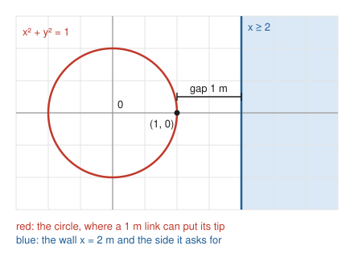

# Sums of squares and the Positivstellensatz: certificates that a polynomial is never negative, or that a system has no real point

[Syllabus](../../../SYLLABUS.md) → [Algebraic geometry](../README.md) → [Polynomial Systems](../README.md#s01) → Sums of squares and the Positivstellensatz

---

## General Overview

Is the polynomial p(x) = x⁴ + 4x³ + 6x² + 4x + 5 ever negative, for a real number x? Try some values: p(0) = 5, p(−1) = 4, p(−3) = 20. Trying values never ends, because there are infinitely many x.

One rewrite settles it for every x at once:

```math
x^4 + 4x^3 + 6x^2 + 4x + 5 = \bigl((x + 1)^2\bigr)^2 + 2^2
```

A real number squared is never negative. So p is at least 4 everywhere, and it equals 4 at x = −1. The rewrite is a **certificate**: a short identity that anyone can check by multiplying out.

The same trick proves that something is impossible. A 1 m link swings about a bolt at the origin, so its tip (x, y) lies on the circle x² + y² = 1. A sensor needs the tip at x ≥ 2, at least 2 m out. That cannot happen, and this identity proves it:

```math
-1 = \tfrac13\bigl((x - 2)^2 + y^2\bigr) + \tfrac43\,(x - 2) - \tfrac13\,(x^2 + y^2 - 1)
```

At a point that met both demands, the first term would be at least 0 (squares), the second at least 0 (x − 2 ≥ 0), and the third exactly 0 (the point is on the circle). The right side would be at least 0. It equals −1. So no such point exists. The toy is chosen so the eye can check it. Certificates earn their keep where inspection fails, with many joints or many constraints, and they are checked the same way.

Such certificates are found by a computer, through a positive semidefinite matrix (a symmetric table of numbers that can be split into squares) and a [Semidefinite programs](../../15-Optimization/06-Conic%2C%20Quadratic%20and%20Stochastic%20Programs/05-semidefinite-programs-and-relaxations.md) solver. They are checked by hand. They have one limit: Motzkin's polynomial x⁴y² + x²y⁴ − 3x²y² + 1 is never negative, yet it is no sum of squares.

**Over the real numbers, a sum of squares proves a polynomial is never negative, and "−1 equals squares plus the constraints times multipliers" proves a system has no real point; the Positivstellensatz says the second kind of certificate always exists, and semidefinite programming finds it.**

**What kind of fact this is:** theorems and one counterexample. The Gram-matrix test for sums of squares is proved on the optimisation wing's card and recapped here. Hilbert's list is stated with its source. Motzkin's counterexample is proved here, by a second route through the Newton polygon. The real Nullstellensatz and the Positivstellensatz (Krivine 1964, Stengle 1974) are proved here in the easy direction, and the hard direction is stated with its source.

### The picture: the link and the wall

<p align="center"></p>

Real points only, drawn to scale, in metres. The red circle is every place the tip can be. The blue region is where the sensor needs it. They never meet, and the gap is 1 m. The certificate above proves it without drawing anything.

---

## The formula

The field here is ℝ, the real numbers. That matters: over ℂ, the complex numbers, i² = −1 is a square, so "squares are never negative" fails.

A **sum of squares** (SOS) is a polynomial $`q_1^2 + \cdots + q_m^2`$ with each $`q_k`$ a real polynomial. Write the monomials of p up to half its degree as a list, $`z = (1, x, x^2)`$; a monomial is one coefficient-free product of powers, such as x² or x²y. The **Gram matrix** test:

```math
p = z^T Q\, z \ \text{ for some symmetric } Q \succeq 0 \iff p \text{ is a sum of squares of polynomials in } z
```

**Read it aloud:** p is a sum of squares exactly when it equals the monomial list, times a positive semidefinite matrix, times the monomial list again.

The optimisation wing's [Sums of squares](../../15-Optimization/06-Conic%2C%20Quadratic%20and%20Stochastic%20Programs/12-sum-of-squares-polynomial-optimisation.md) card proves this test and uses it to find the lowest value of a polynomial. Step 1 recaps it; this card turns it to systems with no real point.

The **Positivstellensatz** (German for "positive-places theorem"), for a system of inequalities $`g_i \ge 0`$ and equations $`h_j = 0`$ in n real unknowns:

```math
\{x \in \mathbb{R}^n : g_i(x) \ge 0 \text{ for all } i,\ h_j(x) = 0 \text{ for all } j\} = \varnothing \iff -1 = \sum_{S} \sigma_S \prod_{i \in S} g_i + \sum_j \lambda_j h_j
```

**Read it aloud:** the system has no real point exactly when −1 equals a sum, over groups S of the inequalities, of a sum of squares times the product of that group, plus a combination of the equations.

With no inequalities, only the empty group remains. That is the **real Nullstellensatz**, in its weak form: the equations $`h_j = 0`$ have no real point exactly when $`-1 = \sigma + \sum_j \lambda_j h_j`$ for some sum of squares σ.

The link and the wall is the case with one inequality, g = x − 2, and one equation, h = x² + y² − 1. The groups are "none" and "g", so the certificate reads $`-1 = \sigma_0 + \sigma_1 g + \lambda h`$. Here $`\sigma_0 = \frac13((x-2)^2 + y^2)`$, $`\sigma_1 = \frac43`$ and $`\lambda = -\frac13`$.

| Symbol | Plain meaning | In our example | Push it up and the answer… |
| --- | --- | --- | --- |
| $`\mathbb{R}`$, $`\mathbb{C}`$, $`i`$ | the field: real numbers; complex numbers, where $`i^2 = -1`$ is a square below 0 | ℝ throughout | — |
| $`p(x)`$, $`x`$, $`y`$; $`u`$, $`v`$ | the polynomial to certify; the real unknowns, in metres for the link; in Step 1, shorthands with $`p = (u^2 + 1)(v^2 + 1)`$ | $`x^4 + 4x^3 + 6x^2 + 4x + 5`$; u = x, v = x + 2 | raising its constant term lifts p and widens the range of t |
| $`z`$, $`z^T`$; $`n`$, $`m`$ | the monomial list, up to half the degree, and the same list written as a row; the number of unknowns; the number of squares | $`(1, x, x^2)`$; $`(1, x, y)`$ for the link | — |
| $`Q`$, $`Q_{ij}`$, $`t`$ | the Gram matrix; its entry in row i, column j, counted from 0; the one entry the coefficients leave free, $`t = Q_{02}`$ | t = 1 gives `[[5, 2, 1], [2, 4, 2], [1, 2, 1]]` | t above 1 breaks positive semidefinite |
| $`Q \succeq 0`$, $`w`$ | positive semidefinite: $`w^T Q w \ge 0`$ for every real vector w; equivalently, every principal minor is 0 or more | holds exactly for −1 ≤ t ≤ 1 | — |
| $`d_k`$, $`q_k`$, $`\ell_k`$; $`L`$, $`D`$ | the split $`p = \sum d_k q_k^2`$ read off Q, with weights $`d_k \ge 0`$; the coefficient list of $`q_k`$; the same split as matrices, $`Q = L D L^T`$ | t = 1: $`(x^2 + 2x + 1)^2 + 4`$ | a negative $`d_k`$ means no certificate |
| $`\gamma`$ | a proposed floor: is $`p - \gamma`$, or $`M - \gamma`$, a sum of squares? | 4 for p; none for M | above 4, $`p(-1) - \gamma < 0`$ |
| $`M(x, y)`$ | Motzkin's polynomial | $`x^4y^2 + x^2y^4 - 3x^2y^2 + 1`$ | — |
| $`g_i`$, $`h_j`$, $`S`$ | the inequalities $`g_i \ge 0`$; the equations $`h_j = 0`$; a group of the inequalities | g = x − 2, h = x² + y² − 1 | — |
| $`\sigma`$, $`\sigma_S`$; $`\lambda_j`$ | sums of squares, one per group; any polynomial multipliers on the equations | $`\sigma_0 = \frac13((x-2)^2 + y^2)`$, $`\sigma_1 = \frac43`$, $`\lambda = -\frac13`$ | — |
| $`s`$, $`c`$, $`r`$ | in the search: weight on the circle ($`\lambda = -s`$), weight on the wall ($`\sigma_1 = c`$), the wall's position x ≥ r | s = 1/3, c = 4/3, r = 2 | a wall nearer the circle needs a larger s |
| $`a`$, $`b`$ | the arm's elbow, in metres: a along the table, b its height | b = ±1.452369 m | — |

### When it holds

- **The field is ℝ.** Over ℂ the identity $`-1 = i^2`$ is a "sum of squares", so every system would be certified. [The Nullstellensatz](09-nullstellensatz.md) is the complex version, and it needs no squares.
- **Q must be positive semidefinite, not just match the coefficients.** At t = 2 the coefficients still match, but the split has a weight −2. The identity is true and proves nothing.
- **Never negative does not always mean SOS.** It does for one variable, for degree 2, and for two variables at degree 4. Motzkin's polynomial, two variables at degree 6, is the counterexample.
- **The certificate degree is not known in advance.** A search fixes a degree for the σ and λ, solves, and raises the degree if it fails. Proven worst-case bounds exist, but they are towers of exponentials.
- **Products of inequalities can be needed.** With several $`g_i`$, the general form uses every product $`\prod_{i \in S} g_i`$. With one inequality, as here, "none" and "g" are all there is.

---

## Why it works

### Step 0: a square is never negative, so a certificate is checked by multiplying out

Over ℝ every square is 0 or more, and so is every sum of squares. That is the whole of the easy direction.

- If p is a sum of squares, then p(x) ≥ 0 at every real x.
- If $`-1 = \sum_S \sigma_S \prod_{i \in S} g_i + \sum_j \lambda_j h_j`$, take any real point of the system. Every $`h_j`$ is 0 there, every $`g_i`$ is 0 or more, and every $`\sigma_S`$ is 0 or more. The right side is 0 or more, and the left side is −1. So the point cannot exist.

The checking needs no search and no decimals. It is exact multiplication. The hard part is the converse: when a polynomial is nonnegative, or a system is empty, is there always a certificate to find?

### Step 1: the Gram matrix of p, in brief

The optimisation wing's [Sums of squares](../../15-Optimization/06-Conic%2C%20Quadratic%20and%20Stochastic%20Programs/12-sum-of-squares-polynomial-optimisation.md) card proves the Gram-matrix test both ways, on the mirror image of this p, $`p(-x)`$. In brief, squares $`q_k = \ell_k^T z`$, where $`\ell_k`$ lists the coefficients of $`q_k`$, add up to $`z^T (\sum_k \ell_k \ell_k^T) z`$, and that matrix is positive semidefinite. A positive semidefinite Q splits back into squares as $`L D L^T`$, with weights $`d_k \ge 0`$ ([Quadratic forms](../../03-Algebra/07-Eigenvalues%20and%20Symmetric%20Matrices/05-quadratic-forms-and-positive-definite.md)).

For this p, matching the five powers of x leaves one entry free, $`t = Q_{02}`$:

```math
Q(t) = \begin{pmatrix} 5 & 2 & t \\ 2 & 6 - 2t & 2 \\ t & 2 & 1 \end{pmatrix}, \qquad \det Q(t) = 2(t + 1)(t - 1)(t - 3)
```

That is a semidefinite program in one unknown. The minor on rows 1 and 2, $`2 - 2t`$, needs t ≤ 1, and the determinant then needs t ≥ −1. On a grid of t from −3 to 3 in steps of 1/8, the code passes 17 points, from −1 to 1. Each t in that range is a different certificate:

- t = 1: $`p = (x^2 + 2x + 1)^2 + 4`$. So p ≥ 4, and p(−1) = 4 makes 4 its lowest value.
- t = 0: $`p = (x^2 + 2x)^2 + 2(x + 1)^2 + 3`$, three squares.
- t = −1: $`p = (x^2 + 2x - 1)^2 + 4(x + 1)^2`$.

The ends, where det Q = 0, use the fewest squares; a solver usually returns a point inside, with more. The ends are the two ways to multiply out $`p = (u^2 + 1)(v^2 + 1)`$, with u = x and v = x + 2: as $`(uv + 1)^2 + (u - v)^2`$, the t = 1 end, or as $`(uv - 1)^2 + (u + v)^2`$, the t = −1 end. That is the optimisation card's one-variable proof, run on this p.

### Step 2: Hilbert's list, and Motzkin's polynomial by its Newton polygon

Hilbert found in 1888 exactly when "never negative" forces "sum of squares": for one variable at any degree, any number of variables at degree 2, and two variables at degree 4. It can fail for two variables at degree 6 or more, and for three or more at degree 4 or more. The optimisation card sets the list out as a table.

Hilbert built no explicit failure. The first, Motzkin's, came in 1967:

```math
M(x, y) = x^4y^2 + x^2y^4 - 3x^2y^2 + 1
```

**M is never negative.** The three numbers $`x^4y^2`$, $`x^2y^4`$ and 1 are at least 0, with product $`x^6y^6`$. Their average is at least their cube root, $`x^2y^2`$ (the arithmetic–geometric mean inequality, AM-GM). So M ≥ 0, with M = 0 at (±1, ±1).

**M is no sum of squares: a second proof, by the Newton polygon.** The optimisation card proves this by forcing rows of the Gram matrix to zero. Plot each monomial $`x^iy^j`$ of M as the point (i, j). The points (0, 0), (4, 2) and (2, 4) are corners of a triangle, the **Newton polygon**, and (2, 2) sits inside it. A square $`q^2`$ has its points inside the doubled polygon of q, and squares added together cannot cancel their outermost terms. So every $`q_k`$ uses only monomials inside half the triangle: 1, xy, x²y and xy². Among those, only xy · xy makes $`x^2y^2`$. Its coefficient in $`\sum q_k^2`$ is therefore the sum of the squared xy-coefficients, at least 0. In M it is −3. In Gram terms, the diagonal entry for xy is forced to −3, and a positive semidefinite matrix has no negative diagonal entry.

<details>
<summary>Detailed proof: squares added together never cancel their outermost terms</summary>

Pick a direction: two fixed numbers, a first and a second. Score the monomial $`x^iy^j`$ as the first times i plus the second times j. Find the top score among all monomials of all the $`q_k`$. Call the part of each $`q_k`$ that reaches the top score its top part (zero for some k).

The terms of twice the top score in $`\sum_k q_k^2`$ come only from the squares of the top parts. Their sum is a sum of squares of real polynomials, not all zero. It is not the zero polynomial: at a real point where some top part is not 0, it is above 0.

So the top score in $`\sum_k q_k^2`$ is exactly twice the top score of the $`q_k`$. If $`\sum_k q_k^2 = M`$, then in every direction, twice the top score of the $`q_k`$ is M's top score. A point lies outside a polygon with no dents exactly when, in some direction, it scores higher than every corner. So every monomial of every $`q_k`$, doubled, lies inside M's Newton polygon.

For M this leaves the lattice points (i, j) with (2i, 2j) inside the triangle with corners (0, 0), (4, 2) and (2, 4): (0, 0), (1, 1), (2, 1) and (1, 2). The code lists them by testing every candidate.

</details>

Subtracting a floor γ moves only the constant term, never the $`x^2y^2`$ entry, so $`M - \gamma`$ is no sum of squares for any γ. A floor search by squares finds no floor at all, though M's lowest value is 0.

M is a sum of squares of fractions, though. Artin proved in 1927 that every nonnegative polynomial is (Hilbert's 17th problem). For M, the code checks

```math
M = \frac{x^2y^2(x^2 + y^2 + 1)(x^2 + y^2 - 2)^2 + (x^2 - y^2)^2}{(x^2 + y^2)^2}
```

Each term in the numerator is a square or a square times $`x^2`$, $`y^2`$ or 1, so the numerator is a sum of squares. This is the idea the Positivstellensatz generalises: allow multipliers.

### Step 3: the real Nullstellensatz and the Positivstellensatz

Over ℂ, [The Nullstellensatz](09-nullstellensatz.md) says: equations with no common point have a certificate $`1 = \sum_j \lambda_j h_j`$. Over ℝ that fails. The equations $`x^2 + y^2 - 1 = 0`$ and $`x - 2 = 0`$ have no real point, but they have the complex point $`(2, i\sqrt3)`$. So no certificate of the form $`1 = \sum_j \lambda_j h_j`$ exists.

The real version adds squares. For those two equations, $`(x^2 + y^2 - 1) - (x + 2)(x - 2) = y^2 + 3`$ is a combination of them, and

```math
-1 = \tfrac13 y^2 - \tfrac13 (y^2 + 3)
```

The **real Nullstellensatz** (Krivine 1964, later Dubois and Risler) says such a certificate always exists for equations with no real point. That is its weak form. The strong form says which polynomials vanish at every real point of the equations: exactly those with some even power of the polynomial, plus a sum of squares, in the ideal of the equations. The weak form is the polynomial 1, which vanishes at every real point only when there are none. The **Positivstellensatz** (Krivine 1964, Stengle 1974) extends it to inequalities, as in The formula. Stengle's paper also gives the matching certificates that a polynomial is positive, or never negative, on the set.

The hard direction is stated here without proof. Its shape: if −1 has no certificate, the polynomials can be ordered as if they were numbers, with every $`g_i`$ at least 0 and every $`h_j`$ zero. The Tarski–Seidenberg transfer principle then turns that ordering into a real point. Bochnak, Coste and Roy give the full proof (chapter 4, source below).

### Step 4: finding the certificate for the link is a small semidefinite program

Fix the degrees: $`\sigma_0`$ a Gram form on (1, x, y), $`\sigma_1 = c`$ a constant at least 0, and $`\lambda = -s`$ a constant. The identity $`\sigma_0 = -1 - c(x - 2) + s(x^2 + y^2 - 1)`$ fixes every entry of the Gram matrix:

```math
Q = \begin{pmatrix} 2c - s - 1 & -c/2 & 0 \\ -c/2 & s & 0 \\ 0 & 0 & s \end{pmatrix} \succeq 0
```

The minor on rows 0 and 1 needs $`s(2c - s - 1) \ge c^2/4`$. As a condition on c, it has a solution only when $`3s^2 - s \ge 0`$, that is s ≥ 1/3. At s = 1/3 the only choice is c = 4/3, which is the certificate in the General Overview. Drop the wall's term, c = 0, and the top-left entry is −s − 1, below 0 for every s ≥ 0: no certificate, as it must be, since the circle alone has real points. For a wall at x ≥ r the same algebra gives $`s \ge 1/(r^2 - 1)`$. A wall nearer the circle needs a heavier weight, and a wall at r = 1 touches the circle and has no certificate at all.

The **Lasserre and Parrilo hierarchy** (Lasserre 2001, Parrilo 2003) runs this at degree 2, 4, 6 and so on. Each degree is one semidefinite program. A certificate at any degree is a proof.

---

## Worked numbers, by hand

The link and the wall: x² + y² − 1 = 0 and x − 2 ≥ 0, over ℝ.

| Step | Arithmetic | Value |
| --- | --- | --- |
| square part | $`\frac13((x - 2)^2 + y^2) = \frac13 x^2 - \frac43 x + \frac43 + \frac13 y^2`$ | at least 0 |
| wall part | $`\frac43(x - 2) = \frac43 x - \frac83`$ | at least 0 on the wall's side |
| circle part | $`-\frac13(x^2 + y^2 - 1) = -\frac13 x^2 - \frac13 y^2 + \frac13`$ | 0 on the circle |
| add: x², y² and x terms | $`\frac13 - \frac13`$, $`\frac13 - \frac13`$, $`-\frac43 + \frac43`$ | 0, 0, 0 |
| add: constants | $`\frac43 - \frac83 + \frac13`$ | **−1** |

The sum of three parts that are each at least 0 would be −1, so no real point meets both demands: no 1 m link reaches a 2 m wall.

The house example, a two-link robot arm with 3 m and 2 m links in a vertical plane. The shoulder is on the table at the origin, the target is on the table 4 m away, and the elbow is at (a, b), with b its height:

| Step | Arithmetic | Value |
| --- | --- | --- |
| the two links | $`a^2 + b^2 - 9 = 0`$ and $`(a - 4)^2 + b^2 - 4 = 0`$ | two equations |
| subtract | $`(a^2 + b^2 - 9) - (a^2 - 8a + b^2 + 12)`$ | $`8a - 21`$ |
| eliminate a | $`(a^2 + b^2 - 9) - \frac18(a + \frac{21}8)(8a - 21)`$ | $`b^2 - \frac{135}{64}`$, in the ideal |
| elbow height | $`b = \pm\sqrt{135/64}`$ | ±1.452369 m |
| demand b − 2 ≥ 0 | $`(b - 2)^2 + 4(b - 2) = b^2 - 4`$ | a square plus 4 times the demand |
| certificate | $`\frac{64}{121}\bigl((b - 2)^2 + 4(b - 2) - (b^2 - \frac{135}{64})\bigr)`$ | **−1** |

An elbow that must clear 2 m, to pass over an obstacle, is impossible for this target: the links fix its height at 1.452369 m.

### What breaks if you drop a piece

| Mistake | Comes out at | What went wrong |
| --- | --- | --- |
| Take t = 2, outside −1 ≤ t ≤ 1 | $`p = (x^2 + 2x + 2)^2 - 2(x + 1)^2 + 3`$ | the identity is true, but a weight is −2; Q is not positive semidefinite (least principal minor −6) |
| Swap x ≥ 2 for x = 2 and look for $`1 = \lambda_1 h_1 + \lambda_2 h_2`$, the complex certificate | no such certificate; $`x = 2`$, $`y^2 = -3`$ is a point | the point is complex; the real certificate $`-1 = \frac13 y^2 - \frac13(y^2 + 3)`$ needs a square |
| Read Hilbert's list as "nonnegative means SOS" for M | the xy diagonal entry is forced to −3 | two variables at degree 6 is outside the list |
| Find the lowest value of M by sums of squares | no floor at all, for every γ; the true lowest value is 0 | γ moves only the constant term, and the −3 stays |

The code prints all four.

---

## Code, from first principles, and it actually runs

The code uses exact fractions and imports nothing that knows polynomials or matrices. For p it takes four roads: multiply out the certificate; build the Gram matrix, test its minors across t and split it into squares; multiply the factors two ways; and evaluate p on a grid. For M it checks AM-GM, evaluates M on a grid, lists the half Newton polygon, builds the Gram matrix it forces and checks Artin's identity. For the link it takes three roads: multiply out the certificate, find it again by a Gram search over s and c, and walk rational points round the circle. Then come the arm, the breaks and the try-changing settings.

### Python

```python
# Sums of squares and the Positivstellensatz -- the check behind the card.
# Standard library only.  Polynomials are dicts {(ex, ey): Fraction}, x > y.
# Every certificate is multiplied out exactly; Gram matrices are tested for
# positive semidefinite by their principal minors and split into squares.
from fractions import Fraction as Q
from itertools import combinations

def P(*terms):                                  # P((coefficient, (ex, ey)), ...)
    out = {}
    for c, m in terms:
        out[m] = out.get(m, 0) + Q(c)
    return {m: c for m, c in out.items() if c != 0}
def add(*fs):
    return P(*[(c, m) for f in fs for m, c in f.items()])
def mul(*fs):
    out = {(0, 0): Q(1)}
    for g in fs:
        out = P(*[(a * b, (m[0] + n[0], m[1] + n[1])) for m, a in out.items() for n, b in g.items()])
    return out

k = lambda c: P((c, (0, 0)))                    # a constant

def show(f, v="xy"):                            # leading term first
    s = ""
    for m in sorted(f, key=lambda m: (sum(m), m), reverse=True):
        mono = "".join(n + (f"^{e}" if e > 1 else "") for n, e in zip(v, m) if e)
        a = abs(f[m])
        body = str(a) if not mono else mono if a == 1 else f"{a}{mono}" if a.denominator == 1 else f"({a}){mono}"
        s += (("-" if f[m] < 0 else "") if not s else (" - " if f[m] < 0 else " + ")) + body
    return s or "0"

det = lambda A: A[0][0] if len(A) == 1 else sum((-1) ** j * A[0][j] * det([r[:j] + r[j + 1:] for r in A[1:]]) for j in range(len(A)))
minors = lambda A: [det([[A[i][j] for j in S] for i in S]) for r in range(1, len(A) + 1) for S in combinations(range(len(A)), r)]
psd = lambda A: min(minors(A)) >= 0             # every principal minor at least 0

def squares(A, z):                              # A = L D L^T, pivoting from the last monomial
    A, out = [row[:] for row in A], []
    for p in reversed(range(len(A))):
        d = A[p][p]
        if d == 0:
            continue
        l = [A[i][p] / d for i in range(p + 1)]
        out.append((d, add(*[mul(k(l[i]), z[i]) for i in range(p + 1)])))
        A = [[A[i][j] - d * l[i] * l[j] if i <= p and j <= p else A[i][j] for j in range(len(A))] for i in range(len(A))]
    return out

sos = lambda parts: add(*[mul(k(d), q, q) for d, q in parts])
ev = lambda f, x, y=0: sum(c * Q(x) ** m[0] * Q(y) ** m[1] for m, c in f.items())

def says(parts, v="xy"):                        # d1(q1)^2 + d2(q2)^2 + ...
    w = [str(d) if q == k(1) else ("" if d == 1 else f"{d}" if d.denominator == 1 else f"({d})") + f"({show(q, v)})^2"
         for d, q in parts]
    return " + ".join(w).replace("+ -", "- ")

X, Y = P((1, (1, 0))), P((1, (0, 1)))
p = P((1, (4, 0)), (4, (3, 0)), (6, (2, 0)), (4, (1, 0)), (5, (0, 0)))
print(f"p = {show(p)}")
s1 = add(mul(add(X, k(1)), add(X, k(1)), add(X, k(1)), add(X, k(1))), k(4))
print(f"road 1, ((x + 1)^2)^2 + 2^2 expands to {show(s1)}")
z = [k(1), X, mul(X, X)]
cons = {d: [(i, j) for i in range(3) for j in range(3) if i + j == d] for d in range(5)}
print("road 2, Gram matrix on (1, x, x^2), coefficients matched: " + " | ".join(
      f"x^{d}: " + " + ".join(f"Q{i}{j}" for i, j in cons[d]) + f" = {p.get((d, 0), 0)}" for d in range(5)))
G = lambda t, g=0: [[5 - g, Q(2), Q(t)], [Q(2), 6 - 2 * Q(t), Q(2)], [Q(t), Q(2), Q(1)]]
for t in [Q(-3, 2), Q(-1), Q(0), Q(1), Q(2)]:
    A = G(t)
    print(f"t = {t}: Q = {[[str(a) for a in r] for r in A]}".replace("'", "") +
          f", least principal minor {min(minors(A))}, det {det(A)}, PSD {'yes' if psd(A) else 'no'}")
grid = [Q(j, 8) for j in range(-24, 25)]
ok = [t for t in grid if psd(G(t))]
print(f"road 2, PSD on the grid t = j/8, -3 <= t <= 3: from {min(ok)} to {max(ok)}, {len(ok)} points")
spl = {t: squares(G(t), z) for t in [Q(1), Q(0), Q(-1), Q(2)]}
for t in [Q(1), Q(0), Q(-1)]:
    print(f"t = {t}: p = {says(spl[t])}")
f1, f2 = add(mul(X, X), k(1)), add(mul(X, X), mul(k(4), X), k(5))
print(f"road 3, (x^2 + 1)(x^2 + 4x + 5) = {show(mul(f1, f2))}")
a, b, c, d = X, k(1), add(X, k(2)), k(1)
plus = [add(mul(a, c), mul(b, d)), add(mul(a, d), mul(k(-1), b, c))]
minus = [add(mul(a, c), mul(k(-1), b, d)), add(mul(a, d), mul(b, c))]
print(f"road 3, u = x, v = x + 2: (uv + 1)^2 + (u - v)^2 = ({show(plus[0])})^2 + ({show(plus[1])})^2; "
      f"(uv - 1)^2 + (u + v)^2 = ({show(minus[0])})^2 + ({show(minus[1])})^2")
vals = [(ev(p, Q(j, 100)), Q(j, 100)) for j in range(-500, 501)]
print(f"road 4, p at x = j/100 for -5 <= x <= 5: least value {min(vals)[0]} at x = {min(vals)[1]}")
best = max(g for g in [Q(j, 4) for j in range(12, 21)] if any(psd(G(t, g)) for t in grid))
print(f"SOS lower bound: largest gamma = j/4 with p - gamma a sum of squares: {best}; "
      f"p - 4 = {says(squares(G(1, 4), z))}; p(-1) - 17/4 = {ev(p, -1) - Q(17, 4)}")
M = P((1, (4, 2)), (1, (2, 4)), (-3, (2, 2)), (1, (0, 0)))
print(f"M = {show(M)}; AM-GM at (1, 1): terms x^4y^2, x^2y^4, 1 = 1, 1, 1; mean 1, geometric mean 1, M = {ev(M, 1, 1)}")
mg = [(ev(M, Q(i, 20), Q(j, 20)), i, j) for i in range(-40, 41) for j in range(-40, 41)]
low = min(mg)[0]
print(f"M on the grid x, y = j/20 in [-2, 2]: least value {low}, at {sum(v == low for v, _, _ in mg)} points, "
      f"negative at {sum(v < 0 for v, _, _ in mg)}")
inside = lambda u, v: v <= 2 * u and u <= 2 * v and u + v <= 6   # triangle (0,0), (4,2), (2,4)
half = [(i, j) for i in range(4) for j in range(4) if inside(2 * i, 2 * j)]
print(f"Newton triangle (0, 0), (4, 2), (2, 4) holds (2, 2): {'yes' if inside(2, 2) else 'no'}; "
      f"half of it holds the monomials {', '.join(show(P((1, m))) for m in half)}")
pairs = [(m, n) for m in half for n in half if (m[0] + n[0], m[1] + n[1]) == (2, 2)]
sm = lambda a, b: (a[0] + b[0], a[1] + b[1])     # Gram entry (a, b) multiplies the monomials a and b
GM = [[M.get(sm(a, b), Q(0)) / sum(sm(c, d) == sm(a, b) for c in half for d in half) for b in half] for a in half]
zGz = add(*[mul(k(GM[i][j]), P((1, a)), P((1, b))) for i, a in enumerate(half) for j, b in enumerate(half)])
print(f"products giving x^2y^2: {', '.join(show(P((1, m))) + ' times ' + show(P((1, n))) for m, n in pairs)}, so the Gram diagonal entry for xy must be {GM[1][1]}, "
      f"for M - gamma with any gamma too; the Gram matrix this forces on those monomials gives back M: {'yes' if zGz == M else 'no'}, PSD: {'yes' if psd(GM) else 'no'}")
r2 = add(mul(X, X), mul(Y, Y))
art = add(mul(X, X, Y, Y, add(r2, k(1)), add(r2, k(-2)), add(r2, k(-2))), mul(add(mul(X, X), mul(k(-1), Y, Y)), add(mul(X, X), mul(k(-1), Y, Y))))
print(f"Artin: (x^2 + y^2)^2 M - [x^2y^2(x^2 + y^2 + 1)(x^2 + y^2 - 2)^2 + (x^2 - y^2)^2] = {show(add(mul(r2, r2, M), mul(k(-1), art)))}")
h, g = add(r2, k(-1)), add(X, k(-2))
cert = add(mul(k(Q(1, 3)), add(mul(g, g), mul(Y, Y))), mul(k(Q(4, 3)), g), mul(k(Q(-1, 3)), h))
print(f"system {show(h)} = 0, {show(g)} >= 0; road 1, (1/3)((x - 2)^2 + y^2) + (4/3)(x - 2) - (1/3)(x^2 + y^2 - 1) = {show(cert)}")
C = lambda c, s, w=2: [[w * c - s - 1, -c / 2, Q(0)], [-c / 2, s, Q(0)], [Q(0), Q(0), s]]   # wall at x >= w
feas = lambda w: [(s, c) for s in [Q(j, 24) for j in range(25)] for c in [Q(j, 24) for j in range(73)] if psd(C(c, s, w))]
s0, c0 = min(feas(2))
print(f"road 2, Gram search on (1, x, y), s and c in steps of 1/24: first feasible s = {s0}, c = {c0}, "
      f"sigma0 = {says(squares(C(c0, s0), [k(1), X, Y]))}")
circ = [(Q(1 - u * u, 1 + u * u), Q(2 * u, 1 + u * u)) for u in [Q(j, 10) for j in range(-30, 31)]]
print(f"road 3, circle points ((1 - u^2)/(1 + u^2), 2u/(1 + u^2)), u = j/10: largest x = {max(x for x, _ in circ)}, "
      f"all on the circle: {'yes' if all(ev(h, x, y) == 0 for x, y in circ) else 'no'}")
f_1, f_2 = add(mul(X, X), mul(Y, Y), k(-9)), add(mul(X, X), mul(k(-8), X), mul(Y, Y), k(12))
inI = add(f_1, mul(k(Q(-1, 8)), add(X, k(Q(21, 8))), add(f_1, mul(k(-1), f_2))))
lift = add(Y, k(-2))
arm = mul(k(Q(64, 121)), add(mul(lift, lift), mul(k(4), lift), mul(k(-1), inI)))
print(f"arm, 3 m and 2 m links, target 4 m: {show(f_1, 'ab')} = 0, {show(f_2, 'ab')} = 0; in the ideal: {show(inI, 'ab')}; "
      f"b = +-{float(Q(135, 64)) ** 0.5:.6f} m")
print(f"arm, elbow at least 2 m up: (64/121)((b - 2)^2 + 4(b - 2) - ({show(inI, 'ab')})) = {show(arm, 'ab')}")
print(f"break, t = 2: p = {says(spl[Q(2)])}")
cx = add(h, mul(k(-1), add(X, k(2)), g))
print(f"break, over C: x = 2, y^2 = {-ev(h, 2)}; "
      f"real certificate (1/3)y^2 - (1/3)({show(cx)}) = {show(add(mul(k(Q(1, 3)), Y, Y), mul(k(Q(-1, 3)), cx)))}")
s3, c3 = min(feas(3))
print(f"try: t = 3 gives least principal minor {min(minors(G(3)))}; gamma = 4 leaves t = {', '.join(str(t) for t in grid if psd(G(t, 4)))}; "
      f"wall at x >= 3: first s = {s3}, c = {c3}; wall at x >= 1: {len(feas(1))} feasible pairs")
print("figure, circle centre (0, 0) radius 1; wall x = 2; nearest circle point (1, 0); gap 1")
assert s1 == p and sos(spl[Q(1)]) == p and sos(spl[Q(0)]) == p and sos(spl[Q(-1)]) == p
assert mul(f1, f2) == p and add(mul(*plus[:1] * 2), mul(*plus[1:] * 2)) == p and add(mul(minus[0], minus[0]), mul(minus[1], minus[1])) == p
assert (min(ok), max(ok)) == (-1, 1) and not psd(G(Q(9, 8))) and det(G(0)) == 6
assert min(vals) == (4, -1) and best == 4 and sos(squares(G(1, 4), z)) == add(p, k(-4))
assert ev(M, 1, 1) == 0 == low and all(v >= 0 for v, _, _ in mg) and len(pairs) == 1 and zGz == M and GM[1][1] == -3 and not psd(GM)
assert add(mul(r2, r2, M), mul(k(-1), art)) == {} and cert == k(-1) and arm == k(-1)
assert (s0, c0) == (Q(1, 3), Q(4, 3)) and sos(squares(C(c0, s0), [k(1), X, Y])) == add(cert, mul(k(Q(-4, 3)), g), mul(k(Q(1, 3)), h))
assert (s3, c3) == (Q(1, 8), Q(3, 4)) and feas(1) == [] and max(x for x, _ in circ) == 1 and inI == add(mul(Y, Y), k(Q(-135, 64))) and min(d for d, _ in spl[Q(2)]) < 0
print("ALL CHECKS PASS")
```

**Ran 2026-11-24 on macOS, Python 3.14.10, standard library only. All checks passed. Output, pasted from the run:**

```
p = x^4 + 4x^3 + 6x^2 + 4x + 5
road 1, ((x + 1)^2)^2 + 2^2 expands to x^4 + 4x^3 + 6x^2 + 4x + 5
road 2, Gram matrix on (1, x, x^2), coefficients matched: x^0: Q00 = 5 | x^1: Q01 + Q10 = 4 | x^2: Q02 + Q11 + Q20 = 6 | x^3: Q12 + Q21 = 4 | x^4: Q22 = 1
t = -3/2: Q = [[5, 2, -3/2], [2, 9, 2], [-3/2, 2, 1]], least principal minor -45/4, det -45/4, PSD no
t = -1: Q = [[5, 2, -1], [2, 8, 2], [-1, 2, 1]], least principal minor 0, det 0, PSD yes
t = 0: Q = [[5, 2, 0], [2, 6, 2], [0, 2, 1]], least principal minor 1, det 6, PSD yes
t = 1: Q = [[5, 2, 1], [2, 4, 2], [1, 2, 1]], least principal minor 0, det 0, PSD yes
t = 2: Q = [[5, 2, 2], [2, 2, 2], [2, 2, 1]], least principal minor -6, det -6, PSD no
road 2, PSD on the grid t = j/8, -3 <= t <= 3: from -1 to 1, 17 points
t = 1: p = (x^2 + 2x + 1)^2 + 4
t = 0: p = (x^2 + 2x)^2 + 2(x + 1)^2 + 3
t = -1: p = (x^2 + 2x - 1)^2 + 4(x + 1)^2
road 3, (x^2 + 1)(x^2 + 4x + 5) = x^4 + 4x^3 + 6x^2 + 4x + 5
road 3, u = x, v = x + 2: (uv + 1)^2 + (u - v)^2 = (x^2 + 2x + 1)^2 + (-2)^2; (uv - 1)^2 + (u + v)^2 = (x^2 + 2x - 1)^2 + (2x + 2)^2
road 4, p at x = j/100 for -5 <= x <= 5: least value 4 at x = -1
SOS lower bound: largest gamma = j/4 with p - gamma a sum of squares: 4; p - 4 = (x^2 + 2x + 1)^2; p(-1) - 17/4 = -1/4
M = x^4y^2 + x^2y^4 - 3x^2y^2 + 1; AM-GM at (1, 1): terms x^4y^2, x^2y^4, 1 = 1, 1, 1; mean 1, geometric mean 1, M = 0
M on the grid x, y = j/20 in [-2, 2]: least value 0, at 4 points, negative at 0
Newton triangle (0, 0), (4, 2), (2, 4) holds (2, 2): yes; half of it holds the monomials 1, xy, xy^2, x^2y
products giving x^2y^2: xy times xy, so the Gram diagonal entry for xy must be -3, for M - gamma with any gamma too; the Gram matrix this forces on those monomials gives back M: yes, PSD: no
Artin: (x^2 + y^2)^2 M - [x^2y^2(x^2 + y^2 + 1)(x^2 + y^2 - 2)^2 + (x^2 - y^2)^2] = 0
system x^2 + y^2 - 1 = 0, x - 2 >= 0; road 1, (1/3)((x - 2)^2 + y^2) + (4/3)(x - 2) - (1/3)(x^2 + y^2 - 1) = -1
road 2, Gram search on (1, x, y), s and c in steps of 1/24: first feasible s = 1/3, c = 4/3, sigma0 = (1/3)(y)^2 + (1/3)(x - 2)^2
road 3, circle points ((1 - u^2)/(1 + u^2), 2u/(1 + u^2)), u = j/10: largest x = 1, all on the circle: yes
arm, 3 m and 2 m links, target 4 m: a^2 + b^2 - 9 = 0, a^2 + b^2 - 8a + 12 = 0; in the ideal: b^2 - 135/64; b = +-1.452369 m
arm, elbow at least 2 m up: (64/121)((b - 2)^2 + 4(b - 2) - (b^2 - 135/64)) = -1
break, t = 2: p = (x^2 + 2x + 2)^2 - 2(x + 1)^2 + 3
break, over C: x = 2, y^2 = -3; real certificate (1/3)y^2 - (1/3)(y^2 + 3) = -1
try: t = 3 gives least principal minor -4; gamma = 4 leaves t = 1; wall at x >= 3: first s = 1/8, c = 3/4; wall at x >= 1: 0 feasible pairs
figure, circle centre (0, 0) radius 1; wall x = 2; nearest circle point (1, 0); gap 1
ALL CHECKS PASS
```

### Rust

The same numbers and labels, built with `rustc --edition 2021 -O`. Fractions use i128 with checked multiplication, so an overflow stops the run.

```rust
// Sums of squares and the Positivstellensatz -- the same check as the Python, in Rust.
// No crates.  Polynomials map exponents [ex, ey] to exact fractions, x > y.  Every
// certificate is multiplied out exactly; Gram matrices are tested for positive
// semidefinite by their principal minors and split into squares.
use std::collections::BTreeMap;

#[derive(Clone, Copy, PartialEq, Debug)] struct Fr { n: i128, d: i128 }                // overflow stops the run
fn gcd(a: i128, b: i128) -> i128 { if b == 0 { a.abs() } else { gcd(b, a % b) } }
fn fr(n: i128, d: i128) -> Fr { let g = gcd(n, d).max(1) * d.signum(); Fr { n: n / g, d: d / g } }
fn m(a: i128, b: i128) -> i128 { a.checked_mul(b).expect("overflow") }
fn fa(a: Fr, b: Fr) -> Fr { fr(m(a.n, b.d).checked_add(m(b.n, a.d)).expect("overflow"), m(a.d, b.d)) }
fn fm(a: Fr, b: Fr) -> Fr { fr(m(a.n, b.n), m(a.d, b.d)) }
fn fdv(a: Fr, b: Fr) -> Fr { fr(m(a.n, b.d), m(a.d, b.n)) }
fn neg(a: Fr) -> Fr { fr(-a.n, a.d) }
fn lt(a: Fr, b: Fr) -> bool { m(a.n, b.d) < m(b.n, a.d) }
fn fs(a: Fr) -> String { if a.d == 1 { format!("{}", a.n) } else { format!("{}/{}", a.n, a.d) } }
fn q(n: i128) -> Fr { fr(n, 1) }
type Poly = BTreeMap<[u32; 2], Fr>;
fn p(t: &[(Fr, [u32; 2])]) -> Poly {
    let mut o = Poly::new();
    for &(c, e) in t { let v = fa(*o.get(&e).unwrap_or(&q(0)), c); if v.n == 0 { o.remove(&e); } else { o.insert(e, v); } }
    o
}
fn add(fs_: &[&Poly]) -> Poly { p(&fs_.iter().flat_map(|f| f.iter().map(|(&e, &c)| (c, e))).collect::<Vec<_>>()) }
fn mul(fs_: &[&Poly]) -> Poly {
    fs_.iter().fold(k(q(1)), |o, g| p(&o.iter().flat_map(|(a, &c)| g.iter().map(move |(b, &e)| (fm(c, e), [a[0] + b[0], a[1] + b[1]]))).collect::<Vec<_>>()))
}
fn k(c: Fr) -> Poly { p(&[(c, [0, 0])]) }
fn mono(e: [u32; 2]) -> Poly { p(&[(q(1), e)]) }
fn show(f: &Poly, v: &str) -> String {
    let mut ks: Vec<&[u32; 2]> = f.keys().collect();
    ks.sort_by_key(|e| std::cmp::Reverse((e[0] + e[1], e[0], e[1])));
    let mut s = String::new();
    for e in ks {
        let c = f[e];
        let mo: String = v.chars().zip(e.iter()).filter(|(_, &x)| x > 0)
            .map(|(n, &x)| if x > 1 { format!("{}^{}", n, x) } else { n.to_string() }).collect();
        let a = fr(c.n.abs(), c.d);
        let body = if mo.is_empty() { fs(a) } else if a == q(1) { mo } else if a.d == 1 { format!("{}{}", fs(a), mo) } else { format!("({}){}", fs(a), mo) };
        s += &if s.is_empty() { format!("{}{}", if c.n < 0 { "-" } else { "" }, body) } else { format!("{}{}", if c.n < 0 { " - " } else { " + " }, body) };
    }
    if s.is_empty() { "0".into() } else { s }
}
type Mat = Vec<Vec<Fr>>;
fn det(a: &Mat) -> Fr {
    if a.len() == 1 { return a[0][0] }
    (0..a.len()).fold(q(0), |acc, j| { let t = fm(a[0][j], det(&a[1..].iter().map(|r| r.iter().enumerate().filter(|&(c, _)| c != j).map(|(_, &x)| x).collect()).collect()));
        fa(acc, if j % 2 == 0 { t } else { neg(t) }) })
}
fn minors(a: &Mat) -> Vec<Fr> {
    let n = a.len();
    (1..(1usize << n)).map(|b| (0..n).filter(|i| b >> i & 1 == 1).collect::<Vec<_>>()).collect::<Vec<_>>().iter().map(|s| det(&s.iter().map(|&i| s.iter().map(|&j| a[i][j]).collect()).collect())).collect()
}
fn least(v: &[Fr]) -> Fr { v.iter().copied().fold(v[0], |a, b| if lt(b, a) { b } else { a }) }
fn psd(a: &Mat) -> bool { !lt(least(&minors(a)), q(0)) }
fn squares(a0: &Mat, z: &[Poly]) -> Vec<(Fr, Poly)> {
    let (mut a, mut out) = (a0.clone(), Vec::new());
    for pv in (0..a.len()).rev() {
        let d = a[pv][pv];
        if d.n == 0 { continue }
        let l: Vec<Fr> = (0..=pv).map(|i| fdv(a[i][pv], d)).collect();
        out.push((d, (0..=pv).fold(Poly::new(), |acc, i| add(&[&acc, &mul(&[&k(l[i]), &z[i]])]))));
        for i in 0..=pv { for j in 0..=pv { a[i][j] = fa(a[i][j], neg(fm(d, fm(l[i], l[j])))) } }
    }
    out
}
fn sos(parts: &[(Fr, Poly)]) -> Poly { parts.iter().fold(Poly::new(), |acc, (d, g)| add(&[&acc, &mul(&[&k(*d), g, g])])) }
fn ev(f: &Poly, x: Fr, y: Fr) -> Fr {
    let pw = |b: Fr, e: u32| (0..e).fold(q(1), |a, _| fm(a, b));
    f.iter().fold(q(0), |acc, (e, &c)| fa(acc, fm(c, fm(pw(x, e[0]), pw(y, e[1])))))
}
fn says(parts: &[(Fr, Poly)], v: &str) -> String {
    let w: Vec<String> = parts.iter().map(|(d, g)| if *g == k(q(1)) { fs(*d) } else {
        format!("{}({})^2", if *d == q(1) { String::new() } else if d.d == 1 { fs(*d) } else { format!("({})", fs(*d)) }, show(g, v)) }).collect();
    w.join(" + ").replace("+ -", "- ")
}
fn matstr(a: &Mat) -> String { format!("[{}]", a.iter().map(|r| format!("[{}]", r.iter().map(|&x| fs(x)).collect::<Vec<_>>().join(", "))).collect::<Vec<_>>().join(", ")) }
fn yn(b: bool) -> &'static str { if b { "yes" } else { "no" } }

fn main() {
    let (x, y, one) = (mono([1, 0]), mono([0, 1]), k(q(1)));
    let pp = p(&[(q(1), [4, 0]), (q(4), [3, 0]), (q(6), [2, 0]), (q(4), [1, 0]), (q(5), [0, 0])]);
    println!("p = {}", show(&pp, "xy"));
    let x1 = add(&[&x, &one]);  let s1 = add(&[&mul(&[&x1, &x1, &x1, &x1]), &k(q(4))]);
    println!("road 1, ((x + 1)^2)^2 + 2^2 expands to {}", show(&s1, "xy"));
    let z = vec![one.clone(), x.clone(), mul(&[&x, &x])];
    let cons: Vec<String> = (0..5u32).map(|d| format!("x^{}: {} = {}", d, (0..3u32).flat_map(|i| (0..3u32).map(move |j| (i, j)))
        .filter(|&(i, j)| i + j == d).map(|(i, j)| format!("Q{}{}", i, j)).collect::<Vec<_>>().join(" + "), fs(*pp.get(&[d, 0]).unwrap_or(&q(0))))).collect();
    println!("road 2, Gram matrix on (1, x, x^2), coefficients matched: {}", cons.join(" | "));
    let gm = |t: Fr, g: Fr| -> Mat { vec![vec![fa(q(5), neg(g)), q(2), t], vec![q(2), fa(q(6), fm(q(-2), t)), q(2)], vec![t, q(2), q(1)]] };
    for t in [fr(-3, 2), q(-1), q(0), q(1), q(2)] { let a = gm(t, q(0));
        println!("t = {}: Q = {}, least principal minor {}, det {}, PSD {}", fs(t), matstr(&a), fs(least(&minors(&a))), fs(det(&a)), yn(psd(&a)));
    }
    let grid: Vec<Fr> = (-24..=24).map(|j| fr(j, 8)).collect();
    let ok: Vec<Fr> = grid.iter().copied().filter(|&t| psd(&gm(t, q(0)))).collect();
    println!("road 2, PSD on the grid t = j/8, -3 <= t <= 3: from {} to {}, {} points", fs(ok[0]), fs(ok[ok.len() - 1]), ok.len());
    let spl = |t: Fr| squares(&gm(t, q(0)), &z);
    for t in [q(1), q(0), q(-1)] { println!("t = {}: p = {}", fs(t), says(&spl(t), "xy")) }
    let (f1, f2) = (add(&[&mul(&[&x, &x]), &one]), add(&[&mul(&[&x, &x]), &mul(&[&k(q(4)), &x]), &k(q(5))]));
    println!("road 3, (x^2 + 1)(x^2 + 4x + 5) = {}", show(&mul(&[&f1, &f2]), "xy"));
    let (a, b, c, d) = (x.clone(), one.clone(), add(&[&x, &k(q(2))]), one.clone());
    let mk = |sg: i128, u: &Poly, w: &Poly, u2: &Poly, w2: &Poly| add(&[&mul(&[u, w]), &mul(&[&k(q(sg)), u2, w2])]);
    let plus = [mk(1, &a, &c, &b, &d), mk(-1, &a, &d, &b, &c)];
    let minus = [mk(-1, &a, &c, &b, &d), mk(1, &a, &d, &b, &c)];
    println!("road 3, u = x, v = x + 2: (uv + 1)^2 + (u - v)^2 = ({})^2 + ({})^2; (uv - 1)^2 + (u + v)^2 = ({})^2 + ({})^2",
             show(&plus[0], "xy"), show(&plus[1], "xy"), show(&minus[0], "xy"), show(&minus[1], "xy"));
    let vals: Vec<(Fr, Fr)> = (-500..=500).map(|j| (ev(&pp, fr(j, 100), q(0)), fr(j, 100))).collect();
    let vmin = vals.iter().copied().fold(vals[0], |a, b| if lt(b.0, a.0) { b } else { a });
    println!("road 4, p at x = j/100 for -5 <= x <= 5: least value {} at x = {}", fs(vmin.0), fs(vmin.1));
    let best = (12..=20).map(|j| fr(j, 4)).filter(|&g| grid.iter().any(|&t| psd(&gm(t, g)))).last().unwrap();
    let p4 = squares(&gm(q(1), q(4)), &z);
    println!("SOS lower bound: largest gamma = j/4 with p - gamma a sum of squares: {}; p - 4 = {}; p(-1) - 17/4 = {}",
             fs(best), says(&p4, "xy"), fs(fa(ev(&pp, q(-1), q(0)), fr(-17, 4))));
    let mm = p(&[(q(1), [4, 2]), (q(1), [2, 4]), (q(-3), [2, 2]), (q(1), [0, 0])]);
    println!("M = {}; AM-GM at (1, 1): terms x^4y^2, x^2y^4, 1 = 1, 1, 1; mean 1, geometric mean 1, M = {}", show(&mm, "xy"), fs(ev(&mm, q(1), q(1))));
    let mg: Vec<Fr> = (-40..=40).flat_map(|i| (-40..=40).map(move |j| (i, j))).map(|(i, j)| ev(&mm, fr(i, 20), fr(j, 20))).collect();
    let low = least(&mg);
    println!("M on the grid x, y = j/20 in [-2, 2]: least value {}, at {} points, negative at {}", fs(low),
             mg.iter().filter(|&&v| v == low).count(), mg.iter().filter(|&&v| lt(v, q(0))).count());
    let inside = |u: u32, v: u32| v <= 2 * u && u <= 2 * v && u + v <= 6;
    let half: Vec<[u32; 2]> = (0..4).flat_map(|i| (0..4).map(move |j| [i, j])).filter(|e| inside(2 * e[0], 2 * e[1])).collect();
    println!("Newton triangle (0, 0), (4, 2), (2, 4) holds (2, 2): {}; half of it holds the monomials {}", yn(inside(2, 2)),
             half.iter().map(|&e| show(&mono(e), "xy")).collect::<Vec<_>>().join(", "));
    let pairs: Vec<([u32; 2], [u32; 2])> = half.iter().flat_map(|&u| half.iter().map(move |&w| (u, w))).filter(|(u, w)| [u[0] + w[0], u[1] + w[1]] == [2, 2]).collect();
    let sm = |a: [u32; 2], b: [u32; 2]| [a[0] + b[0], a[1] + b[1]];     // Gram entry (a, b) multiplies the monomials a and b
    let gmm: Mat = half.iter().map(|&a| half.iter().map(|&b| fdv(*mm.get(&sm(a, b)).unwrap_or(&q(0)), q(half.iter().flat_map(|&c| half.iter().map(move |&d| sm(c, d))).filter(|&e| e == sm(a, b)).count() as i128))).collect()).collect();
    let zgz = (0..half.len()).flat_map(|i| (0..half.len()).map(move |j| (i, j))).fold(Poly::new(), |acc, (i, j)| add(&[&acc, &mul(&[&k(gmm[i][j]), &mono(half[i]), &mono(half[j])])]));
    println!("products giving x^2y^2: {}, so the Gram diagonal entry for xy must be {}, for M - gamma with any gamma too; the Gram matrix this forces on those monomials gives back M: {}, PSD: {}",
             pairs.iter().map(|&(u, w)| format!("{} times {}", show(&mono(u), "xy"), show(&mono(w), "xy"))).collect::<Vec<_>>().join(", "), fs(gmm[1][1]), yn(zgz == mm), yn(psd(&gmm)));
    let r2 = add(&[&mul(&[&x, &x]), &mul(&[&y, &y])]);
    let (r1, rm2, dxy) = (add(&[&r2, &one]), add(&[&r2, &k(q(-2))]), add(&[&mul(&[&x, &x]), &mul(&[&k(q(-1)), &y, &y])]));
    let art = add(&[&mul(&[&x, &x, &y, &y, &r1, &rm2, &rm2]), &mul(&[&dxy, &dxy])]);
    let artd = add(&[&mul(&[&r2, &r2, &mm]), &mul(&[&k(q(-1)), &art])]);
    println!("Artin: (x^2 + y^2)^2 M - [x^2y^2(x^2 + y^2 + 1)(x^2 + y^2 - 2)^2 + (x^2 - y^2)^2] = {}", show(&artd, "xy"));
    let (h, g) = (add(&[&r2, &k(q(-1))]), add(&[&x, &k(q(-2))]));
    let cert = add(&[&mul(&[&k(fr(1, 3)), &add(&[&mul(&[&g, &g]), &mul(&[&y, &y])])]), &mul(&[&k(fr(4, 3)), &g]), &mul(&[&k(fr(-1, 3)), &h])]);
    println!("system {} = 0, {} >= 0; road 1, (1/3)((x - 2)^2 + y^2) + (4/3)(x - 2) - (1/3)(x^2 + y^2 - 1) = {}", show(&h, "xy"), show(&g, "xy"), show(&cert, "xy"));
    let cmw = |c: Fr, s: Fr, w: Fr| -> Mat { vec![vec![fa(fm(w, c), neg(fa(s, q(1)))), fm(fr(-1, 2), c), q(0)], vec![fm(fr(-1, 2), c), s, q(0)], vec![q(0), q(0), s]] };   // wall at x >= w
    let feas = |w: Fr| -> Vec<(Fr, Fr)> { (0..=24).flat_map(|i| (0..=72).map(move |j| (fr(i, 24), fr(j, 24)))).filter(|&(s, c)| psd(&cmw(c, s, w))).collect() };
    let (s0, c0) = feas(q(2))[0];
    let sig = squares(&cmw(c0, s0, q(2)), &[one.clone(), x.clone(), y.clone()]);
    println!("road 2, Gram search on (1, x, y), s and c in steps of 1/24: first feasible s = {}, c = {}, sigma0 = {}", fs(s0), fs(c0), says(&sig, "xy"));
    let circ: Vec<(Fr, Fr)> = (-30..=30).map(|j| fr(j, 10)).map(|u| { let w = fa(q(1), fm(u, u)); (fdv(fa(q(1), neg(fm(u, u))), w), fdv(fm(q(2), u), w)) }).collect();
    let xmax = least(&circ.iter().map(|&(cx, _)| neg(cx)).collect::<Vec<_>>());
    println!("road 3, circle points ((1 - u^2)/(1 + u^2), 2u/(1 + u^2)), u = j/10: largest x = {}, all on the circle: {}", fs(neg(xmax)),
             yn(circ.iter().all(|&(cx, cy)| ev(&h, cx, cy).n == 0)));
    let (f_1, f_2) = (add(&[&mul(&[&x, &x]), &mul(&[&y, &y]), &k(q(-9))]), add(&[&mul(&[&x, &x]), &mul(&[&k(q(-8)), &x]), &mul(&[&y, &y]), &k(q(12))]));
    let in_i = add(&[&f_1, &mul(&[&k(fr(-1, 8)), &add(&[&x, &k(fr(21, 8))]), &add(&[&f_1, &mul(&[&k(q(-1)), &f_2])])])]);
    let lift = add(&[&y, &k(q(-2))]);  let arm = mul(&[&k(fr(64, 121)), &add(&[&mul(&[&lift, &lift]), &mul(&[&k(q(4)), &lift]), &mul(&[&k(q(-1)), &in_i])])]);
    println!("arm, 3 m and 2 m links, target 4 m: {} = 0, {} = 0; in the ideal: {}; b = +-{:.6} m", show(&f_1, "ab"), show(&f_2, "ab"), show(&in_i, "ab"), (135f64 / 64.0).sqrt());
    println!("arm, elbow at least 2 m up: (64/121)((b - 2)^2 + 4(b - 2) - ({})) = {}", show(&in_i, "ab"), show(&arm, "ab"));
    let s2 = spl(q(2));
    println!("break, t = 2: p = {}", says(&s2, "xy"));
    let cx = add(&[&h, &mul(&[&k(q(-1)), &add(&[&x, &k(q(2))]), &g])]);
    let rc = add(&[&mul(&[&k(fr(1, 3)), &y, &y]), &mul(&[&k(fr(-1, 3)), &cx])]);
    println!("break, over C: x = 2, y^2 = {}; real certificate (1/3)y^2 - (1/3)({}) = {}", fs(neg(ev(&h, q(2), q(0)))), show(&cx, "xy"), show(&rc, "xy"));
    let (s3, c3) = feas(q(3))[0];  let g4: Vec<String> = grid.iter().filter(|&&t| psd(&gm(t, q(4)))).map(|&t| fs(t)).collect();
    println!("try: t = 3 gives least principal minor {}; gamma = 4 leaves t = {}; wall at x >= 3: first s = {}, c = {}; wall at x >= 1: {} feasible pairs",
             fs(least(&minors(&gm(q(3), q(0))))), g4.join(", "), fs(s3), fs(c3), feas(q(1)).len());
    println!("figure, circle centre (0, 0) radius 1; wall x = 2; nearest circle point (1, 0); gap 1");
    assert!(s1 == pp && sos(&spl(q(1))) == pp && sos(&spl(q(0))) == pp && sos(&spl(q(-1))) == pp);
    assert!(mul(&[&f1, &f2]) == pp && add(&[&mul(&[&plus[0], &plus[0]]), &mul(&[&plus[1], &plus[1]])]) == pp && add(&[&mul(&[&minus[0], &minus[0]]), &mul(&[&minus[1], &minus[1]])]) == pp);
    assert!(ok[0] == q(-1) && ok[ok.len() - 1] == q(1) && !psd(&gm(fr(9, 8), q(0))) && det(&gm(q(0), q(0))) == q(6));
    assert!(vmin == (q(4), q(-1)) && best == q(4) && sos(&p4) == add(&[&pp, &k(q(-4))]));
    assert!(ev(&mm, q(1), q(1)).n == 0 && low.n == 0 && !mg.iter().any(|&v| lt(v, q(0))) && pairs.len() == 1 && zgz == mm && gmm[1][1] == q(-3) && !psd(&gmm));
    assert!(artd.is_empty() && cert == k(q(-1)) && arm == k(q(-1)));
    assert!((s0, c0) == (fr(1, 3), fr(4, 3)) && sos(&sig) == add(&[&cert, &mul(&[&k(fr(-4, 3)), &g]), &mul(&[&k(fr(1, 3)), &h])]));
    assert!((s3, c3) == (fr(1, 8), fr(3, 4)) && feas(q(1)).is_empty() && neg(xmax) == q(1) && in_i == add(&[&mul(&[&y, &y]), &k(fr(-135, 64))]) && s2.iter().any(|(d, _)| d.n < 0));
    println!("ALL CHECKS PASS");
}
```

**Ran 2026-11-24 on macOS, rustc 1.98.1, no crates. All checks passed. Output, pasted from the run:**

```
p = x^4 + 4x^3 + 6x^2 + 4x + 5
road 1, ((x + 1)^2)^2 + 2^2 expands to x^4 + 4x^3 + 6x^2 + 4x + 5
road 2, Gram matrix on (1, x, x^2), coefficients matched: x^0: Q00 = 5 | x^1: Q01 + Q10 = 4 | x^2: Q02 + Q11 + Q20 = 6 | x^3: Q12 + Q21 = 4 | x^4: Q22 = 1
t = -3/2: Q = [[5, 2, -3/2], [2, 9, 2], [-3/2, 2, 1]], least principal minor -45/4, det -45/4, PSD no
t = -1: Q = [[5, 2, -1], [2, 8, 2], [-1, 2, 1]], least principal minor 0, det 0, PSD yes
t = 0: Q = [[5, 2, 0], [2, 6, 2], [0, 2, 1]], least principal minor 1, det 6, PSD yes
t = 1: Q = [[5, 2, 1], [2, 4, 2], [1, 2, 1]], least principal minor 0, det 0, PSD yes
t = 2: Q = [[5, 2, 2], [2, 2, 2], [2, 2, 1]], least principal minor -6, det -6, PSD no
road 2, PSD on the grid t = j/8, -3 <= t <= 3: from -1 to 1, 17 points
t = 1: p = (x^2 + 2x + 1)^2 + 4
t = 0: p = (x^2 + 2x)^2 + 2(x + 1)^2 + 3
t = -1: p = (x^2 + 2x - 1)^2 + 4(x + 1)^2
road 3, (x^2 + 1)(x^2 + 4x + 5) = x^4 + 4x^3 + 6x^2 + 4x + 5
road 3, u = x, v = x + 2: (uv + 1)^2 + (u - v)^2 = (x^2 + 2x + 1)^2 + (-2)^2; (uv - 1)^2 + (u + v)^2 = (x^2 + 2x - 1)^2 + (2x + 2)^2
road 4, p at x = j/100 for -5 <= x <= 5: least value 4 at x = -1
SOS lower bound: largest gamma = j/4 with p - gamma a sum of squares: 4; p - 4 = (x^2 + 2x + 1)^2; p(-1) - 17/4 = -1/4
M = x^4y^2 + x^2y^4 - 3x^2y^2 + 1; AM-GM at (1, 1): terms x^4y^2, x^2y^4, 1 = 1, 1, 1; mean 1, geometric mean 1, M = 0
M on the grid x, y = j/20 in [-2, 2]: least value 0, at 4 points, negative at 0
Newton triangle (0, 0), (4, 2), (2, 4) holds (2, 2): yes; half of it holds the monomials 1, xy, xy^2, x^2y
products giving x^2y^2: xy times xy, so the Gram diagonal entry for xy must be -3, for M - gamma with any gamma too; the Gram matrix this forces on those monomials gives back M: yes, PSD: no
Artin: (x^2 + y^2)^2 M - [x^2y^2(x^2 + y^2 + 1)(x^2 + y^2 - 2)^2 + (x^2 - y^2)^2] = 0
system x^2 + y^2 - 1 = 0, x - 2 >= 0; road 1, (1/3)((x - 2)^2 + y^2) + (4/3)(x - 2) - (1/3)(x^2 + y^2 - 1) = -1
road 2, Gram search on (1, x, y), s and c in steps of 1/24: first feasible s = 1/3, c = 4/3, sigma0 = (1/3)(y)^2 + (1/3)(x - 2)^2
road 3, circle points ((1 - u^2)/(1 + u^2), 2u/(1 + u^2)), u = j/10: largest x = 1, all on the circle: yes
arm, 3 m and 2 m links, target 4 m: a^2 + b^2 - 9 = 0, a^2 + b^2 - 8a + 12 = 0; in the ideal: b^2 - 135/64; b = +-1.452369 m
arm, elbow at least 2 m up: (64/121)((b - 2)^2 + 4(b - 2) - (b^2 - 135/64)) = -1
break, t = 2: p = (x^2 + 2x + 2)^2 - 2(x + 1)^2 + 3
break, over C: x = 2, y^2 = -3; real certificate (1/3)y^2 - (1/3)(y^2 + 3) = -1
try: t = 3 gives least principal minor -4; gamma = 4 leaves t = 1; wall at x >= 3: first s = 1/8, c = 3/4; wall at x >= 1: 0 feasible pairs
figure, circle centre (0, 0) radius 1; wall x = 2; nearest circle point (1, 0); gap 1
ALL CHECKS PASS
```

The two outputs match line for line.

### Lean

Over ℝ, Lean proves the easy direction of the Positivstellensatz, Motzkin's counterexample and the link's search, and checks the card's hand arithmetic.

- A sum of squares is never negative at any real point, in any number of unknowns.
- Suppose −1 equals sums of squares times products of groups of the inequalities, plus multiples of the equations. Then the system has no real point.
- With no inequalities, that is the easy direction of the real Nullstellensatz.
- Motzkin's polynomial M is never negative at any real point (x, y).
- Take any floor γ. Then $`M - \gamma`$ is no sum of squares.
- Take the wall at x ≥ r, with r > 1, and constant weights: c on the wall and s on the circle. Then some c ≥ 0 makes Step 4's Gram matrix positive semidefinite exactly when $`s \ge 1/(r^2 - 1)`$.
- Take $`p = x^4 + 4x^3 + 6x^2 + 4x + 5`$. Then p(0) = 5, p(−1) = 4 and p(−3) = 20.
- Take the same p. Then it equals $`((x + 1)^2)^2 + 2^2`$ as polynomials.
- Take t = 1, 0 and −1. Then Step 1's three splits of p multiply out exactly.
- Take t = 2. Then $`p = (x^2 + 2x + 2)^2 - 2(x + 1)^2 + 3`$ holds too, with a weight −2.
- Take u = x and v = x + 2. Then $`p = (u^2 + 1)(v^2 + 1)`$, and both two-square splits of that product hold.
- Take Q(t) from Step 1. Then $`\det Q(t) = 2(t + 1)(t - 1)(t - 3)`$. The minor on rows 1 and 2 is 2 − 2t.
- Take the four points (±1, ±1). Then M is 0 at each.
- Take Artin's identity from Step 2. Then $`(x^2 + y^2)^2 M`$ equals its numerator exactly.
- Take the link and the wall. Then the General Overview's certificate multiplies out to −1.
- Take r = 2. Then $`1/(r^2 - 1) = 1/3`$, and s = 1/3 with c = 4/3 meets the minor with equality.
- Take the equations $`x^2 + y^2 - 1 = 0`$ and x − 2 = 0. Then their combination is $`y^2 + 3`$.
- Take that combination. Then $`-1 = \frac13 y^2 - \frac13(y^2 + 3)`$ is a real certificate.
- Take the arm with 3 m and 2 m links and the target 4 m away. Then $`b^2 - \frac{135}{64}`$ is in the ideal.
- Take the demand that the elbow clears 2 m. Then the arm's certificate multiplies out to −1.

The grid searches over t, s and c, the floor search and the Newton polygon's monomial lists are left to the Python and Rust checks.

```lean
-- Sums of squares: over the real numbers a sum of squares is never negative and a Positivstellensatz certificate proves a system has no real point, Motzkin's polynomial is never negative yet no sum of squares, and the link and the wall has a constant-multiplier certificate exactly when the circle's weight is at least 1/(r² − 1).
import Mathlib.Algebra.Ring.SumsOfSquares
import Mathlib.Algebra.MvPolynomial.Basic
import Mathlib.Algebra.Polynomial.Eval.Defs
import Mathlib.LinearAlgebra.Matrix.PosDef
import Mathlib.LinearAlgebra.Matrix.Determinant.Basic
import Mathlib.Tactic

/-! The card's notation.
* The field is ℝ. The n real unknowns are `X 0, …, X (n-1)` in `MvPolynomial (Fin n) ℝ`;
  a real point is `x : Fin n → ℝ`, and `MvPolynomial.eval x f` is the value of `f` there.
* "Sum of squares" is Mathlib's `IsSumSq`: a finite sum `q₁ * q₁ + ⋯ + qₘ * qₘ`.
* The inequalities are `g i ≥ 0` for `i : Fin r`; the equations are `h j = 0` for `j : Fin s`.
  A group of the inequalities is `S : Finset (Fin r)`, and its product is `∏ i ∈ S, g i`
  (the empty group gives 1).
* A certificate is one sum of squares `σ S` per group and any polynomial multiplier `lam j`
  per equation, with `-1 = ∑ S, σ S * ∏ i ∈ S, g i + ∑ j, lam j * h j`.
* "Positive semidefinite" is Mathlib's `Matrix.PosSemidef`.
* Motzkin's polynomial lives in `MvPolynomial (Fin 2) ℝ`, with `X 0` for x and `X 1` for y. -/

open MvPolynomial

namespace SumsOfSquaresPositivstellensatzCard

theorem motzkin_nonneg_real (x y : ℝ) : 0 ≤ x ^ 4 * y ^ 2 + x ^ 2 * y ^ 4 - 3 * x ^ 2 * y ^ 2 + 1 := by
  have hu : 0 ≤ x ^ 2 := sq_nonneg x
  have hv : 0 ≤ y ^ 2 := sq_nonneg y
  nlinarith [mul_nonneg (mul_nonneg hu hv) (sq_nonneg (x ^ 2 - 1)), mul_nonneg (mul_nonneg hu hv) (sq_nonneg (y ^ 2 - 1)),
    sq_nonneg (x ^ 2 * y ^ 2 - 1), sq_nonneg (x^2 - y^2), mul_nonneg hu hv, sq_nonneg (x*y), mul_nonneg (mul_nonneg hu hv) (sq_nonneg (x ^ 2 - y ^ 2)),
    mul_nonneg (add_nonneg hu hv) (sq_nonneg (x^2*y^2 - 1))]

theorem isSumSq_repr {σ : Type*} {p : MvPolynomial σ ℝ} (hp : IsSumSq p) :
    ∃ (m : ℕ) (q : Fin m → MvPolynomial σ ℝ), p = ∑ i, q i * q i := by
  induction hp with
  | zero => exact ⟨0, Fin.elim0, by simp⟩
  | sq_add a hs ih =>
    obtain ⟨m, q, rfl⟩ := ih
    exact ⟨m + 1, Fin.cons a q, by simp [Fin.sum_univ_succ]⟩

theorem coeff_double_sumSq {m : ℕ} (q : Fin m → MvPolynomial (Fin 2) ℝ) (e : Fin 2 →₀ ℕ)
    (he : ∀ i a b, a ∈ (q i).support → b ∈ (q i).support → a + b = e + e → a = e) :
    (∑ i, q i * q i).coeff (e + e) = ∑ i, (q i).coeff e ^ 2 := by
  classical
  rw [coeff_sum]
  refine Finset.sum_congr rfl fun i _ => ?_
  rw [coeff_mul, Finset.sum_eq_single (e, e)]
  · ring
  · rintro ⟨a, b⟩ hab hne
    have hab' : a + b = e + e := Finset.mem_antidiagonal.mp hab
    by_contra hz
    have ha : a ∈ (q i).support := by
      rw [mem_support_iff]; intro h0; exact hz (by simp [h0])
    have hb : b ∈ (q i).support := by
      rw [mem_support_iff]; intro h0; exact hz (by simp [h0])
    have h1 := he i a b ha hb hab'
    rw [h1] at hab'
    exact hne (Prod.ext h1 (add_left_cancel hab'))
  · intro h
    exact absurd (Finset.mem_antidiagonal.mpr rfl : (e, e) ∈ Finset.antidiagonal (e + e)) h

theorem weight_bound_sumSq {m : ℕ} (q : Fin m → MvPolynomial (Fin 2) ℝ)
    (φ τ : (Fin 2 →₀ ℕ) → ℤ) (hφ : ∀ a b, φ (a + b) = φ a + φ b)
    (hτ : ∀ a b, τ (a + b) = τ a + τ b) (hinj : ∀ a b, φ a = φ b → τ a = τ b → a = b) (c : ℤ)
    (hF : ∀ d ∈ (∑ i, q i * q i).support, φ d ≤ 2 * c) :
    ∀ i, ∀ a ∈ (q i).support, φ a ≤ c := by
  classical
  intro i₀ a₀ ha₀
  set U := Finset.univ.biUnion (fun i => (q i).support) with hU
  have a₀U : a₀ ∈ U := Finset.mem_biUnion.mpr ⟨i₀, Finset.mem_univ _, ha₀⟩
  obtain ⟨e1, he1U, he1⟩ := Finset.exists_max_image U φ ⟨a₀, a₀U⟩
  set U' := U.filter (fun a => φ a = φ e1) with hU'
  have e1U' : e1 ∈ U' := Finset.mem_filter.mpr ⟨he1U, rfl⟩
  obtain ⟨e, heU', he⟩ := Finset.exists_max_image U' τ ⟨e1, e1U'⟩
  obtain ⟨heU, hφe⟩ := Finset.mem_filter.mp heU'
  have memU : ∀ i a, a ∈ (q i).support → a ∈ U := fun i a ha =>
    Finset.mem_biUnion.mpr ⟨i, Finset.mem_univ _, ha⟩
  have hext : ∀ i a b, a ∈ (q i).support → b ∈ (q i).support → a + b = e + e → a = e := by
    intro i a b ha hb hab
    have hsum := congrArg φ hab
    rw [hφ, hφ] at hsum
    have h1 := he1 a (memU i a ha)
    have h2 := he1 b (memU i b hb)
    have hφa : φ a = φ e1 := by omega
    have hφb : φ b = φ e1 := by omega
    have aU' : a ∈ U' := Finset.mem_filter.mpr ⟨memU i a ha, hφa⟩
    have bU' : b ∈ U' := Finset.mem_filter.mpr ⟨memU i b hb, hφb⟩
    have hsum2 := congrArg τ hab
    rw [hτ, hτ] at hsum2
    have h3 := he a aU'
    have h4 := he b bU'
    exact hinj a e (by omega) (by omega)
  have hco := coeff_double_sumSq q e hext
  obtain ⟨j, -, hj⟩ := Finset.mem_biUnion.mp heU
  have hpos : 0 < ∑ i, (q i).coeff e ^ 2 := by
    refine lt_of_lt_of_le ?_ (Finset.single_le_sum (fun i _ => sq_nonneg ((q i).coeff e))
      (Finset.mem_univ j))
    have hj' := mem_support_iff.mp hj
    positivity
  have hmem : e + e ∈ (∑ i, q i * q i).support := by
    rw [mem_support_iff, hco]; exact hpos.ne'
  have := hF _ hmem
  rw [hφ] at this
  have := he1 a₀ a₀U
  omega

theorem motzkin_sub_C_eq (γ : ℝ) :
    (X 0 ^ 4 * X 1 ^ 2 + X 0 ^ 2 * X 1 ^ 4 - 3 * X 0 ^ 2 * X 1 ^ 2 + 1 - C γ : MvPolynomial (Fin 2) ℝ) =
      monomial (Finsupp.single 0 4 + Finsupp.single 1 2) 1
        + monomial (Finsupp.single 0 2 + Finsupp.single 1 4) 1
        + monomial (Finsupp.single 0 2 + Finsupp.single 1 2) (-3)
        + monomial 0 (1 - γ) := by
  have h1 : ∀ a b : ℕ, ∀ c : ℝ, (monomial (Finsupp.single 0 a + Finsupp.single 1 b) c : MvPolynomial (Fin 2) ℝ)
      = C c * (X 0 ^ a * X 1 ^ b) := by
    intro a b c
    rw [X_pow_eq_monomial, X_pow_eq_monomial, monomial_mul_monomial, C_mul_monomial, one_mul, mul_one]
  rw [h1, h1, h1, ← C_apply, map_sub, map_neg, C_1]
  have h3 : (C 3 : MvPolynomial (Fin 2) ℝ) = 3 := map_ofNat C 3
  rw [h3]
  ring

/-- The card's main claim, the direction it proves. Over ℝ, a sum of squares is never negative;
and if −1 equals a sum, over groups S of the inequalities g_i ≥ 0, of a sum of squares σ_S times
the product of that group, plus polynomial multiples λ_j of the equations h_j = 0, then the system
g_i ≥ 0 (all i), h_j = 0 (all j) has no real point. With no inequalities this is the real
Nullstellensatz certificate −1 = σ + Σ λ_j h_j. -/
theorem sum_of_squares_never_negative_and_certificate_means_no_real_point
    {n r s : ℕ} :
    (∀ p : MvPolynomial (Fin n) ℝ, IsSumSq p → ∀ x : Fin n → ℝ, 0 ≤ eval x p) ∧
    ∀ (g : Fin r → MvPolynomial (Fin n) ℝ) (h : Fin s → MvPolynomial (Fin n) ℝ)
      (σ : Finset (Fin r) → MvPolynomial (Fin n) ℝ) (lam : Fin s → MvPolynomial (Fin n) ℝ),
      (∀ S, IsSumSq (σ S)) →
      (-1 : MvPolynomial (Fin n) ℝ) = ∑ S : Finset (Fin r), σ S * ∏ i ∈ S, g i + ∑ j, lam j * h j →
      ¬ ∃ x : Fin n → ℝ, (∀ i, 0 ≤ eval x (g i)) ∧ ∀ j, eval x (h j) = 0 := by
  have key : ∀ p : MvPolynomial (Fin n) ℝ, IsSumSq p → ∀ x : Fin n → ℝ, 0 ≤ eval x p := by
    intro p hp x
    induction hp with
    | zero => simp
    | sq_add a hs ih =>
      rw [map_add, map_mul]
      exact add_nonneg (mul_self_nonneg _) ih
  refine ⟨key, ?_⟩
  rintro g h σ lam hσ hcert ⟨x, hg, hh⟩
  have := congrArg (eval x) hcert
  rw [map_neg, map_one, map_add, map_sum, map_sum] at this
  have h1 : 0 ≤ ∑ S : Finset (Fin r), eval x (σ S * ∏ i ∈ S, g i) := by
    refine Finset.sum_nonneg fun S _ => ?_
    rw [map_mul, map_prod]
    exact mul_nonneg (key _ (hσ S) x) (Finset.prod_nonneg fun i _ => hg i)
  have h2 : ∑ j, eval x (lam j * h j) = 0 := by
    refine Finset.sum_eq_zero fun j _ => ?_
    rw [map_mul, hh j, mul_zero]
  linarith

/-- Motzkin's polynomial M(x, y) = x⁴y² + x²y⁴ − 3x²y² + 1 is never negative (by AM-GM), yet
it is no sum of squares, and neither is M − γ for any floor γ. -/
theorem motzkin_never_negative_and_no_sum_of_squares :
    let M : MvPolynomial (Fin 2) ℝ :=
      X 0 ^ 4 * X 1 ^ 2 + X 0 ^ 2 * X 1 ^ 4 - 3 * X 0 ^ 2 * X 1 ^ 2 + 1
    (∀ v : Fin 2 → ℝ, 0 ≤ eval v M) ∧ ∀ γ : ℝ, ¬ IsSumSq (M - C γ) := by
  intro M
  refine ⟨fun v => by simpa [M] using motzkin_nonneg_real (v 0) (v 1), fun γ hγ => ?_⟩
  obtain ⟨m, q, hq⟩ := isSumSq_repr hγ
  have hEq := motzkin_sub_C_eq γ
  have hsupp : ∀ d ∈ (∑ i, q i * q i).support, d = Finsupp.single 0 4 + Finsupp.single 1 2 ∨
      d = Finsupp.single 0 2 + Finsupp.single 1 4 ∨ d = Finsupp.single 0 2 + Finsupp.single 1 2 ∨
      d = 0 := by
    intro d hd
    rw [← hq, hEq, mem_support_iff] at hd
    by_contra hne
    simp only [not_or] at hne
    obtain ⟨n1, n2, n3, n4⟩ := hne
    apply hd
    simp only [AddMonoidAlgebra.coeff_add, Finsupp.add_apply, coeff_monomial, Ne.symm n1,
      Ne.symm n2, Ne.symm n3, Ne.symm n4, ite_false, add_zero]
  have b1 := weight_bound_sumSq q (fun a => (a 0 : ℤ) + a 1) (fun a => (a 0 : ℤ))
    (fun a b => by simp only [Finsupp.add_apply]; push_cast; ring)
    (fun a b => by simp only [Finsupp.add_apply]; push_cast; ring)
    (fun a b h1 h2 => by ext j; fin_cases j <;> simp <;> omega) 3
    (fun d hd => by rcases hsupp d hd with rfl | rfl | rfl | rfl <;> simp)
  have b2 := weight_bound_sumSq q (fun a => (a 0 : ℤ) - 2 * a 1) (fun a => (a 0 : ℤ))
    (fun a b => by simp only [Finsupp.add_apply]; push_cast; ring)
    (fun a b => by simp only [Finsupp.add_apply]; push_cast; ring)
    (fun a b h1 h2 => by ext j; fin_cases j <;> simp <;> omega) 0
    (fun d hd => by rcases hsupp d hd with rfl | rfl | rfl | rfl <;> simp)
  have b3 := weight_bound_sumSq q (fun a => (a 1 : ℤ) - 2 * a 0) (fun a => (a 1 : ℤ))
    (fun a b => by simp only [Finsupp.add_apply]; push_cast; ring)
    (fun a b => by simp only [Finsupp.add_apply]; push_cast; ring)
    (fun a b h1 h2 => by ext j; fin_cases j <;> simp <;> omega) 0
    (fun d hd => by rcases hsupp d hd with rfl | rfl | rfl | rfl <;> simp)
  set e : Fin 2 →₀ ℕ := Finsupp.single 0 1 + Finsupp.single 1 1 with he
  have hext : ∀ i a b, a ∈ (q i).support → b ∈ (q i).support → a + b = e + e → a = e := by
    intro i a b ha hb hab
    have ha1 := b1 i a ha
    have ha2 := b2 i a ha
    have ha3 := b3 i a ha
    have hb1 := b1 i b hb
    have hb2 := b2 i b hb
    have hb3 := b3 i b hb
    have h0 := congrArg (fun f => f 0) hab
    have h1 := congrArg (fun f => f 1) hab
    simp only [Finsupp.add_apply, he] at h0 h1
    simp at h0 h1 ha1 ha2 ha3 hb1 hb2 hb3
    ext j; fin_cases j <;> simp [he] <;> omega
  have hco := coeff_double_sumSq q e hext
  rw [← hq, hEq] at hco
  have hval : (monomial (Finsupp.single 0 4 + Finsupp.single 1 2) 1
        + monomial (Finsupp.single 0 2 + Finsupp.single 1 4) 1
        + monomial (Finsupp.single 0 2 + Finsupp.single 1 2) (-3)
        + monomial 0 (1 - γ) : MvPolynomial (Fin 2) ℝ).coeff (e + e) = -3 := by
    have k1 : Finsupp.single 0 4 + Finsupp.single 1 2 ≠ e + e := by
      intro h; have := congrArg (fun f => f 0) h; simp [he] at this
    have k2 : Finsupp.single 0 2 + Finsupp.single 1 4 ≠ e + e := by
      intro h; have := congrArg (fun f => f 1) h; simp [he] at this
    have k3 : Finsupp.single 0 2 + Finsupp.single 1 2 = e + e := by
      ext j; fin_cases j <;> simp [he]
    have k4 : (0 : Fin 2 →₀ ℕ) ≠ e + e := by
      intro h; have := congrArg (fun f => f 0) h; simp [he] at this
    simp only [AddMonoidAlgebra.coeff_add, Finsupp.add_apply, coeff_monomial, k1, k2, k3, k4,
      ite_false, ite_true]
    ring
  rw [hval] at hco
  have : 0 ≤ ∑ i, (q i).coeff e ^ 2 := Finset.sum_nonneg fun i _ => sq_nonneg _
  linarith

/-- Step 4, the link and the wall at x ≥ r, with r > 1. With σ₁ = c a constant at least 0 and
λ = −s a constant, the certificate −1 = σ₀ + c(x − r) − s(x² + y² − 1) forces σ₀'s Gram matrix
on (1, x, y) to be `[[r c − s − 1, −c/2, 0], [−c/2, s, 0], [0, 0, s]]`. Some c ≥ 0 makes it
positive semidefinite exactly when s ≥ 1/(r² − 1); for r = 2 that is s ≥ 1/3. -/
theorem wall_certificate_exists_iff_circle_weight_at_least
    (r s : ℝ) (hr : 1 < r) :
    (∃ c : ℝ, 0 ≤ c ∧
      (!![r * c - s - 1, -c / 2, 0; -c / 2, s, 0; 0, 0, s] : Matrix (Fin 3) (Fin 3) ℝ).PosSemidef)
      ↔ 1 / (r ^ 2 - 1) ≤ s := by
  have hr2 : 0 < r ^ 2 - 1 := by nlinarith
  constructor
  · rintro ⟨c, hc, hP⟩
    have := hP.dotProduct_mulVec_nonneg ![1, r, 0]
    simp [dotProduct, Fin.sum_univ_three, Matrix.mulVec] at this
    rw [div_le_iff₀ hr2]
    nlinarith
  · intro hs
    have hs' : 1 ≤ s * (r ^ 2 - 1) := by rwa [div_le_iff₀ hr2] at hs
    have spos : 0 < s := by
      by_contra hneg
      push Not at hneg
      nlinarith
    refine ⟨2 * s * r, by positivity, ?_⟩
    refine Matrix.PosSemidef.of_dotProduct_mulVec_nonneg ?_ ?_
    · ext i j
      fin_cases i <;> fin_cases j <;> simp [Matrix.conjTranspose]
    · intro x
      simp [dotProduct, Fin.sum_univ_three, Matrix.mulVec]
      nlinarith [mul_nonneg spos.le (sq_nonneg (x 1 - r * x 0)), mul_nonneg spos.le (sq_nonneg (x 2)),
        mul_nonneg (sub_nonneg.mpr hs') (sq_nonneg (x 0))]

/-! The card's worked examples, checked exactly. -/

-- p(0) = 5, p(−1) = 4, p(−3) = 20 for p = x⁴ + 4x³ + 6x² + 4x + 5.
example : (fun x : ℤ => x ^ 4 + 4 * x ^ 3 + 6 * x ^ 2 + 4 * x + 5) 0 = 5 ∧
    (fun x : ℤ => x ^ 4 + 4 * x ^ 3 + 6 * x ^ 2 + 4 * x + 5) (-1) = 4 ∧
    (fun x : ℤ => x ^ 4 + 4 * x ^ 3 + 6 * x ^ 2 + 4 * x + 5) (-3) = 20 := by
  norm_num

-- The opening certificate: p = ((x + 1)²)² + 2², as polynomials.
example : (Polynomial.X ^ 4 + 4 * Polynomial.X ^ 3 + 6 * Polynomial.X ^ 2 + 4 * Polynomial.X + 5
    : Polynomial ℝ) = ((Polynomial.X + 1) ^ 2) ^ 2 + 2 ^ 2 := by
  ring

-- Step 1: the three certificates at t = 1, 0, −1, and the false one at t = 2 (a weight −2).
example (x : ℝ) : x ^ 4 + 4 * x ^ 3 + 6 * x ^ 2 + 4 * x + 5 = (x ^ 2 + 2 * x + 1) ^ 2 + 4 ∧
    x ^ 4 + 4 * x ^ 3 + 6 * x ^ 2 + 4 * x + 5 = (x ^ 2 + 2 * x) ^ 2 + 2 * (x + 1) ^ 2 + 3 ∧
    x ^ 4 + 4 * x ^ 3 + 6 * x ^ 2 + 4 * x + 5 = (x ^ 2 + 2 * x - 1) ^ 2 + 4 * (x + 1) ^ 2 ∧
    x ^ 4 + 4 * x ^ 3 + 6 * x ^ 2 + 4 * x + 5 = (x ^ 2 + 2 * x + 2) ^ 2 - 2 * (x + 1) ^ 2 + 3 := by
  refine ⟨?_, ?_, ?_, ?_⟩ <;> ring

-- Step 1: p = (u² + 1)(v² + 1) with u = x, v = x + 2, and its two ends.
example (u v : ℝ) : (u ^ 2 + 1) * (v ^ 2 + 1) = (u * v + 1) ^ 2 + (u - v) ^ 2 ∧
    (u ^ 2 + 1) * (v ^ 2 + 1) = (u * v - 1) ^ 2 + (u + v) ^ 2 ∧
    (u ^ 2 + 1) * ((u + 2) ^ 2 + 1) = u ^ 4 + 4 * u ^ 3 + 6 * u ^ 2 + 4 * u + 5 := by
  refine ⟨?_, ?_, ?_⟩ <;> ring

-- Step 1: det Q(t) = 2(t + 1)(t − 1)(t − 3); the minor on rows 1 and 2 is 2 − 2t.
example (t : ℝ) :
    (!![5, 2, t; 2, 6 - 2 * t, 2; t, 2, 1] : Matrix (Fin 3) (Fin 3) ℝ).det
      = 2 * (t + 1) * (t - 1) * (t - 3) ∧ (6 - 2 * t) * 1 - 2 * 2 = 2 - 2 * t := by
  constructor
  · simp [Matrix.det_fin_three]; ring
  · ring

-- Step 2: M(1, 1) = 0 (and at all four points (±1, ±1)), and Artin's identity
-- (x² + y²)² M = x²y²(x² + y² + 1)(x² + y² − 2)² + (x² − y²)².
example : ∀ x ∈ ({1, -1} : Finset ℤ), ∀ y ∈ ({1, -1} : Finset ℤ),
    x ^ 4 * y ^ 2 + x ^ 2 * y ^ 4 - 3 * x ^ 2 * y ^ 2 + 1 = 0 := by
  decide

example (x y : ℝ) : (x ^ 2 + y ^ 2) ^ 2 * (x ^ 4 * y ^ 2 + x ^ 2 * y ^ 4 - 3 * x ^ 2 * y ^ 2 + 1) =
    x ^ 2 * y ^ 2 * (x ^ 2 + y ^ 2 + 1) * (x ^ 2 + y ^ 2 - 2) ^ 2 + (x ^ 2 - y ^ 2) ^ 2 := by
  ring

-- The link and the wall: −1 = (1/3)((x − 2)² + y²) + (4/3)(x − 2) − (1/3)(x² + y² − 1).
example (x y : ℝ) :
    (-1 : ℝ) = 1 / 3 * ((x - 2) ^ 2 + y ^ 2) + 4 / 3 * (x - 2) - 1 / 3 * (x ^ 2 + y ^ 2 - 1) := by
  ring

-- Step 4 at r = 2: the bound 1/(r² − 1) is 1/3, and s = 1/3, c = 4/3 meets the minor
-- s(2c − s − 1) ≥ c²/4 with equality.
example : (1 : ℚ) / (2 ^ 2 - 1) = 1 / 3 ∧
    (1 / 3 : ℚ) * (2 * (4 / 3) - 1 / 3 - 1) = (4 / 3) ^ 2 / 4 := by
  norm_num

-- What breaks over ℂ: (x² + y² − 1) − (x + 2)(x − 2) = y² + 3, and the real certificate
-- −1 = (1/3)y² − (1/3)(y² + 3).
example (x y : ℝ) : (x ^ 2 + y ^ 2 - 1) - (x + 2) * (x - 2) = y ^ 2 + 3 ∧
    (-1 : ℝ) = 1 / 3 * y ^ 2 - 1 / 3 * (y ^ 2 + 3) := by
  constructor <;> ring

-- The arm, 3 m and 2 m links, target 4 m: the difference 8a − 21, b² − 135/64 in the ideal,
-- and the certificate that the elbow cannot clear 2 m.
example (a b : ℝ) : (a ^ 2 + b ^ 2 - 9) - ((a - 4) ^ 2 + b ^ 2 - 4) = 8 * a - 21 ∧
    (a ^ 2 + b ^ 2 - 9) - 1 / 8 * (a + 21 / 8) * (8 * a - 21) = b ^ 2 - 135 / 64 ∧
    64 / 121 * ((b - 2) ^ 2 + 4 * (b - 2) - (b ^ 2 - 135 / 64)) = -1 := by
  refine ⟨?_, ?_, ?_⟩ <;> ring

#print axioms motzkin_nonneg_real
#print axioms isSumSq_repr
#print axioms coeff_double_sumSq
#print axioms weight_bound_sumSq
#print axioms motzkin_sub_C_eq
#print axioms sum_of_squares_never_negative_and_certificate_means_no_real_point
#print axioms motzkin_never_negative_and_no_sum_of_squares
#print axioms wall_certificate_exists_iff_circle_weight_at_least

end SumsOfSquaresPositivstellensatzCard
```

**Checked 2026-11-24 on macOS, Lean 4.36.0-rc2, Mathlib v4.36.0-rc2. Every proof is complete and uses only Lean's standard axioms. Output, pasted from the run:**

```
'SumsOfSquaresPositivstellensatzCard.motzkin_nonneg_real' depends on axioms: [propext, Classical.choice, Quot.sound]
'SumsOfSquaresPositivstellensatzCard.isSumSq_repr' depends on axioms: [propext, Classical.choice, Quot.sound]
'SumsOfSquaresPositivstellensatzCard.coeff_double_sumSq' depends on axioms: [propext, Classical.choice, Quot.sound]
'SumsOfSquaresPositivstellensatzCard.weight_bound_sumSq' depends on axioms: [propext, Classical.choice, Quot.sound]
'SumsOfSquaresPositivstellensatzCard.motzkin_sub_C_eq' depends on axioms: [propext, Classical.choice, Quot.sound]
'SumsOfSquaresPositivstellensatzCard.sum_of_squares_never_negative_and_certificate_means_no_real_point' depends on axioms: [propext, Classical.choice, Quot.sound]
'SumsOfSquaresPositivstellensatzCard.motzkin_never_negative_and_no_sum_of_squares' depends on axioms: [propext, Classical.choice, Quot.sound]
'SumsOfSquaresPositivstellensatzCard.wall_certificate_exists_iff_circle_weight_at_least' depends on axioms: [propext, Classical.choice, Quot.sound]
```

> [!TIP]
> **Try changing**
> - Guess first: t = 3 makes det Q(t) zero, as t = ±1 do. Is it a certificate? Set t = 3 in the list of t values. Answer: no. The least principal minor is −4, because $`Q_{11} = 0`$ while $`Q_{12} = 2`$.
> - Guess first: how many t work for p − 4? Answer: one, t = 1. p − 4 is 0 at x = −1, where z = (1, −1, 1), and a positive semidefinite Q with $`z^T Q z = 0`$ must have Qz = 0. That reads (t − 1, 2t − 2, t − 1) = 0, so t = 1.
> - Guess first: move the wall out to x ≥ 3. Does the weight s rise or fall? Answer: it falls to s = 1/8, with c = 3/4, as $`1/(r^2 - 1)`$ predicts.
> - Guess first: move the wall in to x ≥ 1. Answer: 0 feasible pairs, because the point (1, 0) is on the circle and on the wall.

---

## The usual mistake

> [!warning]
> **Treating a solver's matrix as the proof.** A numerical solver returns a Q that is nearly positive semidefinite, with entries close to 1/3 but not equal to it. A tiny negative eigenvalue, or a coefficient off in a late digit, breaks the certificate. Round Q to fractions, then check two things exactly: the identity multiplies out, and every weight $`d_k`$ is 0 or more.
>
> Smaller traps:
> - **Forgetting the field.** The real certificate $`-1 = \frac13 y^2 - \frac13(y^2 + 3)`$ means "no real point". Over ℂ the same system has the point $`(2, i\sqrt3)`$.
> - **Reading a failed search as a point.** No certificate at degree 2 proves nothing. With the wall at x ≥ 1, the point (1, 0) is the proof.
> - **Expecting SOS from every nonnegative polynomial.** Motzkin's M forces a Gram entry of −3.
> - **Dropping the products.** With two inequalities $`g_1, g_2 \ge 0`$, the Positivstellensatz needs a $`\sigma_{12} g_1 g_2`$ term too. Leaving it out can lose the certificate.

---

## Where you meet it in real life

- **Robot arms.** "This arm cannot reach that point with its elbow above 2 m" is a system with no real point. One certificate covers every configuration at once, as in the arm table above.
- **Control engineering.** A stability proof needs a Lyapunov function V: an energy-like quantity that is positive and falls over time, as on [Lyapunov functions](../../08-Differential%20equations%20and%20dynamics/06-Nonlinear%20Dynamics%20in%20the%20Plane/04-lyapunov-functions.md). Asking for V and −dV/dt to be sums of squares makes the search one semidefinite program.
- **Polynomial optimisation.** In one variable, the lowest value of p is the largest γ with p − γ a sum of squares: 4 here. In general that γ is only a lower bound: for Motzkin's M no γ works at all, though M's lowest value is 0.
- **Trusting a computer's answer.** A certificate is a few fractions. A hand check or a proof assistant verifies it without trusting the solver that found it.

> **Say it back**
> Over the real numbers a square is never negative, so writing a polynomial as a sum of squares proves it is never negative. A polynomial is a sum of squares exactly when a positive semidefinite Gram matrix reproduces it, so the search is a semidefinite program. Hilbert's list says when a nonnegative polynomial must be a sum of squares, and Motzkin's polynomial is the first explicit exception. For systems, "−1 equals squares plus multiples of the constraints" proves there is no real point. The Positivstellensatz says such a certificate always exists when the system is empty.

---

## What this builds on

- [The Nullstellensatz](09-nullstellensatz.md): the complex certificate 1 = a combination of the equations. This card is its real version, which adds squares.
- [Semidefinite programs](../../15-Optimization/06-Conic%2C%20Quadratic%20and%20Stochastic%20Programs/05-semidefinite-programs-and-relaxations.md): optimisation over positive semidefinite matrices, the solver that finds every certificate here.
- [Quadratic forms](../../03-Algebra/07-Eigenvalues%20and%20Symmetric%20Matrices/05-quadratic-forms-and-positive-definite.md): $`w^T Q w`$, positive semidefinite, and the split of Q into squares.
- [Sums of squares](../../15-Optimization/06-Conic%2C%20Quadratic%20and%20Stochastic%20Programs/12-sum-of-squares-polynomial-optimisation.md), in the optimisation wing: the Gram-matrix test and its floor search, the one-variable proof, Hilbert's table, Motzkin's polynomial and the Lasserre hierarchy, which this card recaps and turns to certificates of no point.
- [Ideals and varieties](01-ideals-and-varieties.md): the ideal $`\langle h_1, h_2, \ldots \rangle`$, every combination $`\sum_j \lambda_j h_j`$ of the equations, used in every certificate.

## Where this goes next

- Semialgebraic sets and the Tarski–Seidenberg theorem (planned): sets cut out by polynomial equations and inequalities, and the transfer principle behind the hard direction of Step 3.
- [Decidable theories](../../24-Computability%20and%20complexity/02-Computability%20and%20Logic/14-decidable-theories-presburger-and-tarski.md): Tarski's quantifier elimination for the real numbers, the logic behind that transfer principle.

The question this card leaves open: how high must the certificate degree go for a given system, and can the search ever know in advance when to stop?

---

## Sources

Verified 2026-11-24: every link below resolves to the publisher's page.

- Hilbert, David. "Ueber die Darstellung definiter Formen als Summe von Formenquadraten." *Mathematische Annalen* 32 (1888): 342–350. [doi:10.1007/BF01443605](https://doi.org/10.1007/BF01443605). Hilbert's list of when nonnegative means a sum of squares.
- Reznick, Bruce. "Extremal PSD forms with few terms." *Duke Mathematical Journal* 45, no. 2 (1978): 363–374. [doi:10.1215/S0012-7094-78-04519-2](https://doi.org/10.1215/S0012-7094-78-04519-2). The Newton polygon argument of Step 2.
- Stengle, Gilbert. "A nullstellensatz and a positivstellensatz in semialgebraic geometry." *Mathematische Annalen* 207 (1974): 87–97. [doi:10.1007/BF01362149](https://doi.org/10.1007/BF01362149). The Positivstellensatz in the form stated in The formula.
- Parrilo, Pablo A. "Semidefinite programming relaxations for semialgebraic problems." *Mathematical Programming* 96 (2003): 293–320. [doi:10.1007/s10107-003-0387-5](https://doi.org/10.1007/s10107-003-0387-5). Positivstellensatz certificates found by semidefinite programming, degree by degree.
- Bochnak, Jacek, Michel Coste and Marie-Françoise Roy. *Real Algebraic Geometry*. Springer, 1998. [Publisher page](https://doi.org/10.1007/978-3-662-03718-8). Full proofs of the real Nullstellensatz and the Positivstellensatz (chapter 4) and of Artin's theorem (chapter 6).
