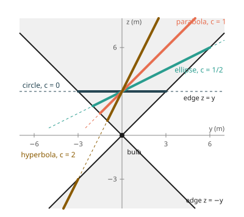

# Affine varieties: the zero set of a system, and its ring of polynomial functions

[Syllabus](../../../SYLLABUS.md) → [Algebraic geometry](../README.md) → [Affine and Projective Varieties](../README.md#s02) → Affine varieties

---

## General Overview

A torch hangs at the origin and points along the z-axis. Its beam spreads at 45 degrees from the axis. A point (x, y, z) in the room, in metres, sits on the edge of the beam, or on its mirror image behind the bulb, exactly when x² + y² = z². That one equation is a cone: two funnels, tip to tip at the bulb.

The cone is the solution set of a polynomial system. Such a set is an **affine variety**: the points of ordinary space where a list of polynomials are all zero. "Affine" means ordinary space, with no points at infinity added.

Now measure something on the beam's edge, say the squared distance from the bulb. One formula is x² + y² + z². A second is 2x² + 2y². A third is 2z². In the room they differ. On the cone they always agree, because x² + y² can be swapped for z².

That swap is the whole idea of this card. A polynomial read only at the points of the cone is a **function on the cone**. Treat every polynomial that is zero all over the cone as zero, and what is left is the **coordinate ring**: the ring of polynomial functions on the variety.

For the cone this is concrete. Replace x² by z² − y² until no x² is left. Two formulas agree on the cone exactly when the results match. All three distance formulas reduce to 2z², so on a wall 3 m ahead the lit circle's edge is √18 = 4.243 m from the bulb.

**A variety is the set of points where a system of polynomials vanishes, and its coordinate ring is the polynomials modulo those that vanish on it: two formulas are one function exactly when their difference lies in that vanishing set.**

**What kind of fact this is:** two definitions, the affine variety and its coordinate ring, and one theorem proved on this card in Why it works: over the real or the complex numbers, the polynomials vanishing on the cone are exactly the multiples of x² + y² − z².

### The picture: the cone from the side, and the walls it lights

Tilt the wall and the lit patch changes shape. Each wall is a plane z = 3 + c·y, where c is its tilt. Each one cuts the cone in a conic: a circle, an ellipse, a parabola or a hyperbola.

<p align="center"></p>

Side view, to scale, real points only, with x dropped. The cone's real points fill the shaded wedge between the edges z = y and z = −y. Each wall is a dashed line seen edge-on; its thick part is the conic it cuts from the cone, squashed flat. The c = 2 wall also cuts the cone's lower funnel, behind the bulb and not lit by the torch, so its hyperbola has two pieces.

---

## The formula

Notation first. The field k is the number system the coordinates come from. Here it is ℝ, the real numbers, unless a line names another field. Two names are new on this card:

- **Affine n-space**, written $`\mathbb{A}^n`$, is the set of all lists of n numbers from k. The room is $`\mathbb{A}^3`$.
- **The coordinate ring**, written $`k[V]`$, is the ring of polynomial functions on a variety V, defined below.

Three names come from earlier cards. $`k[x_1, \dots, x_n]`$ is all polynomials in n letters with coefficients in k. $`\langle f_1, \dots, f_s \rangle`$ is the **ideal** they generate: every sum $`h_1 f_1 + \dots + h_s f_s`$ with polynomial multipliers ([Ideals and varieties](../01-Polynomial%20Systems/01-ideals-and-varieties.md)). $`I(V)`$ is the **vanishing ideal**: every polynomial that is zero at every point of V ([The Nullstellensatz](../01-Polynomial%20Systems/09-nullstellensatz.md)).

```math
V(f_1, \dots, f_s) = \{\, a \in \mathbb{A}^n : f_1(a) = \dots = f_s(a) = 0 \,\} \qquad k[V] = k[x_1, \dots, x_n] \,/\, I(V)
```

**Read it aloud:** the variety is every point where all the equations hold; its coordinate ring is the polynomials, with two counted as equal when they agree at every point of the variety.

A variety cut out by a single polynomial, like the cone, is a **hypersurface**. For the cone the theorem on this card makes the ring explicit:

```math
\mathbb{R}[V] = \mathbb{R}[x, y, z] \,/\, \langle x^2 + y^2 - z^2 \rangle, \qquad \text{each function is } A(y, z) + x\,B(y, z) \text{ in exactly one way}
```

**Read it aloud:** on the cone, every polynomial function is a polynomial in y and z, plus x times another polynomial in y and z, and that split is unique.

| Symbol | Plain meaning | In our example | Push it up and the answer… |
| --- | --- | --- | --- |
| $`k`$ | the field the coordinates come from; $`\mathbb{F}_p`$ is the whole numbers mod a prime p | ℝ; $`\mathbb{F}_3`$ in one trap | a finite field adds extra vanishing polynomials |
| $`\mathbb{A}^n`$ | affine n-space: all lists of n numbers from k | $`\mathbb{A}^3`$, the room | more letters, more room |
| $`x, y, z`$ | the coordinates, in metres | y across the wall, z along the beam | — |
| $`k[x, y, z]`$ | all polynomials in the coordinates | $`x^2 + y^2 + z^2`$, $`2z^2`$ | — |
| $`f`$, $`f_1, \dots, f_s`$ | the equations of the system | $`f = x^2 + y^2 - z^2`$ | more equations, a smaller variety |
| $`\langle f_1, \dots, f_s \rangle`$ | the ideal: all combinations $`h_1 f_1 + \dots + h_s f_s`$, each $`h_i`$ any polynomial | multiples of f | — |
| $`V(f_1, \dots, f_s)`$ | the variety: the points a where every equation is zero | the cone | — |
| $`I(V)`$ | the vanishing ideal: polynomials zero everywhere on V; over ℂ, $`I(V(J)) = \sqrt{J}`$ for an ideal J, where the radical $`\sqrt{J}`$ is the polynomials with a power in J | $`\langle f \rangle`$, proved below | larger, so fewer distinct functions |
| $`k[V]`$ | the coordinate ring: polynomials modulo $`I(V)`$ | functions on the beam's edge | — |
| $`g`$ | a polynomial read as a function on V | squared distance to the bulb | — |
| $`A(y, z)`$, $`B(y, z)`$ | the two parts of the standard form $`A + xB`$ | for g: A = $`2z^2`$, B = 0 | — |
| $`c = p/q`$; $`d`$ | a wall's tilt, as a fraction of whole numbers p and q (this p is not the prime of $`\mathbb{F}_p`$); a degree limit when counting functions | c = 1/2; d = 0 to 5 | c past 1 turns the ellipse into a hyperbola; d up, $`(d+1)^2`$ functions |

### When it holds

- **The ideal must be the vanishing ideal.** Write the cone as $`(x^2 + y^2 - z^2)^2 = 0`$ and the points are the same. But dividing by $`\langle f^2 \rangle`$ keeps f as a nonzero class, although f is zero at every point. Up to degree 2 that quotient keeps 10 independent classes; the cone has 9 functions.
- **The field must be infinite.** Over $`\mathbb{F}_3`$ the cone has 9 points, and $`x^3 - x`$ is zero at all of them. Yet its standard form $`-xy^2 + xz^2 - x`$ is not zero, so $`\langle f \rangle`$ misses part of the vanishing ideal.
- **Over ℝ, the equation must have enough real points.** $`x^2 + y^2 + z^2 = 0`$ has one real point, the origin. Its real coordinate ring is just the constants, not the 9 classes up to degree 2 that the quotient by that one polynomial suggests. Over ℂ, [The Nullstellensatz](../01-Polynomial%20Systems/09-nullstellensatz.md) fixes this: $`I(V(J)) = \sqrt{J}`$, the polynomials some power of which lies in J.
- **Functions are polynomials only.** $`1/z`$ is a fine function on most of the cone but is not in $`k[V]`$: it blows up at the bulb. Ratios belong to [Maps between varieties](05-regular-and-rational-maps.md).

---

## Why it works

### Step 0: a function only sees its values on V

A function on the cone is read only at points of the cone. So two polynomials g and h give the same function exactly when g − h is zero at every point of V. That is, when $`g - h`$ lies in $`I(V)`$.

So "same function on V" is "same class modulo $`I(V)`$". The steps below show this is a ring, then find the classes for the cone.

### Step 1: the vanishing polynomials form an ideal

If g and h vanish on V, so does g − h. If g vanishes on V, then any polynomial times g vanishes on V too: zero times anything is zero. Those are the two tests of an ideal.

The algebra wing builds the quotient ring R/I for any ideal I: classes add and multiply by any of their names ([Ideals and quotient rings](../../03-Algebra/09-Rings%20and%20Fields/04-ideals-and-quotient-rings.md)). Its example collapses polynomials by $`x^2 + 1`$. Here the collapse is by $`I(V)`$.

### Step 2: the quotient is exactly the functions

Send each polynomial to the function it defines on V. Sums go to sums and products to products, so this is a ring map. Its **kernel**, what goes to zero, is $`I(V)`$ by definition. Its image is all polynomial functions on V.

The first isomorphism theorem from that same card says a ring modulo a kernel is the image. So $`k[V]`$, the quotient, is the ring of polynomial functions on V, with nothing lost and nothing doubled.

### Step 3: for the cone, divide by f

Each $`x^2`$ can be swapped for $`z^2 - y^2`$, since the two differ by f. Repeat until x appears at most to the first power. What remains has the form $`A(y, z) + x\,B(y, z)`$.

This is division by f, with $`x^2`$ as its leading term in the order x > y > z. The squared distance reduces in one swap:

```math
x^2 + y^2 + z^2 \;\to\; (z^2 - y^2) + y^2 + z^2 = 2z^2
```

### Step 4: the standard form is unique, so I(V) is the multiples of f

Suppose $`A + xB`$ is zero at every real point of the cone. Pick y and z with $`z^2 > y^2`$. Then both $`x = \sqrt{z^2 - y^2}`$ and its negative give points of the cone. Adding the two values gives $`2A(y, z) = 0`$. Subtracting gives $`2x\,B(y, z) = 0`$ with x not zero.

So A and B vanish on a whole open region of the (y, z) plane. A polynomial in two letters that vanishes on an open region is the zero polynomial. Hence A = B = 0.

Two results follow. A polynomial vanishes on the cone exactly when its standard form is 0, so $`I(V) = \langle f \rangle`$. And the classes of $`y^a z^b`$ and $`x\,y^a z^b`$ form a basis of $`\mathbb{R}[V]`$: every function is one combination of them, in exactly one way.

<details>
<summary>Why a two-letter polynomial that vanishes on an open region is zero</summary>

Fix z in the region's range. Then A(y, z) is a polynomial in y alone with infinitely many roots, so each of its coefficients, a polynomial in z, is zero at that z.

Each coefficient is then a polynomial in z with infinitely many roots, so it is the zero polynomial. The same proof works over ℂ, where every (y, z) gives two points on the cone.

It fails over $`\mathbb{F}_p`$, which has only p values to try. That is the second bullet of When it holds.

</details>

### Step 5: count the functions two ways

Count the functions of degree at most d. The standard form gives the monomials $`y^a z^b`$ with $`a + b \le d`$ and $`x\,y^a z^b`$ with $`a + b \le d - 1`$:

```math
\tfrac{(d+1)(d+2)}{2} + \tfrac{d(d+1)}{2} = (d+1)^2 = \binom{d+3}{3} - \binom{d+1}{3}
```

The right-hand form reads: all monomials of degree at most d, minus the multiples of f that fit, which are f times a polynomial of degree at most d − 2.

A second road never looks at f. Evaluate every monomial at 336 integer points of the cone and take the rank of that table of values. The rank is the number of independent functions the points can tell apart. For d = 0 to 5 both roads give 1, 4, 9, 16, 25 and 36.

### Step 6: a wall's conic is one more equation

The lit patch on a wall is the variety of two equations: the cone and the wall. Its coordinate ring is the cone's ring with one more relation, the wall's equation. Substituting $`z = 3 + cy`$ removes z and leaves a conic in x and y. Written with c = p/q and multiplied by $`q^2`$:

```math
q^2 x^2 + (q^2 - p^2)\,y^2 - 6pq\,y - 9q^2 = 0
```

The sign of the $`y^2`$ coefficient picks the shape: positive an ellipse, zero a parabola, negative a hyperbola. The side view agrees: the wall crosses both edges in front of the bulb, one edge only, or one edge behind it.

---

## Worked numbers, by hand

| Step | Arithmetic | Value |
| --- | --- | --- |
| squared distance, standard form | $`x^2 + y^2 + z^2`$, swap $`x^2`$ for $`z^2 - y^2`$ | $`2z^2`$ |
| a second formula | $`2x^2 + 2y^2 \to 2(z^2 - y^2) + 2y^2`$ | $`2z^2`$, the same function |
| check at the cone point (9, 12, 15) | 81 + 144 + 225 against 2 × 225 | 450 and 450 |
| on the wall z = 3 | 2 × 3², then the square root | 18; **4.243 m** |
| a hidden member of $`I(V)`$ | $`x^4 - x^2z^2 - y^4 + y^2z^2 = (x^2 - y^2) f`$ | standard form 0 |
| functions of degree at most 2 | 10 monomials minus 1 multiple of f | **9** |
| wall tilted at c = 1/2, put into f, times 4 | $`4x^2 + 3y^2 - 12y - 36`$; $`y^2`$ term positive | an ellipse |
| its ends, where x = 0 | $`y^2 - 4y - 12 = 0`$, z = 3 + y/2 | (−2, 2) and (6, 6) |
| their distances from the bulb | $`\sqrt{2 \cdot 2^2}`$ and $`\sqrt{2 \cdot 6^2}`$ | **2.828 m and 8.485 m** |

The lit ellipse on that tilted wall runs from 2.828 m to 8.485 m from the bulb, every distance read from the one standard form $`2z^2`$.

### What breaks if you drop a piece

| Mistake | Comes out at | What went wrong |
| --- | --- | --- |
| Work over $`\mathbb{F}_3`$ and trust $`\langle f \rangle`$ | $`x^3 - x`$ is 0 at all 9 points, standard form $`-xy^2 + xz^2 - x`$ | a finite field has extra vanishing polynomials |
| Use $`(x^2 + y^2 - z^2)^2 = 0`$ as the equation | 10 classes up to degree 2, against 9 functions | the ideal was not the vanishing ideal |
| Read $`x^2 + y^2 + z^2 = 0`$ over ℝ as a surface | 1 real point; 9 classes up to degree 2, against 1 function | over ℝ an equation can have almost no points |

The code prints all three.

---

## Code, from first principles, and it actually runs

Nothing is imported. Polynomials are stored as tables of exponents and whole-number coefficients, so every result is exact. The script takes three independent roads:

1. **Division:** reduce each polynomial to its standard form $`A + xB`$.
2. **Substitution:** put 336 exact integer points of the cone, built from Pythagorean triples such as (3, 4, 5), back into both the polynomial and its standard form.
3. **A table of values:** rank the values of every monomial at those points, modulo the prime 1,000,003. This road never sees f.

It also counts the cone's points over $`\mathbb{F}_3`$, $`\mathbb{F}_5`$ and $`\mathbb{F}_7`$ by enumeration, and classifies the four walls by algebra and by the side view.

### Python

```python
# Affine varieties and coordinate rings -- the check behind the card.  Nothing
# is imported.  The variety is the cone x^2 + y^2 = z^2, the edge of a torch
# beam with its bulb at the origin.  A polynomial is a dict {(i, j, k): coeff}
# for x^i y^j z^k, with whole-number coefficients.  Roads: divide by the cone
# (replace x^2 by z^2 - y^2); put exact points back in; count independent
# functions by the rank of a table of values, which never sees the equation.
P = 1000003                                     # a prime, for the rank road

def add(a, b):
    out = dict(a)
    for m, c in b.items():
        out[m] = out.get(m, 0) + c
    return {m: c for m, c in out.items() if c}

def normal_form(g):                             # road one: x^2 -> z^2 - y^2
    g = dict(g)
    while any(m[0] >= 2 for m in g):
        (i, j, k), c = next((m, c) for m, c in g.items() if m[0] >= 2)
        del g[(i, j, k)]
        g = add(g, {(i - 2, j, k + 2): c, (i - 2, j + 2, k): -c})
    return g

def ev(g, pt, mod=None):                        # road two: put a point back in
    s = sum(c * pt[0] ** i * pt[1] ** j * pt[2] ** k for (i, j, k), c in g.items())
    return s % mod if mod else s

def show(g):                                    # leading term first, x > y > z
    if not g:
        return "0"
    out = ""
    for (i, j, k), c in sorted(g.items(), reverse=True):
        mono = "".join(v + (f"^{e}" if e > 1 else "") for v, e in zip("xyz", (i, j, k)) if e)
        coef = (str(abs(c)) if abs(c) != 1 or not mono else "") + mono
        out += ("-" if c < 0 else "") + coef if not out else (" - " if c < 0 else " + ") + coef
    return out

pts = set()                                     # integer points from Pythagorean triples
for m in range(1, 6):
    for n in range(0, m):
        a, b, c = m * m - n * n, 2 * m * n, m * m + n * n
        for t in (1, 2):
            for sx, sy, sz in [(u, v, w) for u in (1, -1) for v in (1, -1) for w in (1, -1)]:
                pts |= {(sx * t * a, sy * t * b, sz * t * c), (sx * t * b, sy * t * a, sz * t * c)}
pts = sorted(pts)
F = {(2, 0, 0): 1, (0, 2, 0): 1, (0, 0, 2): -1}
assert all(ev(F, q) == 0 for q in pts)
print("field: the real numbers; F_p only where named")
print(f"cone f = {show(F)}; normal form: replace x^2 by z^2 - y^2")
print(f"integer test points on the cone: {len(pts)}")
named = [("x^2 + y^2 + z^2", {(2, 0, 0): 1, (0, 2, 0): 1, (0, 0, 2): 1}),
         ("2x^2 + 2y^2", {(2, 0, 0): 2, (0, 2, 0): 2}),
         ("x^4 - x^2z^2 - y^4 + y^2z^2", {(4, 0, 0): 1, (2, 0, 2): -1, (0, 4, 0): -1, (0, 2, 2): 1}),
         ("x^2 + z^2", {(2, 0, 0): 1, (0, 0, 2): 1})]
for name, g in named:
    r = normal_form(g)
    same = all(ev(g, q) == ev(r, q) for q in pts)
    print(f"g = {name}  ->  {show(r)}; equal at all {len(pts)} points: {'yes' if same else 'no'}")
    assert same
assert normal_form(named[0][1]) == normal_form(named[1][1]) == {(0, 0, 2): 2} and normal_form(named[2][1]) == {}
print(f"x^2 + z^2 against 2z^2: at (3, 0, 3) {ev(named[3][1], (3, 0, 3))} and 18; at (0, 3, 3) {ev(named[3][1], (0, 3, 3))} and 18")
print(f"squared distance from the bulb at (9, 12, 15): {ev(named[0][1], (9, 12, 15))} = 2 x 15^2 = {2 * 225}")
print(f"on the wall z = 3: 2 x 3^2 = 18, distance {18 ** 0.5:.3f} m")

def rank_mod(rows):                             # Gaussian elimination mod P
    r = 0
    for col in range(len(rows[0])):
        piv = next((i for i in range(r, len(rows)) if rows[i][col]), None)
        if piv is None:
            continue
        rows[r], rows[piv] = rows[piv], rows[r]
        inv = pow(rows[r][col], P - 2, P)
        rows[r] = [v * inv % P for v in rows[r]]
        for i in range(len(rows)):
            if i != r and rows[i][col]:
                c = rows[i][col]
                rows[i] = [(v - c * w) % P for v, w in zip(rows[i], rows[r])]
        r += 1
    return r

def monos(d):
    return [(i, j, k) for i in range(d + 1) for j in range(d + 1 - i) for k in range(d + 1 - i - j)]

def mults(e, d):                                # multiples h g of a degree-e polynomial g, deg h <= d - e
    return len(monos(d - e)) if d >= e else 0

print("degree d | monomials | multiples of f | normal-form basis | rank of values")
dims = []
for d in range(6):
    ms = monos(d)
    basis = sum(1 for (i, j, k) in ms if i <= 1)
    rank = rank_mod([[ev({m: 1}, q, P) for m in ms] for q in pts])
    print(f"   {d}     |    {len(ms):2}     |      {mults(2, d):2}        |        {basis:2}         |   {rank:2}")
    assert basis == rank == (d + 1) ** 2 == len(ms) - mults(2, d)
    dims.append(rank)

def frac(n, d):                                 # n/d in lowest terms
    a, b = abs(n), abs(d)
    while b:
        a, b = b, a % b
    sign = "-" if n * d < 0 else ""
    return f"{sign}{abs(n) // a}" + (f"/{abs(d) // a}" if abs(d) != a else "")

print("walls z = 3 + c y with c = p/q; the slice, put into f and times q^2:")
ends = {}                                       # each wall's x = 0 ends, kept for the lines below
for p, q in [(0, 1), (1, 2), (1, 1), (2, 1), (3, 2)]:
    A, B, C = q * q - p * p, -6 * p * q, -9 * q * q
    kind = ("circle" if B == 0 else "ellipse") if A > 0 else "parabola" if A == 0 else "hyperbola"
    disc = B * B - 4 * A * C
    s = int(disc ** 0.5)
    assert s * s == disc
    ys = sorted([(-B - s, 2 * A), (-B + s, 2 * A)], key=lambda t: t[0] / t[1]) if A else [(-C, B)]
    zs = [(3 * q * yd + p * yn, q * yd) for yn, yd in ys]
    ends[p, q] = list(zip(ys, zs))
    for (yn, yd), (zn, zd) in zip(ys, zs):          # scale up and put back in f
        assert ev(F, (0, yn * zd, zn * yd)) == 0
    geo = "ellipse" if len(zs) == 2 and all(zn * zd > 0 for zn, zd in zs) else "parabola" if len(zs) == 1 else "hyperbola"
    assert geo == kind.replace("circle", "ellipse")
    print(f"c = {frac(p, q)}: {show(add({}, {(2, 0, 0): q * q, (0, 2, 0): A, (0, 1, 0): B, (0, 0, 0): C}))}; {kind}; x = 0 at "
          + "(y, z) = " + " and ".join(f"({frac(*y)}, {frac(*z)})" for y, z in zip(ys, zs)))
(ya, za), (yb, zb) = ends[1, 2]                 # the ellipse's ends; on the cone, distance^2 = 2z^2
print(f"ellipse ends (0, {frac(*ya)}, {frac(*za)}) and (0, {frac(*yb)}, {frac(*zb)}): "
      f"{(2 * (za[0] / za[1]) ** 2) ** 0.5:.3f} m and {(2 * (zb[0] / zb[1]) ** 2) ** 0.5:.3f} m from the bulb")
pt = {w: [f"({frac(*y)},{frac(*z)})" for y, z in sorted(e, key=lambda t: t[1][0] / t[1][1])] for w, e in ends.items()}
print(f"figure, edges z = y and z = -y; circle {'-'.join(pt[0, 1])}; ellipse {'-'.join(pt[1, 2])}; "
      f"parabola from {pt[1, 1][0]} along z = 3 + y; hyperbola up from {pt[2, 1][1]}, down from {pt[2, 1][0]}")
for p in (3, 5, 7, 11):
    n = sum(1 for x in range(p) for y in range(p) for z in range(p) if (x * x + y * y - z * z) % p == 0)
    print(f"points on the cone over F_{p}: {n} = {p}^2")
    assert n == p * p
cub = {(3, 0, 0): 1, (1, 0, 0): -1}
on3 = [(x, y, z) for x in range(3) for y in range(3) for z in range(3) if (x * x + y * y - z * z) % 3 == 0]
print(f"mistake 1, over F_3: x^3 - x is 0 at all {len(on3)} points: {'yes' if all(ev(cub, q, 3) == 0 for q in on3) else 'no'}; "
      f"normal form {show(normal_form(cub))}, not 0")
q2, q3 = (len(monos(2)) - mults(e, 2) for e in (2 * max(map(sum, F)), max(map(sum, named[0][1]))))  # f^2; x^2+y^2+z^2
print(f"mistake 2, (x^2 + y^2 - z^2)^2 = 0 as the equation: degree <= 2 quotient keeps {q2}; functions {dims[2]}")
box = [(x, y, z) for x in range(-5, 6) for y in range(-5, 6) for z in range(-5, 6) if x * x + y * y + z * z == 0]
one = rank_mod([[ev({m: 1}, q, P) for m in monos(2)] for q in box])
print(f"mistake 3, x^2 + y^2 + z^2 = 0 over the reals: {len(box)} point in the box; quotient keeps {q3} in degree <= 2, functions {one}")
assert normal_form(cub) != {} and all(ev(cub, q, 3) == 0 for q in on3) and len(box) == one == 1 and q2 == dims[2] + 1 == q3 + 1
print("ALL CHECKS PASS")
```

**Ran 2026-11-17 on macOS, Python 3.14.10, standard library only. All checks passed. Output, pasted from the run:**

```
field: the real numbers; F_p only where named
cone f = x^2 + y^2 - z^2; normal form: replace x^2 by z^2 - y^2
integer test points on the cone: 336
g = x^2 + y^2 + z^2  ->  2z^2; equal at all 336 points: yes
g = 2x^2 + 2y^2  ->  2z^2; equal at all 336 points: yes
g = x^4 - x^2z^2 - y^4 + y^2z^2  ->  0; equal at all 336 points: yes
g = x^2 + z^2  ->  -y^2 + 2z^2; equal at all 336 points: yes
x^2 + z^2 against 2z^2: at (3, 0, 3) 18 and 18; at (0, 3, 3) 9 and 18
squared distance from the bulb at (9, 12, 15): 450 = 2 x 15^2 = 450
on the wall z = 3: 2 x 3^2 = 18, distance 4.243 m
degree d | monomials | multiples of f | normal-form basis | rank of values
   0     |     1     |       0        |         1         |    1
   1     |     4     |       0        |         4         |    4
   2     |    10     |       1        |         9         |    9
   3     |    20     |       4        |        16         |   16
   4     |    35     |      10        |        25         |   25
   5     |    56     |      20        |        36         |   36
walls z = 3 + c y with c = p/q; the slice, put into f and times q^2:
c = 0: x^2 + y^2 - 9; circle; x = 0 at (y, z) = (-3, 3) and (3, 3)
c = 1/2: 4x^2 + 3y^2 - 12y - 36; ellipse; x = 0 at (y, z) = (-2, 2) and (6, 6)
c = 1: x^2 - 6y - 9; parabola; x = 0 at (y, z) = (-3/2, 3/2)
c = 2: x^2 - 3y^2 - 12y - 9; hyperbola; x = 0 at (y, z) = (-3, -3) and (-1, 1)
c = 3/2: 4x^2 - 5y^2 - 36y - 36; hyperbola; x = 0 at (y, z) = (-6, -6) and (-6/5, 6/5)
ellipse ends (0, -2, 2) and (0, 6, 6): 2.828 m and 8.485 m from the bulb
figure, edges z = y and z = -y; circle (-3,3)-(3,3); ellipse (-2,2)-(6,6); parabola from (-3/2,3/2) along z = 3 + y; hyperbola up from (-1,1), down from (-3,-3)
points on the cone over F_3: 9 = 3^2
points on the cone over F_5: 25 = 5^2
points on the cone over F_7: 49 = 7^2
points on the cone over F_11: 121 = 11^2
mistake 1, over F_3: x^3 - x is 0 at all 9 points: yes; normal form -xy^2 + xz^2 - x, not 0
mistake 2, (x^2 + y^2 - z^2)^2 = 0 as the equation: degree <= 2 quotient keeps 10; functions 9
mistake 3, x^2 + y^2 + z^2 = 0 over the reals: 1 point in the box; quotient keeps 9 in degree <= 2, functions 1
ALL CHECKS PASS
```

### Rust

Same numbers, same labels, built with `rustc --edition 2021 -O`.

```rust
// Affine varieties and coordinate rings -- the same check as the Python, in Rust,
// no crates.  The cone x^2 + y^2 = z^2 is a torch beam's edge, bulb at the origin.
// A polynomial maps (i, j, k) to the whole-number coefficient of x^i y^j z^k.
// Roads: divide by the cone; put exact points back in; rank a table of values.
use std::collections::{BTreeMap, BTreeSet};
type Poly = BTreeMap<(u32, u32, u32), i64>;
type Pt = (i64, i64, i64);
const P: i64 = 1000003; // a prime, for the rank road

fn poly(terms: &[((u32, u32, u32), i64)]) -> Poly {
    let mut out = Poly::new();
    for &(m, c) in terms { *out.entry(m).or_insert(0) += c }
    out.retain(|_, c| *c != 0);
    out
}

fn normal_form(g: &Poly) -> Poly { // road one: x^2 -> z^2 - y^2
    let mut g = g.clone();
    while let Some((&(i, j, k), &c)) = g.iter().find(|(m, _)| m.0 >= 2) {
        g.remove(&(i, j, k));
        *g.entry((i - 2, j, k + 2)).or_insert(0) += c;
        *g.entry((i - 2, j + 2, k)).or_insert(0) -= c;
        g.retain(|_, c| *c != 0);
    }
    g
}

fn ev(g: &Poly, p: Pt, m: i64) -> i64 { // road two: put a point back in (m = 0: exact)
    let mut s = 0;
    for (&(i, j, k), &c) in g {
        let t = c * p.0.pow(i) * p.1.pow(j) * p.2.pow(k);
        s = if m > 0 { (s + t.rem_euclid(m)) % m } else { s + t };
    }
    s
}

fn show(g: &Poly) -> String { // leading term first, x > y > z
    if g.is_empty() { return "0".to_string() }
    let mut out = String::new();
    for (&(i, j, k), &c) in g.iter().rev() {
        let mut mono = String::new();
        for (v, e) in [("x", i), ("y", j), ("z", k)] { if e > 0 { mono += v; if e > 1 { mono += &format!("^{}", e) } } }
        let coef = if c.abs() != 1 || mono.is_empty() { format!("{}{}", c.abs(), mono) } else { mono };
        if out.is_empty() { out = format!("{}{}", if c < 0 { "-" } else { "" }, coef) }
        else { out += &format!("{}{}", if c < 0 { " - " } else { " + " }, coef) }
    }
    out
}

fn rank_mod(mut rows: Vec<Vec<i64>>) -> usize { // Gaussian elimination mod P
    let mut r = 0;
    for col in 0..rows[0].len() {
        let piv = match (r..rows.len()).find(|&i| rows[i][col] != 0) { Some(p) => p, None => continue };
        rows.swap(r, piv);
        let (mut inv, mut b, mut e) = (1i64, rows[r][col], P - 2);
        while e > 0 { if e & 1 == 1 { inv = inv * b % P } b = b * b % P; e >>= 1 }
        rows[r] = rows[r].iter().map(|v| v * inv % P).collect();
        let pivot = rows[r].clone();
        for i in 0..rows.len() {
            let c = rows[i][col];
            if i != r && c != 0 { rows[i] = rows[i].iter().zip(&pivot).map(|(v, w)| (v - c * w).rem_euclid(P)).collect() }
        }
        r += 1;
    }
    r
}

fn monos(d: u32) -> Vec<(u32, u32, u32)> {
    (0..=d).flat_map(|i| (0..=d - i).flat_map(move |j| (0..=d - i - j).map(move |k| (i, j, k)))).collect()
}
fn mults(e: u32, d: u32) -> usize { if d >= e { monos(d - e).len() } else { 0 } } // multiples h g of a degree-e g, deg h <= d - e

fn table(ms: &[(u32, u32, u32)], pts: &[Pt]) -> Vec<Vec<i64>> { pts.iter().map(|&q| ms.iter().map(|&m| ev(&poly(&[(m, 1)]), q, P)).collect()).collect() }

fn frac(n: i64, d: i64) -> String { // n/d in lowest terms
    let (mut a, mut b) = (n.abs(), d.abs());
    while b != 0 { (a, b) = (b, a % b) }
    let sign = if n * d < 0 { "-" } else { "" };
    if d.abs() != a { format!("{}{}/{}", sign, n.abs() / a, d.abs() / a) } else { format!("{}{}", sign, n.abs() / a) }
}

fn yn(b: bool) -> &'static str { if b { "yes" } else { "no" } }

fn main() {
    let mut set: BTreeSet<Pt> = BTreeSet::new(); // integer points from Pythagorean triples
    for m in 1..6i64 { for n in 0..m {
        let (a, b, c) = (m * m - n * n, 2 * m * n, m * m + n * n);
        for t in [1, 2] { for sx in [1, -1] { for sy in [1, -1] { for sz in [1, -1] {
            set.extend([(sx * t * a, sy * t * b, sz * t * c), (sx * t * b, sy * t * a, sz * t * c)]);
        } } } }
    } }
    let pts: Vec<Pt> = set.into_iter().collect();
    let f = poly(&[((2, 0, 0), 1), ((0, 2, 0), 1), ((0, 0, 2), -1)]);
    assert!(pts.iter().all(|&q| ev(&f, q, 0) == 0));
    println!("field: the real numbers; F_p only where named");
    println!("cone f = {}; normal form: replace x^2 by z^2 - y^2", show(&f));
    println!("integer test points on the cone: {}", pts.len());
    let named = [("x^2 + y^2 + z^2", poly(&[((2, 0, 0), 1), ((0, 2, 0), 1), ((0, 0, 2), 1)])),
                 ("2x^2 + 2y^2", poly(&[((2, 0, 0), 2), ((0, 2, 0), 2)])),
                 ("x^4 - x^2z^2 - y^4 + y^2z^2", poly(&[((4, 0, 0), 1), ((2, 0, 2), -1), ((0, 4, 0), -1), ((0, 2, 2), 1)])),
                 ("x^2 + z^2", poly(&[((2, 0, 0), 1), ((0, 0, 2), 1)]))];
    for (name, g) in &named {
        let r = normal_form(g);
        let same = pts.iter().all(|&q| ev(g, q, 0) == ev(&r, q, 0));
        println!("g = {}  ->  {}; equal at all {} points: {}", name, show(&r), pts.len(), yn(same));
        assert!(same);
    }
    assert!(normal_form(&named[0].1) == poly(&[((0, 0, 2), 2)]) && normal_form(&named[1].1) == normal_form(&named[0].1) && normal_form(&named[2].1).is_empty());
    println!("x^2 + z^2 against 2z^2: at (3, 0, 3) {} and 18; at (0, 3, 3) {} and 18", ev(&named[3].1, (3, 0, 3), 0), ev(&named[3].1, (0, 3, 3), 0));
    println!("squared distance from the bulb at (9, 12, 15): {} = 2 x 15^2 = {}", ev(&named[0].1, (9, 12, 15), 0), 2 * 225);
    println!("on the wall z = 3: 2 x 3^2 = 18, distance {:.3} m", 18f64.sqrt());
    println!("degree d | monomials | multiples of f | normal-form basis | rank of values");
    let mut dims = Vec::new();
    for d in 0..6u32 {
        let ms = monos(d);
        let basis = ms.iter().filter(|m| m.0 <= 1).count();
        let rank = rank_mod(table(&ms, &pts));
        let (n, mult) = ((d + 1) as usize, mults(2, d));
        println!("   {}     |    {:2}     |      {:2}        |        {:2}         |   {:2}", d, ms.len(), mult, basis, rank);
        assert!(basis == rank && rank == n * n && n * n == ms.len() - mult);
        dims.push(rank);
    }
    println!("walls z = 3 + c y with c = p/q; the slice, put into f and times q^2:");
    let mut ends = std::collections::BTreeMap::new(); // each wall's x = 0 ends, kept for the lines below
    for (p, q) in [(0i64, 1i64), (1, 2), (1, 1), (2, 1), (3, 2)] {
        let (a, b, c) = (q * q - p * p, -6 * p * q, -9 * q * q);
        let kind = if a > 0 { if b == 0 { "circle" } else { "ellipse" } } else if a == 0 { "parabola" } else { "hyperbola" };
        let disc = b * b - 4 * a * c;
        let s = (disc as f64).sqrt() as i64;
        assert!(s * s == disc);
        let mut ys: Vec<(i64, i64)> = if a != 0 { vec![(-b - s, 2 * a), (-b + s, 2 * a)] } else { vec![(-c, b)] };
        ys.sort_by(|u, v| (u.0 as f64 / u.1 as f64).partial_cmp(&(v.0 as f64 / v.1 as f64)).unwrap());
        let zs: Vec<(i64, i64)> = ys.iter().map(|&(yn, yd)| (3 * q * yd + p * yn, q * yd)).collect();
        ends.insert((p, q), ys.iter().copied().zip(zs.iter().copied()).collect::<Vec<_>>());
        for (&(yn, yd), &(zn, zd)) in ys.iter().zip(&zs) { // scale up and put back in f
            assert!(ev(&f, (0, yn * zd, zn * yd), 0) == 0);
        }
        let geo = if zs.len() == 2 && zs.iter().all(|&(zn, zd)| zn * zd > 0) { "ellipse" } else if zs.len() == 1 { "parabola" } else { "hyperbola" };
        assert!(geo == kind.replace("circle", "ellipse"));
        let sl = poly(&[((2, 0, 0), q * q), ((0, 2, 0), a), ((0, 1, 0), b), ((0, 0, 0), c)]);
        let at: Vec<String> = ys.iter().zip(&zs).map(|(y, z)| format!("({}, {})", frac(y.0, y.1), frac(z.0, z.1))).collect();
        println!("c = {}: {}; {}; x = 0 at (y, z) = {}", frac(p, q), show(&sl), kind, at.join(" and "));
    }
    let ((ya, za), (yb, zb)) = (ends[&(1, 2)][0], ends[&(1, 2)][1]); // the ellipse's ends; on the cone, distance^2 = 2z^2
    println!("ellipse ends (0, {}, {}) and (0, {}, {}): {:.3} m and {:.3} m from the bulb", frac(ya.0, ya.1), frac(za.0, za.1), frac(yb.0, yb.1),
             frac(zb.0, zb.1), (2.0 * (za.0 as f64 / za.1 as f64).powi(2)).sqrt(), (2.0 * (zb.0 as f64 / zb.1 as f64).powi(2)).sqrt());
    let pt = |w: (i64, i64)| -> Vec<String> { let mut e = ends[&w].clone(); e.sort_by(|s, t| (s.1 .0 as f64 / s.1 .1 as f64).total_cmp(&(t.1 .0 as f64 / t.1 .1 as f64)));
        e.iter().map(|(y, z)| format!("({},{})", frac(y.0, y.1), frac(z.0, z.1))).collect() };
    println!("figure, edges z = y and z = -y; circle {}; ellipse {}; parabola from {} along z = 3 + y; hyperbola up from {}, down from {}",
             pt((0, 1)).join("-"), pt((1, 2)).join("-"), pt((1, 1))[0], pt((2, 1))[1], pt((2, 1))[0]);
    for p in [3i64, 5, 7, 11] {
        let n = (0..p * p * p).filter(|v| { let (x, y, z) = (v / (p * p), v / p % p, v % p); (x * x + y * y - z * z).rem_euclid(p) == 0 }).count() as i64;
        println!("points on the cone over F_{}: {} = {}^2", p, n, p);
        assert!(n == p * p);
    }
    let cub = poly(&[((3, 0, 0), 1), ((1, 0, 0), -1)]);
    let mut on3 = Vec::new();
    for x in 0..3 { for y in 0..3 { for z in 0..3 { if (x * x + y * y - z * z) % 3 == 0 { on3.push((x, y, z)) } } } }
    let zero3 = on3.iter().all(|&q| ev(&cub, q, 3) == 0);
    println!("mistake 1, over F_3: x^3 - x is 0 at all {} points: {}; normal form {}, not 0", on3.len(), yn(zero3), show(&normal_form(&cub)));
    let (q2, q3) = (monos(2).len() - mults(2 * f.keys().map(|m| m.0 + m.1 + m.2).max().unwrap(), 2),
                    monos(2).len() - mults(named[0].1.keys().map(|m| m.0 + m.1 + m.2).max().unwrap(), 2)); // f^2; x^2 + y^2 + z^2
    println!("mistake 2, (x^2 + y^2 - z^2)^2 = 0 as the equation: degree <= 2 quotient keeps {}; functions {}", q2, dims[2]);
    let mut bx = Vec::new();
    for x in -5..6i64 { for y in -5..6i64 { for z in -5..6i64 { if x * x + y * y + z * z == 0 { bx.push((x, y, z)) } } } }
    let one = rank_mod(table(&monos(2), &bx));
    println!("mistake 3, x^2 + y^2 + z^2 = 0 over the reals: {} point in the box; quotient keeps {} in degree <= 2, functions {}", bx.len(), q3, one);
    assert!(!normal_form(&cub).is_empty() && zero3 && bx.len() == 1 && one == 1 && q2 == dims[2] + 1 && q3 == dims[2]);
    println!("ALL CHECKS PASS");
}
```

**Ran 2026-11-17 on macOS, rustc 1.98.1, no crates. All checks passed. Output, pasted from the run:**

```
field: the real numbers; F_p only where named
cone f = x^2 + y^2 - z^2; normal form: replace x^2 by z^2 - y^2
integer test points on the cone: 336
g = x^2 + y^2 + z^2  ->  2z^2; equal at all 336 points: yes
g = 2x^2 + 2y^2  ->  2z^2; equal at all 336 points: yes
g = x^4 - x^2z^2 - y^4 + y^2z^2  ->  0; equal at all 336 points: yes
g = x^2 + z^2  ->  -y^2 + 2z^2; equal at all 336 points: yes
x^2 + z^2 against 2z^2: at (3, 0, 3) 18 and 18; at (0, 3, 3) 9 and 18
squared distance from the bulb at (9, 12, 15): 450 = 2 x 15^2 = 450
on the wall z = 3: 2 x 3^2 = 18, distance 4.243 m
degree d | monomials | multiples of f | normal-form basis | rank of values
   0     |     1     |       0        |         1         |    1
   1     |     4     |       0        |         4         |    4
   2     |    10     |       1        |         9         |    9
   3     |    20     |       4        |        16         |   16
   4     |    35     |      10        |        25         |   25
   5     |    56     |      20        |        36         |   36
walls z = 3 + c y with c = p/q; the slice, put into f and times q^2:
c = 0: x^2 + y^2 - 9; circle; x = 0 at (y, z) = (-3, 3) and (3, 3)
c = 1/2: 4x^2 + 3y^2 - 12y - 36; ellipse; x = 0 at (y, z) = (-2, 2) and (6, 6)
c = 1: x^2 - 6y - 9; parabola; x = 0 at (y, z) = (-3/2, 3/2)
c = 2: x^2 - 3y^2 - 12y - 9; hyperbola; x = 0 at (y, z) = (-3, -3) and (-1, 1)
c = 3/2: 4x^2 - 5y^2 - 36y - 36; hyperbola; x = 0 at (y, z) = (-6, -6) and (-6/5, 6/5)
ellipse ends (0, -2, 2) and (0, 6, 6): 2.828 m and 8.485 m from the bulb
figure, edges z = y and z = -y; circle (-3,3)-(3,3); ellipse (-2,2)-(6,6); parabola from (-3/2,3/2) along z = 3 + y; hyperbola up from (-1,1), down from (-3,-3)
points on the cone over F_3: 9 = 3^2
points on the cone over F_5: 25 = 5^2
points on the cone over F_7: 49 = 7^2
points on the cone over F_11: 121 = 11^2
mistake 1, over F_3: x^3 - x is 0 at all 9 points: yes; normal form -xy^2 + xz^2 - x, not 0
mistake 2, (x^2 + y^2 - z^2)^2 = 0 as the equation: degree <= 2 quotient keeps 10; functions 9
mistake 3, x^2 + y^2 + z^2 = 0 over the reals: 1 point in the box; quotient keeps 9 in degree <= 2, functions 1
ALL CHECKS PASS
```

The two outputs match line for line.

### Lean

Lean proves Steps 0 to 4, the cone parts over the real or complex numbers, and checks the card's hand arithmetic.

- Take a system $`f_1, \dots, f_s`$ over any field k, with variety V. Then g and h give the same class in $`k[V]`$ exactly when they agree at every point of V.
- Sending each class to its function on V is a ring map. It reaches every polynomial function on V, with nothing lost and nothing doubled.
- Take any field. Then every polynomial is a multiple of f plus some $`A(y, z) + x\,B(y, z)`$, as in Step 3.
- Take the real or the complex numbers. Then the polynomials vanishing on the cone are exactly the multiples of f, so $`I(V) = \langle f \rangle`$.
- Take the real or the complex numbers and any polynomial g. Then on the cone, g equals $`A(y, z) + x\,B(y, z)`$ for exactly one pair A, B.
- Multiplied out, $`x^2 + y^2 + z^2 - 2z^2`$ is f.
- Multiplied out, $`2x^2 + 2y^2 - 2z^2`$ is $`2f`$.
- At the cone point (9, 12, 15), 81 + 144 + 225 and 2 × 225 both give 450.
- On the wall z = 3, the squared distance $`2 \cdot 3^2`$ is 18.
- The hidden member $`x^4 - x^2z^2 - y^4 + y^2z^2`$ equals $`(x^2 - y^2) f`$.
- $`x^2 + z^2`$ and $`2z^2`$ both give 18 at (3, 0, 3), but 9 and 18 at (0, 3, 3).
- For d = 0 to 5, the three expressions in Step 5 agree, giving 1, 4, 9, 16, 25 and 36.
- Up to degree 2, 10 monomials minus 1 multiple of f leaves 9.
- Take a wall $`z = 3 + cy`$ with $`c = p/q`$. Then putting it into f and multiplying by $`q^2`$ gives the conic of Step 6.
- At c = 1/2 the conic is $`4x^2 + 3y^2 - 12y - 36`$. Its ends are (−2, 2) and (6, 6).
- Those ends are at squared distances 8 and 72 from the bulb.
- At x = 0, the conic for c = 1 is zero at y = −3/2. For c = 2 it is zero at −3 and −1.
- At x = 0, the conic for c = 3/2 is zero at y = −6 and y = −6/5.
- The cone has 9, 25 and 49 points over $`\mathbb{F}_3`$, $`\mathbb{F}_5`$ and $`\mathbb{F}_7`$.
- Over $`\mathbb{F}_3`$, $`x^3 - x`$ is zero at every point of the cone.
- Multiplied out, $`x^3 - x`$ is x times f plus $`-xy^2 + xz^2 - x`$, its standard form.

The 336 test points, the rank of the table of values and the decimal distances are left to the Python and Rust checks.

```lean
-- Affine varieties: two polynomials are the same function on a variety exactly when their difference lies in its vanishing ideal, so the coordinate ring k[V] = k[x₁, …, xₙ]/I(V) is the ring of polynomial functions on V, and for the real or complex cone x² + y² = z² that ideal is the multiples of x² + y² − z².
import Mathlib.RingTheory.Nullstellensatz
import Mathlib.RingTheory.Ideal.Quotient.Operations
import Mathlib.Analysis.RCLike.Basic
import Mathlib.Algebra.MvPolynomial.Rename
import Mathlib.Data.ZMod.Basic
import Mathlib.Tactic.NormNum
import Mathlib.Tactic.FieldSimp
import Mathlib.Tactic.Ring
import Mathlib.Algebra.MvPolynomial.Funext
import Mathlib.Algebra.MvPolynomial.Equiv
import Mathlib.Algebra.Polynomial.Degree.SmallDegree

/-! The field is `k`. The unknowns x₁, …, xₙ are `X 0, …, X (n-1)` in `MvPolynomial (Fin n) k`.
A system is `f : Fin s → MvPolynomial (Fin n) k`; its variety V(f₁, …, fₛ) is Mathlib's
`zeroLocus k (Ideal.span (Set.range f))`, a set of points `a : Fin n → k` of affine n-space.
The vanishing ideal I(V) is `vanishingIdeal k V`, and the coordinate ring k[V] is the quotient
`MvPolynomial (Fin n) k ⧸ vanishingIdeal k V`. `eval a g` is the value of g at the point a.
On the cone, x = X 0, y = X 1, z = X 2; a polynomial A(y, z) in two letters is placed in
k[x, y, z] by `rename Fin.succ`, which sends its letters to y and z. -/

open MvPolynomial

namespace AffineVarietiesCard

lemma cone_mem_iff {K : Type*} [Field K] (a : Fin 3 → K) :
    a ∈ zeroLocus K (Ideal.span {(X 0 ^ 2 + X 1 ^ 2 - X 2 ^ 2 : MvPolynomial (Fin 3) K)}) ↔
      eval a (X 0 ^ 2 + X 1 ^ 2 - X 2 ^ 2 : MvPolynomial (Fin 3) K) = 0 := by
  rw [zeroLocus_span]
  simp only [Set.mem_singleton_iff, forall_eq, Set.mem_ofPred_eq, aeval_eq_eval]

lemma finSuccEquiv_rename_succ {K : Type*} [CommRing K] (A : MvPolynomial (Fin 2) K) :
    finSuccEquiv K 2 (rename Fin.succ A) = Polynomial.C A := by
  induction A using MvPolynomial.induction_on with
  | C r => simp [finSuccEquiv_apply]
  | add p q hp hq => simp [hp, hq]
  | mul_X p i hp => simp [hp, finSuccEquiv_X_succ]

lemma cone_division {K : Type*} [Field K] (g : MvPolynomial (Fin 3) K) :
    ∃ q : MvPolynomial (Fin 3) K, ∃ A B : MvPolynomial (Fin 2) K,
      g = q * (X 0 ^ 2 + X 1 ^ 2 - X 2 ^ 2) + (rename Fin.succ A + X 0 * rename Fin.succ B) := by
  set F := finSuccEquiv K 2
  set m : Polynomial (MvPolynomial (Fin 2) K) :=
    Polynomial.X ^ 2 + Polynomial.C (X 0 ^ 2 - X 1 ^ 2)
  have h1 : F (X 1) = Polynomial.C (X 0) := by
    rw [show (X 1 : MvPolynomial (Fin 3) K) = X (Fin.succ 0) from
      congrArg X (by decide)]
    exact finSuccEquiv_X_succ
  have h2 : F (X 2) = Polynomial.C (X 1) := by
    rw [show (X 2 : MvPolynomial (Fin 3) K) = X (Fin.succ 1) from
      congrArg X (by decide)]
    exact finSuccEquiv_X_succ
  have hFf : F (X 0 ^ 2 + X 1 ^ 2 - X 2 ^ 2) = m := by
    simp only [map_add, map_sub, map_pow, h1, h2, finSuccEquiv_X_zero, F, m]
    ring
  have hm : m.Monic := Polynomial.monic_X_pow_add_C _ two_ne_zero
  have hmdeg : m.natDegree = 2 := Polynomial.natDegree_X_pow_add_C
  set r := F g %ₘ m with hr_def
  have hrdeg : r.natDegree ≤ 1 := by
    have := Polynomial.natDegree_modByMonic_lt (F g) hm (by
      intro h; have := congrArg Polynomial.natDegree h; simp [hmdeg] at this)
    rw [hmdeg] at this
    exact Nat.lt_succ_iff.mp this
  have hr := Polynomial.eq_X_add_C_of_natDegree_le_one hrdeg
  refine ⟨F.symm (F g /ₘ m), r.coeff 0, r.coeff 1, ?_⟩
  apply F.injective
  simp only [map_add, map_mul, hFf, finSuccEquiv_rename_succ, finSuccEquiv_X_zero,
    AlgEquiv.apply_symm_apply, F]
  linear_combination (Polynomial.modByMonic_add_div (F g) m).symm + hr

lemma cone_standard_zero {K : Type*} [RCLike K] (A B : MvPolynomial (Fin 2) K)
    (h : ∀ a : Fin 3 → K, eval a (X 0 ^ 2 + X 1 ^ 2 - X 2 ^ 2 : MvPolynomial (Fin 3) K) = 0 →
      eval a (rename Fin.succ A + X 0 * rename Fin.succ B) = 0) :
    A = 0 ∧ B = 0 := by
  let s : Fin 2 → Set K :=
    ![(fun r : ℝ => (r : K)) '' Set.Ioo 0 1, (fun r : ℝ => (r : K)) '' Set.Ioo 2 3]
  have hs : ∀ i, (s i).Infinite := by
    intro i
    fin_cases i
    · exact (Set.Ioo_infinite (by norm_num)).image RCLike.ofReal_injective.injOn
    · exact (Set.Ioo_infinite (by norm_num)).image RCLike.ofReal_injective.injOn
  have key : ∀ x ∈ Set.pi Set.univ s, eval x A = 0 ∧ eval x B = 0 := by
    intro x hx
    obtain ⟨y, ⟨hy0, hy1⟩, hyx⟩ := hx 0 (Set.mem_univ _)
    obtain ⟨z, ⟨hz0, hz1⟩, hzx⟩ := hx 1 (Set.mem_univ _)
    set w := Real.sqrt (z ^ 2 - y ^ 2)
    have hw : w ^ 2 = z ^ 2 - y ^ 2 := Real.sq_sqrt (by nlinarith)
    have hwpos : 0 < w := Real.sqrt_pos.2 (by nlinarith)
    have hwK : (w : K) ^ 2 + x 0 ^ 2 - x 1 ^ 2 = 0 := by
      have := congrArg (fun r : ℝ => (r : K)) hw
      rw [← hyx, ← hzx]
      push_cast at this
      linear_combination this
    have E : ∀ c : K, c ^ 2 = (w : K) ^ 2 → eval x A + c * eval x B = 0 := by
      intro c hc
      have := h (Fin.cons c x) (by
        simp only [map_add, map_sub, map_pow, eval_X]
        change c ^ 2 + x 0 ^ 2 - x 1 ^ 2 = 0
        rw [hc]; exact hwK)
      simpa [eval_rename, Fin.cons_comp_succ] using this
    have E1 := E (w : K) rfl
    have E2 := E (-(w : K)) (by ring)
    have hw0 : (w : K) ≠ 0 := RCLike.ofReal_ne_zero.2 hwpos.ne'
    have hB : (w : K) * eval x B = 0 := by
      have : (2 : K) * ((w : K) * eval x B) = 0 := by linear_combination E1 - E2
      exact (mul_eq_zero.1 this).resolve_left two_ne_zero
    have hB' : eval x B = 0 := (mul_eq_zero.1 hB).resolve_left hw0
    refine ⟨?_, hB'⟩
    linear_combination E1 - (w : K) * hB'
  refine ⟨funext_set s hs fun x hx => ?_, funext_set s hs fun x hx => ?_⟩
  · rw [(key x hx).1, map_zero]
  · rw [(key x hx).2, map_zero]


/-- The card's main claim. Let V be the variety of a system f₁, …, fₛ of polynomials over a field
k. Two polynomials g and h give the same class in the coordinate ring k[V] = k[x₁, …, xₙ]/I(V)
exactly when they agree at every point of V; and k[V] is the ring of polynomial functions on V:
sending each class to the function it defines on V is a ring isomorphism onto those functions,
with nothing lost and nothing doubled. -/
theorem same_function_on_variety_iff_same_class_in_coordinate_ring
    {k : Type*} [Field k] {n s : ℕ} (f : Fin s → MvPolynomial (Fin n) k) :
    let V : Set (Fin n → k) := zeroLocus k (Ideal.span (Set.range f))
    (∀ g h : MvPolynomial (Fin n) k,
      (Ideal.Quotient.mk (vanishingIdeal k V) g = Ideal.Quotient.mk (vanishingIdeal k V) h ↔
        ∀ a ∈ V, eval a g = eval a h)) ∧
    ∃ e : (MvPolynomial (Fin n) k ⧸ vanishingIdeal k V) ≃+*
        (RingHom.pi fun a : V => (eval (a : Fin n → k) : MvPolynomial (Fin n) k →+* k)).range,
      ∀ g : MvPolynomial (Fin n) k,
        ((e (Ideal.Quotient.mk (vanishingIdeal k V) g) : V → k) = fun a : V => eval (a : Fin n → k) g) := by
  intro V
  refine ⟨fun g h => ?_, ?_⟩
  · rw [Ideal.Quotient.eq, mem_vanishingIdeal_iff]
    simp only [aeval_eq_eval, map_sub, sub_eq_zero]
  · set φ := (RingHom.pi fun a : V => (eval (a : Fin n → k) : MvPolynomial (Fin n) k →+* k))
    have hker : RingHom.ker φ = vanishingIdeal k V := by
      ext p
      simp only [RingHom.mem_ker, mem_vanishingIdeal_iff, aeval_eq_eval, φ]
      constructor
      · intro h a ha
        exact congrFun h ⟨a, ha⟩
      · intro h
        funext a
        exact h a a.2
    exact ⟨(Ideal.quotEquivOfEq hker.symm).trans (RingHom.quotientKerEquivRange φ),
      fun g => rfl⟩

/-- The theorem proved on the card: over the real or the complex numbers, the polynomials that
vanish at every point of the cone x² + y² = z² are exactly the multiples of x² + y² − z²,
that is I(V(f)) = ⟨f⟩ for f = x² + y² − z². -/
theorem cone_vanishing_ideal_eq_multiples_of_equation {K : Type*} [RCLike K] :
    vanishingIdeal K (zeroLocus K (Ideal.span {(X 0 ^ 2 + X 1 ^ 2 - X 2 ^ 2 : MvPolynomial (Fin 3) K)}))
      = Ideal.span {(X 0 ^ 2 + X 1 ^ 2 - X 2 ^ 2 : MvPolynomial (Fin 3) K)} := by
  apply le_antisymm
  · intro g hg
    obtain ⟨q, A, B, rfl⟩ := cone_division g
    have hAB := cone_standard_zero A B (fun a ha => by
      have := (mem_vanishingIdeal_iff.1 hg) a ((cone_mem_iff a).2 ha)
      rw [aeval_eq_eval, map_add, map_mul, ha, mul_zero, zero_add] at this
      exact this)
    obtain ⟨rfl, rfl⟩ := hAB
    simp only [map_zero, mul_zero, add_zero]
    exact Ideal.mul_mem_left _ _ (Ideal.mem_span_singleton_self _)
  · exact le_vanishingIdeal_zeroLocus _

/-- The standard form on the cone, over the real or the complex numbers: every polynomial
function on the cone x² + y² = z² is A(y, z) + x·B(y, z) for exactly one pair of polynomials
A and B in y and z. -/
theorem cone_function_has_unique_standard_form {K : Type*} [RCLike K]
    (g : MvPolynomial (Fin 3) K) :
    ∃! p : MvPolynomial (Fin 2) K × MvPolynomial (Fin 2) K,
      ∀ a ∈ (zeroLocus K (Ideal.span {(X 0 ^ 2 + X 1 ^ 2 - X 2 ^ 2 : MvPolynomial (Fin 3) K)}) :
          Set (Fin 3 → K)),
        eval a g = eval a (rename Fin.succ p.1 + X 0 * rename Fin.succ p.2) := by
  obtain ⟨q, A, B, hg⟩ := cone_division g
  refine ⟨(A, B), fun a ha => ?_, fun p hp => ?_⟩
  · rw [hg, map_add, map_mul, (cone_mem_iff a).1 ha, mul_zero, zero_add]
  · have hz := cone_standard_zero (p.1 - A) (p.2 - B) (fun a ha => by
      have h1 := hp a ((cone_mem_iff a).2 ha)
      have h2 : eval a g = eval a (rename Fin.succ A + X 0 * rename Fin.succ B) := by
        rw [hg, map_add, map_mul, ha, mul_zero, zero_add]
      simp only [map_add, map_mul, map_sub] at h1 h2 ⊢
      linear_combination h2 - h1)
    exact Prod.ext (sub_eq_zero.1 hz.1) (sub_eq_zero.1 hz.2)

/-! Worked numbers from the card, checked exactly. x = X 0, y = X 1, z = X 2. -/

-- The squared distance reduces in one swap: x² + y² + z² − 2z² = 1 · (x² + y² − z²).
example : (X 0 ^ 2 + X 1 ^ 2 + X 2 ^ 2 - 2 * X 2 ^ 2 : MvPolynomial (Fin 3) ℤ)
    = 1 * (X 0 ^ 2 + X 1 ^ 2 - X 2 ^ 2) := by ring

-- A second formula: 2x² + 2y² − 2z² = 2 · (x² + y² − z²), the same function 2z².
example : (2 * X 0 ^ 2 + 2 * X 1 ^ 2 - 2 * X 2 ^ 2 : MvPolynomial (Fin 3) ℤ)
    = 2 * (X 0 ^ 2 + X 1 ^ 2 - X 2 ^ 2) := by ring

-- (9, 12, 15) is on the cone, and there x² + y² + z² = 81 + 144 + 225 = 450 = 2 × 15².
example : (9 : ℤ) ^ 2 + 12 ^ 2 = 15 ^ 2 := by norm_num
example : (81 : ℤ) + 144 + 225 = 450 ∧ (2 : ℤ) * 15 ^ 2 = 450 := by norm_num

-- On the wall z = 3 the squared distance is 2 × 3² = 18.
example : (2 : ℤ) * 3 ^ 2 = 18 := by norm_num

-- A hidden member of I(V): x⁴ − x²z² − y⁴ + y²z² = (x² − y²)(x² + y² − z²).
example : (X 0 ^ 4 - X 0 ^ 2 * X 2 ^ 2 - X 1 ^ 4 + X 1 ^ 2 * X 2 ^ 2 : MvPolynomial (Fin 3) ℤ)
    = (X 0 ^ 2 - X 1 ^ 2) * (X 0 ^ 2 + X 1 ^ 2 - X 2 ^ 2) := by ring

-- x² + z² against 2z²: 18 and 18 at (3, 0, 3), but 9 and 18 at (0, 3, 3).
example : (3 : ℤ) ^ 2 + 3 ^ 2 = 2 * 3 ^ 2 ∧ (0 : ℤ) ^ 2 + 3 ^ 2 = 9 ∧ (2 : ℤ) * 3 ^ 2 = 18 := by
  norm_num

-- Functions of degree at most d, for d = 0 to 5: (d+1)(d+2)/2 + d(d+1)/2 = (d+1)² = C(d+3, 3) − C(d+1, 3),
-- giving 1, 4, 9, 16, 25, 36.
example : ∀ d ∈ Finset.range 6,
    (d + 1) * (d + 2) / 2 + d * (d + 1) / 2 = (d + 1) ^ 2 ∧
      (d + 1) ^ 2 = Nat.choose (d + 3) 3 - Nat.choose (d + 1) 3 := by decide
example : (List.range 6).map (fun d => (d + 1) ^ 2) = [1, 4, 9, 16, 25, 36] := by decide

-- Degree at most 2: 10 monomials minus 1 multiple of f leaves 9 functions.
example : Nat.choose 5 3 = 10 ∧ Nat.choose 5 3 - Nat.choose 3 3 = 9 := by decide

-- A wall z = 3 + c·y with c = p/q, put into f and multiplied by q².
example (p q x y : ℚ) (hq : q ≠ 0) :
    q ^ 2 * (x ^ 2 + y ^ 2 - (3 + p / q * y) ^ 2)
      = q ^ 2 * x ^ 2 + (q ^ 2 - p ^ 2) * y ^ 2 - 6 * p * q * y - 9 * q ^ 2 := by
  field_simp; ring

-- c = 1/2: 4x² + 3y² − 12y − 36, an ellipse; x = 0 at y = −2 and y = 6, so z = 2 and z = 6.
example (x y : ℚ) : 4 * (x ^ 2 + y ^ 2 - (3 + y / 2) ^ 2) = 4 * x ^ 2 + 3 * y ^ 2 - 12 * y - 36 := by
  ring
example : (3 : ℚ) * (-2) ^ 2 - 12 * (-2) - 36 = 0 ∧ (3 : ℚ) * 6 ^ 2 - 12 * 6 - 36 = 0 := by norm_num
example : (3 : ℚ) + (-2) / 2 = 2 ∧ (3 : ℚ) + 6 / 2 = 6 := by norm_num

-- The ellipse's ends are at squared distances 2 · 2² = 8 and 2 · 6² = 72 from the bulb.
example : (2 : ℤ) * 2 ^ 2 = 8 ∧ (2 : ℤ) * 6 ^ 2 = 72 := by norm_num

-- c = 1: x² − 6y − 9 meets x = 0 at y = −3/2; c = 2: x² − 3y² − 12y − 9 at y = −3 and −1;
-- c = 3/2: 4x² − 5y² − 36y − 36 at y = −6 and −6/5.
example : -6 * (-3 / 2 : ℚ) - 9 = 0 := by norm_num
example : -3 * (-3 : ℚ) ^ 2 - 12 * (-3) - 9 = 0 ∧ -3 * (-1 : ℚ) ^ 2 - 12 * (-1) - 9 = 0 := by
  norm_num
example : -5 * (-6 : ℚ) ^ 2 - 36 * (-6) - 36 = 0 ∧ -5 * (-6 / 5 : ℚ) ^ 2 - 36 * (-6 / 5) - 36 = 0 := by
  norm_num

-- Points on the cone over F₃, F₅ and F₇: 9, 25 and 49.
example : (Finset.univ.filter fun a : ZMod 3 × ZMod 3 × ZMod 3 =>
    a.1 ^ 2 + a.2.1 ^ 2 = a.2.2 ^ 2).card = 9 := by decide
example : (Finset.univ.filter fun a : ZMod 5 × ZMod 5 × ZMod 5 =>
    a.1 ^ 2 + a.2.1 ^ 2 = a.2.2 ^ 2).card = 25 := by decide
example : (Finset.univ.filter fun a : ZMod 7 × ZMod 7 × ZMod 7 =>
    a.1 ^ 2 + a.2.1 ^ 2 = a.2.2 ^ 2).card = 49 := by decide

-- Over F₃, x³ − x is zero at every point of the cone ...
example : ∀ x y z : ZMod 3, x ^ 2 + y ^ 2 = z ^ 2 → x ^ 3 - x = 0 := by decide

-- ... and its standard form is −xy² + xz² − x, since x³ − x = x·f + (−xy² + xz² − x).
example : (X 0 ^ 3 - X 0 : MvPolynomial (Fin 3) ℤ)
    = X 0 * (X 0 ^ 2 + X 1 ^ 2 - X 2 ^ 2) + (-(X 0 * X 1 ^ 2) + X 0 * X 2 ^ 2 - X 0) := by ring

end AffineVarietiesCard

open AffineVarietiesCard

#print axioms same_function_on_variety_iff_same_class_in_coordinate_ring
#print axioms cone_vanishing_ideal_eq_multiples_of_equation
#print axioms cone_function_has_unique_standard_form
#print axioms cone_mem_iff
#print axioms finSuccEquiv_rename_succ
#print axioms cone_division
#print axioms cone_standard_zero
```

**Checked 2026-11-17 on macOS, Lean 4.36.0-rc2, Mathlib v4.36.0-rc2. Every proof is complete and uses only Lean's standard axioms. Output, pasted from the run:**

```
'AffineVarietiesCard.same_function_on_variety_iff_same_class_in_coordinate_ring' depends on axioms: [propext, Classical.choice, Quot.sound]
'AffineVarietiesCard.cone_vanishing_ideal_eq_multiples_of_equation' depends on axioms: [propext, Classical.choice, Quot.sound]
'AffineVarietiesCard.cone_function_has_unique_standard_form' depends on axioms: [propext, Classical.choice, Quot.sound]
'AffineVarietiesCard.cone_mem_iff' depends on axioms: [propext, Classical.choice, Quot.sound]
'AffineVarietiesCard.finSuccEquiv_rename_succ' depends on axioms: [propext, Classical.choice, Quot.sound]
'AffineVarietiesCard.cone_division' depends on axioms: [propext, Classical.choice, Quot.sound]
'AffineVarietiesCard.cone_standard_zero' depends on axioms: [propext, Classical.choice, Quot.sound]
```

> [!TIP]
> **Try changing**
> - Guess first: what is $`x^3`$ as a function on the cone? Add `("x^3", {(3, 0, 0): 1})` to the `named` list. Answer: its standard form is $`-xy^2 + xz^2`$, which is x times $`z^2 - y^2`$, and the run finds the two equal at all 336 points.
> - Guess first: how many functions of degree at most 7? Change the degree loop to `range(8)`. Answer: 64, which is $`(7+1)^2`$: 120 monomials minus 56 multiples of f, and the rank of values agrees.
> - Guess first: what shape does the wall with c = 5/2 cut from the cone? Add `(5, 2)` to the wall list. Answer: a hyperbola, $`4x^2 - 21y^2 - 60y - 36`$, with one end at (y, z) = (−6/7, 6/7) in front of the bulb and one at (−2, −2) on the lower funnel. Only c = 1 or c = −1, a wall parallel to an edge, gives a parabola.
> - Guess first: how many points has the cone over $`\mathbb{F}_{13}`$? Add 13 to the prime list. Answer: 169, which is $`13^2`$. Every odd prime p gives $`p^2`$.

---

## The usual mistake

> [!warning]
> **Taking the system's own ideal as the ring of functions.** The coordinate ring is the polynomials modulo the vanishing ideal $`I(V)`$, not modulo whatever equations happened to be written down. The two agree for the real or complex cone, as proved above. They disagree for $`(x^2 + y^2 - z^2)^2 = 0`$, which keeps 10 classes up to degree 2 where the cone has 9 functions.
>
> Smaller traps:
> - **Testing equality at a few points.** $`x^2 + z^2`$ and $`2z^2`$ both give 18 at (3, 0, 3), yet differ at (0, 3, 3): 9 against 18. Compare standard forms, which settles it exactly.
> - **Forgetting to name the field.** Over $`\mathbb{F}_3`$, $`x^3 - x`$ vanishes on all 9 points of the cone without being a multiple of f.
> - **Trusting a real equation to have a shape.** $`x^2 + y^2 + z^2 = 0`$ has 1 real point, so its real functions are only the constants.
> - **Dropping the lower funnel.** The variety $`x^2 + y^2 = z^2`$ includes points behind the bulb. The wall with c = 2 meets it there at (0, −3, −3), which is why its hyperbola has two pieces.

---

## Where you meet it in real life

- **A lamp on a wall.** A round lampshade throws a cone of light, and the wall's tilt decides whether the lit edge is a circle, ellipse, parabola or hyperbola.
- **The light cone.** In two space dimensions plus time, with the speed of light set to 1, the events a flash at the origin reaches are $`x^2 + y^2 = t^2`$: this cone with z renamed t.
- **Simplifying under side conditions.** Computer algebra systems simplify an expression "given that $`x^2 + y^2 = z^2`$" by computing its standard form modulo the side relations, the division of Step 3.
- **Robot arms.** An arm's possible positions form a variety. Two sensor formulas agree on every position exactly when their difference lies in the vanishing ideal.
- **Error-correcting codes.** Some codes evaluate polynomials at the points of a variety over a finite field. The code's dimension, the number of independent symbols each message carries, is the number of functions the points can tell apart, which is the $`\mathbb{F}_3`$ trap put to work.

> **Say it back**
> An affine variety is the set of points where a system of polynomials is zero, such as the cone $`x^2 + y^2 = z^2`$. Two polynomials are the same function on it exactly when their difference vanishes there. Those vanishing polynomials form an ideal, and the polynomials modulo it form the coordinate ring. For the real cone that ideal is the multiples of $`x^2 + y^2 - z^2`$, so every function has one standard form $`A(y, z) + x\,B(y, z)`$. A finite field, a repeated factor or an equation with almost no real points can make the written equations differ from the vanishing ideal.

---

## What this builds on

- [Ideals and varieties](../01-Polynomial%20Systems/01-ideals-and-varieties.md): the field k, the polynomials $`k[x_1, \dots, x_n]`$, the ideal $`\langle f_1, \dots, f_s \rangle`$ and the variety $`V(f_1, \dots, f_s)`$, which this card turns into a space with functions on it.
- [The Nullstellensatz](../01-Polynomial%20Systems/09-nullstellensatz.md): the vanishing ideal $`I(V)`$ and, over ℂ, $`I(V(J)) = \sqrt{J}`$, which says when the written equations already generate it.
- [Ideals and quotient rings](../../03-Algebra/09-Rings%20and%20Fields/04-ideals-and-quotient-rings.md): the quotient R/I and the first isomorphism theorem, which turn "agree on V" into a ring.

## Where this goes next

- [The Zariski topology](02-zariski-topology-and-irreducibility.md): calls every variety a closed set, and splits a variety into pieces that cannot be split further, which the coordinate ring detects as a ring without zero divisors (two nonzero functions whose product is zero).
- [Sheaves](../05-Cohomology%20and%20the%20Hodge%20Conjecture/01-sheaves-in-outline.md): functions defined only on part of a variety, glued together; the coordinate ring is what they give on the whole variety.
- [Maps between varieties](05-regular-and-rational-maps.md): a polynomial map between varieties pulls functions back, so it is a ring map between coordinate rings running the other way.
- [Dimension and tangent space](07-dimension-and-tangent-spaces.md): the count $`(d+1)^2`$ grows like $`d^2`$, and that power 2 is the cone's dimension.

The question this card leaves open: when a variety is a union of pieces, such as the two crossing lines $`x^2 = y^2`$ in the plane, how does its coordinate ring record the split?

---

## Sources

Verified 2026-11-17: every link below resolves to the publisher's page.

- Cox, David A., John Little, and Donal O'Shea. *Ideals, Varieties, and Algorithms*, 4th ed. Springer, 2015. [doi:10.1007/978-3-319-16721-3](https://doi.org/10.1007/978-3-319-16721-3). Affine varieties, the vanishing ideal and the coordinate ring as polynomials modulo $`I(V)`$, with division giving standard forms.
- Reid, Miles. *Undergraduate Algebraic Geometry*. Cambridge University Press, 1988. [doi:10.1017/CBO9781139163699](https://doi.org/10.1017/CBO9781139163699). The coordinate ring as the ring of polynomial functions on a variety, and conics as the first worked case.
- Shafarevich, Igor R. *Basic Algebraic Geometry 1*, 3rd ed. Springer, 2013. [doi:10.1007/978-3-642-37956-7](https://doi.org/10.1007/978-3-642-37956-7). Closed subsets of affine space and their rings of regular functions.
- Hilbert, David. "Ueber die vollen Invariantensysteme." *Mathematische Annalen* 42 (1893): 313–373. [doi:10.1007/BF01444162](https://doi.org/10.1007/BF01444162). The original Nullstellensatz, behind the complex case of When it holds.
