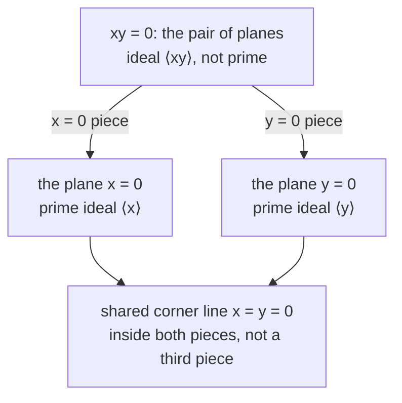
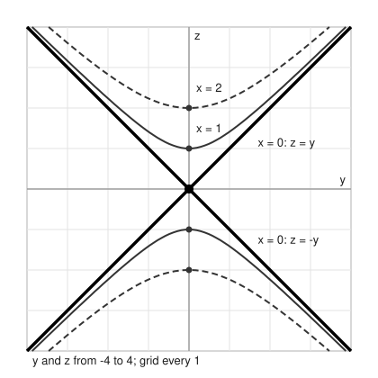

# The Zariski topology: calling solution sets closed, and splitting a shape into pieces

[Syllabus](../../../SYLLABUS.md) → [Algebraic geometry](../README.md) → [Affine and Projective Varieties](../README.md#s02) → The Zariski topology

---

## General Overview

A torch hangs at the origin and shines along the z-axis. The edge of its beam is the cone $`x^2 + y^2 = z^2`$ of [Affine varieties](01-affine-varieties-and-coordinate-rings.md). On a wall that misses the bulb, such as the plane x = 1, the cone's equation leaves one curve, a hyperbola. Now move the wall to x = 0, through the bulb. There the equation becomes $`y^2 - z^2 = 0`$, which is $`(y - z)(y + z) = 0`$. Its real points are two straight lines, z = y and z = −y, crossing at the bulb; the beam lights the V between their upper halves. A solver handed $`y^2 - z^2 = 0`$ sees one equation. The shape is really two pieces.

Write u = y − z and v = y + z, and the wall's equation is uv = 0. A product is zero exactly when one of its factors is zero. The card works the same splitting with one more dimension, as $`xy = 0`$ in space: two planes, x = 0 and y = 0, meeting along the z-axis, their corner line. The point (0, 3, −2) is on the first plane: there $`xy = 0 \cdot 3 = 0`$. The point (2, 0, −1) is on the second: $`xy = 2 \cdot 0 = 0`$.

This card does three things with that observation.

1. It calls every solution set of polynomial equations **closed**. That choice is a topology (a rule for which sets count as closed), called the **Zariski topology**. It is built from equations alone, with no distances.
2. It calls a closed set **irreducible** when it is not the union of two smaller closed sets. Each plane is irreducible. The pair of planes is not.
3. It matches the pieces with algebra. Each plane's equations form a **prime ideal**: if a product vanishes on the plane, one of the factors already does. The pair of planes fails this test: $`xy`$ vanishes on it, but $`x`$ does not (it is 2 at (2, 0, −1)) and $`y`$ does not (it is 3 at (0, 3, −2)).

The field throughout is $`\mathbb{C}`$, the complex numbers. Drawings show real points only.

**Calling the solution sets of polynomial equations closed gives a topology; in it every solution set splits in exactly one way into finitely many irreducible pieces, and over the complex numbers those pieces match the prime ideals, as the pair of planes $`xy = 0`$ splits into $`x = 0`$ and $`y = 0`$.**

**What kind of fact this is:** two definitions (the Zariski topology, irreducible) and three theorems, proved on this card in Why it works: solution sets obey the closed-set rules, a closed set is irreducible exactly when its ideal is prime, and every closed set splits uniquely into finitely many irreducible pieces. The last one uses [Hilbert's basis theorem](../01-Polynomial%20Systems/08-hilbert-basis-theorem.md). The match with every prime ideal also uses [The Nullstellensatz](../01-Polynomial%20Systems/09-nullstellensatz.md); both are proved on shelf 01.

### The picture: one equation, two pieces, two prime ideals



The ideal of the whole is the overlap of the two prime ideals: $`\langle xy \rangle = \langle x \rangle \cap \langle y \rangle`$.

---

## The formula

Notation first, in words. $`\mathbb{A}^n`$ is affine n-space: all lists of n complex numbers ([Affine varieties](01-affine-varieties-and-coordinate-rings.md)). For a set $`S`$ of polynomials, $`V(S)`$ is its zero set: the points where every polynomial in $`S`$ is zero. For a set of points $`X`$, $`I(X)`$ is its ideal: every polynomial that is zero at all of them. Angle brackets $`\langle f_1, \dots, f_s \rangle`$ mean the ideal generated: all sums $`h_1 f_1 + \dots + h_s f_s`$ with polynomial multipliers.

A set is **Zariski closed** when it is a zero set:

```math
X \text{ is closed} \iff X = V(S) \text{ for some set } S \text{ of polynomials}
```

**Read it aloud:** a set of points is closed when some polynomial equations have exactly that set as their solutions.

A closed set $`X`$ is **irreducible** when it is not empty and is not $`X_1 \cup X_2`$ with both $`X_1`$ and $`X_2`$ closed and smaller than $`X`$. The card writes $`\mathfrak{p}`$ (fraktur p) for a prime ideal and $`\mathfrak{m}`$ (fraktur m) for a maximal ideal; both kinds were defined in wing 03. The main result is the dictionary:

```math
V = V_1 \cup V_2 \cup \dots \cup V_r \quad\text{and}\quad I(V) = \mathfrak{p}_1 \cap \mathfrak{p}_2 \cap \dots \cap \mathfrak{p}_r, \qquad \mathfrak{p}_i = I(V_i) \text{ prime}
```

**Read it aloud:** every closed set is a union of finitely many irreducible pieces, none inside another, and its ideal is the overlap of the pieces' prime ideals.

For the pair of planes, $`r = 2`$:

```math
V(xy) = V(x) \cup V(y), \qquad \langle xy \rangle = \langle x \rangle \cap \langle y \rangle
```

| Symbol | Plain meaning | In our example | Push it up and the answer… |
| --- | --- | --- | --- |
| $`\mathbb{C}`$, $`\mathbb{R}`$, $`k`$, $`i`$ | the complex and real numbers; $`k`$ names any field; $`i`$ is the square root of −1 | $`\mathbb{C}`$ | — |
| $`\mathbb{F}_p`$, $`p`$ | the whole numbers mod a prime $`p`$ (wing 03's GF(p)) | $`\mathbb{F}_{13}`$, $`\mathbb{F}_7`$ | more points to count |
| $`\mathbb{A}^n`$, $`n`$; $`x`$, $`y`$, $`z`$; $`k[x_1, \dots, x_n]`$ | affine n-space, all lists of $`n`$ numbers; its coordinates; the polynomials in $`n`$ variables | $`\mathbb{A}^3`$, the torch's space | more variables, more room for pieces |
| $`f`$, $`g`$, $`h`$, $`Q`$, $`l`$, $`m`$; $`d`$ | polynomials; $`Q`$ has degree 2, $`l`$ and $`m`$ degree 1; $`d`$ a degree | $`x`$, $`y`$, $`x^3 - x`$ with $`d = 3`$; $`Q = xy`$ | higher degree, more roots allowed on the line |
| $`S`$, $`U`$, $`S_i`$ | sets of polynomials: the equations | $`\{xy\}`$ | more equations, smaller zero set |
| $`V(S)`$; $`X`$, $`X_1`$, $`X_2`$; $`\varnothing`$ | the zero set of $`S`$; closed sets; the empty set | $`V(xy)`$, the two planes | — |
| $`I(X)`$; $`\langle \dots \rangle`$; $`J`$, $`\sqrt{J}`$ | the ideal of a point set; the ideal generated; an ideal and its radical | $`I(V(xy)) = \langle xy \rangle`$ | bigger set, smaller ideal |
| $`V`$, $`V_i`$, $`W_j`$; $`r`$, $`s`$ | a closed set and its irreducible pieces; counts of pieces or of listed polynomials | $`V(x)`$, $`V(y)`$; $`r = 2`$ | — |
| $`\mathfrak{p}`$, $`\mathfrak{p}_i`$; $`\mathfrak{m}`$; $`P`$ | prime ideals; a maximal ideal; a point | $`\langle x \rangle`$; $`\langle x, y - 3, z + 2 \rangle`$ for $`P`$ = (0, 3, −2) | — |
| $`M`$, $`\mathbf{x}`$, $`T`$, $`w`$ | the matrix of twice a degree-2 polynomial; its list of variables; transpose (column turned into row); a variable added to make every term degree 2 | $`M`$ of $`2xy`$ has rank 2 | — |
| $`c`$ | where a wall $`x = c`$ slices the cone; $`c = 0`$ passes through the bulb | 0, 1, 2, 3 | $`c \neq 0`$: the slice stays one piece |
| $`u`$, $`v`$, $`a`$, $`b`$, $`A`$, $`B`$, $`R`$ | letters used inside one proof or count, defined where they appear | $`u = y - z`$ | — |

### When it holds

- **Finite unions, any intersections.** Two zero sets join into one, $`V(f) \cup V(g) = V(fg)`$, so finitely many do. Infinitely many need not: the whole numbers on the line are infinitely many points, and no nonzero polynomial has infinitely many roots.
- **The field must be algebraically closed for the match with primes** (every one-variable polynomial has a root there). Over $`\mathbb{R}`$ the ideal $`\langle x^2 + y^2 \rangle`$ is prime, yet its real zero set is the single point (0, 0), whose ideal is $`\langle x, y \rangle`$. The topology and the splitting still exist over $`\mathbb{R}`$; the one-to-one match with primes does not.
- **Pieces may not sit inside each other.** $`V(xy) = V(x) \cup V(y) \cup V(x, y)`$ is also true, but the corner line lies inside both planes. Uniqueness holds only after such redundant pieces are dropped.
- **Ideals match sets only up to roots.** $`V(x^2) = V(x)`$, but $`\langle x^2 \rangle \neq \langle x \rangle`$. The match is with radical ideals (an ideal that holds $`f`$ whenever it holds a power of $`f`$); every prime ideal is radical.
- **Finitely many variables.** With finitely many, Hilbert's basis theorem gives every ideal of $`k[x_1, \dots, x_n]`$ a finite generating set, so the splitting in Step 5 stops. With infinitely many, $`x_1, x_2, \dots`$, the chain $`\langle x_1 \rangle \subset \langle x_1, x_2 \rangle \subset \dots`$ never stops, its zero sets shrink forever, and that guarantee is gone.

---

## Why it works

### Step 0: a product vanishes exactly when a factor does

The splitting on this card comes from one fact about numbers: $`ab = 0`$ only when $`a = 0`$ or $`b = 0`$. Applied pointwise, it makes the union of two zero sets a zero set. Applied to polynomials, it says a shape that is two pieces has an ideal holding a product $`fg`$ without holding $`f`$ or $`g`$.

### Step 1: zero sets obey the closed-set rules

[Topological space](../../17-Topology/02-Topological%20Spaces/01-topological-spaces-and-bases.md) gives the rules for open sets. Closed sets are their complements, so the rules flip: the empty set and the whole space are closed, any intersection of closed sets is closed, and a union of two is closed.

- **Empty and whole.** $`V(1) = \varnothing`$, since 1 is never zero. $`V(0) = \mathbb{A}^n`$.
- **Any intersection.** A point lies in every $`V(S_i)`$ exactly when all the equations of all the $`S_i`$ hold there, so $`\bigcap_i V(S_i) = V(\bigcup_i S_i)`$.
- **A union of two.** $`V(S) \cup V(U) = V(\{ fg : f \in S, g \in U \})`$. If a point is off both, some $`f`$ in $`S`$ and some $`g`$ in $`U`$ are nonzero there, so $`fg`$ is nonzero there by Step 0. If it is on either, every product vanishes.

On the line: $`V(x^3 - x) = \{-1, 0, 1\}`$ and $`V(x^2 - 3x + 2) = \{1, 2\}`$. The union is the zero set of the product, $`x^5 - 3x^4 + x^3 + 3x^2 - 2x`$, whose roots are $`\{-1, 0, 1, 2\}`$. The overlap is the zero set of both, which is the zero set of their greatest common divisor $`x - 1`$: the single point 1.

### Step 2: on the line, closed means finite

A nonzero polynomial of degree $`d`$ in one variable has at most $`d`$ roots. So a closed set of the line is either finite or the whole line. Every finite set is closed: $`\{-1, 0, 1\} = V((x + 1)\,x\,(x - 1)) = V(x^3 - x)`$.

That is exactly the cofinite topology, where the closed sets are the finite sets and the whole space ([The test spaces](../../17-Topology/02-Topological%20Spaces/09-standard-examples-and-counterexamples.md)). That card shows it is not Hausdorff (two different points cannot be put in two disjoint open sets): here any two nonempty open sets meet. The Zariski line inherits this.

### Step 3: the plane is not cofinite

In $`\mathbb{A}^2`$ the closed sets are the empty set, the whole plane, and finite unions of points and curves $`V(f)`$. The line $`y = x`$ is closed and holds infinitely many points, so the Zariski plane is not cofinite.

The proof that nothing else appears rests on one fact: two curves $`V(f)`$ and $`V(g)`$ with no common factor meet in finitely many points. A closed set $`V(f_1, \dots, f_s)`$ is then the curve of the common factor of the $`f_i`$, plus finitely many points.

Nor is it the product of two Zariski lines. The product's closed sets are built from points, vertical lines and horizontal lines. Each meets the diagonal $`y = x`$ in at most one point, so finitely many cannot make it. The Zariski plane is finer than the product: it has more closed sets.

<details>
<summary>Detailed proof: two curves with no common factor meet in finitely many points</summary>

Work over $`\mathbb{C}`$. Let $`f`$ and $`g`$ in $`\mathbb{C}[x, y]`$ share no factor. Treat them as polynomials in $`y`$ with coefficients in the field $`\mathbb{C}(x)`$ of fractions of polynomials in $`x`$.

They share no factor there either, by Gauss's lemma (named on [Polynomials behave like integers](../../03-Algebra/09-Rings%20and%20Fields/03-polynomials-behave-like-integers.md)). Euclid's algorithm in $`\mathbb{C}(x)[y]`$ gives $`a f + b g = 1`$. Clearing denominators gives polynomials $`A`$ and $`B`$ and a nonzero $`R(x)`$ with

$`\displaystyle A(x, y)\, f(x, y) + B(x, y)\, g(x, y) = R(x).`$

At a common point $`(a, b)`$ the left side is 0, so $`R(a) = 0`$. A nonzero one-variable polynomial has finitely many roots, so finitely many $`x`$ values occur. The same argument with $`x`$ and $`y`$ swapped bounds the $`y`$ values, so there are finitely many common points. One valid choice of $`R`$ is the resultant of $`f`$ and $`g`$ in $`y`$, from [The resultant](../01-Polynomial%20Systems/06-resultants-and-common-roots.md).

</details>

### Step 4: irreducible exactly when the ideal is prime

**If $`V`$ splits, its ideal is not prime.** Say $`V = V_1 \cup V_2`$ with both closed and smaller. Since $`V_1`$ is smaller than $`V`$ and closed, some polynomial $`f`$ vanishes on $`V_1`$ but not on all of $`V`$. Likewise $`g`$ vanishes on $`V_2`$ but not on all of $`V`$. By Step 0, $`fg`$ vanishes on $`V_1 \cup V_2 = V`$. So $`fg`$ is in $`I(V)`$ while neither $`f`$ nor $`g`$ is.

**If the ideal is not prime, $`V`$ splits.** Say $`fg`$ is in $`I(V)`$ and neither $`f`$ nor $`g`$ is. Then $`V = (V \cap V(f)) \cup (V \cap V(g))`$, because $`fg`$ is zero at each point of $`V`$. Both parts are closed. Neither is all of $`V`$, because $`f`$ and $`g`$ each miss somewhere on $`V`$.

For the pair of planes, take $`f = x`$ and $`g = y`$. The product $`xy`$ is zero on every point of $`V(xy)`$. But $`x = 2`$ at (2, 0, −1) and $`y = 3`$ at (0, 3, −2), both on $`V(xy)`$. So $`\langle xy \rangle`$ is not prime.

Each plane is irreducible. First, its ideal is $`\langle x \rangle`$: a polynomial $`f`$ that is zero on the whole plane x = 0 has $`f(0, y, z) = 0`$ for every y and z, so the terms of $`f`$ without x add up to zero, x divides $`f`$, and $`I(V(x)) = \langle x \rangle`$. Second, setting $`x = 0`$ turns $`k[x, y, z]`$ modulo $`\langle x \rangle`$ into $`k[y, z]`$, where a product of nonzero polynomials is nonzero. That is what prime means for $`\langle x \rangle`$.

### Step 5: every closed set splits into finitely many pieces, in one way only

**Existence.** If $`V`$ is irreducible, stop. If not, write it as a union of two smaller closed sets and repeat on each. Suppose this never stopped. Then some branch of the splitting would give an endless chain of closed sets, each strictly inside the last. Their ideals would form an endless chain, each strictly larger. Hilbert's basis theorem rules this out: the union of such a chain is an ideal with finitely many generators, which all lie in one ideal of the chain, so the chain stops there.

**Uniqueness.** Suppose $`V = V_1 \cup \dots \cup V_r = W_1 \cup \dots \cup W_s`$, both lists irreducible with no piece inside another. Then $`V_1 = (V_1 \cap W_1) \cup \dots \cup (V_1 \cap W_s)`$. Since $`V_1`$ is irreducible, one part is all of $`V_1`$, so $`V_1`$ sits inside some $`W_j`$. The same argument puts $`W_j`$ inside some $`V_i`$. Then $`V_1 \subseteq V_i`$, and no piece is inside another, so $`V_1 = V_i = W_j`$. Pairing off all the pieces this way shows the lists agree.

On the ideal side, $`I(V_1 \cup V_2) = I(V_1) \cap I(V_2)`$, since a polynomial vanishes on a union exactly when it vanishes on each part. For the pair of planes, $`I(V(x)) \cap I(V(y)) = \langle x \rangle \cap \langle y \rangle = \langle xy \rangle`$.

<details>
<summary>Ideals that are not radical: primary decomposition</summary>

The ideal $`\langle x^2, xy \rangle`$ has zero set $`V(x)`$, one plane. It is not that plane's ideal: $`x`$ vanishes on the plane but is not in $`\langle x^2, xy \rangle`$. The Lasker–Noether theorem writes it as

$`\displaystyle \langle x^2, xy \rangle = \langle x \rangle \cap \langle x^2, y \rangle.`$

The second ideal's zero set is the line $`x = y = 0`$, inside the plane, so it adds no points. It records a thickening along that line that points cannot see. Shelf 06 gives such hidden parts a geometry of their own.

</details>

### Step 6: the dictionary, with containment reversed

Over $`\mathbb{C}`$, the Nullstellensatz ([The Nullstellensatz](../01-Polynomial%20Systems/09-nullstellensatz.md)) gives $`I(V(J)) = \sqrt{J}`$, the radical of $`J`$. A prime ideal is its own radical, so $`I(V(\mathfrak{p})) = \mathfrak{p}`$. The dictionary reads:

| Geometry, over $`\mathbb{C}`$ | Algebra | Planes example |
| --- | --- | --- |
| a point | a maximal ideal $`\mathfrak{m}`$ | (0, 3, −2) and $`\langle x, y - 3, z + 2 \rangle`$ |
| an irreducible closed set | a prime ideal $`\mathfrak{p}`$ | the plane $`x = 0`$ and $`\langle x \rangle`$ |
| a closed set | a radical ideal | the two planes and $`\langle xy \rangle`$ |
| splitting into pieces | writing the ideal as an overlap of primes | $`\langle xy \rangle = \langle x \rangle \cap \langle y \rangle`$ |

Containment runs backwards. The point lies inside the plane, which lies inside the pair. The ideals grow the other way: $`\langle xy \rangle \subset \langle x \rangle \subset \langle x, y - 3, z + 2 \rangle`$. More equations cut out a smaller set.

### Step 7: a test for degree 2 — the rank of a matrix

For one polynomial, splitting means factoring. Degree-2 polynomials have a quick exact test.

Write twice the polynomial as $`\mathbf{x}^{T} M \mathbf{x}`$, where $`\mathbf{x}`$ lists the variables and $`M`$ is a symmetric matrix of whole numbers. If the polynomial has terms of degree 1 or 0, add a variable $`w`$: multiply each degree-1 term by $`w`$ and the constant by $`w^2`$, so every term has degree 2. Then, over $`\mathbb{C}`$:

- rank 3 or more: one irreducible piece;
- rank 2: two different planes or lines;
- rank 1: one plane or line, counted twice.

| Polynomial, variables | Matrix $`M`$ | Rank | Pieces |
| --- | --- | --- | --- |
| $`xy`$, in $`(x, y, z)`$ | `[[0, 1, 0], [1, 0, 0], [0, 0, 0]]` | 2 | the planes $`x = 0`$ and $`y = 0`$ |
| cone $`x^2 + y^2 - z^2`$ | diagonal 2, 2, −2 | 3 | one |
| slice $`x = c`$: $`y^2 - z^2 + c^2`$, in $`(y, z, w)`$ | diagonal 2, −2, $`2c^2`$ | 3 when $`c \neq 0`$ | one, since the determinant is $`-8c^2`$ |
| slice $`x = 0`$: $`y^2 - z^2`$ | diagonal 2, −2, 0 | 2 | the lines $`z = y`$ and $`z = -y`$ |

The house cone is one piece. Slicing it with a plane $`x = c`$ keeps one piece unless $`c = 0`$, where the slice through the tip falls apart into two lines.

<p align="center"></p>

The figure is drawn to scale and shows real points only. The thick cross is the slice $`x = 0`$, two pieces. Each hyperbola is one piece, although its real points form two separate branches.

<details>
<summary>Detailed proof: rank 2 or less means two linear factors</summary>

If $`Q = l \cdot m`$ for linear forms $`l`$ and $`m`$ (lists of coefficients), then the matrix of $`2Q`$ is $`l\, m^{T} + m\, l^{T}`$. Each of the two terms has rank at most 1, so the sum has rank at most 2.

Conversely, a symmetric matrix over $`\mathbb{C}`$ can be diagonalised by a change of variables. With rank 2, $`Q`$ becomes $`a u^2 + b v^2`$ with $`a`$ and $`b`$ nonzero. Over $`\mathbb{C}`$ this factors:

$`\displaystyle a u^2 + b v^2 = \left(\sqrt{a}\, u + \sqrt{-b}\, v\right)\left(\sqrt{a}\, u - \sqrt{-b}\, v\right).`$

With rank 1 it is $`a u^2`$, one factor twice. With rank 3 or more, the first paragraph shows that $`Q`$ is no product of two linear forms. A degree-2 polynomial that factors at all factors into two linear forms, so $`Q`$ does not factor, and $`\langle Q \rangle`$ is prime.

</details>

### Step 8: a second road — count the points over a finite field

Over $`\mathbb{F}_{13}`$ (the whole numbers mod 13) every point can be listed and counted. Pieces show up in the count.

- A line in the plane has 13 points. Two lines crossing once have $`13 + 13 - 1 = 25`$.
- The curve $`y^2 - z^2 = -c^2`$ with $`c \neq 0`$ has 12 points: substitute $`u = y - z`$ and $`v = y + z`$ and it becomes $`uv = -c^2`$, one $`v`$ for each of the 12 nonzero $`u`$.
- The pair of planes in 3-space: $`169 + 169 - 13 = 325`$ points. Each plane has $`13^2 = 169`$; the corner line, counted in both, has 13.

The code checks every count by listing all points. A count supports the rank test but cannot replace it: $`-1 = 5^2`$ in $`\mathbb{F}_{13}`$, so changing z to 5z turns $`y^2 - z^2`$ into $`y^2 + z^2`$, and the counts cannot tell the two apart.

---

## Worked numbers, by hand

| Step | Arithmetic | Value |
| --- | --- | --- |
| a point on the plane $`x = 0`$ | $`xy`$ at (0, 3, −2): $`0 \cdot 3`$ | 0 |
| a point on the plane $`y = 0`$ | $`xy`$ at (2, 0, −1): $`2 \cdot 0`$ | 0 |
| $`x`$ is not zero on all of $`V(xy)`$ | $`x`$ at (2, 0, −1) | 2 |
| $`y`$ is not zero on all of $`V(xy)`$ | $`y`$ at (0, 3, −2) | 3 |
| so $`\langle xy \rangle`$ is not prime | $`xy`$ in it, $`x`$ and $`y`$ not | not prime |
| matrix test | $`M`$ of $`2xy`$ has rank 2 | **two planes** |
| the pieces' primes | $`\langle x \rangle \cap \langle y \rangle`$ | $`\langle xy \rangle`$ |
| count over $`\mathbb{F}_{13}`$ | $`169 + 169 - 13`$ | **325** |

The pair of planes is two irreducible pieces with prime ideals $`\langle x \rangle`$ and $`\langle y \rangle`$, and nothing else. Read back on the torch: the wall x = 0, through the bulb, has rank 2 and 25 points over $`\mathbb{F}_{13}`$, two lines; the walls x = 1, 2 and 3 have rank 3 and 12 points, one curve each.

### What breaks if you drop a piece

| Mistake | Comes out at | What went wrong |
| --- | --- | --- |
| Adding the corner line as a third piece | $`169 + 169 + 13 = 351`$ points over $`\mathbb{F}_{13}`$, not 325 | the corner line lies inside both planes; a piece may not sit inside another |
| Reading two real branches as two pieces | the slice $`x = 1`$ has rank 3 and 12 points, not 25 | separate in the usual topology, but one irreducible piece |
| Trusting the points of a field that is not algebraically closed | $`x^2 + y^2 = 0`$ has 1 point over $`\mathbb{F}_7`$ but 25 over $`\mathbb{F}_{13}`$ | in $`\mathbb{F}_{13}`$, $`5^2 = -1`$, so it splits into $`x = \pm 5y`$; $`\mathbb{F}_7`$ and $`\mathbb{R}`$ hide the two lines $`x = \pm i y`$ that $`\mathbb{C}`$ shows |
| Reading the ideal off the set | $`V(x^2)`$ and $`V(x)`$ both have 169 points | one set, two ideals; only the radical ideal $`\langle x \rangle`$ matches |

The code prints all four.

---

## Code, from first principles, and it actually runs

Nothing is imported, and every number is an exact integer. The code takes four roads, which share no arithmetic. On the line, it finds zero sets of unions and overlaps by building polynomials from roots and running Euclid's algorithm, then checks them against plain set union and overlap. For degree 2, it checks each matrix against its polynomial at 125 integer points, finds the rank by elimination, and checks the rank against the cofactor determinant. Where a polynomial splits, it multiplies the factors back out. Last, it counts points over $`\mathbb{F}_{13}`$ and $`\mathbb{F}_7`$ by listing every point.

### Python

```python
# The Zariski topology and irreducible pieces -- the check behind the card.
# Nothing is imported; every number is an exact integer.  The field for the
# theorems is the complex numbers.  The finite fields F_13 and F_7 are used
# only to count points by listing them all, as an independent road.

def trim(a):                                  # drop zero coefficients at the top
    while len(a) > 1 and a[-1] == 0:
        a = a[:-1]
    return a

def mul(a, b):                                # one-variable product; a[i] is the x^i coefficient
    out = [0] * (len(a) + len(b) - 1)
    for i, s in enumerate(a):
        for j, t in enumerate(b):
            out[i + j] += s * t
    return trim(out)

def from_roots(roots):                        # (x - r1)(x - r2)...: a finite set as a zero set
    p = [1]
    for r in roots:
        p = mul(p, [-r, 1])
    return p

def igcd(a, b):
    while b:
        a, b = b, a % b
    return abs(a)

def primitive(a):                             # divide out the common factor, top coefficient positive
    g = 0
    for c in a:
        g = igcd(g, c)
    a = [c // g for c in a]
    return [-c for c in a] if a[-1] < 0 else a

def poly_gcd(a, b):                           # Euclid with pseudo-remainders: integers only
    while b != [0]:
        r = a[:]
        while len(r) >= len(b) and r != [0]:
            shift, lead = len(r) - len(b), r[-1]
            r = [b[-1] * c for c in r]
            for i, c in enumerate(b):
                r[i + shift] -= lead * c
            r = trim(r)
        a, b = b, (primitive(r) if r != [0] else [0])
    return primitive(a)

def roots(p):                                 # road two: try every whole number from -10 to 10
    return [x for x in range(-10, 11) if sum(c * x ** i for i, c in enumerate(p)) == 0]

def show(p):                                  # leading term first, e.g. x^3 - x
    out = ""
    for i in range(len(p) - 1, -1, -1):
        c = p[i]
        if c == 0:
            continue
        body = ("" if abs(c) == 1 and i > 0 else str(abs(c))) + ("" if i == 0 else "x" if i == 1 else f"x^{i}")
        out += ("-" if c < 0 else "") + body if out == "" else (" - " if c < 0 else " + ") + body
    return out

def rank(m):                                  # elimination without division; counts pivots
    a, r, n = [row[:] for row in m], 0, len(m)
    for col in range(n):
        piv = next((i for i in range(r, n) if a[i][col] != 0), None)
        if piv is None:
            continue
        a[r], a[piv] = a[piv], a[r]
        for i in range(r + 1, n):
            a[i] = [a[r][col] * a[i][j] - a[i][col] * a[r][j] for j in range(n)]
        r += 1
    return r

def det3(m):                                  # road two: the cofactor formula
    return (m[0][0] * (m[1][1] * m[2][2] - m[1][2] * m[2][1]) - m[0][1] * (m[1][0] * m[2][2] - m[1][2] * m[2][0])
            + m[0][2] * (m[1][0] * m[2][1] - m[1][1] * m[2][0]))

def twice_product(l, m):                      # the matrix of 2 l m for linear forms l, m
    return [[l[i] * m[j] + m[i] * l[j] for j in range(3)] for i in range(3)]

def count(p, test, dims):                     # list every point of F_p^dims and count the zeros
    pts = [(a, b, c) for a in range(p) for b in range(p) for c in range(p)] if dims == 3 else \
          [(a, b) for a in range(p) for b in range(p)]
    return sum(1 for q in pts if test(*q) % p == 0)

yn = lambda claim: "yes" if claim else "no"
A, B = [-1, 0, 1], [1, 2]
f, g = from_roots(A), from_roots(B)
fg, h = mul(f, g), poly_gcd(f, g)
print(f"line: V({show(f)}) = {roots(f)}; V({show(g)}) = {roots(g)}")
print(f"union: V({show(fg)}) = {roots(fg)}, the union of the two sets: {yn(roots(fg) == sorted(set(A) | set(B)))}")
print(f"overlap: gcd = {show(h)}, V = {roots(h)}, the shared points: {yn(roots(h) == sorted(set(A) & set(B)))}")
assert roots(fg) == sorted(set(A) | set(B)) and len(roots(fg)) <= len(fg) - 1   # the sets, built separately
assert roots(h) == sorted(set(A) & set(B))

p = 13
both = count(p, lambda x, y, z: x * y, 3)
px, py_, axis = (count(p, t, 3) for t in (lambda x, y, z: x, lambda x, y, z: y, lambda x, y, z: (x != 0) + (y != 0)))
print(f"pair of planes over F_{p}: V(xy) has {both} points; V(x) {px}, V(y) {py_}, corner line V(x, y) {axis}")
print(f"inclusion-exclusion: {px} + {py_} - {axis} = {px + py_ - axis}; adding the corner as a third piece gives {px + py_ + axis}")
on_v = [(x, y, z) for x in range(p) for y in range(p) for z in range(p) if x * y % p == 0]
wx, wy, wxy = (sum(1 for q in on_v if t(*q) % p) for t in (lambda x, y, z: x, lambda x, y, z: y, lambda x, y, z: x * y))
print(f"points of V(xy) where x is not 0: {wx}; where y is not 0: {wy}; where xy is not 0: {wxy}")
(x1, y1, _), (x2, y2, _) = (2, 0, -1), (0, 3, -2)
print(f"witnesses: x at (2, 0, -1) = {x1}, y at (0, 3, -2) = {y2}, xy at them = {x1 * y1} and {x2 * y2}")
assert both == px + py_ - axis == 2 * p * p - p and wx == wy == p * p - p and wxy == 0

cone = lambda x, y, z: x * x + y * y - z * z    # the house cone; each slice's polynomial is read off it
quads = [("pair of planes xy, in (x, y, z)", [[0, 1, 0], [1, 0, 0], [0, 0, 0]], ([1, 0, 0], [0, 1, 0]), 0, lambda x, y, z: x * y),
         ("cone x^2 + y^2 - z^2, in (x, y, z)", [[2, 0, 0], [0, 2, 0], [0, 0, -2]], None, 0, cone)]
for c in range(4):
    quads.append((f"slice x = {c}: y^2 - z^2 + {c * c}, in (y, z, w)", [[2, 0, 0], [0, -2, 0], [0, 0, 2 * c * c]],
                  ([1, -1, 0], [1, 1, 0]) if c == 0 else None, 0, lambda y, z, w, c=c: cone(c * w, y, z)))
quads.append(("slice z = 0: x^2 + y^2, in (x, y, w)", [[2, 0, 0], [0, 2, 0], [0, 0, 0]], ([1, 5, 0], [1, -5, 0]), 13,
              lambda x, y, w: cone(x, y, 0)))
grid = [(a, b, e) for a in range(-2, 3) for b in range(-2, 3) for e in range(-2, 3)]
for name, m, fac, mod, form in quads:
    r, d = rank(m), det3(m)
    assert all(sum(v[i] * m[i][j] * v[j] for i in range(3) for j in range(3)) == 2 * form(*v) for v in grid)  # M is 2Q's matrix
    pieces = "one piece" if r == 3 else "two flat pieces" if r == 2 else "one doubled piece"
    line = f"{name}: rank {r}, det {d}, {pieces}"
    if fac:
        t = twice_product(*fac)
        same = all((t[i][j] - m[i][j]) % mod == 0 if mod else t[i][j] == m[i][j] for i in range(3) for j in range(3))
        line += f"; factors {fac[0]} times {fac[1]} expand back{' mod 13' if mod else ''}: {yn(same)}"
        assert same and r == 2
    print(line)
    assert (r == 3) == (d != 0)
assert [det3(q[1]) for q in quads[2:6]] == [-8 * c * c for c in range(4)]     # the slices' determinants are -8c^2
slices = [count(p, lambda y, z, c=c: y * y - z * z + c * c, 2) for c in range(4)]
print(f"slices x = 0, 1, 2, 3 over F_{p}, points: {slices}; two crossing lines give 2p - 1 = {2 * p - 1}, one curve p - 1 = {p - 1}")
assert slices == [2 * p - 1] + [p - 1] * 3
v13, v7 = count(13, lambda x, y: x * x + y * y, 2), count(7, lambda x, y: x * x + y * y, 2)
print(f"x^2 + y^2 = 0: {v13} points over F_13, where 5^2 = {25 % 13 - 13} mod 13; {v7} point over F_7, where -1 is no square")
sq, lin = count(p, lambda x, y, z: x * x, 3), count(p, lambda x, y, z: x, 3)
print(f"V(x^2) has {sq} points and V(x) has {lin}: one set, two ideals")
assert v13 == 2 * 13 - 1 and v7 == 1 and sq == lin
tops = "; ".join(f"hyperbola c = {c} vertices " + " and ".join(f"(0, {z})" for z in range(4, -5, -1) if cone(c, 0, z) == 0)
                 for c in (1, 2))                 # where the slice x = c meets y = 0, inside the window
print(f"figure, lines z = y and z = -y cross at (0, 0); {tops}; window -4 to 4 in y and z")
print("ALL CHECKS PASS")
```

**Ran 2026-11-17 on macOS, Python 3.14.10, standard library only. All checks passed. Output, pasted from the run:**

```
line: V(x^3 - x) = [-1, 0, 1]; V(x^2 - 3x + 2) = [1, 2]
union: V(x^5 - 3x^4 + x^3 + 3x^2 - 2x) = [-1, 0, 1, 2], the union of the two sets: yes
overlap: gcd = x - 1, V = [1], the shared points: yes
pair of planes over F_13: V(xy) has 325 points; V(x) 169, V(y) 169, corner line V(x, y) 13
inclusion-exclusion: 169 + 169 - 13 = 325; adding the corner as a third piece gives 351
points of V(xy) where x is not 0: 156; where y is not 0: 156; where xy is not 0: 0
witnesses: x at (2, 0, -1) = 2, y at (0, 3, -2) = 3, xy at them = 0 and 0
pair of planes xy, in (x, y, z): rank 2, det 0, two flat pieces; factors [1, 0, 0] times [0, 1, 0] expand back: yes
cone x^2 + y^2 - z^2, in (x, y, z): rank 3, det -8, one piece
slice x = 0: y^2 - z^2 + 0, in (y, z, w): rank 2, det 0, two flat pieces; factors [1, -1, 0] times [1, 1, 0] expand back: yes
slice x = 1: y^2 - z^2 + 1, in (y, z, w): rank 3, det -8, one piece
slice x = 2: y^2 - z^2 + 4, in (y, z, w): rank 3, det -32, one piece
slice x = 3: y^2 - z^2 + 9, in (y, z, w): rank 3, det -72, one piece
slice z = 0: x^2 + y^2, in (x, y, w): rank 2, det 0, two flat pieces; factors [1, 5, 0] times [1, -5, 0] expand back mod 13: yes
slices x = 0, 1, 2, 3 over F_13, points: [25, 12, 12, 12]; two crossing lines give 2p - 1 = 25, one curve p - 1 = 12
x^2 + y^2 = 0: 25 points over F_13, where 5^2 = -1 mod 13; 1 point over F_7, where -1 is no square
V(x^2) has 169 points and V(x) has 169: one set, two ideals
figure, lines z = y and z = -y cross at (0, 0); hyperbola c = 1 vertices (0, 1) and (0, -1); hyperbola c = 2 vertices (0, 2) and (0, -2); window -4 to 4 in y and z
ALL CHECKS PASS
```

### Rust

Same numbers, same labels, built with `rustc --edition 2021 -O`.

```rust
// The Zariski topology and irreducible pieces -- the same check as the Python,
// in Rust.  No crates; every number is an exact integer.  The field for the
// theorems is the complex numbers.  The finite fields F_13 and F_7 are used
// only to count points by listing them all, as an independent road.
use std::collections::BTreeSet;

fn trim(mut a: Vec<i64>) -> Vec<i64> {                 // drop zero coefficients at the top
    while a.len() > 1 && *a.last().unwrap() == 0 { a.pop(); }
    a
}

fn mul(a: &[i64], b: &[i64]) -> Vec<i64> {             // one-variable product; a[i] is the x^i coefficient
    let mut out = vec![0; a.len() + b.len() - 1];
    for (i, s) in a.iter().enumerate() { for (j, t) in b.iter().enumerate() { out[i + j] += s * t; } }
    trim(out)
}

fn from_roots(rs: &[i64]) -> Vec<i64> {                // (x - r1)(x - r2)...: a finite set as a zero set
    let mut p = vec![1];
    for &r in rs { p = mul(&p, &[-r, 1]); }
    p
}

fn igcd(mut a: i64, mut b: i64) -> i64 {
    while b != 0 { (a, b) = (b, a % b); }
    a.abs()
}

fn primitive(a: &[i64]) -> Vec<i64> {                  // divide out the common factor, top coefficient positive
    let g = a.iter().fold(0, |g, &c| igcd(g, c));
    let s = if *a.last().unwrap() < 0 { -1 } else { 1 };
    a.iter().map(|&c| s * c / g).collect()
}

fn poly_gcd(mut a: Vec<i64>, mut b: Vec<i64>) -> Vec<i64> {   // Euclid with pseudo-remainders: integers only
    while b != vec![0] {
        let mut r = a.clone();
        while r.len() >= b.len() && r != vec![0] {
            let (shift, lead, top) = (r.len() - b.len(), *r.last().unwrap(), *b.last().unwrap());
            r = r.iter().map(|&c| top * c).collect();
            for (i, &c) in b.iter().enumerate() { r[i + shift] -= lead * c; }
            r = trim(r);
        }
        let next = if r != vec![0] { primitive(&r) } else { vec![0] };
        a = b;
        b = next;
    }
    primitive(&a)
}

fn roots(p: &[i64]) -> Vec<i64> {                      // road two: try every whole number from -10 to 10
    (-10i64..=10).filter(|&x| p.iter().enumerate().map(|(i, &c)| c * x.pow(i as u32)).sum::<i64>() == 0).collect()
}

fn show(p: &[i64]) -> String {                         // leading term first, e.g. x^3 - x
    let mut out = String::new();
    for i in (0..p.len()).rev() {
        let c = p[i];
        if c == 0 { continue; }
        let num = if c.abs() == 1 && i > 0 { String::new() } else { c.abs().to_string() };
        let var = if i == 0 { String::new() } else if i == 1 { "x".to_string() } else { format!("x^{}", i) };
        let sign = if out.is_empty() { if c < 0 { "-" } else { "" } } else if c < 0 { " - " } else { " + " };
        out += &format!("{}{}{}", sign, num, var);
    }
    out
}

fn rank(m: &[[i64; 3]; 3]) -> usize {                  // elimination without division; counts pivots
    let (mut a, mut r) = (*m, 0);
    for col in 0..3 {
        let piv = match (r..3).find(|&i| a[i][col] != 0) { Some(i) => i, None => continue };
        a.swap(r, piv);
        for i in r + 1..3 {
            let (top, here) = (a[r][col], a[i][col]);
            for j in 0..3 { a[i][j] = top * a[i][j] - here * a[r][j]; }
        }
        r += 1;
    }
    r
}

fn det3(m: &[[i64; 3]; 3]) -> i64 {                    // road two: the cofactor formula
    m[0][0] * (m[1][1] * m[2][2] - m[1][2] * m[2][1]) - m[0][1] * (m[1][0] * m[2][2] - m[1][2] * m[2][0])
        + m[0][2] * (m[1][0] * m[2][1] - m[1][1] * m[2][0])
}

fn count3(p: i64, t: impl Fn(i64, i64, i64) -> i64) -> usize {   // list every point of F_p^3, count zeros
    (0..p * p * p).filter(|v| t(v / (p * p), v / p % p, v % p) % p == 0).count()
}

fn count2(p: i64, t: impl Fn(i64, i64) -> i64) -> usize { (0..p * p).filter(|v| t(v / p, v % p) % p == 0).count() }

fn cone(x: i64, y: i64, z: i64) -> i64 { x * x + y * y - z * z }   // the house cone; each slice's polynomial is read off it

fn yn(claim: bool) -> &'static str { if claim { "yes" } else { "no" } }

fn set(v: &[i64]) -> BTreeSet<i64> { v.iter().copied().collect() }

fn main() {
    let (a, b) = ([-1, 0, 1], [1, 2]);
    let (f, g) = (from_roots(&a), from_roots(&b));
    let (fg, h) = (mul(&f, &g), poly_gcd(f.clone(), g.clone()));
    let uni: Vec<i64> = set(&a).union(&set(&b)).copied().collect();
    let cap: Vec<i64> = set(&a).intersection(&set(&b)).copied().collect();
    println!("line: V({}) = {:?}; V({}) = {:?}", show(&f), roots(&f), show(&g), roots(&g));
    println!("union: V({}) = {:?}, the union of the two sets: {}", show(&fg), roots(&fg), yn(roots(&fg) == uni));
    println!("overlap: gcd = {}, V = {:?}, the shared points: {}", show(&h), roots(&h), yn(roots(&h) == cap));
    assert!(roots(&fg) == uni && roots(&fg).len() <= fg.len() - 1);   // the sets, built separately
    assert!(roots(&h) == cap);

    let p = 13;
    let both = count3(p, |x, y, _| x * y);
    let (px, py, axis) = (count3(p, |x, _, _| x), count3(p, |_, y, _| y), count3(p, |x, y, _| (x != 0) as i64 + (y != 0) as i64));
    println!("pair of planes over F_{}: V(xy) has {} points; V(x) {}, V(y) {}, corner line V(x, y) {}", p, both, px, py, axis);
    println!("inclusion-exclusion: {} + {} - {} = {}; adding the corner as a third piece gives {}", px, py, axis, px + py - axis, px + py + axis);
    let mut on_v = Vec::new();
    for x in 0..p { for y in 0..p { for z in 0..p { if x * y % p == 0 { on_v.push((x, y, z)); } } } }
    let wx = on_v.iter().filter(|q| q.0 % p != 0).count();
    let wy = on_v.iter().filter(|q| q.1 % p != 0).count();
    let wxy = on_v.iter().filter(|q| q.0 * q.1 % p != 0).count();
    println!("points of V(xy) where x is not 0: {}; where y is not 0: {}; where xy is not 0: {}", wx, wy, wxy);
    let ((x1, y1, _), (x2, y2, _)) = ((2i64, 0i64, -1i64), (0i64, 3i64, -2i64));
    println!("witnesses: x at (2, 0, -1) = {}, y at (0, 3, -2) = {}, xy at them = {} and {}", x1, y2, x1 * y1, x2 * y2);
    let pu = p as usize;
    assert!(both == px + py - axis && both == 2 * pu * pu - pu && wx == pu * pu - pu && wy == wx && wxy == 0);

    type Fac = Option<([i64; 3], [i64; 3])>;
    type Form = fn(i64, [i64; 3]) -> i64;               // the polynomial Q, given the slice's c
    let mut quads: Vec<(String, [[i64; 3]; 3], Fac, i64, Form, i64)> = vec![
        ("pair of planes xy, in (x, y, z)".to_string(), [[0, 1, 0], [1, 0, 0], [0, 0, 0]], Some(([1, 0, 0], [0, 1, 0])), 0, |_, v| v[0] * v[1], 0),
        ("cone x^2 + y^2 - z^2, in (x, y, z)".to_string(), [[2, 0, 0], [0, 2, 0], [0, 0, -2]], None, 0, |_, v| cone(v[0], v[1], v[2]), 0)];
    for c in 0..4i64 {
        quads.push((format!("slice x = {}: y^2 - z^2 + {}, in (y, z, w)", c, c * c), [[2, 0, 0], [0, -2, 0], [0, 0, 2 * c * c]],
                    if c == 0 { Some(([1, -1, 0], [1, 1, 0])) } else { None }, 0, |c, v| cone(c * v[2], v[0], v[1]), c));
    }
    quads.push(("slice z = 0: x^2 + y^2, in (x, y, w)".to_string(), [[2, 0, 0], [0, 2, 0], [0, 0, 0]], Some(([1, 5, 0], [1, -5, 0])), 13,
                |_, v| cone(v[0], v[1], 0), 0));
    let grid: Vec<[i64; 3]> = (0..125).map(|k| [k / 25 - 2, k / 5 % 5 - 2, k % 5 - 2]).collect();
    for (name, m, fac, md, form, c) in &quads {
        let (r, d) = (rank(m), det3(m));
        assert!(grid.iter().all(|v| (0..3).map(|i| (0..3).map(|j| v[i] * m[i][j] * v[j]).sum::<i64>()).sum::<i64>() == 2 * form(*c, *v))); // M is 2Q's matrix
        let pieces = if r == 3 { "one piece" } else if r == 2 { "two flat pieces" } else { "one doubled piece" };
        let mut line = format!("{}: rank {}, det {}, {}", name, r, d, pieces);
        if let Some((l, k)) = fac {
            let mut same = true;
            for i in 0..3 { for j in 0..3 {
                let diff = l[i] * k[j] + k[i] * l[j] - m[i][j];
                same &= if *md != 0 { diff % md == 0 } else { diff == 0 };
            } }
            line += &format!("; factors {:?} times {:?} expand back{}: {}", l, k, if *md != 0 { " mod 13" } else { "" }, yn(same));
            assert!(same && r == 2);
        }
        println!("{}", line);
        assert!((r == 3) == (d != 0));
    }
    assert!(quads[2..6].iter().all(|q| det3(&q.1) == -8 * q.5 * q.5));   // the slices' determinants are -8c^2
    let slices: Vec<usize> = (0..4i64).map(|c| count2(p, |y, z| y * y - z * z + c * c)).collect();
    println!("slices x = 0, 1, 2, 3 over F_{}, points: {:?}; two crossing lines give 2p - 1 = {}, one curve p - 1 = {}", p, slices, 2 * p - 1, p - 1);
    assert!(slices == vec![2 * pu - 1, pu - 1, pu - 1, pu - 1]);
    let (v13, v7) = (count2(13, |x, y| x * x + y * y), count2(7, |x, y| x * x + y * y));
    println!("x^2 + y^2 = 0: {} points over F_13, where 5^2 = {} mod 13; {} point over F_7, where -1 is no square", v13, 25 % 13 - 13, v7);
    let (sq, lin) = (count3(p, |x, _, _| x * x), count3(p, |x, _, _| x));
    println!("V(x^2) has {} points and V(x) has {}: one set, two ideals", sq, lin);
    assert!(v13 == 2 * 13 - 1 && v7 == 1 && sq == lin);
    let tops: Vec<String> = [1i64, 2].iter().map(|&c| format!("hyperbola c = {} vertices {}", c, // where the slice x = c meets y = 0
        (-4..=4i64).rev().filter(|&z| cone(c, 0, z) == 0).map(|z| format!("(0, {})", z)).collect::<Vec<_>>().join(" and "))).collect();
    println!("figure, lines z = y and z = -y cross at (0, 0); {}; window -4 to 4 in y and z", tops.join("; "));
    println!("ALL CHECKS PASS");
}
```

**Ran 2026-11-17 on macOS, rustc 1.98.1, no crates. All checks passed. Output, pasted from the run:**

```
line: V(x^3 - x) = [-1, 0, 1]; V(x^2 - 3x + 2) = [1, 2]
union: V(x^5 - 3x^4 + x^3 + 3x^2 - 2x) = [-1, 0, 1, 2], the union of the two sets: yes
overlap: gcd = x - 1, V = [1], the shared points: yes
pair of planes over F_13: V(xy) has 325 points; V(x) 169, V(y) 169, corner line V(x, y) 13
inclusion-exclusion: 169 + 169 - 13 = 325; adding the corner as a third piece gives 351
points of V(xy) where x is not 0: 156; where y is not 0: 156; where xy is not 0: 0
witnesses: x at (2, 0, -1) = 2, y at (0, 3, -2) = 3, xy at them = 0 and 0
pair of planes xy, in (x, y, z): rank 2, det 0, two flat pieces; factors [1, 0, 0] times [0, 1, 0] expand back: yes
cone x^2 + y^2 - z^2, in (x, y, z): rank 3, det -8, one piece
slice x = 0: y^2 - z^2 + 0, in (y, z, w): rank 2, det 0, two flat pieces; factors [1, -1, 0] times [1, 1, 0] expand back: yes
slice x = 1: y^2 - z^2 + 1, in (y, z, w): rank 3, det -8, one piece
slice x = 2: y^2 - z^2 + 4, in (y, z, w): rank 3, det -32, one piece
slice x = 3: y^2 - z^2 + 9, in (y, z, w): rank 3, det -72, one piece
slice z = 0: x^2 + y^2, in (x, y, w): rank 2, det 0, two flat pieces; factors [1, 5, 0] times [1, -5, 0] expand back mod 13: yes
slices x = 0, 1, 2, 3 over F_13, points: [25, 12, 12, 12]; two crossing lines give 2p - 1 = 25, one curve p - 1 = 12
x^2 + y^2 = 0: 25 points over F_13, where 5^2 = -1 mod 13; 1 point over F_7, where -1 is no square
V(x^2) has 169 points and V(x) has 169: one set, two ideals
figure, lines z = y and z = -y cross at (0, 0); hyperbola c = 1 vertices (0, 1) and (0, -1); hyperbola c = 2 vertices (0, 2) and (0, -2); window -4 to 4 in y and z
ALL CHECKS PASS
```

The two outputs match line for line.

### Lean

Lean proves the card's three theorems and the match with prime ideals, in any finite number of variables, and checks the worked numbers.

- Take any field $`k`$, and $`\mathbb{A}^n`$ as the lists of $`n`$ numbers from $`k`$. Then a set is Zariski closed exactly when it is a zero set $`V(S)`$.
- Take any field $`k`$ and a closed set $`V`$. Then $`V`$ is irreducible exactly when its ideal $`I(V)`$ is prime.
- Take $`k`$ algebraically closed, such as $`\mathbb{C}`$. Then every closed set is a union of finitely many closed irreducible pieces, none inside another.
- Take $`k`$ algebraically closed. Then any two such lists of pieces for the same closed set are the same.
- Take $`k`$ algebraically closed and the pieces $`V_1, \dots, V_r`$ of a closed set $`V`$. Then each $`I(V_i)`$ is prime, and $`I(V) = I(V_1) \cap \dots \cap I(V_r)`$.
- Take $`k`$ algebraically closed and a prime ideal $`\mathfrak{p}`$. Then $`V(\mathfrak{p})`$ is irreducible, and $`I(V(\mathfrak{p})) = \mathfrak{p}`$.
- At (2, 0, −1), $`xy`$ is 0 and $`x`$ is 2. At (0, 3, −2), $`xy`$ is 0 and $`y`$ is 3.
- Take the whole numbers −10 to 10. Then $`x^3 - x`$ is zero at −1, 0 and 1, and $`x^2 - 3x + 2`$ at 1 and 2.
- Their product, $`x^5 - 3x^4 + x^3 + 3x^2 - 2x`$, is zero at −1, 0, 1 and 2 there. Both share the factor $`x - 1`$.
- The slice $`x = 0`$ of the cone splits: $`y^2 - z^2 = (y - z)(y + z)`$.
- The matrices $`M`$ have determinant 0 for the planes and −8 for the cone. The slices $`x = 1, 2, 3`$ give −8, −32 and −72.
- Over $`\mathbb{F}_{13}`$, the pair of planes has 325 points. The slices $`x = 0, 1, 2, 3`$ have 25, 12, 12 and 12.
- Over $`\mathbb{F}_{13}`$, $`5^2 = -1`$ and $`x^2 + y^2 = (x + 5y)(x - 5y)`$, with 25 points. Over $`\mathbb{F}_7`$ it has 1 point.

The rank test of Step 7 and the figure are left to the Python and Rust checks, on the printed cases only.

```lean
-- The Zariski topology: the zero sets of polynomials are the closed sets of a topology, a closed set is irreducible exactly when its ideal is prime, and over an algebraically closed field every closed set splits in exactly one way into finitely many irreducible pieces whose ideals are prime.
import Mathlib.RingTheory.Nullstellensatz
import Mathlib.RingTheory.Ideal.MinimalPrime.Noetherian
import Mathlib.RingTheory.Polynomial.Basic
import Mathlib.Topology.Irreducible
import Mathlib.LinearAlgebra.Matrix.Determinant.Basic
import Mathlib.Data.ZMod.Basic
import Mathlib.Data.Int.Interval
import Mathlib.Tactic.NormNum
import Mathlib.Tactic.Ring
import Mathlib.Tactic.LinearCombination

open MvPolynomial Topology

/-- The Zariski topology on affine n-space kⁿ: its open sets are generated by the complements of
the zero sets V(S), one for every set S of polynomials in k[x₁, …, xₙ]. -/
@[instance_reducible]
def zariskiTopology (k : Type*) [Field k] (n : ℕ) : TopologicalSpace (Fin n → k) :=
  TopologicalSpace.generateFrom
    {U | ∃ S : Set (MvPolynomial (Fin n) k), U = (zeroLocus k (Ideal.span S))ᶜ}


/-- A set is a zero set V(S) exactly when V(I(Z)) ⊆ Z. -/
theorem zariski_aux_zero_set_iff {k : Type*} [Field k] {n : ℕ} (Z : Set (Fin n → k)) :
    (∃ S : Set (MvPolynomial (Fin n) k), Z = zeroLocus k (Ideal.span S)) ↔
      zeroLocus k (vanishingIdeal k Z) ⊆ Z := by
  constructor
  · rintro ⟨S, rfl⟩
    exact zeroLocus_anti_mono (le_vanishingIdeal_zeroLocus _)
  · intro h
    refine ⟨(vanishingIdeal k Z : Set (MvPolynomial (Fin n) k)), ?_⟩
    rw [Ideal.span_eq]
    exact le_antisymm (zeroLocus_vanishingIdeal_le Z) h

/-- The open sets of the Zariski topology are exactly the complements of zero sets. -/
theorem zariski_aux_isOpen_iff {k : Type*} [Field k] {n : ℕ} (U : Set (Fin n → k)) :
    IsOpen[zariskiTopology k n] U ↔ zeroLocus k (vanishingIdeal k Uᶜ) ⊆ Uᶜ := by
  constructor
  · intro h
    induction h with
    | basic s hs =>
      obtain ⟨S, rfl⟩ := hs
      rw [compl_compl]
      exact (zariski_aux_zero_set_iff _).1 ⟨S, rfl⟩
    | univ =>
      rw [Set.compl_univ, vanishingIdeal_empty, zeroLocus_top]
      exact le_rfl
    | inter s t _ _ hs ht =>
      intro x hx
      rw [Set.compl_inter] at hx ⊢
      by_contra hn
      simp only [Set.mem_union, not_or] at hn
      have h1 : ∃ f ∈ vanishingIdeal k sᶜ, aeval x f ≠ 0 := by
        by_contra h1
        push Not at h1
        exact hn.1 (hs h1)
      have h2 : ∃ g ∈ vanishingIdeal k tᶜ, aeval x g ≠ 0 := by
        by_contra h2
        push Not at h2
        exact hn.2 (ht h2)
      obtain ⟨f, hf, hfx⟩ := h1
      obtain ⟨g, hg, hgx⟩ := h2
      have hfg : f * g ∈ vanishingIdeal k (sᶜ ∪ tᶜ) := by
        intro y hy
        rcases hy with hy | hy
        · rw [map_mul, hf y hy, zero_mul]
        · rw [map_mul, hg y hy, mul_zero]
      have := hx _ hfg
      rw [map_mul] at this
      exact mul_ne_zero hfx hgx this
    | sUnion 𝒰 _ h =>
      intro x hx
      simp only [Set.mem_compl_iff, Set.mem_sUnion, not_exists, not_and]
      intro u hu hxu
      have hsub : (⋃₀ 𝒰)ᶜ ⊆ uᶜ := Set.compl_subset_compl.2 (Set.subset_sUnion_of_mem hu)
      exact h u hu (zeroLocus_anti_mono (vanishingIdeal_anti_mono hsub) hx) hxu
  · intro h
    obtain ⟨S, hS⟩ := (zariski_aux_zero_set_iff Uᶜ).2 h
    apply TopologicalSpace.isOpen_generateFrom_of_mem
    exact ⟨S, by rw [← hS, compl_compl]⟩

/-- Closed sets of the Zariski topology are exactly the zero sets. -/
theorem zariski_aux_isClosed_iff {k : Type*} [Field k] {n : ℕ} (X : Set (Fin n → k)) :
    IsClosed[zariskiTopology k n] X ↔
      ∃ S : Set (MvPolynomial (Fin n) k), X = zeroLocus k (Ideal.span S) := by
  rw [← @isOpen_compl_iff _ _ (zariskiTopology k n), zariski_aux_isOpen_iff, compl_compl,
    zariski_aux_zero_set_iff]

/-- A set is irreducible exactly when its vanishing ideal is prime. -/
theorem zariski_aux_irreducible_iff {k : Type*} [Field k] {n : ℕ} (V : Set (Fin n → k)) :
    @IsIrreducible _ (zariskiTopology k n) V ↔ (vanishingIdeal k V).IsPrime := by
  let _ := zariskiTopology k n
  have hpt : ∀ f : MvPolynomial (Fin n) k,
      IsClosed (zeroLocus k (Ideal.span {f}) : Set (Fin n → k)) :=
    fun f => (zariski_aux_isClosed_iff _).2 ⟨{f}, rfl⟩
  constructor
  · rintro ⟨⟨x, hx⟩, hpre⟩
    rw [Ideal.isPrime_iff]
    refine ⟨?_, ?_⟩
    · intro htop
      have h1 : (1 : MvPolynomial (Fin n) k) ∈ vanishingIdeal k V := htop ▸ Submodule.mem_top
      have := h1 x hx
      rw [map_one] at this
      exact one_ne_zero this
    · intro f g hfg
      have hcov : V ⊆ zeroLocus k (Ideal.span {f}) ∪ zeroLocus k (Ideal.span {g}) := by
        intro y hy
        have := hfg y hy
        rw [map_mul, mul_eq_zero] at this
        rcases this with h | h
        · left; rw [zeroLocus_span]; simpa using h
        · right; rw [zeroLocus_span]; simpa using h
      rcases (isPreirreducible_iff_isClosed_union_isClosed.1 hpre) _ _ (hpt f) (hpt g) hcov
        with h | h
      · left
        intro y hy
        have := h hy
        rw [zeroLocus_span] at this
        simpa using this
      · right
        intro y hy
        have := h hy
        rw [zeroLocus_span] at this
        simpa using this
  · intro hp
    refine ⟨?_, ?_⟩
    · rw [Set.nonempty_iff_ne_empty]
      rintro rfl
      exact hp.ne_top vanishingIdeal_empty
    · rw [isPreirreducible_iff_isClosed_union_isClosed]
      intro z₁ z₂ hz₁ hz₂ hcov
      obtain ⟨S₁, rfl⟩ := (zariski_aux_isClosed_iff z₁).1 hz₁
      obtain ⟨S₂, rfl⟩ := (zariski_aux_isClosed_iff z₂).1 hz₂
      by_contra hn
      simp only [not_or, Set.not_subset] at hn
      obtain ⟨⟨x₁, hx₁, hx₁'⟩, ⟨x₂, hx₂, hx₂'⟩⟩ := hn
      rw [zeroLocus_span] at hx₁' hx₂'
      simp only [Set.mem_ofPred_eq, not_forall] at hx₁' hx₂'
      obtain ⟨p, hpS, hpx⟩ := hx₁'
      obtain ⟨q, hqS, hqx⟩ := hx₂'
      have hpq : p * q ∈ vanishingIdeal k V := by
        intro y hy
        rcases hcov hy with h | h
        · rw [zeroLocus_span] at h
          rw [map_mul, h p hpS, zero_mul]
        · rw [zeroLocus_span] at h
          rw [map_mul, h q hqS, mul_zero]
      rcases hp.mem_or_mem hpq with h | h
      · exact hpx (h x₁ hx₁)
      · exact hqx (h x₂ hx₂)

/-- Over an algebraically closed field, the zero set of a prime ideal is closed and irreducible,
and its vanishing ideal is the prime back again. -/
theorem zariski_aux_prime_piece {k : Type*} [Field k] [IsAlgClosed k] {n : ℕ}
    (𝔭 : Ideal (MvPolynomial (Fin n) k)) (h𝔭 : 𝔭.IsPrime) :
    IsClosed[zariskiTopology k n] (zeroLocus k 𝔭) ∧
      @IsIrreducible _ (zariskiTopology k n) (zeroLocus k 𝔭) ∧
        vanishingIdeal k (zeroLocus k 𝔭) = 𝔭 := by
  have hv : vanishingIdeal k (zeroLocus k 𝔭) = 𝔭 :=
    IsPrime.vanishingIdeal_zeroLocus (K := k) 𝔭
  refine ⟨(zariski_aux_isClosed_iff _).2 ⟨(𝔭 : Set _), by rw [Ideal.span_eq]⟩, ?_, hv⟩
  rw [zariski_aux_irreducible_iff, hv]
  exact h𝔭

/-- Two irredundant finite covers of the same set by closed irreducible sets are equal. -/
theorem zariski_aux_unique {X : Type*} [TopologicalSpace X] (V : Set X)
    (F G : Finset (Set X))
    (hF : (∀ W ∈ F, IsClosed W ∧ IsIrreducible W) ∧ (∀ W ∈ F, ∀ W' ∈ F, W ⊆ W' → W = W') ∧
      (⋃ W ∈ F, W) = V)
    (hG : (∀ W ∈ G, IsClosed W ∧ IsIrreducible W) ∧ (∀ W ∈ G, ∀ W' ∈ G, W ⊆ W' → W = W') ∧
      (⋃ W ∈ G, W) = V) : G = F := by
  have key : ∀ (A B : Finset (Set X)),
      ((∀ W ∈ A, IsClosed W ∧ IsIrreducible W) ∧ (∀ W ∈ A, ∀ W' ∈ A, W ⊆ W' → W = W') ∧
        (⋃ W ∈ A, W) = V) →
      ((∀ W ∈ B, IsClosed W ∧ IsIrreducible W) ∧ (∀ W ∈ B, ∀ W' ∈ B, W ⊆ W' → W = W') ∧
        (⋃ W ∈ B, W) = V) → ∀ W ∈ A, ∃ W' ∈ B, W ⊆ W' := by
    intro A B hA hB W hW
    have hsub : W ⊆ ⋃₀ (↑B : Set (Set X)) := by
      intro x hx
      have hxV : x ∈ V := hA.2.2 ▸ Set.mem_biUnion hW hx
      rw [← hB.2.2] at hxV
      simp only [Set.mem_iUnion] at hxV
      obtain ⟨W', hW', hxW'⟩ := hxV
      exact ⟨W', hW', hxW'⟩
    exact isIrreducible_iff_sUnion_isClosed.1 (hA.1 W hW).2 B (fun z hz => (hB.1 z hz).1) hsub
  have half : ∀ (A B : Finset (Set X)),
      ((∀ W ∈ A, IsClosed W ∧ IsIrreducible W) ∧ (∀ W ∈ A, ∀ W' ∈ A, W ⊆ W' → W = W') ∧
        (⋃ W ∈ A, W) = V) →
      ((∀ W ∈ B, IsClosed W ∧ IsIrreducible W) ∧ (∀ W ∈ B, ∀ W' ∈ B, W ⊆ W' → W = W') ∧
        (⋃ W ∈ B, W) = V) → ∀ W ∈ A, W ∈ B := by
    intro A B hA hB W hW
    obtain ⟨W', hW', h1⟩ := key A B hA hB W hW
    obtain ⟨W'', hW'', h2⟩ := key B A hB hA W' hW'
    have hWW'' : W = W'' := hA.2.1 W hW W'' hW'' (h1.trans h2)
    have : W = W' := le_antisymm h1 (hWW'' ▸ h2)
    exact this ▸ hW'
  ext W
  exact ⟨half G F hG hF W, half F G hF hG W⟩

#print axioms zariski_aux_zero_set_iff
#print axioms zariski_aux_isOpen_iff
#print axioms zariski_aux_isClosed_iff
#print axioms zariski_aux_irreducible_iff
#print axioms zariski_aux_prime_piece
#print axioms zariski_aux_unique

/-- Every closed set splits into irreducible pieces, in one way only, and the pieces match prime
ideals: over an algebraically closed field k (such as ℂ), in finitely many variables, every zero
set V = V(S) in kⁿ is the union of a finite list of Zariski-closed irreducible pieces V₁, …, Vᵣ,
none inside another; any two such lists are the same; each piece's ideal I(Vᵢ) is prime and
I(V) = I(V₁) ∩ ⋯ ∩ I(Vᵣ). Every prime ideal 𝔭 is matched with an irreducible closed set: V(𝔭)
is irreducible and I(V(𝔭)) = 𝔭. -/
theorem closed_set_splits_uniquely_into_prime_pieces {k : Type*} [Field k] [IsAlgClosed k]
    {n : ℕ} (S : Set (MvPolynomial (Fin n) k)) :
    (∃ F : Finset (Set (Fin n → k)),
      ((∀ W ∈ F, IsClosed[zariskiTopology k n] W ∧ @IsIrreducible _ (zariskiTopology k n) W) ∧
        (∀ W ∈ F, ∀ W' ∈ F, W ⊆ W' → W = W') ∧
        (⋃ W ∈ F, W) = zeroLocus k (Ideal.span S)) ∧
      (∀ W ∈ F, (vanishingIdeal k W).IsPrime) ∧
      (vanishingIdeal k (zeroLocus k (Ideal.span S)) = ⨅ W ∈ F, vanishingIdeal k W) ∧
      ∀ G : Finset (Set (Fin n → k)),
        ((∀ W ∈ G, IsClosed[zariskiTopology k n] W ∧ @IsIrreducible _ (zariskiTopology k n) W) ∧
          (∀ W ∈ G, ∀ W' ∈ G, W ⊆ W' → W = W') ∧
          (⋃ W ∈ G, W) = zeroLocus k (Ideal.span S)) → G = F) ∧
    ∀ 𝔭 : Ideal (MvPolynomial (Fin n) k), 𝔭.IsPrime →
      @IsIrreducible _ (zariskiTopology k n) (zeroLocus k 𝔭) ∧
        vanishingIdeal k (zeroLocus k 𝔭) = 𝔭 := by
  classical
  set V := zeroLocus k (Ideal.span S) with hVdef
  set I := vanishingIdeal k V with hIdef
  have hfin : I.minimalPrimes.Finite := Ideal.finite_minimalPrimes_of_isNoetherianRing _ I
  set F : Finset (Set (Fin n → k)) := hfin.toFinset.image (fun p => zeroLocus k p) with hFdef
  have hmemF : ∀ W, W ∈ F ↔ ∃ p ∈ I.minimalPrimes, zeroLocus k p = W := by
    intro W
    simp [hFdef]
  have hVcl : zeroLocus k I = V :=
    le_antisymm (zeroLocus_anti_mono (le_vanishingIdeal_zeroLocus _))
      (zeroLocus_vanishingIdeal_le V)
  have hunion : (⋃ W ∈ F, W) = V := by
    ext x
    simp only [Set.mem_iUnion]
    constructor
    · rintro ⟨W, hW, hxW⟩
      obtain ⟨p, hp, rfl⟩ := (hmemF W).1 hW
      rw [← hVcl]
      exact zeroLocus_anti_mono hp.1.2 hxW
    · intro hx
      have hle : I ≤ vanishingIdeal k ({x} : Set (Fin n → k)) :=
        vanishingIdeal_anti_mono (Set.singleton_subset_iff.2 hx)
      obtain ⟨p, hp, hpx⟩ := Ideal.exists_minimalPrimes_le hle
      refine ⟨zeroLocus k p, (hmemF _).2 ⟨p, hp, rfl⟩, ?_⟩
      exact zeroLocus_anti_mono hpx (zeroLocus_vanishingIdeal_le _ rfl)
  have hpieces : ∀ W ∈ F, IsClosed[zariskiTopology k n] W ∧
      @IsIrreducible _ (zariskiTopology k n) W := by
    intro W hW
    obtain ⟨p, hp, rfl⟩ := (hmemF W).1 hW
    have h := zariski_aux_prime_piece p hp.1.1
    exact ⟨h.1, h.2.1⟩
  have hirr : ∀ W ∈ F, ∀ W' ∈ F, W ⊆ W' → W = W' := by
    intro W hW W' hW' hsub
    obtain ⟨p, hp, rfl⟩ := (hmemF W).1 hW
    obtain ⟨q, hq, rfl⟩ := (hmemF W').1 hW'
    have hqp : q ≤ p := by
      have h := vanishingIdeal_anti_mono (k := k) hsub
      rwa [(zariski_aux_prime_piece p hp.1.1).2.2, (zariski_aux_prime_piece q hq.1.1).2.2] at h
    have hpq : p ≤ q := hp.2 hq.1 hqp
    rw [le_antisymm hpq hqp]
  have hF : (∀ W ∈ F, IsClosed[zariskiTopology k n] W ∧ @IsIrreducible _ (zariskiTopology k n) W) ∧
      (∀ W ∈ F, ∀ W' ∈ F, W ⊆ W' → W = W') ∧ (⋃ W ∈ F, W) = V := ⟨hpieces, hirr, hunion⟩
  refine ⟨⟨F, hF, ?_, ?_, ?_⟩, ?_⟩
  · intro W hW
    obtain ⟨p, hp, rfl⟩ := (hmemF W).1 hW
    rw [(zariski_aux_prime_piece p hp.1.1).2.2]
    exact hp.1.1
  · rw [hIdef]
    conv_lhs => rw [← hunion]
    ext f
    simp only [mem_vanishingIdeal_iff, Set.mem_iUnion, Submodule.mem_iInf]
    constructor
    · intro h W hW x hx
      exact h x ⟨W, hW, hx⟩
    · rintro h x ⟨W, hW, hx⟩
      exact h W hW x hx
  · intro G hG
    exact @zariski_aux_unique _ (zariskiTopology k n) V F G hF hG
  · intro 𝔭 h𝔭
    have h := zariski_aux_prime_piece 𝔭 h𝔭
    exact ⟨h.2.1, h.2.2⟩

/-- Solution sets obey the closed-set rules: in the Zariski topology on kⁿ, a set of points is
closed exactly when it is the set of common zeros V(S) of some set S of polynomials. -/
theorem zariski_closed_iff_zero_set {k : Type*} [Field k] {n : ℕ} (X : Set (Fin n → k)) :
    IsClosed[zariskiTopology k n] X ↔
      ∃ S : Set (MvPolynomial (Fin n) k), X = zeroLocus k (Ideal.span S) := by
  exact zariski_aux_isClosed_iff X

/-- Irreducible exactly when the ideal is prime: a Zariski-closed set V in kⁿ is irreducible
(not empty, and not the union of two smaller closed sets) exactly when its ideal I(V), every
polynomial vanishing on V, is a prime ideal. -/
theorem irreducible_iff_vanishing_ideal_prime {k : Type*} [Field k] {n : ℕ}
    (V : Set (Fin n → k)) (hV : IsClosed[zariskiTopology k n] V) :
    @IsIrreducible _ (zariskiTopology k n) V ↔ (vanishingIdeal k V).IsPrime := by
  exact zariski_aux_irreducible_iff V

/-! Worked numbers from the card. In k[x, y, z], x is X 0, y is X 1 and z is X 2. -/

-- (0, 3, −2) lies on the plane x = 0 and (2, 0, −1) on the plane y = 0: xy is 0 at both.
example : eval ![0, 3, -2] (X 0 * X 1 : MvPolynomial (Fin 3) ℤ) = 0 := by norm_num
example : eval ![2, 0, -1] (X 0 * X 1 : MvPolynomial (Fin 3) ℤ) = 0 := by norm_num

-- The witnesses that ⟨xy⟩ is not prime: x is 2 at (2, 0, −1) and y is 3 at (0, 3, −2).
example : eval ![2, 0, -1] (X 0 : MvPolynomial (Fin 3) ℤ) = 2 := by norm_num
example : eval ![0, 3, -2] (X 1 : MvPolynomial (Fin 3) ℤ) = 3 := by norm_num

-- On the line: V(x³ − x) = {−1, 0, 1} and V(x² − 3x + 2) = {1, 2} (whole numbers −10 to 10).
example : (Finset.Icc (-10 : ℤ) 10).filter (fun x => x ^ 3 - x = 0) = {-1, 0, 1} := by decide
example : (Finset.Icc (-10 : ℤ) 10).filter (fun x => x ^ 2 - 3 * x + 2 = 0) = {1, 2} := by decide

-- The union is the zero set of the product x⁵ − 3x⁴ + x³ + 3x² − 2x, with roots −1, 0, 1, 2.
example (x : ℤ) : (x ^ 3 - x) * (x ^ 2 - 3 * x + 2) = x ^ 5 - 3 * x ^ 4 + x ^ 3 + 3 * x ^ 2 - 2 * x := by
  ring
example : (Finset.Icc (-10 : ℤ) 10).filter
    (fun x => x ^ 5 - 3 * x ^ 4 + x ^ 3 + 3 * x ^ 2 - 2 * x = 0) = {-1, 0, 1, 2} := by decide

-- The overlap: both polynomials have the factor x − 1, the single shared point 1.
example (x : ℤ) : x ^ 3 - x = (x - 1) * (x ^ 2 + x) ∧ x ^ 2 - 3 * x + 2 = (x - 1) * (x - 2) :=
  ⟨by ring, by ring⟩

-- The slice x = 0 of the cone splits: y² − z² = (y − z)(y + z).
example (y z : ℤ) : y ^ 2 - z ^ 2 = (y - z) * (y + z) := by ring

-- Determinants of the matrices M: the pair of planes 0, the cone −8, the slices x = 1, 2, 3
-- give −8, −32, −72 (that is −8c²).
example : Matrix.det !![(0 : ℤ), 1, 0; 1, 0, 0; 0, 0, 0] = 0 := by
  norm_num [Matrix.det_fin_three]
example : Matrix.det !![(2 : ℤ), 0, 0; 0, 2, 0; 0, 0, -2] = -8 := by
  norm_num [Matrix.det_fin_three]
example : Matrix.det !![(2 : ℤ), 0, 0; 0, -2, 0; 0, 0, 2] = -8 := by
  norm_num [Matrix.det_fin_three]
example : Matrix.det !![(2 : ℤ), 0, 0; 0, -2, 0; 0, 0, 8] = -32 := by
  norm_num [Matrix.det_fin_three]
example : Matrix.det !![(2 : ℤ), 0, 0; 0, -2, 0; 0, 0, 18] = -72 := by
  norm_num [Matrix.det_fin_three]

-- Point counts over F₁₃: the pair of planes 169 + 169 − 13 = 325; adding the corner line gives 351.
example : (169 + 169 - 13 : ℕ) = 325 ∧ (169 + 169 + 13 : ℕ) = 351 := by norm_num
set_option maxRecDepth 100000 in
example : (Finset.univ.filter (fun v : ZMod 13 × ZMod 13 × ZMod 13 => v.1 * v.2.1 = 0)).card
    = 325 := by decide

-- The slices x = 0, 1, 2, 3 over F₁₃ have 25, 12, 12, 12 points.
example : (Finset.univ.filter (fun v : ZMod 13 × ZMod 13 => v.1 ^ 2 - v.2 ^ 2 = 0)).card = 25 := by
  decide
example : (Finset.univ.filter (fun v : ZMod 13 × ZMod 13 => v.1 ^ 2 - v.2 ^ 2 + 1 = 0)).card
    = 12 := by decide
example : (Finset.univ.filter (fun v : ZMod 13 × ZMod 13 => v.1 ^ 2 - v.2 ^ 2 + 4 = 0)).card
    = 12 := by decide
example : (Finset.univ.filter (fun v : ZMod 13 × ZMod 13 => v.1 ^ 2 - v.2 ^ 2 + 9 = 0)).card
    = 12 := by decide

-- x² + y² = 0 has 25 points over F₁₃, where 5² = −1, and 1 point over F₇.
example : (5 : ZMod 13) ^ 2 = -1 := by decide
example : (Finset.univ.filter (fun v : ZMod 13 × ZMod 13 => v.1 ^ 2 + v.2 ^ 2 = 0)).card = 25 := by
  decide
example : (Finset.univ.filter (fun v : ZMod 7 × ZMod 7 => v.1 ^ 2 + v.2 ^ 2 = 0)).card = 1 := by
  decide

-- Over F₁₃, x² + y² = (x + 5y)(x − 5y).
example (x y : ZMod 13) : x ^ 2 + y ^ 2 = (x + 5 * y) * (x - 5 * y) := by
  have h : (25 : ZMod 13) = -1 := by decide
  linear_combination y ^ 2 * h

#print axioms closed_set_splits_uniquely_into_prime_pieces
#print axioms zariski_closed_iff_zero_set
#print axioms irreducible_iff_vanishing_ideal_prime
```

**Checked 2026-11-17 on macOS, Lean 4.36.0-rc2, Mathlib v4.36.0-rc2. Every proof is complete and uses only Lean's standard axioms. Output, pasted from the run:**

```
'zariski_aux_zero_set_iff' depends on axioms: [propext, Classical.choice, Quot.sound]
'zariski_aux_isOpen_iff' depends on axioms: [propext, Classical.choice, Quot.sound]
'zariski_aux_isClosed_iff' depends on axioms: [propext, Classical.choice, Quot.sound]
'zariski_aux_irreducible_iff' depends on axioms: [propext, Classical.choice, Quot.sound]
'zariski_aux_prime_piece' depends on axioms: [propext, Classical.choice, Quot.sound]
'zariski_aux_unique' depends on axioms: [propext, Classical.choice, Quot.sound]
'closed_set_splits_uniquely_into_prime_pieces' depends on axioms: [propext, Classical.choice, Quot.sound]
'zariski_closed_iff_zero_set' depends on axioms: [propext, Classical.choice, Quot.sound]
'irreducible_iff_vanishing_ideal_prime' depends on axioms: [propext, Classical.choice, Quot.sound]
```

> [!TIP]
> **Try changing**
> Guess first, then run the Python.
> - **Move the second set.** Set `B` to `[0, 2]`. Guess the overlap. Answer: the greatest common divisor becomes `x`, so the overlap is the single point 0; the union is still -1, 0, 1, 2.
> - **A smaller field.** Set `p = 7`. Guess the planes' count. Answer: $`49 + 49 - 7 = 91`$, and the slices give 13 and 6, still $`2p - 1`$ and $`p - 1`$.
> - **Slice further out.** Change `for c in range(4):` to `range(6)`. Guess whether any new slice splits. Answer: no; the slices $`x = 4`$ and $`x = 5`$ have rank 3 and determinants −128 and −200.

---

## The usual mistake

> [!warning]
> **Reading pieces off a real picture.** Zariski pieces are not the parts a drawing shows. The real slice $`x = 1`$ of the cone, $`z^2 - y^2 = 1`$, is two separate branches, yet it is one irreducible piece: its matrix has rank 3 and it has 12 points over $`\mathbb{F}_{13}`$, not the 25 of two crossing lines. The real slice $`z = 0`$, $`x^2 + y^2 = 0`$, is one point, yet over $`\mathbb{C}`$ it is two lines, $`x = \pm i y`$, where $`i`$ is the square root of −1.
>
> - **Counting the overlap as a piece.** The corner line of the two planes is closed and irreducible, but it lies inside both planes. Adding it gives 351 points over $`\mathbb{F}_{13}`$ instead of 325.
> - **Treating the Zariski plane as cofinite.** The line $`y = x`$ is closed and infinite. Only on the line are the proper closed sets just the finite sets.
> - **Reading the ideal off the set.** $`\langle x^2 \rangle`$ and $`\langle x \rangle`$ have the same 169 points over $`\mathbb{F}_{13}`$. Only $`\langle x \rangle`$ is prime: $`x \cdot x`$ is in $`\langle x^2 \rangle`$ while $`x`$ is not.

---

## Where you meet it in real life

- **Mechanism design.** A linkage's positions solve polynomial equations, and numerical software splits them into irreducible pieces. A piece that is a curve, not a point, means the mechanism can move while it should be locked.
- **Computer algebra.** Systems such as Singular and Macaulay2 return the prime ideals of the pieces. Each piece can then be studied on its own, with fewer solutions mixed in.
- **Statistics.** Independence statements become polynomial equations in the probabilities. Their solution set often splits, and each piece is a different model.
- **The house cone.** Slices of the cone $`x^2 + y^2 = z^2`$ are conics. Every slice $`x = c`$ with $`c \neq 0`$ is one piece. Only the slice through the tip splits, into two lines.

> **Say it back**
> Calling every solution set of polynomial equations closed gives the Zariski topology. On the line its closed sets are the finite sets and the whole line; in the plane, curves and points as well. A closed set is irreducible when it is not two smaller closed sets, and that happens exactly when its ideal is prime. Every closed set splits in one way into finitely many irreducible pieces. The pair $`xy = 0`$ is the planes $`x = 0`$ and $`y = 0`$, with $`\langle xy \rangle = \langle x \rangle \cap \langle y \rangle`$.

---

## What this builds on

- [Affine varieties](01-affine-varieties-and-coordinate-rings.md): affine space, zero sets and the coordinate ring, which this card gives a topology.
- [Topological space](../../17-Topology/02-Topological%20Spaces/01-topological-spaces-and-bases.md): the rules for open sets, flipped here into rules for closed sets.
- [The test spaces](../../17-Topology/02-Topological%20Spaces/09-standard-examples-and-counterexamples.md): the cofinite topology, which is exactly the Zariski topology on the line.

## Where this goes next

- [Projective space](03-projective-space-and-homogeneous-coordinates.md): the next card adds points at infinity; its Zariski topology uses equations of one degree.
- [The spectrum of a ring](../06-Schemes%20and%20Modern%20Language/02-spectrum-of-a-ring-and-schemes.md): the same topology placed on the prime ideals themselves, so the hidden parts of non-radical ideals get points.
- [Separated and proper](../06-Schemes%20and%20Modern%20Language/12-separated-and-proper-morphisms.md): no doubled points, and nothing escapes to infinity.

This card splits a shape into pieces but does not yet measure a piece. How many directions does each piece have? [Dimension and tangent space](07-dimension-and-tangent-spaces.md) answers that.

---

## Sources

Verified 2026-11-17: every link below resolves to the publisher's page.

- Zariski, Oscar. "The compactness of the Riemann manifold of an abstract field of algebraic functions." *Bulletin of the American Mathematical Society* 50, no. 10 (1944): 683–691. [doi:10.1090/S0002-9904-1944-08206-2](https://doi.org/10.1090/S0002-9904-1944-08206-2). The paper that introduced the topology now named after its author.
- Reid, Miles. *Undergraduate Algebraic Geometry*. Cambridge University Press, 1988. [doi:10.1017/CBO9781139163699](https://doi.org/10.1017/CBO9781139163699). Chapter 3: closed sets, irreducible pieces and the Nullstellensatz, at this card's level.
- Cox, David A., John Little, and Donal O'Shea. *Ideals, Varieties, and Algorithms*, 4th ed. Springer, 2015. [doi:10.1007/978-3-319-16721-3](https://doi.org/10.1007/978-3-319-16721-3). Chapter 4: Zariski closure, irreducible decomposition and primary decomposition, with algorithms.
- Hartshorne, Robin. *Algebraic Geometry*. Springer, 1977. [doi:10.1007/978-1-4757-3849-0](https://doi.org/10.1007/978-1-4757-3849-0). Section I.1: the Zariski topology, irreducible exactly when the ideal is prime, and Noetherian spaces.
- Sommese, Andrew J., and Charles W. Wampler. *The Numerical Solution of Systems of Polynomials Arising in Engineering and Science*. World Scientific, 2005. [doi:10.1142/5763](https://doi.org/10.1142/5763). Numerical irreducible decomposition, used on mechanism equations.
