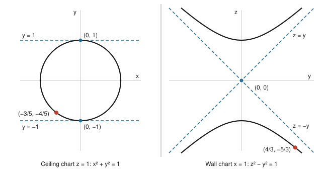

# Projective space: adding points at infinity so that parallel lines meet

[Syllabus](../../../SYLLABUS.md) → [Algebraic geometry](../README.md) → [Affine and Projective Varieties](../README.md#s02) → Projective space

---

## General Overview

A wall lamp hangs with its bulb 1 m from the wall and 1 m below the ceiling. Its shade is open at the top and the bottom, and the edge of the light leaves the bulb at 45° to the vertical. Put the bulb at the origin, with z pointing up and the wall at x = 1 m. The edge of the light is then the cone $`x^2 + y^2 = z^2`$, this shelf's house example.

On the ceiling, the edge of the light is a circle of radius 1 m. On the wall's plane, the cone's equation gives a hyperbola (a curve of two open arcs). The lower arc opens downwards from a highest point 1 m below the bulb, and the light from the bottom of the shade traces it on the wall. The upper arc opens upwards from the corner where wall meets ceiling, so it lies above the ceiling, where the wall's plane runs on outside the room. One cone of light, two very different curves.

Each edge of the light runs along a line through the bulb, and the light leaves along both halves of it: one ray (a half-line) up, one down. Take the line through (3, 4, −5). Its upward ray, through (−3, −4, 5), meets the ceiling at (x, y) = (−3/5, −4/5). Its downward ray meets the wall at (y, z) = (4/3, −5/3), 5/3 m below the bulb. A line that runs parallel to the wall never reaches it: on the wall, that line is missing. The same line lands on the ceiling at an ordinary spot.

**Projective space** makes this the definition. A point is a line through a fixed origin, written as a list of coordinates that may be scaled freely. Every flat surface of the form "one coordinate equals 1" is a **chart**: it shows most points with ordinary coordinates and misses the ones parallel to it. Lines that are parallel in a chart meet at a point that the chart misses.

**A point of projective space is a ratio of coordinates, unchanged by scaling; each coordinate that is not zero gives a chart that looks like ordinary space, and what a chart misses is a projective space one dimension down, where that chart's parallel lines meet.**

**What kind of fact this is:** projective space and its charts are definitions; that the charts cover it, that each is a copy of ordinary space, and that the points over a finite field number $`1 + p + \dots + p^n`$ are theorems, proved on this card in Why it works.

### The picture: one cone, two charts

<p align="center"></p>

Drawn to scale, 80 units per metre, real points only. The red dot is one line through the bulb, $`(3 : 4 : -5)`$, seen in both charts: its upward ray lights the ceiling, its downward ray the wall. Only the wall's lower arc is lit; the upper arc lies in the wall's plane above the ceiling. The two dashed lines are also the same two lines in both panels: parallel tangents on the ceiling, asymptotes (lines the curve approaches far out) crossing at the centre on the wall.

---

## The formula

Notation already in use. Homogeneous coordinates $`(x : y : z)`$ come from the [Perspective](../../05-Geometry%20and%20trig/05-Vectors%20in%20Space/05-perspective-and-projective-coordinates.md) card: $`(x, y, z)`$ and $`(\lambda x, \lambda y, \lambda z)`$ name the same point for any $`\lambda`$ that is not zero. The field $`k`$ (the number system in use: $`\mathbb{R}`$, $`\mathbb{C}`$ or $`\mathbb{F}_p`$, the integers mod a prime $`p`$) and affine space $`\mathbb{A}^n`$ (the ordinary list space $`k^n`$) come from [Affine varieties](01-affine-varieties-and-coordinate-rings.md).

New on this card: $`\mathbb{P}^n`$ and its charts. **Projective n-space** $`\mathbb{P}^n`$ is the set of lines through the origin in $`k^{n+1}`$, each written by any point on it other than the origin:

```math
\mathbb{P}^n(k) = \{\,(x_0 : x_1 : \dots : x_n) \text{ with not every } x_i = 0\,\}, \qquad (x_0 : \dots : x_n) = (\lambda x_0 : \dots : \lambda x_n) \text{ for every } \lambda \neq 0
```

**Read it aloud:** a point of projective n-space is a list of n + 1 numbers, not all zero, and two lists name the same point when one is a multiple of the other.

The **standard charts** are the places where one coordinate is not zero. Divide by that coordinate and drop it:

```math
U_i = \{\,x_i \neq 0\,\} \;\longrightarrow\; \mathbb{A}^n, \qquad (x_0 : \dots : x_n) \longmapsto \Big(\frac{x_0}{x_i}, \dots, \widehat{\frac{x_i}{x_i}}, \dots, \frac{x_n}{x_i}\Big)
```

**Read it aloud:** on the chart where coordinate i is not zero, scale the list so that coordinate is 1, then read off the other n numbers. The hat marks the entry that is left out.

The charts cover everything, and what one chart misses is a smaller projective space:

```math
\mathbb{P}^n = U_0 \cup U_1 \cup \dots \cup U_n, \qquad \mathbb{P}^n \setminus U_i = \{\,x_i = 0\,\} \cong \mathbb{P}^{n-1}, \qquad \#\,\mathbb{P}^n(\mathbb{F}_p) = 1 + p + \dots + p^n = \frac{p^{n+1} - 1}{p - 1}
```

**Read it aloud:** the n + 1 charts together hold every point; the points one chart misses form a copy of projective space one dimension lower, its hyperplane at infinity; so over the field with p elements, projective n-space has $`1 + p + \dots + p^n`$ points.

For the lamp, $`n = 2`$. The ceiling is the chart $`z = 1`$, the wall is the chart $`x = 1`$, and the line $`(3 : 4 : -5)`$ sits at $`(-3/5, -4/5)`$ on the ceiling and at $`(4/3, -5/3)`$ on the wall. Over $`\mathbb{F}_7`$, $`\mathbb{P}^2`$ has $`1 + 7 + 49 = 57`$ points.

| Symbol | Plain meaning | In our example | Push it up and the answer… |
| --- | --- | --- | --- |
| $`k`$ | the field: the numbers coordinates are taken from | $`\mathbb{R}`$ for the lamp; $`\mathbb{F}_7`$ for counting | a bigger field holds more points, such as $`(1 : i : 0)`$ over $`\mathbb{C}`$, where $`i = \sqrt{-1}`$, not a chart index |
| $`n`$ | the dimension: how many numbers a chart needs | 2 | one more chart, one more layer at infinity |
| $`x_0, \dots, x_n`$; $`x, y, z`$ | homogeneous coordinates, defined only up to scale | $`(3 : 4 : -5)`$, a line of the cone | — |
| $`\lambda`$, $`\mu`$ | scale factors, never zero | 2, −1 and −1/5 all leave $`(3 : 4 : -5)`$ alone | nothing changes; that is the point |
| $`\mathbb{P}^n`$ | projective n-space: lines through the origin in $`k^{n+1}`$ | every line through the bulb | — |
| $`\mathbb{A}^n`$ | affine n-space: ordinary coordinates, $`k^n`$ | the ceiling plane; the wall plane | — |
| $`U_i`$ | the chart where $`x_i \neq 0`$, a copy of $`\mathbb{A}^n`$ | $`U_z`$, the ceiling; $`U_x`$, the wall | — |
| $`(u, v)`$ | ceiling coordinates, $`(x/z, y/z)`$ | $`(-3/5, -4/5)`$ | — |
| $`\mathbb{P}^n \setminus U_i`$; $`\infty`$ | the points the chart misses: its hyperplane at infinity; for n = 1, a single point such as $`\infty = (1 : 0)`$ | $`z = 0`$, the horizontal lines; $`x = 0`$, lines parallel to the wall | — |
| $`p`$, $`\mathbb{F}_p`$, $`\#`$ | a prime, the integers mod $`p`$, and the number of points | $`p = 7`$; $`\#\,\mathbb{P}^2(\mathbb{F}_7) = 57`$ | the count grows like $`p^n`$ |
| $`a, b, c, c'`$ | the numbers in a line $`ax + by + c = 0`$ | tangent $`y = 1`$: $`a = 0`$, $`b = 1`$, $`c = -1`$ | changing $`c`$ shifts the line; its point at infinity $`(b : -a : 0)`$ stays |
| $`m`$ | a slope, used to list the cone's points | $`m = -2`$ gives $`(-3 : -4 : 5) = (3 : 4 : -5)`$ | — |

### When it holds

- **Not all coordinates zero.** $`(0 : 0 : 0)`$ is no line, and the count breaks with it: over $`\mathbb{F}_7`$ the 343 triples split by 6 scalings into 343/6 points, not a whole number.
- **Scaling by a number that is not zero.** Scaling by 0 sends every point to $`(0, 0, 0)`$, and every point would equal every other.
- **Equations of one degree throughout.** A curve in $`\mathbb{P}^2`$ needs an equation whose terms all have the same degree, such as $`x^2 + y^2 - z^2`$. Otherwise the answer depends on the scale: $`x^2 + y^2 - z`$ gives 0 at $`(1, 0, 1)`$ and 2 at $`(2, 0, 2)`$, one point. Turning an equation into this form is the next card's job.
- **A chart sees only its own points.** The wall chart misses $`(0 : 1 : 1)`$ and $`(0 : -1 : 1)`$, which the ceiling shows as $`(0, 1)`$ and $`(0, -1)`$. Use several charts to see everything.
- **Any field for the definition; real numbers for the pictures.** Over $`\mathbb{R}`$ the cone has no horizontal line, so the ceiling sees all of it. Over $`\mathbb{C}`$ it has two, $`(1 : i : 0)`$ and $`(1 : -i : 0)`$, which no drawing shows.

---

## Why it works

### Step 0: a point is a line through the origin, so only ratios matter

The line through $`(3, 4, -5)`$ also passes through $`(6, 8, -10)`$ and $`(-3, -4, 5)`$. All three satisfy $`x^2 + y^2 = z^2`$, because the equation has degree 2: scaling by $`\lambda`$ multiplies its value by $`\lambda^2`$, and 0 stays 0.

A list of numbers up to scale carries exactly the ratios between them. Those ratios pick out one line through the origin. That line is the point. The line runs both ways through the bulb, so $`\lambda = -1`$ names the same point: $`(-3, -4, 5)`$ is on the upward ray that lights the ceiling, $`(3, 4, -5)`$ on the downward ray that lights the wall.

### Step 1: a chart picks one list from each line

Every line through the origin that is not horizontal crosses the ceiling plane $`z = 1`$ exactly once. To find where, scale the list until its last entry is 1: $`(3, 4, -5)`$ becomes $`(-3/5, -4/5, 1)`$. The ceiling coordinates are $`(-3/5, -4/5)`$, and $`(-3/5)^2 + (-4/5)^2 = 1`$.

The map back puts the 1 back: $`(u, v)`$ goes to $`(u : v : 1)`$. The two maps undo each other, so the chart $`U_z`$ is a copy of the ordinary plane $`\mathbb{A}^2`$. The same holds for every coordinate. The wall chart divides by $`x = 3`$ and gives $`(4/3, -5/3)`$, with $`(-5/3)^2 - (4/3)^2 = 1`$. The chart $`y = 1`$ gives $`(3/4, -5/4)`$, a second hyperbola.

### Step 2: the charts cover, and they agree where they overlap

Every point has at least one coordinate that is not zero, so it lies in at least one chart. That is why the n + 1 charts cover $`\mathbb{P}^n`$.

Where two charts overlap, one chart's coordinates are ratios of the other's. A ceiling point $`(u, v)`$ is the list $`(u : v : 1)`$. Divide by $`u`$ to put it on the wall:

```math
(u, v) \longmapsto \Big(\frac{v}{u}, \frac{1}{u}\Big), \qquad \Big(-\frac{3}{5}, -\frac{4}{5}\Big) \longmapsto \Big(\frac{4}{3}, -\frac{5}{3}\Big)
```

**Read it aloud:** from ceiling to wall, divide the second ceiling number by the first, and take one over the first. This works wherever $`u \neq 0`$, which is where both charts see the point.

The same substitution turns one chart's equation into the other's. Put $`u = 1/z`$ and $`v = y/z`$, wall coordinates $`(y, z)`$, into $`u^2 + v^2 = 1`$ and multiply by $`z^2`$: $`1 + y^2 = z^2`$. The circle and the hyperbola are one curve of $`\mathbb{P}^2`$, read through two charts.

### Step 3: what a chart misses is projective space one dimension down

The ceiling misses the points with $`z = 0`$: lists $`(x : y : 0)`$, with x and y not both zero. Drop the final 0 and these are the points $`(x : y)`$ of $`\mathbb{P}^1`$, one for each horizontal direction. This is the ceiling's **line at infinity**. So the projective plane is an ordinary plane plus one line at infinity.

The same peeling works in any dimension. Points with $`x_0 \neq 0`$ make a copy of $`\mathbb{A}^n`$. The rest have $`x_0 = 0`$ and form a $`\mathbb{P}^{n-1}`$. Peel that one too, and so on down to a single point:

```math
\mathbb{P}^n = \mathbb{A}^n \sqcup \mathbb{A}^{n-1} \sqcup \dots \sqcup \mathbb{A}^1 \sqcup \mathbb{A}^0
```

**Read it aloud:** projective n-space splits, with no overlaps, into an ordinary n-space, an ordinary space one dimension lower, and so on down to one point. The square cup $`\sqcup`$ means a union of pieces that do not overlap.

Over $`\mathbb{F}_p`$, $`\mathbb{A}^j`$ has $`p^j`$ points, so $`\mathbb{P}^n`$ has $`p^n + \dots + p + 1`$. For $`\mathbb{P}^2(\mathbb{F}_7)`$: 49 + 7 + 1 = 57.

<details>
<summary>Detailed proof: the count, a second way</summary>

The nonzero lists in $`\mathbb{F}_p^{\,n+1}`$ number $`p^{n+1} - 1`$. Each point of $`\mathbb{P}^n`$ is named by exactly $`p - 1`$ of them, its multiples by the nonzero scales. Two different scales $`\lambda \neq \mu`$ give different lists, since $`\lambda v = \mu v`$ with some entry of $`v`$ not zero forces $`\lambda = \mu`$. So the points number

$`\displaystyle \frac{p^{n+1} - 1}{p - 1} = 1 + p + \dots + p^n,`$

the last step being the sum of a geometric series. For $`p = 7`$ and $`n = 2`$: 342 nonzero triples, 6 scales each, 57 points. The code counts it a third way, by brute force.

</details>

### Step 4: parallel lines meet on the line at infinity

On the ceiling, the tangent lines to the circle at $`(0, 1)`$ and $`(0, -1)`$ are $`y = 1`$ and $`y = -1`$. They are parallel. Written with $`z`$ so that each term has degree 1, they are $`y - z = 0`$ and $`y + z = 0`$. Adding gives $`y = 0`$; subtracting gives $`z = 0`$. The common point is $`(1 : 0 : 0)`$, on the ceiling's line at infinity.

This is general. Parallel lines $`ax + by + c = 0`$ and $`ax + by + c' = 0`$, with $`c \neq c'`$, become $`ax + by + cz = 0`$ and $`ax + by + c'z = 0`$. Subtracting forces $`z = 0`$, and the shared point is $`(b : -a : 0)`$: the direction both lines run in. Any two distinct lines of $`\mathbb{P}^2`$ meet in exactly one point, found by a cross product; the [Perspective](../../05-Geometry%20and%20trig/05-Vectors%20in%20Space/05-perspective-and-projective-coordinates.md) card proves it. Here $`(0, 1, -1) \times (0, 1, 1) = (2, 0, 0)`$.

Now read $`(1 : 0 : 0)`$ on the wall. Divide by $`x = 1`$: it is $`(0, 0)`$, the hyperbola's centre. The two tangents become $`z = y`$ and $`z = -y`$, the hyperbola's asymptotes. Far out, the hyperbola hugs them: at $`y = 1000`$ m, $`z - y`$ is about 0.0005 m. A point "at infinity" is a property of the chart, not of the point.

### Step 5: the line, the sphere, and why counts come out clean

For $`n = 1`$ there are two charts, and each misses one point. Over $`\mathbb{C}`$, $`\mathbb{P}^1`$ is the complex plane plus one point $`\infty = (1 : 0)`$: the Riemann sphere of [Mobius transformations](../../07-Complex%20analysis/07-Conformal%20Maps%20and%20Harmonic%20Functions/02-mobius-transformations-and-the-point-at-infinity.md). A Mobius map $`(az + b)/(cz + d)`$ is a 2 by 2 matrix acting on $`(z : 1)`$.

The cone shows why projective counts are clean. In the ceiling chart, lines of slope $`m`$ through the point (−1, 0), which is $`(-1 : 0 : 1)`$, meet the circle once more, at $`(1 - m^2 : 2m : 1 + m^2)`$; $`m = -2`$ gives $`(-3 : -4 : 5)`$, the red dot's line $`(3 : 4 : -5)`$. Over $`\mathbb{F}_p`$ with $`p`$ odd, the p slopes plus the starting point give $`p + 1`$ points, every time. Over $`\mathbb{F}_5`$, $`m = 2`$ makes $`1 + m^2 = 0`$: the ceiling formula would divide by zero, but projectively the point is $`(1 : 2 : 0)`$, on the line at infinity.

---

## Worked numbers, by hand

| Step | Arithmetic | Value |
| --- | --- | --- |
| the line is on the cone | $`3^2 + 4^2 - (-5)^2`$; scaled by 2: $`36 + 64 - 100`$ | 0 and 0 |
| ceiling chart, divide by $`z = -5`$ | $`(-3/5, -4/5)`$; check $`9/25 + 16/25`$ | $`(-3/5, -4/5)`$, on $`u^2 + v^2 = 1`$ |
| wall chart, divide by $`x = 3`$ | $`(4/3, -5/3)`$; check $`25/9 - 16/9`$ | $`(4/3, -5/3)`$, on $`z^2 - y^2 = 1`$ |
| ceiling to wall | $`((-4/5)/(-3/5),\ 1/(-3/5))`$ | $`(4/3, -5/3)`$, the same point |
| parallel tangents meet | $`y - z = 0`$ and $`y + z = 0`$: add, subtract | $`(1 : 0 : 0)`$ |
| that point on the wall | divide by $`x = 1`$ | $`(0, 0)`$, the centre |
| points of $`\mathbb{P}^2(\mathbb{F}_7)`$ | $`49 + 7 + 1`$ | **57** |
| the cone over $`\mathbb{F}_7`$ | $`p + 1`$; wall chart misses $`x = 0`$ | **8**, of which the wall sees 6 |

The line $`(3 : 4 : -5)`$ is one point with a different address in each chart. The tangents parallel on the ceiling cross at the wall's centre. Over $`\mathbb{F}_7`$ the plane has 57 points and the cone 8.

### What breaks if you drop a piece

| Mistake | Comes out at | What went wrong |
| --- | --- | --- |
| Count scaled copies as different points | 342 triples over $`\mathbb{F}_7`$, not 57 points | Each point has 6 names, one per nonzero scale |
| Keep $`(0, 0, 0)`$ | 343/6, not a whole number | The zero list lies on no line through the origin |
| Use $`x^2 + y^2 - z`$, not one degree | 0 at $`(1, 0, 1)`$, 2 at $`(2, 0, 2)`$ | One point, two answers: the curve is not defined |
| Work in one chart only | wall sees 6 of 8 points over $`\mathbb{F}_7`$; ceiling 4 of 6 over $`\mathbb{F}_5`$ | Each chart misses its own points at infinity |

The code prints every row.

---

## Code, from first principles, and it actually runs

The code works exactly: fractions for the charts, whole numbers mod p for the counts. It takes three roads. First, it puts the line $`(3 : 4 : -5)`$ into each chart directly, then again through the change-of-chart formula, and the two must agree; the slope formula with $`m = -2`$ must give the same point. Second, it meets the parallel tangents by a cross product and reads the result on the wall. Third, it counts $`\mathbb{P}^n(\mathbb{F}_p)`$ by brute force (scale each list so its first nonzero entry is 1, then count the distinct results), by dividing the nonzero lists by $`p - 1`$, and by the layer sum $`1 + p + \dots + p^n`$. It also counts the cone by brute force and by the slope formula, against Euler's test for whether −1 is a square.

### Python

```python
# Projective space and homogeneous coordinates -- the check behind the card.
# Standard library only.  Fraction keeps the chart arithmetic exact.  A lamp at
# the origin throws the light cone x^2 + y^2 = z^2.  A point of the projective
# plane is a whole line through the lamp; the ceiling z = 1 and the wall x = 1
# are two charts of it.  Then P^n and the cone are counted over F_p, three ways.
from fractions import Fraction as Q

def cone(v): return v[0] * v[0] + v[1] * v[1] - v[2] * v[2]
def pair(a, b): return f"({a}, {b})"
def cross(a, b): return (a[1]*b[2] - a[2]*b[1], a[2]*b[0] - a[0]*b[2], a[0]*b[1] - a[1]*b[0])
def dot(a, b): return sum(x * y for x, y in zip(a, b))
def yn(c): return "yes" if c else "no"
def charts(r): return (r[0] / r[2], r[1] / r[2]), (r[1] / r[0], r[2] / r[0]), (r[0] / r[1], r[2] / r[1])
def to_wall(u, v): return (v / u, 1 / u)          # ceiling (u, v) is the triple (u, v, 1)
def to_ceil(s, t): return (1 / t, s / t)          # wall (s, t) is the triple (1, s, t)

r = (Q(3), Q(4), Q(-5))                          # down to the wall; its other half, (-3, -4, 5), goes up
ceil, wall, side = charts(r)
print("lamp at the origin; light cone x^2 + y^2 = z^2; ceiling z = 1 m, wall x = 1 m")
print(f"line (3 : 4 : -5): cone value {cone(r)}; scaled by 2, -1, -1/5: "
      + ", ".join(str(cone([l * c for c in r])) for l in (2, -1, Q(-1, 5))))
print(f"chart z = 1, ceiling: (x, y) = {pair(*ceil)}; x^2 + y^2 = 1: {yn(ceil[0]**2 + ceil[1]**2 == 1)}")
print(f"chart x = 1, wall: (y, z) = {pair(*wall)}; z^2 - y^2 = 1: {yn(wall[1]**2 - wall[0]**2 == 1)}")
print(f"chart y = 1: (x, z) = {pair(*side)}; z^2 - x^2 = 1: {yn(side[1]**2 - side[0]**2 == 1)}")
assert ceil[0]**2 + ceil[1]**2 == 1 and wall[1]**2 - wall[0]**2 == 1 and side[1]**2 - side[0]**2 == 1
print(f"ceiling to wall, (u, v) -> (v/u, 1/u): {pair(*to_wall(*ceil))}; wall back to ceiling: "
      f"{pair(*to_ceil(*to_wall(*ceil)))}")
m = Q(-2)                                         # slope of a ceiling line through (-1, 0)
sl = (1 - m * m, 2 * m, 1 + m * m)
print(f"ceiling line of slope {m} through (-1, 0): (1 - m^2 : 2m : 1 + m^2) = ({sl[0]} : {sl[1]} : {sl[2]}), "
      f"the same point as (3 : 4 : -5): {yn(cross(sl, r) == (0, 0, 0))}")
assert cross(sl, r) == (0, 0, 0) and ceil[1] == m * (ceil[0] + 1)   # proportional; on that line
r2 = (Q(5), Q(12), Q(13))
c2, w2, _ = charts(r2)
print(f"line ({r2[0]} : {r2[1]} : {r2[2]}): ceiling {pair(*c2)}, wall {pair(*w2)}, cone value {cone(r2)}")
t1, t2 = (0, 1, -1), (0, 1, 1)                    # y - z = 0 and y + z = 0
meet = cross(t1, t2)
print(f"ceiling tangents y = 1 and y = -1 are the triples {t1}, {t2}; they meet at {meet} = (1 : 0 : 0)")
print(f"in the wall chart (1 : 0 : 0) is (y, z) = {pair(Q(meet[1], meet[0]), Q(meet[2], meet[0]))}, "
      f"the hyperbola's centre")
far = (1000001.0 ** 0.5) - 1000.0
print(f"wall hyperbola at y = 1000 m: z - y = {far:.12f}, closing on the asymptote z = y")
print("ceiling points (0, 1), (0, -1) are (0 : 1 : 1), (0 : -1 : 1): x = 0, the wall's line at infinity")
gi = lambda a, b: (a[0] * b[0] - a[1] * b[1], a[0] * b[1] + a[1] * b[0])   # complex product
for y in ((0, 1), (0, -1)):
    s = tuple(p + q for p, q in zip(gi((1, 0), (1, 0)), gi(y, y)))
    print(f"over C, horizontal line (1 : {'i' if y[1] == 1 else '-i'} : 0): x^2 + y^2 = {s[0]} + {s[1]}i")
    assert s == (0, 0)

def tuples(m, p):
    out = [()]
    for _ in range(m):
        out = [t + (c,) for t in out for c in range(p)]
    return out

def norm(v, p):                                   # scale so the first nonzero entry is 1
    i = next(k for k, c in enumerate(v) if c % p)
    inv = pow(v[i], p - 2, p)
    return tuple(c * inv % p for c in v)

primes = (2, 3, 5, 7)
print(f"P^n(F_p) for p = {', '.join(map(str, primes))}: canonical forms / nonzero lists over p - 1 / 1 + p + ... + p^n")
for n in (1, 2, 3):
    brute, orbit, strata, chart_ok = [], [], [], True
    for p in primes:
        nz = [v for v in tuples(n + 1, p) if any(v)]
        pts = {norm(v, p) for v in nz}
        brute.append(len(pts))
        assert len(nz) % (p - 1) == 0
        orbit.append(len(nz) // (p - 1))
        strata.append(sum(p ** k for k in range(n + 1)))
        chart_ok &= all(sum(1 for q in pts if q[i]) == p ** n for i in range(n + 1))
    print(f"n = {n}: {brute} {orbit} {strata}; each of the {n + 1} charts holds p^{n} points: {yn(chart_ok)}")
    assert brute == orbit == strata and chart_ok

seen, miss = {}, {}
for p in (5, 7, 11, 13):
    pts = sorted({norm(v, p) for v in tuples(3, p) if any(v) and cone(v) % p == 0})
    par = {norm(((1 - m * m) % p, 2 * m % p, (1 + m * m) % p), p) for m in range(p)} | {norm((p - 1, 0, 1), p)}
    ceil_n = sum(1 for q in pts if q[2]); inf_n = len(pts) - ceil_n
    wall_n = sum(1 for q in pts if q[0])
    chi = 1 if pow(p - 1, (p - 1) // 2, p) == 1 else -1   # Euler: is -1 a square mod p?
    print(f"cone over F_{p}: {len(pts)} points; ceiling chart {ceil_n}, at the ceiling's infinity {inf_n}, "
          f"wall chart {wall_n}; by (1 - m^2 : 2m : 1 + m^2): {len(par)}, same set: {yn(par == set(pts))}")
    assert par == set(pts) and len(pts) == p + 1 and ceil_n == p - chi and wall_n == p - 1
    seen[p], miss[p] = len(pts), (len(pts) - wall_n, len(pts) - ceil_n)
    if p == 5:
        print(f"  over F_5 at infinity: {[q for q in pts if q[2] == 0]}; m = 2 gives {norm((1 - 4, 4, 5), 5)}")

all7 = tuples(3, 7)
nz7 = [v for v in all7 if any(v)]
print(f"mistake 1, scaled copies counted as points: F_7 has {len(nz7)} nonzero triples; P^2(F_7) has "
      f"{len({norm(v, 7) for v in nz7})} points")
print(f"mistake 2, (0, 0, 0) kept: {len(all7)} triples / 6 scalings = {Q(len(all7), 6)}, not a whole number")
bad = lambda v: v[0] * v[0] + v[1] * v[1] - v[2]
print(f"mistake 3, x^2 + y^2 - z is not homogeneous: (1, 0, 1) gives {bad((1, 0, 1))}, (2, 0, 2) gives {bad((2, 0, 2))}")
print(f"mistake 4, one chart only: the wall chart misses {miss[7][0]} of the {seen[7]} points over F_7; "
      f"the ceiling chart, {miss[5][1]} of {seen[5]} over F_5")
k = 80                                            # figure: 80 units per metre
fx = lambda cx, a, b: f"({float(cx + k * a):.2f}, {float(160 - k * b):.2f})"
print(f"figure, {k} units per metre: ceiling point {fx(160, *ceil)}, tangent points {fx(160, 0, 1)} {fx(160, 0, -1)}; wall point {fx(480, *wall)}, "
      f"vertices {fx(480, 0, 1)} {fx(480, 0, -1)}, asymptote z = y ends {fx(480, -1.8, -1.8)} {fx(480, 1.8, 1.8)}, "
      f"asymptote z = -y ends {fx(480, -1.8, 1.8)} {fx(480, 1.8, -1.8)}")

assert to_wall(*ceil) == wall and to_ceil(*wall) == ceil and to_wall(*c2) == w2   # transition = direct
assert dot(meet, t1) == 0 and dot(meet, t2) == 0 and meet[2] == 0 and meet[0] != 0
assert 0 < far < 0.0006 and cone(r) == 0 and cone(r2) == 0
print("ALL CHECKS PASS")
```

**Ran 2026-11-17 on macOS, Python 3.14.10, standard library only. All checks passed. Output, pasted from the run:**

```
lamp at the origin; light cone x^2 + y^2 = z^2; ceiling z = 1 m, wall x = 1 m
line (3 : 4 : -5): cone value 0; scaled by 2, -1, -1/5: 0, 0, 0
chart z = 1, ceiling: (x, y) = (-3/5, -4/5); x^2 + y^2 = 1: yes
chart x = 1, wall: (y, z) = (4/3, -5/3); z^2 - y^2 = 1: yes
chart y = 1: (x, z) = (3/4, -5/4); z^2 - x^2 = 1: yes
ceiling to wall, (u, v) -> (v/u, 1/u): (4/3, -5/3); wall back to ceiling: (-3/5, -4/5)
ceiling line of slope -2 through (-1, 0): (1 - m^2 : 2m : 1 + m^2) = (-3 : -4 : 5), the same point as (3 : 4 : -5): yes
line (5 : 12 : 13): ceiling (5/13, 12/13), wall (12/5, 13/5), cone value 0
ceiling tangents y = 1 and y = -1 are the triples (0, 1, -1), (0, 1, 1); they meet at (2, 0, 0) = (1 : 0 : 0)
in the wall chart (1 : 0 : 0) is (y, z) = (0, 0), the hyperbola's centre
wall hyperbola at y = 1000 m: z - y = 0.000499999875, closing on the asymptote z = y
ceiling points (0, 1), (0, -1) are (0 : 1 : 1), (0 : -1 : 1): x = 0, the wall's line at infinity
over C, horizontal line (1 : i : 0): x^2 + y^2 = 0 + 0i
over C, horizontal line (1 : -i : 0): x^2 + y^2 = 0 + 0i
P^n(F_p) for p = 2, 3, 5, 7: canonical forms / nonzero lists over p - 1 / 1 + p + ... + p^n
n = 1: [3, 4, 6, 8] [3, 4, 6, 8] [3, 4, 6, 8]; each of the 2 charts holds p^1 points: yes
n = 2: [7, 13, 31, 57] [7, 13, 31, 57] [7, 13, 31, 57]; each of the 3 charts holds p^2 points: yes
n = 3: [15, 40, 156, 400] [15, 40, 156, 400] [15, 40, 156, 400]; each of the 4 charts holds p^3 points: yes
cone over F_5: 6 points; ceiling chart 4, at the ceiling's infinity 2, wall chart 4; by (1 - m^2 : 2m : 1 + m^2): 6, same set: yes
  over F_5 at infinity: [(1, 2, 0), (1, 3, 0)]; m = 2 gives (1, 2, 0)
cone over F_7: 8 points; ceiling chart 8, at the ceiling's infinity 0, wall chart 6; by (1 - m^2 : 2m : 1 + m^2): 8, same set: yes
cone over F_11: 12 points; ceiling chart 12, at the ceiling's infinity 0, wall chart 10; by (1 - m^2 : 2m : 1 + m^2): 12, same set: yes
cone over F_13: 14 points; ceiling chart 12, at the ceiling's infinity 2, wall chart 12; by (1 - m^2 : 2m : 1 + m^2): 14, same set: yes
mistake 1, scaled copies counted as points: F_7 has 342 nonzero triples; P^2(F_7) has 57 points
mistake 2, (0, 0, 0) kept: 343 triples / 6 scalings = 343/6, not a whole number
mistake 3, x^2 + y^2 - z is not homogeneous: (1, 0, 1) gives 0, (2, 0, 2) gives 2
mistake 4, one chart only: the wall chart misses 2 of the 8 points over F_7; the ceiling chart, 2 of 6 over F_5
figure, 80 units per metre: ceiling point (112.00, 224.00), tangent points (160.00, 80.00) (160.00, 240.00); wall point (586.67, 293.33), vertices (480.00, 80.00) (480.00, 240.00), asymptote z = y ends (336.00, 304.00) (624.00, 16.00), asymptote z = -y ends (336.00, 16.00) (624.00, 304.00)
ALL CHECKS PASS
```

### Rust

Same numbers, same labels. Fractions are an `i128` struct whose products use `checked_mul`, so an overflow stops the run.

```rust
// Projective space and homogeneous coordinates -- the same check as the Python, in Rust.
// No crates.  Fractions are an i128 struct using checked_mul, so overflow stops the run.
// A lamp at the origin throws the light cone x^2 + y^2 = z^2.  A point of the projective
// plane is a whole line through the lamp; the ceiling z = 1 and the wall x = 1 are two
// charts of it.  Then P^n and the cone are counted over F_p, three ways.
use std::collections::BTreeSet;
use std::fmt;

#[derive(Clone, Copy, PartialEq, Debug)]
struct Q { n: i128, d: i128 }
fn gcd(a: i128, b: i128) -> i128 { if b == 0 { a.abs() } else { gcd(b, a % b) } }
fn q(n: i128, d: i128) -> Q {
    assert!(d != 0, "division by zero");
    let g = gcd(n, d); let s = if d < 0 { -1 } else { 1 };
    Q { n: s * n / g, d: s * d / g }
}
fn m(a: i128, b: i128) -> i128 { a.checked_mul(b).expect("overflow") }
fn add(a: Q, b: Q) -> Q { q(m(a.n, b.d) + m(b.n, a.d), m(a.d, b.d)) }
fn sub(a: Q, b: Q) -> Q { add(a, Q { n: -b.n, d: b.d }) }
fn mul(a: Q, b: Q) -> Q { q(m(a.n, b.n), m(a.d, b.d)) }
fn div(a: Q, b: Q) -> Q { q(m(a.n, b.d), m(a.d, b.n)) }
impl fmt::Display for Q {
    fn fmt(&self, f: &mut fmt::Formatter) -> fmt::Result {
        if self.d == 1 { write!(f, "{}", self.n) } else { write!(f, "{}/{}", self.n, self.d) }
    }
}
fn i(n: i128) -> Q { q(n, 1) }
fn cone(v: [Q; 3]) -> Q { sub(add(mul(v[0], v[0]), mul(v[1], v[1])), mul(v[2], v[2])) }
fn pair(a: (Q, Q)) -> String { format!("({}, {})", a.0, a.1) }
fn yn(c: bool) -> &'static str { if c { "yes" } else { "no" } }
fn charts(r: [Q; 3]) -> ((Q, Q), (Q, Q), (Q, Q)) {
    ((div(r[0], r[2]), div(r[1], r[2])), (div(r[1], r[0]), div(r[2], r[0])), (div(r[0], r[1]), div(r[2], r[1])))
}
fn to_wall(c: (Q, Q)) -> (Q, Q) { (div(c.1, c.0), div(i(1), c.0)) }   // ceiling (u, v) is (u, v, 1)
fn to_ceil(w: (Q, Q)) -> (Q, Q) { (div(i(1), w.1), div(w.0, w.1)) }   // wall (s, t) is (1, s, t)
fn cross(a: [i64; 3], b: [i64; 3]) -> [i64; 3] {
    [a[1] * b[2] - a[2] * b[1], a[2] * b[0] - a[0] * b[2], a[0] * b[1] - a[1] * b[0]]
}
fn tuples(len: usize, p: i64) -> Vec<Vec<i64>> {
    let mut out: Vec<Vec<i64>> = vec![vec![]];
    for _ in 0..len {
        out = out.iter().flat_map(|t| (0..p).map(move |c| { let mut u = t.clone(); u.push(c); u })).collect();
    }
    out
}
fn powmod(b: i64, e: i64, p: i64) -> i64 { let mut r = 1; for _ in 0..e { r = r * b % p } r }
fn norm(v: &[i64], p: i64) -> Vec<i64> {                  // scale so the first nonzero entry is 1
    let first = *v.iter().find(|&&c| c.rem_euclid(p) != 0).unwrap();
    let inv = powmod(first.rem_euclid(p), p - 2, p);
    v.iter().map(|&c| (c * inv).rem_euclid(p)).collect()
}
fn tup(v: &[i64]) -> String { format!("({}, {}, {})", v[0], v[1], v[2]) }

fn main() {
    let r = [i(3), i(4), i(-5)];                               // down to the wall; its other half, (-3, -4, 5), goes up
    let (ceil, wall, side) = charts(r);
    println!("lamp at the origin; light cone x^2 + y^2 = z^2; ceiling z = 1 m, wall x = 1 m");
    let sc: Vec<String> = [i(2), i(-1), q(-1, 5)].iter().map(|&l| cone([mul(l, r[0]), mul(l, r[1]), mul(l, r[2])]).to_string()).collect();
    println!("line (3 : 4 : -5): cone value {}; scaled by 2, -1, -1/5: {}", cone(r), sc.join(", "));
    let sq = |a: Q| mul(a, a);
    println!("chart z = 1, ceiling: (x, y) = {}; x^2 + y^2 = 1: {}", pair(ceil), yn(add(sq(ceil.0), sq(ceil.1)) == i(1)));
    println!("chart x = 1, wall: (y, z) = {}; z^2 - y^2 = 1: {}", pair(wall), yn(sub(sq(wall.1), sq(wall.0)) == i(1)));
    println!("chart y = 1: (x, z) = {}; z^2 - x^2 = 1: {}", pair(side), yn(sub(sq(side.1), sq(side.0)) == i(1)));
    assert!(add(sq(ceil.0), sq(ceil.1)) == i(1) && sub(sq(wall.1), sq(wall.0)) == i(1) && sub(sq(side.1), sq(side.0)) == i(1));
    println!("ceiling to wall, (u, v) -> (v/u, 1/u): {}; wall back to ceiling: {}", pair(to_wall(ceil)), pair(to_ceil(to_wall(ceil))));
    let m = i(-2);                                            // slope of a ceiling line through (-1, 0)
    let sl = [sub(i(1), sq(m)), mul(i(2), m), add(i(1), sq(m))];
    let prop = (0..3).all(|k| mul(sl[(k + 1) % 3], r[(k + 2) % 3]) == mul(sl[(k + 2) % 3], r[(k + 1) % 3]));   // cross product is 0
    println!("ceiling line of slope {} through (-1, 0): (1 - m^2 : 2m : 1 + m^2) = ({} : {} : {}), the same point as (3 : 4 : -5): {}",
             m, sl[0], sl[1], sl[2], yn(prop));
    assert!(prop && ceil.1 == mul(m, add(ceil.0, i(1))));    // proportional; on that line
    let r2 = [i(5), i(12), i(13)];
    let (c2, w2, _) = charts(r2);
    println!("line ({} : {} : {}): ceiling {}, wall {}, cone value {}", r2[0], r2[1], r2[2], pair(c2), pair(w2), cone(r2));
    let (t1, t2) = ([0i64, 1, -1], [0i64, 1, 1]);            // y - z = 0 and y + z = 0
    let meet = cross(t1, t2);
    println!("ceiling tangents y = 1 and y = -1 are the triples {}, {}; they meet at {} = (1 : 0 : 0)",
             tup(&t1), tup(&t2), tup(&meet));
    println!("in the wall chart (1 : 0 : 0) is (y, z) = {}, the hyperbola's centre",
             pair((q(meet[1] as i128, meet[0] as i128), q(meet[2] as i128, meet[0] as i128))));
    let far = 1000001.0f64.sqrt() - 1000.0;
    println!("wall hyperbola at y = 1000 m: z - y = {:.12}, closing on the asymptote z = y", far);
    println!("ceiling points (0, 1), (0, -1) are (0 : 1 : 1), (0 : -1 : 1): x = 0, the wall's line at infinity");
    let gi = |a: (i64, i64), b: (i64, i64)| (a.0 * b.0 - a.1 * b.1, a.0 * b.1 + a.1 * b.0);   // complex product
    for y in [(0i64, 1i64), (0, -1)] {
        let (x2, y2) = (gi((1, 0), (1, 0)), gi(y, y));
        println!("over C, horizontal line (1 : {} : 0): x^2 + y^2 = {} + {}i", if y.1 == 1 { "i" } else { "-i" }, x2.0 + y2.0, x2.1 + y2.1);
        assert!(x2.0 + y2.0 == 0 && x2.1 + y2.1 == 0);
    }
    let primes = [2i64, 3, 5, 7];
    println!("P^n(F_p) for p = {}: canonical forms / nonzero lists over p - 1 / 1 + p + ... + p^n",
             primes.iter().map(|p| p.to_string()).collect::<Vec<_>>().join(", "));
    for n in 1..=3usize {
        let (mut brute, mut orbit, mut strata, mut chart_ok) = (vec![], vec![], vec![], true);
        for &p in &primes {
            let nz: Vec<Vec<i64>> = tuples(n + 1, p).into_iter().filter(|v| v.iter().any(|&c| c != 0)).collect();
            let pts: BTreeSet<Vec<i64>> = nz.iter().map(|v| norm(v, p)).collect();
            brute.push(pts.len() as i64);
            assert!(nz.len() as i64 % (p - 1) == 0);
            orbit.push(nz.len() as i64 / (p - 1));
            strata.push((0..=n as u32).map(|k| p.pow(k)).sum::<i64>());
            chart_ok &= (0..=n).all(|c| pts.iter().filter(|q| q[c] != 0).count() as i64 == p.pow(n as u32));
        }
        println!("n = {}: {:?} {:?} {:?}; each of the {} charts holds p^{} points: {}", n, brute, orbit, strata, n + 1, n, yn(chart_ok));
        assert!(brute == orbit && orbit == strata && chart_ok);
    }
    let (mut seen, mut miss) = (std::collections::BTreeMap::new(), std::collections::BTreeMap::new());
    for p in [5i64, 7, 11, 13] {
        let pts: BTreeSet<Vec<i64>> = tuples(3, p).into_iter()
            .filter(|v| v.iter().any(|&c| c != 0) && (v[0] * v[0] + v[1] * v[1] - v[2] * v[2]).rem_euclid(p) == 0)
            .map(|v| norm(&v, p)).collect();
        let mut par: BTreeSet<Vec<i64>> = (0..p).map(|m| norm(&[(1 - m * m).rem_euclid(p), 2 * m % p, (1 + m * m) % p], p)).collect();
        par.insert(norm(&[p - 1, 0, 1], p));
        let ceil_n = pts.iter().filter(|q| q[2] != 0).count();
        let inf_n = pts.len() - ceil_n;
        let wall_n = pts.iter().filter(|q| q[0] != 0).count();
        let chi: i64 = if powmod(p - 1, (p - 1) / 2, p) == 1 { 1 } else { -1 };   // Euler: is -1 a square mod p?
        println!("cone over F_{}: {} points; ceiling chart {}, at the ceiling's infinity {}, wall chart {}; by (1 - m^2 : 2m : 1 + m^2): {}, same set: {}",
                 p, pts.len(), ceil_n, inf_n, wall_n, par.len(), yn(par == pts));
        assert!(par == pts && pts.len() as i64 == p + 1 && ceil_n as i64 == p - chi && wall_n as i64 == p - 1);
        seen.insert(p, pts.len());
        miss.insert(p, (pts.len() - wall_n, pts.len() - ceil_n));
        if p == 5 {
            let at_inf: Vec<String> = pts.iter().filter(|q| q[2] == 0).map(|q| tup(q)).collect();
            println!("  over F_5 at infinity: [{}]; m = 2 gives {}", at_inf.join(", "), tup(&norm(&[1 - 4, 4, 5], 5)));
        }
    }
    let all7 = tuples(3, 7);
    let nz7: Vec<Vec<i64>> = all7.iter().filter(|v| v.iter().any(|&c| c != 0)).cloned().collect();
    let p2f7: BTreeSet<Vec<i64>> = nz7.iter().map(|v| norm(v, 7)).collect();
    println!("mistake 1, scaled copies counted as points: F_7 has {} nonzero triples; P^2(F_7) has {} points", nz7.len(), p2f7.len());
    println!("mistake 2, (0, 0, 0) kept: {} triples / 6 scalings = {}, not a whole number", all7.len(), q(all7.len() as i128, 6));
    let bad = |v: [i64; 3]| v[0] * v[0] + v[1] * v[1] - v[2];
    println!("mistake 3, x^2 + y^2 - z is not homogeneous: (1, 0, 1) gives {}, (2, 0, 2) gives {}", bad([1, 0, 1]), bad([2, 0, 2]));
    println!("mistake 4, one chart only: the wall chart misses {} of the {} points over F_7; the ceiling chart, {} of {} over F_5",
             miss[&7].0, seen[&7], miss[&5].1, seen[&5]);
    let k = 80.0f64;                                           // figure: 80 units per metre
    let fl = |a: Q| a.n as f64 / a.d as f64;
    let fx = |cx: f64, a: f64, b: f64| format!("({:.2}, {:.2})", cx + k * a, 160.0 - k * b);
    println!("figure, 80 units per metre: ceiling point {}, tangent points {} {}; wall point {}, vertices {} {}, asymptote z = y ends {} {}, \
              asymptote z = -y ends {} {}", fx(160.0, fl(ceil.0), fl(ceil.1)), fx(160.0, 0.0, 1.0), fx(160.0, 0.0, -1.0),
             fx(480.0, fl(wall.0), fl(wall.1)), fx(480.0, 0.0, 1.0), fx(480.0, 0.0, -1.0), fx(480.0, -1.8, -1.8), fx(480.0, 1.8, 1.8),
             fx(480.0, -1.8, 1.8), fx(480.0, 1.8, -1.8));

    assert!(to_wall(ceil) == wall && to_ceil(wall) == ceil && to_wall(c2) == w2);   // transition = direct
    let dot = |a: [i64; 3], b: [i64; 3]| a[0] * b[0] + a[1] * b[1] + a[2] * b[2];
    assert!(dot(meet, t1) == 0 && dot(meet, t2) == 0 && meet[2] == 0 && meet[0] != 0);
    assert!(far > 0.0 && far < 0.0006 && cone(r) == i(0) && cone(r2) == i(0));
    println!("ALL CHECKS PASS");
}
```

**Ran 2026-11-17 on macOS, rustc 1.98.1, no crates. All checks passed. Output, pasted from the run:**

```
lamp at the origin; light cone x^2 + y^2 = z^2; ceiling z = 1 m, wall x = 1 m
line (3 : 4 : -5): cone value 0; scaled by 2, -1, -1/5: 0, 0, 0
chart z = 1, ceiling: (x, y) = (-3/5, -4/5); x^2 + y^2 = 1: yes
chart x = 1, wall: (y, z) = (4/3, -5/3); z^2 - y^2 = 1: yes
chart y = 1: (x, z) = (3/4, -5/4); z^2 - x^2 = 1: yes
ceiling to wall, (u, v) -> (v/u, 1/u): (4/3, -5/3); wall back to ceiling: (-3/5, -4/5)
ceiling line of slope -2 through (-1, 0): (1 - m^2 : 2m : 1 + m^2) = (-3 : -4 : 5), the same point as (3 : 4 : -5): yes
line (5 : 12 : 13): ceiling (5/13, 12/13), wall (12/5, 13/5), cone value 0
ceiling tangents y = 1 and y = -1 are the triples (0, 1, -1), (0, 1, 1); they meet at (2, 0, 0) = (1 : 0 : 0)
in the wall chart (1 : 0 : 0) is (y, z) = (0, 0), the hyperbola's centre
wall hyperbola at y = 1000 m: z - y = 0.000499999875, closing on the asymptote z = y
ceiling points (0, 1), (0, -1) are (0 : 1 : 1), (0 : -1 : 1): x = 0, the wall's line at infinity
over C, horizontal line (1 : i : 0): x^2 + y^2 = 0 + 0i
over C, horizontal line (1 : -i : 0): x^2 + y^2 = 0 + 0i
P^n(F_p) for p = 2, 3, 5, 7: canonical forms / nonzero lists over p - 1 / 1 + p + ... + p^n
n = 1: [3, 4, 6, 8] [3, 4, 6, 8] [3, 4, 6, 8]; each of the 2 charts holds p^1 points: yes
n = 2: [7, 13, 31, 57] [7, 13, 31, 57] [7, 13, 31, 57]; each of the 3 charts holds p^2 points: yes
n = 3: [15, 40, 156, 400] [15, 40, 156, 400] [15, 40, 156, 400]; each of the 4 charts holds p^3 points: yes
cone over F_5: 6 points; ceiling chart 4, at the ceiling's infinity 2, wall chart 4; by (1 - m^2 : 2m : 1 + m^2): 6, same set: yes
  over F_5 at infinity: [(1, 2, 0), (1, 3, 0)]; m = 2 gives (1, 2, 0)
cone over F_7: 8 points; ceiling chart 8, at the ceiling's infinity 0, wall chart 6; by (1 - m^2 : 2m : 1 + m^2): 8, same set: yes
cone over F_11: 12 points; ceiling chart 12, at the ceiling's infinity 0, wall chart 10; by (1 - m^2 : 2m : 1 + m^2): 12, same set: yes
cone over F_13: 14 points; ceiling chart 12, at the ceiling's infinity 2, wall chart 12; by (1 - m^2 : 2m : 1 + m^2): 14, same set: yes
mistake 1, scaled copies counted as points: F_7 has 342 nonzero triples; P^2(F_7) has 57 points
mistake 2, (0, 0, 0) kept: 343 triples / 6 scalings = 343/6, not a whole number
mistake 3, x^2 + y^2 - z is not homogeneous: (1, 0, 1) gives 0, (2, 0, 2) gives 2
mistake 4, one chart only: the wall chart misses 2 of the 8 points over F_7; the ceiling chart, 2 of 6 over F_5
figure, 80 units per metre: ceiling point (112.00, 224.00), tangent points (160.00, 80.00) (160.00, 240.00); wall point (586.67, 293.33), vertices (480.00, 80.00) (480.00, 240.00), asymptote z = y ends (336.00, 304.00) (624.00, 16.00), asymptote z = -y ends (336.00, 16.00) (624.00, 304.00)
ALL CHECKS PASS
```

The two outputs match line for line.

### Lean

Lean proves the charts, their hyperplanes at infinity and the count for every $`n`$, plus the lamp's worked numbers.

- Take any field $`k`$. Then every point of $`\mathbb{P}^n`$ has a coordinate that is not zero, so the charts $`U_0, \dots, U_n`$ cover it.
- Take any field $`k`$ and any place $`i`$. Then putting a 1 in place $`i`$ matches $`\mathbb{A}^n`$, point for point, with exactly the chart $`U_i`$.
- Take any field $`k`$ and any place $`i`$. Then putting a 0 in place $`i`$ matches $`\mathbb{P}^{n-1}`$, point for point, with the points where $`x_i = 0`$. These are the chart's hyperplane at infinity.
- Take a prime $`p`$. Then $`\mathbb{P}^n(\mathbb{F}_p)`$ has $`1 + p + \dots + p^n`$ points. That number equals $`(p^{n+1} - 1)/(p - 1)`$.
- The line $`(3 : 4 : -5)`$ is on the cone, and so is its double. It sits at $`(-3/5, -4/5)`$ on the ceiling and at $`(4/3, -5/3)`$ on the wall.
- Ceiling to wall sends $`(-3/5, -4/5)`$ to $`(4/3, -5/3)`$. The slope $`m = -2`$ gives $`(-3 : -4 : 5)`$.
- The parallel tangents $`y - z = 0`$ and $`y + z = 0`$ meet at $`(1 : 0 : 0)`$.
- The equation $`x^2 + y^2 - z`$ gives 0 at $`(1, 0, 1)`$ but 2 at $`(2, 0, 2)`$.
- Over $`\mathbb{F}_7`$, 342 nonzero triples with 6 scales each give 57 points. The 343 triples with $`(0, 0, 0)`$ do not split by 6.
- The ceiling circle $`u^2 + v^2 = 1`$ has 8 points over $`\mathbb{F}_7`$ and 4 over $`\mathbb{F}_5`$.
- The sums $`1 + p + \dots + p^n`$ match the code's table for $`p = 2, 3, 5, 7`$ and $`n = 1, 2, 3`$.

The brute-force counts, the cone's $`p + 1`$ points for each prime, and the far-out hyperbola are left to the Python and Rust checks.

```lean
-- Projective space: the standard charts cover projective n-space, each chart is a copy of n-space, what a chart misses is projective (n - 1)-space, and over the integers mod a prime p projective n-space has 1 + p + ... + p^n points.
import Mathlib.LinearAlgebra.Projectivization.Cardinality
import Mathlib.LinearAlgebra.CrossProduct
import Mathlib.Algebra.Field.ZMod
import Mathlib.Data.Fin.Tuple.Basic
import Mathlib.Algebra.BigOperators.Intervals

open scoped LinearAlgebra.Projectivization

/-- Over the integers mod a prime `p`, projective n-space `ℙ^n(𝔽_p)`, the lines through the
origin in `𝔽_p^(n+1)`, has `1 + p + ... + p^n` points, which is also `(p^(n+1) - 1)/(p - 1)`. -/
theorem card_projective_space_zmod (p n : ℕ) [Fact p.Prime] :
    Nat.card (ℙ (ZMod p) (Fin (n + 1) → ZMod p)) = ∑ i ∈ Finset.range (n + 1), p ^ i ∧
    Nat.card (ℙ (ZMod p) (Fin (n + 1) → ZMod p)) = (p ^ (n + 1) - 1) / (p - 1) := by
  have hp : (p : ℕ).Prime := Fact.out
  have hcard : Nat.card (ZMod p) = p := by simp
  constructor
  · rw [Projectivization.card_of_finrank (ZMod p) (Fin (n + 1) → ZMod p)
      (n := n + 1) (by simp), hcard]
  · rw [Projectivization.card'', hcard, Nat.card_fun, hcard]
    simp

/-- The standard charts: every point `(x_0 : ... : x_n)` has some coordinate `x_i ≠ 0`, so the
`n + 1` charts `U_i = {x_i ≠ 0}` cover projective n-space; and for each `i`, putting a 1 in
place `i`, `a ↦ (a_0 : ... : 1 : ... : a_{n-1})`, is a one-to-one map from affine n-space
onto exactly the chart `U_i`. -/
theorem standard_charts_cover_and_are_affine_space (K : Type*) [Field K] (n : ℕ) :
    (∀ x : ℙ K (Fin (n + 1) → K), ∃ i, x.rep i ≠ 0) ∧
    ∀ i : Fin (n + 1),
      Function.Injective (fun a : Fin n → K =>
        Projectivization.mk K (Fin.insertNth (α := fun _ => K) i 1 a)
          (fun h => (one_ne_zero : (1 : K) ≠ 0) (by simpa using congrFun h i))) ∧
      Set.range (fun a : Fin n → K =>
        Projectivization.mk K (Fin.insertNth (α := fun _ => K) i 1 a)
          (fun h => (one_ne_zero : (1 : K) ≠ 0) (by simpa using congrFun h i))) =
        {x : ℙ K (Fin (n + 1) → K) | x.rep i ≠ 0} := by
  refine ⟨fun x => ?_, fun i => ⟨?_, ?_⟩⟩
  · by_contra h
    push Not at h
    exact x.rep_ne_zero (funext h)
  · intro a b hab
    simp only at hab
    rw [Projectivization.mk_eq_mk_iff'] at hab
    obtain ⟨c, hc⟩ := hab
    have hi := congrFun hc i
    simp only [Pi.smul_apply, Fin.insertNth_apply_same, smul_eq_mul, mul_one] at hi
    subst hi
    funext j
    have := congrFun hc (i.succAbove j)
    simpa [Fin.insertNth_apply_succAbove] using this.symm
  · ext x
    simp only [Set.mem_range, Set.mem_ofPred_eq]
    constructor
    · rintro ⟨a, rfl⟩
      obtain ⟨c, hc⟩ := Projectivization.exists_smul_eq_mk_rep K
        (Fin.insertNth (α := fun _ => K) i 1 a)
        (fun h => (one_ne_zero : (1 : K) ≠ 0) (by simpa using congrFun h i))
      rw [← hc]
      simp [Fin.insertNth_apply_same, Units.smul_def]
    · intro hx
      refine ⟨fun j => (x.rep i)⁻¹ * x.rep (i.succAbove j), ?_⟩
      conv_rhs => rw [← Projectivization.mk_rep x]
      rw [Projectivization.mk_eq_mk_iff']
      refine ⟨(x.rep i)⁻¹, ?_⟩
      funext j
      cases j using Fin.succAboveCases i with
      | x => simp [Fin.insertNth_apply_same, hx]
      | p j =>
        simp [Fin.insertNth_apply_succAbove]

/-- What chart `U_i` misses is projective space one dimension down: putting a 0 in place `i`,
`(y_0 : ... : y_{n-1}) ↦ (y_0 : ... : 0 : ... : y_{n-1})`, is a one-to-one map from
projective (n - 1)-space onto exactly the points with `x_i = 0`, the chart's hyperplane at
infinity. -/
theorem chart_complement_is_projective_space (K : Type*) [Field K] (n : ℕ) (i : Fin (n + 1)) :
    Function.Injective (fun y : ℙ K (Fin n → K) =>
        Projectivization.mk K (Fin.insertNth (α := fun _ => K) i 0 y.rep)
          (fun h => y.rep_ne_zero (funext fun j => by
            simpa using congrFun h (i.succAbove j)))) ∧
    Set.range (fun y : ℙ K (Fin n → K) =>
        Projectivization.mk K (Fin.insertNth (α := fun _ => K) i 0 y.rep)
          (fun h => y.rep_ne_zero (funext fun j => by
            simpa using congrFun h (i.succAbove j)))) =
      {x : ℙ K (Fin (n + 1) → K) | x.rep i = 0} := by
  refine ⟨?_, ?_⟩
  · intro y z hyz
    simp only at hyz
    rw [Projectivization.mk_eq_mk_iff'] at hyz
    obtain ⟨c, hc⟩ := hyz
    rw [← Projectivization.mk_rep y, ← Projectivization.mk_rep z,
      Projectivization.mk_eq_mk_iff']
    refine ⟨c, funext fun j => ?_⟩
    have := congrFun hc (i.succAbove j)
    simpa [Fin.insertNth_apply_succAbove] using this
  · ext x
    simp only [Set.mem_range, Set.mem_ofPred_eq]
    constructor
    · rintro ⟨y, rfl⟩
      obtain ⟨c, hc⟩ := Projectivization.exists_smul_eq_mk_rep K
        (Fin.insertNth (α := fun _ => K) i 0 y.rep)
        (fun h => y.rep_ne_zero (funext fun j => by
            simpa using congrFun h (i.succAbove j)))
      rw [← hc]
      simp [Fin.insertNth_apply_same]
    · intro hx
      have hne : (fun j => x.rep (i.succAbove j)) ≠ 0 := by
        intro h
        apply x.rep_ne_zero
        funext k
        cases k using Fin.succAboveCases i with
        | x => exact hx
        | p k => exact congrFun h k
      refine ⟨Projectivization.mk K _ hne, ?_⟩
      obtain ⟨c, hc⟩ := Projectivization.exists_smul_eq_mk_rep K _ hne
      conv_rhs => rw [← Projectivization.mk_rep x]
      rw [Projectivization.mk_eq_mk_iff']
      refine ⟨(c : K), funext fun k => ?_⟩
      cases k using Fin.succAboveCases i with
      | x => simp [Fin.insertNth_apply_same, hx]
      | p k =>
        rw [← hc]
        simp [Fin.insertNth_apply_succAbove, Units.smul_def]

-- The line (3 : 4 : -5) lies on the cone x^2 + y^2 = z^2, and so does its multiple by 2.
example : (3 : ℤ) ^ 2 + 4 ^ 2 - (-5) ^ 2 = 0 := by norm_num
example : (6 : ℤ) ^ 2 + 8 ^ 2 - (-10) ^ 2 = 0 := by norm_num

-- Ceiling chart (divide by z = -5) and wall chart (divide by x = 3).
example : ((3 : ℚ) / -5, (4 : ℚ) / -5) = (-3 / 5, -4 / 5) := by norm_num
example : (-3 / 5 : ℚ) ^ 2 + (-4 / 5) ^ 2 = 1 := by norm_num
example : ((4 : ℚ) / 3, (-5 : ℚ) / 3) = (4 / 3, -5 / 3) := by norm_num
example : (-5 / 3 : ℚ) ^ 2 - (4 / 3) ^ 2 = 1 := by norm_num

-- Ceiling to wall, (u, v) ↦ (v/u, 1/u), sends (-3/5, -4/5) to (4/3, -5/3).
example : ((-4 / 5 : ℚ) / (-3 / 5), 1 / (-3 / 5 : ℚ)) = (4 / 3, -5 / 3) := by norm_num

-- The slope formula (1 - m^2 : 2m : 1 + m^2) at m = -2 gives (-3 : -4 : 5).
example : ((1 : ℤ) - (-2) ^ 2, 2 * (-2 : ℤ), (1 : ℤ) + (-2) ^ 2) = (-3, -4, 5) := by norm_num

-- The parallel tangents y - z = 0 and y + z = 0 meet at (2, 0, 0), that is (1 : 0 : 0).
example : crossProduct ![(0 : ℤ), 1, -1] ![0, 1, 1] = ![2, 0, 0] := by
  simp [crossProduct]

-- x^2 + y^2 - z is not of one degree: 0 at (1, 0, 1) but 2 at (2, 0, 2).
example : (1 : ℤ) ^ 2 + 0 ^ 2 - 1 = 0 ∧ (2 : ℤ) ^ 2 + 0 ^ 2 - 2 = 2 := by norm_num

-- Counts 1 + p + ... + p^n for p = 2, 3, 5, 7 and n = 1, 2, 3.
example : [2, 3, 5, 7].map (fun p => ∑ i ∈ Finset.range 2, p ^ i) = [3, 4, 6, 8] := by decide
example : [2, 3, 5, 7].map (fun p => ∑ i ∈ Finset.range 3, p ^ i) = [7, 13, 31, 57] := by decide
example : [2, 3, 5, 7].map (fun p => ∑ i ∈ Finset.range 4, p ^ i) = [15, 40, 156, 400] := by
  decide

-- Over 𝔽_7: 342 nonzero triples, 6 scalings each, 57 points; keeping (0, 0, 0) gives 343,
-- which 6 does not divide.
example : 7 ^ 3 - 1 = 342 ∧ 342 / 6 = 57 ∧ 342 % 6 = 0 ∧ ¬ (6 ∣ 343) := by decide

-- The ceiling chart u^2 + v^2 = 1 holds 8 points over 𝔽_7 and 4 over 𝔽_5.
example : (Finset.univ.filter fun q : ZMod 7 × ZMod 7 => q.1 ^ 2 + q.2 ^ 2 = 1).card = 8 := by
  decide
example : (Finset.univ.filter fun q : ZMod 5 × ZMod 5 => q.1 ^ 2 + q.2 ^ 2 = 1).card = 4 := by
  decide

#print axioms card_projective_space_zmod
#print axioms standard_charts_cover_and_are_affine_space
#print axioms chart_complement_is_projective_space
```

**Checked 2026-11-17 on macOS, Lean 4.36.0-rc2, Mathlib v4.36.0-rc2. Every proof is complete and uses only Lean's standard axioms. Output, pasted from the run:**

```
'card_projective_space_zmod' depends on axioms: [propext, Classical.choice, Quot.sound]
'standard_charts_cover_and_are_affine_space' depends on axioms: [propext, Classical.choice, Quot.sound]
'chart_complement_is_projective_space' depends on axioms: [propext, Classical.choice, Quot.sound]
```

> [!TIP]
> **Try changing**
> - Guess first: how many points has $`\mathbb{P}^2(\mathbb{F}_{11})`$? Add 11 to `primes`. Answer: 133, which is 1 + 11 + 121; $`\mathbb{P}^3(\mathbb{F}_{11})`$ has 1464.
> - Guess first: where does the line $`(8 : 15 : 17)`$ land? Set `r2 = (Q(8), Q(15), Q(17))`. Answer: $`(8/17, 15/17)`$ on the ceiling and $`(15/8, 17/8)`$ in the wall's plane, above the ceiling.
> - Guess first: how many points has the cone over $`\mathbb{F}_{17}`$, and how many does the ceiling chart see? Add 17 to the cone's prime list, `(5, 7, 11, 13)`. Answer: 18 points, of which the ceiling sees 16: since $`-1 = 4^2`$ mod 17, two points lie at the ceiling's infinity.

---

## The usual mistake

> [!warning]
> **Treating points at infinity as special.** No point of $`\mathbb{P}^n`$ is special. Which points lie "at infinity" depends only on the chart. $`(1 : 0 : 0)`$ is where the ceiling's parallel tangents meet, off the ceiling, yet on the wall it is the hyperbola's centre, $`(0, 0)`$.
>
> - **Counting lists, not points.** Over $`\mathbb{F}_7`$ there are 342 nonzero triples but only 57 points.
> - **Letting $`(0, 0, 0)`$ in.** The count becomes 343/6, which is not a whole number.
> - **Writing an equation of mixed degree.** $`x^2 + y^2 - z`$ gives 0 and 2 at one point.
> - **Trusting one chart.** The wall chart shows 6 of the cone's 8 points over $`\mathbb{F}_7`$.

---

## Where you meet it in real life

- **Graphics cards.** A 3D scene is stored as points of $`\mathbb{P}^3`$, four numbers each. A point with last entry 0 is a direction, such as sunlight, and moves and perspective are all matrix products.
- **Computer vision.** A camera is a map from $`\mathbb{P}^3`$ to $`\mathbb{P}^2`$. Vanishing points and the horizon are points and lines at infinity, as in [Perspective](../../05-Geometry%20and%20trig/05-Vectors%20in%20Space/05-perspective-and-projective-coordinates.md).
- **Design software.** Exact circles in drawing programs use weighted, homogeneous control points; the slope formula $`(1 - m^2 : 2m : 1 + m^2)`$ is the circle written that way.
- **Elliptic-curve keys.** Software adds curve points in projective coordinates to avoid a slow division at every step, and the curve's zero point is a point at infinity.

> **Say it back**
> A point of projective space is a list of numbers, not all zero, up to scaling: a line through the origin. Setting one coordinate to 1 gives a chart, a copy of ordinary space. The charts cover everything and agree on their overlaps through ratios. What one chart misses is a projective space one dimension down, and parallel lines in the chart meet there. So the lamp's circle on the ceiling and hyperbola on the wall are one curve, and $`\mathbb{P}^n(\mathbb{F}_p)`$ has $`1 + p + \dots + p^n`$ points.

---

## What this builds on

- [The Zariski topology](02-zariski-topology-and-irreducibility.md): solution sets are the closed sets, so each chart, where one coordinate is not zero, is an open set.
- [Perspective](../../05-Geometry%20and%20trig/05-Vectors%20in%20Space/05-perspective-and-projective-coordinates.md): homogeneous coordinates, and the proof that two distinct lines meet in exactly one point by a cross product.
- [Mobius transformations](../../07-Complex%20analysis/07-Conformal%20Maps%20and%20Harmonic%20Functions/02-mobius-transformations-and-the-point-at-infinity.md): the complex plane plus one point at infinity, which is $`\mathbb{P}^1(\mathbb{C})`$.

## Where this goes next

- [Projective varieties](04-projective-varieties-and-closure.md): equations of one degree in $`\mathbb{P}^n`$, and how to complete an affine curve such as the wall's hyperbola by adding its points at infinity.
- [Sphere, torus and projective plane](../../23-Differential%20geometry%20and%20Lie%20groups/03-Manifolds/02-example-manifolds-sphere-torus-and-projective-space.md): the real projective plane as a surface, built by gluing.
- [Degree](09-degree-and-the-hilbert-polynomial.md): counts of intersection points, which come out the same every time only in projective space.

This card adds the points at infinity; which equations still make sense once they are added, and how to find a curve's points there, is the open question.

---

## Sources

Verified 2026-11-17: every link below resolves to the publisher's page.

- Reid, Miles. *Undergraduate Algebraic Geometry*. Cambridge University Press, 1988. [doi:10.1017/CBO9781139163699](https://doi.org/10.1017/CBO9781139163699). Conics in the projective plane, the standard charts, and the parametrisation of a conic.
- Cox, David A., John Little, and Donal O'Shea. *Ideals, Varieties, and Algorithms*, 4th ed. Springer, 2015. [doi:10.1007/978-3-319-16721-3](https://doi.org/10.1007/978-3-319-16721-3). Chapter 8: projective space, its charts and the line at infinity.
- Richter-Gebert, Jürgen. *Perspectives on Projective Geometry*. Springer, 2011. [doi:10.1007/978-3-642-17286-1](https://doi.org/10.1007/978-3-642-17286-1). Homogeneous coordinates and the meeting of parallel lines.
- Shafarevich, Igor R. *Basic Algebraic Geometry 1*, 3rd ed. Springer, 2013. [doi:10.1007/978-3-642-37956-7](https://doi.org/10.1007/978-3-642-37956-7). Projective n-space as a union of affine charts.
