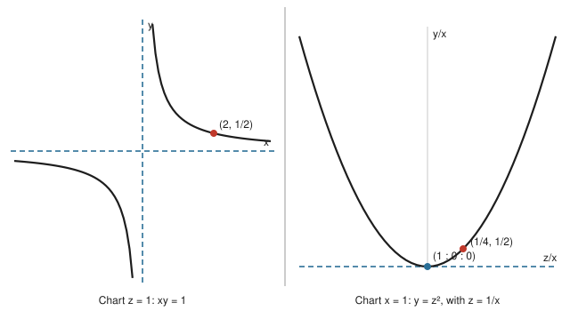

# Projective varieties: equations of one degree, and the closure of an affine shape

[Syllabus](../../../SYLLABUS.md) → [Algebraic geometry](../README.md) → [Affine and Projective Varieties](../README.md#s02) → Projective varieties

---

## General Overview

A camera lens has a focal length of 50 mm. Measure the object's distance $`x`$ from the front focal point, and the sharp image's distance $`y`$ behind the rear focal point. Count both in focal lengths, so 1 means 50 mm. Newton's lens equation then says $`xy = 1`$.

An object 100 mm beyond the front focal point has $`x = 2`$. Its image sits at $`y = 1/2`$: 25 mm behind the rear focal point. The points $`(x, y)`$ that obey the equation form a hyperbola (a curve of two open arcs).

Two everyday cases have no point on that hyperbola. A star is so far away that $`x`$ has no value, and its image lands on the focal point, $`y = 0`$. A bulb placed on the front focal point, $`x = 0`$, leaves as a parallel beam: its image is infinitely far away. The equation $`xy = 1`$ cannot hold either case.

This card adds both. Pad the equation with a third coordinate $`z`$ so that every term has degree 2: $`xy = z^2`$. That equation makes sense in the projective plane (lines through an origin, from [Projective space](03-projective-space-and-homogeneous-coordinates.md)). Setting $`z = 0`$ gives exactly two new points: the star case and the beam case. Setting $`x = 1`$ instead shows the same curve as the parabola $`y = z^2`$, with the star case at its tip.

**Give every term the same degree by padding with a new coordinate, and the equation defines a curve in projective space; setting the new coordinate to 0 finds the points the affine curve was missing, and setting any one coordinate to 1 gives the curve back in that chart with nothing lost.**

**What kind of fact this is:** homogenisation, projective varieties and the projective closure are definitions. That one homogenised equation gives exactly the closure, and that the charts lose nothing, are theorems, proved on this card in Why it works over the complex numbers. For a system of equations, the closure theorem and the graded Gröbner basis theorem are stated with their source and checked on the printed example.

### The picture: one lens curve, two charts

<p align="center"></p>

Drawn to scale, real points only: 40 units per focal length on the left, 80 on the right. The red dot is the 100 mm object in both charts. The dashed axes on the left are the asymptotes (lines the curve approaches far out). On the right, the asymptote $`y = 0`$ is the tangent at the tip, and the tip is the star case $`(1 : 0 : 0)`$. The right chart misses the beam case $`(0 : 1 : 0)`$.

---

## The formula

Notation already in use. The field $`k`$ is the number system in use ($`\mathbb{R}`$, $`\mathbb{C}`$, or $`\mathbb{F}_p`$, the integers mod a prime $`p`$). $`V(f_1, \dots, f_s)`$ is the set of common zeros of some polynomials, and $`\langle f_1, \dots, f_s \rangle`$ is the ideal they generate: every combination $`a_1 f_1 + \dots + a_s f_s`$ with polynomial multipliers ([Ideals and varieties](../01-Polynomial%20Systems/01-ideals-and-varieties.md)). The projective plane $`\mathbb{P}^2`$, its points $`(x : y : z)`$ up to scaling, and its charts (the places where one coordinate is not zero, set to 1) come from [Projective space](03-projective-space-and-homogeneous-coordinates.md).

New on this card. A polynomial is **homogeneous** of degree $`d`$ when every term has total degree $`d`$. To **homogenise** a polynomial $`f(x, y)`$ of degree $`d`$, pad each term with powers of $`z`$ up to degree $`d`$. To **dehomogenise**, set one coordinate to 1:

```math
f^h(x, y, z) = z^d f\Big(\frac{x}{z}, \frac{y}{z}\Big), \qquad f^h(x, y, 1) = f(x, y), \qquad f^h(x, y, 0) = f_d(x, y)
```

**Read it aloud:** the homogenised polynomial is $`z`$ to the degree times $`f`$ at $`x`$ over $`z`$ and $`y`$ over $`z`$; putting $`z = 1`$ gives $`f`$ back; putting $`z = 0`$ leaves only the top-degree terms of $`f`$.

For the lens, $`f = xy - 1`$ has degree 2, so $`F = f^h = xy - z^2`$, and the top-degree part is $`f_2 = xy`$.

A **projective variety** is the common zero set in $`\mathbb{P}^n`$ of homogeneous polynomials. The **projective closure** of an affine variety $`V(I)`$ is the smallest projective variety that contains it. With $`I^h`$ the ideal generated by $`f^h`$ for every $`f`$ in $`I`$, and working over $`\mathbb{C}`$:

```math
\overline{V(I)} = V(I^h), \qquad I = \langle f \rangle \;\Longrightarrow\; I^h = \langle f^h \rangle, \qquad \overline{V(I)} \cap \{z = 0\} = V(f_d) \text{ when } I = \langle f \rangle
```

**Read it aloud:** the closure of an affine variety is cut out by the homogenised ideal; for one equation that ideal is generated by the one homogenised equation; and its points at infinity are where the top-degree part vanishes.

Here the bar means closure. Later cards also use a bar for complex conjugation; this card never does.

| Symbol | Plain meaning | In our example | Push it up and the answer… |
| --- | --- | --- | --- |
| $`k`$, $`i`$ | the field the coordinates come from; $`i`$ is a square root of $`-1`$ in $`\mathbb{C}`$ | $`\mathbb{Q}`$ for exact work, $`\mathbb{C}`$ for the proofs, $`\mathbb{F}_p`$ for counts | over $`\mathbb{C}`$, more points at infinity become visible |
| $`x`$, $`y`$ | object and image distances from the focal points, in focal lengths | $`x = 2`$, $`y = 1/2`$ | larger $`x`$ gives smaller $`y`$ |
| $`(x : y : z)`$, $`\lambda`$ | a point of $`\mathbb{P}^2`$, and a nonzero scale that leaves it unchanged | $`(4 : 1 : 2)`$ is the object $`(2, 1/2)`$ | — |
| $`f`$, $`d`$ | an affine polynomial and its degree | $`xy - 1`$, degree 2 | a higher degree pads with more $`z`$ |
| $`F`$, $`G`$, $`G'`$ | homogeneous polynomials; $`F = f^h`$, $`G`$ any other, $`G'`$ is $`G`$ with its factors of $`z`$ removed | $`F = xy - z^2`$ | — |
| $`f_d`$ | the top-degree part of $`f`$ | $`xy`$ | its zeros are the points at infinity |
| $`I`$, $`I^h`$ | an ideal of affine equations, and its homogenisation | $`\langle xy - 1, y - 2 \rangle`$ | — |
| $`V(\cdot)`$, $`\overline{V}`$ | the common zeros of some polynomials, and the projective closure | $`V(xy - 1)`$, the lens curve; its closure $`V(xy - z^2)`$ | more equations, fewer points |
| $`a`$, $`b`$, $`e`$; $`g`$, $`q`$ | exponents or coordinates in the proofs; $`e`$ counts the factors of $`z`$; in the closure proof, $`g = G'(x, y, 1)`$ and $`q`$ is $`g`$ divided by $`xy - 1`$ | $`x^a y^b`$ gets $`z^{d - a - b}`$ | a larger $`e`$: the line at infinity is lost with higher multiplicity |
| $`s`$, $`t`$ | parameters, a point $`(s : t)`$ of the projective line | $`(2 : 1)`$ gives the object | — |
| $`u`$ | $`x - y`$, a coordinate in the chart $`x + y = 1`$ | $`u = 0`$ at $`(1 : 1 : 1)`$ | — |
| $`p`$, $`\mathbb{F}_p`$ | a prime, and the integers mod $`p`$ | 7: the closure has 8 points | the closure has $`p + 1`$ points |

### When it holds

- **One equation, no factor of the chart's coordinate.** Homogenising then dehomogenising always gives $`f`$ back. Dehomogenising $`F`$ at $`z = 1`$ then homogenising gives $`F`$ back only when $`z`$ does not divide $`F`$; the same goes for $`x`$ in the chart $`x = 1`$. The curve $`x^2y - xz^2`$, sent through the chart $`x = 1`$ and back, loses its factor $`x`$: 8 points over $`\mathbb{F}_7`$, not 15.
- **Homogenise the ideal, not each equation.** For a system, padding each equation gives too much. Padding $`\{xy - 1,\ y - 2\}`$ gives 2 points, where the closure of its one solution has 1.
- **The field must be algebraically closed (every one-variable polynomial has a root), such as $`\mathbb{C}`$.** The proof uses [The Nullstellensatz](../01-Polynomial%20Systems/09-nullstellensatz.md), which needs that. Over $`\mathbb{R}`$, $`x^2 + 1`$ has no affine zero, so its closure is empty, yet its padding $`x^2 + z^2`$ vanishes at the real point $`(0 : 1 : 0)`$.
- **Setting $`z = 0`$ comes after padding.** Setting $`z = 0`$ in $`xy - 1`$ itself gives $`-1 = 0`$ and no points at infinity, not 2.
- **Which points are "at infinity" depends on the chart**, as [Projective space](03-projective-space-and-homogeneous-coordinates.md) showed. $`(1 : 0 : 0)`$ is at infinity in the chart $`z = 1`$ and is the parabola's tip in the chart $`x = 1`$.

---

## Why it works

### Step 0: one degree throughout makes the equation ignore scaling

A point of $`\mathbb{P}^2`$ has many names: $`(4, 1, 2)`$ and $`(8, 2, 4)`$ name the same point. An equation can only describe points if it gives the same yes-or-no answer for every name.

A homogeneous $`F`$ of degree $`d`$ does that. Scaling every coordinate by $`\lambda`$ multiplies every term by $`\lambda^d`$, so $`F(\lambda x, \lambda y, \lambda z) = \lambda^d F(x, y, z)`$, and zero stays zero. For the lens, $`F(4, 1, 2) = 4 - 4 = 0`$, and doubling every coordinate multiplies that 0 by 4. A mixed-degree equation fails this test, so padding to one degree is the price of entry.

### Step 1: padding and unpadding undo each other

Homogenising gives the term $`x^a y^b`$ the factor $`z^{d - a - b}`$. Setting $`z = 1`$ removes every such factor, so $`f^h(x, y, 1) = f`$ for every $`f`$. For the lens, $`xy - z^2`$ becomes $`xy - 1`$.

The other direction needs one condition. Start from a homogeneous $`F`$ of degree $`d`$ and set $`z = 1`$. If some term of $`F`$ has no $`z`$, the result still has degree $`d`$, and padding restores every lost $`z`$. If $`z^e`$ divides every term, the result has degree $`d - e`$, and padding gives back $`F / z^e`$. That lost factor is the line at infinity $`z = 0`$, counted $`e`$ times.

The same holds in every chart. The lens curve $`xy - z^2`$ dehomogenises to $`y - z^2`$ at $`x = 1`$ and to $`x - z^2`$ at $`y = 1`$. No coordinate divides $`F`$, so each pads back to $`xy - z^2`$: no chart loses information.

### Step 2: the affine curve sits inside, and the new points are where the top degree vanishes

The affine point $`(a, b)`$ is the projective point $`(a : b : 1)`$, and $`F(a, b, 1) = f(a, b)`$. So in the chart $`z = 1`$, $`V(F)`$ is exactly the lens curve.

The rest of $`V(F)`$ lies on the line $`z = 0`$. There every padded term vanishes and only the top-degree terms remain. For the lens, $`F(x, y, 0) = xy`$, which is zero at $`(1 : 0 : 0)`$ and $`(0 : 1 : 0)`$.

Each is a direction in which the curve runs off. The object at distance $`x`$ is $`(x : 1/x : 1) = (1 : 1/x^2 : 1/x)`$, so in the chart $`x = 1`$ its address is $`(1/x^2, 1/x)`$. At $`x = 10, 100, 1000`$ that is $`(1/100, 1/10)`$, $`(1/10000, 1/100)`$, $`(1/1000000, 1/1000)`$, closing on $`(1 : 0 : 0)`$: the star. An object closing on the focal point gives the same numbers in the chart $`y = 1`$, closing on $`(0 : 1 : 0)`$: the beam.

### Step 3: the closure has nothing extra

Could a smaller projective curve contain the lens curve and skip a point at infinity? No. Over $`\mathbb{C}`$, every homogeneous $`G`$ that vanishes on the lens curve is a multiple of $`F`$, so it vanishes at both new points too.

The proof in words: setting $`z = 1`$ in $`G`$ gives a polynomial that vanishes on the curve. The curve's equation $`xy - 1`$ does not factor, so the Nullstellensatz makes $`xy - 1`$ divide it. Padding turns products into products, so $`xy - z^2`$ divides $`G`$.

<details>
<summary>Detailed proof: every homogeneous G through the lens curve is a multiple of F</summary>

Work over $`\mathbb{C}`$. Let $`G`$ be homogeneous and vanish at every point $`(a : 1/a : 1)`$ with $`a \neq 0`$.

Write $`G = z^e G'`$ with $`z`$ not dividing $`G'`$. Then $`g = G'(x, y, 1)`$ vanishes on $`V(xy - 1)`$, and Step 1 gives $`G' = g^h`$.

The strong Nullstellensatz says some power of $`g`$ lies in $`\langle xy - 1 \rangle`$. The polynomial $`xy - 1`$ does not factor, so that ideal is prime, and $`g`$ itself lies in it. Write $`g = (xy - 1)\,q`$.

Padding is multiplicative, because the top degrees add: $`(ab)^h = a^h b^h`$. Hence

$`\displaystyle G = z^e\,(xy - 1)^h\,q^h = z^e\,(xy - z^2)\,q^h.`$

So $`G`$ vanishes wherever $`F = xy - z^2`$ does, including $`(1 : 0 : 0)`$ and $`(0 : 1 : 0)`$. Therefore $`V(F)`$ is the smallest projective variety containing the lens curve: $`\overline{V(xy - 1)} = V(xy - z^2)`$. The same argument works for any single equation $`f`$ with no repeated factor.

</details>

A counting road agrees. Over $`\mathbb{F}_p`$ the lens curve has $`p - 1`$ points, one per nonzero $`x`$, and the closure adds 2. The map $`(s : t) \mapsto (s^2 : t^2 : st)`$ hits every point of $`xy = z^2`$ once, and the projective line has $`p + 1`$ points. Its values $`t = 0`$ and $`s = 0`$ are the two points at infinity.

### Step 4: for a system, homogenise a graded Gröbner basis

A system is different. Take the lens curve and the line $`y = 2`$, an image 100 mm behind the rear focal point. The one affine solution is $`(1/2, 2)`$: the object sits 25 mm beyond the front focal point.

Pad each equation: $`xy - z^2`$ and $`y - 2z`$. Put $`y = 2z`$ into the first: $`z(2x - z) = 0`$. That gives $`(1 : 4 : 2)`$, the real solution, and also $`(1 : 0 : 0)`$. The extra point is where the line and the curve meet at infinity. It is not in the closure of the one solution.

The cause is visible in one line. In the ideal, $`2x - 1 = (xy - 1) - x(y - 2)`$. Pad the same combination and an extra factor $`z`$ appears:

```math
(xy - z^2) - x\,(y - 2z) = 2xz - z^2 = z\,(2x - z)
```

**Read it aloud:** the padded combination equals $`z`$ times the padded $`2x - 1`$, so it also vanishes on the whole line at infinity.

The fix is a theorem (Cox, Little and O'Shea, Chapter 8, §4, Theorem 4). Compute a Gröbner basis of $`I`$ ([Grobner bases](../01-Polynomial%20Systems/03-grobner-bases-and-buchberger.md)) for a **graded** order (one that ranks higher total degree first, such as grevlex), then homogenise each member. The results generate $`I^h`$. A separate theorem in the same section, for $`k`$ algebraically closed, says that $`V(I^h)`$ is the closure. Here the grevlex basis with $`x > y`$ is $`\{x - 1/2,\ y - 2\}`$. It pads to $`\{x - z/2,\ y - 2z\}`$, whose only zero is $`(1 : 4 : 2)`$. The code checks both directions of the ideal equality by certificates: $`2x - 1 = (xy - 1) - x(y - 2)`$ and $`xy - 1 = (y/2)(2x - 1) + (1/2)(y - 2)`$.

The graded order matters because graded division never raises a total degree. Each certificate then pads term by term with no stray $`z`$.

This one-solution example cannot show the difference: every order gives it the same basis. Three solutions can. The lens curve meets the parabola $`y = x^2`$ where $`x^3 = 1`$, and the lex basis of that system with $`x > y`$ is $`\{x - y^2,\ y^3 - 1\}`$. Its lex certificate $`xy - 1 = y(x - y^2) + (y^3 - 1)`$ passes through degree 3, so padding it adds a stray $`z`$, and the padded basis also vanishes at $`(1 : 0 : 0)`$. The last row of What breaks counts it.

### Step 5: one projective conic, three affine pictures

Which line plays "infinity" decides what the curve looks like. Along a line, $`F`$ is a quadratic in two letters, and the sign of its discriminant counts the real meeting points: positive, 2; zero, 1; negative, 0.

| Line removed | Real points it meets on $`xy = z^2`$ | Chart | Affine curve |
| --- | --- | --- | --- |
| $`z = 0`$ | 2: $`(1 : 0 : 0)`$, $`(0 : 1 : 0)`$ | $`z = 1`$ | hyperbola $`xy = 1`$ |
| $`x = 0`$ | 1, $`(0 : 1 : 0)`$, touching | $`x = 1`$ | parabola $`y = z^2`$ |
| $`x + y = 0`$ | 0 (over $`\mathbb{C}`$, $`(1 : -1 : \pm i)`$, with $`i^2 = -1`$) | $`x + y = 1`$ | ellipse $`u^2 + 4z^2 = 1`$, $`u = x - y`$ |

[Projective space](03-projective-space-and-homogeneous-coordinates.md) showed that a hyperbola's asymptotes are tangent lines through a point at infinity. The lens curve agrees. Its asymptote $`y = 0`$ meets $`F`$ where $`-z^2 = 0`$: only at $`(1 : 0 : 0)`$, and twice. A line meeting a conic twice at one point is a tangent, so in the chart $`x = 1`$ the asymptote is the tangent at the parabola's tip.

The shelf's house example is this same curve. The change of coordinates $`(x : y : z) \mapsto (z - y : z + y : x)`$ turns the cone $`x^2 + y^2 = z^2`$ into $`xy = z^2`$, because $`(z - y)(z + y) = z^2 - y^2 = x^2`$. The ray $`(3 : 4 : 5)`$ goes to $`(1 : 9 : 3)`$, the lens point $`(1/3, 3)`$. Over each $`\mathbb{F}_p`$ the cone and the lens closure both have $`p + 1`$ points.

---

## Worked numbers, by hand

| Step | Arithmetic | Value |
| --- | --- | --- |
| object 100 mm out | $`x = 2`$, so $`y = 1/2`$; $`2 \cdot 1/2 - 1`$ | 0: on the curve |
| homogenise | pad $`-1`$ to degree 2 | $`F = xy - z^2`$ |
| points at infinity | $`z = 0`$: $`xy = 0`$ | $`(1 : 0 : 0)`$, $`(0 : 1 : 0)`$ |
| object in chart $`x = 1`$ | $`(y/x, z/x) = ((1/2)/2,\ 1/2)`$; $`(1/2)^2`$ | $`(1/4, 1/2)`$, on $`y = z^2`$ |
| star, approached | $`x = 1000`$: $`(1/1000^2,\ 1/1000)`$ | $`(1/1000000, 1/1000)`$, closing on $`(0, 0)`$ |
| round trip | $`y - z^2`$, pad with $`x`$ | $`xy - z^2 = F`$ |
| pad each equation of $`\{xy - 1,\ y - 2\}`$ | $`y = 2z`$ gives $`z(2x - z) = 0`$ | $`(1 : 4 : 2)`$ and $`(1 : 0 : 0)`$ |
| pad the basis $`\{x - 1/2,\ y - 2\}`$ | $`x = z/2`$, $`y = 2z`$ | $`(1 : 4 : 2)`$ only |
| closure over $`\mathbb{F}_7`$ | 6 affine points + 2 at infinity | **8** = 7 + 1 |

The lens curve gains exactly two points, the star and the beam, and in the chart $`x = 1`$ the star is an ordinary point at the parabola's tip. A system must be homogenised through its graded basis, or it gains points that are not there.

### What breaks if you drop a piece

| Mistake | Comes out at | What went wrong |
| --- | --- | --- |
| Pad each equation of $`\{xy - 1,\ y - 2\}`$ to find the closure of its solutions | 2 points over $`\mathbb{F}_7`$, not 1 | Padding a combination can add a factor $`z`$, so the padded equations generate less than $`I^h`$ |
| Meet the line $`y = 2`$ with the curve in the affine plane only | 1 meeting point, not 2 | The second meeting point, $`(1 : 0 : 0)`$, is at infinity |
| Set $`z = 0`$ before padding | $`-1 = 0`$: 0 points at infinity, not 2 | Only the top-degree part survives at infinity; the padding puts it there |
| Send $`x^2y - xz^2`$ through the chart $`x = 1`$ and back | $`xy - z^2`$: 8 points over $`\mathbb{F}_7`$, not 15 | The factor $`x`$ is the chart's own line at infinity, and dehomogenising erases it |
| Pad a lex basis: $`\{x - y^2,\ y^3 - 1\}`$ for $`\{xy - 1,\ x^2 - y\}`$ | $`\{xz - y^2,\ y^3 - z^3\}`$: 4 points over $`\mathbb{F}_7`$, not 3; the extra one is $`(1 : 0 : 0)`$ | Lex steps can raise the degree, so the padded basis misses $`x^2 - yz`$, the padding of $`x^2 - y`$, which is 1 at $`(1 : 0 : 0)`$; a graded basis pads to 3 points |

The code prints every row.

---

## Code, from first principles, and it actually runs

The code stores a polynomial as a table from exponents to exact fractions, writes padding, unpadding and evaluation from scratch, and prints terms in lex order with $`x > y > z`$. It takes four roads. Padding must equal $`z^2 f(x/z, y/z)`$, and every chart must pad back to $`F`$. The points at infinity come from the top-degree part, from the parametrisation and as limits; on each line of Step 5 the real points are counted by the discriminant's sign and listed by a search, and the two must agree. Over $`\mathbb{F}_p`$, the affine count plus 2, the closure, the parametrisation and the house cone must all equal $`p + 1`$. The system is solved by a search of small whole-number points and by a count over $`\mathbb{F}_7`$, with the Gröbner basis checked by certificates; a second system shows a lex basis failing where a graded one works.

### Python

```python
# Projective varieties and closure -- the check behind the card.
# Standard library only.  Fraction keeps every step exact.  A 50 mm lens obeys
# Newton's equation x y = 1 (distances from the two focal points, in focal lengths).
# Homogenise to x y = z^2, find its points at infinity three ways, dehomogenise into
# every chart and back, then count over F_p and test the homogenised system.
from fractions import Fraction as Q

def deg(m): return sum(m)
def clean(P): return {m: c for m, c in P.items() if c != 0}
def add(P, R): return clean({m: P.get(m, 0) + R.get(m, 0) for m in set(P) | set(R)})
def mul(P, R):
    out = {}
    for m, c in P.items():
        for n, e in R.items():
            k = tuple(a + b for a, b in zip(m, n)); out[k] = out.get(k, 0) + c * e
    return clean(out)
def sc(c, P): return clean({m: c * v for m, v in P.items()})
def dehom(P, i):                                  # set coordinate i equal to 1
    out = {}
    for m, c in P.items():
        k = tuple(0 if j == i else e for j, e in enumerate(m)); out[k] = out.get(k, 0) + c
    return clean(out)
def rehom(P, i):                                  # pad coordinate i up to the top degree
    d = max(deg(m) for m in P)
    return {tuple(d - deg(m) + e if j == i else e for j, e in enumerate(m)): c for m, c in P.items()}
def ev(P, v):
    tot = Q(0)
    for m, c in P.items():
        t = Q(c)
        for a, e in zip(v, m): t *= Q(a) ** e
        tot += t
    return tot
def show(P):
    s = ""
    for m, c in sorted(P.items(), key=lambda t: [-e for e in t[0]]):
        mono = "".join(n + ("" if e == 1 else f"^{e}") for n, e in zip("xyz", m) if e)
        a = abs(Q(c)); num = "" if a == 1 and mono else (f"{a} " if a.denominator > 1 and mono else str(a))
        s += ("-" if c < 0 else "") + num + mono if not s else (" - " if c < 0 else " + ") + num + mono
    return s
def modp(q, p): return q.numerator * pow(q.denominator, p - 2, p) % p
def yn(c): return "yes" if c else "no"
def pt(v): return "(" + " : ".join(str(c) for c in v) + ")"
def pr(a, b): return f"({a}, {b})"
def norm(v, p=0):                                 # scale so the first nonzero entry is 1
    i = next(k for k, c in enumerate(v) if (c % p if p else c))
    if p: inv = pow(v[i], p - 2, p); return tuple(c * inv % p for c in v)
    return tuple(Q(c) / v[i] for c in v)

X, Y, Z, ONE = {(1, 0, 0): 1}, {(0, 1, 0): 1}, {(0, 0, 1): 1}, {(0, 0, 0): 1}
f = add(mul(X, Y), sc(-1, ONE))                   # x y - 1
F = rehom(f, 2)
print("lens of focal length 50 mm; x, y = object and image distances from the focal points, in focal lengths")
print(f"Newton's equation f = {show(f)} = 0; object at 100 mm: x = 2, image y = {Q(1, 2)} (25 mm); f = {ev(f, (2, Q(1, 2), 1))}")
tests = [(2, 3, 1), (5, -1, 2), (Q(1, 2), 7, -3), (4, 4, 4), (-2, 9, 5)]
subst = all(ev(F, v) == Q(v[2]) ** 2 * ev(f, (Q(v[0]) / v[2], Q(v[1]) / v[2], 1)) for v in tests)
print(f"homogenise (degree 2): F = {show(F)}; z^2 f(x/z, y/z) agrees at {len(tests)} test points: {yn(subst)}")
ch = [dehom(F, i) for i in (2, 0, 1)]
back = [rehom(g, i) for g, i in zip(ch, (2, 0, 1))]
print(f"dehomogenise F: chart z = 1: {show(ch[0])}; chart x = 1: {show(ch[1])}; chart y = 1: {show(ch[2])}")
print(f"rehomogenise each chart: {', '.join(show(b) for b in back)}; all equal F: {yn(all(b == F for b in back))}")
top = {m: c for m, c in f.items() if deg(m) == 2}
grid = [(a, b) for a in range(-3, 4) for b in range(-3, 4) if (a, b) != (0, 0)]
def online(line):                                 # F along a line is al a^2 + be ab + ga b^2: its real points
    al, ga = ev(F, line(1, 0)), ev(F, line(0, 1)); be = ev(F, line(1, 1)) - al - ga; dc = be * be - 4 * al * ga
    return dc, (dc > 0) + (dc >= 0), sorted({norm(line(a, b)) for a, b in grid if ev(F, line(a, b)) == 0}, reverse=True)
LINES = (("z = 0", lambda a, b: (a, b, 0)), ("x = 0", lambda a, b: (0, a, b)), ("x + y = 0", lambda a, b: (a, -a, b)))
dz, _, inf = online(LINES[0][1])                  # by the discriminant's sign (2, 1 or 0), and by a search
print(f"points at infinity: F(x, y, 0) = {show(top)} = 0, discriminant {dz}, gives {', '.join(pt(v) for v in inf)}")
far = [(Q(10) ** k, Q(10) ** -k) for k in (1, 2, 3)]
print("far object, chart x = 1 address (y/x, z/x): " + "; ".join(f"x = {a}: {pr(b / a, 1 / a)}" for a, b in far))
print("object near the front focus, chart y = 1 address (x/y, z/y): " + "; ".join(f"x = {b}: {pr(b / a, 1 / a)}" for a, b in far))
par = lambda s, t: (s * s, t * t, s * t)          # (s : t) -> (s^2 : t^2 : st)
pin = [norm(par(*st)) for st in ((1, 0), (0, 1), (2, 1))]
print(f"parametrisation (s^2 : t^2 : st): (1 : 0) -> {pt(pin[0])}, (0 : 1) -> {pt(pin[1])}, (2 : 1) -> {pt(par(2, 1))} = {pr(Q(4, 2), Q(1, 2))}")
obj = (Q(1, 4), Q(1, 2))
print(f"the 100 mm object in chart x = 1: {pr(*obj)}; on y = z^2: {yn(ev(ch[1], (1, *obj)) == 0)}")
img = (5 - 4, 5 + 4, 3)                           # (x : y : z) -> (z - y : z + y : x)
print(f"house cone x^2 + y^2 = z^2 to this conic, (x : y : z) -> (z - y : z + y : x): (3 : 4 : 5) -> {pt(img)} = "
      f"{pr(Q(1, 3), Q(9, 3))}; xy = z^2: {yn(ev(F, img) == 0)}")
cnt = []
for name, line in LINES:
    dc, nr, real = online(line); cnt.append((nr, len(real)))
    print(f"line at infinity {name}: discriminant {dc}, real points on F {nr}; search finds {len(real)}{''.join(', ' + pt(v) for v in real)}")
e, isq = (Q(1, 2),) * 3, 0 * 0 - 1 * 1           # chart x + y = 1, u = x - y: u^2 + 4 z^2 = 1
print(f"  chart x + y = 1, u = x - y: ellipse u^2 + 4z^2 = 1; (1 : 1 : 1) is u = {e[0] - e[1]}, z = {e[2]}: "
      f"{yn((e[0] - e[1]) ** 2 + 4 * e[2] ** 2 == 1)}; over C, F(1, -1, i) = F(1, -1, -i) = -1 - i^2 = {-1 - isq}")
asy = {m: c for m, c in F.items() if m[1] == 0}
print(f"asymptote y = 0: F becomes {show(asy)}, a double root z = 0 at (1 : 0 : 0): tangent at infinity")
xz = add(mul(X, X), {(0, 0, 2): 1})                # x^2 + 1 padded; over R x^2 + 1 is never 0
print(f"over R, x^2 + 1 has no affine zero, yet its padding {show(xz)} vanishes at (0 : 1 : 0): {yn(ev(xz, (0, 1, 0)) == 0)}")
print("over F_p: affine xy = 1 / closure xy = z^2 / at infinity / parametrisation / house cone")
for p in (5, 7, 11, 13):
    trip = [(a, b, c) for a in range(p) for b in range(p) for c in range(p) if (a, b, c) != (0, 0, 0)]
    clo = {norm(v, p) for v in trip if (v[0] * v[1] - v[2] ** 2) % p == 0}
    aff = sum(1 for a in range(p) for b in range(p) if (a * b - 1) % p == 0)
    pp = {norm(par(s, t), p) for s, t in [(1, t) for t in range(p)] + [(0, 1)]}
    cone = {norm(v, p) for v in trip if (v[0] ** 2 + v[1] ** 2 - v[2] ** 2) % p == 0}
    atinf = sum(1 for v in clo if v[2] == 0)
    print(f"p = {p}: {aff} {len(clo)} {atinf} {len(pp)} {len(cone)}")
    assert len(clo) == aff + 2 == len(pp) == len(cone) == p + 1 and pp == clo and atinf == 2
    if p == 7: trip7 = trip
g1, g2 = f, add(Y, sc(-2, ONE))                   # the system x y = 1, y = 2
gb = [add(X, sc(Q(-1, 2), ONE)), g2]              # grevlex x > y basis of <g1, g2>
c1 = add(g1, sc(-1, mul(X, g2))) == sc(2, gb[0])
c2 = add(mul(sc(Q(1, 2), Y), sc(2, gb[0])), sc(Q(1, 2), g2)) == g1
each, base = [rehom(g1, 2), rehom(g2, 2)], [rehom(g, 2) for g in gb]
box = [(a, b, c) for a in range(-4, 5) for b in range(-4, 5) for c in range(-4, 5) if (a, b, c) != (0, 0, 0)]
common = lambda S: sorted({norm(v) for v in box if all(ev(P, v) == 0 for P in S)}, reverse=True)
cnt7 = lambda S: len({norm(v, 7) for v in trip7 if all(modp(ev(P, v), 7) == 0 for P in S)})
print(f"system {{{show(g1)}, {show(g2)}}}: affine solution {pr(Q(1, 2), 2)}")
print(f"  homogenise each equation {{{', '.join(map(show, each))}}}: {', '.join(pt(v) for v in common(each))}")
print(f"  grevlex (x > y) Groebner basis {{{', '.join(map(show, gb))}}}; both certificates hold: {yn(c1 and c2)}")
print(f"  homogenised basis {{{', '.join(map(show, base))}}}: {', '.join(pt(v) for v in common(base))}")
print(f"  over F_7: homogenised equations {cnt7(each)} points, homogenised basis {cnt7(base)}")
print(f"mistake 1, closure of the system from its homogenised equations: {cnt7(each)} points, not {cnt7(base)}")
print(f"mistake 2, line y = 2 met in the affine plane only: {len([v for v in common(each) if v[2] != 0])}, not {len(common(each))}")
print(f"mistake 3, z = 0 set before homogenising: f(x, y) has no z, so {show(f)} = 0 becomes -1 = 0: 0 points, not {len(inf)}")
G = mul(X, F); G2 = rehom(dehom(G, 0), 0)
n7 = lambda P: len({norm(v, 7) for v in trip7 if modp(ev(P, v), 7) == 0})
print(f"mistake 4, {show(G)} through chart x = 1 and back: {show(G2)}; over F_7 {n7(G2)} points, not {n7(G)}")
h2 = add(mul(X, X), sc(-1, Y))                    # a second system: x y = 1 and y = x^2, three solutions
lx = [add(X, sc(-1, mul(Y, Y))), add(mul(Y, mul(Y, Y)), sc(-1, ONE))]   # its lex (x > y) basis: x - y^2, y^3 - 1
c3 = (lx[0] == add(mul(Y, h2), sc(-1, mul(X, f))) and lx[1] == add(sc(-1, mul(Y, lx[0])), f)
      and f == add(mul(Y, lx[0]), lx[1]) and h2 == add(mul(lx[0], add(X, mul(Y, Y))), mul(Y, lx[1])))
aff3 = sum(1 for a in range(7) for b in range(7) if (a * b - 1) % 7 == 0 and (b - a * a) % 7 == 0)
lxh, grh = [rehom(g, 2) for g in lx], [rehom(g, 2) for g in (h2, f, lx[0])]   # grh: a graded basis, padded
at100 = all(ev(P, (1, 0, 0)) == 0 for P in lxh)
print(f"mistake 5, {{{show(f)}, {show(h2)}}} has {aff3} solutions over F_7; certificates for its lex (x > y) basis "
      f"{{{', '.join(map(show, lx))}}} hold: {yn(c3)}")
print(f"  padded lex basis {{{', '.join(map(show, lxh))}}}: {cnt7(lxh)} points over F_7, zero at (1 : 0 : 0): {yn(at100)}; "
      f"padded graded basis {{{', '.join(map(show, grh))}}}: {cnt7(grh)}; {show(grh[0])} at (1 : 0 : 0) = {ev(grh[0], (1, 0, 0))}")
k, cx, cy, kr, rx, ry = 40, 160, 170, 80, 480, 300
print(f"figure, left 40 and right 80 units per focal length: object {pr(cx + k * 2, cy - k * Q(1, 2))}, vertices "
      f"{pr(cx + k, cy - k)} {pr(cx - k, cy + k)}; right object {pr(rx + kr * obj[1], ry - kr * obj[0])}, (1 : 0 : 0) at {pr(rx, ry)}")
assert subst and all(b == F for b in back) and inf == [(1, 0, 0), (0, 1, 0)] and pin[:2] == inf
assert c1 and c2 and common(each) == [(1, 4, 2), (1, 0, 0)] and common(base) == [(1, 4, 2)]
assert ev(F, img) == 0 and n7(G) == 15 and n7(G2) == 8 and ev(ch[1], (1, *obj)) == 0
assert cnt == [(2, 2), (1, 1), (0, 0)] and dz == 1                 # discriminant and search agree on each line
assert c3 and cnt7(lxh) == aff3 + 1 == 4 and cnt7(grh) == aff3 and at100 and ev(grh[0], (1, 0, 0)) == 1
print("ALL CHECKS PASS")
```

**Ran 2026-11-17 on macOS, Python 3.14.10, standard library only. All checks passed. Output, pasted from the run:**

```
lens of focal length 50 mm; x, y = object and image distances from the focal points, in focal lengths
Newton's equation f = xy - 1 = 0; object at 100 mm: x = 2, image y = 1/2 (25 mm); f = 0
homogenise (degree 2): F = xy - z^2; z^2 f(x/z, y/z) agrees at 5 test points: yes
dehomogenise F: chart z = 1: xy - 1; chart x = 1: y - z^2; chart y = 1: x - z^2
rehomogenise each chart: xy - z^2, xy - z^2, xy - z^2; all equal F: yes
points at infinity: F(x, y, 0) = xy = 0, discriminant 1, gives (1 : 0 : 0), (0 : 1 : 0)
far object, chart x = 1 address (y/x, z/x): x = 10: (1/100, 1/10); x = 100: (1/10000, 1/100); x = 1000: (1/1000000, 1/1000)
object near the front focus, chart y = 1 address (x/y, z/y): x = 1/10: (1/100, 1/10); x = 1/100: (1/10000, 1/100); x = 1/1000: (1/1000000, 1/1000)
parametrisation (s^2 : t^2 : st): (1 : 0) -> (1 : 0 : 0), (0 : 1) -> (0 : 1 : 0), (2 : 1) -> (4 : 1 : 2) = (2, 1/2)
the 100 mm object in chart x = 1: (1/4, 1/2); on y = z^2: yes
house cone x^2 + y^2 = z^2 to this conic, (x : y : z) -> (z - y : z + y : x): (3 : 4 : 5) -> (1 : 9 : 3) = (1/3, 3); xy = z^2: yes
line at infinity z = 0: discriminant 1, real points on F 2; search finds 2, (1 : 0 : 0), (0 : 1 : 0)
line at infinity x = 0: discriminant 0, real points on F 1; search finds 1, (0 : 1 : 0)
line at infinity x + y = 0: discriminant -4, real points on F 0; search finds 0
  chart x + y = 1, u = x - y: ellipse u^2 + 4z^2 = 1; (1 : 1 : 1) is u = 0, z = 1/2: yes; over C, F(1, -1, i) = F(1, -1, -i) = -1 - i^2 = 0
asymptote y = 0: F becomes -z^2, a double root z = 0 at (1 : 0 : 0): tangent at infinity
over R, x^2 + 1 has no affine zero, yet its padding x^2 + z^2 vanishes at (0 : 1 : 0): yes
over F_p: affine xy = 1 / closure xy = z^2 / at infinity / parametrisation / house cone
p = 5: 4 6 2 6 6
p = 7: 6 8 2 8 8
p = 11: 10 12 2 12 12
p = 13: 12 14 2 14 14
system {xy - 1, y - 2}: affine solution (1/2, 2)
  homogenise each equation {xy - z^2, y - 2z}: (1 : 4 : 2), (1 : 0 : 0)
  grevlex (x > y) Groebner basis {x - 1/2, y - 2}; both certificates hold: yes
  homogenised basis {x - 1/2 z, y - 2z}: (1 : 4 : 2)
  over F_7: homogenised equations 2 points, homogenised basis 1
mistake 1, closure of the system from its homogenised equations: 2 points, not 1
mistake 2, line y = 2 met in the affine plane only: 1, not 2
mistake 3, z = 0 set before homogenising: f(x, y) has no z, so xy - 1 = 0 becomes -1 = 0: 0 points, not 2
mistake 4, x^2y - xz^2 through chart x = 1 and back: xy - z^2; over F_7 8 points, not 15
mistake 5, {xy - 1, x^2 - y} has 3 solutions over F_7; certificates for its lex (x > y) basis {x - y^2, y^3 - 1} hold: yes
  padded lex basis {xz - y^2, y^3 - z^3}: 4 points over F_7, zero at (1 : 0 : 0): yes; padded graded basis {x^2 - yz, xy - z^2, xz - y^2}: 3; x^2 - yz at (1 : 0 : 0) = 1
figure, left 40 and right 80 units per focal length: object (240, 150), vertices (200, 130) (120, 210); right object (520, 280), (1 : 0 : 0) at (480, 300)
ALL CHECKS PASS
```

### Rust

Same numbers, same labels. Fractions are an `i128` struct whose products use `checked_mul`, so an overflow stops the run.

```rust
// Projective varieties and closure -- the same check as the Python, in Rust.
// No crates.  Fractions are an i128 struct using checked_mul, so overflow stops the run.
// A 50 mm lens obeys Newton's equation x y = 1 (distances from the focal points, in focal lengths).
// Homogenise to x y = z^2, find its points at infinity three ways, dehomogenise into every
// chart and back, then count over F_p and test the homogenised system.
use std::{cmp::Ordering, collections::{BTreeMap, BTreeSet}, fmt};

#[derive(Clone, Copy, PartialEq, Eq, Debug)]
struct Q { n: i128, d: i128 }
fn gcd(a: i128, b: i128) -> i128 { if b == 0 { a.abs() } else { gcd(b, a % b) } }
fn q(n: i128, d: i128) -> Q { assert!(d != 0, "division by zero"); let g = gcd(n, d); let s = if d < 0 { -1 } else { 1 }; Q { n: s * n / g, d: s * d / g } }
fn m(a: i128, b: i128) -> i128 { a.checked_mul(b).expect("overflow") }
fn qa(a: Q, b: Q) -> Q { q(m(a.n, b.d) + m(b.n, a.d), m(a.d, b.d)) }
fn qm(a: Q, b: Q) -> Q { q(m(a.n, b.n), m(a.d, b.d)) }
fn qd(a: Q, b: Q) -> Q { q(m(a.n, b.d), m(a.d, b.n)) }
fn i(n: i128) -> Q { q(n, 1) }
impl Ord for Q { fn cmp(&self, o: &Q) -> Ordering { m(self.n, o.d).cmp(&m(o.n, self.d)) } }
impl PartialOrd for Q { fn partial_cmp(&self, o: &Q) -> Option<Ordering> { Some(self.cmp(o)) } }
impl fmt::Display for Q { fn fmt(&self, f: &mut fmt::Formatter) -> fmt::Result { if self.d == 1 { write!(f, "{}", self.n) } else { write!(f, "{}/{}", self.n, self.d) } } }
type P = BTreeMap<[u32; 3], Q>;
fn deg(e: &[u32; 3]) -> u32 { e[0] + e[1] + e[2] }
fn clean(p: P) -> P { p.into_iter().filter(|(_, c)| c.n != 0).collect() }
fn add(a: &P, b: &P) -> P { let mut o = a.clone(); for (k, c) in b { let v = *o.get(k).unwrap_or(&i(0)); o.insert(*k, qa(v, *c)); } clean(o) }
fn mul(a: &P, b: &P) -> P {
    let mut o = P::new();
    for (k, c) in a { for (l, e) in b {
        let s = [k[0] + l[0], k[1] + l[1], k[2] + l[2]];
        let v = *o.get(&s).unwrap_or(&i(0)); o.insert(s, qa(v, qm(*c, *e)));
    } }
    clean(o)
}
fn sc(c: Q, a: &P) -> P { clean(a.iter().map(|(k, v)| (*k, qm(c, *v))).collect()) }
fn dehom(a: &P, j: usize) -> P {                       // set coordinate j equal to 1
    let mut o = P::new(); for (k, c) in a { let mut s = *k; s[j] = 0; let v = *o.get(&s).unwrap_or(&i(0)); o.insert(s, qa(v, *c)); } clean(o)
}
fn rehom(a: &P, j: usize) -> P {                       // pad coordinate j up to the top degree
    let d = a.keys().map(deg).max().unwrap();
    a.iter().map(|(k, c)| { let mut s = *k; s[j] += d - deg(k); (s, *c) }).collect()
}
fn ev(a: &P, v: [Q; 3]) -> Q { let mut t = i(0); for (k, c) in a { let mut u = *c; for j in 0..3 { for _ in 0..k[j] { u = qm(u, v[j]); } } t = qa(t, u); } t }
fn show(a: &P) -> String {
    let mut s = String::new();
    for (k, c) in a.iter().rev() {
        let mono: String = (0..3).filter(|&j| k[j] > 0)
            .map(|j| format!("{}{}", ["x", "y", "z"][j], if k[j] == 1 { String::new() } else { format!("^{}", k[j]) })).collect();
        let ab = q(c.n.abs(), c.d);
        let num = if ab == i(1) && !mono.is_empty() { String::new() } else if ab.d > 1 && !mono.is_empty() { format!("{} ", ab) } else { ab.to_string() };
        if s.is_empty() { s = format!("{}{}{}", if c.n < 0 { "-" } else { "" }, num, mono); }
        else { s += &format!("{}{}{}", if c.n < 0 { " - " } else { " + " }, num, mono); }
    }
    s
}
fn mono(e: [u32; 3], c: Q) -> P { let mut p = P::new(); p.insert(e, c); p }
fn yn(c: bool) -> &'static str { if c { "yes" } else { "no" } }
fn pt<T: fmt::Display>(v: &[T]) -> String { format!("({})", v.iter().map(|c| c.to_string()).collect::<Vec<_>>().join(" : ")) }
fn pr<A: fmt::Display, B: fmt::Display>(a: A, b: B) -> String { format!("({}, {})", a, b) }
fn qi(v: [i128; 3]) -> [Q; 3] { [i(v[0]), i(v[1]), i(v[2])] }
fn norm(v: [Q; 3]) -> [Q; 3] { let f = *v.iter().find(|c| c.n != 0).unwrap(); [qd(v[0], f), qd(v[1], f), qd(v[2], f)] }
fn powm(b: i128, e: i128, p: i128) -> i128 { let mut r = 1; for _ in 0..e { r = r * b % p } r }
fn normp(v: [i128; 3], p: i128) -> [i128; 3] {
    let inv = powm(v.iter().find(|&&c| c.rem_euclid(p) != 0).unwrap().rem_euclid(p), p - 2, p); v.map(|c| (c * inv).rem_euclid(p))
}
fn modp(a: Q, p: i128) -> i128 { (a.n.rem_euclid(p) * powm(a.d.rem_euclid(p), p - 2, p)) % p }
fn trips(lo: i128, hi: i128) -> Vec<[i128; 3]> {
    (lo..hi).flat_map(|a| (lo..hi).flat_map(move |b| (lo..hi).map(move |c| [a, b, c]))).filter(|v| *v != [0, 0, 0]).collect()
}

fn main() {
    let (x, y, one) = (mono([1, 0, 0], i(1)), mono([0, 1, 0], i(1)), mono([0, 0, 0], i(1)));
    let f = add(&mul(&x, &y), &sc(i(-1), &one));
    let ff = rehom(&f, 2);
    println!("lens of focal length 50 mm; x, y = object and image distances from the focal points, in focal lengths");
    println!("Newton's equation f = {} = 0; object at 100 mm: x = 2, image y = {} (25 mm); f = {}", show(&f), q(1, 2), ev(&f, [i(2), q(1, 2), i(1)]));
    let tests = [[i(2), i(3), i(1)], [i(5), i(-1), i(2)], [q(1, 2), i(7), i(-3)], [i(4), i(4), i(4)], [i(-2), i(9), i(5)]];
    let subst = tests.iter().all(|v| ev(&ff, *v) == qm(qm(v[2], v[2]), ev(&f, [qd(v[0], v[2]), qd(v[1], v[2]), i(1)])));
    println!("homogenise (degree 2): F = {}; z^2 f(x/z, y/z) agrees at {} test points: {}", show(&ff), tests.len(), yn(subst));
    let ch: Vec<P> = [2, 0, 1].iter().map(|&j| dehom(&ff, j)).collect();
    let back: Vec<P> = ch.iter().zip([2, 0, 1]).map(|(g, j)| rehom(g, j)).collect();
    println!("dehomogenise F: chart z = 1: {}; chart x = 1: {}; chart y = 1: {}", show(&ch[0]), show(&ch[1]), show(&ch[2]));
    println!("rehomogenise each chart: {}; all equal F: {}", back.iter().map(show).collect::<Vec<_>>().join(", "), yn(back.iter().all(|b| *b == ff)));
    let top: P = f.iter().filter(|(k, _)| deg(k) == 2).map(|(k, c)| (*k, *c)).collect();
    let grid: Vec<(i128, i128)> = (-3..4).flat_map(|a| (-3..4).map(move |b| (a, b))).filter(|&ab| ab != (0, 0)).collect();
    let online = |line: fn(i128, i128) -> [i128; 3]| -> (Q, usize, Vec<[Q; 3]>) {   // F along a line is al a^2 + be ab + ga b^2: its real points
        let (al, ga) = (ev(&ff, qi(line(1, 0))), ev(&ff, qi(line(0, 1)))); let be = qa(ev(&ff, qi(line(1, 1))), qm(i(-1), qa(al, ga)));
        let dc = qa(qm(be, be), qm(i(-4), qm(al, ga)));
        (dc, (dc > i(0)) as usize + (dc >= i(0)) as usize, grid.iter().map(|&(a, b)| qi(line(a, b))).filter(|v| ev(&ff, *v) == i(0)).map(norm).collect::<BTreeSet<_>>().into_iter().rev().collect())
    };
    let lines: [(&str, fn(i128, i128) -> [i128; 3]); 3] = [("z = 0", |a, b| [a, b, 0]), ("x = 0", |a, b| [0, a, b]), ("x + y = 0", |a, b| [a, -a, b])];
    let (dz, _, inf) = online(lines[0].1);                  // by the discriminant's sign (2, 1 or 0), and by a search
    println!("points at infinity: F(x, y, 0) = {} = 0, discriminant {}, gives {}", show(&top), dz, inf.iter().map(|v| pt(v)).collect::<Vec<_>>().join(", "));
    let far: Vec<(Q, Q)> = [10i128, 100, 1000].iter().map(|&a| (i(a), q(1, a))).collect();
    println!("far object, chart x = 1 address (y/x, z/x): {}", far.iter().map(|&(a, b)| format!("x = {}: {}", a, pr(qd(b, a), qd(i(1), a)))).collect::<Vec<_>>().join("; "));
    println!("object near the front focus, chart y = 1 address (x/y, z/y): {}", far.iter().map(|&(a, b)| format!("x = {}: {}", b, pr(qd(b, a), qd(i(1), a)))).collect::<Vec<_>>().join("; "));
    let par = |s: i128, t: i128| [s * s, t * t, s * t];       // (s : t) -> (s^2 : t^2 : st)
    let pin: Vec<[Q; 3]> = [(1, 0), (0, 1), (2, 1)].iter().map(|&(s, t)| norm(qi(par(s, t)))).collect();
    println!("parametrisation (s^2 : t^2 : st): (1 : 0) -> {}, (0 : 1) -> {}, (2 : 1) -> {} = {}", pt(&pin[0]), pt(&pin[1]), pt(&par(2, 1)), pr(q(4, 2), q(1, 2)));
    let obj = (q(1, 4), q(1, 2));
    println!("the 100 mm object in chart x = 1: {}; on y = z^2: {}", pr(obj.0, obj.1), yn(ev(&ch[1], [i(1), obj.0, obj.1]) == i(0)));
    let img = [5 - 4, 5 + 4, 3];                             // (x : y : z) -> (z - y : z + y : x)
    println!("house cone x^2 + y^2 = z^2 to this conic, (x : y : z) -> (z - y : z + y : x): (3 : 4 : 5) -> {} = {}; xy = z^2: {}",
             pt(&img), pr(q(1, 3), q(9, 3)), yn(ev(&ff, qi(img)) == i(0)));
    let mut cnt = vec![];
    for (name, line) in lines {
        let (dc, nr, real) = online(line); cnt.push((nr, real.len()));
        println!("line at infinity {}: discriminant {}, real points on F {}; search finds {}{}", name, dc, nr, real.len(), real.iter().map(|v| format!(", {}", pt(v))).collect::<String>());
    }
    let (e, isq) = ([q(1, 2); 3], 0 * 0 - 1 * 1);              // chart x + y = 1, s = x - y: s^2 + 4 z^2 = 1
    let s = qa(e[0], q(-e[1].n, e[1].d));
    println!("  chart x + y = 1, u = x - y: ellipse u^2 + 4z^2 = 1; (1 : 1 : 1) is u = {}, z = {}: {}; over C, F(1, -1, i) = F(1, -1, -i) = -1 - i^2 = {}",
             s, e[2], yn(qa(qm(s, s), qm(i(4), qm(e[2], e[2]))) == i(1)), -1 - isq);
    let asy: P = ff.iter().filter(|(k, _)| k[1] == 0).map(|(k, c)| (*k, *c)).collect();
    println!("asymptote y = 0: F becomes {}, a double root z = 0 at (1 : 0 : 0): tangent at infinity", show(&asy));
    let xz = add(&mul(&x, &x), &mono([0, 0, 2], i(1)));       // x^2 + 1 padded; over R x^2 + 1 is never 0
    println!("over R, x^2 + 1 has no affine zero, yet its padding {} vanishes at (0 : 1 : 0): {}", show(&xz), yn(ev(&xz, qi([0, 1, 0])) == i(0)));
    println!("over F_p: affine xy = 1 / closure xy = z^2 / at infinity / parametrisation / house cone");
    let mut trip7 = vec![];
    for p in [5i128, 7, 11, 13] {
        let trip = trips(0, p);
        let clo: BTreeSet<[i128; 3]> = trip.iter().filter(|v| (v[0] * v[1] - v[2] * v[2]).rem_euclid(p) == 0).map(|v| normp(*v, p)).collect();
        let aff = (0..p).flat_map(|a| (0..p).map(move |b| (a, b))).filter(|&(a, b)| (a * b - 1).rem_euclid(p) == 0).count();
        let pp: BTreeSet<[i128; 3]> = (0..p).map(|t| (1, t)).chain([(0, 1)]).map(|(s, t)| normp(par(s, t), p)).collect();
        let cone: BTreeSet<[i128; 3]> = trip.iter().filter(|v| (v[0] * v[0] + v[1] * v[1] - v[2] * v[2]).rem_euclid(p) == 0).map(|v| normp(*v, p)).collect();
        let atinf = clo.iter().filter(|v| v[2] == 0).count();
        println!("p = {}: {} {} {} {} {}", p, aff, clo.len(), atinf, pp.len(), cone.len());
        assert!(clo.len() == aff + 2 && aff + 2 == pp.len() && pp.len() == cone.len() && cone.len() as i128 == p + 1 && pp == clo && atinf == 2);
        if p == 7 { trip7 = trip; }
    }
    let (g1, g2) = (f.clone(), add(&y, &sc(i(-2), &one)));         // the system x y = 1, y = 2
    let gb = [add(&x, &sc(q(-1, 2), &one)), g2.clone()];          // grevlex x > y basis of <g1, g2>
    let c1 = add(&g1, &sc(i(-1), &mul(&x, &g2))) == sc(i(2), &gb[0]);
    let c2 = add(&mul(&sc(q(1, 2), &y), &sc(i(2), &gb[0])), &sc(q(1, 2), &g2)) == g1;
    let (each, base) = (vec![rehom(&g1, 2), rehom(&g2, 2)], vec![rehom(&gb[0], 2), rehom(&gb[1], 2)]);
    let bx = trips(-4, 5);
    let common = |s: &Vec<P>| -> Vec<[Q; 3]> { bx.iter().map(|v| qi(*v)).filter(|v| s.iter().all(|g| ev(g, *v) == i(0))).map(norm).collect::<BTreeSet<_>>().into_iter().rev().collect() };
    let cnt7 = |s: &Vec<P>| trip7.iter().filter(|v| s.iter().all(|g| modp(ev(g, qi(**v)), 7) == 0)).map(|v| normp(*v, 7)).collect::<BTreeSet<_>>().len();
    let shows = |s: &[P]| s.iter().map(show).collect::<Vec<_>>().join(", ");
    let pts = |s: &Vec<[Q; 3]>| s.iter().map(|v| pt(v)).collect::<Vec<_>>().join(", ");
    println!("system {{{}, {}}}: affine solution {}", show(&g1), show(&g2), pr(q(1, 2), 2));
    println!("  homogenise each equation {{{}}}: {}", shows(&each), pts(&common(&each)));
    println!("  grevlex (x > y) Groebner basis {{{}}}; both certificates hold: {}", shows(&gb), yn(c1 && c2));
    println!("  homogenised basis {{{}}}: {}", shows(&base), pts(&common(&base)));
    println!("  over F_7: homogenised equations {} points, homogenised basis {}", cnt7(&each), cnt7(&base));
    println!("mistake 1, closure of the system from its homogenised equations: {} points, not {}", cnt7(&each), cnt7(&base));
    println!("mistake 2, line y = 2 met in the affine plane only: {}, not {}", common(&each).iter().filter(|v| v[2].n != 0).count(), common(&each).len());
    println!("mistake 3, z = 0 set before homogenising: f(x, y) has no z, so {} = 0 becomes -1 = 0: 0 points, not {}", show(&f), inf.len());
    let (g, g2b) = (mul(&x, &ff), rehom(&dehom(&mul(&x, &ff), 0), 0));
    let n7 = |a: &P| cnt7(&vec![a.clone()]);
    println!("mistake 4, {} through chart x = 1 and back: {}; over F_7 {} points, not {}", show(&g), show(&g2b), n7(&g2b), n7(&g));
    let h2 = add(&mul(&x, &x), &sc(i(-1), &y));                    // a second system: x y = 1 and y = x^2, three solutions
    let lx = [add(&x, &sc(i(-1), &mul(&y, &y))), add(&mul(&y, &mul(&y, &y)), &sc(i(-1), &one))];   // its lex (x > y) basis
    let c3 = lx[0] == add(&mul(&y, &h2), &sc(i(-1), &mul(&x, &f))) && lx[1] == add(&sc(i(-1), &mul(&y, &lx[0])), &f)
        && f == add(&mul(&y, &lx[0]), &lx[1]) && h2 == add(&mul(&lx[0], &add(&x, &mul(&y, &y))), &mul(&y, &lx[1]));
    let aff3 = (0..7i128).flat_map(|a| (0..7i128).map(move |b| (a, b))).filter(|&(a, b)| (a * b - 1).rem_euclid(7) == 0 && (b - a * a).rem_euclid(7) == 0).count();
    let (lxh, grh) = (vec![rehom(&lx[0], 2), rehom(&lx[1], 2)], vec![rehom(&h2, 2), rehom(&f, 2), rehom(&lx[0], 2)]);   // grh: a graded basis, padded
    let o100 = qi([1, 0, 0]); let at100 = lxh.iter().all(|g| ev(g, o100) == i(0));
    println!("mistake 5, {{{}, {}}} has {} solutions over F_7; certificates for its lex (x > y) basis {{{}}} hold: {}", show(&f), show(&h2), aff3, shows(&lx), yn(c3));
    println!("  padded lex basis {{{}}}: {} points over F_7, zero at (1 : 0 : 0): {}; padded graded basis {{{}}}: {}; {} at (1 : 0 : 0) = {}",
             shows(&lxh), cnt7(&lxh), yn(at100), shows(&grh), cnt7(&grh), show(&grh[0]), ev(&grh[0], o100));
    let (k, cx, cy, kr, rx, ry) = (i(40), i(160), i(170), i(80), i(480), i(300));
    let sub = |a: Q, b: Q| qa(a, q(-b.n, b.d));
    println!("figure, left 40 and right 80 units per focal length: object {}, vertices {} {}; right object {}, (1 : 0 : 0) at {}",
             pr(qa(cx, qm(k, i(2))), sub(cy, qm(k, q(1, 2)))), pr(qa(cx, k), sub(cy, k)), pr(sub(cx, k), qa(cy, k)),
             pr(qa(rx, qm(kr, obj.1)), sub(ry, qm(kr, obj.0))), pr(rx, ry));
    assert!(subst && back.iter().all(|b| *b == ff) && inf == vec![qi([1, 0, 0]), qi([0, 1, 0])] && pin[..2] == inf[..]);
    assert!(c1 && c2 && common(&each) == vec![qi([1, 4, 2]), qi([1, 0, 0])] && common(&base) == vec![qi([1, 4, 2])]);
    assert!(ev(&ff, qi(img)) == i(0) && n7(&g) == 15 && n7(&g2b) == 8 && ev(&ch[1], [i(1), obj.0, obj.1]) == i(0));
    assert!(cnt == vec![(2, 2), (1, 1), (0, 0)] && dz == i(1));               // discriminant and search agree on each line
    assert!(c3 && cnt7(&lxh) == aff3 + 1 && aff3 + 1 == 4 && cnt7(&grh) == aff3 && at100 && ev(&grh[0], o100) == i(1));
    println!("ALL CHECKS PASS");
}
```

**Ran 2026-11-17 on macOS, rustc 1.98.1, no crates. All checks passed. Output, pasted from the run:**

```
lens of focal length 50 mm; x, y = object and image distances from the focal points, in focal lengths
Newton's equation f = xy - 1 = 0; object at 100 mm: x = 2, image y = 1/2 (25 mm); f = 0
homogenise (degree 2): F = xy - z^2; z^2 f(x/z, y/z) agrees at 5 test points: yes
dehomogenise F: chart z = 1: xy - 1; chart x = 1: y - z^2; chart y = 1: x - z^2
rehomogenise each chart: xy - z^2, xy - z^2, xy - z^2; all equal F: yes
points at infinity: F(x, y, 0) = xy = 0, discriminant 1, gives (1 : 0 : 0), (0 : 1 : 0)
far object, chart x = 1 address (y/x, z/x): x = 10: (1/100, 1/10); x = 100: (1/10000, 1/100); x = 1000: (1/1000000, 1/1000)
object near the front focus, chart y = 1 address (x/y, z/y): x = 1/10: (1/100, 1/10); x = 1/100: (1/10000, 1/100); x = 1/1000: (1/1000000, 1/1000)
parametrisation (s^2 : t^2 : st): (1 : 0) -> (1 : 0 : 0), (0 : 1) -> (0 : 1 : 0), (2 : 1) -> (4 : 1 : 2) = (2, 1/2)
the 100 mm object in chart x = 1: (1/4, 1/2); on y = z^2: yes
house cone x^2 + y^2 = z^2 to this conic, (x : y : z) -> (z - y : z + y : x): (3 : 4 : 5) -> (1 : 9 : 3) = (1/3, 3); xy = z^2: yes
line at infinity z = 0: discriminant 1, real points on F 2; search finds 2, (1 : 0 : 0), (0 : 1 : 0)
line at infinity x = 0: discriminant 0, real points on F 1; search finds 1, (0 : 1 : 0)
line at infinity x + y = 0: discriminant -4, real points on F 0; search finds 0
  chart x + y = 1, u = x - y: ellipse u^2 + 4z^2 = 1; (1 : 1 : 1) is u = 0, z = 1/2: yes; over C, F(1, -1, i) = F(1, -1, -i) = -1 - i^2 = 0
asymptote y = 0: F becomes -z^2, a double root z = 0 at (1 : 0 : 0): tangent at infinity
over R, x^2 + 1 has no affine zero, yet its padding x^2 + z^2 vanishes at (0 : 1 : 0): yes
over F_p: affine xy = 1 / closure xy = z^2 / at infinity / parametrisation / house cone
p = 5: 4 6 2 6 6
p = 7: 6 8 2 8 8
p = 11: 10 12 2 12 12
p = 13: 12 14 2 14 14
system {xy - 1, y - 2}: affine solution (1/2, 2)
  homogenise each equation {xy - z^2, y - 2z}: (1 : 4 : 2), (1 : 0 : 0)
  grevlex (x > y) Groebner basis {x - 1/2, y - 2}; both certificates hold: yes
  homogenised basis {x - 1/2 z, y - 2z}: (1 : 4 : 2)
  over F_7: homogenised equations 2 points, homogenised basis 1
mistake 1, closure of the system from its homogenised equations: 2 points, not 1
mistake 2, line y = 2 met in the affine plane only: 1, not 2
mistake 3, z = 0 set before homogenising: f(x, y) has no z, so xy - 1 = 0 becomes -1 = 0: 0 points, not 2
mistake 4, x^2y - xz^2 through chart x = 1 and back: xy - z^2; over F_7 8 points, not 15
mistake 5, {xy - 1, x^2 - y} has 3 solutions over F_7; certificates for its lex (x > y) basis {x - y^2, y^3 - 1} hold: yes
  padded lex basis {xz - y^2, y^3 - z^3}: 4 points over F_7, zero at (1 : 0 : 0): yes; padded graded basis {x^2 - yz, xy - z^2, xz - y^2}: 3; x^2 - yz at (1 : 0 : 0) = 1
figure, left 40 and right 80 units per focal length: object (240, 150), vertices (200, 130) (120, 210); right object (520, 280), (1 : 0 : 0) at (480, 300)
ALL CHECKS PASS
```

### Lean

Lean proves the closure of the lens curve, its two points at infinity, the system example, and the counts over $`\mathbb{F}_7`$.

- Take an algebraically closed field, such as $`\mathbb{C}`$. Then $`V(xy - z^2)`$ contains the lens curve, and lies inside every projective variety that contains it.
- Take any field. Then $`xy = z^2`$ meets $`z = 0`$ only at the star $`(1 : 0 : 0)`$ and the beam $`(0 : 1 : 0)`$.
- Take any field where $`2 \neq 0`$. Then the padded equations $`xy - z^2`$ and $`y - 2z`$ have common zeros $`(1 : 4 : 2)`$ and $`(1 : 0 : 0)`$.
- Keep that field. Then the padded basis $`x - z/2`$ and $`y - 2z`$ has only the common zero $`(1 : 4 : 2)`$.
- The 100 mm object $`(2, 1/2)`$ is on $`xy = 1`$. Its name $`(4 : 1 : 2)`$ is on $`xy = z^2`$.
- In the chart $`x = 1`$ the object sits at $`(1/4, 1/2)`$, on $`y = z^2`$.
- The cone point $`(3 : 4 : 5)`$ is on $`x^2 + y^2 = z^2`$. Its image $`(1 : 9 : 3)`$ is on $`xy = z^2`$.
- Over $`\mathbb{F}_7`$ the lens curve has 6 points. Its closure and the house cone have 8 each.
- Over $`\mathbb{F}_7`$ the padded equations give 2 points, and the padded basis gives 1. The curve $`x^2y - xz^2`$ has 15 points.
- Over $`\mathbb{F}_7`$ the system $`\{xy - 1,\ x^2 - y\}`$ has 3 solutions. Its padded lex basis has 4 points, and its padded graded basis 3.

The chart round trips, Step 5's three charts and the other primes are left to the Python and Rust checks.

```lean
-- Projective varieties: the padded lens equation xy = z^2 is exactly the projective closure of the hyperbola xy = 1, it adds the two points (1 : 0 : 0) and (0 : 1 : 0), and a system must be padded through a graded basis, not equation by equation.
import Mathlib.LinearAlgebra.Projectivization.Basic
import Mathlib.RingTheory.MvPolynomial.Homogeneous
import Mathlib.FieldTheory.IsAlgClosed.Basic
import Mathlib.Data.ZMod.Basic
import Mathlib.Tactic.NormNum
import Mathlib.Algebra.MvPolynomial.Polynomial
import Mathlib.Algebra.Polynomial.Roots

open MvPolynomial
open scoped LinearAlgebra.Projectivization

namespace ProjectiveClosure

variable {k : Type*} [Field k]

/-- The common zeros, in the projective plane, of a set of polynomials in x, y, z
(read at a representative of each point; for homogeneous polynomials every representative
gives the same answer). -/
def projZeros (S : Set (MvPolynomial (Fin 3) k)) : Set (ℙ k (Fin 3 → k)) :=
  {p | ∀ G ∈ S, eval p.rep G = 0}

/-- The point (a : b : 1) of the projective plane: the affine point (a, b) in the chart z = 1. -/
def chartZ (a b : k) : ℙ k (Fin 3 → k) :=
  Projectivization.mk k ![a, b, 1] (fun h => by simpa using congrFun h 2)

/-- The point (a : b : c) of the projective plane with a ≠ 0. -/
def ptX (a b c : k) (ha : a ≠ 0) : ℙ k (Fin 3 → k) :=
  Projectivization.mk k ![a, b, c] (fun h => ha (by simpa using congrFun h 0))

/-- The point (0 : 1 : 0), the beam case. -/
def ptBeam : ℙ k (Fin 3 → k) :=
  Projectivization.mk k ![0, 1, 0] (fun h => by simpa using congrFun h 1)

/-- The lens curve xy = 1, placed in the projective plane through the chart z = 1. -/
def lens (k : Type*) [Field k] : Set (ℙ k (Fin 3 → k)) :=
  {p | ∃ a b : k, a * b = 1 ∧ p = chartZ a b}

/-- The padded lens equation F = xy - z^2. -/
noncomputable def lensF : MvPolynomial (Fin 3) k := X 0 * X 1 - X 2 ^ 2

lemma eval_smul_of_isHomogeneous {G : MvPolynomial (Fin 3) k} {n : ℕ} (hG : G.IsHomogeneous n)
    (c : k) (v : Fin 3 → k) : eval (c • v) G = c ^ n * eval v G := by
  rw [eval_eq, eval_eq, Finset.mul_sum]
  refine Finset.sum_congr rfl fun d hd => ?_
  rw [hG.degree_eq_sum_deg_support hd]
  simp only [Pi.smul_apply, smul_eq_mul, mul_pow, Finset.prod_mul_distrib,
    Finset.prod_pow_eq_pow_sum]
  ring

#print axioms eval_smul_of_isHomogeneous

lemma rep_mk_eq_smul (v : Fin 3 → k) (hv : v ≠ 0) :
    ∃ c : k, c ≠ 0 ∧ (Projectivization.mk k v hv).rep = c • v := by
  obtain ⟨a, ha⟩ := (Projectivization.mk_eq_mk_iff k _ _ (Projectivization.rep_ne_zero _) hv).mp
    (Projectivization.mk_rep (Projectivization.mk k v hv))
  exact ⟨a, a.ne_zero, by rw [← ha, Units.smul_def]⟩

#print axioms rep_mk_eq_smul

lemma rep_eq_smul_of_eq_mk (p : ℙ k (Fin 3 → k)) (v : Fin 3 → k) (hv : v ≠ 0)
    (hp : p = Projectivization.mk k v hv) : ∃ c : k, c ≠ 0 ∧ p.rep = c • v := by
  subst hp
  exact rep_mk_eq_smul v hv

#print axioms rep_eq_smul_of_eq_mk

lemma eq_mk_of_rep_eq_smul (p : ℙ k (Fin 3 → k)) (w : Fin 3 → k) (hw : w ≠ 0) (c : k)
    (h : p.rep = c • w) : p = Projectivization.mk k w hw := by
  rw [← Projectivization.mk_rep p]
  exact (Projectivization.mk_eq_mk_iff' k _ _ _ hw).mpr ⟨c, h.symm⟩

#print axioms eq_mk_of_rep_eq_smul

lemma eval_zero_of_forall_ne_zero [Infinite k] (G : MvPolynomial (Fin 3) k)
    (g : Fin 3 → Polynomial k) (h : ∀ t : k, t ≠ 0 → eval (fun i => (g i).eval t) G = 0) :
    eval (fun i => (g i).eval 0) G = 0 := by
  have key : ∀ t : k, (eval₂ Polynomial.C g G).eval t = eval (fun i => (g i).eval t) G := by
    intro t
    rw [MvPolynomial.polynomial_eval_eval₂]
    have : (Polynomial.evalRingHom t).comp Polynomial.C = RingHom.id k :=
      RingHom.ext fun x => by simp
    rw [this]
    rfl
  have hP : eval₂ Polynomial.C g G = 0 := by
    apply Polynomial.eq_zero_of_infinite_isRoot
    refine (Set.finite_singleton (0 : k)).infinite_compl.mono ?_
    intro t ht
    simp only [Set.mem_compl_iff, Set.mem_singleton_iff] at ht
    simp only [Set.mem_ofPred_eq, Polynomial.IsRoot.def, key]
    exact h t ht
  rw [← key, hP, Polynomial.eval_zero]

#print axioms eval_zero_of_forall_ne_zero

lemma eval_lens_of_subset {S : Set (MvPolynomial (Fin 3) k)} (hlens : lens k ⊆ projZeros S)
    {G : MvPolynomial (Fin 3) k} (hG : G ∈ S) {n : ℕ} (hn : G.IsHomogeneous n) (a b : k)
    (hab : a * b = 1) : eval ![a, b, 1] G = 0 := by
  have h1 := hlens ⟨a, b, hab, rfl⟩ G hG
  obtain ⟨c, hc, hrep⟩ := rep_eq_smul_of_eq_mk (chartZ a b) ![a, b, 1] _ rfl
  rw [hrep, eval_smul_of_isHomogeneous hn] at h1
  exact (mul_eq_zero.mp h1).resolve_left (pow_ne_zero _ hc)

#print axioms eval_lens_of_subset

/-- Over an algebraically closed field such as ℂ, the projective closure of the hyperbola
xy = 1 is the conic xy = z^2: the conic contains the affine curve, and every projective
variety (the common zeros of some homogeneous polynomials) that contains the affine curve
contains the whole conic, including its points at infinity. -/
theorem projective_closure_of_xy_eq_one [IsAlgClosed k] :
    lens k ⊆ projZeros {lensF} ∧
      ∀ S : Set (MvPolynomial (Fin 3) k), (∀ G ∈ S, ∃ n, G.IsHomogeneous n) →
        lens k ⊆ projZeros S → projZeros {lensF} ⊆ projZeros S := by
  refine ⟨?_, ?_⟩
  · rintro p ⟨a, b, hab, rfl⟩ G hG
    rw [Set.mem_singleton_iff] at hG
    subst hG
    obtain ⟨c, hc, hrep⟩ := rep_eq_smul_of_eq_mk (chartZ a b) ![a, b, 1] _ rfl
    rw [hrep]
    simp [lensF]
    linear_combination c ^ 2 * hab
  · intro S hS hlens p hp G hG
    obtain ⟨n, hn⟩ := hS G hG
    have hF := hp lensF rfl
    simp only [lensF, map_sub, map_mul, map_pow, eval_X] at hF
    by_cases h2 : p.rep 2 = 0
    · rw [h2] at hF
      have h01 : p.rep 0 * p.rep 1 = 0 := by linear_combination hF
      rcases mul_eq_zero.mp h01 with h0 | h1
      · -- the beam (0 : 1 : 0)
        have hv : p.rep = p.rep 1 • ![0, 1, 0] := by
          ext i; fin_cases i <;> simp [h0, h2]
        rw [hv, eval_smul_of_isHomogeneous hn]
        have := eval_zero_of_forall_ne_zero G ![Polynomial.X ^ 2, 1, Polynomial.X] (by
          intro t ht
          have e : (fun i => (![Polynomial.X ^ 2, 1, Polynomial.X] i).eval t) =
              t • ![t, t⁻¹, 1] := by
            ext i; fin_cases i <;> simp [ht, pow_two]
          rw [e, eval_smul_of_isHomogeneous hn,
            eval_lens_of_subset hlens hG hn t t⁻¹ (mul_inv_cancel₀ ht), mul_zero])
        have e0 : (fun i => (![Polynomial.X ^ 2, 1, Polynomial.X] i).eval (0 : k)) =
            ![0, 1, 0] := by
          ext i; fin_cases i <;> simp
        rw [e0] at this
        rw [this, mul_zero]
      · -- the star (1 : 0 : 0)
        have hv : p.rep = p.rep 0 • ![1, 0, 0] := by
          ext i; fin_cases i <;> simp [h1, h2]
        rw [hv, eval_smul_of_isHomogeneous hn]
        have := eval_zero_of_forall_ne_zero G ![1, Polynomial.X ^ 2, Polynomial.X] (by
          intro t ht
          have e : (fun i => (![1, Polynomial.X ^ 2, Polynomial.X] i).eval t) =
              t • ![t⁻¹, t, 1] := by
            ext i; fin_cases i <;> simp [ht, pow_two]
          rw [e, eval_smul_of_isHomogeneous hn,
            eval_lens_of_subset hlens hG hn t⁻¹ t (inv_mul_cancel₀ ht), mul_zero])
        have e0 : (fun i => (![1, Polynomial.X ^ 2, Polynomial.X] i).eval (0 : k)) =
            ![1, 0, 0] := by
          ext i; fin_cases i <;> simp
        rw [e0] at this
        rw [this, mul_zero]
    · have hp' : p ∈ lens k := by
        refine ⟨p.rep 0 / p.rep 2, p.rep 1 / p.rep 2, ?_, ?_⟩
        · field_simp
          linear_combination hF
        · apply eq_mk_of_rep_eq_smul p _ _ (p.rep 2)
          ext i; fin_cases i <;> simp <;> field_simp
      exact hlens hp' G hG

/-- Setting z = 0 in the padded equation leaves its top-degree part xy, so the conic
xy = z^2 meets the line at infinity in exactly two points: the star (1 : 0 : 0) and the
beam (0 : 1 : 0). -/
theorem points_at_infinity_of_xy_eq_z_sq :
    {p ∈ projZeros ({lensF} : Set (MvPolynomial (Fin 3) k)) | eval p.rep (X 2) = 0} =
      {ptX 1 0 0 one_ne_zero, ptBeam} := by
  ext p
  simp only [Set.mem_sep_iff, Set.mem_insert_iff, Set.mem_singleton_iff, eval_X]
  constructor
  · rintro ⟨h1, h2⟩
    have hF := h1 lensF rfl
    simp only [lensF, map_sub, map_mul, map_pow, eval_X, h2] at hF
    have h01 : p.rep 0 * p.rep 1 = 0 := by linear_combination hF
    rcases mul_eq_zero.mp h01 with h0 | h1'
    · right
      exact eq_mk_of_rep_eq_smul p _ _ (p.rep 1) (by ext i; fin_cases i <;> simp [h0, h2])
    · left
      exact eq_mk_of_rep_eq_smul p _ _ (p.rep 0) (by ext i; fin_cases i <;> simp [h1', h2])
  · rintro (rfl | rfl)
    · obtain ⟨c, hc, hrep⟩ :=
        rep_eq_smul_of_eq_mk (ptX (k := k) 1 0 0 one_ne_zero) ![1, 0, 0] _ rfl
      rw [hrep]
      refine ⟨fun G hG => ?_, by simp⟩
      rw [Set.mem_singleton_iff] at hG
      subst hG
      simp [lensF, hrep]
    · obtain ⟨c, hc, hrep⟩ := rep_eq_smul_of_eq_mk (ptBeam (k := k)) ![0, 1, 0] _ rfl
      rw [hrep]
      refine ⟨fun G hG => ?_, by simp⟩
      rw [Set.mem_singleton_iff] at hG
      subst hG
      simp [lensF, hrep]

/-- Homogenise the ideal, not each equation: padding xy - 1 and y - 2 one by one gives
xy - z^2 and y - 2z, whose common zeros are the solution (1 : 4 : 2) and an extra point
(1 : 0 : 0); padding the graded Gröbner basis x - 1/2, y - 2 gives x - z/2 and y - 2z,
whose only common zero is (1 : 4 : 2), the closure of the one solution (1/2, 2). -/
theorem homogenise_graded_basis_not_equations (h2 : (2 : k) ≠ 0) :
    projZeros ({lensF, X 1 - C 2 * X 2} : Set (MvPolynomial (Fin 3) k)) =
        {ptX 1 4 2 one_ne_zero, ptX 1 0 0 one_ne_zero} ∧
      projZeros ({X 0 - C (1 / 2) * X 2, X 1 - C 2 * X 2} : Set (MvPolynomial (Fin 3) k)) =
        {ptX 1 4 2 one_ne_zero} := by
  refine ⟨?_, ?_⟩
  · ext p
    simp only [projZeros, Set.mem_ofPred_eq, Set.mem_insert_iff, Set.mem_singleton_iff]
    constructor
    · intro h
      have hF := h lensF (Or.inl rfl)
      have hL := h (X 1 - C 2 * X 2) (Or.inr rfl)
      simp only [lensF, map_sub, map_mul, map_pow, eval_X, eval_C] at hF hL
      by_cases hc : p.rep 2 = 0
      · right
        have hb : p.rep 1 = 0 := by linear_combination hL + 2 * hc
        exact eq_mk_of_rep_eq_smul p _ _ (p.rep 0) (by ext i; fin_cases i <;> simp [hb, hc])
      · left
        have hca : p.rep 2 = 2 * p.rep 0 := by
          have : p.rep 2 * (p.rep 2 - 2 * p.rep 0) = 0 := by
            linear_combination -hF + p.rep 0 * hL
          linear_combination (mul_eq_zero.mp this).resolve_left hc
        refine eq_mk_of_rep_eq_smul p _ _ (p.rep 0) ?_
        ext i; fin_cases i
        · simp
        · simp; linear_combination hL + 2 * hca
        · simp; linear_combination hca
    · rintro (rfl | rfl) G hG
      · obtain ⟨c, hc, hrep⟩ :=
          rep_eq_smul_of_eq_mk (ptX (k := k) 1 4 2 one_ne_zero) ![1, 4, 2] _ rfl
        rw [hrep]
        rcases hG with rfl | rfl
        · simp [lensF]; ring
        · simp; ring
      · obtain ⟨c, hc, hrep⟩ :=
          rep_eq_smul_of_eq_mk (ptX (k := k) 1 0 0 one_ne_zero) ![1, 0, 0] _ rfl
        rw [hrep]
        rcases hG with rfl | rfl
        · simp [lensF]
        · simp
  · ext p
    simp only [projZeros, Set.mem_ofPred_eq, Set.mem_insert_iff, Set.mem_singleton_iff]
    constructor
    · intro h
      have hA := h (X 0 - C (1 / 2) * X 2) (Or.inl rfl)
      have hB := h (X 1 - C 2 * X 2) (Or.inr rfl)
      simp only [map_sub, map_mul, eval_X, eval_C] at hA hB
      refine eq_mk_of_rep_eq_smul p _ _ (p.rep 2 / 2) ?_
      ext i; fin_cases i
      · simp; linear_combination hA
      · simp; field_simp; linear_combination 2 * hB
      · simp; field_simp
    · rintro rfl G hG
      obtain ⟨c, hc, hrep⟩ :=
        rep_eq_smul_of_eq_mk (ptX (k := k) 1 4 2 one_ne_zero) ![1, 4, 2] _ rfl
      rw [hrep]
      rcases hG with rfl | rfl
      · simp; field_simp; ring
      · simp; ring

/-- The number of points of the projective plane over ZMod p (each counted once, through
the representative whose first nonzero coordinate is 1) that satisfy a test. -/
def projCount (p : ℕ) [NeZero p] (P : ZMod p → ZMod p → ZMod p → Bool) : ℕ :=
  ((Finset.univ : Finset (ZMod p × ZMod p × ZMod p)).filter (fun v =>
    (v.1 = 1 ∨ (v.1 = 0 ∧ v.2.1 = 1) ∨ (v.1 = 0 ∧ v.2.1 = 0 ∧ v.2.2 = 1)) ∧
      P v.1 v.2.1 v.2.2 = true)).card

/-- The number of affine points (a, b) over ZMod p that satisfy a test. -/
def affCount (p : ℕ) [NeZero p] (P : ZMod p → ZMod p → Bool) : ℕ :=
  ((Finset.univ : Finset (ZMod p × ZMod p)).filter (fun v => P v.1 v.2 = true)).card

-- The object 100 mm out: x = 2, y = 1/2 is on xy = 1.
example : (2 : ℚ) * (1 / 2) - 1 = 0 := by norm_num
-- Its projective name (4 : 1 : 2) satisfies xy = z^2.
example : (4 : ℤ) * 1 - 2 ^ 2 = 0 := by norm_num
-- In the chart x = 1 the object sits at (1/4, 1/2) on the parabola y = z^2.
example : (1 / 4 : ℚ) = (1 / 2) ^ 2 := by norm_num
-- The house cone: (3 : 4 : 5) is on x^2 + y^2 = z^2, and its image (1 : 9 : 3) is on xy = z^2.
example : (3 : ℤ) ^ 2 + 4 ^ 2 = 5 ^ 2 ∧ (5 - 4 : ℤ) * (5 + 4) = 3 ^ 2 := by norm_num
-- Over F_7: the affine lens curve has 6 points and its closure xy = z^2 has 8 = 7 + 1.
example : affCount 7 (fun a b => a * b == 1) = 6 := by decide
example : projCount 7 (fun x y z => x * y == z ^ 2) = 8 := by decide
-- Over F_7 the house cone x^2 + y^2 = z^2 also has 8 points.
example : projCount 7 (fun x y z => x ^ 2 + y ^ 2 == z ^ 2) = 8 := by decide
-- Padding xy - 1 and y - 2 one by one: 2 points over F_7; padding the basis (2x - z, y - 2z): 1.
example : projCount 7 (fun x y z => x * y == z ^ 2 && y == 2 * z) = 2 := by decide
example : projCount 7 (fun x y z => 2 * x == z && y == 2 * z) = 1 := by decide
-- x^2y - xz^2 has 15 points over F_7; after the round trip through x = 1 it has 8.
example : projCount 7 (fun x y z => x ^ 2 * y == x * z ^ 2) = 15 := by decide
-- The lex basis of {xy - 1, x^2 - y}, padded to {xz - y^2, y^3 - z^3}: 4 points over F_7;
-- the padded graded basis {x^2 - yz, xy - z^2, xz - y^2}: 3, the affine solutions.
example : affCount 7 (fun a b => a * b == 1 && b == a ^ 2) = 3 := by decide
example : projCount 7 (fun x y z => x * z == y ^ 2 && y ^ 3 == z ^ 3) = 4 := by decide
example : projCount 7 (fun x y z => x ^ 2 == y * z && x * y == z ^ 2 && x * z == y ^ 2) = 3 := by
  decide

#print axioms projective_closure_of_xy_eq_one
#print axioms points_at_infinity_of_xy_eq_z_sq
#print axioms homogenise_graded_basis_not_equations

end ProjectiveClosure
```

**Checked 2026-11-17 on macOS, Lean 4.36.0-rc2, Mathlib v4.36.0-rc2. Every proof is complete and uses only Lean's standard axioms. Output, pasted from the run:**

```
'ProjectiveClosure.eval_smul_of_isHomogeneous' depends on axioms: [propext, Classical.choice, Quot.sound]
'ProjectiveClosure.rep_mk_eq_smul' depends on axioms: [propext, Classical.choice, Quot.sound]
'ProjectiveClosure.rep_eq_smul_of_eq_mk' depends on axioms: [propext, Classical.choice, Quot.sound]
'ProjectiveClosure.eq_mk_of_rep_eq_smul' depends on axioms: [propext, Classical.choice, Quot.sound]
'ProjectiveClosure.eval_zero_of_forall_ne_zero' depends on axioms: [propext, Classical.choice, Quot.sound]
'ProjectiveClosure.eval_lens_of_subset' depends on axioms: [propext, Classical.choice, Quot.sound]
'ProjectiveClosure.projective_closure_of_xy_eq_one' depends on axioms: [propext, Classical.choice, Quot.sound]
'ProjectiveClosure.points_at_infinity_of_xy_eq_z_sq' depends on axioms: [propext, Classical.choice, Quot.sound]
'ProjectiveClosure.homogenise_graded_basis_not_equations' depends on axioms: [propext, Classical.choice, Quot.sound]
```

> [!TIP]
> **Try changing**
> - Guess first: where is an object 500 m out, $`x = 10000`$, in the chart $`x = 1`$? Change `(1, 2, 3)` in the line `far = ...` to `(1, 2, 3, 4)`. The "far object" line adds $`(1/100000000, 1/10000)`$: closer still to the tip.
> - Guess first: how many points has the closure over $`\mathbb{F}_{17}`$? Change `(5, 7, 11, 13)` to `(5, 7, 11, 13, 17)`. The new row reads `p = 17: 16 18 2 18 18`: 16 affine points and 2 at infinity, 18 in all.
> - Guess first: if the lost factor is $`x^2`$, not $`x`$, does the count change? Change `G = mul(X, F)` to `G = mul(mul(X, X), F)`. "mistake 4" still prints 8 points, not 15: the new curve still has 15 points, because a point set cannot see that a factor is repeated.

---

## The usual mistake

> [!warning]
> **Homogenising each equation of a system to get the closure of its solutions.** The padded equations can share points at infinity that no solution approaches. $`\{xy - 1,\ y - 2\}`$ has one solution, but its padded equations also meet at $`(1 : 0 : 0)`$. Homogenise a basis for a graded order instead: 1 point, not 2.
>
> - **Counting meeting points in the affine plane.** The line $`y = 2`$ meets the lens curve once there, and twice in $`\mathbb{P}^2`$ (projective, over $`\mathbb{C}`$, each point counted once).
> - **Setting $`z = 0`$ before padding.** $`xy - 1`$ then reads $`-1 = 0`$: 0 points at infinity instead of 2.
> - **Trusting a round trip through a chart.** $`x^2y - xz^2`$ comes back as $`xy - z^2`$: 8 points over $`\mathbb{F}_7`$ instead of 15.
> - **Treating $`(1 : 0 : 0)`$ as a special point.** In the chart $`x = 1`$ it is the parabola's tip, an ordinary point.

---

## Where you meet it in real life

- **Camera and telescope focusing.** A star's image forms on the focal point, $`y = 0`$, and a focus scale marks that setting ∞. Newton's equation, padded, holds the star and the parallel beam as ordinary points.
- **Computer vision.** A camera image of a circle is a conic. Whether it shows as an ellipse, a parabola or a hyperbola depends on how many real points it shares with the image's line at infinity, as in the table of Step 5.
- **Solving polynomial systems numerically.** Path-following solvers work in projective space, so a path heading off to infinity ends at a point at infinity instead of failing.
- **Elliptic-curve software.** The closure of $`y^2 = x^3 - 2`$ gains exactly one point at infinity, $`O = (0 : 1 : 0)`$, and that point is the zero of the curve's addition law.

> **Say it back**
> To homogenise an equation, pad every term with a new coordinate up to one degree; the result makes sense in projective space. Setting the new coordinate to 1 gives the equation back, and setting it to 0 leaves the top-degree part, whose zeros are the new points at infinity. For Newton's lens equation $`xy = 1`$ those are the star and the parallel beam. For one equation the padded curve is exactly the closure, and every chart sees it without loss; for a system, pad a graded Gröbner basis, not the equations. Seen from different charts, one projective conic is a hyperbola, a parabola or an ellipse.

---

## What this builds on

- [Projective space](03-projective-space-and-homogeneous-coordinates.md): points as ratios $`(x : y : z)`$, the charts, and the line at infinity where the padded curve gains its points.
- [Ellipses and hyperbolas](../../05-Geometry%20and%20trig/04-Coordinates%20and%20Curves/05-ellipses-and-hyperbolas.md): the hyperbola and its asymptotes, which this card reads as tangents at infinity.
- [Grobner bases](../01-Polynomial%20Systems/03-grobner-bases-and-buchberger.md): the bases that make padding a system safe when the order is graded.
- [The Nullstellensatz](../01-Polynomial%20Systems/09-nullstellensatz.md): the step in the closure proof that turns "vanishes on the curve" into "is a multiple of the equation".

## Where this goes next

- [Maps between varieties](05-regular-and-rational-maps.md): maps given by homogeneous polynomials, such as $`(s : t) \mapsto (s^2 : t^2 : st)`$, which this card used to count the closure.
- [Degree](09-degree-and-the-hilbert-polynomial.md): the count of meeting points, projective, with multiplicity, over $`\mathbb{C}`$, which comes out the same every time only after the points at infinity are added.
- [Smooth and singular points](08-smooth-and-singular-points.md): checking every point of the closure, the ones at infinity included, chart by chart.
- [Proj](../06-Schemes%20and%20Modern%20Language/10-proj-of-a-graded-ring.md): building projective schemes from graded rings, the way Spec builds affine ones.
- [The 27 lines on a cubic surface](../09-Intersection%20Theory%20and%20Surfaces/04-twenty-seven-lines-on-a-cubic-surface.md): the plane blown up at six points, with every line accounted for.

This card finds the points a curve gains at infinity; how to map one projective variety to another, and when two of them are the same, is the open question.

---

## Sources

Verified 2026-11-17: every link below resolves to the publisher's page.

- Cox, David A., John Little, and Donal O'Shea. *Ideals, Varieties, and Algorithms*, 4th ed. Springer, 2015. [doi:10.1007/978-3-319-16721-3](https://doi.org/10.1007/978-3-319-16721-3). Chapter 8: homogenisation, the projective closure, the theorem that a graded Gröbner basis homogenises to a basis of $`I^h`$, and the separate theorem that $`V(I^h)`$ is the closure when $`k`$ is algebraically closed.
- Reid, Miles. *Undergraduate Algebraic Geometry*. Cambridge University Press, 1988. [doi:10.1017/CBO9781139163699](https://doi.org/10.1017/CBO9781139163699). Conics in the projective plane, and their affine pictures as ellipse, parabola and hyperbola.
- Shafarevich, Igor R. *Basic Algebraic Geometry 1*, 3rd ed. Springer, 2013. [doi:10.1007/978-3-642-37956-7](https://doi.org/10.1007/978-3-642-37956-7). Projective varieties, homogeneous ideals and the projective closure of an affine variety.
- Born, Max, and Emil Wolf. *Principles of Optics*, 7th ed. Cambridge University Press, 1999. [doi:10.1017/CBO9781139644181](https://doi.org/10.1017/CBO9781139644181). Newton's lens equation, measured from the focal points, as a projective map of object space to image space.
