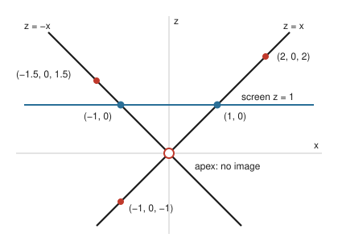
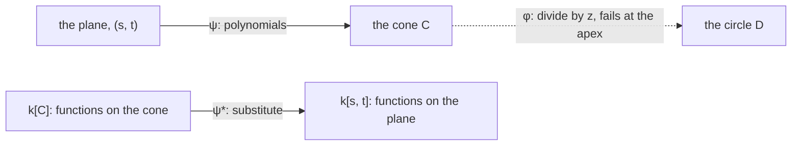

# Maps between varieties: polynomial maps, and ratios with a bad set

[Syllabus](../../../SYLLABUS.md) → [Algebraic geometry](../README.md) → [Affine and Projective Varieties](../README.md#s02) → Maps between varieties

---

## General Overview

A lamp's bulb sits at the origin and throws a cone of light, $`x^2 + y^2 = z^2`$, in metres, with $`z`$ pointing up. This is the shelf's house example. Put a pinhole camera at the bulb, the cone's tip or **apex**, and a flat screen at height $`z = 1`$ m.

The camera sends each point of the cone along its line through the apex to the screen. The point $`(3, 4, 5)`$ lands at $`(3/5, 4/5)`$. So do $`(6, 8, 10)`$ and even $`(-3, -4, -5)`$ below the bulb, because all three lie on one line through the apex. Every point of the cone except the apex lands on the unit circle $`u^2 + v^2 = 1`$.

The camera's rule is a ratio: divide by the height. A ratio fails where its bottom is zero, and the apex fails: the camera cannot photograph its own pinhole. Over the real numbers, does any other point fail, and could a cleverer formula rescue the apex? No and no.

A map can also run the other way, from a plane into the cone, with no division at all: $`(s, t) \mapsto (s^2 - t^2,\ 2st,\ s^2 + t^2)`$. The pair $`(2, 1)`$ goes to $`(3, 4, 5)`$. Over $`\mathbb{C}`$ it reaches the whole cone; over $`\mathbb{R}`$ only the upper half, since $`z = s^2 + t^2`$ is never negative. A map built from polynomials alone is **regular**. Every polynomial function on the cone then turns into a polynomial in $`s`$ and $`t`$, by substitution. That reversal, from maps to functions, is how algebra reads a map.

**A regular map is given by polynomials and turns each function on its target into a function on its source; a rational map is given by ratios and fails exactly at the points where no formula for it has a nonzero bottom, which for the camera on the cone is the apex alone.**

**What kind of fact this is:** regular and rational maps are definitions; that regular maps match ring maps one for one, and that the camera's bad set is exactly the apex, are theorems, proved on this card in Why it works.

### The picture: two lines of the cone, seen from the side

<p align="center"></p>

Drawn to scale, 60 units per metre, real points only. The side view is the slice $`y = 0`$, which cuts the cone in two lines through the apex. Every point of a line lands where that line crosses the screen, both above and below the apex. The apex sits on every line at once, so it has no single place to go.

---

## The formula

Notation already in use. The field $`k`$ is the number system in use: $`\mathbb{R}`$, $`\mathbb{C}`$, or $`\mathbb{F}_p`$, the whole numbers mod a prime $`p`$. The **coordinate ring** $`k[V]`$ is the ring of polynomial functions on a variety $`V`$ (the solution set of a list of polynomial equations); for the cone it is $`k[x, y, z]`$ with $`x^2 + y^2 - z^2`$ counted as zero ([Affine varieties](01-affine-varieties-and-coordinate-rings.md)). Projective points $`(x : y : z)`$, lists up to scale, come from [Projective space](03-projective-space-and-homogeneous-coordinates.md).

New on this card: regular maps, the pullback $`\psi^*`$, rational maps and the dashed arrow $`\dashrightarrow`$.

A **regular map** $`\psi : V \to W`$ between affine varieties is a list of polynomial functions on $`V`$ whose values always land in $`W`$. Its **pullback** $`\psi^*`$ feeds the map into a function on $`W`$:

```math
\psi = (f_1, \dots, f_m),\ f_i \in k[V], \qquad \psi^*(g) = g \circ \psi = g(f_1, \dots, f_m) \in k[V] \ \text{ for every } g \in k[W]
```

**Read it aloud:** a regular map is a list of polynomials; to pull a function back, substitute those polynomials for the target's coordinates.

The pullback runs backwards, from functions on $`W`$ to functions on $`V`$. It respects sums and products, and regular maps match these ring maps exactly:

```math
\{\ \text{regular maps } V \to W\ \} \;\longleftrightarrow\; \{\ k\text{-algebra maps } k[W] \to k[V]\ \}, \qquad \psi \longmapsto \psi^*
```

**Read it aloud:** each regular map gives one ring map going the other way, and each ring map that fixes the numbers in $`k`$ comes from exactly one regular map.

A **rational map** $`\varphi : V \dashrightarrow \mathbb{P}^m`$ is given by a list of functions read up to scale, $`(F_0 : \dots : F_m)`$, not all zero on $`V`$. The dashed arrow says it may fail at some points. Two lists that agree, up to scale, wherever both are defined name the same map, so a rational map can have many formulas:

```math
\varphi \text{ is defined at } P \iff \text{some formula } (F_0 : \dots : F_m) \text{ for } \varphi \text{ has } F_i(P) \neq 0 \text{ for at least one } i
```

**Read it aloud:** a rational map works at a point when at least one of its formulas gives a list there that is not all zeros. The **bad set** is the set of points where every formula fails.

For the cone, the two maps and the answer are:

```math
\psi(s, t) = (s^2 - t^2,\ 2st,\ s^2 + t^2), \qquad \varphi(x, y, z) = \Big(\frac{x}{z}, \frac{y}{z}\Big) = (x : y : z), \qquad \text{bad set of } \varphi = \{(0, 0, 0)\}
```

**Read it aloud:** the plane maps into the cone by these three polynomials; the camera divides by the height, which is the projective point $`(x : y : z)`$; and the camera fails only at the apex.

Worked once: $`\psi(2, 1) = (4 - 1, 4, 4 + 1) = (3, 4, 5)`$, and $`\varphi(3, 4, 5) = (3/5, 4/5)`$. The function $`z - x`$ on the cone pulls back to $`(s^2 + t^2) - (s^2 - t^2) = 2t^2`$; both give 2.



Maps run forwards along the top row; their pullbacks run backwards along the bottom.

| Symbol | Plain meaning | In our example | Push it up and the answer… |
| --- | --- | --- | --- |
| $`k`$, $`p`$, $`\mathbb{F}_p`$, $`i`$ | the field; a prime, and the whole numbers mod it; the square root of −1 in $`\mathbb{C}`$ | $`\mathbb{R}`$ for the picture; $`\mathbb{F}_7`$ and $`\mathbb{F}_{13}`$ for counts | over $`\mathbb{F}_{13}`$ the screen misses 25 points, not 1 |
| $`V`$, $`W`$; $`C`$, $`D`$ | varieties, the source and the target; the cone and the circle | $`C`$: $`x^2 + y^2 = z^2`$; $`D`$: $`u^2 + v^2 = 1`$ | — |
| $`\mathbb{A}^2`$, $`\mathbb{P}^1`$, $`\mathbb{P}^m`$; $`m`$, $`\theta`$ | the ordinary plane; projective line; projective m-space; in Where you meet it, a joint angle $`\theta`$ and $`m = \tan(\theta/2)`$ | $`\mathbb{A}^2`$ holds $`(s, t)`$; $`\varphi`$ aims at $`\mathbb{P}^2`$ | — |
| $`k[V]`$ | the coordinate ring: polynomial functions on $`V`$ | $`k[x, y, z]`$ with $`x^2 + y^2 - z^2 = 0`$ | — |
| $`s, t`$; $`x, y, z`$; $`u, v`$; $`x_i`$ | coordinates on the plane, on space, on the screen; on $`\mathbb{A}^m`$ in Step 2's proof | $`(2, 1)`$; $`(3, 4, 5)`$ m; $`(3/5, 4/5)`$ m | — |
| $`\psi`$, $`f_i`$ | a regular map and its polynomial entries | $`(s^2 - t^2, 2st, s^2 + t^2)`$ | higher degree: more terms, same rule |
| $`\psi^*`$, $`g`$, $`h`$ | the pullback, and functions on the target it acts on; in Step 2's proof, $`h`$ is a ring map | $`g = z - x`$ pulls back to $`2t^2`$ | — |
| $`\varphi`$, $`F_i`$, $`\dashrightarrow`$ | a rational map, its entries up to scale, and its arrow | $`(x : y : z)`$ | more formulas can only shrink the bad set |
| $`f`$; $`X, Y, Z`$ | the perspective card's focal length and camera coordinates | $`f = 1`$; $`(X, Y, Z) = (x, y, z)`$ | larger $`f`$: a bigger photo, same bad set |
| $`P`$ | a point of the source | the apex $`(0, 0, 0)`$ | — |
| $`(a, b, c)`$, $`\lambda`$, $`L`$ | a direction on the cone, a scale along its line, and that line | $`(3, 4, 5)`$; $`\lambda = 1/1000`$ | smaller $`\lambda`$: nearer the apex, same image |
| $`d`$ | the degree of the functions counted in Step 3 | degree 4: 15 monomials, 9 survive | the survivors number $`2d + 1`$ |

### When it holds

- **The map must land in the target.** The pullback of every equation of $`W`$ must be zero. Change $`\psi`$'s last entry to $`s^2 + 2t^2`$ and the cone's equation pulls back to $`-2s^2t^2 - 3t^4`$; the pair $`(2, 1)`$ goes to $`(3, 4, 6)`$, with cone value −11, off the cone.
- **Regular means polynomial, with no division.** The ratio $`x/z`$ is not a function in $`k[C]`$. Near the apex it takes the value 3/5 along one line and 5/13 along another, so it has no value at the apex.
- **The bad set depends on the target and the field.** Aimed at $`\mathbb{P}^2`$, the camera fails only at the apex, over every field. Aimed at the screen alone, it also fails at points with $`z = 0`$ off the apex, which exist over $`\mathbb{C}`$ and $`\mathbb{F}_{13}`$ but not over $`\mathbb{R}`$ (Step 4).
- **The bad set depends on the map, not on one formula.** Before calling a point bad, try every formula, or prove none can work, as in Step 5.

---

## Why it works

### Step 0: a map is known by what it does to coordinates

A map into $`W`$ is known once each coordinate of the answer is known. Those coordinates are functions on the source. So the map is the same thing as the list of functions it pulls the coordinates back to, and substitution does the rest.

A rational map adds division. Division can fail. The bad set is found in two halves: show some formula works at every good point, and show no formula can work at each bad point. The second half needs two ways of approaching a point that force two different values.

### Step 1: the polynomial map lands on the cone

Put $`\psi`$ into the cone's equation:

```math
(s^2 - t^2)^2 + (2st)^2 - (s^2 + t^2)^2 = (s^4 - 2s^2t^2 + t^4) + 4s^2t^2 - (s^4 + 2s^2t^2 + t^4) = 0
```

**Read it aloud:** the square of the first entry plus the square of the second equals the square of the third, for every $`s`$ and $`t`$.

This is the recipe for Pythagorean triples: $`(2, 1)`$ gives $`(3, 4, 5)`$ and $`(3, 2)`$ gives $`(5, 12, 13)`$. It holds as an identity of polynomials, so it holds over every field.

### Step 2: pullback reverses arrows, and it is all a map is

Pulling back is substitution, so it keeps sums and products: $`\psi^*(g + h) = \psi^*g + \psi^*h`$ and $`\psi^*(gh) = \psi^*g \cdot \psi^*h`$. On the coordinates, $`\psi^*(x) = s^2 - t^2`$, $`\psi^*(y) = 2st`$ and $`\psi^*(z) = s^2 + t^2`$. Every other pullback follows: $`z + x`$ goes to $`2s^2`$, $`z - x`$ to $`2t^2`$.

The direction reverses. A map from the plane to the cone gives a ring map from the cone's functions to the plane's functions. Composing maps reverses too: $`(\varphi \circ \psi)^* = \psi^* \circ \varphi^*`$. For a rational map such as $`\varphi`$, the pullback lands in fractions, which [Birational equivalence](06-birational-equivalence-and-function-fields.md) defines.

<details>
<summary>Detailed proof: regular maps and ring maps match one for one</summary>

Given a regular map $`\psi : V \to W`$, its pullback $`\psi^*`$ is a ring map $`k[W] \to k[V]`$ that fixes the numbers in $`k`$. It is well defined: if $`g`$ vanishes on $`W`$, then $`g \circ \psi`$ vanishes on $`V`$, since $`\psi`$ lands in $`W`$.

Going back, let $`h : k[W] \to k[V]`$ be such a ring map, with $`W`$ inside $`\mathbb{A}^m`$ and coordinates $`x_1, \dots, x_m`$. Set $`f_i = h(x_i)`$ and $`\psi = (f_1, \dots, f_m)`$. For any equation $`g`$ of $`W`$, since $`h`$ respects sums and products,

$`\displaystyle g(f_1, \dots, f_m) = g(h(x_1), \dots, h(x_m)) = h(g(x_1, \dots, x_m)) = h(0) = 0,`$

so $`\psi`$ lands in $`W`$. Its pullback sends each $`x_i`$ to $`f_i = h(x_i)`$, and a ring map is fixed by where it sends the coordinates, so $`\psi^* = h`$. Two regular maps with the same pullback send each $`x_i`$ to the same function, so they are the same map.

</details>

### Step 3: what the pullback says about the map

The pullback $`\psi^*`$ sends a function on the cone to zero only if that function is zero on the cone. In ring terms: the only polynomials in $`x, y, z`$ that substitution kills are the multiples of $`x^2 + y^2 - z^2`$. That says the image of $`\psi`$ lies on no curve inside the cone.

The check is a count, one degree at a time. That is enough: substitution sends degree $`d`$ to degree $`2d`$, so a polynomial is killed only when each of its single-degree parts is. Take the polynomials whose terms all have degree $`d`$ in $`x, y, z`$:

- There are $`(d + 1)(d + 2)/2`$ monomials. For $`d = 4`$: 15.
- The multiples of the cone's equation among them number $`d(d - 1)/2`$, one per monomial of degree $`d - 2`$. For $`d = 4`$: 6.
- Substitution sends them to polynomials of degree $`2d`$ in $`s, t`$, of which there are $`2d + 1`$ independent ones. For $`d = 4`$: 9.

Since 15 − 6 = 9, the substitution kills the multiples and nothing more exactly when its images span all 9. They do, at every degree: $`z + x`$, $`z - x`$ and $`y`$ pull back to $`2s^2`$, $`2t^2`$ and $`2st`$, so a term $`s^it^j`$ with $`i + j = 2d`$ is a product of the first two when $`i`$ and $`j`$ are even, times one $`y`$ when both are odd. Dividing by the 2s needs $`2 \neq 0`$, so the field must not be $`\mathbb{F}_2`$. The code confirms the span $`2d + 1`$ for every degree from 1 to 5.

So the images are all the polynomials whose terms have even degree in $`s, t`$: the cone's ring is the ring of even polynomials, and $`\psi(s, t) = \psi(-s, -t)`$. Over $`\mathbb{C}`$ the cone is the plane folded in two through the origin: take $`s^2 = (z + x)/2`$ and $`t^2 = (z - x)/2`$, with signs making $`2st = y`$. Over $`\mathbb{R}`$ the fold gives only the upper half, $`z \ge 0`$. Over $`\mathbb{F}_7`$, $`\psi`$ reaches all 8 lines through the apex but only 25 of the 49 points: each point off the apex comes from two pairs $`\pm(s, t)`$, and $`1 + 48/2 = 25`$.

<details>
<summary>Why the span is computed modulo a prime and still exact</summary>

The code row-reduces the substitution matrix modulo the prime 1 000 003. Reducing modulo a prime can only lower a rank, never raise it. The rank over $`\mathbb{Q}`$ is at most $`2d + 1`$, the number of columns. So a rank of $`2d + 1`$ modulo the prime forces a rank of exactly $`2d + 1`$ over $`\mathbb{Q}`$.

</details>

### Step 4: the camera is defined everywhere except the apex

The [Perspective](../../05-Geometry%20and%20trig/05-Vectors%20in%20Space/05-perspective-and-projective-coordinates.md) card's camera sends $`(X, Y, Z)`$ to $`(fX/Z, fY/Z)`$ and fails at $`Z = 0`$. Projecting the cone from its apex is that camera with focal length $`f = 1`$.

As a map to $`\mathbb{P}^2`$ the camera is $`(x : y : z)`$. That list is not all zeros at every point except $`(0, 0, 0)`$. So the camera is defined everywhere off the apex, over any field.

Aimed at the screen alone, the bottom is $`z`$. On the real cone $`z = 0`$ forces $`x^2 + y^2 = 0`$, so $`x = y = 0`$: the apex again. Over $`\mathbb{C}`$, the point $`(1, i, 0)`$ is on the cone with $`z = 0`$. Its line runs parallel to the screen and lands at the screen's point at infinity, $`(1 : i : 0)`$. The same happens over $`\mathbb{F}_{13}`$, where −1 is a square ($`5^2`$ is −1 mod 13): the screen misses 25 points. Over $`\mathbb{F}_7`$, where −1 is not a square, it misses only the apex.

### Step 5: no formula can rescue the apex

Every line through the apex in a direction $`(a, b, c)`$ on the cone lies on the cone: $`\lambda(a, b, c)`$ satisfies the equation for every scale $`\lambda`$. Away from the apex, the camera sends the whole line to the one point $`(a : b : c)`$.

Suppose some formula worked at the apex. Its value there would have to match the value along every line through the apex. The line through $`(3, 4, 5)`$ demands $`(3/5, 4/5)`$. The line through $`(5, 12, 13)`$ demands $`(5/13, 12/13)`$. One point cannot have two images, so no formula works.

<details>
<summary>Detailed proof: why the value must match along each line</summary>

Suppose a formula $`(F_0 : F_1 : F_2)`$ for $`\varphi`$ is defined at the apex. Restrict it to the line $`L = \{\lambda(a, b, c)\}`$. It gives a regular map from $`L`$ to $`\mathbb{P}^2`$ that equals the constant $`(a : b : c)`$ wherever $`\lambda \neq 0`$.

The formula's value equals $`(a : b : c)`$ exactly where $`F_0 b - F_1 a`$, $`F_0 c - F_2 a`$ and $`F_1 c - F_2 b`$ all vanish. On the line these are polynomials in $`\lambda`$ that vanish at every $`\lambda \neq 0`$. Over an infinite field such as $`\mathbb{R}`$ or $`\mathbb{C}`$, a polynomial with infinitely many roots is zero, so they vanish at $`\lambda = 0`$ too, and the formula gives $`(a : b : c)`$ at the apex.

Two directions on the cone that are not multiples give two different values at one point, a contradiction. Over $`\mathbb{F}_p`$ the same argument runs in its algebraic closure, the infinite field holding every root of every polynomial mod $`p`$.

</details>

Over $`\mathbb{F}_7`$ the cone's 49 points are the apex plus 8 lines of 6, so 8 lines make 8 different demands at the apex. Over $`\mathbb{F}_{13}`$: 169 points, the apex plus 14 lines of 12.

Combined with $`\psi`$, the trouble disappears. Read $`(s : t)`$ as a point of $`\mathbb{P}^1`$, so $`\varphi \circ \psi = (s^2 - t^2 : 2st : s^2 + t^2)`$. All three entries vanish only at $`s = t = 0`$, which is not a point of $`\mathbb{P}^1`$. This composite is regular, and over $`\mathbb{F}_7`$ and $`\mathbb{F}_{13}`$ it reaches all 8 and all 14 lines. The circle's points are reached without ever passing through the apex.

### Step 6: a zero bottom is not yet a bad point

Project the circle $`u^2 + v^2 = 1`$ from its own point $`(-1, 0)`$ onto a line. The slope of the line from $`(-1, 0)`$ is $`v/(1 + u)`$. At $`(3/5, 4/5)`$ it is $`(4/5)/(8/5) = 1/2`$, the $`t/s`$ of $`\psi(2, 1)`$.

At $`(-1, 0)`$ the formula reads 0/0. But on the circle $`v^2 = (1 - u)(1 + u)`$, so a second formula gives the same map:

```math
\frac{v}{1 + u} = \frac{1 - u}{v}, \qquad (v : 1 + u) = (1 - u : v) \in \mathbb{P}^1
```

**Read it aloud:** on the circle, the two ratios agree wherever both are defined, and as points of the projective line they are one map.

At $`(-1, 0)`$ the second formula gives $`(2 : 0) = (1 : 0)`$, the line's point at infinity: the tangent there is vertical. So the circle's map has no bad point at all.

This is general. A rational map from a smooth curve into projective space has no bad point. On a smooth surface it can have bad points, but only finitely many: the bad set is at least two dimensions smaller than the variety. The cone is not smooth at its apex, so the theorem does not apply to it directly. Its bad set is still a single point, two dimensions below the surface, and that point is the cone's one singular point ([Smooth and singular points](08-smooth-and-singular-points.md)).

---

## Worked numbers, by hand

| Step | Arithmetic | Value |
| --- | --- | --- |
| the regular map at $`(2, 1)`$ | $`(4 - 1,\ 2 \cdot 2 \cdot 1,\ 4 + 1)`$ | $`(3, 4, 5)`$ |
| it lands on the cone | $`9 + 16 - 25`$ | 0 |
| pull back $`z - x`$ | $`(s^2 + t^2) - (s^2 - t^2)`$; at $`(2, 1)`$: $`2 \cdot 1`$; on the cone: $`5 - 3`$ | $`2t^2`$; 2 and 2 |
| pull back the cone's equation | Step 1's expansion | **0** |
| degree 4 functions on the cone | 15 monomials − 6 multiples | 9, the span of the images |
| the camera at $`(3, 4, 5)`$ | divide by $`z = 5`$ | $`(3/5, 4/5)`$ |
| same line: $`(6, 8, 10)`$, $`(-3, -4, -5)`$ | divide by 10, by −5 | $`(3/5, 4/5)`$ |
| near the apex on two lines | $`(3/1000, 1/250, 1/200)`$ and $`(1/200, 3/250, 13/1000)`$ | $`(3/5, 4/5)`$ and $`(5/13, 12/13)`$ |
| where $`z = 0`$ on the real cone | $`x^2 + y^2 = 0`$ | only $`(0, 0, 0)`$ |
| bad set, aimed at $`\mathbb{P}^2`$, over $`\mathbb{F}_7`$ and $`\mathbb{F}_{13}`$ | $`(x : y : z)`$ nonzero at the other 48 and 168 points; the 8 and 14 lines through the apex give 8 and 14 different images | **the apex alone** |

The camera photographs every point of the cone except its pinhole, and no formula can photograph that one, because two lines through it already disagree about its image.

### What breaks if you drop a piece

| Mistake | Comes out at | What went wrong |
| --- | --- | --- |
| $`\psi`$ with last entry $`s^2 + 2t^2`$ | pullback $`-2s^2t^2 - 3t^4`$; $`(3, 4, 6)`$ with cone value −11 | the map leaves the cone, so it has no pullback on $`k[C]`$ |
| bad set read off one formula | $`v/(1 + u)`$ flags 1 of the circle's 8 points over $`\mathbb{F}_7`$; the true bad set is 0 points | a second formula works there |
| camera aimed at the screen, not $`\mathbb{P}^2`$ | 25 undefined points over $`\mathbb{F}_{13}`$, not 1 | lines parallel to the screen land at infinity |
| apex filled by one line's limit | $`(3/5, 4/5)`$ along one line, $`(5/13, 12/13)`$ along another | the value depends on the approach |

The code prints every row.

---

## Code, from first principles, and it actually runs

The code works exactly: polynomials as tables of whole-number coefficients, fractions for the camera, whole numbers mod $`p`$ for the counts. It takes three independent roads. First, substitution: $`\psi`$ is put into the cone's equation as polynomials and as numbers. Second, linear algebra: the span of the pulled-back monomials is computed degree by degree and compared with the count of multiples of the cone's equation. Third, finite enumeration: the camera's formula is evaluated at every point of the cone over $`\mathbb{F}_7`$ and $`\mathbb{F}_{13}`$, the lines through the apex are counted and shown to give different images, and $`\psi`$ is checked to reach every line but only half the points. It also takes exact limits along lines to the apex, and checks the circle's two formulas against each other at six points and at every circle point over $`\mathbb{F}_7`$.

### Python

```python
# Regular and rational maps -- the check behind the card.  Standard library only.
# The cone C: x^2 + y^2 = z^2.  A regular map psi from the plane into it, and its
# pullback on coordinate rings; then the projection phi from the apex onto the
# screen z = 1, and exactly where phi is undefined.  Fractions keep it exact.
from fractions import Fraction as Q
from math import comb

def padd(a, b):                                # polynomials in s, t: {(i, j): coefficient}
    out = dict(a)
    for m, c in b.items():
        out[m] = out.get(m, 0) + c
    return {m: c for m, c in out.items() if c}

def pmul(a, b):
    out = {}
    for (i, j), c in a.items():
        for (k, l), e in b.items():
            out[(i + k, j + l)] = out.get((i + k, j + l), 0) + c * e
    return {m: c for m, c in out.items() if c}

def show(p):                                   # leading term first: degree, then power of s
    out = ""
    for (i, j) in sorted(p, key=lambda m: (-m[0] - m[1], -m[0])):
        c = p[(i, j)]
        mono = (f"s^{i}" if i > 1 else "s" * i) + (f"t^{j}" if j > 1 else "t" * j)
        body = (str(abs(c)) if abs(c) != 1 or not mono else "") + mono
        out += ((" - " if c < 0 else " + ") if out else ("-" if c < 0 else "")) + body
    return out or "0"

X, Y, Z = {(2, 0): 1, (0, 2): -1}, {(1, 1): 2}, {(2, 0): 1, (0, 2): 1}   # psi, as polynomials
def cone_of(x, y, z): return padd(padd(pmul(x, x), pmul(y, y)), {m: -c for m, c in pmul(z, z).items()})
def psi(s, t): return (s * s - t * t, 2 * s * t, s * s + t * t)
def cone(v): return v[0] * v[0] + v[1] * v[1] - v[2] * v[2]
def phi(v): return (Q(v[0]) / v[2], Q(v[1]) / v[2])          # the screen z = 1, focal length 1
def cam(v): return (v[0], v[1], v[2])                         # phi aimed at P^2: the formula (x : y : z)
def tri(v): return "(" + ", ".join(str(c) for c in v) + ")"

P = 1_000_003                                  # rank mod a prime: a lower bound for the rank over Q
def rank_mod(rows):
    rows, r = [list(x) for x in rows], 0
    for col in range(len(rows[0])):
        piv = next((i for i in range(r, len(rows)) if rows[i][col] % P), None)
        if piv is None: continue
        rows[r], rows[piv] = rows[piv], rows[r]
        inv = pow(rows[r][col], P - 2, P)
        for i in range(len(rows)):
            if i != r and rows[i][col] % P:
                f = rows[i][col] * inv % P
                rows[i] = [(a - f * b) % P for a, b in zip(rows[i], rows[r])]
        r += 1
    return r

def ppow(a, n):
    out = {(0, 0): 1}
    for _ in range(n): out = pmul(out, a)
    return out

print("cone C: x^2 + y^2 - z^2 = 0; psi(s, t) = (s^2 - t^2, 2st, s^2 + t^2); phi(x, y, z) = (x/z, y/z)")
print(f"psi(2, 1) = {tri(psi(2, 1))}, cone value {cone(psi(2, 1))}; psi(3, 2) = {tri(psi(3, 2))}, cone value {cone(psi(3, 2))}")
print(f"pullback of x^2 + y^2 - z^2: {show(cone_of(X, Y, Z))}")
print(f"pullback of x: {show(X)}; of y: {show(Y)}; of z + x: {show(padd(Z, X))}; of z - x: {show(padd(Z, {m: -c for m, c in X.items()}))}")
print(f"z - x at (3, 4, 5) is {5 - 3}; 2t^2 at (s, t) = (2, 1) is {2 * 1 * 1}")
ranks = []
for d in range(1, 6):
    rows = []
    for a in range(d + 1):
        for b in range(d + 1 - a):
            img = pmul(pmul(ppow(X, a), ppow(Y, b)), ppow(Z, d - a - b))
            rows.append([img.get((i, 2 * d - i), 0) for i in range(2 * d + 1)])
    ranks.append(rank_mod(rows))
    print(f"degree {d}: {len(rows)} monomials in x, y, z; images span {ranks[-1]} of the {2 * d + 1} forms of degree "
          f"{2 * d} in s, t; kernel {len(rows) - ranks[-1]} = multiples of the cone's equation, {comb(d, 2)}")

for v in ((3, 4, 5), (6, 8, 10), (-3, -4, -5), (5, 12, 13)):
    print(f"phi{tri(v)} = {tri(phi(v))}")
for v in ((3, 4, 5), (5, 12, 13), (1, 0, 1)):
    near = tuple(Q(c, 1000) for c in v)
    print(f"toward the apex along {tri(v)}: phi{tri(near)} = {tri(phi(near))}")
gi = lambda a, b: (a[0] * b[0] - a[1] * b[1], a[0] * b[1] + a[1] * b[0])  # complex product
print(f"over C: (1, i, 0) has x^2 + y^2 - z^2 = {gi((1, 0), (1, 0))[0] + gi((0, 1), (0, 1))[0]} and z = 0; "
      f"its ray (1 : i : 0) never meets the screen")

found = {}
for p in (7, 13):
    pts = [(x, y, z) for x in range(p) for y in range(p) for z in range(p) if (x * x + y * y - z * z) % p == 0]
    def norm(v):
        i = next(k for k in range(3) if v[k] % p)
        inv = pow(v[i], p - 2, p)
        return tuple(c * inv % p for c in v)
    lines = {norm(v) for v in pts if any(v)}
    hits = {norm(psi(s, t)) for s in range(p) for t in range(p) if (s, t) != (0, 0)}
    reach = {tuple(c % p for c in psi(s, t)) for s in range(p) for t in range(p)}
    blank = [(s, t) for s in range(p) for t in range(p) if (s, t) != (0, 0) and not any(c % p for c in psi(s, t))]
    on_screen_bad = sum(1 for v in pts if v[2] == 0)
    undef = [v for v in pts if not any(c % p for c in cam(v))]              # the camera's formula, at every point
    demand = {(norm(v), norm(cam(v))) for v in pts if v not in undef}       # (line through the apex, its image)
    imgs = {b for a, b in demand}
    found[p] = on_screen_bad
    print(f"over F_{p}: {len(pts)} points on the cone; {len(lines)} lines through the apex; "
          f"psi reaches {len(hits)} lines and {len(reach)} points; z = 0 at {on_screen_bad}")
    print(f"  (x : y : z) has a nonzero entry at {len(pts) - len(undef)} points and is undefined at {len(undef)}, the apex; "
          f"the {len(lines)} lines give {len(imgs)} different images")
    print(f"  psi(s : t) has all three entries 0 at {len(blank)} of the {p * p - 1} pairs other than (0, 0)")
    assert len(pts) == p * p == 1 + len(lines) * (p - 1) and lines == hits and not blank and len(reach) == (p * p + 1) // 2
    assert on_screen_bad == (1 if p % 4 == 3 else 2 * p - 1)
    assert undef == [(0, 0, 0)] and len(demand) == len(imgs) == len(lines) == p + 1    # one image per line, all different

u, v = phi((3, 4, 5))
print(f"circle u^2 + v^2 = 1, seen from (-1, 0): v/(1 + u) = {v / (1 + u)}, (1 - u)/v = {(1 - u) / v} at {tri((u, v))}")
same = all(b / (1 + a) == (1 - a) / b for a, b in (phi(psi(s, t)) for s, t in ((2, 1), (3, 2), (1, 3), (5, -2), (4, 7))))
print(f"the two formulas agree at 5 more circle points: {'yes' if same else 'no'}")
print(f"at (-1, 0): v/(1 + u) is 0/0; (1 - u)/v is 2/0, the point (2 : 0) = (1 : 0) of P^1")

bad = cone_of(X, Y, {(2, 0): 1, (0, 2): 2})
print(f"mistake 1, z = s^2 + 2t^2: pullback of the cone's equation {show(bad)}; (2, 1) gives (3, 4, 6), cone value {cone((3, 4, 6))}")
circ7 = [(a, b) for a in range(7) for b in range(7) if (a * a + b * b - 1) % 7 == 0]
f1, f2 = lambda a, b: (b % 7, (1 + a) % 7), lambda a, b: ((1 - a) % 7, b % 7)   # (v : 1 + u) and (1 - u : v)
flag1 = sum(1 for a, b in circ7 if f1(a, b)[1] == 0)                     # v/(1 + u) has a zero denominator
flag2 = sum(1 for a, b in circ7 if not any(f1(a, b)) and not any(f2(a, b)))   # both formulas (0 : 0)
agree = all((f1(a, b)[0] * f2(a, b)[1] - f1(a, b)[1] * f2(a, b)[0]) % 7 == 0 for a, b in circ7)
print(f"mistake 2, one formula over F_7: v/(1 + u) flags {flag1} of the {len(circ7)} circle points; "
      f"both formulas fail as points of P^1 at {flag2}; they agree wherever both are defined: {'yes' if agree else 'no'}")
print(f"mistake 3, aim at the screen, not at P^2: over F_13, {found[13]} undefined points, not 1")
print(f"mistake 4, fill the apex by one approach: {tri(phi((3, 4, 5)))} along one line, {tri(phi((5, 12, 13)))} along another")
k, ox, oy = 60, 210, 190                       # figure: 60 units per metre, side view y = 0
fig = lambda x, z: f"({ox + k * Q(x)}, {oy - k * Q(z)})"
print(f"figure, {k} units per metre, side view y = 0: apex {fig(0, 0)}; (2, 0, 2) at {fig(2, 2)} -> {fig(1, 1)}; "
      f"(-1.5, 0, 1.5) at {fig(Q(-3, 2), Q(3, 2))} -> {fig(-1, 1)}; (-1, 0, -1) at {fig(-1, -1)} -> {fig(1, 1)}")

assert cone_of(X, Y, Z) == {} and cone(psi(2, 1)) == 0 and cone(psi(3, 2)) == 0     # psi lands on C
assert ranks == [2 * d + 1 for d in range(1, len(ranks) + 1)]                                   # pullback is injective
assert phi((3, 4, 5)) == phi((-3, -4, -5)) != phi((5, 12, 13)) and same and bad != {}
assert len(circ7) == 8 and flag1 == 1 and flag2 == 0 and agree                       # P^1 target: no bad point
print("ALL CHECKS PASS")
```

**Ran 2026-11-17 on macOS, Python 3.14.10, standard library only. All checks passed. Output, pasted from the run:**

```
cone C: x^2 + y^2 - z^2 = 0; psi(s, t) = (s^2 - t^2, 2st, s^2 + t^2); phi(x, y, z) = (x/z, y/z)
psi(2, 1) = (3, 4, 5), cone value 0; psi(3, 2) = (5, 12, 13), cone value 0
pullback of x^2 + y^2 - z^2: 0
pullback of x: s^2 - t^2; of y: 2st; of z + x: 2s^2; of z - x: 2t^2
z - x at (3, 4, 5) is 2; 2t^2 at (s, t) = (2, 1) is 2
degree 1: 3 monomials in x, y, z; images span 3 of the 3 forms of degree 2 in s, t; kernel 0 = multiples of the cone's equation, 0
degree 2: 6 monomials in x, y, z; images span 5 of the 5 forms of degree 4 in s, t; kernel 1 = multiples of the cone's equation, 1
degree 3: 10 monomials in x, y, z; images span 7 of the 7 forms of degree 6 in s, t; kernel 3 = multiples of the cone's equation, 3
degree 4: 15 monomials in x, y, z; images span 9 of the 9 forms of degree 8 in s, t; kernel 6 = multiples of the cone's equation, 6
degree 5: 21 monomials in x, y, z; images span 11 of the 11 forms of degree 10 in s, t; kernel 10 = multiples of the cone's equation, 10
phi(3, 4, 5) = (3/5, 4/5)
phi(6, 8, 10) = (3/5, 4/5)
phi(-3, -4, -5) = (3/5, 4/5)
phi(5, 12, 13) = (5/13, 12/13)
toward the apex along (3, 4, 5): phi(3/1000, 1/250, 1/200) = (3/5, 4/5)
toward the apex along (5, 12, 13): phi(1/200, 3/250, 13/1000) = (5/13, 12/13)
toward the apex along (1, 0, 1): phi(1/1000, 0, 1/1000) = (1, 0)
over C: (1, i, 0) has x^2 + y^2 - z^2 = 0 and z = 0; its ray (1 : i : 0) never meets the screen
over F_7: 49 points on the cone; 8 lines through the apex; psi reaches 8 lines and 25 points; z = 0 at 1
  (x : y : z) has a nonzero entry at 48 points and is undefined at 1, the apex; the 8 lines give 8 different images
  psi(s : t) has all three entries 0 at 0 of the 48 pairs other than (0, 0)
over F_13: 169 points on the cone; 14 lines through the apex; psi reaches 14 lines and 85 points; z = 0 at 25
  (x : y : z) has a nonzero entry at 168 points and is undefined at 1, the apex; the 14 lines give 14 different images
  psi(s : t) has all three entries 0 at 0 of the 168 pairs other than (0, 0)
circle u^2 + v^2 = 1, seen from (-1, 0): v/(1 + u) = 1/2, (1 - u)/v = 1/2 at (3/5, 4/5)
the two formulas agree at 5 more circle points: yes
at (-1, 0): v/(1 + u) is 0/0; (1 - u)/v is 2/0, the point (2 : 0) = (1 : 0) of P^1
mistake 1, z = s^2 + 2t^2: pullback of the cone's equation -2s^2t^2 - 3t^4; (2, 1) gives (3, 4, 6), cone value -11
mistake 2, one formula over F_7: v/(1 + u) flags 1 of the 8 circle points; both formulas fail as points of P^1 at 0; they agree wherever both are defined: yes
mistake 3, aim at the screen, not at P^2: over F_13, 25 undefined points, not 1
mistake 4, fill the apex by one approach: (3/5, 4/5) along one line, (5/13, 12/13) along another
figure, 60 units per metre, side view y = 0: apex (210, 190); (2, 0, 2) at (330, 70) -> (270, 130); (-1.5, 0, 1.5) at (120, 100) -> (150, 130); (-1, 0, -1) at (150, 250) -> (270, 130)
ALL CHECKS PASS
```

### Rust

Same numbers, same labels, built with `rustc --edition 2021 -O`. Fractions are an `i128` struct whose products use `checked_mul`, so an overflow stops the run.

```rust
// Regular and rational maps -- the same check as the Python, in Rust.  No crates.
// The cone C: x^2 + y^2 = z^2.  A regular map psi from the plane into it, and its
// pullback on coordinate rings; then the projection phi from the apex onto the
// screen z = 1, and exactly where phi is undefined.  Fractions are an i128 struct
// using checked_mul, so overflow stops the run.
use std::collections::{BTreeMap, BTreeSet};
use std::fmt;

type Poly = BTreeMap<(i64, i64), i128>;            // polynomials in s, t: (i, j) -> coefficient
fn clean(p: Poly) -> Poly { p.into_iter().filter(|&(_, c)| c != 0).collect() }
fn padd(a: &Poly, b: &Poly) -> Poly {
    let mut out = a.clone();
    for (m, c) in b { *out.entry(*m).or_insert(0) += c }
    clean(out)
}
fn pneg(a: &Poly) -> Poly { a.iter().map(|(m, c)| (*m, -c)).collect() }
fn pmul(a: &Poly, b: &Poly) -> Poly {
    let mut out = Poly::new();
    for ((i, j), c) in a { for ((k, l), e) in b { *out.entry((i + k, j + l)).or_insert(0) += c * e } }
    clean(out)
}
fn ppow(a: &Poly, n: usize) -> Poly { let mut out = poly(&[((0, 0), 1)]); for _ in 0..n { out = pmul(&out, a) } out }
fn poly(t: &[((i64, i64), i128)]) -> Poly { clean(t.iter().cloned().collect()) }
fn show(p: &Poly) -> String {                      // leading term first: degree, then power of s
    let mut keys: Vec<(i64, i64)> = p.keys().cloned().collect();
    keys.sort_by_key(|m| (-m.0 - m.1, -m.0));
    let mut out = String::new();
    for (i, j) in keys {
        let c = p[&(i, j)];
        let mono = format!("{}{}", if i > 1 { format!("s^{}", i) } else { "s".repeat(i as usize) },
                           if j > 1 { format!("t^{}", j) } else { "t".repeat(j as usize) });
        let body = format!("{}{}", if c.abs() != 1 || mono.is_empty() { c.abs().to_string() } else { String::new() }, mono);
        let sign = if out.is_empty() { if c < 0 { "-" } else { "" } } else if c < 0 { " - " } else { " + " };
        out += &format!("{}{}", sign, body);
    }
    if out.is_empty() { "0".to_string() } else { out }
}
fn cone_of(x: &Poly, y: &Poly, z: &Poly) -> Poly { padd(&padd(&pmul(x, x), &pmul(y, y)), &pneg(&pmul(z, z))) }

#[derive(Clone, Copy, PartialEq, Debug)]
struct Q { n: i128, d: i128 }
fn gcd(a: i128, b: i128) -> i128 { if b == 0 { a.abs() } else { gcd(b, a % b) } }
fn q(n: i128, d: i128) -> Q { assert!(d != 0, "division by zero"); let g = gcd(n, d); let s = if d < 0 { -1 } else { 1 }; Q { n: s * n / g, d: s * d / g } }
fn m(a: i128, b: i128) -> i128 { a.checked_mul(b).expect("overflow") }
fn add(a: Q, b: Q) -> Q { q(m(a.n, b.d) + m(b.n, a.d), m(a.d, b.d)) }
fn mul(a: Q, b: Q) -> Q { q(m(a.n, b.n), m(a.d, b.d)) }
fn div(a: Q, b: Q) -> Q { q(m(a.n, b.d), m(a.d, b.n)) }
fn i(n: i128) -> Q { q(n, 1) }
impl fmt::Display for Q { fn fmt(&self, f: &mut fmt::Formatter) -> fmt::Result { if self.d == 1 { write!(f, "{}", self.n) } else { write!(f, "{}/{}", self.n, self.d) } } }
fn psi(s: i128, t: i128) -> [i128; 3] { [s * s - t * t, 2 * s * t, s * s + t * t] }
fn cone(v: [i128; 3]) -> i128 { v[0] * v[0] + v[1] * v[1] - v[2] * v[2] }
fn phi(v: [Q; 3]) -> (Q, Q) { (div(v[0], v[2]), div(v[1], v[2])) }      // the screen z = 1, focal length 1
fn cam(v: [i128; 3]) -> [i128; 3] { [v[0], v[1], v[2]] }                 // phi aimed at P^2: the formula (x : y : z)
fn qs(v: [i128; 3]) -> [Q; 3] { [i(v[0]), i(v[1]), i(v[2])] }
fn tri<T: fmt::Display>(v: &[T]) -> String { format!("({})", v.iter().map(|c| c.to_string()).collect::<Vec<_>>().join(", ")) }
fn two(p: (Q, Q)) -> String { tri(&[p.0, p.1]) }

const P: i128 = 1_000_003;                         // rank mod a prime: a lower bound for the rank over Q
fn powmod(b: i128, e: i128, p: i128) -> i128 { let (mut r, mut b, mut e) = (1, b.rem_euclid(p), e); while e > 0 { if e & 1 == 1 { r = r * b % p } b = b * b % p; e >>= 1 } r }
fn rank_mod(mut rows: Vec<Vec<i128>>) -> usize {
    let mut r = 0;
    for col in 0..rows[0].len() {
        let piv = match (r..rows.len()).find(|&k| rows[k][col].rem_euclid(P) != 0) { Some(k) => k, None => continue };
        rows.swap(r, piv);
        let inv = powmod(rows[r][col], P - 2, P);
        for k in 0..rows.len() {
            if k != r && rows[k][col].rem_euclid(P) != 0 {
                let f = rows[k][col].rem_euclid(P) * inv % P;
                let pivot = rows[r].clone();
                rows[k] = rows[k].iter().zip(pivot.iter()).map(|(a, b)| (a - f * b).rem_euclid(P)).collect();
            }
        }
        r += 1;
    }
    r
}

fn main() {
    let (x, y, z) = (poly(&[((2, 0), 1), ((0, 2), -1)]), poly(&[((1, 1), 2)]), poly(&[((2, 0), 1), ((0, 2), 1)]));
    println!("cone C: x^2 + y^2 - z^2 = 0; psi(s, t) = (s^2 - t^2, 2st, s^2 + t^2); phi(x, y, z) = (x/z, y/z)");
    println!("psi(2, 1) = {}, cone value {}; psi(3, 2) = {}, cone value {}", tri(&psi(2, 1)), cone(psi(2, 1)), tri(&psi(3, 2)), cone(psi(3, 2)));
    println!("pullback of x^2 + y^2 - z^2: {}", show(&cone_of(&x, &y, &z)));
    println!("pullback of x: {}; of y: {}; of z + x: {}; of z - x: {}", show(&x), show(&y), show(&padd(&z, &x)), show(&padd(&z, &pneg(&x))));
    println!("z - x at (3, 4, 5) is {}; 2t^2 at (s, t) = (2, 1) is {}", 5 - 3, 2 * 1 * 1);
    let mut ranks = vec![];
    for d in 1..=5usize {
        let mut rows = vec![];
        for a in 0..=d { for b in 0..=(d - a) {
            let img = pmul(&pmul(&ppow(&x, a), &ppow(&y, b)), &ppow(&z, d - a - b));
            rows.push((0..=2 * d as i64).map(|k| *img.get(&(k, 2 * d as i64 - k)).unwrap_or(&0)).collect::<Vec<i128>>());
        } }
        let n = rows.len();
        ranks.push(rank_mod(rows));
        println!("degree {}: {} monomials in x, y, z; images span {} of the {} forms of degree {} in s, t; kernel {} = multiples of the cone's equation, {}",
                 d, n, ranks[d - 1], 2 * d + 1, 2 * d, n - ranks[d - 1], d * (d - 1) / 2);
    }
    for v in [[3, 4, 5], [6, 8, 10], [-3, -4, -5], [5, 12, 13]] { println!("phi{} = {}", tri(&v), two(phi(qs(v)))) }
    for v in [[3, 4, 5], [5, 12, 13], [1, 0, 1]] {
        let near = [q(v[0], 1000), q(v[1], 1000), q(v[2], 1000)];
        println!("toward the apex along {}: phi{} = {}", tri(&v), tri(&near), two(phi(near)));
    }
    let gi = |a: (i128, i128), b: (i128, i128)| (a.0 * b.0 - a.1 * b.1, a.0 * b.1 + a.1 * b.0);   // complex product
    println!("over C: (1, i, 0) has x^2 + y^2 - z^2 = {} and z = 0; its ray (1 : i : 0) never meets the screen",
             gi((1, 0), (1, 0)).0 + gi((0, 1), (0, 1)).0);

    let mut found = BTreeMap::new();
    for p in [7i128, 13] {
        let mut pts = vec![];
        for a in 0..p { for b in 0..p { for c in 0..p { if (a * a + b * b - c * c).rem_euclid(p) == 0 { pts.push([a, b, c]) } } } }
        let norm = |v: [i128; 3]| -> [i128; 3] {
            let k = (0..3).find(|&k| v[k].rem_euclid(p) != 0).unwrap();
            let inv = powmod(v[k], p - 2, p);
            [(v[0] * inv).rem_euclid(p), (v[1] * inv).rem_euclid(p), (v[2] * inv).rem_euclid(p)]
        };
        let lines: BTreeSet<[i128; 3]> = pts.iter().filter(|v| v.iter().any(|&c| c != 0)).map(|&v| norm(v)).collect();
        let pairs: Vec<(i128, i128)> = (0..p).flat_map(|s| (0..p).map(move |t| (s, t))).filter(|&st| st != (0, 0)).collect();
        let blank: Vec<&(i128, i128)> = pairs.iter().filter(|&&(s, t)| psi(s, t).iter().all(|c| c.rem_euclid(p) == 0)).collect();
        let hits: BTreeSet<[i128; 3]> = pairs.iter().filter(|&&(s, t)| psi(s, t).iter().any(|c| c.rem_euclid(p) != 0)).map(|&(s, t)| norm(psi(s, t))).collect();
        let reach: BTreeSet<[i128; 3]> = (0..p).flat_map(|s| (0..p).map(move |t| psi(s, t).map(|c| c.rem_euclid(p)))).collect();
        let on_screen_bad = pts.iter().filter(|v| v[2] == 0).count();
        let undef: Vec<[i128; 3]> = pts.iter().cloned().filter(|&v| cam(v).iter().all(|c| c.rem_euclid(p) == 0)).collect();   // the camera's formula
        let demand: BTreeSet<([i128; 3], [i128; 3])> = pts.iter().filter(|v| !undef.contains(v)).map(|&v| (norm(v), norm(cam(v)))).collect();
        let imgs: BTreeSet<[i128; 3]> = demand.iter().map(|&(_, b)| b).collect();   // (line through the apex, its image) pairs, then the images
        found.insert(p, on_screen_bad);
        println!("over F_{}: {} points on the cone; {} lines through the apex; psi reaches {} lines and {} points; z = 0 at {}",
                 p, pts.len(), lines.len(), hits.len(), reach.len(), on_screen_bad);
        println!("  (x : y : z) has a nonzero entry at {} points and is undefined at {}, the apex; the {} lines give {} different images",
                 pts.len() - undef.len(), undef.len(), lines.len(), imgs.len());
        println!("  psi(s : t) has all three entries 0 at {} of the {} pairs other than (0, 0)", blank.len(), p * p - 1);
        assert!(pts.len() as i128 == p * p && p * p == 1 + lines.len() as i128 * (p - 1) && lines == hits && blank.is_empty() && reach.len() as i128 == (p * p + 1) / 2);
        assert!(on_screen_bad as i128 == if p % 4 == 3 { 1 } else { 2 * p - 1 });
        assert!(undef == vec![[0, 0, 0]] && demand.len() == imgs.len() && imgs.len() == lines.len() && lines.len() as i128 == p + 1);
    }

    let (u, v) = phi(qs([3, 4, 5]));
    let one = i(1);
    let f2 = |a: Q, b: Q| div(add(one, mul(i(-1), a)), b);
    println!("circle u^2 + v^2 = 1, seen from (-1, 0): v/(1 + u) = {}, (1 - u)/v = {} at {}", div(v, add(one, u)), f2(u, v), two((u, v)));
    let same = [(2, 1), (3, 2), (1, 3), (5, -2), (4, 7)].iter().all(|&(s, t)| { let (a, b) = phi(qs(psi(s, t))); div(b, add(one, a)) == f2(a, b) });
    println!("the two formulas agree at 5 more circle points: {}", if same { "yes" } else { "no" });
    println!("at (-1, 0): v/(1 + u) is 0/0; (1 - u)/v is 2/0, the point (2 : 0) = (1 : 0) of P^1");

    let bad = cone_of(&x, &y, &poly(&[((2, 0), 1), ((0, 2), 2)]));
    println!("mistake 1, z = s^2 + 2t^2: pullback of the cone's equation {}; (2, 1) gives (3, 4, 6), cone value {}", show(&bad), cone([3, 4, 6]));
    let circ7: Vec<(i128, i128)> = (0..7).flat_map(|a| (0..7).map(move |b| (a, b))).filter(|&(a, b)| (a * a + b * b - 1) % 7 == 0).collect();
    let (f1, f2) = (|a: i128, b: i128| [b.rem_euclid(7), (1 + a).rem_euclid(7)], |a: i128, b: i128| [(1 - a).rem_euclid(7), b.rem_euclid(7)]);
    let flag1 = circ7.iter().filter(|&&(a, b)| f1(a, b)[1] == 0).count();          // v/(1 + u) has a zero denominator
    let flag2 = circ7.iter().filter(|&&(a, b)| f1(a, b) == [0, 0] && f2(a, b) == [0, 0]).count();   // both formulas (0 : 0)
    let agree = circ7.iter().all(|&(a, b)| (f1(a, b)[0] * f2(a, b)[1] - f1(a, b)[1] * f2(a, b)[0]).rem_euclid(7) == 0);
    println!("mistake 2, one formula over F_7: v/(1 + u) flags {} of the {} circle points; both formulas fail as points of P^1 at {}; they agree wherever both are defined: {}",
             flag1, circ7.len(), flag2, if agree { "yes" } else { "no" });
    println!("mistake 3, aim at the screen, not at P^2: over F_13, {} undefined points, not 1", found[&13]);
    println!("mistake 4, fill the apex by one approach: {} along one line, {} along another", two(phi(qs([3, 4, 5]))), two(phi(qs([5, 12, 13]))));
    let (k, ox, oy) = (i(60), i(210), i(190));       // figure: 60 units per metre, side view y = 0
    let fig = |a: Q, b: Q| two((add(ox, mul(k, a)), add(oy, mul(i(-1), mul(k, b)))));
    println!("figure, 60 units per metre, side view y = 0: apex {}; (2, 0, 2) at {} -> {}; (-1.5, 0, 1.5) at {} -> {}; (-1, 0, -1) at {} -> {}",
             fig(i(0), i(0)), fig(i(2), i(2)), fig(i(1), i(1)), fig(q(-3, 2), q(3, 2)), fig(i(-1), i(1)), fig(i(-1), i(-1)), fig(i(1), i(1)));

    assert!(cone_of(&x, &y, &z).is_empty() && cone(psi(2, 1)) == 0 && cone(psi(3, 2)) == 0);   // psi lands on C
    assert!(ranks == (1..=ranks.len()).map(|d| 2 * d + 1).collect::<Vec<usize>>());                     // pullback is injective
    assert!(phi(qs([3, 4, 5])) == phi(qs([-3, -4, -5])) && phi(qs([3, 4, 5])) != phi(qs([5, 12, 13])) && same && !bad.is_empty());
    assert!(circ7.len() == 8 && flag1 == 1 && flag2 == 0 && agree);                              // P^1 target: no bad point
    println!("ALL CHECKS PASS");
}
```

**Ran 2026-11-17 on macOS, rustc 1.98.1, no crates. All checks passed. Output, pasted from the run:**

```
cone C: x^2 + y^2 - z^2 = 0; psi(s, t) = (s^2 - t^2, 2st, s^2 + t^2); phi(x, y, z) = (x/z, y/z)
psi(2, 1) = (3, 4, 5), cone value 0; psi(3, 2) = (5, 12, 13), cone value 0
pullback of x^2 + y^2 - z^2: 0
pullback of x: s^2 - t^2; of y: 2st; of z + x: 2s^2; of z - x: 2t^2
z - x at (3, 4, 5) is 2; 2t^2 at (s, t) = (2, 1) is 2
degree 1: 3 monomials in x, y, z; images span 3 of the 3 forms of degree 2 in s, t; kernel 0 = multiples of the cone's equation, 0
degree 2: 6 monomials in x, y, z; images span 5 of the 5 forms of degree 4 in s, t; kernel 1 = multiples of the cone's equation, 1
degree 3: 10 monomials in x, y, z; images span 7 of the 7 forms of degree 6 in s, t; kernel 3 = multiples of the cone's equation, 3
degree 4: 15 monomials in x, y, z; images span 9 of the 9 forms of degree 8 in s, t; kernel 6 = multiples of the cone's equation, 6
degree 5: 21 monomials in x, y, z; images span 11 of the 11 forms of degree 10 in s, t; kernel 10 = multiples of the cone's equation, 10
phi(3, 4, 5) = (3/5, 4/5)
phi(6, 8, 10) = (3/5, 4/5)
phi(-3, -4, -5) = (3/5, 4/5)
phi(5, 12, 13) = (5/13, 12/13)
toward the apex along (3, 4, 5): phi(3/1000, 1/250, 1/200) = (3/5, 4/5)
toward the apex along (5, 12, 13): phi(1/200, 3/250, 13/1000) = (5/13, 12/13)
toward the apex along (1, 0, 1): phi(1/1000, 0, 1/1000) = (1, 0)
over C: (1, i, 0) has x^2 + y^2 - z^2 = 0 and z = 0; its ray (1 : i : 0) never meets the screen
over F_7: 49 points on the cone; 8 lines through the apex; psi reaches 8 lines and 25 points; z = 0 at 1
  (x : y : z) has a nonzero entry at 48 points and is undefined at 1, the apex; the 8 lines give 8 different images
  psi(s : t) has all three entries 0 at 0 of the 48 pairs other than (0, 0)
over F_13: 169 points on the cone; 14 lines through the apex; psi reaches 14 lines and 85 points; z = 0 at 25
  (x : y : z) has a nonzero entry at 168 points and is undefined at 1, the apex; the 14 lines give 14 different images
  psi(s : t) has all three entries 0 at 0 of the 168 pairs other than (0, 0)
circle u^2 + v^2 = 1, seen from (-1, 0): v/(1 + u) = 1/2, (1 - u)/v = 1/2 at (3/5, 4/5)
the two formulas agree at 5 more circle points: yes
at (-1, 0): v/(1 + u) is 0/0; (1 - u)/v is 2/0, the point (2 : 0) = (1 : 0) of P^1
mistake 1, z = s^2 + 2t^2: pullback of the cone's equation -2s^2t^2 - 3t^4; (2, 1) gives (3, 4, 6), cone value -11
mistake 2, one formula over F_7: v/(1 + u) flags 1 of the 8 circle points; both formulas fail as points of P^1 at 0; they agree wherever both are defined: yes
mistake 3, aim at the screen, not at P^2: over F_13, 25 undefined points, not 1
mistake 4, fill the apex by one approach: (3/5, 4/5) along one line, (5/13, 12/13) along another
figure, 60 units per metre, side view y = 0: apex (210, 190); (2, 0, 2) at (330, 70) -> (270, 130); (-1.5, 0, 1.5) at (120, 100) -> (150, 130); (-1, 0, -1) at (150, 250) -> (270, 130)
ALL CHECKS PASS
```

The two outputs match line for line.

### Lean

Lean proves the card's three theorems over every field, and checks the worked numbers exactly.

- Regular maps from V to W match the ring maps from $`k[W]`$ to $`k[V]`$ that fix the numbers in k. Each map is matched with its pullback.
- Aimed at $`\mathbb{P}^2`$, the camera $`(x : y : z)`$ fails at the apex and nowhere else on the cone. No formula rescues the apex.
- Take any numbers s and t. Then $`(s^2 - t^2)^2 + (2st)^2 = (s^2 + t^2)^2`$, so $`\psi`$ lands on the cone.
- $`\psi(2, 1) = (3, 4, 5)`$ and $`\psi(3, 2) = (5, 12, 13)`$, both on the cone. At $`(2, 1)`$, $`z - x`$ and $`2t^2`$ both give 2.
- With last entry $`s^2 + 2t^2`$, the pair $`(2, 1)`$ goes to $`(3, 4, 6)`$, with cone value −11.
- At degree 4 there are 15 monomials and 6 multiples of the cone's equation, leaving 9.
- Over $`\mathbb{F}_{13}`$, $`5^2`$ is −1. Over $`\mathbb{F}_7`$ the cone has 49 points, and $`\psi`$ reaches 25 of them.
- Aimed at the screen, the camera fails where z = 0. That is 1 cone point over $`\mathbb{F}_7`$ and 25 over $`\mathbb{F}_{13}`$.

The span at every degree, the limits near the apex, the circle's two formulas and the figure are left to the Python and Rust checks.

```lean
-- Maps between varieties: regular maps match coordinate-ring maps one for one, the plane's polynomial map lands on the cone, and the camera from the cone's apex fails at the apex alone.
import Mathlib.RingTheory.Nullstellensatz
import Mathlib.Data.ZMod.Basic
import Mathlib.Tactic.NormNum
import Mathlib.Algebra.MvPolynomial.CommRing

open MvPolynomial

/-- A regular map from `V` to `W` (sets of points in `kⁿ` and `kᵐ`) is a list
`f = (f₁, …, fₘ)` of functions in the coordinate ring `k[V]` such that the pullback
of every equation of `W` is zero. Its pullback `ψ*` substitutes the `fᵢ` for the
target's coordinates. Regular maps match the `k`-algebra maps `k[W] → k[V]` one for
one, and the matching sends each map to substitution: `ψ*(g) = g(f₁, …, fₘ)`. -/
theorem regular_maps_match_coordinate_ring_maps {k : Type*} [Field k] {n m : ℕ}
    (V : Set (Fin n → k)) (W : Set (Fin m → k)) :
    ∃ e : {f : Fin m → MvPolynomial (Fin n) k ⧸ vanishingIdeal k V //
            ∀ g ∈ vanishingIdeal k W, aeval f g = 0} ≃
          ((MvPolynomial (Fin m) k ⧸ vanishingIdeal k W) →ₐ[k]
            (MvPolynomial (Fin n) k ⧸ vanishingIdeal k V)),
      ∀ f g, e f (Ideal.Quotient.mk (vanishingIdeal k W) g) = aeval f.1 g := by
  refine ⟨{
    toFun := fun f => Ideal.Quotient.liftₐ (vanishingIdeal k W) (aeval f.1) f.2
    invFun := fun φ => ⟨fun i => φ (Ideal.Quotient.mk _ (X i)), fun g hg => by
      have e : φ.comp (Ideal.Quotient.mkₐ k (vanishingIdeal k W)) =
          aeval (fun i => φ (Ideal.Quotient.mk (vanishingIdeal k W) (X i))) :=
        MvPolynomial.algHom_ext (fun i => by
          rw [AlgHom.comp_apply, Ideal.Quotient.mkₐ_eq_mk, aeval_X])
      rw [← e, AlgHom.comp_apply, Ideal.Quotient.mkₐ_eq_mk,
        Ideal.Quotient.eq_zero_iff_mem.mpr hg, map_zero]⟩
    left_inv := fun f => by
      apply Subtype.ext
      funext i
      exact aeval_X _ i
    right_inv := fun φ => by
      apply Ideal.Quotient.algHom_ext
      apply MvPolynomial.algHom_ext
      intro i
      exact aeval_X _ i }, ?_⟩
  intro f g
  rfl

/-- The camera `φ = (x : y : z)` projects the cone `x² + y² = z²` from its apex.
A formula for `φ` is a list `(F₀ : F₁ : F₂)` of polynomials that agrees with
`(x : y : z)` up to scale in the cone's coordinate ring, that is
`Fᵢ·x_j = F_j·xᵢ` once `x² + y² - z²` counts as zero. Over every field, the bad set
(the points of the cone where every formula gives the all-zero list) is exactly the
apex `(0, 0, 0)`. -/
theorem camera_bad_set_is_apex {k : Type*} [Field k] :
    {P : Fin 3 → k | P 0 ^ 2 + P 1 ^ 2 = P 2 ^ 2 ∧
      ∀ F : Fin 3 → MvPolynomial (Fin 3) k,
        (∀ i j, F i * X j - F j * X i ∈
          Ideal.span {(X 0 ^ 2 + X 1 ^ 2 - X 2 ^ 2 : MvPolynomial (Fin 3) k)}) →
        ∀ i, eval P (F i) = 0} = {0} := by
  ext P
  simp only [Set.mem_ofPred_eq, Set.mem_singleton_iff]
  constructor
  · rintro ⟨-, h⟩
    have hX := h (fun i => X i) (fun i j => by simp [mul_comm])
    funext i
    simpa using hX i
  · rintro rfl
    refine ⟨by simp, fun F hF i => ?_⟩
    rw [MvPolynomial.eval_zero]
    obtain ⟨c, hc⟩ := Ideal.mem_span_singleton'.mp (hF i (i + 1))
    have hij : i ≠ i + 1 := by fin_cases i <;> decide
    have key := congrArg (fun p : MvPolynomial (Fin 3) k => p.coeff (Finsupp.single (i + 1) 1)) hc
    have h1 : (F i * X (i + 1)).coeff (Finsupp.single (i + 1) 1) = constantCoeff (F i) := by
      have := MvPolynomial.coeff_mul_X (0 : Fin 3 →₀ ℕ) (i + 1) (F i)
      rw [zero_add] at this
      rw [this]
      rfl
    have h2 : (F (i + 1) * X i).coeff (Finsupp.single (i + 1) 1) = 0 := by
      classical
      rw [MvPolynomial.coeff_mul_X']
      simp [hij]
    have h3 : (c * (X 0 ^ 2 + X 1 ^ 2 - X 2 ^ 2 : MvPolynomial (Fin 3) k)).coeff
        (Finsupp.single (i + 1) 1) = 0 := by
      classical
      have e : c * (X 0 ^ 2 + X 1 ^ 2 - X 2 ^ 2 : MvPolynomial (Fin 3) k) =
          c * monomial (Finsupp.single 0 2) 1 + c * monomial (Finsupp.single 1 2) 1
            - c * monomial (Finsupp.single 2 2) 1 := by
        simp only [X_pow_eq_monomial]; ring
      rw [e, coeff_sub, AddMonoidAlgebra.coeff_add, Finsupp.add_apply, MvPolynomial.coeff_mul_monomial',
        MvPolynomial.coeff_mul_monomial', MvPolynomial.coeff_mul_monomial']
      simp only [Finsupp.single_le_iff, Finsupp.single_apply]
      fin_cases i <;> simp
    rw [h3, coeff_sub, h1, h2, sub_zero] at key
    exact key.symm

/-- The plane's map `ψ(s, t) = (s² - t², 2st, s² + t²)` lands on the cone: putting it
into `x² + y² - z²` gives zero, as an identity of polynomials, over every field. -/
theorem psi_lands_on_cone {R : Type*} [CommRing R] (s t : R) :
    (s ^ 2 - t ^ 2) ^ 2 + (2 * s * t) ^ 2 = (s ^ 2 + t ^ 2) ^ 2 := by
  ring

-- ψ(2, 1) = (3, 4, 5) and ψ(3, 2) = (5, 12, 13), both on the cone.
example : ((2 : ℤ) ^ 2 - 1 ^ 2, 2 * 2 * 1, (2 : ℤ) ^ 2 + 1 ^ 2) = (3, 4, 5) := by norm_num
example : ((3 : ℤ) ^ 2 - 2 ^ 2, 2 * 3 * 2, (3 : ℤ) ^ 2 + 2 ^ 2) = (5, 12, 13) := by norm_num
example : (3 : ℤ) ^ 2 + 4 ^ 2 - 5 ^ 2 = 0 := by norm_num
example : (5 : ℤ) ^ 2 + 12 ^ 2 - 13 ^ 2 = 0 := by norm_num
-- z - x pulls back to 2t²: at (s, t) = (2, 1) it is 2, and at (3, 4, 5) it is 5 - 3 = 2.
example : ((2 : ℤ) ^ 2 + 1 ^ 2) - (2 ^ 2 - 1 ^ 2) = 2 * 1 ^ 2 ∧ (5 : ℤ) - 3 = 2 := by norm_num
-- Mistake 1: last entry s² + 2t² sends (2, 1) to (3, 4, 6), with cone value -11.
example : (2 : ℤ) ^ 2 + 2 * 1 ^ 2 = 6 ∧ (3 : ℤ) ^ 2 + 4 ^ 2 - 6 ^ 2 = -11 := by norm_num
-- Step 3 at degree 4: 15 monomials, 6 multiples of the cone's equation, 9 = 2·4 + 1 survive.
example : Nat.choose (4 + 2) 2 = 15 ∧ 4 * 3 / 2 = 6 ∧ 15 - 6 = 2 * 4 + 1 := by decide
-- Over F₁₃, -1 is a square: 5² = -1.
example : (5 : ZMod 13) ^ 2 = -1 := by decide
-- Over F₇ the cone has 49 points.
example : ((Finset.univ : Finset (ZMod 7 × ZMod 7 × ZMod 7)).filter
    (fun v => v.1 ^ 2 + v.2.1 ^ 2 = v.2.2 ^ 2)).card = 49 := by decide
-- Over F₇, ψ reaches only 25 of the cone's 49 points.
example : ((Finset.univ : Finset (ZMod 7 × ZMod 7)).image
    (fun v => (v.1 ^ 2 - v.2 ^ 2, 2 * v.1 * v.2, v.1 ^ 2 + v.2 ^ 2))).card = 25 := by decide
-- Aimed at the screen, the camera fails where z = 0: 1 cone point over F₇, 25 over F₁₃.
example : ((Finset.univ : Finset (ZMod 7 × ZMod 7)).filter
    (fun v => v.1 ^ 2 + v.2 ^ 2 = 0)).card = 1 := by decide
example : ((Finset.univ : Finset (ZMod 13 × ZMod 13)).filter
    (fun v => v.1 ^ 2 + v.2 ^ 2 = 0)).card = 25 := by decide

#print axioms regular_maps_match_coordinate_ring_maps
#print axioms camera_bad_set_is_apex
#print axioms psi_lands_on_cone
```

**Checked 2026-11-17 on macOS, Lean 4.36.0-rc2, Mathlib v4.36.0-rc2. Every proof is complete and uses only Lean's standard axioms. Output, pasted from the run:**

```
'regular_maps_match_coordinate_ring_maps' depends on axioms: [propext, Classical.choice, Quot.sound]
'camera_bad_set_is_apex' depends on axioms: [propext, Classical.choice, Quot.sound]
'psi_lands_on_cone' depends on axioms: [propext, Quot.sound]
```

> [!TIP]
> **Try changing**
> - Guess first: what happens if $`\psi`$'s last entry becomes $`s^2 + 2t^2`$? Set `Z = {(2, 0): 1, (0, 2): 2}`. The pullback of the cone's equation is $`-2s^2t^2 - 3t^4`$, not 0, and the pullback assert stops the run.
> - Guess first: does a prime of the form $`4n + 1`$ always enlarge the screen's bad set? Add 17 to `(7, 13)`. The second finite-field assert predicts $`2p - 1`$ points with $`z = 0`$, and it holds; the bad set aimed at $`\mathbb{P}^2`$ is still the apex alone.
> - Guess first: does the count of Step 3 keep working at higher degree? Change `range(1, 6)` to `range(1, 8)`. The span stays $`2d + 1`$ and the kernel stays $`d(d - 1)/2`$, the multiples of the cone's equation.
> - Guess first: where does the camera send a point of the lower cone? Add `(-5, -12, -13)` to the list of points. It lands at $`(5/13, 12/13)`$, the same as $`(5, 12, 13)`$: one line, one image.

---

## The usual mistake

> [!warning]
> **Calling a point bad because one formula has a zero bottom.** The bad set belongs to the map, not to a formula. On the circle, $`v/(1 + u)`$ reads 0/0 at $`(-1, 0)`$, yet the equal formula $`(1 - u)/v`$ gives the point $`(1 : 0)`$ there. To prove a point bad, show that two approaches force two different values, as the two lines through the apex do.
>
> - **Calling a ratio regular.** $`x/z`$ has no value at the apex: 3/5 along one line, 5/13 along another.
> - **Forgetting the field.** Over $`\mathbb{R}`$ the screen misses only the apex; over $`\mathbb{F}_{13}`$ it misses 25 points, and over $`\mathbb{C}`$ two whole lines.
> - **Pulling back along a map that misses the target.** With last entry $`s^2 + 2t^2`$, the pair $`(2, 1)`$ goes to $`(3, 4, 6)`$, where the cone's equation is −11, not 0.
> - **Running the pullback forwards.** A map from the plane to the cone turns functions on the cone into functions on the plane, never the reverse: $`z - x`$ becomes $`2t^2`$.

---

## Where you meet it in real life

- **Cameras and computer vision.** A pinhole camera is the rational map $`(X : Y : Z) \mapsto (fX : fY : Z)`$. Its bad set is the camera's own centre, the one point it cannot photograph ([Perspective](../../05-Geometry%20and%20trig/05-Vectors%20in%20Space/05-perspective-and-projective-coordinates.md)).
- **Design software.** Exact circles and arcs are drawn as rational curves, with weighted, homogeneous control points. The composite $`(s^2 - t^2 : 2st : s^2 + t^2)`$ is the circle written that way: a regular map from $`\mathbb{P}^1`$ with no bad point.
- **Robot arms.** The half-angle substitution $`m = \tan(\theta/2)`$ turns a joint's cosine and sine into $`(1 - m^2)/(1 + m^2)`$ and $`2m/(1 + m^2)`$, so the arm's equations become polynomial. The inverse, $`m = v/(1 + u)`$, is Step 6's map; its formula fails when the joint points straight back, and the second formula, read in $`\mathbb{P}^1`$, gives the point at infinity there.
- **Finding the equation of a parametrised shape.** Given a map such as $`\psi`$, the polynomials its pullback kills are the equations of its image. Step 3 found exactly one, $`x^2 + y^2 - z^2`$, up to multiples.

> **Say it back**
> A regular map is a list of polynomials whose values land in the target. Pulling back substitutes those polynomials into each function on the target, so maps run one way and functions the other, and the two match one for one. A rational map uses ratios and is defined at a point when some formula for it gives a list that is not all zeros there. The camera at the cone's apex works everywhere except at the apex, and no formula fixes the apex, because two lines through it demand two different images. A zero bottom in one formula is not enough: the circle's projection from its own point looks bad there and is not.

---

## What this builds on

- [Projective varieties](04-projective-varieties-and-closure.md): the circle's completion $`u^2 + v^2 = w^2`$, where the camera's images live once points at infinity are included.
- [Functions](../../01-Foundations/08-Relations%20and%20Functions/02-functions.md): one output for every input; a rational map keeps that promise only on its domain, the variety minus its bad set.
- [Perspective](../../05-Geometry%20and%20trig/05-Vectors%20in%20Space/05-perspective-and-projective-coordinates.md): the pinhole camera $`u = fX/Z`$, $`v = fY/Z`$; projecting the cone from its apex is that camera with $`f = 1`$.

## Where this goes next

- [Birational equivalence](06-birational-equivalence-and-function-fields.md): rational maps with rational inverses, such as the circle's slope map $`v/(1 + u)`$, and the field of fractions that the pullback of a rational map lands in.
- [Sheaves](../05-Cohomology%20and%20the%20Hodge%20Conjecture/01-sheaves-in-outline.md): functions given by different formulas on different open sets, patched together, as the circle's two formulas were.
- [The Jacobian conjecture](../../25-Frontier/05-Analysis%20and%20Dynamics/04-jacobian-conjecture.md): a regular map from the plane to itself whose Jacobian determinant (the determinant of its matrix of partial derivatives) is a nonzero constant, and whether its inverse must also be regular.
- [Hyperelliptic curves and the canonical map](../03-Plane%20Curves/10-hyperelliptic-curves-and-the-canonical-map.md): a curve's differentials embed it, unless it doubles over the line.
- [Isogenies](../04-Elliptic%20Curves/11-isogenies-and-the-dual-isogeny.md): maps between elliptic curves that respect addition, and the dual that undoes them up to a multiple.

This card finds where one map fails; when two varieties are the same once each side's bad set is removed is the question it leaves open.

---

## Sources

Verified 2026-11-17: every link below resolves to the publisher's page.

- Cox, David A., John Little, and Donal O'Shea. *Ideals, Varieties, and Algorithms*, 4th ed. Springer, 2015. [doi:10.1007/978-3-319-16721-3](https://doi.org/10.1007/978-3-319-16721-3). Chapter 5: polynomial maps, the coordinate ring, and rational functions on a variety.
- Reid, Miles. *Undergraduate Algebraic Geometry*. Cambridge University Press, 1988. [doi:10.1017/CBO9781139163699](https://doi.org/10.1017/CBO9781139163699). Conics, their rational parametrisation, and maps between varieties at first-course level.
- Shafarevich, Igor R. *Basic Algebraic Geometry 1*, 3rd ed. Springer, 2013. [doi:10.1007/978-3-642-37956-7](https://doi.org/10.1007/978-3-642-37956-7). Regular and rational maps, and the theorem that the bad set on a smooth variety is at least two dimensions smaller.
- Hartshorne, Robin. *Algebraic Geometry*. Springer, 1977. [doi:10.1007/978-1-4757-3849-0](https://doi.org/10.1007/978-1-4757-3849-0). Chapter I: morphisms of affine varieties match maps of coordinate rings, and a rational map from a smooth curve extends everywhere.
- Harris, Joe. *Algebraic Geometry: A First Course*. Springer, 1992. [doi:10.1007/978-1-4757-2189-8](https://doi.org/10.1007/978-1-4757-2189-8). Regular and rational maps worked through many examples, among them projection from a point.
