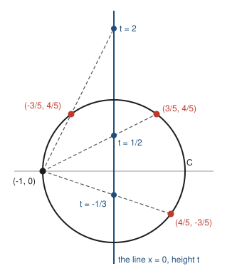

# Birational equivalence: the same away from a small bad set, and the field that detects it

[Syllabus](../../../SYLLABUS.md) → [Algebraic geometry](../README.md) → [Affine and Projective Varieties](../README.md#s02) → Birational equivalence

---

## General Overview

The lamp of this shelf throws the light cone $`x^2 + y^2 = z^2`$. On a ceiling 1 m above the bulb, the edge of the light is the circle $`x^2 + y^2 = 1`$, radius 1 m. Stand a pointer at the rim point $`(-1, 0)`$ and run a straight rail through the centre along $`x = 0`$.

Aim the pointer at any other point of the circle. The beam crosses the rail at one height, $`t`$. Aim it at $`(3/5, 4/5)`$ and the beam crosses at $`t = 1/2`$. Aim through a height on the rail instead, and the beam meets the circle at exactly one more point. Circle points and rail heights pair off one to one. This pairing is **stereographic projection** (projection from one point of a curve onto a line).

The pairing fails at one place. At the pointer's own point $`(-1, 0)`$ the beam becomes the tangent $`x = -1`$, parallel to the rail, so that point gets no height. Over the complex numbers, two heights, $`t = i`$ and $`t = -i`$ (where $`i^2 = -1`$), get no circle point. Away from these few points the circle and the line are the same curve with different coordinates. Two varieties (solution sets of polynomial equations) that match like this are **birational**.

Drawings fail for surfaces and complicated curves, so algebra checks the match. The fractions of polynomial functions on the circle form its **function field**. The one fraction $`t = y/(x + 1)`$ produces all the others, so the circle's field is the fractions in one letter, like the line's.

**Two varieties are birational when inverse rational maps match them away from a small bad set; this happens exactly when their function fields, the fractions of polynomial functions on each, are the same field.**

**What kind of fact this is:** the function field and birational equivalence are definitions; that each detects the other is a theorem, proved on this card in Why it works; the circle-and-line match is a calculation, done by hand and by the checks.

### The picture: one pointer, one rail

<p align="center"></p>

Drawn to scale, 100 units per metre, real points only. Red dots are circle points, blue dots are rail heights, and each dashed beam pairs one red dot with one blue dot. The black point $`(-1, 0)`$ is the one point of the circle with no partner.

---

## The formula

Notation already in use. The field $`k`$ holds the coordinates: $`\mathbb{Q}`$ for exact sums, $`\mathbb{R}`$ for the drawing, $`\mathbb{F}_p`$ (whole numbers mod a prime $`p`$) for counts, $`\mathbb{C}`$ for the missing points. The coordinate ring $`k[V]`$ is the polynomials restricted to the variety $`V`$, where two polynomials count as equal when they agree on $`V`$ ([Affine varieties](01-affine-varieties-and-coordinate-rings.md)). From [Maps between varieties](05-regular-and-rational-maps.md): a **rational map** $`\varphi : V \dashrightarrow W`$ is given by fractions of polynomials and is defined wherever no denominator is zero; its **pullback** $`\varphi^*`$ turns a function $`f`$ on $`W`$ into the function $`f \circ \varphi`$ on $`V`$.

New on this card: the function field $`k(V)`$ and the word birational. For an irreducible variety $`V`$ (one that is not a union of two smaller varieties, [The Zariski topology](02-zariski-topology-and-irreducibility.md)):

```math
k(V) = \Big\{\, \frac{f}{g} \;:\; f, g \in k[V],\ g \neq 0 \text{ in } k[V] \,\Big\}, \qquad \frac{f}{g} = \frac{f'}{g'} \iff f g' - f' g = 0 \text{ in } k[V]
```

**Read it aloud:** the function field of V is all fractions of polynomial functions on V whose bottom is not the zero function on V, and two fractions are equal when their cross-multiples agree on V.

This construction is the **field of fractions** of $`k[V]`$. It is how the rationals are built from the integers, with polynomial functions in place of integers; [Fields](../../03-Algebra/09-Rings%20and%20Fields/02-fields.md) states it for any ring with no zero divisors.

```math
V \text{ and } W \text{ are birational} \iff \text{there are } \varphi : V \dashrightarrow W,\ \psi : W \dashrightarrow V \text{ with } \psi \circ \varphi = \mathrm{id},\ \varphi \circ \psi = \mathrm{id} \text{ where defined} \iff k(V) \cong k(W) \text{ over } k
```

**Read it aloud:** two varieties are birational when two rational maps undo each other wherever both are defined, and that happens exactly when the two function fields are the same field, matched in a way that leaves every constant of k alone.

For the circle $`C : x^2 + y^2 = 1`$ and the rail, an ordinary line with coordinate $`t`$ and no point at infinity:

```math
\varphi(x, y) = \frac{y}{x + 1}, \qquad \psi(t) = \Big(\frac{1 - t^2}{1 + t^2},\ \frac{2t}{1 + t^2}\Big), \qquad k(C) = k(t) \text{ with } t = \frac{y}{x + 1}
```

**Read it aloud:** the circle sends a point to the height y over x plus 1; the line sends a height back to the point one minus t squared over one plus t squared, two t over one plus t squared; and the circle's function field is the field of fractions in the single letter t.

With $`t = 1/2`$: $`\psi(1/2) = (3/5, 4/5)`$, and $`\varphi(3/5, 4/5) = (4/5)/(8/5) = 1/2`$.

| Symbol | Plain meaning | In our example | Push it up and the answer… |
| --- | --- | --- | --- |
| $`k`$, $`i`$ | the field the coordinates come from; $`i`$ is a square root of $`-1`$ in $`\mathbb{C}`$ | $`\mathbb{Q}`$; $`\mathbb{F}_7`$ for counts | a bigger field can add bad points: $`t = \pm i`$ appear over $`\mathbb{C}`$ |
| $`V`$, $`W`$ | two irreducible varieties being compared | the circle $`C`$ and the line | — |
| $`k[V]`$ | the coordinate ring: polynomials, equal when they agree on $`V`$ | $`k[x, y]`$ with $`y^2 = 1 - x^2`$ | — |
| $`k(V)`$ | the function field: fractions from $`k[V]`$ | $`k(C) = k(t)`$ | — |
| $`f`$, $`g`$ | the top and bottom of a fraction; $`g`$ not zero on $`V`$ | $`y`$ and $`x + 1`$ | — |
| $`C`$; $`x`$, $`y`$ | the unit circle $`x^2 + y^2 = 1`$, the ceiling slice of the cone; its coordinates | radius 1 m | — |
| $`t`$ | the height on the rail; the line's coordinate | $`1/2`$ pairs with $`(3/5, 4/5)`$ | the point runs anticlockwise from $`(1, 0)`$ over the top toward $`(-1, 0)`$ |
| $`\varphi`$, $`\psi`$; $`\dashrightarrow`$ | the projection, circle to line, and its inverse; the dashed arrow marks a map that may be undefined on a small set | $`y/(x + 1)`$; $`((1 - t^2)/(1 + t^2), 2t/(1 + t^2))`$ | — |
| $`\varphi^*`$, $`\psi^*`$ | pullbacks: substitute the map into a function | $`\psi^*(x) = (1 - t^2)/(1 + t^2)`$ | — |
| $`\cong`$; $`\theta`$ | an isomorphism, a one-to-one match keeping sums and products; Step 4 names one $`\theta`$, with $`w_j`$, $`F_i`$, $`h_j`$ the coordinates of $`W`$, its equations, and their images | $`k(C) \cong k(t)`$ | — |
| $`p`$, $`\mathbb{F}_p`$ | a prime, and the whole numbers mod $`p`$ | 7 | the counts grow like $`p`$ |
| $`s`$, $`z`$; $`X`$, $`Y`$, $`Z`$ | the cone's plane coordinates, slope and height; whole numbers in the mod-9 test | $`(1/2, 5)`$ for $`(3, 4, 5)`$ | — |

### When it holds

- **Irreducible varieties.** On $`xy = 0`$, two crossing lines, $`x \cdot y`$ is the zero function, yet neither $`x`$ nor $`y`$ is. A fraction $`1/x`$ would force $`y = (1/x)(xy) = 0`$. Zero divisors (nonzero things whose product is zero) leave no field.
- **Bottoms that are not zero on V.** $`1/(x^2 + y^2 - 1)`$ is no function on the circle: its bottom is zero everywhere on it.
- **Maps whose image is not squeezed into a smaller set (dominant maps).** Send the whole circle to $`(0, 0)`$, and $`1/x`$ pulls back to $`1/0`$.
- **A starting point with coordinates in k.** $`x^2 + y^2 = 3`$ has no rational point to project from. It is birational to the line over $`\mathbb{R}`$, not over $`\mathbb{Q}`$.
- **Characteristic not 2.** Over $`\mathbb{F}_2`$, $`2 = 0`$: then $`x^2 + y^2 - 1 = (x + y + 1)^2`$, a doubled line, and the formulas for $`\psi`$ lose their 2.

---

## Why it works

### Step 0: functions travel backwards along maps

A map moves points forward, from $`V`$ to $`W`$. Functions move back: a function on $`W`$, fed the image of a point, becomes a function on $`V`$. That is the pullback $`\varphi^*`$, and it keeps sums and products because it is only substitution.

So inverse maps of varieties should give inverse maps of functions. Rational maps divide, so polynomial functions are too few to receive them; fractions are exactly enough. That is why the detector is the function field, not the coordinate ring.

### Step 1: the function field is a field

The fractions $`f/g`$ with $`g`$ not zero on $`V`$ add and multiply by the school rules. A fraction $`f/g`$ with $`f`$ not zero on $`V`$ has the reciprocal $`g/f`$. The one danger is two nonzero bottoms whose product is zero on $`V`$. Irreducibility rules this out: if $`g g' = 0`$ on $`V`$, then $`V`$ is the union of the zero sets of $`g`$ and $`g'`$ on $`V`$, so one of them is all of $`V`$.

The equality rule is what makes the field useful. On the circle,

```math
\frac{y}{x + 1} = \frac{1 - x}{y}, \qquad \text{because } y \cdot y - (1 - x)(x + 1) = x^2 + y^2 - 1 = 0 \text{ on } C
```

**Read it aloud:** y over x plus 1 and one minus x over y are the same element of the function field, because their cross-multiples differ by the circle's own equation.

One element, two fractions. At $`(1, 0)`$ the first fraction gives $`0/2 = 0`$ while the second gives $`0/0`$. A function is **defined at a point** when some fraction for it has a nonzero bottom there. So $`\varphi`$ is defined at $`(1, 0)`$. At $`(-1, 0)`$ the two fractions give $`0/0`$ and $`2/0`$. Over $`\mathbb{R}`$ no other fraction can work there either. A fraction with a nonzero bottom at a point stays bounded near it, but near $`(-1, 0)`$ the height runs off: at the circle point with $`y = 1/100`$, $`t \approx 199.995`$. So $`(-1, 0)`$ is the bad point of $`\varphi`$ as a map to the rail. Read into $`\mathbb{P}^1`$ instead, as in [Maps between varieties](05-regular-and-rational-maps.md), the second fraction gives $`(2 : 0) = (1 : 0)`$ there, the rail's point at infinity; in the projective plane the bad sets vanish ([Conics](../03-Plane%20Curves/01-conics-and-rational-parametrisation.md)).

### Step 2: maps give field maps, in the other order

A rational map $`\varphi : V \dashrightarrow W`$ whose image is not squeezed into a smaller set gives $`\varphi^* : k(W) \to k(V)`$. The image condition keeps every bottom nonzero after substitution.

Pullbacks reverse composition: to pull back along "$`\varphi`$ then $`\psi`$", pull back along $`\psi`$ first, then along $`\varphi`$. In symbols, $`(\psi \circ \varphi)^* = \varphi^* \circ \psi^*`$, and the identity map pulls back to the identity.

### Step 3: inverse maps give inverse fields, shown on the circle

If $`\psi \circ \varphi = \mathrm{id}`$ and $`\varphi \circ \psi = \mathrm{id}`$, Step 2 gives $`\varphi^* \circ \psi^* = \mathrm{id}`$ and $`\psi^* \circ \varphi^* = \mathrm{id}`$. So $`\varphi^*`$ and $`\psi^*`$ are inverse field maps and $`k(V) \cong k(W)`$.

On the circle, the check is three substitutions. Each answer is a fraction of polynomial functions, reduced by the rule $`y^2 = 1 - x^2`$:

| Pull back | Substitute | Reduce on $`C`$ | Equals |
| --- | --- | --- | --- |
| $`\varphi^*\psi^*(x)`$ | $`t = y/(x + 1)`$ in $`(1 - t^2)/(1 + t^2)`$ | $`(2x^2 + 2x)/(2x + 2)`$ | $`x`$ |
| $`\varphi^*\psi^*(y)`$ | $`t = y/(x + 1)`$ in $`2t/(1 + t^2)`$ | $`(2xy + 2y)/(2x + 2)`$ | $`y`$ |
| $`\psi^*\varphi^*(t)`$ | $`x, y = \psi(t)`$ in $`y/(x + 1)`$ | $`(2t)/(2)`$ | $`t`$ |

In the first row, multiply top and bottom by $`(x + 1)^2`$: the top is $`(x + 1)^2 - y^2`$ and the bottom $`(x + 1)^2 + y^2`$. Replacing $`y^2`$ by $`1 - x^2`$ gives $`2x^2 + 2x = 2x(x + 1)`$ over $`2x + 2 = 2(x + 1)`$, which is $`x`$. So $`k(C)`$ and $`k(t)`$ are one field: every fraction in $`x`$ and $`y`$ is a fraction in $`t`$ alone.

### Step 4: a match of fields gives inverse maps

The converse runs backwards. Let $`\theta : k(W) \to k(V)`$ be a field isomorphism fixing the constants. Each coordinate $`w_1, \dots, w_m`$ of $`W`$ goes to a fraction on $`V`$, and these $`m`$ fractions are the formulas of a rational map $`V \dashrightarrow W`$. The same with $`\theta^{-1}`$ gives the map back.

<details>
<summary>Detailed proof: why the fractions land on W, and why the maps are inverse</summary>

Write $`W \subseteq \mathbb{A}^m`$ (affine $`m`$-space: lists of $`m`$ coordinates), cut out by polynomials $`F_1, \dots, F_s`$. Set $`h_j = \theta(w_j)`$ and $`\varphi = (h_1, \dots, h_m)`$, defined where every bottom is nonzero.

Because $`\theta`$ keeps sums, products and constants, for each equation of $`W`$:

$`\displaystyle F_i(h_1, \dots, h_m) = F_i(\theta(w_1), \dots, \theta(w_m)) = \theta\big(F_i(w_1, \dots, w_m)\big) = \theta(0) = 0.`$

So every defined point of $`V`$ lands on $`W`$. The pullback of $`w_j`$ is $`h_j = \theta(w_j)`$, so $`\varphi^* = \theta`$ on coordinates, hence everywhere.

Build $`\psi`$ from $`\theta^{-1}`$ the same way. Then $`(\psi \circ \varphi)^* = \varphi^* \circ \psi^* = \theta \circ \theta^{-1} = \mathrm{id}`$. A rational map whose pullback fixes every coordinate is the identity where it is defined, so $`\psi \circ \varphi = \mathrm{id}`$. The same holds the other way round. The image of $`\varphi`$ is not squeezed into a smaller set, because a function zero on that image would pull back to 0, and $`\theta`$ is one to one.

</details>

### Step 5: where the two maps are defined, and why the bad sets are small

As a map to the rail, $`\varphi = y/(x + 1)`$ fails only at $`(-1, 0)`$, as Step 1 showed. $`\psi`$ fails where $`1 + t^2 = 0`$. Off these points, the maps are inverse bijections:

```math
C \setminus \{(-1, 0)\} \;\longleftrightarrow\; \{\, t : 1 + t^2 \neq 0 \,\}
```

**Read it aloud:** the circle without the pointer's point matches the line without the roots of one plus t squared, one point for one point.

Each bad set is where some nonzero function vanishes: a closed set ([The Zariski topology](02-zariski-topology-and-irreducibility.md)) smaller than the variety. On a curve that is finitely many points; on a surface, at most a curve.

Over $`\mathbb{F}_p`$ this gives a count to check. The circle has $`p + 1`$ points when $`p`$ leaves remainder 3 on division by 4, and $`p - 1`$ when it leaves 1. In the second case $`-1`$ is a square mod $`p`$, so $`t^2 = -1`$ removes two heights. Either way the two sides match:

| $`p`$ | circle points | minus $`(-1, 0)`$ | line points | minus roots of $`t^2 = -1`$ | match |
| --- | --- | --- | --- | --- | --- |
| 3 | 4 | 3 | 3 | none: 3 | yes |
| 5 | 4 | 3 | 5 | 2 and 3: 3 | yes |
| 7 | 8 | 7 | 7 | none: 7 | yes |
| 13 | 12 | 11 | 13 | 5 and 8: 11 | yes |

### Step 6: the same trick on the cone

The lamp's whole cone is birational to a plane. Project each slice at height $`z`$ from its point $`(-z, 0, z)`$, and keep the slope $`s = y/(x + z)`$ and $`z`$. The inverse is $`(s, z) \mapsto (z(1 - s^2)/(1 + s^2),\ 2zs/(1 + s^2),\ z)`$. The ray $`(3, 4, 5)`$ goes to $`(s, z) = (1/2, 5)`$ and back; $`(5, 12, 13)`$ goes to $`(2/3, 13)`$ and back. The projection's bad set is a whole line of the cone, $`x + z = 0`$. Over $`\mathbb{C}`$ the match also drops the slice $`z = 0`$: the projection sends it to $`s = \pm i`$, where $`\psi`$ is undefined. On the plane side, $`\psi`$ crushes the whole line $`z = 0`$ to the cone's tip. Small means one dimension down, not few points.

---

## Worked numbers, by hand

| Step | Arithmetic | Value |
| --- | --- | --- |
| a height | the beam through $`(3/5, 4/5)`$: $`(4/5) / (3/5 + 1)`$ | $`t = 1/2`$ |
| back to the circle | $`1 + 1/4 = 5/4`$; $`(3/4)/(5/4)`$ and $`1/(5/4)`$; $`9/25 + 16/25 = 1`$ | $`(3/5, 4/5)`$, on $`C`$ |
| another height | $`t = 2/3`$: $`1 + 4/9 = 13/9`$; $`(5/9)/(13/9)`$, $`(4/3)/(13/9)`$ | $`(5/13, 12/13)`$ |
| a whole-number triangle | clear the 13s: $`25 + 144 = 169`$ | $`(5, 12, 13)`$ |
| one element, two fractions | $`y \cdot y - (1 - x)(x + 1)`$ | $`x^2 + y^2 - 1 = 0`$ on $`C`$ |
| the round trip in the field | $`\varphi^*\psi^*(x) = (2x^2 + 2x)/(2x + 2)`$ | $`x`$ |
| bad sets over $`\mathbb{F}_7`$ | circle 8 minus 1; line 7 minus 0 | **7 = 7, matched one to one** |

The circle and the line are one curve in two coordinate systems, and one function field. Only the pointer's point and, over some fields, two heights fall outside the match.

### What breaks if you drop a piece

| Mistake | Comes out at | What went wrong |
| --- | --- | --- |
| Ignore the bad sets and match the whole circle to the whole line | over $`\mathbb{F}_7`$ the circle has 8 points and the line 7; over $`\mathbb{F}_5`$, 4 and 5 | Birational is a match away from small sets, not everywhere |
| Map the circle to the line by $`x`$ alone | $`x = 3/5`$ has 2 points above it, $`y = 4/5`$ and $`y = -4/5`$ | The map is two to one: $`k(x)`$ is a smaller field inside $`k(C)`$, not all of it |
| Use a reducible variety, $`xy = 0`$ | over $`\mathbb{F}_7`$: $`x \cdot y`$ nonzero at 0 of 13 points, while $`x`$ and $`y`$ are nonzero at 6 each | Zero divisors: there is no field of fractions |
| Use the wrong field: $`x^2 + y^2 = 3`$ over $`\mathbb{Q}`$ | 0 solutions of $`X^2 + Y^2 = 3Z^2`$ mod 9 not all divisible by 3; 72 for $`X^2 + Y^2 = Z^2`$ | No rational point to project from |

The last row is a proof: a rational point $`(X/Z, Y/Z)`$ in lowest terms gives such a solution, and mod 9 there is none. With no rational point there is no birational match over $`\mathbb{Q}`$ either: the inverse map from the line would send all but finitely many rational $`t`$ to rational points of the curve.

---

## Code, from first principles, and it actually runs

The code works exactly, in fractions and mod $`p`$, and takes three roads. It sends points through $`\psi`$ and back through $`\varphi`$, both ways, and shows the height running off near $`(-1, 0)`$. It builds each round-trip pullback from the same coefficients that $`\psi`$ uses, reduces it by $`y^2 = 1 - x^2`$, and cross-multiplies it to zero. It counts the circle and the line over $`\mathbb{F}_p`$ for six primes and checks the one-to-one match. It also prints every what-breaks row and the figure's coordinates.

### Python

```python
# Birational equivalence and function fields -- the check behind the card.
# Standard library only.  Fraction keeps every value exact.  The circle C: x^2 + y^2 = 1
# and the line with coordinate t are matched by projection from the point (-1, 0):
# phi(x, y) = y/(x + 1) and psi(t) = ((1 - t^2)/(1 + t^2), 2t/(1 + t^2)).
# Three roads: points put back exactly; the pullbacks composed as fractions of
# polynomial functions, reduced by y^2 = 1 - x^2; and the match counted over F_p.
from fractions import Fraction as Q
from math import sqrt

PX, PY, PD = (1, 0, -1), (0, 2, 0), (1, 0, 1)                # psi's two tops and its bottom: coefficients of 1, t, t^2
def cv(c, t): return c[0] + c[1] * t + c[2] * t * t
def psi(t): return (cv(PX, t) / cv(PD, t), cv(PY, t) / cv(PD, t))
def phi(x, y): return y / (x + 1)
def on_c(x, y): return x * x + y * y == 1
def pt(*a): return "(" + ", ".join(str(c) for c in a) + ")"
def yn(c): return "yes" if c else "no"
def cone_phi(x, y, z): return (y / (x + z), z)               # cone x^2 + y^2 = z^2 to the (s, z) plane
def cone_psi(s, z): return tuple(z * c for c in psi(s)) + (z,)

# ---- polynomials in x, y as {(i, j): coefficient}; normal form uses y^2 = 1 - x^2 ----
def add(a, b):
    out = dict(a)
    for k, c in b.items(): out[k] = out.get(k, 0) + c
    return {k: c for k, c in out.items() if c != 0}
def scale(a, c): return {k: v * c for k, v in a.items() if v * c != 0}
def mul(a, b):
    out = {}
    for (i, j), c in a.items():
        for (k, l), d in b.items(): out = add(out, {(i + k, j + l): c * d})
    return out
def nf(a):                                     # every element of k[C] is a(x) + b(x) y
    out = {}
    for (i, j), c in a.items():
        term = {(i, j % 2): Q(c)}
        for _ in range(j // 2): term = mul(term, {(0, 0): Q(1), (2, 0): Q(-1)})
        out = add(out, term)
    return out
def show(a, names=("x", "y")):
    if not a: return "0"
    s = ""
    for (i, j) in sorted(a, reverse=True):
        c = a[(i, j)]
        mono = "*".join(n + (f"^{e}" if e > 1 else "") for n, e in zip(names, (i, j)) if e)
        body = (str(abs(c)) if abs(c) != 1 or not mono else "") + ("*" if abs(c) != 1 and mono else "") + mono
        s += (" - " if c < 0 else " + ") + body if s else ("-" if c < 0 else "") + body
    return s
X, Y, ONE = {(1, 0): Q(1)}, {(0, 1): Q(1)}, {(0, 0): Q(1)}
def P(*terms): return {k: Q(c) for k, c in terms}

print("field Q; circle C: x^2 + y^2 = 1; line: coordinate t; projection from (-1, 0)")
print("road 1: points, put back exactly")
for t in (Q(1, 2), Q(2, 3), Q(3, 4), Q(1, 4), Q(2), Q(-1, 3), Q(0)):
    x, y = psi(t)
    m, n = t.denominator, t.numerator
    trip = (m * m - n * n, 2 * m * n, m * m + n * n)
    print(f"  t = {t}: psi(t) = {pt(x, y)}, on C: {yn(on_c(x, y))}, phi back: {phi(x, y)}"
          + (f"; triple {pt(*trip)}" if 0 < t < 1 else ""))
    assert on_c(x, y) and phi(x, y) == t
    assert trip[0] ** 2 + trip[1] ** 2 == trip[2] ** 2
for x, y in ((Q(5, 13), Q(-12, 13)), (Q(-7, 25), Q(24, 25)), (Q(1), Q(0)), (Q(0), Q(-1))):
    t = phi(x, y)
    print(f"  circle point {pt(x, y)}: phi = {t}, psi back: {pt(*psi(t))}")
    assert psi(t) == (x, y)

print("road 2: fractions in k(C), cross-multiplied and reduced by y^2 = 1 - x^2")
a, b = Y, add(X, ONE)                           # t = a/b = y/(x + 1)
same = nf(add(mul(Y, Y), scale(mul(P(((0, 0), 1), ((1, 0), -1)), b), -1)))
print(f"  y/(x + 1) = (1 - x)/y: y*y - (1 - x)(x + 1) reduces to {show(same)}")
print("  " + "; ".join(f"at ({u}, {w}): y/(x + 1) = {w}/{u + 1}, (1 - x)/y = {1 - u}/{w}" for u, w in ((1, 0), (-1, 0)))
      + ": phi is defined at (1, 0), not at (-1, 0)")
yb = 0.01; xb = -sqrt(1 - yb * yb)                            # the circle point just above (-1, 0)
print(f"  near (-1, 0): at y = 1/100, x = {xb:.5f}, the height t = (1 - x)/y = {(1 - xb) / yb:.3f}: t runs off")
assert same == {} and abs(yb / (xb + 1) - (1 - xb) / yb) < 1e-6 and (1 - xb) / yb > 199
hs = lambda c: add(add(scale(mul(b, b), c[0]), scale(mul(a, b), c[1])), scale(mul(a, a), c[2]))   # psi's c at t = a/b, times b^2
den = nf(hs(PD))
for name, num, target in (("x", hs(PX), X), ("y", hs(PY), Y)):
    num = nf(num)
    diff = nf(add(num, scale(mul(target, den), -1)))
    print(f"  phi*(psi*({name})) = ({show(num)})/({show(den)}); minus {name}, cross-multiplied: {show(diff)}")
    assert diff == {}
tp = lambda c: {(k, 0): Q(v) for k, v in enumerate(c) if v}  # psi's coefficients as a polynomial in t
lin = lambda L: add(add(scale(tp(PD), L.get((0, 0), 0)), scale(tp(PX), L.get((1, 0), 0))), scale(tp(PY), L.get((0, 1), 0)))
tn, td = lin(a), lin(b)                            # phi = a/b with x, y = psi(t); top and bottom times 1 + t^2
diff_t = add(tn, scale(mul(P(((1, 0), 1)), td), -1))
print(f"  psi*(phi*(t)) = ({show(tn, 't_')})/({show(td, 't_')}); minus t, cross-multiplied: {show(diff_t)}")
assert diff_t == {}

count = {}
print("road 3: count over F_p (circle minus (-1, 0) against line minus t^2 = -1)")
for p in (3, 5, 7, 11, 13, 17):
    inv = lambda v: pow(v % p, p - 2, p)
    circ = [(x, y) for x in range(p) for y in range(p) if (x * x + y * y - 1) % p == 0]
    bad_t = [t for t in range(p) if (t * t + 1) % p == 0]
    good_c = [(x, y) for x, y in circ if (x + 1) % p]
    image = sorted({y * inv(x + 1) % p for x, y in good_c})
    back = all(((1 - t * t) * inv(1 + t * t) % p, 2 * t * inv(1 + t * t) % p) in good_c for t in image)
    print(f"  p = {p:2d}: circle {len(circ):2d}, minus 1 = {len(good_c):2d}; line {p:2d}, minus {bad_t} = "
          f"{p - len(bad_t):2d}; phi one-to-one onto the rest: {yn(len(image) == len(good_c) and back)}")
    assert len(image) == len(good_c) == p - len(bad_t) and back
    count[p] = len(circ)
    assert set(image).isdisjoint(bad_t)

c5 = [(x, y) for x in range(5) for y in range(5) if (x * x + y * y - 1) % 5 == 0]
print(f"  F_5 unit on C, (x + 2y)(x - 2y) = x^2 + y^2 = 1: values of x + 2y at "
      + ", ".join(pt(*c) for c in c5) + ": " + ", ".join(str((x + 2 * y) % 5) for x, y in c5))
assert all((x + 2 * y) * (x - 2 * y) % 5 == 1 for x, y in c5)
for v in ((Q(3), Q(4), Q(5)), (Q(5), Q(12), Q(13))):
    w = cone_phi(*v)
    print(f"cone x^2 + y^2 = z^2: {pt(*v)} -> (s, z) = {pt(*w)} -> {pt(*cone_psi(*w))}")
    assert cone_psi(*w) == v

print("what breaks")
print(f"  no bad sets: over F_7 circle {count[7]} points, line 7; over F_5 circle {count[5]}, line 5: "
      "no one-to-one match")
assert count[7] != 7 and count[5] != 5
ys = [y for y in (Q(k, 5) for k in range(-5, 6)) if on_c(Q(3, 5), y)]
print(f"  map to x only: x = 3/5, y^2 = {1 - Q(9, 25)}: {len(ys)} points, y = " + " and ".join(map(str, ys)))
assert len(ys) == 2
v = [(x, y) for x in range(7) for y in range(7) if x * y % 7 == 0]
print(f"  reducible xy = 0 over F_7: {len(v)} points; x*y nonzero at {sum(x * y % 7 != 0 for x, y in v)}, "
      f"x nonzero at {sum(x != 0 for x, y in v)}, y nonzero at {sum(y != 0 for x, y in v)}: zero divisors, no field")
sols = [(u, v, w) for u in range(9) for v in range(9) for w in range(9)
        if (u * u + v * v - 3 * w * w) % 9 == 0 and (u % 3 or v % 3 or w % 3)]
ok1 = [(u, v, w) for u in range(9) for v in range(9) for w in range(9)
       if (u * u + v * v - w * w) % 9 == 0 and (u % 3 or v % 3 or w % 3)]
print(f"  x^2 + y^2 = 3 over Q: primitive X^2 + Y^2 = 3Z^2 mod 9: {len(sols)}; for x^2 + y^2 = 1: {len(ok1)}")
assert sols == [] and len(ok1) > 0

S = 100                                                    # figure: 100 units per unit, origin (160, 240)
sv = lambda x, y: f"({160 + S * x:.2f}, {240 - S * y:.2f})"
print("figure, N " + sv(-1, 0) + "; " + "; ".join(
    f"t = {t}: point {sv(*psi(t))}, line {sv(0, t)}" for t in (Q(1, 2), Q(2), Q(-1, 3))))
print("ALL CHECKS PASS")
```

**Ran 2026-11-17 on macOS, Python 3.14.10, standard library only. All checks passed. Output, pasted from the run:**

```
field Q; circle C: x^2 + y^2 = 1; line: coordinate t; projection from (-1, 0)
road 1: points, put back exactly
  t = 1/2: psi(t) = (3/5, 4/5), on C: yes, phi back: 1/2; triple (3, 4, 5)
  t = 2/3: psi(t) = (5/13, 12/13), on C: yes, phi back: 2/3; triple (5, 12, 13)
  t = 3/4: psi(t) = (7/25, 24/25), on C: yes, phi back: 3/4; triple (7, 24, 25)
  t = 1/4: psi(t) = (15/17, 8/17), on C: yes, phi back: 1/4; triple (15, 8, 17)
  t = 2: psi(t) = (-3/5, 4/5), on C: yes, phi back: 2
  t = -1/3: psi(t) = (4/5, -3/5), on C: yes, phi back: -1/3
  t = 0: psi(t) = (1, 0), on C: yes, phi back: 0
  circle point (5/13, -12/13): phi = -2/3, psi back: (5/13, -12/13)
  circle point (-7/25, 24/25): phi = 4/3, psi back: (-7/25, 24/25)
  circle point (1, 0): phi = 0, psi back: (1, 0)
  circle point (0, -1): phi = -1, psi back: (0, -1)
road 2: fractions in k(C), cross-multiplied and reduced by y^2 = 1 - x^2
  y/(x + 1) = (1 - x)/y: y*y - (1 - x)(x + 1) reduces to 0
  at (1, 0): y/(x + 1) = 0/2, (1 - x)/y = 0/0; at (-1, 0): y/(x + 1) = 0/0, (1 - x)/y = 2/0: phi is defined at (1, 0), not at (-1, 0)
  near (-1, 0): at y = 1/100, x = -0.99995, the height t = (1 - x)/y = 199.995: t runs off
  phi*(psi*(x)) = (2*x^2 + 2*x)/(2*x + 2); minus x, cross-multiplied: 0
  phi*(psi*(y)) = (2*x*y + 2*y)/(2*x + 2); minus y, cross-multiplied: 0
  psi*(phi*(t)) = (2*t)/(2); minus t, cross-multiplied: 0
road 3: count over F_p (circle minus (-1, 0) against line minus t^2 = -1)
  p =  3: circle  4, minus 1 =  3; line  3, minus [] =  3; phi one-to-one onto the rest: yes
  p =  5: circle  4, minus 1 =  3; line  5, minus [2, 3] =  3; phi one-to-one onto the rest: yes
  p =  7: circle  8, minus 1 =  7; line  7, minus [] =  7; phi one-to-one onto the rest: yes
  p = 11: circle 12, minus 1 = 11; line 11, minus [] = 11; phi one-to-one onto the rest: yes
  p = 13: circle 12, minus 1 = 11; line 13, minus [5, 8] = 11; phi one-to-one onto the rest: yes
  p = 17: circle 16, minus 1 = 15; line 17, minus [4, 13] = 15; phi one-to-one onto the rest: yes
  F_5 unit on C, (x + 2y)(x - 2y) = x^2 + y^2 = 1: values of x + 2y at (0, 1), (0, 4), (1, 0), (4, 0): 2, 3, 1, 4
cone x^2 + y^2 = z^2: (3, 4, 5) -> (s, z) = (1/2, 5) -> (3, 4, 5)
cone x^2 + y^2 = z^2: (5, 12, 13) -> (s, z) = (2/3, 13) -> (5, 12, 13)
what breaks
  no bad sets: over F_7 circle 8 points, line 7; over F_5 circle 4, line 5: no one-to-one match
  map to x only: x = 3/5, y^2 = 16/25: 2 points, y = -4/5 and 4/5
  reducible xy = 0 over F_7: 13 points; x*y nonzero at 0, x nonzero at 6, y nonzero at 6: zero divisors, no field
  x^2 + y^2 = 3 over Q: primitive X^2 + Y^2 = 3Z^2 mod 9: 0; for x^2 + y^2 = 1: 72
figure, N (60.00, 240.00); t = 1/2: point (220.00, 160.00), line (160.00, 190.00); t = 2: point (100.00, 160.00), line (160.00, 40.00); t = -1/3: point (240.00, 300.00), line (160.00, 273.33)
ALL CHECKS PASS
```

### Rust

Same numbers, same labels. Fractions are an `i128` struct whose products use `checked_mul`, so an overflow stops the run.

```rust
// Birational equivalence and function fields -- the same check as the Python, in Rust.
// No crates.  Fractions are an i128 struct using checked_mul, so overflow stops the run.
// The circle C: x^2 + y^2 = 1 and the line with coordinate t are matched by projection
// from the point (-1, 0): phi(x, y) = y/(x + 1), psi(t) = ((1 - t^2)/(1 + t^2), 2t/(1 + t^2)).
// Three roads: points put back exactly; the pullbacks composed as fractions of
// polynomial functions, reduced by y^2 = 1 - x^2; and the match counted over F_p.
use std::collections::{BTreeMap, BTreeSet};
use std::fmt;

#[derive(Clone, Copy, PartialEq, Debug)]
struct Q { n: i128, d: i128 }
fn gcd(a: i128, b: i128) -> i128 { if b == 0 { a.abs() } else { gcd(b, a % b) } }
fn q(n: i128, d: i128) -> Q { assert!(d != 0, "division by zero"); let g = gcd(n, d); let s = if d < 0 { -1 } else { 1 }; Q { n: s * n / g, d: s * d / g } }
fn m(a: i128, b: i128) -> i128 { a.checked_mul(b).expect("overflow") }
fn add(a: Q, b: Q) -> Q { q(m(a.n, b.d) + m(b.n, a.d), m(a.d, b.d)) }
fn sub(a: Q, b: Q) -> Q { add(a, Q { n: -b.n, d: b.d }) }
fn mul(a: Q, b: Q) -> Q { q(m(a.n, b.n), m(a.d, b.d)) }
fn div(a: Q, b: Q) -> Q { q(m(a.n, b.d), m(a.d, b.n)) }
impl fmt::Display for Q { fn fmt(&self, f: &mut fmt::Formatter) -> fmt::Result { if self.d == 1 { write!(f, "{}", self.n) } else { write!(f, "{}/{}", self.n, self.d) } } }
fn i(n: i128) -> Q { q(n, 1) }
const PX: [i128; 3] = [1, 0, -1]; const PY: [i128; 3] = [0, 2, 0]; const PD: [i128; 3] = [1, 0, 1];   // psi's two tops and its bottom: 1, t, t^2
fn cv(c: [i128; 3], t: Q) -> Q { add(add(i(c[0]), mul(i(c[1]), t)), mul(i(c[2]), mul(t, t))) }
fn psi(t: Q) -> (Q, Q) { (div(cv(PX, t), cv(PD, t)), div(cv(PY, t), cv(PD, t))) }
fn phi(x: Q, y: Q) -> Q { div(y, add(x, i(1))) }
fn on_c(x: Q, y: Q) -> bool { add(mul(x, x), mul(y, y)) == i(1) }
fn pt(a: &[Q]) -> String { format!("({})", a.iter().map(|c| c.to_string()).collect::<Vec<_>>().join(", ")) }
fn yn(c: bool) -> &'static str { if c { "yes" } else { "no" } }
fn cone_phi(v: [Q; 3]) -> [Q; 2] { [div(v[1], add(v[0], v[2])), v[2]] }   // cone to the (s, z) plane
fn cone_psi(w: [Q; 2]) -> [Q; 3] { let (x, y) = psi(w[0]); [mul(w[1], x), mul(w[1], y), w[1]] }

// ---- polynomials in x, y as {(i, j): coefficient}; normal form uses y^2 = 1 - x^2 ----
type P = BTreeMap<(u32, u32), Q>;
fn pp(terms: &[((u32, u32), i128)]) -> P { padd(&P::new(), &terms.iter().map(|&(k, c)| (k, i(c))).collect()) }
fn padd(a: &P, b: &P) -> P {
    let mut out = a.clone(); for (k, c) in b { let e = out.entry(*k).or_insert(i(0)); *e = add(*e, *c); } out.into_iter().filter(|(_, c)| c.n != 0).collect()
}
fn pscale(a: &P, c: Q) -> P { padd(&P::new(), &a.iter().map(|(k, v)| (*k, mul(*v, c))).collect()) }
fn pmul(a: &P, b: &P) -> P {
    let mut out = P::new(); for ((i1, j1), c) in a { for ((k, l), d) in b { out = padd(&out, &[((i1 + k, j1 + l), mul(*c, *d))].into_iter().collect()); } } out
}
fn nf(a: &P) -> P {                                   // every element of k[C] is a(x) + b(x) y
    let mut out = P::new();
    for ((ii, j), c) in a {
        let mut term: P = [((*ii, j % 2), *c)].into_iter().collect();
        for _ in 0..j / 2 { term = pmul(&term, &pp(&[((0, 0), 1), ((2, 0), -1)])); }
        out = padd(&out, &term);
    }
    out
}
fn show(a: &P, names: [&str; 2]) -> String {
    if a.is_empty() { return "0".to_string(); }
    let mut s = String::new();
    for (&(ii, j), &c) in a.iter().rev() {
        let mono: Vec<String> = names.iter().zip([ii, j]).filter(|(_, e)| *e > 0)
            .map(|(n, e)| if e > 1 { format!("{}^{}", n, e) } else { n.to_string() }).collect();
        let mono = mono.join("*");
        let ac = Q { n: c.n.abs(), d: c.d };
        let body = format!("{}{}{}", if ac != i(1) || mono.is_empty() { ac.to_string() } else { String::new() },
                           if ac != i(1) && !mono.is_empty() { "*" } else { "" }, mono);
        if s.is_empty() { s = format!("{}{}", if c.n < 0 { "-" } else { "" }, body); }
        else { s += &format!("{}{}", if c.n < 0 { " - " } else { " + " }, body); }
    }
    s
}
fn inv(v: i64, p: i64) -> i64 { let mut r = 1; for _ in 0..p - 2 { r = r * v.rem_euclid(p) % p } r }

fn main() {
    let xy = ["x", "y"];
    println!("field Q; circle C: x^2 + y^2 = 1; line: coordinate t; projection from (-1, 0)");
    println!("road 1: points, put back exactly");
    for t in [q(1, 2), q(2, 3), q(3, 4), q(1, 4), i(2), q(-1, 3), i(0)] {
        let (x, y) = psi(t);
        let (mm, n) = (t.d, t.n);
        let trip = [mm * mm - n * n, 2 * mm * n, mm * mm + n * n];
        let tail = if t.n > 0 && t.n < t.d { format!("; triple {}", pt(&trip.map(i))) } else { String::new() };
        println!("  t = {}: psi(t) = {}, on C: {}, phi back: {}{}", t, pt(&[x, y]), yn(on_c(x, y)), phi(x, y), tail);
        assert!(on_c(x, y) && phi(x, y) == t);
        assert!(trip[0] * trip[0] + trip[1] * trip[1] == trip[2] * trip[2]);
    }
    for (x, y) in [(q(5, 13), q(-12, 13)), (q(-7, 25), q(24, 25)), (i(1), i(0)), (i(0), i(-1))] {
        let t = phi(x, y);
        let (bx, by) = psi(t);
        println!("  circle point {}: phi = {}, psi back: {}", pt(&[x, y]), t, pt(&[bx, by]));
        assert!(bx == x && by == y);
    }

    println!("road 2: fractions in k(C), cross-multiplied and reduced by y^2 = 1 - x^2");
    let (xp, yp) = (pp(&[((1, 0), 1)]), pp(&[((0, 1), 1)]));
    let (a, b) = (yp.clone(), pp(&[((1, 0), 1), ((0, 0), 1)]));          // t = a/b = y/(x + 1)
    let same = nf(&padd(&pmul(&yp, &yp), &pscale(&pmul(&pp(&[((0, 0), 1), ((1, 0), -1)]), &b), i(-1))));
    println!("  y/(x + 1) = (1 - x)/y: y*y - (1 - x)(x + 1) reduces to {}", show(&same, xy));
    let at: Vec<String> = [(1i64, 0i64), (-1, 0)].iter()
        .map(|&(u, w)| format!("at ({}, {}): y/(x + 1) = {}/{}, (1 - x)/y = {}/{}", u, w, w, u + 1, 1 - u, w)).collect();
    println!("  {}: phi is defined at (1, 0), not at (-1, 0)", at.join("; "));
    let (yb, xb) = (0.01f64, -(1.0f64 - 0.01 * 0.01).sqrt());          // the circle point just above (-1, 0)
    println!("  near (-1, 0): at y = 1/100, x = {:.5}, the height t = (1 - x)/y = {:.3}: t runs off", xb, (1.0 - xb) / yb);
    assert!(same.is_empty() && (yb / (xb + 1.0) - (1.0 - xb) / yb).abs() < 1e-6 && (1.0 - xb) / yb > 199.0);
    let hs = |c: [i128; 3]| padd(&padd(&pscale(&pmul(&b, &b), i(c[0])), &pscale(&pmul(&a, &b), i(c[1]))), &pscale(&pmul(&a, &a), i(c[2])));   // psi's c at t = a/b, times b^2
    let den = nf(&hs(PD));
    let cases = [("x", hs(PX), xp.clone()), ("y", hs(PY), yp.clone())];
    for (name, num, target) in cases {
        let num = nf(&num);
        let diff = nf(&padd(&num, &pscale(&pmul(&target, &den), i(-1))));
        println!("  phi*(psi*({})) = ({})/({}); minus {}, cross-multiplied: {}",
                 name, show(&num, xy), show(&den, xy), name, show(&diff, xy));
        assert!(diff.is_empty());
    }
    let tp = |c: [i128; 3]| pp(&[((0, 0), c[0]), ((1, 0), c[1]), ((2, 0), c[2])]);   // psi's coefficients as a polynomial in t
    let lin = |l: &P| { let g = |k| *l.get(&k).unwrap_or(&i(0)); padd(&padd(&pscale(&tp(PD), g((0, 0))), &pscale(&tp(PX), g((1, 0)))), &pscale(&tp(PY), g((0, 1)))) };
    let (tn, td) = (lin(&a), lin(&b));                // phi = a/b with x, y = psi(t); top and bottom times 1 + t^2
    let diff_t = padd(&tn, &pscale(&pmul(&pp(&[((1, 0), 1)]), &td), i(-1)));
    println!("  psi*(phi*(t)) = ({})/({}); minus t, cross-multiplied: {}",
             show(&tn, ["t", "_"]), show(&td, ["t", "_"]), show(&diff_t, xy));
    assert!(diff_t.is_empty());
    let mut count = BTreeMap::new();
    println!("road 3: count over F_p (circle minus (-1, 0) against line minus t^2 = -1)");
    for p in [3i64, 5, 7, 11, 13, 17] {
        let circ: Vec<(i64, i64)> = (0..p).flat_map(|x| (0..p).map(move |y| (x, y)))
            .filter(|&(x, y)| (x * x + y * y - 1).rem_euclid(p) == 0).collect();
        let bad_t: Vec<i64> = (0..p).filter(|t| (t * t + 1) % p == 0).collect();
        let good_c: Vec<(i64, i64)> = circ.iter().cloned().filter(|&(x, _)| (x + 1) % p != 0).collect();
        let image: BTreeSet<i64> = good_c.iter().map(|&(x, y)| y * inv(x + 1, p) % p).collect();
        let back = image.iter().all(|&t| good_c.contains(&((1 - t * t).rem_euclid(p) * inv(1 + t * t, p) % p,
                                                            2 * t * inv(1 + t * t, p) % p)));
        let bt: Vec<String> = bad_t.iter().map(|t| t.to_string()).collect();
        println!("  p = {:2}: circle {:2}, minus 1 = {:2}; line {:2}, minus [{}] = {:2}; phi one-to-one onto the rest: {}",
                 p, circ.len(), good_c.len(), p, bt.join(", "), p as usize - bad_t.len(),
                 yn(image.len() == good_c.len() && back));
        assert!(image.len() == good_c.len() && good_c.len() == p as usize - bad_t.len() && back);
        count.insert(p, circ.len());
        assert!(image.iter().all(|t| !bad_t.contains(t)));
    }
    let c5: Vec<(i64, i64)> = (0..5).flat_map(|x| (0..5).map(move |y| (x, y)))
        .filter(|&(x, y)| (x * x + y * y - 1) % 5 == 0).collect();
    let ps: Vec<String> = c5.iter().map(|&(x, y)| format!("({}, {})", x, y)).collect();
    let vs: Vec<String> = c5.iter().map(|&(x, y)| ((x + 2 * y) % 5).to_string()).collect();
    println!("  F_5 unit on C, (x + 2y)(x - 2y) = x^2 + y^2 = 1: values of x + 2y at {}: {}", ps.join(", "), vs.join(", "));
    assert!(c5.iter().all(|&(x, y)| ((x + 2 * y) * (x - 2 * y)).rem_euclid(5) == 1));
    for v in [[i(3), i(4), i(5)], [i(5), i(12), i(13)]] {
        let w = cone_phi(v);
        println!("cone x^2 + y^2 = z^2: {} -> (s, z) = {} -> {}", pt(&v), pt(&w), pt(&cone_psi(w)));
        assert!(cone_psi(w) == v);
    }
    println!("what breaks");
    println!("  no bad sets: over F_7 circle {} points, line 7; over F_5 circle {}, line 5: no one-to-one match",
             count[&7], count[&5]);
    assert!(count[&7] != 7 && count[&5] != 5);
    let ys: Vec<Q> = (-5..6).map(|k| q(k, 5)).filter(|&y| on_c(q(3, 5), y)).collect();
    let yss: Vec<String> = ys.iter().map(|y| y.to_string()).collect();
    println!("  map to x only: x = 3/5, y^2 = {}: {} points, y = {}", sub(i(1), q(9, 25)), ys.len(), yss.join(" and "));
    assert!(ys.len() == 2);
    let v: Vec<(i64, i64)> = (0..7).flat_map(|x| (0..7).map(move |y| (x, y))).filter(|&(x, y)| x * y % 7 == 0).collect();
    println!("  reducible xy = 0 over F_7: {} points; x*y nonzero at {}, x nonzero at {}, y nonzero at {}: zero divisors, no field",
             v.len(), v.iter().filter(|&&(x, y)| x * y % 7 != 0).count(),
             v.iter().filter(|&&(x, _)| x != 0).count(), v.iter().filter(|&&(_, y)| y != 0).count());
    let prim = |c: i64| (0..9i64).flat_map(|u| (0..9i64).flat_map(move |v| (0..9i64).map(move |w| (u, v, w))))
        .filter(|&(u, v, w)| (u * u + v * v - c * w * w) % 9 == 0 && (u % 3 != 0 || v % 3 != 0 || w % 3 != 0)).count();
    let (sols, ok1) = (prim(3), prim(1));
    println!("  x^2 + y^2 = 3 over Q: primitive X^2 + Y^2 = 3Z^2 mod 9: {}; for x^2 + y^2 = 1: {}", sols, ok1);
    assert!(sols == 0 && ok1 > 0);
    let sv = |x: Q, y: Q| format!("({:.2}, {:.2})", 160.0 + 100.0 * x.n as f64 / x.d as f64, 240.0 - 100.0 * y.n as f64 / y.d as f64);
    let fig: Vec<String> = [q(1, 2), i(2), q(-1, 3)].iter()
        .map(|&t| { let (x, y) = psi(t); format!("t = {}: point {}, line {}", t, sv(x, y), sv(i(0), t)) }).collect();
    println!("figure, N {}; {}", sv(i(-1), i(0)), fig.join("; "));
    println!("ALL CHECKS PASS");
}
```

**Ran 2026-11-17 on macOS, rustc 1.98.1, no crates. All checks passed. Output, pasted from the run:**

```
field Q; circle C: x^2 + y^2 = 1; line: coordinate t; projection from (-1, 0)
road 1: points, put back exactly
  t = 1/2: psi(t) = (3/5, 4/5), on C: yes, phi back: 1/2; triple (3, 4, 5)
  t = 2/3: psi(t) = (5/13, 12/13), on C: yes, phi back: 2/3; triple (5, 12, 13)
  t = 3/4: psi(t) = (7/25, 24/25), on C: yes, phi back: 3/4; triple (7, 24, 25)
  t = 1/4: psi(t) = (15/17, 8/17), on C: yes, phi back: 1/4; triple (15, 8, 17)
  t = 2: psi(t) = (-3/5, 4/5), on C: yes, phi back: 2
  t = -1/3: psi(t) = (4/5, -3/5), on C: yes, phi back: -1/3
  t = 0: psi(t) = (1, 0), on C: yes, phi back: 0
  circle point (5/13, -12/13): phi = -2/3, psi back: (5/13, -12/13)
  circle point (-7/25, 24/25): phi = 4/3, psi back: (-7/25, 24/25)
  circle point (1, 0): phi = 0, psi back: (1, 0)
  circle point (0, -1): phi = -1, psi back: (0, -1)
road 2: fractions in k(C), cross-multiplied and reduced by y^2 = 1 - x^2
  y/(x + 1) = (1 - x)/y: y*y - (1 - x)(x + 1) reduces to 0
  at (1, 0): y/(x + 1) = 0/2, (1 - x)/y = 0/0; at (-1, 0): y/(x + 1) = 0/0, (1 - x)/y = 2/0: phi is defined at (1, 0), not at (-1, 0)
  near (-1, 0): at y = 1/100, x = -0.99995, the height t = (1 - x)/y = 199.995: t runs off
  phi*(psi*(x)) = (2*x^2 + 2*x)/(2*x + 2); minus x, cross-multiplied: 0
  phi*(psi*(y)) = (2*x*y + 2*y)/(2*x + 2); minus y, cross-multiplied: 0
  psi*(phi*(t)) = (2*t)/(2); minus t, cross-multiplied: 0
road 3: count over F_p (circle minus (-1, 0) against line minus t^2 = -1)
  p =  3: circle  4, minus 1 =  3; line  3, minus [] =  3; phi one-to-one onto the rest: yes
  p =  5: circle  4, minus 1 =  3; line  5, minus [2, 3] =  3; phi one-to-one onto the rest: yes
  p =  7: circle  8, minus 1 =  7; line  7, minus [] =  7; phi one-to-one onto the rest: yes
  p = 11: circle 12, minus 1 = 11; line 11, minus [] = 11; phi one-to-one onto the rest: yes
  p = 13: circle 12, minus 1 = 11; line 13, minus [5, 8] = 11; phi one-to-one onto the rest: yes
  p = 17: circle 16, minus 1 = 15; line 17, minus [4, 13] = 15; phi one-to-one onto the rest: yes
  F_5 unit on C, (x + 2y)(x - 2y) = x^2 + y^2 = 1: values of x + 2y at (0, 1), (0, 4), (1, 0), (4, 0): 2, 3, 1, 4
cone x^2 + y^2 = z^2: (3, 4, 5) -> (s, z) = (1/2, 5) -> (3, 4, 5)
cone x^2 + y^2 = z^2: (5, 12, 13) -> (s, z) = (2/3, 13) -> (5, 12, 13)
what breaks
  no bad sets: over F_7 circle 8 points, line 7; over F_5 circle 4, line 5: no one-to-one match
  map to x only: x = 3/5, y^2 = 16/25: 2 points, y = -4/5 and 4/5
  reducible xy = 0 over F_7: 13 points; x*y nonzero at 0, x nonzero at 6, y nonzero at 6: zero divisors, no field
  x^2 + y^2 = 3 over Q: primitive X^2 + Y^2 = 3Z^2 mod 9: 0; for x^2 + y^2 = 1: 72
figure, N (60.00, 240.00); t = 1/2: point (220.00, 160.00), line (160.00, 190.00); t = 2: point (100.00, 160.00), line (160.00, 40.00); t = -1/3: point (240.00, 300.00), line (160.00, 273.33)
ALL CHECKS PASS
```

### Lean

Lean proves the card's three theorems, the circle ones over every field with $`2 \neq 0`$, and checks the worked numbers exactly.

- Take irreducible varieties V and W over k. Then they are birational exactly when $`k(V) \cong k(W)`$ by a match that leaves every constant of k alone.
- Take a field k with $`2 \neq 0`$. Then $`k(C) = k(t)`$, matched over k, with $`t = y/(x + 1)`$.
- Take a field k with $`2 \neq 0`$. Then $`\varphi`$ and $`\psi`$ match the circle minus $`(-1, 0)`$ one to one with the heights where $`1 + t^2 \neq 0`$.
- $`\psi(1/2) = (3/5, 4/5)`$, on $`C`$, and $`\varphi`$ sends it back to $`1/2`$. Also $`\psi(2/3) = (5/13, 12/13)`$, and $`5^2 + 12^2 = 13^2`$.
- The cross-multiples $`y \cdot y - (1 - x)(x + 1)`$ give $`x^2 + y^2 - 1`$. The round trip $`(2x^2 + 2x)/(2x + 2)`$ cross-multiplies to x.
- Over $`\mathbb{F}_7`$ the circle has 8 points and the line 7; over $`\mathbb{F}_5`$, 4 and 5.
- $`1 + t^2 = 0`$ has no root in $`\mathbb{F}_7`$, and the roots 2 and 3 in $`\mathbb{F}_5`$.
- Over $`\mathbb{F}_7`$, the reducible $`xy = 0`$ has 13 points.
- Mod 9, $`X^2 + Y^2 = 3Z^2`$ has no solution with X, Y, Z not all divisible by 3. The same count for $`X^2 + Y^2 = Z^2`$ gives 72.

The height near $`(-1, 0)`$, other primes, the cone, the map to x alone and the figure are left to the Python and Rust checks.

```lean
-- Birational equivalence: two varieties over a field k are birational exactly when their function fields match over k, and the circle is birational to the line.
import Mathlib.AlgebraicGeometry.Birational.Birational
import Mathlib.AlgebraicGeometry.FunctionField
import Mathlib.AlgebraicGeometry.Morphisms.FiniteType
import Mathlib.FieldTheory.RatFunc.AsPolynomial
import Mathlib.RingTheory.Localization.FractionRing
import Mathlib.RingTheory.MvPolynomial.Basic
import Mathlib.Data.ZMod.Basic
import Mathlib.Tactic.NormNum
import Mathlib.RingTheory.Algebraic.Integral
import Mathlib.Tactic.FieldSimp
import Mathlib.Tactic.LinearCombination

open AlgebraicGeometry CategoryTheory

universe u

/-- The constants of `k` inside the function field `k(X)` of a variety `X` over `k`:
a constant on `Spec k` pulls back to a global function on `X`, then to a fraction on `X`. -/
noncomputable def constantsToFunctionField {k : Type u} [Field k] {X : Scheme.{u}}
    [IsIntegral X] (sX : X ⟶ Spec (CommRingCat.of k)) : k →+* X.functionField :=
  haveI : Nonempty (⊤ : X.Opens) := ⟨⟨Classical.arbitrary X, trivial⟩⟩
  ((Scheme.ΓSpecIso (CommRingCat.of k)).inv ≫ sX.appTop ≫ X.germToFunctionField ⊤).hom

/-- The map of function fields `K(B) → K(A)` along a morphism `f : A ⟶ B`
sending the generic point to the generic point. -/
noncomputable def functionFieldMap {A B : Scheme.{u}} [IrreducibleSpace A] [IrreducibleSpace B]
    (f : A ⟶ B) (h : f (genericPoint A) = genericPoint B) : B.functionField ⟶ A.functionField :=
  B.presheaf.stalkSpecializes (Inseparable.of_eq h).specializes ≫ f.stalkMap (genericPoint A)

theorem functionFieldMap_constants {k : Type u} [Field k] {A B : Scheme.{u}}
    [IsIntegral A] [IsIntegral B] (f : A ⟶ B) (h : f (genericPoint A) = genericPoint B)
    (s : B ⟶ Spec (CommRingCat.of k)) (c : k) :
    functionFieldMap f h (constantsToFunctionField s c) = constantsToFunctionField (f ≫ s) c := by
  have : Nonempty (⊤ : A.Opens) := ⟨⟨Classical.arbitrary A, trivial⟩⟩
  have : Nonempty (⊤ : B.Opens) := ⟨⟨Classical.arbitrary B, trivial⟩⟩
  have key : B.germToFunctionField ⊤ ≫ B.presheaf.stalkSpecializes (Inseparable.of_eq h).specializes ≫
      f.stalkMap (genericPoint A) = f.appTop ≫ A.germToFunctionField ⊤ := by
    simp only [Scheme.germToFunctionField]
    rw [TopCat.Presheaf.germ_stalkSpecializes_assoc, Scheme.Hom.germ_stalkMap]
    rfl
  simp only [constantsToFunctionField, functionFieldMap, CommRingCat.hom_comp,
    RingHom.comp_apply, Scheme.Hom.comp_appTop]
  rw [← CommRingCat.comp_apply, ← CommRingCat.comp_apply, key]
  rfl

#print axioms functionFieldMap_constants

theorem functionFieldMap_isIso {A B : Scheme.{u}} [IrreducibleSpace A] [IrreducibleSpace B]
    (f : A ⟶ B) (h : f (genericPoint A) = genericPoint B) [IsOpenImmersion f] :
    IsIso (functionFieldMap f h) := by
  have key : ∀ (y : B) (h : y ⤳ genericPoint B), y = genericPoint B →
      IsIso (B.presheaf.stalkSpecializes h) := by
    rintro _ h rfl
    rw [TopCat.Presheaf.stalkSpecializes_refl]
    infer_instance
  have := key _ (Inseparable.of_eq h).specializes h
  unfold functionFieldMap
  infer_instance

#print axioms functionFieldMap_isIso

theorem fromSpecStalk_generic_comp {k : Type u} [Field k] {X : Scheme.{u}} [IsIntegral X]
    (sX : X ⟶ Spec (CommRingCat.of k)) :
    X.fromSpecStalk (genericPoint X) ≫ sX =
      Spec.map (CommRingCat.ofHom (constantsToFunctionField sX)) := by
  apply ext_of_isAffine
  rw [Scheme.Hom.comp_appTop, Scheme.fromSpecStalk_appTop,
    ← cancel_epi (Scheme.ΓSpecIso (CommRingCat.of k)).inv, ← Scheme.ΓSpecIso_inv_naturality]
  simp only [constantsToFunctionField, CommRingCat.ofHom_hom, Category.assoc]
  congr 3

#print axioms fromSpecStalk_generic_comp

theorem birational_forward {k : Type u} [Field k] {X Y : Scheme.{u}}
    (sX : X ⟶ Spec (CommRingCat.of k)) (sY : Y ⟶ Spec (CommRingCat.of k))
    [IsIntegral X] [IsIntegral Y] (H : Scheme.BirationalOver sX sY) :
      ∃ e : X.functionField ≃+* Y.functionField,
        ∀ c : k, e (constantsToFunctionField sX c) = constantsToFunctionField sY c := by
  obtain ⟨p, hp⟩ := H
  obtain ⟨x, hx⟩ := p.dense_source.nonempty
  obtain ⟨y, hy⟩ := p.dense_target.nonempty
  have : Nonempty p.source := ⟨⟨x, hx⟩⟩
  have : Nonempty p.target := ⟨⟨y, hy⟩⟩
  have hU := genericPoint_eq_of_isOpenImmersion p.source.ι
  have hV := genericPoint_eq_of_isOpenImmersion p.target.ι
  have hφ := genericPoint_eq_of_isOpenImmersion p.iso.hom
  have := functionFieldMap_isIso _ hU
  have := functionFieldMap_isIso _ hV
  have := functionFieldMap_isIso _ hφ
  refine ⟨(asIso (functionFieldMap _ hU) ≪≫ (asIso (functionFieldMap _ hφ)).symm ≪≫
    (asIso (functionFieldMap _ hV)).symm).commRingCatIsoToRingEquiv, fun c => ?_⟩
  have key : functionFieldMap _ hU (constantsToFunctionField sX c) =
      functionFieldMap _ hφ (functionFieldMap _ hV (constantsToFunctionField sY c)) := by
    rw [functionFieldMap_constants, functionFieldMap_constants, functionFieldMap_constants, hp]
  change (inv (functionFieldMap _ hV)) ((inv (functionFieldMap _ hφ))
    ((functionFieldMap _ hU) (constantsToFunctionField sX c))) = _
  rw [key]
  rw [← CommRingCat.comp_apply (functionFieldMap _ hφ), IsIso.hom_inv_id, CommRingCat.id_apply,
    ← CommRingCat.comp_apply, IsIso.hom_inv_id, CommRingCat.id_apply]

#print axioms birational_forward

theorem genericPoint_mem_of_dense {X : Scheme.{u}} [IrreducibleSpace X] (W : X.Opens)
    (hW : Dense (W : Set X)) : genericPoint X ∈ W := by
  obtain ⟨x, hx⟩ := hW.nonempty
  exact (genericPoint_specializes x).mem_open W.2 hx

#print axioms genericPoint_mem_of_dense

theorem partialMap_hom_genericPoint {X Y : Scheme.{u}} [IsIntegral X] [IsIntegral Y]
    (f : X.PartialMap Y) (hxf : genericPoint X ∈ f.domain)
    (α : Y.functionField ⟶ X.functionField)
    (hf : f.fromSpecStalkOfMem hxf = Spec.map α ≫ Y.fromSpecStalk (genericPoint Y)) :
    f.hom ⟨genericPoint X, hxf⟩ = genericPoint Y := by
  obtain ⟨pt, hpt⟩ : ∃ pt : Spec X.functionField,
      pt = IsLocalRing.closedPoint X.functionField := ⟨_, rfl⟩
  have h1 : (f.domain.fromSpecStalkOfMem _ hxf ≫ f.hom) pt =
      (Spec.map α ≫ Y.fromSpecStalk (genericPoint Y)) pt := by
    rw [← hf]; rfl
  have h2 : f.domain.fromSpecStalkOfMem _ hxf pt = ⟨genericPoint X, hxf⟩ := by
    apply Subtype.ext
    have e1 : (f.domain.fromSpecStalkOfMem _ hxf ≫ f.domain.ι) pt = X.fromSpecStalk _ pt := by
      rw [Scheme.Opens.fromSpecStalkOfMem_ι]
    rw [Scheme.Hom.comp_apply] at e1
    change f.domain.ι _ = genericPoint X
    rw [e1, hpt, Scheme.fromSpecStalk_closedPoint]
  have h3 : Spec.map α pt = IsLocalRing.closedPoint Y.functionField :=
    Subsingleton.elim (α := PrimeSpectrum Y.functionField) _ _
  rw [Scheme.Hom.comp_apply, Scheme.Hom.comp_apply, h2, h3, Scheme.fromSpecStalk_closedPoint] at h1
  exact h1

#print axioms partialMap_hom_genericPoint

theorem partialMap_leftInverse {X Y : Scheme.{u}} [IsIntegral X] [IsIntegral Y]
    (f : X.PartialMap Y) (g : Y.PartialMap X)
    (hxf : genericPoint X ∈ f.domain) (hyg : genericPoint Y ∈ g.domain)
    (α : Y.functionField ⟶ X.functionField) (β : X.functionField ⟶ Y.functionField)
    (hf : f.fromSpecStalkOfMem hxf = Spec.map α ≫ Y.fromSpecStalk (genericPoint Y))
    (hg : g.fromSpecStalkOfMem hyg = Spec.map β ≫ X.fromSpecStalk (genericPoint X))
    (hαβ : β ≫ α = 𝟙 _) :
    ∃ (W : X.Opens) (hW : W ≤ f.domain) (a : W.toScheme ⟶ g.domain.toScheme),
      genericPoint X ∈ W ∧ a ≫ g.domain.ι = X.homOfLE hW ≫ f.hom ∧ a ≫ g.hom = W.ι := by
  let D0 : X.Opens := f.domain.ι ''ᵁ (f.hom ⁻¹ᵁ g.domain)
  have hD0 : D0 ≤ f.domain := by
    rintro _ ⟨y, -, rfl⟩
    exact y.2
  have hrange : Set.range (X.homOfLE hD0 ≫ f.hom) ⊆ Set.range g.domain.ι := by
    rw [Scheme.Opens.range_ι]
    rintro _ ⟨z, rfl⟩
    obtain ⟨y, hy, hyz⟩ := z.2
    have : X.homOfLE hD0 z = y := Subtype.ext ((Scheme.homOfLE_apply hD0 z).trans hyz.symm)
    rw [Scheme.Hom.comp_apply, this]
    exact hy
  let F0 := IsOpenImmersion.lift g.domain.ι (X.homOfLE hD0 ≫ f.hom) hrange
  have hF0 : F0 ≫ g.domain.ι = X.homOfLE hD0 ≫ f.hom := IsOpenImmersion.lift_fac _ _ _
  have hη : genericPoint X ∈ D0 := by
    refine ⟨⟨_, hxf⟩, ?_, rfl⟩
    change f.hom ⟨_, hxf⟩ ∈ g.domain
    rw [partialMap_hom_genericPoint f hxf α hf]
    exact hyg
  have hdense : Dense (D0 : Set X) := D0.2.dense ⟨_, hη⟩
  have heq := Scheme.PartialMap.equiv_of_fromSpecStalkOfMem_eq (x := genericPoint X)
    ⟨D0, hdense, F0 ≫ g.hom⟩ ⟨D0, hdense, D0.ι⟩ hη hη ?_
  · obtain ⟨W, hW, hWl, hWr, e⟩ := heq
    refine ⟨W, hWl.trans hD0, X.homOfLE hWl ≫ F0, genericPoint_mem_of_dense W hW, ?_, ?_⟩
    · rw [Category.assoc, hF0, ← Category.assoc, Scheme.homOfLE_homOfLE]
    · simp only [Scheme.PartialMap.restrict_hom] at e
      rw [Category.assoc, e, Scheme.homOfLE_ι]
  · change D0.fromSpecStalkOfMem _ hη ≫ F0 ≫ g.hom = D0.fromSpecStalkOfMem _ hη ≫ D0.ι
    have h0 : D0.fromSpecStalkOfMem _ hη ≫ X.homOfLE hD0 = f.domain.fromSpecStalkOfMem _ hxf := by
      rw [← cancel_mono f.domain.ι, Category.assoc, Scheme.homOfLE_ι,
        Scheme.Opens.fromSpecStalkOfMem_ι, Scheme.Opens.fromSpecStalkOfMem_ι]
    have h1 : D0.fromSpecStalkOfMem _ hη ≫ F0 = Spec.map α ≫ g.domain.fromSpecStalkOfMem _ hyg := by
      rw [← cancel_mono g.domain.ι, Category.assoc, hF0, ← Category.assoc, h0, Category.assoc,
        Scheme.Opens.fromSpecStalkOfMem_ι]
      exact hf
    rw [← Category.assoc, h1, Category.assoc]
    change Spec.map α ≫ g.fromSpecStalkOfMem hyg = _
    rw [hg, ← Category.assoc, ← Spec.map_comp, hαβ, Spec.map_id, Category.id_comp,
      Scheme.Opens.fromSpecStalkOfMem_ι]

#print axioms partialMap_leftInverse

/-- The range condition for building the isomorphism: `f` maps `W₁ ∩ f⁻¹(W₂)` into
`W₂ ∩ g⁻¹(W₁)`. -/
theorem partialMap_range_aux {X Y : Scheme.{u}}
    (f : X.PartialMap Y) (g : Y.PartialMap X) (W1 : X.Opens) (W2 : Y.Opens)
    (hW1 : W1 ≤ f.domain) (a1 : W1.toScheme ⟶ g.domain.toScheme)
    (ha1 : a1 ≫ g.domain.ι = X.homOfLE hW1 ≫ f.hom) (ha1' : a1 ≫ g.hom = W1.ι)
    (hUf : W1 ⊓ f.domain.ι ''ᵁ (f.hom ⁻¹ᵁ W2) ≤ f.domain) :
    Set.range (X.homOfLE hUf ≫ f.hom) ⊆
      Set.range (W2 ⊓ g.domain.ι ''ᵁ (g.hom ⁻¹ᵁ W1)).ι := by
  have hUW1 : W1 ⊓ f.domain.ι ''ᵁ (f.hom ⁻¹ᵁ W2) ≤ W1 := inf_le_left
  rw [Scheme.Opens.range_ι]
  rintro _ ⟨z, rfl⟩
  refine ⟨?_, ?_⟩
  · obtain ⟨y, hy, hyz⟩ := z.2.2
    have : X.homOfLE hUf z = y := Subtype.ext ((Scheme.homOfLE_apply hUf z).trans hyz.symm)
    rw [Scheme.Hom.comp_apply, this]
    exact hy
  · refine ⟨a1 (X.homOfLE hUW1 z), ?_, ?_⟩
    · change g.hom (a1 (X.homOfLE hUW1 z)) ∈ W1
      rw [← Scheme.Hom.comp_apply, ha1']
      exact (X.homOfLE hUW1 z).2
    · change g.domain.ι (a1 (X.homOfLE hUW1 z)) = _
      rw [← Scheme.Hom.comp_apply, ha1, ← Scheme.Hom.comp_apply, ← Category.assoc,
        Scheme.homOfLE_homOfLE]

#print axioms partialMap_range_aux

theorem birational_backward {k : Type u} [Field k] {X Y : Scheme.{u}}
    (sX : X ⟶ Spec (CommRingCat.of k)) (sY : Y ⟶ Spec (CommRingCat.of k))
    [IsIntegral X] [IsIntegral Y] [LocallyOfFiniteType sX] [LocallyOfFiniteType sY]
    (e : X.functionField ≃+* Y.functionField)
    (he : ∀ c : k, e (constantsToFunctionField sX c) = constantsToFunctionField sY c) :
    Scheme.BirationalOver sX sY := by
  let α : Y.functionField ⟶ X.functionField := CommRingCat.ofHom e.symm.toRingHom
  let β : X.functionField ⟶ Y.functionField := CommRingCat.ofHom e.toRingHom
  have hαβ : β ≫ α = 𝟙 _ := by ext x; exact e.symm_apply_apply x
  have hβα : α ≫ β = 𝟙 _ := by ext x; exact e.apply_symm_apply x
  have hΦ : (Spec.map α ≫ Y.fromSpecStalk (genericPoint Y)) ≫ sY =
      X.fromSpecStalk (genericPoint X) ≫ sX := by
    rw [Category.assoc, fromSpecStalk_generic_comp, fromSpecStalk_generic_comp, ← Spec.map_comp]
    congr 1
    ext c
    exact e.symm_apply_eq.mpr (he c).symm
  have hΨ : (Spec.map β ≫ X.fromSpecStalk (genericPoint X)) ≫ sX =
      Y.fromSpecStalk (genericPoint Y) ≫ sY := by
    rw [Category.assoc, fromSpecStalk_generic_comp, fromSpecStalk_generic_comp, ← Spec.map_comp]
    congr 1
    ext c
    exact he c
  set f := Scheme.PartialMap.ofFromSpecStalk sX sY _ hΦ
  set g := Scheme.PartialMap.ofFromSpecStalk sY sX _ hΨ
  have hxf : genericPoint X ∈ f.domain := Scheme.PartialMap.mem_domain_ofFromSpecStalk sX sY _ hΦ
  have hyg : genericPoint Y ∈ g.domain := Scheme.PartialMap.mem_domain_ofFromSpecStalk sY sX _ hΨ
  have hf : f.fromSpecStalkOfMem hxf = Spec.map α ≫ Y.fromSpecStalk (genericPoint Y) :=
    Scheme.PartialMap.fromSpecStalkOfMem_ofFromSpecStalk sX sY _ hΦ
  have hg : g.fromSpecStalkOfMem hyg = Spec.map β ≫ X.fromSpecStalk (genericPoint X) :=
    Scheme.PartialMap.fromSpecStalkOfMem_ofFromSpecStalk sY sX _ hΨ
  have hfo : f.hom ≫ sY = f.domain.ι ≫ sX := Scheme.PartialMap.ofFromSpecStalk_comp sX sY _ hΦ
  obtain ⟨W1, hW1, a1, hη1, ha1, ha1'⟩ := partialMap_leftInverse f g hxf hyg α β hf hg hαβ
  obtain ⟨W2, hW2, a2, hη2, ha2, ha2'⟩ := partialMap_leftInverse g f hyg hxf β α hg hf hβα
  let U : X.Opens := W1 ⊓ f.domain.ι ''ᵁ (f.hom ⁻¹ᵁ W2)
  let V : Y.Opens := W2 ⊓ g.domain.ι ''ᵁ (g.hom ⁻¹ᵁ W1)
  have hUf : U ≤ f.domain := fun x hx => hW1 hx.1
  have hVg : V ≤ g.domain := fun y hy => hW2 hy.1
  have hUW1 : U ≤ W1 := inf_le_left
  have hVW2 : V ≤ W2 := inf_le_left
  let φ : U.toScheme ⟶ V.toScheme := IsOpenImmersion.lift V.ι (X.homOfLE hUf ≫ f.hom)
    (partialMap_range_aux f g W1 W2 hW1 a1 ha1 ha1' hUf)
  let ψ : V.toScheme ⟶ U.toScheme := IsOpenImmersion.lift U.ι (Y.homOfLE hVg ≫ g.hom)
    (partialMap_range_aux g f W2 W1 hW2 a2 ha2 ha2' hVg)
  have hφ : φ ≫ V.ι = X.homOfLE hUf ≫ f.hom := IsOpenImmersion.lift_fac _ _ _
  have hψ : ψ ≫ U.ι = Y.homOfLE hVg ≫ g.hom := IsOpenImmersion.lift_fac _ _ _
  have hφ' : φ ≫ Y.homOfLE hVg = X.homOfLE hUW1 ≫ a1 := by
    rw [← cancel_mono g.domain.ι, Category.assoc, Scheme.homOfLE_ι, hφ, Category.assoc, ha1,
      ← Category.assoc, Scheme.homOfLE_homOfLE]
  have hψ' : ψ ≫ X.homOfLE hUf = Y.homOfLE hVW2 ≫ a2 := by
    rw [← cancel_mono f.domain.ι, Category.assoc, Scheme.homOfLE_ι, hψ, Category.assoc, ha2,
      ← Category.assoc, Scheme.homOfLE_homOfLE]
  have hηU : genericPoint X ∈ U := by
    refine ⟨hη1, ⟨_, hxf⟩, ?_, rfl⟩
    change f.hom ⟨_, hxf⟩ ∈ W2
    rw [partialMap_hom_genericPoint f hxf α hf]
    exact hη2
  have hηV : genericPoint Y ∈ V := by
    refine ⟨hη2, ⟨_, hyg⟩, ?_, rfl⟩
    change g.hom ⟨_, hyg⟩ ∈ W1
    rw [partialMap_hom_genericPoint g hyg β hg]
    exact hη1
  refine ⟨⟨U, U.2.dense ⟨_, hηU⟩, V, V.2.dense ⟨_, hηV⟩,
    { hom := φ, inv := ψ, hom_inv_id := ?_, inv_hom_id := ?_ }⟩, ?_⟩
  · rw [← cancel_mono U.ι, Category.assoc, hψ, ← Category.assoc, hφ', Category.assoc, ha1',
      Scheme.homOfLE_ι, Category.id_comp]
  · rw [← cancel_mono V.ι, Category.assoc, hφ, ← Category.assoc, hψ', Category.assoc, ha2',
      Scheme.homOfLE_ι, Category.id_comp]
  · change φ ≫ V.ι ≫ sY = U.ι ≫ sX
    rw [← Category.assoc, hφ, Category.assoc, hfo, ← Category.assoc, Scheme.homOfLE_ι]

#print axioms birational_backward

/-- Two irreducible varieties `X` and `Y` over a field `k` are birational over `k`
(dense open pieces of them match by an isomorphism over `k`, that is, inverse rational maps)
exactly when their function fields `k(X)` and `k(Y)` are the same field, matched by an
isomorphism that leaves every constant of `k` alone. -/
theorem birational_iff_function_fields_isomorphic {k : Type u} [Field k] {X Y : Scheme.{u}}
    (sX : X ⟶ Spec (CommRingCat.of k)) (sY : Y ⟶ Spec (CommRingCat.of k))
    [IsIntegral X] [IsIntegral Y] [LocallyOfFiniteType sX] [LocallyOfFiniteType sY] :
    Scheme.BirationalOver sX sY ↔
      ∃ e : X.functionField ≃+* Y.functionField,
        ∀ c : k, e (constantsToFunctionField sX c) = constantsToFunctionField sY c :=
  ⟨birational_forward sX sY, fun ⟨e, he⟩ => birational_backward sX sY e he⟩

/-- The circle's equation `x^2 + y^2 - 1`, with `x = X 0` and `y = X 1`. -/
noncomputable abbrev circleIdeal (k : Type u) [Field k] : Ideal (MvPolynomial (Fin 2) k) :=
  Ideal.span {MvPolynomial.X 0 ^ 2 + MvPolynomial.X 1 ^ 2 - 1}

/-- The coordinate ring `k[C]`: polynomials in `x, y`, equal when they agree on the circle. -/
abbrev circleRing (k : Type u) [Field k] := MvPolynomial (Fin 2) k ⧸ circleIdeal k

/-- The function field `k(C)`: fractions of polynomial functions on the circle. -/
abbrev circleFunctionField (k : Type u) [Field k] := FractionRing (circleRing k)

theorem ratFunc_one_add_X_sq_ne_zero (k : Type u) [Field k] :
    (1 + RatFunc.X ^ 2 : RatFunc k) ≠ 0 := by
  rw [← RatFunc.algebraMap_X, ← map_pow, ← map_one (algebraMap (Polynomial k) (RatFunc k)),
    ← map_add]
  refine (map_ne_zero_iff _ (IsFractionRing.injective (Polynomial k) (RatFunc k))).mpr ?_
  intro h
  have := congrArg (Polynomial.coeff · 0) h
  simp at this

#print axioms ratFunc_one_add_X_sq_ne_zero

/-- Every function on the circle is `A(x) + B(x) y`. -/
theorem circleRing_normal_form (k : Type u) [Field k] (r : circleRing k) :
    ∃ A B : Polynomial k, r = Polynomial.aeval (Ideal.Quotient.mk (circleIdeal k) (MvPolynomial.X 0)) A +
      Polynomial.aeval (Ideal.Quotient.mk (circleIdeal k) (MvPolynomial.X 0)) B *
        Ideal.Quotient.mk (circleIdeal k) (MvPolynomial.X 1) := by
  obtain ⟨p, rfl⟩ := Ideal.Quotient.mk_surjective r
  set x := Ideal.Quotient.mk (circleIdeal k) (MvPolynomial.X 0)
  set y := Ideal.Quotient.mk (circleIdeal k) (MvPolynomial.X 1)
  have hy : y ^ 2 = 1 - x ^ 2 := by
    have : Ideal.Quotient.mk (circleIdeal k) (MvPolynomial.X 0 ^ 2 + MvPolynomial.X 1 ^ 2 - 1) = 0 :=
      Ideal.Quotient.eq_zero_iff_mem.mpr (Ideal.subset_span rfl)
    simp only [map_sub, map_add, map_pow, map_one] at this
    linear_combination this
  induction p using MvPolynomial.induction_on with
  | C a => exact ⟨Polynomial.C a, 0, by simp; rfl⟩
  | add p q hp hq =>
    obtain ⟨A, B, hAB⟩ := hp
    obtain ⟨C, D, hCD⟩ := hq
    exact ⟨A + C, B + D, by rw [map_add, hAB, hCD]; simp only [map_add]; ring⟩
  | mul_X p i hp =>
    obtain ⟨A, B, hAB⟩ := hp
    obtain rfl | rfl : i = 0 ∨ i = 1 := by fin_cases i <;> simp
    · refine ⟨A * Polynomial.X, B * Polynomial.X, ?_⟩
      rw [map_mul, hAB]; simp only [map_mul, Polynomial.aeval_X]; ring
    · refine ⟨B * (1 - Polynomial.X ^ 2), A, ?_⟩
      rw [map_mul, hAB]
      simp only [map_mul, map_sub, map_one, map_pow, Polynomial.aeval_X]
      rw [← hy]; ring

#print axioms circleRing_normal_form

noncomputable def circleToRatFunc (k : Type u) [Field k] : circleRing k →ₐ[k] RatFunc k :=
  Ideal.Quotient.liftₐ (circleIdeal k)
    (MvPolynomial.aeval ![(1 - RatFunc.X ^ 2) / (1 + RatFunc.X ^ 2),
      2 * RatFunc.X / (1 + RatFunc.X ^ 2)]) (by
      intro a ha
      obtain ⟨c, rfl⟩ := Ideal.mem_span_singleton'.mp ha
      have hne := ratFunc_one_add_X_sq_ne_zero k
      simp only [map_mul, map_sub, map_add, map_pow, MvPolynomial.aeval_X, map_one,
        Matrix.cons_val_zero, Matrix.cons_val_one]
      convert mul_zero _
      field_simp
      ring)

theorem circleToRatFunc_mk (k : Type u) [Field k] (p : MvPolynomial (Fin 2) k) :
    circleToRatFunc k (Ideal.Quotient.mk (circleIdeal k) p) =
      MvPolynomial.aeval ![(1 - RatFunc.X ^ 2) / (1 + RatFunc.X ^ 2),
        2 * RatFunc.X / (1 + RatFunc.X ^ 2)] p :=
  Ideal.Quotient.lift_mk (circleIdeal k) _ _

#print axioms circleToRatFunc_mk

theorem circleToRatFunc_x (k : Type u) [Field k] :
    circleToRatFunc k (Ideal.Quotient.mk (circleIdeal k) (MvPolynomial.X 0)) =
      (1 - RatFunc.X ^ 2) / (1 + RatFunc.X ^ 2) := by
  rw [circleToRatFunc_mk]; simp

#print axioms circleToRatFunc_x

theorem circleToRatFunc_y (k : Type u) [Field k] :
    circleToRatFunc k (Ideal.Quotient.mk (circleIdeal k) (MvPolynomial.X 1)) =
      2 * RatFunc.X / (1 + RatFunc.X ^ 2) := by
  rw [circleToRatFunc_mk]; simp

#print axioms circleToRatFunc_y

theorem ratFunc_transcendental_neg_X (k : Type u) [Field k] :
    Transcendental k (-RatFunc.X : RatFunc k) := by
  intro h
  exact RatFunc.transcendental_X (K := k) (by simpa using h.neg)

#print axioms ratFunc_transcendental_neg_X

theorem ratFunc_transcendental_u (k : Type u) [Field k] (h2 : (2 : k) ≠ 0) :
    Transcendental k ((1 - RatFunc.X ^ 2) / (1 + RatFunc.X ^ 2) : RatFunc k) := by
  intro h
  have hne := ratFunc_one_add_X_sq_ne_zero k
  have h2' : (2 : RatFunc k) ≠ 0 := by
    have : (algebraMap k (RatFunc k)) 2 ≠ 0 :=
      (map_ne_zero_iff _ (algebraMap k (RatFunc k)).injective).mpr h2
    rwa [map_ofNat] at this
  have e : (1 - RatFunc.X ^ 2) / (1 + RatFunc.X ^ 2) + 1 = (2 : RatFunc k) / (1 + RatFunc.X ^ 2) := by
    field_simp; ring
  have h1 : IsAlgebraic k ((2 : RatFunc k) / (1 + RatFunc.X ^ 2)) := by
    rw [← e]; exact h.add isAlgebraic_one
  have h3 : IsAlgebraic k ((1 + RatFunc.X ^ 2 : RatFunc k)) := by
    have := (h1.inv).mul (isAlgebraic_algebraMap (2 : k))
    convert this using 1
    simp only [map_ofNat]
    field_simp
  have h4 : IsAlgebraic k ((RatFunc.X : RatFunc k) ^ 2) := by
    simpa using h3.sub (isAlgebraic_one (R := k) (A := RatFunc k))
  exact RatFunc.transcendental_X (K := k) (h4.of_pow two_pos)

#print axioms ratFunc_transcendental_u

theorem ratFuncNeg_aux (k : Type u) [Field k] :
    nonZeroDivisors (Polynomial k) ≤
      (nonZeroDivisors (RatFunc k)).comap (Polynomial.aeval (-RatFunc.X : RatFunc k)) := by
  intro p hp
  rw [Submonoid.mem_comap, mem_nonZeroDivisors_iff_ne_zero]
  exact fun h0 => ratFunc_transcendental_neg_X k ⟨p, nonZeroDivisors.ne_zero hp, h0⟩

#print axioms ratFuncNeg_aux

/-- The reflection `t ↦ -t` of `k(t)`. -/
noncomputable def ratFuncNeg (k : Type u) [Field k] : RatFunc k →ₐ[k] RatFunc k :=
  RatFunc.liftAlgHom (Polynomial.aeval (-RatFunc.X : RatFunc k)) (ratFuncNeg_aux k)

theorem ratFuncNeg_X (k : Type u) [Field k] : ratFuncNeg k RatFunc.X = -RatFunc.X := by
  have := RatFunc.liftAlgHom_apply_div (S := k) (Polynomial.aeval (-RatFunc.X : RatFunc k))
    (ratFuncNeg_aux k) Polynomial.X 1
  simp only [RatFunc.algebraMap_X, map_one, div_one, Polynomial.aeval_X] at this
  exact this

#print axioms ratFuncNeg_X

theorem circleToRatFunc_injective (k : Type u) [Field k] (h2 : (2 : k) ≠ 0) :
    Function.Injective (circleToRatFunc k) := by
  rw [injective_iff_map_eq_zero]
  intro r hr
  obtain ⟨A, B, rfl⟩ := circleRing_normal_form k r
  rw [map_add, map_mul, ← Polynomial.aeval_algHom_apply, ← Polynomial.aeval_algHom_apply,
    circleToRatFunc_x, circleToRatFunc_y] at hr
  have hne := ratFunc_one_add_X_sq_ne_zero k
  have h2' : (2 : RatFunc k) ≠ 0 := by
    have : (algebraMap k (RatFunc k)) 2 ≠ 0 :=
      (map_ne_zero_iff _ (algebraMap k (RatFunc k)).injective).mpr h2
    rwa [map_ofNat] at this
  have hXne : (RatFunc.X : RatFunc k) ≠ 0 := RatFunc.X_ne_zero
  have hσu : ratFuncNeg k ((1 - RatFunc.X ^ 2) / (1 + RatFunc.X ^ 2)) =
      (1 - RatFunc.X ^ 2) / (1 + RatFunc.X ^ 2) := by
    simp [map_div₀, ratFuncNeg_X]
  have hσv : ratFuncNeg k (2 * RatFunc.X / (1 + RatFunc.X ^ 2)) =
      -(2 * RatFunc.X / (1 + RatFunc.X ^ 2)) := by
    simp [map_div₀, ratFuncNeg_X, neg_div, map_ofNat]
  have hr' := congrArg (ratFuncNeg k) hr
  rw [map_add, map_mul, ← Polynomial.aeval_algHom_apply, ← Polynomial.aeval_algHom_apply,
    hσu, hσv, map_zero] at hr'
  set a := Polynomial.aeval ((1 - RatFunc.X ^ 2) / (1 + RatFunc.X ^ 2) : RatFunc k) A
  set b := Polynomial.aeval ((1 - RatFunc.X ^ 2) / (1 + RatFunc.X ^ 2) : RatFunc k) B
  have ha : a = 0 := by
    have : 2 * a = 0 := by linear_combination hr + hr'
    simpa [h2'] using this
  have hv : (2 * RatFunc.X / (1 + RatFunc.X ^ 2) : RatFunc k) ≠ 0 :=
    div_ne_zero (mul_ne_zero h2' hXne) hne
  have hb : b = 0 := by
    rw [ha, zero_add] at hr
    exact (mul_eq_zero.mp hr).resolve_right hv
  have hA : A = 0 := by
    by_contra hA; exact ratFunc_transcendental_u k h2 ⟨A, hA, ha⟩
  have hB : B = 0 := by
    by_contra hB; exact ratFunc_transcendental_u k h2 ⟨B, hB, hb⟩
  simp [hA, hB]

#print axioms circleToRatFunc_injective

/-- The circle `x^2 + y^2 = 1` over a field `k` in which `2 ≠ 0` has the function field
`k(t)` of the line, with `t = y/(x + 1)`: there is an isomorphism over `k` from the fractions
of polynomial functions on the circle to the rational functions in one letter `t`, whose
inverse sends `t` to the fraction `y/(x + 1)`, that is, `t · (x + 1) = y`. -/
theorem circle_function_field_eq_rational_functions {k : Type u} [Field k] (h2 : (2 : k) ≠ 0) :
    ∃ e : circleFunctionField k ≃ₐ[k] RatFunc k,
      e.symm RatFunc.X * algebraMap (circleRing k) (circleFunctionField k)
          (Ideal.Quotient.mk (circleIdeal k) (MvPolynomial.X 0 + 1)) =
        algebraMap (circleRing k) (circleFunctionField k)
          (Ideal.Quotient.mk (circleIdeal k) (MvPolynomial.X 1)) := by
  have hinj := circleToRatFunc_injective k h2
  have : IsDomain (circleRing k) := hinj.isDomain (circleToRatFunc k).toRingHom
  let e0 : circleFunctionField k →ₐ[k] RatFunc k :=
    IsFractionRing.liftAlgHom (A := circleRing k) (K := circleFunctionField k) hinj
  have he0 : ∀ r, e0 (algebraMap (circleRing k) (circleFunctionField k) r) =
      circleToRatFunc k r := fun r => IsFractionRing.lift_algebraMap hinj r
  have hne := ratFunc_one_add_X_sq_ne_zero k
  have h2' : (2 : RatFunc k) ≠ 0 := by
    have : (algebraMap k (RatFunc k)) 2 ≠ 0 :=
      (map_ne_zero_iff _ (algebraMap k (RatFunc k)).injective).mpr h2
    rwa [map_ofNat] at this
  set w : circleFunctionField k :=
    algebraMap (circleRing k) (circleFunctionField k)
        (Ideal.Quotient.mk (circleIdeal k) (MvPolynomial.X 1)) /
      algebraMap (circleRing k) (circleFunctionField k)
        (Ideal.Quotient.mk (circleIdeal k) (MvPolynomial.X 0 + 1))
  have hw : e0 w = RatFunc.X := by
    rw [map_div₀, he0, he0, circleToRatFunc_mk, circleToRatFunc_mk]
    simp only [map_add, MvPolynomial.aeval_X, map_one, Matrix.cons_val_zero, Matrix.cons_val_one]
    have hu1 : (1 - RatFunc.X ^ 2) / (1 + RatFunc.X ^ 2) + 1 = (2 : RatFunc k) / (1 + RatFunc.X ^ 2) := by
      field_simp; ring
    rw [hu1, div_div_div_cancel_right₀ hne, mul_div_cancel_left₀ _ h2']
  have key : ∀ p : Polynomial k,
      algebraMap (Polynomial k) (RatFunc k) p = e0 (Polynomial.aeval w p) := by
    intro p
    rw [← Polynomial.aeval_algHom_apply, hw, ← RatFunc.algebraMap_X,
      Polynomial.aeval_algebraMap_apply, Polynomial.aeval_X_left_apply]
  have hsurj : Function.Surjective e0 := by
    intro f
    obtain ⟨p, q, -, rfl⟩ := IsFractionRing.div_surjective (A := Polynomial k) f
    exact ⟨Polynomial.aeval w p / Polynomial.aeval w q, by rw [map_div₀, ← key, ← key]⟩
  let e := AlgEquiv.ofBijective e0 ⟨e0.toRingHom.injective, hsurj⟩
  refine ⟨e, ?_⟩
  apply e.injective
  rw [map_mul, AlgEquiv.apply_symm_apply]
  change RatFunc.X * e0 _ = e0 _
  rw [he0, he0, circleToRatFunc_mk, circleToRatFunc_mk]
  simp only [map_add, MvPolynomial.aeval_X, map_one, Matrix.cons_val_zero, Matrix.cons_val_one]
  field_simp
  ring

/-- Stereographic projection from `(-1, 0)` matches the circle without `(-1, 0)` one to one
with the heights `t` where `1 + t^2 ≠ 0`, over any field with `2 ≠ 0`: the point `(x, y)`
goes to `t = y/(x + 1)`, and `t` goes back to `((1 - t^2)/(1 + t^2), 2t/(1 + t^2))`. -/
theorem stereographic_projection_inverse {k : Type u} [Field k] (h2 : (2 : k) ≠ 0) :
    (∀ x y : k, x ^ 2 + y ^ 2 = 1 → (x, y) ≠ (-1, 0) →
        1 + (y / (x + 1)) ^ 2 ≠ 0 ∧
        ((1 - (y / (x + 1)) ^ 2) / (1 + (y / (x + 1)) ^ 2),
          2 * (y / (x + 1)) / (1 + (y / (x + 1)) ^ 2)) = (x, y)) ∧
    (∀ t : k, 1 + t ^ 2 ≠ 0 →
        ((1 - t ^ 2) / (1 + t ^ 2)) ^ 2 + (2 * t / (1 + t ^ 2)) ^ 2 = 1 ∧
        ((1 - t ^ 2) / (1 + t ^ 2), 2 * t / (1 + t ^ 2)) ≠ (-1, 0) ∧
        (2 * t / (1 + t ^ 2)) / ((1 - t ^ 2) / (1 + t ^ 2) + 1) = t) := by
  refine ⟨fun x y h hne => ?_, fun t ht => ?_⟩
  · have hx1 : x + 1 ≠ 0 := by
      intro hx
      have hx' : x = -1 := by linear_combination hx
      subst hx'
      have hy : y ^ 2 = 0 := by linear_combination h
      exact hne (by simp [pow_eq_zero_iff two_ne_zero |>.mp hy])
    have key : 1 + (y / (x + 1)) ^ 2 = 2 / (x + 1) := by
      field_simp
      linear_combination h
    have k2 : 1 - (y / (x + 1)) ^ 2 = 2 * x / (x + 1) := by
      field_simp
      linear_combination -h
    refine ⟨?_, ?_⟩
    · rw [key]; exact div_ne_zero h2 hx1
    · rw [key, k2]
      ext
      · field_simp
      · field_simp
  · have hd : (1 - t ^ 2) / (1 + t ^ 2) + 1 = 2 / (1 + t ^ 2) := by
      field_simp; ring
    refine ⟨?_, ?_, ?_⟩
    · field_simp; ring
    · intro he
      have := congrArg Prod.fst he
      simp only at this
      field_simp at this
      apply h2
      linear_combination this
    · rw [hd]; field_simp

-- t = 1/2 goes to (3/5, 4/5), which is on the circle and goes back to 1/2.
example : ((1 - (1 / 2 : ℚ) ^ 2) / (1 + (1 / 2) ^ 2), 2 * (1 / 2 : ℚ) / (1 + (1 / 2) ^ 2))
    = (3 / 5, 4 / 5) := by norm_num
example : (3 / 5 : ℚ) ^ 2 + (4 / 5) ^ 2 = 1 := by norm_num
example : (4 / 5 : ℚ) / (3 / 5 + 1) = 1 / 2 := by norm_num
-- t = 2/3 goes to (5/13, 12/13); clearing the 13s gives the triangle (5, 12, 13).
example : ((1 - (2 / 3 : ℚ) ^ 2) / (1 + (2 / 3) ^ 2), 2 * (2 / 3 : ℚ) / (1 + (2 / 3) ^ 2))
    = (5 / 13, 12 / 13) := by norm_num
example : (5 : ℕ) ^ 2 + 12 ^ 2 = 13 ^ 2 := by norm_num
-- One element, two fractions: y * y - (1 - x)(x + 1) = x^2 + y^2 - 1.
example {R : Type*} [CommRing R] (x y : R) : y * y - (1 - x) * (x + 1) = x ^ 2 + y ^ 2 - 1 := by
  ring
-- The round trip in the field: (2x^2 + 2x)/(2x + 2) is x, cross-multiplied.
example {R : Type*} [CommRing R] (x : R) : (2 * x ^ 2 + 2 * x) - x * (2 * x + 2) = 0 := by ring
-- Counts over F_p: the circle has 8 points mod 7 and 4 mod 5; the line has 7 and 5.
example : (Finset.univ.filter (fun p : ZMod 7 × ZMod 7 => p.1 ^ 2 + p.2 ^ 2 = 1)).card = 8 := by
  decide
example : (Finset.univ.filter (fun p : ZMod 5 × ZMod 5 => p.1 ^ 2 + p.2 ^ 2 = 1)).card = 4 := by
  decide
-- Heights removed: t^2 = -1 has no root mod 7 and the roots 2 and 3 mod 5.
example : (Finset.univ.filter (fun t : ZMod 7 => 1 + t ^ 2 = 0)).card = 0 := by decide
example : Finset.univ.filter (fun t : ZMod 5 => 1 + t ^ 2 = 0) = {2, 3} := by decide
-- The reducible xy = 0 over F_7 has 13 points, and x * y is zero at all of them.
example : (Finset.univ.filter (fun p : ZMod 7 × ZMod 7 => p.1 * p.2 = 0)).card = 13 := by decide
-- x^2 + y^2 = 3 over Q: X^2 + Y^2 = 3Z^2 has no solution mod 9 with X, Y, Z not all divisible
-- by 3, while X^2 + Y^2 = Z^2 has 72.
set_option maxRecDepth 100000 in
example : (Finset.univ.filter (fun p : ZMod 9 × ZMod 9 × ZMod 9 =>
    p.1 ^ 2 + p.2.1 ^ 2 = 3 * p.2.2 ^ 2 ∧
      ¬ (3 ∣ p.1.val ∧ 3 ∣ p.2.1.val ∧ 3 ∣ p.2.2.val))).card = 0 := by decide
set_option maxRecDepth 100000 in
example : (Finset.univ.filter (fun p : ZMod 9 × ZMod 9 × ZMod 9 =>
    p.1 ^ 2 + p.2.1 ^ 2 = p.2.2 ^ 2 ∧
      ¬ (3 ∣ p.1.val ∧ 3 ∣ p.2.1.val ∧ 3 ∣ p.2.2.val))).card = 72 := by decide

#print axioms birational_iff_function_fields_isomorphic
#print axioms circle_function_field_eq_rational_functions
#print axioms stereographic_projection_inverse
```

**Checked 2026-11-17 on macOS, Lean 4.36.0-rc2, Mathlib v4.36.0-rc2. Every proof is complete and uses only Lean's standard axioms. Output, pasted from the run:**

```
'functionFieldMap_constants' depends on axioms: [propext, Classical.choice, Quot.sound]
'functionFieldMap_isIso' depends on axioms: [propext, Classical.choice, Quot.sound]
'fromSpecStalk_generic_comp' depends on axioms: [propext, Classical.choice, Quot.sound]
'birational_forward' depends on axioms: [propext, Classical.choice, Quot.sound]
'genericPoint_mem_of_dense' depends on axioms: [propext, Classical.choice, Quot.sound]
'partialMap_hom_genericPoint' depends on axioms: [propext, Classical.choice, Quot.sound]
'partialMap_leftInverse' depends on axioms: [propext, Classical.choice, Quot.sound]
'partialMap_range_aux' depends on axioms: [propext, Classical.choice, Quot.sound]
'birational_backward' depends on axioms: [propext, Classical.choice, Quot.sound]
'ratFunc_one_add_X_sq_ne_zero' depends on axioms: [propext, Classical.choice, Quot.sound]
'circleRing_normal_form' depends on axioms: [propext, Classical.choice, Quot.sound]
'circleToRatFunc_mk' depends on axioms: [propext, Classical.choice, Quot.sound]
'circleToRatFunc_x' depends on axioms: [propext, Classical.choice, Quot.sound]
'circleToRatFunc_y' depends on axioms: [propext, Classical.choice, Quot.sound]
'ratFunc_transcendental_neg_X' depends on axioms: [propext, Classical.choice, Quot.sound]
'ratFunc_transcendental_u' depends on axioms: [propext, Classical.choice, Quot.sound]
'ratFuncNeg_aux' depends on axioms: [propext, Classical.choice, Quot.sound]
'ratFuncNeg_X' depends on axioms: [propext, Classical.choice, Quot.sound]
'circleToRatFunc_injective' depends on axioms: [propext, Classical.choice, Quot.sound]
'birational_iff_function_fields_isomorphic' depends on axioms: [propext, Classical.choice, Quot.sound]
'circle_function_field_eq_rational_functions' depends on axioms: [propext, Classical.choice, Quot.sound]
'stereographic_projection_inverse' depends on axioms: [propext, Classical.choice, Quot.sound]
```

> [!TIP]
> **Try changing**
> - Guess first: which right triangle does $`t = 4/5`$ give? Add `Q(4, 5)` to the heights in road 1. The new line reads $`\psi(4/5) = (9/41, 40/41)`$, triple 9, 40, 41.
> - Guess first: over $`\mathbb{F}_{19}`$ and $`\mathbb{F}_{29}`$, how many heights does $`\psi`$ lose? Add 19 and 29 to `(3, 5, 7, 11, 13, 17)`. 19 leaves remainder 3 on division by 4, so none: 20 circle points, 19 = 19. 29 leaves remainder 1, so two, $`t = 12`$ and $`t = 17`$: 28 circle points, 27 = 27.
> - Guess first: where does the cone's ray $`(8, 15, 17)`$ land in the plane? Add `(Q(8), Q(15), Q(17))` to the cone points. It prints $`(s, z) = (3/5, 17)`$, since $`15/(8 + 17) = 3/5`$, and comes back to $`(8, 15, 17)`$.

---

## The usual mistake

> [!warning]
> **Reading "birational" as "the same shape".** Birational varieties agree only away from their bad sets, and the bad sets can change the shape. The affine circle and the line are birational but not isomorphic (matched one to one by polynomial maps everywhere). Over $`\mathbb{F}_7`$ the circle has 8 points and the line 7, so no one-to-one match exists. Over $`\mathbb{C}`$, $`(x + iy)(x - iy) = 1`$ on the circle: a function that is not constant with a polynomial inverse, which the line lacks. Over $`\mathbb{F}_5`$, where $`2^2 = -1`$, $`x + 2y`$ takes the values 2, 3, 1, 4 at the four circle points, never zero.
>
> - **Forgetting the bad points.** $`\varphi(-1, 0)`$ has no value on the rail, since $`t`$ runs off there (in $`\mathbb{P}^1`$ it is the point at infinity); over $`\mathbb{F}_5`$ the heights 2 and 3 have no circle point.
> - **Judging a function by one fraction.** $`(1 - x)/y`$ gives $`0/0`$ at $`(1, 0)`$, yet the same function, written $`y/(x + 1)`$, is 0 there.
> - **Taking any rational map for a birational one.** The projection to $`x`$ is rational and covers the line, but $`x = 3/5`$ has 2 points above it.
> - **Comparing fractions top to top.** $`y/(x + 1)`$ and $`(1 - x)/y`$ differ piece by piece yet are equal: cross-multiply and reduce on the variety.

---

## Where you meet it in real life

- **Right triangles with whole sides.** Every rational point of the circle except $`(-1, 0)`$ is $`\psi(t)`$ for a rational $`t`$. Clearing denominators is the recipe of [Pythagorean triples](../../02-Number%20theory/07-For%20the%20Curious/01-pythagorean-triples.md): $`t = 1/2`$ gives 3, 4, 5.
- **Integrals of sines and cosines.** At the circle point at angle $`\alpha`$, $`t = y/(x + 1)`$ is $`\tan(\alpha/2)`$. It turns any fraction of $`\sin\alpha`$ and $`\cos\alpha`$ into a fraction in $`t`$, which partial fractions integrate.
- **Robot arms and design software.** Both use this parametrisation, as [Maps between varieties](05-regular-and-rational-maps.md) describes. Birational equivalence adds that nothing is lost: every fraction of a joint's sine and cosine, or of an arc's coordinates, is a fraction in $`t`$ alone.

> **Say it back**
> The function field of an irreducible variety is the fractions of its polynomial functions, equal when cross-multiples agree on the variety. Two varieties are birational when two rational maps undo each other away from small bad sets. Pullbacks turn those maps into inverse field maps, and a match of fields gives the maps back. Projection from $`(-1, 0)`$ matches the circle with the line, so the circle's field is the fractions in $`t = y/(x + 1)`$. Birational is weaker than isomorphic: over $`\mathbb{F}_7`$ the circle has 8 points and the line 7.

---

## What this builds on

- [Maps between varieties](05-regular-and-rational-maps.md): rational maps, where they are defined, and the pullback that sends functions backwards.
- [Pythagorean triples](../../02-Number%20theory/07-For%20the%20Curious/01-pythagorean-triples.md): the whole-number form of $`\psi`$, from two seeds to a right triangle.
- [Fields](../../03-Algebra/09-Rings%20and%20Fields/02-fields.md): what a field is, and the field of fractions of a ring with no zero divisors, here applied to $`k[V]`$.

## Where this goes next

- [Dimension and tangent space](07-dimension-and-tangent-spaces.md): the dimension of a variety read from its function field, as the number of letters it needs; the circle's field needs one.
- [Conics](../03-Plane%20Curves/01-conics-and-rational-parametrisation.md): every conic with one point is birational to the line, and in the projective plane the bad sets disappear.

This card matches curves that can be matched; which curves have a function field of fractions in a single letter, and how to prove one does not, is the question this card leaves open.

---

## Sources

Verified 2026-11-17: every link below resolves to the publisher's page.

- Reid, Miles. *Undergraduate Algebraic Geometry*. Cambridge University Press, 1988. [doi:10.1017/CBO9781139163699](https://doi.org/10.1017/CBO9781139163699). Conics parametrised by projection from a point; rational maps and function fields.
- Cox, David A., John Little, and Donal O'Shea. *Ideals, Varieties, and Algorithms*, 4th ed. Springer, 2015. [doi:10.1007/978-3-319-16721-3](https://doi.org/10.1007/978-3-319-16721-3). Chapter 5: rational functions on an irreducible variety and birational equivalence.
- Hartshorne, Robin. *Algebraic Geometry*. Springer, 1977. [doi:10.1007/978-1-4757-3849-0](https://doi.org/10.1007/978-1-4757-3849-0). Chapter I, section 4: rational maps, and the theorem that birational varieties are those with isomorphic function fields.
- Shafarevich, Igor R. *Basic Algebraic Geometry 1*, 3rd ed. Springer, 2013. [doi:10.1007/978-3-642-37956-7](https://doi.org/10.1007/978-3-642-37956-7). Rational functions, rational maps and birational maps.
