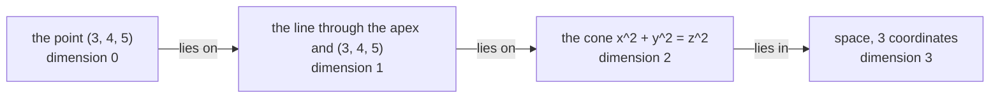

# Dimension and tangent space: how many directions a shape has at a point

[Syllabus](../../../SYLLABUS.md) → [Algebraic geometry](../README.md) → [Affine and Projective Varieties](../README.md#s02) → Dimension and tangent space

---

## General Overview

A torch hangs at the origin and points along the z-axis. The edge of its beam is the cone $`x^2 + y^2 = z^2`$, in metres: the house example of this shelf. A fly walks on that edge and stops at the point (3, 4, 5).

How many independent ways can the fly move and stay on the cone? Two. It can walk along the straight line towards the bulb, or around the beam. It cannot step straight out of the surface. That count, 2, is the cone's **dimension**: the number of independent directions the shape has.

Now put the fly on the bulb itself, the cone's tip, called the **apex**. Straight lines of the cone leave the apex in every direction of a whole circle, up and down. No single flat plane holds them all. The linear directions that fit the cone at the apex fill all of space: 3 of them, one more than the cone's dimension.

This card measures both numbers by exact algebra. The dimension counts independent coordinates, or nested pieces. The directions at a point come from **linearising**: keeping only the first-order part of each equation. They form the **tangent space**.

**The dimension of a variety is the number of its coordinates that move freely, which equals the length of the longest chain of nested pieces inside it; the tangent space at a point is the set of directions where every equation's first-order part is zero, and it has at least that dimension, with more at a point like the cone's apex.**

**What kind of fact this is:** two definitions (dimension and tangent space) and two theorems. The cone's numbers are proved on this card in Why it works. That the two counts of dimension always agree, and that the tangent space is never smaller, are theorems stated with their sources.

### The picture: a chain of nested pieces inside the cone



Each arrow is a strict step to a bigger piece that cannot be split into two smaller ones. The cone holds two such steps, so its dimension is 2. Space holds one more.

---

## The formula

Notation first, in words. The field k is the number system of the coordinates: ℝ, the real numbers, unless a line names another. $`\mathbb{F}_p`$ is the whole numbers modulo a prime p. Three names are new on this card:

- $`\dim V`$, the **dimension** of the variety V.
- $`\mathrm{trdeg}`$, the **transcendence degree**: the largest number of functions on V that obey no polynomial equation together.
- $`T_P V`$, the **tangent space** of V at the point P.

Two names come from sibling cards. $`k[V]`$ is the **coordinate ring**, the polynomial functions on V ([Affine varieties](01-affine-varieties-and-coordinate-rings.md)). $`k(V)`$ is the **function field**, its fractions ([Birational equivalence](06-birational-equivalence-and-function-fields.md)).

A **prime ideal** 𝔭 is an ideal where a product lies in 𝔭 only if one factor does. Each irreducible piece of V (one that is not a union of two smaller varieties) matches one prime of $`k[V]`$, with inclusions reversed ([The Zariski topology](02-zariski-topology-and-irreducibility.md)).

```math
\dim V \;=\; \mathrm{trdeg}_k\, k(V) \;=\; \max\{\, d : \mathfrak{p}_0 \subsetneq \mathfrak{p}_1 \subsetneq \dots \subsetneq \mathfrak{p}_d \text{ primes of } k[V] \,\}
```

**Read it aloud:** the dimension is the number of independent functions on the variety, and also the number of strict steps in the longest chain of prime ideals.

```math
T_P V = \{\, v \in k^n : J(P)\, v = 0 \,\}, \qquad \dim T_P V = n - \mathrm{rank}\, J(P) \;\ge\; \dim V
```

**Read it aloud:** the tangent space at P is every direction v that the Jacobian matrix sends to zero; its size is the number of coordinates minus the matrix's rank, and it is never smaller than the dimension.

The **Jacobian matrix** $`J(P)`$ has one row per equation: that equation's partial derivatives at P. For the cone, with $`f = x^2 + y^2 - z^2`$:

```math
J(x, y, z) = \begin{pmatrix} 2x & 2y & -2z \end{pmatrix}, \qquad J(3, 4, 5) = \begin{pmatrix} 6 & 8 & -10 \end{pmatrix}, \qquad J(0, 0, 0) = \begin{pmatrix} 0 & 0 & 0 \end{pmatrix}
```

At (3, 4, 5) the rank is 1, so the tangent space has 3 − 1 = 2 dimensions. At the apex the rank is 0, so it has 3.

| Symbol | Plain meaning | In our example | Push it up and the answer… |
| --- | --- | --- | --- |
| $`k`$; $`\mathbb{F}_p`$ | the field of the coordinates; whole numbers mod a prime p | ℝ; $`\mathbb{F}_7`$ for counting | — |
| $`n`$; $`\mathbb{A}^n`$, $`k^n`$ | the number of coordinates; affine n-space, all lists of n numbers | 3: x, y, z | one more free direction in space |
| $`f`$; $`f_1, \dots, f_s`$; $`h`$ | the equations, which must generate the vanishing ideal $`I(V)`$; any polynomial multiplier | $`f = x^2 + y^2 - z^2`$; z in $`zf`$ | more independent equations, lower dimension |
| $`V`$ | the variety: points where every equation is zero | the cone | — |
| $`P`$; $`Q`$ | a point of V; a second point of V near it | (3, 4, 5) or the apex (0, 0, 0); Q − P = (−21, 40, 21)/100 | — |
| $`k[V]`$; $`k(V)`$ | functions on V; their fractions | polynomials with $`x^2`$ swapped for $`z^2 - y^2`$ | — |
| $`\mathrm{trdeg}`$; $`t`$ | most functions with no polynomial relation; the unknown in a relation | y and z; $`t^2 - (z^2 - y^2)`$ for x | a larger free set, higher dimension |
| $`\mathfrak{p}_0 \subsetneq \dots \subsetneq \mathfrak{p}_d`$; $`g_1, g_2`$ | a chain of prime ideals; the line's equations | (0), the line's ideal, the point's ideal; $`4x - 3y`$, $`5x - 3z`$ | longer chain, higher dimension |
| $`\dim V`$ | the dimension | 2 | — |
| $`J(P)`$; $`\nabla f`$ | the Jacobian matrix; one row, the gradient of f | (6, 8, −10) at (3, 4, 5) | higher rank, smaller tangent space |
| $`T_P V`$; $`v`$ | the tangent space; one direction in it | the plane $`3x + 4y - 5z = 0`$ | — |
| $`\varepsilon`$ | a formal number with $`\varepsilon^2 = 0`$, for first-order steps | $`f(P + \varepsilon v)`$ | — |

### When it holds

- **The equations must generate the vanishing ideal $`I(V)`$**, every polynomial that is zero on all of V. Write the cone as $`f^2 = 0`$ and the points are the same. But the derivative of $`f^2`$ is $`2f\,\nabla f`$, zero at every point of the cone, so every point gets a tangent space of dimension 3.
- **The variety must be irreducible for one function field.** A union of pieces has no single function field; its dimension is its largest piece's.
- **Over ℝ, the equation must have enough real points.** $`x^2 + y^2 + z^2 = 0`$ has one real point, so the real variety has dimension 0, not 3 − 1 = 2. Over ℂ, the complex numbers, the same equation is a cone of dimension 2.
- **Counting equations gives only a floor.** Over ℂ, each equation lowers the dimension by at most 1; over ℝ it can lower it more, as the bullet above shows. The pair $`f`$ and $`zf`$ still describes the cone, of dimension 2, not 3 − 2 = 1.
- **Point counts over $`\mathbb{F}_p`$ are evidence, not the definition.** The Lang–Weil estimate (Step 3) guarantees about $`p^{\dim V}`$ points when the variety stays irreducible over every finite extension of the field. Otherwise the count need not be close to $`p^{\dim V}`$.

---

## Why it works

### Step 0: dimension is the number of free coordinates

On the cone, choose y and z freely. Then x is fixed up to sign: $`x = \pm\sqrt{z^2 - y^2}`$. Two coordinates move freely and the third follows them. That is what "two-dimensional" means, and the steps below make it exact.

### Step 1: transcendence degree counts the free coordinates

A number is **transcendental** over a field when it satisfies no polynomial equation over it, and **algebraic** when it does ([Minimal polynomials](../../21-Algebraic%20and%20analytic%20number%20theory/05-Fields%20and%20Galois%20Theory/02-minimal-polynomials-and-conjugates.md)). The same words apply to functions on V. Several functions are **algebraically independent** when no nonzero polynomial in them is zero on V.

On the cone, y and z are independent. A polynomial in y and z alone has no $`x^2`$ to swap, so it is its own standard form. The [Affine varieties](01-affine-varieties-and-coordinate-rings.md) card proves a standard form is zero on the cone only if it is the zero polynomial.

The function x is algebraic over y and z. It solves $`t^2 - (z^2 - y^2) = 0`$, with t the unknown. The degree is 2, not 1: x is no fraction g/h of polynomials in y and z. If it were, $`xh - g`$ would be zero on the cone. It has no $`x^2`$, so it is its own standard form, and the same fact forces g = h = 0. The points (3, 4, 5) and (−3, 4, 5) show the two values x takes above one (y, z).

So the largest independent set has two members, and $`\mathrm{trdeg}\, \mathbb{R}(V) = 2`$. All three letters together are not independent: of the 10 monomials of degree at most 2, only 9 are independent on the cone. The tenth is tied by f.

### Step 2: a chain of primes counts nested pieces

Inside the cone sits the straight line through the apex and (3, 4, 5): the points (3t, 4t, 5t). Its equations are $`g_1 = 4x - 3y`$ and $`g_2 = 5x - 3z`$. Inside the line sits the point (3, 4, 5), with equations x − 3, y − 4, z − 5.

Each piece is irreducible, so each ideal is prime. The cone's ideal $`\langle f \rangle`$ is prime because f is not a product of two linear factors: its matrix of second derivatives, diag(2, 2, −2), has rank 3, and a product of two linear factors has rank at most 2. The line's ideal is prime because the line's functions are the polynomials in one letter t, which have no zero divisors (two nonzero elements whose product is zero).

Each step is strict, and one point witnesses it:

1. The line lies on the cone: $`9f = (g_1 - 8x)\,g_1 + (10x - g_2)\,g_2`$, an identity the code expands exactly.
2. The cone is bigger than the line: $`g_1`$ at the cone point (4, 3, 5) is 7, not 0.
3. The line is bigger than the point: x − 3 at the line point (6, 8, 10) is 3, not 0.

In $`k[V]`$ this is a chain (0) ⊊ line ideal ⊊ point ideal, with 2 strict steps. Space adds one more step at the bottom, $`(0) \subsetneq \langle f \rangle`$, so the polynomial ring in 3 letters has a chain of length 3.

<details>
<summary>Why no chain is longer, and why the two counts agree</summary>

Project the cone to the (y, z) plane. Above each (y, z) sit at most two points, since x solves $`t^2 - (z^2 - y^2) = 0`$, a monic equation (top coefficient 1) of degree 2 in t whose coefficients are polynomials in y and z. Such a projection is called **finite**.

Noether normalisation says every irreducible affine variety has a finite projection onto $`\mathbb{A}^d`$, with d the transcendence degree. Chains of primes pass up and down a finite projection without changing length (the going-up and incomparability theorems). In $`\mathbb{A}^d`$ the longest chain has length d, so both definitions give d. Eisenbud's *Commutative Algebra* proves each step.

Krull's principal ideal theorem gives a third way: over ℂ, one equation that is neither 0 nor a constant cuts the dimension of space by exactly one.

$`\displaystyle \dim V(f) = 3 - 1 = 2`$

</details>

### Step 3: count points over a finite field

Over $`\mathbb{F}_p`$ a variety has finitely many points. When it stays irreducible over every finite extension of the field, the count is about $`p^{\dim V}`$: this is the Lang–Weil estimate.

The cone gives exactly $`p^2`$: 9, 25, 49, 121 and 169 points for p = 3, 5, 7, 11 and 13. The circle the plane z = 5 cuts from it gives 8 points over $`\mathbb{F}_7`$, about $`7^1`$. The powers 2 and 1 are the dimensions.

### Step 4: linearise the equation

For a polynomial f and a step v from P, expand $`f(P + v)`$ in powers of v. For the cone the expansion is exact and short:

```math
f(P + v) = f(P) + \nabla f(P) \cdot v + f(v)
```

**Read it aloud:** the value after the step is the value at P, plus the gradient dotted with the step, plus a part that is quadratic in the step.

P is on the cone, so $`f(P) = 0`$. For a small step, the quadratic part $`f(v)`$ is tiny beside the linear part. Keep only the linear part and set it to zero: $`\nabla f(P) \cdot v = 0`$. The gradient stands at right angles to the level surface ([Gradient](../../06-Calculus%20and%20analysis/07-Several%20Variables/03-gradient-and-directional-derivatives.md)), so these are the directions along it.

With several equations, stack their gradients as rows of $`J(P)`$. The tangent space is the matrix's kernel: the directions it sends to zero. By [Rank and nullity](../../03-Algebra/05-Solving%20Systems/05-rank-nullity.md), the kernel has $`n - \mathrm{rank}\, J(P)`$ dimensions.

At (3, 4, 5): $`J = (6, 8, -10)`$, rank 1, so the tangent space has 2 dimensions. It is the plane $`6x + 8y - 10z = 0`$, or $`3x + 4y - 5z = 0`$. That plane passes through the apex and contains the whole line through (3, 4, 5): the cone touches it along that line.

### Step 5: the same rule still works where the gradient is zero

At the apex the gradient is (0, 0, 0). The calculus picture breaks: every direction has zero dot product with the zero vector, and no plane is singled out. The algebra does not break. The kernel of the zero matrix is all of $`k^3`$, so the tangent space has dimension 3.

A second definition gives the same answer without derivatives. Use a formal number ε with $`\varepsilon^2 = 0`$. A direction v is tangent at P when $`f(P + \varepsilon v) = 0`$: the step satisfies the equation to first order. At the apex $`f(\varepsilon v) = \varepsilon^2 f(v) = 0`$ for every v. So every direction is tangent.

Over $`\mathbb{F}_7`$ this is a finite count: 49 = $`7^2`$ of the 343 directions pass at (3, 4, 5), and all 343 = $`7^3`$ at the apex.

### Step 6: why generators of I(V) give the right answer

The tangent space should use every polynomial that vanishes on V. Generators are enough. If f vanishes on V and h is any polynomial, the product rule at a point P of V gives:

```math
\nabla(hf)(P) = h(P)\,\nabla f(P) + f(P)\,\nabla h(P) = h(P)\,\nabla f(P)
```

So a multiple of f adds no new condition. This is why $`f`$ and $`zf`$ together give rank 1, not 2. It is also why $`f^2`$ fails: $`f^2`$ does not generate $`I(V)`$, and its gradient is zero on the whole cone.

### Step 7: secants close in on the tangent plane

Take points Q on the cone closer and closer to P = (3, 4, 5). Since f(Q) = 0 and f(P) = 0, Step 4 gives the exact identity $`\nabla f(P) \cdot (Q - P) = -f(Q - P)`$. The code checks it at 336 points.

The right side is quadratic in the step, so its ratio to the step's length shrinks to zero. For three points at distances 0.498197, 0.049072 and 0.004900 m from P, the ratio is 0.321158, 0.032605 and 0.003265: ten times smaller at each step. The direction from P to Q swings into the tangent plane.

At the apex the secants are the cone's own lines. The lines through (3, 4, 5), (4, 3, 5) and (−3, 4, 5) have determinant −30, not 0, so they point in three independent directions. No plane holds them. The set of limiting directions, the cone itself, is the **tangent cone**; [Smooth and singular points](08-smooth-and-singular-points.md) takes it further.

<details>
<summary>Why the tangent space is never smaller than the dimension</summary>

On an irreducible variety, $`\dim T_P V \ge \dim V`$ at every point, with equality outside a smaller closed set where the rank of $`J(P)`$ drops. Shafarevich's *Basic Algebraic Geometry 1*, Chapter II, proves it. For the cone the rank drops only at the apex:

$`\displaystyle \dim T_P V = 3 - 1 = 2 \text{ for } P \ne 0, \qquad \dim T_0 V = 3 - 0 = 3`$

</details>

---

## Worked numbers, by hand

| Step | Arithmetic | Value |
| --- | --- | --- |
| y and z independent | 15 monomials in y, z of degree ≤ 4; rank of their values on the cone | 15: no relation |
| x tied to y and z | $`t^2 - (z^2 - y^2)`$; at (y, z) = (4, 5), x = 3 or −3 | algebraic, degree 2 |
| transcendence degree | 2 free, 1 tied | **2** |
| chain of primes | point ⊊ line ⊊ cone; witnesses 7 and 3 | length **2** |
| points over $`\mathbb{F}_7`$ | count all 343 triples | 49 = $`7^2`$ |
| Jacobian matrix at (3, 4, 5) | (2 × 3, 2 × 4, −2 × 5) | (6, 8, −10), rank 1 |
| tangent space at (3, 4, 5) | 3 − 1 | **2**: the plane $`3x + 4y - 5z = 0`$ |
| circle z = 5 at (3, 4, 5) | rows (6, 8, −10) and (0, 0, 1), rank 2 | tangent dimension 1 |
| first-order directions over $`\mathbb{F}_7`$ | count v with $`f(P + \varepsilon v) = 0`$ | 49 at (3, 4, 5), 343 at the apex |
| Jacobian matrix at the apex | (2 × 0, 2 × 0, −2 × 0) | (0, 0, 0), rank 0 |
| tangent space at the apex | 3 − 0 | **3**: all of space |

The cone is two-dimensional everywhere, and its tangent space matches that everywhere except the apex, where it is three-dimensional. For the fly on the beam's edge: away from the bulb it has 2 independent directions, the tangent plane. At the bulb the first-order test allows all 3, because the cone's own lines leave it in directions that no single plane holds (determinant −30).

```
tangent dimension at each point (# = 1)
cone at (3, 4, 5)      ##   2
cone at (5, 12, 13)    ##   2
cone at the apex       ###  3
circle at (3, 4, 5)    #    1
```

### What breaks if you drop a piece

| Mistake | Comes out at | What went wrong |
| --- | --- | --- |
| Use $`f^2`$ as the equation | tangent dimension 3 at (3, 4, 5) | $`f^2`$ does not generate $`I(V)`$; its gradient is 0 on the cone |
| Count all three coordinates as free | transcendence degree 3; but 10 monomials of degree ≤ 2 have rank 9 | f ties x to y and z |
| Subtract equations: $`f`$ and $`zf`$ give 3 − 2 | 1; true dimension 2, Jacobian rank 1, 49 points over $`\mathbb{F}_7`$ | $`zf`$ adds no new condition |
| Read $`x^2 + y^2 + z^2 = 0`$ over ℝ as a surface | 3 − 1 = 2; 1 real point, dimension 0 | over ℝ an equation can have almost no points |

The code prints all four.

---

## Code, from first principles, and it actually runs

Nothing is imported. Polynomials are tables of exponents and whole-number coefficients, so every result is exact. Ranks of large tables of values are taken modulo the prime 1,000,003; a full rank there is a full rank over the fractions too. The script reaches the dimension by three independent roads and the tangent space by three more:

1. **Dimension by free coordinates:** rank the values of monomials in y and z at 336 integer points of the cone, built from Pythagorean triples.
2. **Dimension by a chain of primes:** expand the identity that puts the line inside the cone, and print a witness point for each strict step.
3. **Dimension by counting:** count the cone's points over $`\mathbb{F}_p`$ for five primes.
4. **Tangent space by the Jacobian matrix:** differentiate each equation exactly and take the rank.
5. **Tangent space by dual numbers:** count every direction v over $`\mathbb{F}_7`$ with $`f(P + \varepsilon v) = 0`$, multiplying with $`\varepsilon^2 = 0`$. This road never takes a derivative.
6. **Secants:** check $`\nabla f(P) \cdot (Q - P) = -f(Q - P)`$ at every test point.

Roads 4 and 5 must agree as $`7^{3 - \mathrm{rank}}`$ at every point tried.

### Python

```python
# Dimension and tangent space -- the check behind the card.  Nothing is imported.
# The variety is the cone x^2 + y^2 = z^2 over the reals; F_p only where named.
# A polynomial is a dict {(i, j, k): coeff} for x^i y^j z^k, whole numbers.
# Dimension, three roads: independent coordinates (transcendence degree), a
# chain of prime ideals with exact witnesses, and point counts over F_p.
# Tangent space, three roads: Jacobian rank, dual numbers counted over F_p,
# and the exact secant identity of a quadratic.
P = 1000003                                     # a prime, for ranks of value tables

def add(a, b, s=1):
    out = dict(a)
    for m, c in b.items():
        out[m] = out.get(m, 0) + s * c
    return {m: c for m, c in out.items() if c}

def mul(a, b):
    out = {}
    for (i, j, k), c in a.items():
        for (u, v, w), d in b.items():
            out = add(out, {(i + u, j + v, k + w): c * d})
    return out

def ev(g, pt, mod=0):
    s = sum(c * pt[0] ** i * pt[1] ** j * pt[2] ** k for (i, j, k), c in g.items())
    return s % mod if mod else s

def grad(g, pt):                                # the Jacobian row of g at pt
    row = []
    for v in range(3):
        d = {}
        for m, c in g.items():
            if m[v]:
                e = list(m)
                e[v] -= 1
                d = add(d, {tuple(e): c * m[v]})
        row.append(ev(d, pt))
    return row

def rank_mod(rows):                             # Gaussian elimination mod P
    rows, r = [[v % P for v in row] for row in rows], 0
    for col in range(len(rows[0])):
        piv = next((i for i in range(r, len(rows)) if rows[i][col]), None)
        if piv is None:
            continue
        rows[r], rows[piv] = rows[piv], rows[r]
        inv = pow(rows[r][col], P - 2, P)
        rows[r] = [v * inv % P for v in rows[r]]
        for i in range(len(rows)):
            if i != r and rows[i][col]:
                c = rows[i][col]
                rows[i] = [(v - c * w) % P for v, w in zip(rows[i], rows[r])]
        r += 1
    return r

def dual_ev(g, pt, v, p):                       # g(pt + eps v) with eps^2 = 0, mod p
    a, b = 0, 0
    for m, c in g.items():
        ta, tb = c % p, 0
        for q, d, e in zip(pt, v, m):
            for _ in range(e):
                ta, tb = ta * q % p, (ta * d + tb * q) % p
        a, b = (a + ta) % p, (b + tb) % p
    return a, b

def tangent_count(gens, pt, p):                 # directions v in F_p^3 that keep every g zero
    box = [(i, j, k) for i in range(p) for j in range(p) for k in range(p)]
    return sum(1 for v in box if all(dual_ev(g, pt, v, p) == (0, 0) for g in gens))

x, y, z, one = {(1, 0, 0): 1}, {(0, 1, 0): 1}, {(0, 0, 1): 1}, {(0, 0, 0): 1}
F = {(2, 0, 0): 1, (0, 2, 0): 1, (0, 0, 2): -1}
pts = sorted({(sx * t * a, sy * t * b, sz * t * (m * m + n * n))
              for m in range(1, 6) for n in range(m) for a, b in [(m * m - n * n, 2 * m * n), (2 * m * n, m * m - n * n)]
              for t in (1, 2) for sx in (1, -1) for sy in (1, -1) for sz in (1, -1)})
assert all(ev(F, q) == 0 for q in pts)
print("field: the real numbers; F_p only where named.  cone f = x^2 + y^2 - z^2")
print(f"integer test points on the cone: {len(pts)}")
print("-- dimension, road 1: independent coordinates --")
yz = [(0, a, b) for a in range(5) for b in range(5 - a)]
r_yz = rank_mod([[ev({m: 1}, q, P) for m in yz] for q in pts])
print(f"monomials in y, z of degree <= 4: {len(yz)}; rank of their values on the cone: {r_yz}")
xyz = [(i, j, k) for i in range(3) for j in range(3) for k in range(3) if i + j + k <= 2]
r_xyz = rank_mod([[ev({m: 1}, q, P) for m in xyz] for q in pts])
print(f"monomials in x, y, z of degree <= 2: {len(xyz)}; rank: {r_xyz}, so one relation: f")
print(f"x over k(y, z): t^2 - (z^2 - y^2) = 0; (3, 4, 5) and (-3, 4, 5) share y, z: degree 2")
assert r_yz == len(yz) == 15 and r_xyz == len(xyz) - 1 == 9 and ev(F, (-3, 4, 5)) == 0
print("transcendence degree 2")
print("-- dimension, road 2: a chain of prime ideals --")
g1, g2 = add(mul({(0, 0, 0): 4}, x), mul({(0, 0, 0): 3}, y), -1), add(mul({(0, 0, 0): 5}, x), mul({(0, 0, 0): 3}, z), -1)
lhs = add(mul(add(g1, mul({(0, 0, 0): 8}, x), -1), g1), mul(add(mul({(0, 0, 0): 10}, x), g2, -1), g2))
print(f"9f = (g1 - 8x) g1 + (10x - g2) g2 with g1 = 4x - 3y, g2 = 5x - 3z: {'yes' if lhs == mul({(0, 0, 0): 9}, F) else 'no'}")
print(f"g1 at the cone point (4, 3, 5): {ev(g1, (4, 3, 5))}, not 0, so the line ideal is bigger than <f>")
X3, H = add(x, {(0, 0, 0): 3}, -1), [grad(F, e) for e in ((1, 0, 0), (0, 1, 0), (0, 0, 1))]   # H: f's second derivatives
print(f"x - 3 at the line point (6, 8, 10): {ev(X3, (6, 8, 10))}, not 0, so the point ideal is bigger again")
print(f"quadratic form of f: second-derivative matrix {H}, rank {rank_mod(H)}: no linear factors, <f> prime")
assert lhs == mul({(0, 0, 0): 9}, F) and ev(g1, (4, 3, 5)) == 7 and ev(X3, (6, 8, 10)) != 0 and rank_mod(H) == 3
assert ev(g1, (6, 8, 10)) == ev(g2, (6, 8, 10)) == 0
print("chain in k[V]: (0) < line ideal < point ideal, length 2; in k[x, y, z]: length 3")
print("-- dimension, road 3: points over F_p --")
for p in (3, 5, 7, 11, 13):
    n = sum(1 for a in range(p) for b in range(p) for c in range(p) if ev(F, (a, b, c), p) == 0)
    print(f"cone over F_{p}: {n} points = {p}^2")
    assert n == p * p
circ = sum(1 for a in range(7) for b in range(7) if (a * a + b * b - 25) % 7 == 0)
print(f"circle x^2 + y^2 = 25 at z = 5, over F_7: {circ} points = 7 + 1")
assert circ == 8
print("-- tangent spaces: Jacobian rank against dual numbers over F_7 --")
Z5, ZY = add(z, {(0, 0, 0): 5}, -1), add(z, y, -1)
cases = [("cone at (3, 4, 5)", [F], (3, 4, 5)), ("cone at the apex", [F], (0, 0, 0)),
         ("circle z = 5 at (3, 4, 5)", [F, Z5], (3, 4, 5)), ("mistake <f^2> at (3, 4, 5)", [mul(F, F)], (3, 4, 5)),
         ("count <f, z f>: 3 - 2 = 1? at (3, 4, 5)", [F, mul(z, F)], (3, 4, 5)), ("try <f, z - y> at (0, 3, 3)", [F, ZY], (0, 3, 3)),
         ("try cone at (5, 12, 13)", [F], (5, 12, 13))]
for name, gens, pt in cases:
    J = [grad(g, pt) for g in gens]
    r, cnt = rank_mod(J), tangent_count(gens, pt, 7)
    print(f"{name}: J = {J}, rank {r}, tangent dim {3 - r}; F_7 count {cnt} = 7^{3 - r}")
    assert cnt == 7 ** (3 - r) and all(ev(g, pt) == 0 for g in gens)
print(f"try F_11: apex {tangent_count([F], (0, 0, 0), 11)}, (3, 4, 5) {tangent_count([F], (3, 4, 5), 11)}")
print("-- secants: grad f(P).(Q - P) = -f(Q - P) for every cone point Q --")
G = grad(F, (3, 4, 5))
assert all(sum(a * (b - c) for a, b, c in zip(G, q, (3, 4, 5))) == -ev(F, [b - c for b, c in zip(q, (3, 4, 5))]) for q in pts)
print(f"holds at all {len(pts)} test points; tangent plane 6x + 8y - 10z = 0, or 3x + 4y - 5z = 0")
for N in (10, 100, 1000):
    w = (-2 * N - 1, 4 * N, 2 * N + 1)          # N^2 (Q - P), Q from m = 2N, n = N + 1
    gap, dist = ev(F, w) / N ** 4, sum(c * c for c in w) ** 0.5 / N ** 2
    assert ev(F, (3 * N * N - 2 * N - 1, 4 * N * N + 4 * N, 5 * N * N + 2 * N + 1)) == 0 and sum(a * b for a, b in zip(G, w)) * N * N == -ev(F, w)
    print(f"N = {N}: Q - P = ({w[0]}, {w[1]}, {w[2]})/{N * N}; linear part {-gap:.6f}, distance {dist:.6f}, ratio {gap / dist:.6f}")
det = 3 * (3 * 5 - 5 * 4) - 4 * (4 * 5 - 5 * (-3)) + 5 * (4 * 4 - 3 * (-3))
print(f"apex: rulings through (3, 4, 5), (4, 3, 5), (-3, 4, 5); determinant {det}, so they span all 3 directions")
assert det == -30 and rank_mod([[3, 4, 5], [4, 3, 5], [-3, 4, 5]]) == 3
box = [(a, b, c) for a in range(-5, 6) for b in range(-5, 6) for c in range(-5, 6) if a * a + b * b + c * c == 0]
print(f"mistake x^2 + y^2 + z^2 = 0 over the reals: {len(box)} point in the box, dimension 0, not 3 - 1 = 2")
assert len(box) == 1
print("ALL CHECKS PASS")
```

**Ran 2026-11-17 on macOS, Python 3.14.10, standard library only. All checks passed. Output, pasted from the run:**

```
field: the real numbers; F_p only where named.  cone f = x^2 + y^2 - z^2
integer test points on the cone: 336
-- dimension, road 1: independent coordinates --
monomials in y, z of degree <= 4: 15; rank of their values on the cone: 15
monomials in x, y, z of degree <= 2: 10; rank: 9, so one relation: f
x over k(y, z): t^2 - (z^2 - y^2) = 0; (3, 4, 5) and (-3, 4, 5) share y, z: degree 2
transcendence degree 2
-- dimension, road 2: a chain of prime ideals --
9f = (g1 - 8x) g1 + (10x - g2) g2 with g1 = 4x - 3y, g2 = 5x - 3z: yes
g1 at the cone point (4, 3, 5): 7, not 0, so the line ideal is bigger than <f>
x - 3 at the line point (6, 8, 10): 3, not 0, so the point ideal is bigger again
quadratic form of f: second-derivative matrix [[2, 0, 0], [0, 2, 0], [0, 0, -2]], rank 3: no linear factors, <f> prime
chain in k[V]: (0) < line ideal < point ideal, length 2; in k[x, y, z]: length 3
-- dimension, road 3: points over F_p --
cone over F_3: 9 points = 3^2
cone over F_5: 25 points = 5^2
cone over F_7: 49 points = 7^2
cone over F_11: 121 points = 11^2
cone over F_13: 169 points = 13^2
circle x^2 + y^2 = 25 at z = 5, over F_7: 8 points = 7 + 1
-- tangent spaces: Jacobian rank against dual numbers over F_7 --
cone at (3, 4, 5): J = [[6, 8, -10]], rank 1, tangent dim 2; F_7 count 49 = 7^2
cone at the apex: J = [[0, 0, 0]], rank 0, tangent dim 3; F_7 count 343 = 7^3
circle z = 5 at (3, 4, 5): J = [[6, 8, -10], [0, 0, 1]], rank 2, tangent dim 1; F_7 count 7 = 7^1
mistake <f^2> at (3, 4, 5): J = [[0, 0, 0]], rank 0, tangent dim 3; F_7 count 343 = 7^3
count <f, z f>: 3 - 2 = 1? at (3, 4, 5): J = [[6, 8, -10], [30, 40, -50]], rank 1, tangent dim 2; F_7 count 49 = 7^2
try <f, z - y> at (0, 3, 3): J = [[0, 6, -6], [0, -1, 1]], rank 1, tangent dim 2; F_7 count 49 = 7^2
try cone at (5, 12, 13): J = [[10, 24, -26]], rank 1, tangent dim 2; F_7 count 49 = 7^2
try F_11: apex 1331, (3, 4, 5) 121
-- secants: grad f(P).(Q - P) = -f(Q - P) for every cone point Q --
holds at all 336 test points; tangent plane 6x + 8y - 10z = 0, or 3x + 4y - 5z = 0
N = 10: Q - P = (-21, 40, 21)/100; linear part -0.160000, distance 0.498197, ratio 0.321158
N = 100: Q - P = (-201, 400, 201)/10000; linear part -0.001600, distance 0.049072, ratio 0.032605
N = 1000: Q - P = (-2001, 4000, 2001)/1000000; linear part -0.000016, distance 0.004900, ratio 0.003265
apex: rulings through (3, 4, 5), (4, 3, 5), (-3, 4, 5); determinant -30, so they span all 3 directions
mistake x^2 + y^2 + z^2 = 0 over the reals: 1 point in the box, dimension 0, not 3 - 1 = 2
ALL CHECKS PASS
```

### Rust

```rust
// Dimension and tangent space -- the same check as the Python, in Rust, no crates.
// The variety is the cone x^2 + y^2 = z^2 over the reals; F_p only where named.
// A polynomial maps (i, j, k) to the whole-number coefficient of x^i y^j z^k.
// Dimension: independent coordinates, a chain of primes, points over F_p.
// Tangent space: Jacobian rank, dual numbers over F_p, the secant identity.
use std::collections::{BTreeMap, BTreeSet};
type Poly = BTreeMap<(u32, u32, u32), i64>;
type Pt = (i64, i64, i64);
const P: i64 = 1000003; // a prime, for ranks of value tables

fn poly(terms: &[((u32, u32, u32), i64)]) -> Poly { add(&Poly::new(), &terms.iter().cloned().collect(), 1) }

fn add(a: &Poly, b: &Poly, s: i64) -> Poly {
    let mut out = a.clone();
    for (&m, &c) in b { *out.entry(m).or_insert(0) += s * c }
    out.retain(|_, c| *c != 0);
    out
}

fn mul(a: &Poly, b: &Poly) -> Poly {
    let mut out = Poly::new();
    for (&(i, j, k), &c) in a { for (&(u, v, w), &d) in b { out = add(&out, &poly(&[((i + u, j + v, k + w), c * d)]), 1) } }
    out
}

fn ev(g: &Poly, p: Pt, m: i64) -> i64 { // m = 0: exact
    let mut s = 0;
    for (&(i, j, k), &c) in g { s += c * p.0.pow(i) * p.1.pow(j) * p.2.pow(k) }
    if m > 0 { s.rem_euclid(m) } else { s }
}

fn grad(g: &Poly, p: Pt) -> Vec<i64> { // the Jacobian row of g at p
    (0..3).map(|v| {
        let mut d = Poly::new();
        for (&m, &c) in g {
            let e = [m.0, m.1, m.2];
            if e[v] > 0 {
                let mut f = e;
                f[v] -= 1;
                *d.entry((f[0], f[1], f[2])).or_insert(0) += c * e[v] as i64;
            }
        }
        ev(&d, p, 0)
    }).collect()
}

fn rank_mod(rows: &[Vec<i64>]) -> usize { // Gaussian elimination mod P
    let mut rows: Vec<Vec<i64>> = rows.iter().map(|r| r.iter().map(|v| v.rem_euclid(P)).collect()).collect();
    let mut r = 0;
    for col in 0..rows[0].len() {
        let piv = match (r..rows.len()).find(|&i| rows[i][col] != 0) { Some(p) => p, None => continue };
        rows.swap(r, piv);
        let (mut inv, mut b, mut e) = (1i64, rows[r][col], P - 2);
        while e > 0 { if e & 1 == 1 { inv = inv * b % P } b = b * b % P; e >>= 1 }
        rows[r] = rows[r].iter().map(|v| v * inv % P).collect();
        let pivot = rows[r].clone();
        for i in 0..rows.len() {
            if i != r && rows[i][col] != 0 {
                let c = rows[i][col];
                rows[i] = rows[i].iter().zip(&pivot).map(|(v, w)| (v - c * w).rem_euclid(P)).collect();
            }
        }
        r += 1;
    }
    r
}

fn dual_ev(g: &Poly, pt: Pt, v: Pt, p: i64) -> (i64, i64) { // g(pt + eps v), eps^2 = 0, mod p
    let (mut a, mut b) = (0, 0);
    for (&(i, j, k), &c) in g {
        let (mut ta, mut tb) = (c.rem_euclid(p), 0);
        for (q, d, e) in [(pt.0, v.0, i), (pt.1, v.1, j), (pt.2, v.2, k)] {
            for _ in 0..e { let na = ta * q.rem_euclid(p) % p; tb = (ta * d + tb * q).rem_euclid(p); ta = na; }
        }
        (a, b) = ((a + ta) % p, (b + tb) % p);
    }
    (a, b)
}

fn tangent_count(gens: &[Poly], pt: Pt, p: i64) -> usize {
    (0..p * p * p).filter(|t| gens.iter().all(|g| dual_ev(g, pt, (t / (p * p), t / p % p, t % p), p) == (0, 0))).count()
}

fn vals(ms: &[(u32, u32, u32)], pts: &[Pt]) -> Vec<Vec<i64>> {
    pts.iter().map(|&q| ms.iter().map(|&m| ev(&poly(&[(m, 1)]), q, P)).collect()).collect()
}

fn main() {
    let (x, y, z) = (poly(&[((1, 0, 0), 1)]), poly(&[((0, 1, 0), 1)]), poly(&[((0, 0, 1), 1)]));
    let c = |n: i64| poly(&[((0, 0, 0), n)]);
    let f = poly(&[((2, 0, 0), 1), ((0, 2, 0), 1), ((0, 0, 2), -1)]);
    let mut set = BTreeSet::new();
    for m in 1..6i64 { for n in 0..m {
        for (a, b) in [(m * m - n * n, 2 * m * n), (2 * m * n, m * m - n * n)] {
            for t in [1, 2] { for sx in [1, -1] { for sy in [1, -1] { for sz in [1, -1] {
                set.insert((sx * t * a, sy * t * b, sz * t * (m * m + n * n)));
            } } } }
        }
    } }
    let pts: Vec<Pt> = set.into_iter().collect();
    assert!(pts.iter().all(|&q| ev(&f, q, 0) == 0));
    println!("field: the real numbers; F_p only where named.  cone f = x^2 + y^2 - z^2");
    println!("integer test points on the cone: {}", pts.len());
    println!("-- dimension, road 1: independent coordinates --");
    let yz: Vec<_> = (0..5u32).flat_map(|a| (0..5 - a).map(move |b| (0, a, b))).collect();
    let r_yz = rank_mod(&vals(&yz, &pts));
    println!("monomials in y, z of degree <= 4: {}; rank of their values on the cone: {}", yz.len(), r_yz);
    let mut xyz = vec![];
    for i in 0..3u32 { for j in 0..3u32 { for k in 0..3u32 { if i + j + k <= 2 { xyz.push((i, j, k)) } } } }
    let r_xyz = rank_mod(&vals(&xyz, &pts));
    println!("monomials in x, y, z of degree <= 2: {}; rank: {}, so one relation: f", xyz.len(), r_xyz);
    println!("x over k(y, z): t^2 - (z^2 - y^2) = 0; (3, 4, 5) and (-3, 4, 5) share y, z: degree 2");
    assert!(r_yz == yz.len() && r_yz == 15 && r_xyz == xyz.len() - 1 && r_xyz == 9 && ev(&f, (-3, 4, 5), 0) == 0);
    println!("transcendence degree 2");
    println!("-- dimension, road 2: a chain of prime ideals --");
    let (g1, g2) = (add(&mul(&c(4), &x), &mul(&c(3), &y), -1), add(&mul(&c(5), &x), &mul(&c(3), &z), -1));
    let lhs = add(&mul(&add(&g1, &mul(&c(8), &x), -1), &g1), &mul(&add(&mul(&c(10), &x), &g2, -1), &g2), 1);
    let ok = lhs == mul(&c(9), &f);
    println!("9f = (g1 - 8x) g1 + (10x - g2) g2 with g1 = 4x - 3y, g2 = 5x - 3z: {}", if ok { "yes" } else { "no" });
    println!("g1 at the cone point (4, 3, 5): {}, not 0, so the line ideal is bigger than <f>", ev(&g1, (4, 3, 5), 0));
    let (w3, h): (i64, Vec<Vec<i64>>) = (ev(&add(&x, &c(3), -1), (6, 8, 10), 0), [(1, 0, 0), (0, 1, 0), (0, 0, 1)].iter().map(|&e| grad(&f, e)).collect());
    println!("x - 3 at the line point (6, 8, 10): {}, not 0, so the point ideal is bigger again", w3);
    println!("quadratic form of f: second-derivative matrix {:?}, rank {}: no linear factors, <f> prime", h, rank_mod(&h));
    assert!(ok && ev(&g1, (4, 3, 5), 0) == 7 && w3 != 0 && rank_mod(&h) == 3 && ev(&g1, (6, 8, 10), 0) == 0 && ev(&g2, (6, 8, 10), 0) == 0);
    println!("chain in k[V]: (0) < line ideal < point ideal, length 2; in k[x, y, z]: length 3");
    println!("-- dimension, road 3: points over F_p --");
    for p in [3i64, 5, 7, 11, 13] {
        let n = (0..p * p * p).filter(|&t| ev(&f, (t / (p * p), t / p % p, t % p), p) == 0).count() as i64;
        println!("cone over F_{}: {} points = {}^2", p, n, p);
        assert!(n == p * p);
    }
    let circ = (0..49i64).filter(|t| ((t / 7) * (t / 7) + (t % 7) * (t % 7) - 25).rem_euclid(7) == 0).count();
    println!("circle x^2 + y^2 = 25 at z = 5, over F_7: {} points = 7 + 1", circ);
    assert!(circ == 8);
    println!("-- tangent spaces: Jacobian rank against dual numbers over F_7 --");
    let (z5, zy) = (add(&z, &c(5), -1), add(&z, &y, -1));
    let cases: Vec<(&str, Vec<Poly>, Pt)> = vec![
        ("cone at (3, 4, 5)", vec![f.clone()], (3, 4, 5)), ("cone at the apex", vec![f.clone()], (0, 0, 0)),
        ("circle z = 5 at (3, 4, 5)", vec![f.clone(), z5], (3, 4, 5)), ("mistake <f^2> at (3, 4, 5)", vec![mul(&f, &f)], (3, 4, 5)),
        ("count <f, z f>: 3 - 2 = 1? at (3, 4, 5)", vec![f.clone(), mul(&z, &f)], (3, 4, 5)),
        ("try <f, z - y> at (0, 3, 3)", vec![f.clone(), zy], (0, 3, 3)), ("try cone at (5, 12, 13)", vec![f.clone()], (5, 12, 13))];
    for (name, gens, pt) in &cases {
        let j: Vec<Vec<i64>> = gens.iter().map(|g| grad(g, *pt)).collect();
        let (r, cnt) = (rank_mod(&j), tangent_count(gens, *pt, 7));
        let js: Vec<String> = j.iter().map(|row| format!("[{}, {}, {}]", row[0], row[1], row[2])).collect();
        println!("{}: J = [{}], rank {}, tangent dim {}; F_7 count {} = 7^{}", name, js.join(", "), r, 3 - r, cnt, 3 - r);
        assert!(cnt == 7usize.pow(3 - r as u32) && gens.iter().all(|g| ev(g, *pt, 0) == 0));
    }
    println!("try F_11: apex {}, (3, 4, 5) {}", tangent_count(&[f.clone()], (0, 0, 0), 11), tangent_count(&[f.clone()], (3, 4, 5), 11));
    println!("-- secants: grad f(P).(Q - P) = -f(Q - P) for every cone point Q --");
    let g = grad(&f, (3, 4, 5));
    assert!(pts.iter().map(|&q| (q.0 - 3, q.1 - 4, q.2 - 5)).all(|w| g[0] * w.0 + g[1] * w.1 + g[2] * w.2 == -ev(&f, w, 0)));
    println!("holds at all {} test points; tangent plane 6x + 8y - 10z = 0, or 3x + 4y - 5z = 0", pts.len());
    for n in [10i64, 100, 1000] {
        let w = (-2 * n - 1, 4 * n, 2 * n + 1); // N^2 (Q - P), Q from m = 2N, n = N + 1
        let gap = ev(&f, w, 0) as f64 / (n.pow(4)) as f64;
        let dist = ((w.0 * w.0 + w.1 * w.1 + w.2 * w.2) as f64).sqrt() / (n * n) as f64;
        assert!(ev(&f, (3 * n * n - 2 * n - 1, 4 * n * n + 4 * n, 5 * n * n + 2 * n + 1), 0) == 0 && (g[0] * w.0 + g[1] * w.1 + g[2] * w.2) * n * n == -ev(&f, w, 0));
        println!("N = {}: Q - P = ({}, {}, {})/{}; linear part {:.6}, distance {:.6}, ratio {:.6}",
                 n, w.0, w.1, w.2, n * n, -gap, dist, gap / dist);
    }
    let det = 3 * (3 * 5 - 5 * 4) - 4 * (4 * 5 - 5 * (-3)) + 5 * (4 * 4 - 3 * (-3));
    println!("apex: rulings through (3, 4, 5), (4, 3, 5), (-3, 4, 5); determinant {}, so they span all 3 directions", det);
    assert!(det == -30 && rank_mod(&[vec![3, 4, 5], vec![4, 3, 5], vec![-3, 4, 5]]) == 3);
    let boxn = (0..1331i64).map(|t| (t / 121 - 5, t / 11 % 11 - 5, t % 11 - 5)).filter(|w| w.0 * w.0 + w.1 * w.1 + w.2 * w.2 == 0).count();
    println!("mistake x^2 + y^2 + z^2 = 0 over the reals: {} point in the box, dimension 0, not 3 - 1 = 2", boxn);
    assert!(boxn == 1);
    println!("ALL CHECKS PASS");
}
```

**Ran 2026-11-17 on macOS, rustc 1.98.1, no crates. All checks passed. Output, pasted from the run:**

```
field: the real numbers; F_p only where named.  cone f = x^2 + y^2 - z^2
integer test points on the cone: 336
-- dimension, road 1: independent coordinates --
monomials in y, z of degree <= 4: 15; rank of their values on the cone: 15
monomials in x, y, z of degree <= 2: 10; rank: 9, so one relation: f
x over k(y, z): t^2 - (z^2 - y^2) = 0; (3, 4, 5) and (-3, 4, 5) share y, z: degree 2
transcendence degree 2
-- dimension, road 2: a chain of prime ideals --
9f = (g1 - 8x) g1 + (10x - g2) g2 with g1 = 4x - 3y, g2 = 5x - 3z: yes
g1 at the cone point (4, 3, 5): 7, not 0, so the line ideal is bigger than <f>
x - 3 at the line point (6, 8, 10): 3, not 0, so the point ideal is bigger again
quadratic form of f: second-derivative matrix [[2, 0, 0], [0, 2, 0], [0, 0, -2]], rank 3: no linear factors, <f> prime
chain in k[V]: (0) < line ideal < point ideal, length 2; in k[x, y, z]: length 3
-- dimension, road 3: points over F_p --
cone over F_3: 9 points = 3^2
cone over F_5: 25 points = 5^2
cone over F_7: 49 points = 7^2
cone over F_11: 121 points = 11^2
cone over F_13: 169 points = 13^2
circle x^2 + y^2 = 25 at z = 5, over F_7: 8 points = 7 + 1
-- tangent spaces: Jacobian rank against dual numbers over F_7 --
cone at (3, 4, 5): J = [[6, 8, -10]], rank 1, tangent dim 2; F_7 count 49 = 7^2
cone at the apex: J = [[0, 0, 0]], rank 0, tangent dim 3; F_7 count 343 = 7^3
circle z = 5 at (3, 4, 5): J = [[6, 8, -10], [0, 0, 1]], rank 2, tangent dim 1; F_7 count 7 = 7^1
mistake <f^2> at (3, 4, 5): J = [[0, 0, 0]], rank 0, tangent dim 3; F_7 count 343 = 7^3
count <f, z f>: 3 - 2 = 1? at (3, 4, 5): J = [[6, 8, -10], [30, 40, -50]], rank 1, tangent dim 2; F_7 count 49 = 7^2
try <f, z - y> at (0, 3, 3): J = [[0, 6, -6], [0, -1, 1]], rank 1, tangent dim 2; F_7 count 49 = 7^2
try cone at (5, 12, 13): J = [[10, 24, -26]], rank 1, tangent dim 2; F_7 count 49 = 7^2
try F_11: apex 1331, (3, 4, 5) 121
-- secants: grad f(P).(Q - P) = -f(Q - P) for every cone point Q --
holds at all 336 test points; tangent plane 6x + 8y - 10z = 0, or 3x + 4y - 5z = 0
N = 10: Q - P = (-21, 40, 21)/100; linear part -0.160000, distance 0.498197, ratio 0.321158
N = 100: Q - P = (-201, 400, 201)/10000; linear part -0.001600, distance 0.049072, ratio 0.032605
N = 1000: Q - P = (-2001, 4000, 2001)/1000000; linear part -0.000016, distance 0.004900, ratio 0.003265
apex: rulings through (3, 4, 5), (4, 3, 5), (-3, 4, 5); determinant -30, so they span all 3 directions
mistake x^2 + y^2 + z^2 = 0 over the reals: 1 point in the box, dimension 0, not 3 - 1 = 2
ALL CHECKS PASS
```

The two outputs match line for line.

### Lean

Lean proves both theorems of this card over any field, and the cone's numbers over ℝ and $`\mathbb{F}_p`$.

- Take an irreducible variety V over any field k. Then the longest chain of prime ideals in $`k[V]`$ has length $`\mathrm{trdeg}_k\, k(V)`$.
- Take equations that generate $`I(V)`$ for an irreducible V, and a point P on V. Then $`\dim T_P V = n - \mathrm{rank}\, J(P) \ge \dim V`$.
- Over ℝ the cone has dimension 2. Its tangent space has dimension 2 at (3, 4, 5) and 3 at the apex.
- The line through the apex and (3, 4, 5) lies on the cone, by the identity for 9f.
- The witness values 7 and 3 make both steps of the chain strict.
- Over $`\mathbb{F}_p`$ the cone has $`p^2`$ points for p = 3, 5, 7, 11 and 13. The circle at z = 5 has 8 points over $`\mathbb{F}_7`$.
- At (3, 4, 5) the Jacobian rows of f and zf are (6, 8, −10) and (30, 40, −50).
- Over $`\mathbb{F}_7`$, 49 first-order directions pass at (3, 4, 5), and all 343 pass at the apex. Over $`\mathbb{F}_{11}`$, 121 pass at (3, 4, 5).
- Take P = (3, 4, 5) and any whole-number point Q on the cone. Then $`\nabla f(P) \cdot (Q - P) = -f(Q - P)`$.
- The lines through (3, 4, 5), (4, 3, 5) and (−3, 4, 5) have determinant −30, not 0.

The monomial ranks, the secant ratios, the circle's tangent dimension and the table of mistakes are left to the Python and Rust checks.

```lean
-- Dimension and tangent space: the dimension of an irreducible affine variety, the longest chain of prime ideals in its coordinate ring, equals the transcendence degree of its function field, and at every point the tangent space (the kernel of the Jacobian matrix of generators of the ideal) has dimension n minus the Jacobian's rank, never below that dimension; for the cone x² + y² = z² this is 2, 2 at (3, 4, 5) and 3 at the apex.
import Mathlib.RingTheory.KrullDimension.Basic
import Mathlib.RingTheory.AlgebraicIndependent.TranscendenceBasis
import Mathlib.RingTheory.Localization.FractionRing
import Mathlib.RingTheory.Ideal.Quotient.Basic
import Mathlib.Algebra.MvPolynomial.PDeriv
import Mathlib.LinearAlgebra.Matrix.Rank
import Mathlib.LinearAlgebra.Matrix.Determinant.Basic
import Mathlib.SetTheory.Cardinal.ENat
import Mathlib.Basic.Real.Basic
import Mathlib.Data.ZMod.Basic
import Mathlib.Tactic.LinearCombination
import Mathlib.RingTheory.NoetherNormalization
import Mathlib.RingTheory.KrullDimension.Field
import Mathlib.RingTheory.KrullDimension.Polynomial
import Mathlib.RingTheory.Ideal.HasGoingUp
import Mathlib.RingTheory.IntegralClosure.GoingDown
import Mathlib.RingTheory.Ideal.KrullsHeightTheorem
import Mathlib.RingTheory.Polynomial.UniqueFactorization
import Mathlib.RingTheory.Polynomial.RationalRoot
import Mathlib.RingTheory.AlgebraicIndependent.Transcendental

open MvPolynomial

/-- The Jacobian matrix `J(P)` of equations `f₁, …, f_s` in `n` coordinates over `k`:
row `i`, column `j` is the partial derivative `∂fᵢ/∂x_j` evaluated at the point `P`. -/
noncomputable def jacobianAt {k : Type*} [Field k] {n s : ℕ}
    (f : Fin s → MvPolynomial (Fin n) k) (P : Fin n → k) : Matrix (Fin s) (Fin n) k :=
  Matrix.of fun i j => eval P (pderiv j (f i))

/-- The tangent space `T_P V`: every direction `v ∈ kⁿ` that the Jacobian matrix `J(P)`
sends to zero. -/
noncomputable def tangentSpace {k : Type*} [Field k] {n s : ℕ}
    (f : Fin s → MvPolynomial (Fin n) k) (P : Fin n → k) : Submodule k (Fin n → k) :=
  LinearMap.ker (jacobianAt f P).mulVecLin

/-- The cone `x² + y² - z²` over the reals, coordinates `x = X 0`, `y = X 1`, `z = X 2`. -/
noncomputable def cone : MvPolynomial (Fin 3) ℝ := X 0 ^ 2 + X 1 ^ 2 - X 2 ^ 2

theorem ringKrullDim_eq_of_isIntegral_of_injective {B A : Type*} [CommRing B] [CommRing A]
    [Algebra B A] [Algebra.IsIntegral B A] (hinj : Function.Injective (algebraMap B A)) :
    ringKrullDim A = ringKrullDim B := by
  apply le_antisymm
  · apply Order.krullDim_le_of_strictMono (PrimeSpectrum.comap (algebraMap B A))
    intro p q hpq
    have := Ideal.IsIntegral.under_lt_under (R := B) (A := A) (I := p.asIdeal) (J := q.asIdeal) hpq
    exact this
  · rw [ringKrullDim, Order.krullDim]
    refine iSup_le fun l => ?_
    obtain ⟨Q, -, hQ, hQl⟩ := Ideal.exists_ideal_over_prime_of_isIntegral (S := A)
      l.head.asIdeal ⊥ (by
        intro x hx
        simp only [Ideal.under, Ideal.mem_comap, Ideal.mem_bot] at hx
        rw [← map_zero (algebraMap B A)] at hx
        rw [hinj hx]; exact zero_mem _)
    have : Q.LiesOver l.head.asIdeal := ⟨hQl.symm⟩
    obtain ⟨L, hL, -, -⟩ := Ideal.exists_ltSeries_of_hasGoingUp l Q
    rw [← hL]
    exact le_iSup (fun p : LTSeries (PrimeSpectrum A) => (p.length : WithBot ℕ∞)) L

theorem height_ker_algHom_mvPolynomial {k : Type*} [Field k] :
    ∀ (s : ℕ) (φ : MvPolynomial (Fin s) k →ₐ[k] k), (RingHom.ker φ).height = s := by
  intro s
  induction s with
  | zero =>
    intro φ
    have : RingHom.ker φ = ⊥ := by
      ext p
      simp only [RingHom.mem_ker, Ideal.mem_bot]
      constructor
      · intro hp
        rw [MvPolynomial.eq_C_of_isEmpty p] at hp ⊢
        rw [MvPolynomial.algHom_C, Algebra.algebraMap_self, RingHom.id_apply] at hp
        rw [hp, map_zero]
      · rintro rfl; exact map_zero _
    rw [this, Ideal.height_bot]; rfl
  | succ s ih =>
    intro φ
    set e := MvPolynomial.finSuccEquiv k s
    set φ' : Polynomial (MvPolynomial (Fin s) k) →ₐ[k] k := φ.comp e.symm.toAlgHom
    set ψ : MvPolynomial (Fin s) k →ₐ[k] k :=
      φ'.comp (IsScalarTower.toAlgHom k (MvPolynomial (Fin s) k) (Polynomial (MvPolynomial (Fin s) k)))
    have hker : RingHom.ker φ = Ideal.comap (e : MvPolynomial (Fin (s+1)) k ≃+* _) (RingHom.ker φ') := by
      ext x
      simp [φ']
    have hsurj : Function.Surjective φ' := fun a => ⟨algebraMap k _ a, by
      simp only [φ', AlgHom.commutes, Algebra.algebraMap_self, RingHom.id_apply]⟩
    have hmax : (RingHom.ker φ').IsMaximal := RingHom.ker_isMaximal_of_surjective _ hsurj
    have hlo : (RingHom.ker φ').LiesOver (RingHom.ker ψ) := by
      constructor
      ext x
      simp [ψ, Ideal.under, Ideal.mem_comap]
    rw [hker, RingEquiv.height_comap, Polynomial.height_eq_height_add_one (RingHom.ker ψ), ih ψ]
    push_cast; rfl

theorem quotient_noether_data {k : Type*} [Field k] {n : ℕ}
    (I : Ideal (MvPolynomial (Fin n) k)) [I.IsPrime] :
    ∃ s, ∃ g : MvPolynomial (Fin s) k →ₐ[k] (MvPolynomial (Fin n) k ⧸ I),
      Function.Injective g ∧ g.IsIntegral ∧
      ringKrullDim (MvPolynomial (Fin n) k ⧸ I) = s := by
  obtain ⟨s, -, g, hinj, hint⟩ :=
    exists_integral_inj_algHom_of_quotient I (Ideal.IsPrime.ne_top ‹_›)
  refine ⟨s, g, hinj, hint, ?_⟩
  let _ : Algebra (MvPolynomial (Fin s) k) (MvPolynomial (Fin n) k ⧸ I) := g.toRingHom.toAlgebra
  have : Algebra.IsIntegral (MvPolynomial (Fin s) k) (MvPolynomial (Fin n) k ⧸ I) := ⟨hint⟩
  rw [ringKrullDim_eq_of_isIntegral_of_injective (B := MvPolynomial (Fin s) k) hinj,
    MvPolynomial.ringKrullDim_of_isNoetherianRing_of_finite, ringKrullDim_eq_zero_of_field]
  simp

theorem taylor_sub_mem_ker_sq {k : Type*} [Field k] {n : ℕ} (P : Fin n → k)
    (g : MvPolynomial (Fin n) k) :
    g - C (eval P g) - ∑ j, eval P (pderiv j g) • (X j - C (P j)) ∈
      RingHom.ker (eval P) ^ 2 := by
  classical
  have hy : ∀ j, (X j - C (P j) : MvPolynomial (Fin n) k) ∈ RingHom.ker (eval P) := by
    intro j; simp [RingHom.mem_ker]
  induction g using MvPolynomial.induction_on with
  | C a => simp
  | add p q hp hq =>
    have : (p + q) - C (eval P (p + q)) - ∑ j, eval P (pderiv j (p + q)) • (X j - C (P j)) =
        (p - C (eval P p) - ∑ j, eval P (pderiv j p) • (X j - C (P j))) +
        (q - C (eval P q) - ∑ j, eval P (pderiv j q) • (X j - C (P j))) := by
      simp only [map_add, add_smul, Finset.sum_add_distrib]; ring
    rw [this]; exact add_mem hp hq
  | mul_X p i hp =>
    have : p * X i - C (eval P (p * X i)) - ∑ j, eval P (pderiv j (p * X i)) • (X j - C (P j)) =
        (X i - C (P i)) * (p - C (eval P p)) +
        C (P i) * (p - C (eval P p) - ∑ j, eval P (pderiv j p) • (X j - C (P j))) := by
      simp only [Derivation.leibniz, pderiv_X, smul_eq_mul, map_add, map_mul, eval_X,
        add_smul, Finset.sum_add_distrib, Pi.single_apply]
      simp only [mul_smul]
      simp [MvPolynomial.smul_eq_C_mul]
      rw [← Finset.mul_sum]
      ring
    rw [this, pow_two]
    exact add_mem (Ideal.mul_mem_mul (hy i) (by simp [RingHom.mem_ker]))
      (Ideal.mul_mem_left _ _ (by rw [← pow_two]; exact hp))

theorem finrank_tangentSpace_eq {k : Type*} [Field k] {n s : ℕ}
    (f : Fin s → MvPolynomial (Fin n) k) (P : Fin n → k) :
    Module.finrank k (tangentSpace f P) = n - (jacobianAt f P).rank := by
  have := LinearMap.finrank_range_add_finrank_ker (jacobianAt f P).mulVecLin
  rw [Module.finrank_fin_fun] at this
  unfold tangentSpace Matrix.rank
  omega

#print axioms ringKrullDim_eq_of_isIntegral_of_injective
#print axioms height_ker_algHom_mvPolynomial
#print axioms quotient_noether_data
#print axioms taylor_sub_mem_ker_sq
#print axioms finrank_tangentSpace_eq

/-- **The two counts of dimension agree.** Let `V` be an irreducible affine variety over a
field `k`, so its vanishing ideal `I = I(V)` in `k[x₁, …, xₙ]` is prime and its coordinate
ring is `k[V] = k[x₁, …, xₙ] / I`. Then the length of the longest chain of prime ideals
`𝔭₀ ⊊ 𝔭₁ ⊊ … ⊊ 𝔭_d` in `k[V]` (Mathlib's `ringKrullDim`) equals the transcendence degree
over `k` of the function field `k(V)`, the fraction field of `k[V]`: the largest number of
functions on `V` that obey no polynomial equation together. -/
theorem ringKrullDim_eq_trdeg_functionField {k : Type*} [Field k] {n : ℕ}
    (I : Ideal (MvPolynomial (Fin n) k)) [I.IsPrime] :
    ringKrullDim (MvPolynomial (Fin n) k ⧸ I) =
      ((Cardinal.toENat (Algebra.trdeg k (FractionRing (MvPolynomial (Fin n) k ⧸ I))) : ℕ∞) :
        WithBot ℕ∞) := by
  obtain ⟨s, g, hinj, hint, hdim⟩ := quotient_noether_data I
  rw [hdim]
  set A := MvPolynomial (Fin n) k ⧸ I
  set B := MvPolynomial (Fin s) k
  let _ : Algebra B A := g.toRingHom.toAlgebra
  have : Algebra.IsIntegral B A := ⟨hint⟩
  have : IsScalarTower k B A := IsScalarTower.of_algebraMap_eq (fun x => (g.commutes x).symm)
  have : FaithfulSMul B A := (faithfulSMul_iff_algebraMap_injective B A).mpr hinj
  have : FaithfulSMul A (FractionRing A) :=
    (faithfulSMul_iff_algebraMap_injective A (FractionRing A)).mpr (IsFractionRing.injective _ _)
  have h1 : Algebra.trdeg k A + Algebra.trdeg A (FractionRing A) =
      Algebra.trdeg k (FractionRing A) := trdeg_add_eq k A (A := FractionRing A)
  have h2 : Algebra.trdeg k B + Algebra.trdeg B A = Algebra.trdeg k A :=
    trdeg_add_eq k B (A := A)
  have : Algebra.IsAlgebraic A (FractionRing A) := IsLocalization.isAlgebraic _ (nonZeroDivisors A)
  have : Algebra.IsAlgebraic B A := Algebra.IsIntegral.isAlgebraic
  rw [trdeg_eq_zero (R := A) (A := FractionRing A), add_zero] at h1
  rw [trdeg_eq_zero (R := B) (A := A), add_zero] at h2
  rw [← h1, ← h2, MvPolynomial.trdeg_of_isDomain]
  simp

/-- **The tangent space is never smaller than the dimension.** Let `V` be irreducible, with
prime vanishing ideal `I`, and let the equations `f₁, …, f_s` generate `I`. At every point
`P` of `V` (every `fᵢ` is zero at `P`), the tangent space `T_P V = ker J(P)` has dimension
`n - rank J(P)`, and that number is at least `dim V`. -/
theorem dim_le_finrank_tangentSpace {k : Type*} [Field k] {n s : ℕ}
    (I : Ideal (MvPolynomial (Fin n) k)) [I.IsPrime]
    (f : Fin s → MvPolynomial (Fin n) k) (hf : Ideal.span (Set.range f) = I)
    (P : Fin n → k) (hP : ∀ i, eval P (f i) = 0) :
    Module.finrank k (tangentSpace f P) = n - (jacobianAt f P).rank ∧
      ringKrullDim (MvPolynomial (Fin n) k ⧸ I) ≤ (Module.finrank k (tangentSpace f P) : WithBot ℕ∞) := by
  classical
  refine ⟨finrank_tangentSpace_eq f P, ?_⟩
  rw [finrank_tangentSpace_eq f P]
  -- the maximal ideal of the point `P` in the coordinate ring
  have hIM : I ≤ RingHom.ker (aeval P) := by
    rw [← hf, Ideal.span_le]
    rintro _ ⟨i, rfl⟩
    simpa [RingHom.mem_ker, coe_aeval_eq_eval] using hP i
  let ψ : (MvPolynomial (Fin n) k ⧸ I) →ₐ[k] k := Ideal.Quotient.liftₐ I (aeval P) hIM
  have hψ : ∀ g, ψ (Ideal.Quotient.mk I g) = eval P g := fun g => by
    change (aeval P) g = eval P g
    rfl
  set m := RingHom.ker ψ with hm
  have hψsurj : Function.Surjective ψ := fun a => ⟨Ideal.Quotient.mk I (C a), by simp [hψ]⟩
  have hmmax : m.IsMaximal := RingHom.ker_isMaximal_of_surjective _ hψsurj
  -- Step A: `dim k[V] ≤ ht m` (Noether normalization and going down)
  have hA : ringKrullDim (MvPolynomial (Fin n) k ⧸ I) ≤ (m.height : WithBot ℕ∞) := by
    obtain ⟨s, g, hinj, hint, hdim⟩ := quotient_noether_data I
    rw [hdim]
    let _ : Algebra (MvPolynomial (Fin s) k) (MvPolynomial (Fin n) k ⧸ I) :=
      g.toRingHom.toAlgebra
    have : Algebra.IsIntegral (MvPolynomial (Fin s) k) (MvPolynomial (Fin n) k ⧸ I) := ⟨hint⟩
    have : FaithfulSMul (MvPolynomial (Fin s) k) (MvPolynomial (Fin n) k ⧸ I) :=
      (faithfulSMul_iff_algebraMap_injective _ _).mpr hinj
    have : m.LiesOver (RingHom.ker (ψ.comp g)) := by
      constructor
      ext x
      simp [Ideal.under, m, RingHom.algebraMap_toAlgebra]
    have : (RingHom.ker (ψ.comp g)).IsPrime := RingHom.ker_isPrime _
    have h := Ideal.height_eq_height_add_of_liesOver_of_hasGoingDown (RingHom.ker (ψ.comp g)) m
    rw [height_ker_algHom_mvPolynomial] at h
    rw [h]
    exact_mod_cast le_self_add
  -- Step B: `ht m ≤ n - rank J(P)` (Nakayama's lemma and Krull's height theorem)
  set r := (jacobianAt f P).rank
  let D : MvPolynomial (Fin n) k → (Fin n → k) := fun g j => eval P (pderiv j g)
  let ℓ : (Fin n → k) →ₗ[k] MvPolynomial (Fin n) k :=
    ∑ j, (LinearMap.proj j : (Fin n → k) →ₗ[k] k).smulRight (X j - C (P j))
  have hℓ : ∀ v, ℓ v = ∑ j, v j • (X j - C (P j)) := fun v => by simp [ℓ]
  have hℓM : ∀ v, ℓ v ∈ RingHom.ker (eval P) := fun v => by
    rw [hℓ]
    exact Ideal.sum_mem _ fun j _ =>
      Submodule.smul_of_tower_mem _ _ (by simp [RingHom.mem_ker])
  have htaylor : ∀ g, g - C (eval P g) - ℓ (D g) ∈ RingHom.ker (eval P) ^ 2 := fun g => by
    rw [hℓ]; exact taylor_sub_mem_ker_sq P g
  let W : Submodule k (Fin n → k) := Submodule.span k (Set.range fun i => D (f i))
  have hW : Module.finrank k W = r := by
    have : W = LinearMap.range (jacobianAt f P).transpose.mulVecLin := by
      rw [Matrix.range_mulVecLin]; rfl
    rw [this]; exact Matrix.rank_transpose (jacobianAt f P)
  obtain ⟨U, hU⟩ := Submodule.exists_isCompl W
  have hUdim : Module.finrank k U = n - r := by
    have := Submodule.finrank_add_eq_of_isCompl hU
    rw [Module.finrank_fin_fun, hW] at this; omega
  let b := Module.finBasis k U
  let gens : Fin (Module.finrank k U) → MvPolynomial (Fin n) k ⧸ I :=
    fun t => Ideal.Quotient.mk I (ℓ (b t))
  let J : Ideal (MvPolynomial (Fin n) k ⧸ I) := Ideal.span (Set.range gens)
  have hmapM : ∀ x ∈ RingHom.ker (eval P), Ideal.Quotient.mk I x ∈ m := fun x hx => by
    simp only [m, RingHom.mem_ker, hψ]; exact hx
  have hJm : J ≤ m := by
    rw [Ideal.span_le]; rintro _ ⟨t, rfl⟩
    exact hmapM _ (hℓM _)
  have hmapM2 : ∀ x ∈ RingHom.ker (eval P) ^ 2, Ideal.Quotient.mk I x ∈ m ^ 2 := fun x hx => by
    have : Ideal.map (Ideal.Quotient.mk I) (RingHom.ker (eval P) ^ 2) ≤ m ^ 2 := by
      rw [Ideal.map_pow]; exact Ideal.pow_right_mono (Ideal.map_le_iff_le_comap.mpr hmapM) 2
    exact this (Ideal.mem_map_of_mem _ hx)
  have hsq : ∀ a ∈ m, a ∈ J ⊔ m ^ 2 := by
    intro a ha
    obtain ⟨g, rfl⟩ := Ideal.Quotient.mk_surjective a
    have hg : eval P g = 0 := by rw [← hψ]; exact ha
    have hDg : D g ∈ W ⊔ U := by rw [hU.sup_eq_top]; exact Submodule.mem_top
    obtain ⟨w, hw, u, hu, hwu⟩ := Submodule.mem_sup.mp hDg
    obtain ⟨c, hc⟩ := (Submodule.mem_span_range_iff_exists_fun k).mp hw
    have key : g = (g - C (eval P g) - ℓ (D g)) + ℓ u +
        (∑ i, c i • (ℓ (D (f i)) - f i)) + ∑ i, c i • f i := by
      rw [← hwu, map_add, ← hc, map_sum, hg, map_zero]
      simp only [map_smul, smul_sub, Finset.sum_sub_distrib]
      abel
    rw [key, map_add, map_add, map_add]
    refine add_mem (add_mem (add_mem ?_ ?_) ?_) ?_
    · exact Ideal.mem_sup_right (hmapM2 _ (htaylor g))
    · apply Ideal.mem_sup_left
      have hu' : u = ∑ t, (b.repr ⟨u, hu⟩ t) • (b t : Fin n → k) := by
        have := congrArg Subtype.val (b.sum_repr ⟨u, hu⟩)
        simp only [Submodule.coe_sum, Submodule.coe_smul] at this
        exact this.symm
      rw [hu', map_sum, map_sum]
      refine Ideal.sum_mem _ fun t _ => ?_
      rw [map_smul, MvPolynomial.smul_eq_C_mul, map_mul]
      exact Ideal.mul_mem_left _ _ (Ideal.subset_span ⟨t, rfl⟩)
    · apply Ideal.mem_sup_right
      rw [map_sum]
      refine Ideal.sum_mem _ fun i _ => ?_
      rw [MvPolynomial.smul_eq_C_mul, map_mul]
      refine Ideal.mul_mem_left _ _ (hmapM2 _ ?_)
      have := neg_mem (htaylor (f i))
      rwa [hP i, map_zero, sub_zero, neg_sub] at this
    · have : Ideal.Quotient.mk I (∑ i, c i • f i) = 0 := by
        rw [Ideal.Quotient.eq_zero_iff_mem, ← hf]
        exact Ideal.sum_mem _ fun i _ =>
          Submodule.smul_of_tower_mem _ _ (Ideal.subset_span ⟨i, rfl⟩)
      rw [this]; exact zero_mem _
  have hfg : (m : Submodule (MvPolynomial (Fin n) k ⧸ I) (MvPolynomial (Fin n) k ⧸ I)).FG :=
    IsNoetherian.noetherian m
  obtain ⟨r0, hr0, hr0N⟩ := Submodule.exists_sub_one_mem_and_smul_eq_zero_of_fg_of_le_smul m
    (Submodule.map J.mkQ m) (Submodule.FG.map _ hfg) (by
      intro y hy
      obtain ⟨x, hx, rfl⟩ := Submodule.mem_map.mp hy
      obtain ⟨j, hj, z, hz, rfl⟩ := Submodule.mem_sup.mp (hsq x hx)
      rw [map_add, Submodule.mkQ_apply J j, (Submodule.Quotient.mk_eq_zero J).mpr hj, zero_add,
        ← Submodule.map_smul'']
      rw [pow_two] at hz
      exact Submodule.mem_map_of_mem hz)
  have hrx : ∀ x ∈ m, r0 * x ∈ J := fun x hx => by
    have := hr0N _ (Submodule.mem_map_of_mem (f := J.mkQ) hx)
    rw [← map_smul, Submodule.mkQ_apply] at this
    exact (Submodule.Quotient.mk_eq_zero J).mp this
  have hmin : m ∈ J.minimalPrimes := by
    refine ⟨⟨hmmax.isPrime, hJm⟩, fun p ⟨hp, hJp⟩ hpm => ?_⟩
    intro x hx
    rcases hp.mem_or_mem (hJp (hrx x hx)) with h | h
    · exfalso
      have h1 : (1 : MvPolynomial (Fin n) k ⧸ I) ∈ m := by
        have := sub_mem (hpm h) hr0; simpa using this
      exact hmmax.ne_top ((Ideal.eq_top_iff_one _).mpr h1)
    · exact h
  have hht : m.height ≤ (Module.finrank k U : ℕ∞) := by
    have := Ideal.height_le_card_of_mem_minimalPrimes_span_finset (s := Finset.univ.image gens)
      (by rw [Finset.coe_image, Finset.coe_univ, Set.image_univ]; exact hmin)
    refine this.trans ?_
    exact_mod_cast (Finset.card_image_le.trans (by simp))
  calc ringKrullDim (MvPolynomial (Fin n) k ⧸ I) ≤ (m.height : WithBot ℕ∞) := hA
    _ ≤ ((Module.finrank k U : ℕ∞) : WithBot ℕ∞) := WithBot.coe_le_coe.mpr hht
    _ = _ := by rw [hUdim]; rfl

/-- **The cone's numbers.** Over the reals, the cone `x² + y² = z²` is two-dimensional (its
coordinate ring `ℝ[x, y, z] / ⟨x² + y² - z²⟩` has Krull dimension 2); its tangent space at
`(3, 4, 5)` has dimension 2 (the plane `3x + 4y - 5z = 0`), and at the apex `(0, 0, 0)`,
where the Jacobian matrix is zero, it has dimension 3: all of space. -/
theorem cone_dim_two_tangent_two_and_apex_three :
    ringKrullDim (MvPolynomial (Fin 3) ℝ ⧸ Ideal.span {cone}) = 2 ∧
      Module.finrank ℝ (tangentSpace ![cone] ![3, 4, 5]) = 2 ∧
      Module.finrank ℝ (tangentSpace ![cone] ![0, 0, 0]) = 3 := by
  have hJ : ∀ Q : Fin 3 → ℝ, jacobianAt ![cone] Q = !![2 * Q 0, 2 * Q 1, -(2 * Q 2)] := by
    intro Q
    ext i j
    fin_cases i
    fin_cases j <;> simp [jacobianAt, cone, Derivation.leibniz_pow, pderiv_X, Pi.single_apply]
  -- the Krull dimension of the coordinate ring
  have hcone0 : cone ≠ 0 := by
    intro h
    have := congrArg (eval ![1, 0, 0]) h
    simp [cone] at this
  have hdimR : ringKrullDim (MvPolynomial (Fin 3) ℝ) = 3 := by
    rw [MvPolynomial.ringKrullDim_of_isNoetherianRing_of_finite, ringKrullDim_eq_zero_of_field]
    simp
  have hup : ringKrullDim (MvPolynomial (Fin 3) ℝ ⧸ Ideal.span {cone}) + 1 ≤ 3 := by
    rw [← hdimR]
    exact ringKrullDim_quotient_succ_le_of_nonZeroDivisor (mem_nonZeroDivisors_of_ne_zero hcone0)
  have hlow : (3 : WithBot ℕ∞) ≤ ringKrullDim (MvPolynomial (Fin 3) ℝ ⧸ Ideal.span {cone}) + 1 := by
    have hmem : cone ∈ RingHom.ker (aeval (R := ℝ) (![0, 0, 0] : Fin 3 → ℝ)) := by
      simp [RingHom.mem_ker, cone]
    have : (RingHom.ker (aeval (R := ℝ) (![0, 0, 0] : Fin 3 → ℝ))).IsPrime := RingHom.ker_isPrime _
    have := Ideal.height_le_ringKrullDim_quotient_add_one hmem
    rw [height_ker_algHom_mvPolynomial] at this
    exact_mod_cast this
  have hd : ringKrullDim (MvPolynomial (Fin 3) ℝ ⧸ Ideal.span {cone}) = 2 := by
    have h3 := le_antisymm hup hlow
    generalize ringKrullDim (MvPolynomial (Fin 3) ℝ ⧸ Ideal.span {cone}) = d at h3 ⊢
    induction d using WithBot.recBotCoe with
    | bot => simp at h3
    | coe e =>
      induction e using ENat.recTopCoe with
      | top =>
        exfalso
        have h4 : ((⊤ : ℕ∞) : WithBot ℕ∞) = ((3 : ℕ∞) : WithBot ℕ∞) := h3
        exact ENat.top_ne_ofNat 3 (WithBot.coe_injective h4)
      | coe a =>
        have h4 : (((a + 1 : ℕ) : ℕ∞) : WithBot ℕ∞) = (((3 : ℕ) : ℕ∞) : WithBot ℕ∞) := h3
        have h5 : a + 1 = 3 := by exact_mod_cast WithBot.coe_injective h4
        have : a = 2 := by omega
        subst this; rfl
  refine ⟨hd, ?_, ?_⟩
  · rw [finrank_tangentSpace_eq]
    have hrank : (jacobianAt ![cone] ![3, 4, 5]).rank = 1 := by
      apply le_antisymm (Matrix.rank_le_height _)
      rw [Nat.one_le_iff_ne_zero]
      intro h
      unfold Matrix.rank at h
      rw [Submodule.finrank_eq_zero] at h
      have hv := LinearMap.mem_range_self (jacobianAt ![cone] ![3, 4, 5]).mulVecLin (Pi.single 0 1)
      rw [h, Submodule.mem_bot] at hv
      have := congrFun hv 0
      rw [hJ] at this
      simp [Matrix.mulVec, dotProduct, Fin.sum_univ_three] at this
    rw [hrank]
  · rw [finrank_tangentSpace_eq]
    have hzero : jacobianAt ![cone] ![0, 0, 0] = 0 := by
      rw [hJ]; ext i j; fin_cases i; fin_cases j <;> simp
    rw [hzero, Matrix.rank_zero]

-- The line through the apex and (3, 4, 5) lies on the cone:
-- 9f = (g₁ - 8x) g₁ + (10x - g₂) g₂ with g₁ = 4x - 3y, g₂ = 5x - 3z.
example (x y z : ℤ) :
    9 * (x ^ 2 + y ^ 2 - z ^ 2) =
      ((4 * x - 3 * y) - 8 * x) * (4 * x - 3 * y) + (10 * x - (5 * x - 3 * z)) * (5 * x - 3 * z) := by
  ring

-- Witnesses for the strict steps of the chain: (4, 3, 5) is on the cone with g₁ = 7;
-- (6, 8, 10) is on the line (g₁ = g₂ = 0) with x - 3 = 3.
example : (4 : ℤ) ^ 2 + 3 ^ 2 - 5 ^ 2 = 0 ∧ (4 * 4 - 3 * 3 : ℤ) = 7 := by norm_num
example : (4 * 6 - 3 * 8 : ℤ) = 0 ∧ (5 * 6 - 3 * 10 : ℤ) = 0 ∧ (6 - 3 : ℤ) = 3 := by norm_num

-- (3, 4, 5) and (-3, 4, 5) are both on the cone: x takes two values above one (y, z).
example : (3 : ℤ) ^ 2 + 4 ^ 2 - 5 ^ 2 = 0 ∧ (-3 : ℤ) ^ 2 + 4 ^ 2 - 5 ^ 2 = 0 := by norm_num

-- Points of the cone over 𝔽_p: 9, 25, 49, 121, 169 = p² for p = 3, 5, 7, 11, 13.
example : (Finset.univ.filter (fun v : ZMod 3 × ZMod 3 × ZMod 3 =>
    v.1 ^ 2 + v.2.1 ^ 2 - v.2.2 ^ 2 = 0)).card = 9 := by decide
example : (Finset.univ.filter (fun v : ZMod 5 × ZMod 5 × ZMod 5 =>
    v.1 ^ 2 + v.2.1 ^ 2 - v.2.2 ^ 2 = 0)).card = 25 := by decide
example : (Finset.univ.filter (fun v : ZMod 7 × ZMod 7 × ZMod 7 =>
    v.1 ^ 2 + v.2.1 ^ 2 - v.2.2 ^ 2 = 0)).card = 49 := by decide
example : (Finset.univ.filter (fun v : ZMod 11 × ZMod 11 × ZMod 11 =>
    v.1 ^ 2 + v.2.1 ^ 2 - v.2.2 ^ 2 = 0)).card = 121 := by decide +kernel
example : (Finset.univ.filter (fun v : ZMod 13 × ZMod 13 × ZMod 13 =>
    v.1 ^ 2 + v.2.1 ^ 2 - v.2.2 ^ 2 = 0)).card = 169 := by decide +kernel

-- The circle x² + y² = 25 cut by z = 5 has 8 points over 𝔽_7.
example : (Finset.univ.filter (fun v : ZMod 7 × ZMod 7 =>
    v.1 ^ 2 + v.2 ^ 2 = 25)).card = 8 := by decide

-- The Jacobian row at (3, 4, 5) is (2·3, 2·4, -2·5) = (6, 8, -10); the row of z·f there is
-- 5 times it, (30, 40, -50), so f and z·f together still have rank 1.
example : ((2 * 3, 2 * 4, -2 * 5) : ℤ × ℤ × ℤ) = (6, 8, -10) := by norm_num
example : ((5 * 6, 5 * 8, 5 * -10) : ℤ × ℤ × ℤ) = (30, 40, -50) := by norm_num

-- First-order directions over 𝔽_7: 49 = 7² at (3, 4, 5), where 6a + 8b - 10c = 0,
-- and all 343 = 7³ at the apex, where the Jacobian row is zero.
example : (Finset.univ.filter (fun v : ZMod 7 × ZMod 7 × ZMod 7 =>
    6 * v.1 + 8 * v.2.1 - 10 * v.2.2 = 0)).card = 49 := by decide
example : (Finset.univ.filter (fun v : ZMod 7 × ZMod 7 × ZMod 7 =>
    0 * v.1 + 0 * v.2.1 - 0 * v.2.2 = 0)).card = 343 := by
  simp [Finset.filter_true_of_mem, Finset.card_univ, Fintype.card_prod, ZMod.card]

-- Over 𝔽_11 the exponents stay the tangent dimensions: 121 = 11² directions at (3, 4, 5).
example : (Finset.univ.filter (fun v : ZMod 11 × ZMod 11 × ZMod 11 =>
    6 * v.1 + 8 * v.2.1 - 10 * v.2.2 = 0)).card = 121 := by decide +kernel

-- The exact secant identity: for every cone point Q = (a, b, c),
-- ∇f(3, 4, 5) · (Q - P) = -f(Q - P).
example (a b c : ℤ) (h : a ^ 2 + b ^ 2 = c ^ 2) :
    6 * (a - 3) + 8 * (b - 4) - 10 * (c - 5) =
      -((a - 3) ^ 2 + (b - 4) ^ 2 - (c - 5) ^ 2) := by
  linear_combination h

-- The rulings through (3, 4, 5), (4, 3, 5), (-3, 4, 5) have determinant -30, not 0.
example : Matrix.det !![(3 : ℤ), 4, 5; 4, 3, 5; -3, 4, 5] = -30 := by
  rw [Matrix.det_fin_three]; norm_num

#print axioms ringKrullDim_eq_trdeg_functionField
#print axioms dim_le_finrank_tangentSpace
#print axioms cone_dim_two_tangent_two_and_apex_three
```

**Checked 2026-11-17 on macOS, Lean 4.36.0-rc2, Mathlib v4.36.0-rc2. Every proof is complete and uses only Lean's standard axioms. Output, pasted from the run:**

```
'ringKrullDim_eq_of_isIntegral_of_injective' depends on axioms: [propext, Classical.choice, Quot.sound]
'height_ker_algHom_mvPolynomial' depends on axioms: [propext, Classical.choice, Quot.sound]
'quotient_noether_data' depends on axioms: [propext, Classical.choice, Quot.sound]
'taylor_sub_mem_ker_sq' depends on axioms: [propext, Classical.choice, Quot.sound]
'finrank_tangentSpace_eq' depends on axioms: [propext, Classical.choice, Quot.sound]
'ringKrullDim_eq_trdeg_functionField' depends on axioms: [propext, Classical.choice, Quot.sound]
'dim_le_finrank_tangentSpace' depends on axioms: [propext, Classical.choice, Quot.sound]
'cone_dim_two_tangent_two_and_apex_three' depends on axioms: [propext, Classical.choice, Quot.sound]
```

> [!TIP]
> **Try changing**
> - Guess first: move the point to (5, 12, 13). Answer: the Jacobian matrix is (10, 24, −26), rank 1, tangent dimension 2. Every point but the apex gives 2.
> - Guess first: count first-order directions over $`\mathbb{F}_{11}`$ instead of $`\mathbb{F}_7`$. Answer: 1331 = $`11^3`$ at the apex and 121 = $`11^2`$ at (3, 4, 5). The exponents stay the tangent dimensions.
> - Guess first: cut the cone with the plane z = y and test the point (0, 3, 3). The two meet in a line, so is the tangent dimension 1? Answer: 2. The Jacobian matrix is `[[0, 6, -6], [0, -1, 1]]`, rank 1. On that plane f becomes $`x^2`$, so the equations f and z − y do not generate the line's vanishing ideal: the plane touches the cone along the line.

---

## The usual mistake

> [!warning]
> **Saying the apex has no tangent space because the gradient is zero.** The tangent space is the kernel of the Jacobian matrix, and the kernel of the zero matrix is all of space. At the apex it has dimension 3, one more than the cone's dimension 2. That gap marks the apex as a singular point, not a point of higher dimension.
>
> Smaller traps:
> - **Squaring the equation.** With $`f^2`$ the Jacobian matrix is zero on the whole cone, so every point shows tangent dimension 3. Use generators of $`I(V)`$.
> - **Subtracting the number of equations from the number of coordinates.** The equations f and zf give 3 − 2 = 1, but the cone has dimension 2. Counting equations gives only a floor.
> - **Counting coordinates as free.** x, y and z are not independent on the cone: 10 monomials of degree at most 2 have rank 9.
> - **Reading real points as the whole story.** $`x^2 + y^2 + z^2 = 0`$ has 1 real point, so over ℝ it is a point of dimension 0. Over ℂ it is a cone of dimension 2. Name the field.

---

## Where you meet it in real life

- **Robot arms.** An arm's joint angles map to the hand's position, and the Jacobian matrix of that map has a rank. Where the rank drops, the hand loses a direction of motion: a kinematic singularity, the same rank test as at the apex.
- **Linkages and mechanisms.** The degrees of freedom of a linkage are the dimension of its configuration variety. Counting constraints, as the trap with f and zf shows, can undercount when one constraint repeats another.
- **Optimisation with constraints.** The method of Lagrange multipliers needs the constraints' Jacobian matrix at full rank. At a point like the apex that condition fails, and the method can miss the answer.
- **Statistical models.** A model's dimension is its number of free parameters. A Jacobian-rank test tells whether every parameter can be recovered from data, at least near one set of values.

> **Say it back**
> The dimension of a variety is how many of its coordinates move freely; on the cone $`x^2 + y^2 = z^2`$, y and z are free and x is tied to them, so the dimension is 2. A chain of nested pieces, point inside line inside cone, gives the same 2. The tangent space at a point is the set of directions where every equation's first-order part is zero: the kernel of the Jacobian matrix. At (3, 4, 5) the Jacobian matrix has rank 1, so the tangent space is the plane $`3x + 4y - 5z = 0`$, of dimension 2. At the apex the Jacobian matrix is zero and the tangent space is all of space, of dimension 3: more directions than the shape has, the mark of a singular point.

---

## What this builds on

- [Birational equivalence](06-birational-equivalence-and-function-fields.md): the function field $`k(V)`$, whose transcendence degree is the dimension.
- [Tangent planes](../../06-Calculus%20and%20analysis/07-Several%20Variables/02-differentiability-and-tangent-planes.md): the linear model of a smooth surface, which this card rebuilds by algebra so it survives at the apex.
- [Rank and nullity](../../03-Algebra/05-Solving%20Systems/05-rank-nullity.md): the kernel's size is the number of columns minus the rank, which turns $`J(P)`$ into a tangent dimension.
- [Gradient](../../06-Calculus%20and%20analysis/07-Several%20Variables/03-gradient-and-directional-derivatives.md): the gradient is at right angles to a level surface, so tangent directions have zero dot product with it.
- [Minimal polynomials](../../21-Algebraic%20and%20analytic%20number%20theory/05-Fields%20and%20Galois%20Theory/02-minimal-polynomials-and-conjugates.md): algebraic against transcendental elements, the distinction behind the transcendence degree.

## Where this goes next

- [Smooth and singular points](08-smooth-and-singular-points.md): calls a point singular when its tangent space is bigger than the dimension, as at the apex, and studies the tangent cone and the local ring there.
- [Algebraic statistics](../06-Schemes%20and%20Modern%20Language/08-algebraic-statistics-and-identifiability.md): the dimension of a statistical model as a variety, and the Jacobian-rank test for recovering its parameters.
- [Tangent space and differential](../../23-Differential%20geometry%20and%20Lie%20groups/03-Manifolds/03-tangent-spaces-and-differentials.md): the tangent space of a smooth manifold and the derivative of a map between tangent spaces.
- [Nakayama's lemma](../07-Exact%20Sequences%2C%20Ext%20and%20Tor/03-nakayamas-lemma.md): over a local ring, generators can be checked modulo the maximal ideal.
- [Kahler differentials](../08-Sheaf%20Cohomology%20and%20Differentials/01-kahler-differentials.md): derivatives built from algebra alone.

The question this card leaves open: the apex has one extra tangent direction, but how bad is it, and can a change of the variety smooth it away?

---

## Sources

Verified 2026-11-17: every link below resolves to the publisher's page.

- Cox, David A., John Little, and Donal O'Shea. *Ideals, Varieties, and Algorithms*, 4th ed. Springer, 2015. [doi:10.1007/978-3-319-16721-3](https://doi.org/10.1007/978-3-319-16721-3). Dimension of a variety computed by algebra, and the tangent space as the kernel of the Jacobian matrix.
- Reid, Miles. *Undergraduate Algebraic Geometry*. Cambridge University Press, 1988. [doi:10.1017/CBO9781139163699](https://doi.org/10.1017/CBO9781139163699). Dimension by transcendence degree and the tangent space by linearising, for a first course.
- Eisenbud, David. *Commutative Algebra: with a View Toward Algebraic Geometry*. Springer, 1995. [doi:10.1007/978-1-4612-5350-1](https://doi.org/10.1007/978-1-4612-5350-1). Krull dimension, Noether normalisation and the principal ideal theorem: why the two counts of Step 2 agree.
- Shafarevich, Igor R. *Basic Algebraic Geometry 1*, 3rd ed. Springer, 2013. [doi:10.1007/978-3-642-37956-7](https://doi.org/10.1007/978-3-642-37956-7). The tangent space at a point and the theorem that it is never smaller than the dimension.
- Lang, Serge, and André Weil. "Number of Points of Varieties in Finite Fields." *American Journal of Mathematics* 76, no. 4 (1954): 819–827. [doi:10.2307/2372655](https://doi.org/10.2307/2372655). The point count about $`p^{\dim V}`$ behind Step 3.
